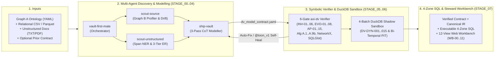

# `open-dv` — Open Neuro-Symbolic Data Vault 2.0 Modeller, Verifier & SQL Compiler (`v6.0`)

**`open-dv`** is an open-source, neuro-symbolic **Data Vault 2.0 (DV 2.0)** modelling, verification, and SQL compilation platform (`dv-firstmate` + `no-mistakes` + `axi-dv`). It transforms messy operational schemas, evolving multi-source tables, and unstructured business documents into mathematically verified **Raw Vault**, **Business Vault**, and **Information Mart** models (`Hub`, `Link`, `Satellite`, `PIT`, `Bridge`) and executable **4-Zone SQL**—without ever trusting an LLM to write raw SQL directly.

---

## Table of Contents

- [1. What is `open-dv`? (Project Overview & Architecture at a Glance)](#1-what-is-open-dv-project-overview--architecture-at-a-glance)
- [2. 5-Minute Developer Quick Start](#2-5-minute-developer-quick-start)
  - [Step 1: Prerequisites & Installation](#step-1-prerequisites--installation)
  - [Step 2: Configure Your Agent Harness (`harness_config.yaml`)](#step-2-configure-your-agent-harness-harness_configyaml)
  - [Step 3: Validate Inputs & Run the End-to-End Agentic Pipeline (`opendv pipeline`)](#step-3-validate-inputs--run-the-end-to-end-agentic-pipeline-opendv-pipeline)
  - [Step 4: Run Standalone Symbolic Verification, Compilation & DuckDB Sandbox](#step-4-run-standalone-symbolic-verification-compilation--duckdb-sandbox)
  - [Step 5: Launch the Platform API & 12-View Web Workbench](#step-5-launch-the-platform-api--12-view-web-workbench)
- [3. CLI Command Reference & Monorepo Structure](#3-cli-command-reference--monorepo-structure)
- [4. Documentation & Specification Map](#4-documentation--specification-map)
- [Appendix: Deep-Dive Technical Reference & Specifications](#appendix-deep-dive-technical-reference--specifications)
  - [A.1 8-Stage Agentic Pipeline Architecture (`STAGE_00` – `STAGE_07`)](#a1-8-stage-agentic-pipeline-architecture-stage_00--stage_07)
  - [A.2 Input Artifacts & Harness Configuration Matrix](#a2-input-artifacts--harness-configuration-matrix)
  - [A.3 Global Commerce Vault 4-Wave Progressive Sample Dataset](#a3-global-commerce-vault-4-wave-progressive-sample-dataset)
  - [A.4 Core Architecture, Mathematical Invariants & Rule Taxonomies](#a4-core-architecture-mathematical-invariants--rule-taxonomies)
  - [A.5 Full CLI & Remote Platform API Command Recipes](#a5-full-cli--remote-platform-api-command-recipes)
  - [A.6 Normative Test Suite & Coverage Matrix](#a6-normative-test-suite--coverage-matrix)

---

## 1. What is `open-dv`? (Project Overview & Architecture at a Glance)

Data Vault 2.0 delivers 100% historical auditability, decoupled parallel ingestion, and resilience to upstream schema drift by decomposing enterprise data into **Hubs** (business keys/identity), **Links** (associations and transactions), and **Satellites** (insert-only temporal attributes), joined via deterministic cryptographic hash keys (`_hk`) and change digests (`hash_diff`).

When autonomous LLM agents design or evolve Data Vault schemas without formal guardrails, five fatal traps—**Source-Driven Hub Proliferation**, **Surrogate Key Leakage**, **Silent Hash Collisions**, **Soft Rule Contamination**, and **Destructive Satellite `UPDATE`s**—can silently corrupt historical lineage.

`open-dv` prevents these failure modes through **three core pillars**:

1. **Multi-Agent Pipeline (`opendv pipeline` / `packages/opendv-agent-harness`)**
   Orchestrates four specialized agent personas—`vault-first-mate` (read-only supervisor), `scout-source` (relational Bronze statistical profiler & drift detector), `scout-unstructured` (span-grounded NER & 3-Tier entity resolver), and `ship-vault` (3-Pass Chain-of-Thought contract modeller)—across an **8-stage pipeline (`STAGE_00`–`STAGE_07`)**. Supports semantic `reasoning` / `fast` model tiers and optional fine-grained per-agent `agent_models` overrides across four production harness adapters: `agy` (`agy` CLI), `claude-cli` (`claude` CLI), `antigravity` (Google Antigravity SDK), and `claude` (Claude Agent SDK).
2. **Deterministic Symbolic Verifier & Compiler (`packages/opendv-core` + `packages/opendv-axi-verifier` + `packages/opendv-duckdb-sandbox`)**
   Agents emit **only** a declarative YAML/JSON contract ([`schemas/no-mistake-dv2-contract-v5.schema.json`](schemas/no-mistake-dv2-contract-v5.schema.json)). The symbolic **6-Gate `axi-dv` verifier** enforces **6 fundamental stability invariants (`INV-01..06`)**, **8 schema-evolution rules (`EVO-01..08`)**, **15 anti-pattern guards (`AP-01..15`)**, length-prefixed SHA-256 hashing (`Algorithm A.5`), `sqlglot` AST verification (`Algorithm A.6`), `networkx` bipartite DAG checks (`DV-STR-*` / `DV-COL-*`), and a **Gate 4 YAGNI write-amplification cost guard** ($W_{\text{amp}} \ge 50\text{ MB/day}$). Verified contracts are lowered into Canonical IR ([`schemas/dv2-canonical-ir.schema.json`](schemas/dv2-canonical-ir.schema.json)), compiled into **4-Zone DuckDB SQL**, and tested against **4 Adversarial Shadow Sandbox Batches** (`DV-DYN-001..015`) in an in-memory DuckDB instance, feeding compact `@toon_v1` error traces back to `ship-vault` for closed-loop self-healing.
3. **Steward Governance & 12-View Web Workbench (`apps/opendv-platform-api` + `apps/opendv-web-workbench`)**
   Provides a headless FastAPI REST + Server-Sent Events (SSE) backend with 5-Tier RBAC PII/MNPI redaction, Content-Addressable Store (CAS) artifact provenance, Steward Captain-Hold resolution (`Rule U1..U4` / `Tier-U3`), and an interactive **12-View Explainability & Observability Web Workbench (`WB-00`–`WB-11`)** featuring topology canvases, column lineage, hash-pill inspection, and live SSE telemetry.

### Architecture Flow at a Glance



---

## 2. 5-Minute Developer Quick Start

### Step 1: Prerequisites & Installation

Ensure you have the following installed:
- **Python `>=3.12`** and **[`uv`](https://docs.astral.sh/uv/)**
- **[`bun`](https://bun.sh/) `>=1.1`** (for the TypeScript Protocol SDK and 12-View Web Workbench)
- **At least one LLM Agent Harness** (for running `opendv pipeline run`):
  - Local logged-in **`agy` CLI** (`provider: agy`) or **`claude` CLI** (`provider: claude-cli`)
  - Or API credentials for **Google Antigravity / Gemini** (`provider: antigravity`, `$GEMINI_API_KEY` or Vertex ADC) or **Anthropic Claude** (`provider: claude`, `$ANTHROPIC_API_KEY`, AWS Bedrock, or Vertex ADC)
  - *(Note: Standalone symbolic verification, compilation, and DuckDB sandbox commands in Step 4 require zero LLM credentials.)*

Install all Python and TypeScript workspace packages from the repository root:

```bash
# Install all Python workspace libraries and CLI entrypoints (opendv, axi-dv)
uv sync --all-packages

# Install TypeScript dependencies for the Protocol SDK and Web Workbench
bun install
# (Or specifically for the workbench: bun install --cwd apps/opendv-web-workbench)
```

---

### Step 2: Configure Your Agent Harness (`harness_config.yaml`)

`open-dv` decouples its 8-stage pipeline from any single LLM vendor via [`HarnessSetupConfig`](docs/12-agentic-pipeline-inputs-and-harness-guide.md#1-agent-harness-configuration-harnesssetupconfig--harness_configyaml):
- **`provider`**: Selects the execution adapter (`agy`, `claude-cli`, `antigravity`, or `claude`).
- **`model_overrides`**: Maps the two semantic tiers—`reasoning` (`vault-first-mate` orchestration & `ship-vault` 3-Pass CoT modelling/repair) and `fast` (`scout-source` profiling & `scout-unstructured` span extraction)—to concrete model IDs.
- **`agent_models`** *(optional)*: Fine-grained per-agent model overrides (`vault-first-mate`, `scout-source`, `scout-unstructured`, `ship-vault`) that take highest precedence over `model_overrides`.

Example minimal `harness_config.yaml`:

```yaml
provider: agy # Options: agy | claude-cli | antigravity | claude

model_overrides:
  reasoning: gemini-4-argon-high # Or claude-opus-4-6 for claude / claude-cli
  fast: gemini-3.8-flash-high    # Or claude-haiku-4-5 for claude / claude-cli

# Optional per-agent overrides (precedence: agent_models[persona] -> model_overrides[tier] -> provider default):
# agent_models:
#   vault-first-mate: gemini-4-argon-high
#   scout-source: gemini-3.8-flash-high
#   scout-unstructured: gemini-3.8-flash-high
#   ship-vault: gemini-4-argon-high

auth:
  auth_mode: cli_session # Options: cli_session | api_key_env | vertex_adc | aws_bedrock | none
  require_credentials_present: false

steward_hold_policy: auto_approve_top_candidate # Options: auto_approve_top_candidate | pause | reject_on_hold
```

Ready-to-use sample configurations are included in [`examples/pipeline_samples/global_commerce_vault/`](examples/pipeline_samples/global_commerce_vault/):
- [`harness_config.yaml`](examples/pipeline_samples/global_commerce_vault/harness_config.yaml) / [`harness_config_agy.yaml`](examples/pipeline_samples/global_commerce_vault/harness_config_agy.yaml) (`provider: agy`)
- [`harness_config_claude_cli.yaml`](examples/pipeline_samples/global_commerce_vault/harness_config_claude_cli.yaml) (`provider: claude-cli`)
- [`harness_config_antigravity.yaml`](examples/pipeline_samples/global_commerce_vault/harness_config_antigravity.yaml) (`provider: antigravity`)
- [`harness_config_claude.yaml`](examples/pipeline_samples/global_commerce_vault/harness_config_claude.yaml) (`provider: claude`)

See [docs/12-agentic-pipeline-inputs-and-harness-guide.md](docs/12-agentic-pipeline-inputs-and-harness-guide.md) for the complete authentication and configuration reference.

---

### Step 3: Validate Inputs & Run the End-to-End Agentic Pipeline (`opendv pipeline`)

Use `opendv pipeline validate` to run deterministic pre-flight checks on your input specification, ontology, data sources, and harness config, then run `opendv pipeline run` to execute the 8-stage neuro-symbolic pipeline.

```bash
# 1. Pre-flight deterministic input validation (Wave 0 baseline cold-start spec)
uv run opendv pipeline validate \
  --input examples/pipeline_samples/global_commerce_vault/wave0_cold_start.yaml \
  --harness-config examples/pipeline_samples/global_commerce_vault/harness_config_agy.yaml \
  --json

# 2. Run Wave 0 (Day-1 Cold Start, N=1: CRM Customers + ERP Orders)
#    --stream (default) prints live [Wave W][STAGE 00..07] progress
#    --stream-tokens streams live LLM token deltas from the harness
uv run opendv pipeline run \
  --local \
  --stream \
  --stream-tokens \
  --role INTERNAL_MODELER \
  --input examples/pipeline_samples/global_commerce_vault/wave0_cold_start.yaml \
  --harness-config examples/pipeline_samples/global_commerce_vault/harness_config_agy.yaml \
  --output-dir /tmp/opendv-quickstart/wave0

# 3. Run Wave 1 Incremental Evolution (N=1 -> N=2: Stripe EU Billing Invoices)
#    Passes Wave 0's verified contract via --initial-contract to enforce Algorithm A.7 additive evolution locks
uv run opendv pipeline run \
  --local \
  --stream \
  --role INTERNAL_MODELER \
  --input examples/pipeline_samples/global_commerce_vault/wave1_incremental_billing.yaml \
  --initial-contract /tmp/opendv-quickstart/wave0/final_contract.yaml \
  --harness-config examples/pipeline_samples/global_commerce_vault/harness_config_agy.yaml \
  --output-dir /tmp/opendv-quickstart/wave1
```

> [!TIP]
> Pass `--no-stream` to silence stage progress, or combine `--stream --json` to stream live stage/token progress to `stderr` while keeping `stdout` pure machine-parseable JSON. You can also run all 4 sample waves (`wave0`..`wave3`) in a single regression command using `--input examples/pipeline_samples/global_commerce_vault/pipeline_input.yaml`.

**Inspecting Generated Artifacts:**
Each pipeline run seals its verified outputs and per-wave intermediate artifacts into `--output-dir`:
- `final_contract.yaml` (and per-wave `waves/wave_<w>/wave_<w>_contract_verified.yaml`) — Verified `NoMistakeDataVault2ContractV5` model contract (`dv_model_contract.yaml` schema).
- `final_canonical_ir.json` — Lowered Canonical Intermediate Representation (`CanonicalIR`).
- `final_four_zone.sql` (and `waves/wave_<w>/wave_<w>_four_zone.sql`) — Generated 4-Zone DuckDB SQL DDL/DML + bi-temporal PIT queries (`generated_4zone.sql` deliverable).
- `pipeline_report.json` & `pipeline_report.md` — Full `AgenticPipelineReport` run report (`pipeline_run_report.json` telemetry, gate verdicts, token/cost metrics, and CAS SHA-256 digests).
- `vault-ledger.jsonl` — Append-only `VaultObservabilityEvent` stream for the Web Workbench.

```bash
# Inspect the RBAC-redacted pipeline run report via CLI
uv run opendv pipeline report \
  --local \
  --role INTERNAL_MODELER \
  --report-path /tmp/opendv-quickstart/wave1/pipeline_report.json \
  --json
```

---

### Step 4: Run Standalone Symbolic Verification, Compilation & DuckDB Sandbox

You can run the deterministic 6-Gate `axi-dv` verifier, 4-Zone SQL compiler, and 4-Batch Adversarial DuckDB Shadow Sandbox standalone (in-process via `--local`, with zero LLM calls) against the included Private Equity reference package in [`examples/private_equity/`](examples/private_equity/):

```bash
# 1. Verify a Data Vault 2.0 contract through Gates 0–5 (add --toon for compact @toon_v1 trace output)
uv run opendv verify --local \
  --contract examples/private_equity/dv_pe_model_contract.yaml \
  --graph-a examples/private_equity/pe_graph_a_ontology.yaml \
  --graph-b examples/private_equity/pe_graph_b_profile.json

# 2. Compile a verified contract into Canonical IR & 4-Zone DuckDB SQL
uv run opendv compile --local \
  --contract examples/private_equity/dv_pe_model_contract.yaml \
  --canonical-ir examples/private_equity/pe_canonical_ir.json

# 3. Execute the 4-Batch Adversarial DuckDB Shadow Sandbox (DV-DYN-001..015) & Query D.10 PIT audit
uv run opendv sandbox --local \
  --contract examples/private_equity/dv_pe_model_contract.yaml \
  --canonical-ir examples/private_equity/pe_canonical_ir.json \
  --query-type ADVERSARIAL_BATCHES_1_TO_4 \
  --cutoff "2026-11-15 23:59:59"
```

---

### Step 5: Launch the Platform API & 12-View Web Workbench

Start the headless FastAPI backend (`:8420`) and the React 19 + Bun 12-View Explainability & Observability Web Workbench (`:5173`):

```bash
# Terminal 1: Start the Headless Platform REST + SSE API Server on http://127.0.0.1:8420
uv run --package opendv-platform-api uvicorn opendv_platform_api.main:app --reload --port 8420
# (Or with moonrepo: moon run opendv-platform-api:dev)

# Terminal 2: Start the 12-View Web Workbench on http://127.0.0.1:5173
bun run --cwd apps/opendv-web-workbench dev
# (Or with moonrepo: moon run opendv-web-workbench:dev)
```

- **Web Workbench UI (`WB-00`–`WB-11`):** [http://127.0.0.1:5173](http://127.0.0.1:5173) (automatically proxies `/api/*` to `http://127.0.0.1:8420`)
- **OpenAPI Swagger UI:** [http://127.0.0.1:8420/docs](http://127.0.0.1:8420/docs)
- **Health Check:** [http://127.0.0.1:8420/api/v1/health](http://127.0.0.1:8420/api/v1/health)

---

## 3. CLI Command Reference & Monorepo Structure

### Core `opendv` / `axi-dv` CLI Commands

Both `opendv` and `axi-dv` share the same unified parser ([`apps/opendv-cli/src/opendv_cli/main.py`](apps/opendv-cli/src/opendv_cli/main.py)) and support `--local` (direct library execution), `--api-url <url>` (remote Platform API execution), `--role <RBAC_ROLE>`, and `--json`:

| Command | Purpose & Key Flags |
| :--- | :--- |
| `opendv pipeline validate` | Pre-flight deterministic validation of `--input <pipeline_input.yaml>`, `--initial-contract <prev_contract.yaml>`, `--harness-config <harness_config.yaml>`, Graph A ontology, CSV/Parquet sources, and unstructured span bounds. |
| `opendv pipeline run` | Executes the 8-stage neuro-symbolic pipeline (`STAGE_00`–`STAGE_07`). Supports `--input`, `--initial-contract`, `--harness-config`, `--output-dir`, `--provider`, `--hold-policy`, `--stream` / `--no-stream`, and `--stream-tokens`. |
| `opendv pipeline report` *(sample-info / run inspection)* | Inspects a completed `AgenticPipelineReport` (`pipeline_report.json`) locally via `--report-path` or remotely via `--run-id`, applying 5-Tier RBAC redaction (`--role`). |
| `opendv verify` / `axi-dv verify` | Runs the 6-Gate `axi-dv` symbolic verification pipeline (`Gates 0–5`) on `--contract`, `--graph-a`, and `--graph-b`. Supports `--toon` for token-dense `@toon_v1` diagnostic traces. |
| `opendv profile` | Profiles raw Bronze CSV/Parquet sources (`--source-csv`, `--source-system`, `--table-name`) via `GraphBProfiler` or inspects an existing `--graph-b` JSON profile. |
| `opendv compile` | Lowers a verified `--contract` into `--canonical-ir` (`CanonicalIR`) and compiles deterministic 4-Zone DuckDB SQL (`Zones 0–4`). |
| `opendv sandbox` | Executes the 4-Batch Adversarial DuckDB Shadow Sandbox (`--query-type ADVERSARIAL_BATCHES_1_TO_4`) and bi-temporal PIT queries (`QUERY_D10_PIT`, `QUERY_D10B_VALUATION`) at `--cutoff <timestamp>`. |
| `opendv run [list\|get\|create\|abort\|events]` | Manages verification runs and streams real-time W3C Server-Sent Events (`events --last-event-id <id>`). |
| `opendv hold [list\|approve\|reject\|answer\|resolve]` | Lists or resolves Steward Captain-Holds (`Tier-U3` ambiguous entity resolution or `Gate 3/4` holds) via `--hold-id`, `--candidate`, and `--notes`. |

### Monorepo Directory Layout

```text
open-dv/
├── packages/
│   ├── opendv-core/            # Pydantic v2 contracts, Canonical IR, ELM calculus & Alg A.5 SHA-256 hashing
│   ├── opendv-telemetry/       # JSONL ledger emitter, CAS store, 5-tier RBAC redactor, PII detector & Hash Pills
│   ├── opendv-axi-verifier/    # 6-Gate axi-dv orchestrator (Alg A.8), AST codemods (A.1..A.9b) & @toon_v1 codec
│   ├── opendv-duckdb-sandbox/  # GraphBProfiler, IR lowerer, 4-Zone SQL compiler & 4-Batch DuckDB Shadow Sandbox
│   ├── opendv-agent-harness/   # 8-stage AgenticVaultPipeline, 4 personas, 8 tools & agy/claude/CLI/SDK adapters
│   └── opendv-protocol-ts/     # Zero-dependency TypeScript SDK (@opendv/protocol-ts), SSE client & Web Crypto Hash Pills
├── apps/
│   ├── opendv-cli/             # Unified `opendv` & `axi-dv` CLI (--local & --api-url modes)
│   ├── opendv-platform-api/    # FastAPI REST + SSE headless platform server (:8420) & OpenAPI 3.1 exporter
│   └── opendv-web-workbench/   # 12-View Explainability & Observability React 19 + Bun Web Workbench (:5173)
├── examples/
│   ├── dv_model_contract.yaml  # Annotated single-Hub multi-source Data Vault 2.0 contract example
│   ├── private_equity/         # Complete Private Equity reference bundle (Contract, Canonical IR, Graph A, Graph B)
│   └── pipeline_samples/
│       └── global_commerce_vault/ # 4-wave progressive commerce dataset, per-wave specs & harness_config*.yaml
├── schemas/                    # Normative JSON Schemas (Draft 2020-12) & OpenAPI 3.1.0 specification
├── docs/                       # Architecture & engineering specifications (01..13, DV2_AGENT_REFERENCE_GUIDE.md)
└── tests/                      # Normative end-to-end pytest specification suite (+ per-package tests)
```

---

## 4. Documentation & Specification Map

| Document / Schema | Path | When to Read This |
| :--- | :--- | :--- |
| **Master Agent Reference Guide (`v6.0`)** | [`docs/DV2_AGENT_REFERENCE_GUIDE.md`](docs/DV2_AGENT_REFERENCE_GUIDE.md) | **Start here for a single-file technical overview** of DV 2.0 layers, DDL/DML templates, 6-stage hashing, the 5 Fatal Traps, `dv-firstmate`, and the 6-Gate `axi-dv` pipeline. |
| **Complete HTML Design & Implementation Guide** | [`docs/references/No-Mistake-Agentic-Data-Vault-2.0-Complete-Design-and-Implementation-Guide.html`](docs/references/No-Mistake-Agentic-Data-Vault-2.0-Complete-Design-and-Implementation-Guide.html) | Read when you want the standalone visual HTML edition with full mathematical proofs, callouts, schemas, and reference algorithms. |
| **01 — Core Modelling Specification** | [`docs/01-core-modelling-spec.md`](docs/01-core-modelling-spec.md) | Read when designing Hubs, Links (`lnk_`, `t_lnk_`, `sal_`, `hal_`, `x_lnk_`), Satellites (`sat_`, `mas_`, `esat_`, `sts_`, `rts_`, `ref_`), PIT/Bridge tables, Zero Keys, Ghost Records, or SQLGlot AST rules. |
| **02 — Schema Stability, Cold-Start ($N=1$) & Evolution** | [`docs/02-schema-stability-and-evolution.md`](docs/02-schema-stability-and-evolution.md) | Read to understand invariants `INV-01..06`, drift playbooks `EVO-01..08`, key rules `KEY-01..05`, bi-temporal rules `TMP-01..04`, anti-patterns `AP-01..15`, 3-Tier `BKCC` Authority, and Gate 4 YAGNI cost guards. |
| **03 — 6-Gate Verification & `dv-firstmate` Architecture** | [`docs/03-verification-and-agentic-architecture.md`](docs/03-verification-and-agentic-architecture.md) | Read for the bipartite graph formulation, static rules (`DV-STR-*`, `DV-COL-*`, `DV-EVO-*`), runtime checks (`DV-DYN-001..015`), the 4 Adversarial Sandbox Batches, and agent swarm roles. |
| **04 — Unstructured & Multi-Modal DV 2.0** | [`docs/04-unstructured-and-multimodal-dv2.md`](docs/04-unstructured-and-multimodal-dv2.md) | Read when onboarding PDFs/text/audio using `Rules U1–U4`, `hub_document`, `mas_document_<cbc>_extraction`, 3-Tier Entity Resolution (`Tier-U1..U3`), and `Algorithm A.9b`. |
| **05 — ELM Calculus, 3-Pass CoT & Reference Algorithms** | [`docs/05-elm-calculus-and-reference-algorithms.md`](docs/05-elm-calculus-and-reference-algorithms.md) | Read for the formal Graph B equations ($U(C), H(C), N_{\text{null}}(C), I(A.x \subseteq B.y), \lambda(c), W_{\text{amp}}$), 3-Pass CoT prompts, and Python/SQL implementations of **Algorithms `A.1`–`A.9` + `D.10`**. |
| **06 — Explainability, Observability & Visualization (`WB-00..WB-11`)** | [`docs/06-explainability-and-observability-spec.md`](docs/06-explainability-and-observability-spec.md) | Read when working with `VaultObservabilityEvent` telemetry (`state/vault-ledger.jsonl`), 3-Layer Progressive Disclosure, Semantic Hash Pills, or the 12 Workbench Views (`WB-00`–`WB-11`). |
| **07 — End-to-End Private Equity Modelling & Verification Demo** | [`docs/07-end-to-end-private-equity-demo.md`](docs/07-end-to-end-private-equity-demo.md) | Read for a self-contained 7-Scene walkthrough (*Apex Horizon Capital*) tracing multi-source onboarding, PDF side-letter extraction, TOON self-healing, schema drift, and 4-Zone SQL execution. |
| **08 — Platform MVP Monorepo & Headless API Spec** | [`docs/08-platform-mvp-monorepo-and-api-spec.md`](docs/08-platform-mvp-monorepo-and-api-spec.md) | Read when modifying the polyglot monorepo (`proto` + `moon` + `uv` + `bun`), 5-Tier RBAC redaction, Content-Addressable Store (CAS), or `/api/v1/*` REST + SSE endpoints. |
| **09 — Agnostic Agent Harness & Dual-SDK Adapter Spec** | [`docs/09-agnostic-agent-harness-and-sdk-spec.md`](docs/09-agnostic-agent-harness-and-sdk-spec.md) | Read when extending `VaultAgentHarness`, `ModelTier` / `agent_models` routing, domain tools, or the `agy`, `claude-cli`, `antigravity`, and `claude` adapters. |
| **10 — Decoupled UI Workbench, Protocol SDK & Theme Engine** | [`docs/10-decoupled-ui-workbench-and-theme-spec.md`](docs/10-decoupled-ui-workbench-and-theme-spec.md) | Read when developing frontend views in `apps/opendv-web-workbench`, the `@opendv/protocol-ts` SDK, or the CSS Custom Properties Theme Engine. |
| **11 — Master Agent Worker Implementation & Dispatch Plan** | [`docs/11-agent-worker-implementation-plan.md`](docs/11-agent-worker-implementation-plan.md) | Read for the dependency-ordered Work Breakdown Structure (`WP-01`–`WP-12`), package ownership boundaries, and verification commands. |
| **12 — Agentic Pipeline Inputs, Harness Config & Auth Reference** | [`docs/12-agentic-pipeline-inputs-and-harness-guide.md`](docs/12-agentic-pipeline-inputs-and-harness-guide.md) | **Read when configuring `harness_config.yaml` or `pipeline_input.yaml`**, setting up API keys / Vertex ADC / AWS Bedrock / CLI sessions, or running incremental `--initial-contract` waves. |
| **13 — Real Agentic Pipeline Remediation Specification** | [`docs/13-real-agentic-pipeline-remediation-spec.md`](docs/13-real-agentic-pipeline-remediation-spec.md) | Read for the engineering specification of discovery-first agentic execution, real neuro-symbolic domain tool wiring, fail-closed harness adapters, and dynamic 4-Batch DuckDB sandbox verification. |
| **No-Mistake DV 2.0 Contract V5 JSON Schema** | [`schemas/no-mistake-dv2-contract-v5.schema.json`](schemas/no-mistake-dv2-contract-v5.schema.json) | Draft 2020-12 JSON Schema for `NoMistakeDataVault2ContractV5` (`column_triage_ledger`, `hubs`, `links`, `satellites`, `reference_tables`, `unmapped_escalations`). |
| **Canonical IR JSON Schema** | [`schemas/dv2-canonical-ir.schema.json`](schemas/dv2-canonical-ir.schema.json) | Draft 2020-12 JSON Schema for the low-level `CanonicalIR` contract between semantic modelling agents and the deterministic 4-Zone SQL compiler. |
| **Observability Telemetry Event JSON Schema** | [`schemas/vault-observability-event.schema.json`](schemas/vault-observability-event.schema.json) | Draft 2020-12 JSON Schema for `VaultObservabilityEvent` records emitted over `state/vault-ledger.jsonl`. |
| **Headless Platform OpenAPI 3.1.0 Schema** | [`schemas/openapi-v1.json`](schemas/openapi-v1.json) | Deterministic OpenAPI 3.1.0 specification for all `/api/v1` REST and SSE endpoints (`moon run opendv-platform-api:export-openapi`). |

---
---

## Appendix: Deep-Dive Technical Reference & Specifications

This appendix retains the complete architectural matrices, mathematical invariants, multi-wave dataset specifications, CLI/API recipes, and test inventories for `open-dv` (`v6.0` Unified Edition: `dv-firstmate` + `no-mistakes` + `axi-dv`).

---

### A.1 8-Stage Agentic Pipeline Architecture (`STAGE_00` – `STAGE_07`)

> **Normative References:** [`docs/08-platform-mvp-monorepo-and-api-spec.md`](docs/08-platform-mvp-monorepo-and-api-spec.md), [`docs/09-agnostic-agent-harness-and-sdk-spec.md`](docs/09-agnostic-agent-harness-and-sdk-spec.md), [`docs/12-agentic-pipeline-inputs-and-harness-guide.md`](docs/12-agentic-pipeline-inputs-and-harness-guide.md), and [`docs/13-real-agentic-pipeline-remediation-spec.md`](docs/13-real-agentic-pipeline-remediation-spec.md).

`open-dv` implements a deterministic, closed-loop multi-agent Data Vault 2.0 pipeline modeled after `firstmate` and `no-mistakes`. Neither the CLI (`opendv`) nor the Platform API/Web Workbench hardcode sample file paths—every invocation accepts explicit input specifications and agent harness configurations and enforces deterministic pre-flight and post-flight validation.

#### 8-Stage Pipeline Lifecycle (`STAGE_00` through `STAGE_07`)

Each wave in a pipeline run executes the 8 canonical stages across Cold Start ($N=1$) and Incremental Evolution Waves ($N \to N+1$ multi-source onboarding, $S_k(t) \to S_k(t+1)$ intra-source schema drift, and multimodal unstructured document grounding):

| Stage ID | Active Persona | Semantic Model Tier | Responsibility & Deterministic Artifacts |
| :--- | :--- | :---: | :--- |
| `STAGE_00_ORCHESTRATION` | `@vault-first-mate` | `reasoning` (`ModelTier.HIGH_REASONING`) | Validates `GraphAOntology` (`Graph A`), initializes the wave worktree/state context, and plans wave execution. |
| `STAGE_01_SCOUT_SOURCE` | `@scout-source` | `fast` (`ModelTier.FAST_TIER`) | Profiles relational CSV/Parquet sources via `GraphBProfiler` ($U(C), H(C), N_{\text{null}}(C), I(A.x \subseteq B.y), \lambda(c)$) and runs `Algorithm A.9a` intra-source schema drift detection ($S_k(t) \to S_k(t+1)$). |
| `STAGE_02_SCOUT_UNSTRUCTURED` | `@scout-unstructured` | `fast` (`ModelTier.FAST_TIER`) | Grounds unstructured text/PDF spans (`[char_start, char_end]`), executes 3-Tier Entity Resolution (`Tier-U1..U3`), and enforces `Algorithm A.9b` (`hub_document`, `lnk_document_<cbc>`, `mas_document_<cbc>_extraction`). |
| `STAGE_03_SHIP_VAULT_PASS1` | `@ship-vault` | `reasoning` (`ModelTier.HIGH_REASONING`) | Executes Pass 1 Exhaustive 100% Column Triage (`BUSINESS_KEY`, `FOREIGN_KEY_REF`, `DESCRIPTIVE_PAYLOAD`, `SYSTEM_SURROGATE_DROPPED`). |
| `STAGE_04_SHIP_VAULT_PASS2` | `@ship-vault` | `reasoning` (`ModelTier.HIGH_REASONING`) | Synthesizes Pass 2/3 Ensemble Logical Model (ELM) topology (`Hubs`, `Links`, `Same-As Links`, `Satellites`, `PII Satellites`) with 3-Tier `BKCC` collision shields and `Algorithm A.7` additive evolution locks. |
| `STAGE_05_AXI_DV_STATIC_GATES` | `@axi-dv` (+ `@ship-vault` on repair) | `fast` (`reasoning` on `@toon_v1` repair) | Runs Gates 0–4 (`gate1_contract_grain`, `Algorithm A.5/A.6` SQLGlot AST, `gate3_networkx_dag` bipartite topology, `Algorithm A.1` Gate 4 YAGNI cost guard) with closed-loop `@toon_v1` self-healing (`k=1 -> k=2`). |
| `STAGE_06_AXI_DV_DYNAMIC_SANDBOX` | `@axi-dv` | `fast` (`ModelTier.FAST_TIER`) | Executes Gate 5 in an ephemeral `:memory:` DuckDB Shadow Sandbox across all 4 Adversarial Batches and 15 runtime checks (`DV-DYN-001`–`015`). |
| `STAGE_07_DETERMINISTIC_COMPILER` | `@deterministic-compiler` | `fast` (`ModelTier.FAST_TIER`) | Lowers verified `NoMistakeDataVault2ContractV5` to `CanonicalIR`, compiles 4-Zone DuckDB SQL (`Zones 0–4`), executes bi-temporal `Query D.10` / `D.10b`, and seals all artifacts into the Content-Addressable Store (CAS). |

#### `dv-firstmate` + `axi-dv` 6-Gate Neuro-Symbolic Topology


---

### A.2 Input Artifacts & Harness Configuration Matrix

> **Normative Reference:** [`docs/12-agentic-pipeline-inputs-and-harness-guide.md`](docs/12-agentic-pipeline-inputs-and-harness-guide.md) (§1–§5).

#### 1. Input Artifacts (`PipelineInputSpec` — `pipeline_input.yaml` & Per-Wave Specs)

The pipeline accepts a declarative [`pipeline_input.yaml`](examples/pipeline_samples/global_commerce_vault/pipeline_input.yaml) (or standalone per-wave specs [`wave0_cold_start.yaml`](examples/pipeline_samples/global_commerce_vault/wave0_cold_start.yaml), [`wave1_incremental_billing.yaml`](examples/pipeline_samples/global_commerce_vault/wave1_incremental_billing.yaml), [`wave2_schema_drift.yaml`](examples/pipeline_samples/global_commerce_vault/wave2_schema_drift.yaml), [`wave3_unstructured_msa.yaml`](examples/pipeline_samples/global_commerce_vault/wave3_unstructured_msa.yaml)) validated by `PipelineInputSpec`:

| Input Artifact / Field | Schema / Model | Role & Validation Rules |
| :--- | :--- | :--- |
| **Pipeline Input Spec (`pipeline_input.yaml` / `wave*.yaml`)** | `PipelineInputSpec` (`PipelineWaveInput`, `PipelineSourceFeedInput`, `PipelineUnstructuredDocInput`) | Declares `pipeline_id`, `project_id`, `run_id`, `display_name`, `domain_namespace`, `graph_a_ontology_path`, optional `initial_contract_path`, `assertion_cutoff_ts`, `output_dir`, and `waves[]` (`sources[]` and `unstructured_documents[]`). |
| **Enterprise Ontology (`Graph A`)** | `GraphAOntology` (e.g., [`commerce_graph_a_ontology.yaml`](examples/pipeline_samples/global_commerce_vault/ontology/commerce_graph_a_ontology.yaml), [`pe_graph_a_ontology.yaml`](examples/private_equity/pe_graph_a_ontology.yaml)) | Defines Core Business Concepts (CBCs), 3-Tier Business Key Authority (`TIER_1_GLOBAL_STANDARD`, `TIER_2_ENTERPRISE_SOR`, `TIER_3_LOCAL_SCOPED`), canonical relationships, and governance rules. |
| **Relational Source Feeds (`waves[].sources[]`)** | CSV / Parquet / JSON files | Verified during pre-flight (`validate_pipeline_inputs`) for path containment, file existence, non-empty row count, and column header completeness; profiled into `GraphBProfile` (`Graph B`). |
| **Unstructured Documents (`waves[].unstructured_documents[]`)** | Markdown / TXT / PDF text files | Verified for file existence and strict character-offset span bounds (`0 <= char_start < char_end <= len(text)`) matching `verbatim_quote` under `Rules U1–U4` and `Algorithm A.9b`. |
| **Prior Verified Contract (`--initial-contract` / `initial_contract_path`)** | `NoMistakeDataVault2ContractV5` (`final_contract.yaml`) | Seeds incremental $N \to N+1$ and $S_k(t) \to S_k(t+1)$ waves so `Algorithm A.7` enforces additive-only evolution locks (`DV-EVO-001`–`007`) against previously deployed Hubs, Links, and Satellites. |

#### 2. Harness Provider & Authentication Matrix (`HarnessSetupConfig` & `HarnessAuthConfig`)

The pipeline accepts a harness configuration file ([`harness_config.yaml`](examples/pipeline_samples/global_commerce_vault/harness_config.yaml), [`harness_config_agy.yaml`](examples/pipeline_samples/global_commerce_vault/harness_config_agy.yaml), [`harness_config_antigravity.yaml`](examples/pipeline_samples/global_commerce_vault/harness_config_antigravity.yaml), [`harness_config_claude.yaml`](examples/pipeline_samples/global_commerce_vault/harness_config_claude.yaml), or [`harness_config_claude_cli.yaml`](examples/pipeline_samples/global_commerce_vault/harness_config_claude_cli.yaml)) validated by `HarnessSetupConfig`:

| Provider Value (`provider`) | Concrete Adapter Class | Underlying Runtime / SDK | Supported `auth_mode` / `mode` Values & Environment Variables | Default `model_overrides` (`reasoning` / `fast`) |
| :--- | :--- | :--- | :--- | :--- |
| **`"agy"` / `"agy-cli"`** | `AgyCliHarnessAdapter` | Local logged-in Antigravity Coding CLI (`agy -p --output-format stream-json --json-schema <path>`) | `cli_session` / `ambient_cli` (`~/.gemini` session; checks `agy` on `PATH` or `$OPENDV_AGY_CLI_BIN`). Rejects `aws_bedrock` (`HARNESS_AUTH_INCOMPATIBLE`). | `reasoning: gemini-4-argon-high`<br>`fast: gemini-3.8-flash-high` |
| **`"claude-cli"` / `"claude-code"`** | `ClaudeCliHarnessAdapter` | Local logged-in Claude Code CLI (`claude -p --model <id> --output-format stream-json --json-schema <schema> --agents <json>`) | `cli_session` / `ambient_cli` / `oauth_token` / `foundry` / `auto` (`~/.claude` session; checks `claude` on `PATH` or `$OPENDV_CLAUDE_CLI_BIN`), `api_key_env` (`$ANTHROPIC_API_KEY`), `vertex_adc` (`CLAUDE_CODE_USE_VERTEX=1`, `$ANTHROPIC_VERTEX_PROJECT_ID`, `$CLOUD_ML_REGION`), `aws_bedrock` (`CLAUDE_CODE_USE_BEDROCK=1`, `$AWS_REGION`, `$AWS_PROFILE`). | `reasoning: claude-opus-4-6`<br>`fast: claude-haiku-4-5` |
| **`"antigravity"`** | `AntigravityHarnessAdapter` | Google Antigravity Python SDK (`google.antigravity`) or Gemini REST fallback | `api_key_env` (`$GEMINI_API_KEY` / `$GOOGLE_API_KEY`, optional `$GOOGLE_GEMINI_BASE_URL`), `vertex_adc` (`GOOGLE_GENAI_USE_VERTEXAI=true`, `$GOOGLE_CLOUD_PROJECT`, `$GOOGLE_CLOUD_LOCATION`, `$GOOGLE_APPLICATION_CREDENTIALS`), `cli_session`. Rejects `aws_bedrock` (`HARNESS_AUTH_INCOMPATIBLE`). | `reasoning: gemini-4-argon-high`<br>`fast: gemini-3.8-flash-high` |
| **`"claude"`** | `ClaudeAgentHarnessAdapter` | Anthropic Claude Agent SDK (`claude_agent_sdk`) or Anthropic Messages REST fallback | `api_key_env` (`$ANTHROPIC_API_KEY`, optional `$ANTHROPIC_BASE_URL`), `aws_bedrock` (`CLAUDE_CODE_USE_BEDROCK=1`, `$AWS_REGION` / `$AWS_DEFAULT_REGION`, `$AWS_PROFILE`), `vertex_adc` (`CLAUDE_CODE_USE_VERTEX=1`, `$ANTHROPIC_VERTEX_PROJECT_ID`, `$CLOUD_ML_REGION`, `$GOOGLE_APPLICATION_CREDENTIALS`), `cli_session`. | `reasoning: claude-opus-4-6` (SDK fallback `claude-opus-5-5-high`)<br>`fast: claude-haiku-4-5` (SDK fallback `claude-sonnet-5-5-medium`) |

- **3-Level Model Resolution Precedence:** `agent_models[persona]` (`vault-first-mate`, `scout-source`, `scout-unstructured`, `ship-vault`) $\to$ `model_overrides[tier]` (`reasoning`, `fast`) $\to$ provider default map (`DEFAULT_AGY_MODEL_MAP` / `DEFAULT_CLAUDE_MODEL_MAP`). Legacy `model_overrides` keys (`argon`, `flash`) are rejected (`HARNESS_SETUP_INVALID`).
- **Live Stage Progress & Token Streaming (`on_stage_start`, `on_stage_complete`, `on_stream_event`, `--stream`, `--stream-tokens`):** `AgenticVaultPipeline` emits real-time stage lifecycle callbacks (`STAGE_00`–`STAGE_07`) and incremental `HarnessEventKind.TEXT_DELTA` / `THOUGHT_DELTA` stream events. When `--json` or `--toon` is set, live progress writes to `stderr` so `stdout` remains pure machine-parseable JSON/TOON.
- **Deterministic Pre-Flight (`validate_pipeline_inputs`) & Post-Flight (`validate_pipeline_outputs`) Validation:**
  - *Pre-Flight:* Verifies path containment, file existence, provider/auth compatibility (`HARNESS_AUTH_INVALID`, `HARNESS_AUTH_INCOMPATIBLE`, `HARNESS_AUTH_MISSING`, `HARNESS_PROVIDER_UNAVAILABLE`), `GraphAOntology` schema compliance, relational source headers, and unstructured character span bounds. (`DeterministicHarnessAdapter` is reserved strictly for internal `pytest` unit/integration mocking and is rejected by the CLI and REST API.)
  - *Post-Flight:* Validates every synthesized `NoMistakeDataVault2ContractV5`, `CanonicalIR`, `GraphBProfile`, and `VaultObservabilityEvent` against Draft 2020-12 JSON Schemas, enforces 5-tier RBAC `validate_no_pii_leaks` (zero unredacted `RESTRICTED_PII`, `MNPI`, or raw 64-hex digests), and checks Content-Addressable Store (CAS) SHA-256 integrity for all artifacts in `AgenticPipelineReport` (`pipeline_report.json`, `pipeline_report.md`, `final_contract.yaml`, `final_canonical_ir.json`, `final_four_zone.sql`, `vault-ledger.jsonl`, and `waves/wave_<w>/*`).

---

### A.3 Global Commerce Vault 4-Wave Progressive Sample Dataset

> **Normative References:** [`examples/pipeline_samples/global_commerce_vault/`](examples/pipeline_samples/global_commerce_vault/) and [`docs/12-agentic-pipeline-inputs-and-harness-guide.md`](docs/12-agentic-pipeline-inputs-and-harness-guide.md) (§2–§3).

In an enterprise Data Vault 2.0 platform, Day-1 Cold Start ($N=1$), new source system onboarding ($N \to N+1$), upstream operational schema drift ($S_k(t) \to S_k(t+1)$), and unstructured contract/document ingestion arrive asynchronously over time as **separate operational releases**. Accordingly, [`examples/pipeline_samples/global_commerce_vault/`](examples/pipeline_samples/global_commerce_vault/) provides both **4 standalone per-wave specs** (`wave0_cold_start.yaml` .. `wave3_unstructured_msa.yaml`) for subsequent CLI calls using `--initial-contract`, and a **combined 4-wave spec** ([`pipeline_input.yaml`](examples/pipeline_samples/global_commerce_vault/pipeline_input.yaml)) for single-command CI regression testing, backed by **4 relational CSV datasets** (`crm_customers.csv`, `erp_orders.csv`, `stripe_invoices.csv`, `crm_customers_v2.csv`), the enterprise ontology ([`ontology/commerce_graph_a_ontology.yaml`](examples/pipeline_samples/global_commerce_vault/ontology/commerce_graph_a_ontology.yaml)), and unstructured contract documents ([`sources/wave3_unstructured_msa/enterprise_msa_addendum_2026.txt`](examples/pipeline_samples/global_commerce_vault/sources/wave3_unstructured_msa/enterprise_msa_addendum_2026.txt) alongside the 3 Private Equity unstructured Markdown/PDF reference narratives in [`docs/07-end-to-end-private-equity-demo.md`](docs/07-end-to-end-private-equity-demo.md)).

| Wave Index & Name | Per-Wave Input Spec & `--initial-contract` Reference | Input Data Sources | Architectural & Verification Scenarios Exercised |
| :--- | :--- | :--- | :--- |
| **Wave 0 (`Wave 1` of 4):** `COLD_START` | [`wave0_cold_start.yaml`](examples/pipeline_samples/global_commerce_vault/wave0_cold_start.yaml)<br>*(No `--initial-contract`; produces `wave0/final_contract.yaml`)* | `sources/wave0_cold_start/crm_customers.csv`<br>`sources/wave0_cold_start/erp_orders.csv` | **Cold Start ($N=1$, `COLD_START_N1`):** Quarantines and drops system surrogate key (`customer_row_seq`), isolates `RESTRICTED_PII` (`contact_email`, `tax_ssn_tin`) into a dedicated PII satellite (`Algorithm A.1`), and splits sparse optional promo foreign key (`promo_campaign_code`, $U_{nn} < 0.95$) into a dedicated link (`Algorithm A.4`). Produces 3 Hubs, 2 Links, and 4 Satellites. |
| **Wave 1 (`Wave 2` of 4):** `INCREMENTAL_SOURCE` | [`wave1_incremental_billing.yaml`](examples/pipeline_samples/global_commerce_vault/wave1_incremental_billing.yaml)<br>`--initial-contract <wave0_out>/final_contract.yaml` | `sources/wave1_incremental_billing/stripe_invoices.csv` | **Incremental Source Onboarding ($N=1 \to N=2$, `MULTI_SOURCE_EXPANSION`):** Onboards regional Stripe EU billing invoices using `TIER_3_LOCAL_SCOPED` `BKCC` namespace `STRIPE_EU` on `hub_customer`, adds `lnk_customer_sales_order` and `sat_customer_core` billing state, and enforces `Algorithm A.7` additive evolution locks (`zero` destructive mutations to Wave 0 Hubs/Links/Satellites). |
| **Wave 2 (`Wave 3` of 4):** `SCHEMA_DRIFT` | [`wave2_schema_drift.yaml`](examples/pipeline_samples/global_commerce_vault/wave2_schema_drift.yaml)<br>`--initial-contract <wave1_out>/final_contract.yaml` | `sources/wave2_schema_drift/crm_customers_v2.csv`<br>*(baseline: `sources/wave0_cold_start/crm_customers.csv`)* | **Intra-Source Schema Drift ($S_1(t) \to S_1(t+1)$, `MULTI_SOURCE_EXPANSION`):** Detects additive columns (`loyalty_tier_code`, `annual_spend_band`) against the deployed contract and `baseline_data_path` via `Algorithm A.9a` and spawns additive companion satellite `sat_customer_core_ext_v2` without mutating `sat_customer_core` or historical `hash_diff` digests. |
| **Wave 3 (`Wave 4` of 4):** `UNSTRUCTURED_ONBOARDING` | [`wave3_unstructured_msa.yaml`](examples/pipeline_samples/global_commerce_vault/wave3_unstructured_msa.yaml)<br>`--initial-contract <wave2_out>/final_contract.yaml` | `sources/wave3_unstructured_msa/enterprise_msa_addendum_2026.txt` | **Multimodal Unstructured Grounding (`Rules U1–U4`, `MULTI_SOURCE_EXPANSION`):** Verifies verbatim `[char_start, char_end]` character spans via `Algorithm A.9b`, routes `Tier-U1` (`0.98`, `ext_msa_counterparty_u1`) and `Tier-U3` (`0.68`, `STEWARD_HOLD` resolution for `ext_msa_guarantor_u3`) entity candidates against existing `hub_customer`, and adds `hub_document`, `lnk_document_customer`, `sat_document_customer_ai_provenance`, and `mas_document_extractions`. |

#### Production Multi-Call Incremental Evolution Commands (`--initial-contract`)

```bash
# CLI Call 1 (Wave 0 — Day-1 Cold Start, N=1):
uv run opendv pipeline run \
  --local \
  --role INTERNAL_MODELER \
  --input examples/pipeline_samples/global_commerce_vault/wave0_cold_start.yaml \
  --harness-config examples/pipeline_samples/global_commerce_vault/harness_config_agy.yaml \
  --output-dir /tmp/opendv-commerce/wave0 \
  --json

# CLI Call 2 (Wave 1 — Incremental Source Onboarding, N=1 -> N=2):
uv run opendv pipeline run \
  --local \
  --role INTERNAL_MODELER \
  --input examples/pipeline_samples/global_commerce_vault/wave1_incremental_billing.yaml \
  --initial-contract /tmp/opendv-commerce/wave0/final_contract.yaml \
  --harness-config examples/pipeline_samples/global_commerce_vault/harness_config_agy.yaml \
  --output-dir /tmp/opendv-commerce/wave1 \
  --json

# CLI Call 3 (Wave 2 — Intra-Source Schema Drift, S_1(t) -> S_1(t+1)):
uv run opendv pipeline run \
  --local \
  --role INTERNAL_MODELER \
  --input examples/pipeline_samples/global_commerce_vault/wave2_schema_drift.yaml \
  --initial-contract /tmp/opendv-commerce/wave1/final_contract.yaml \
  --harness-config examples/pipeline_samples/global_commerce_vault/harness_config_agy.yaml \
  --output-dir /tmp/opendv-commerce/wave2 \
  --json

# CLI Call 4 (Wave 3 — Unstructured Document Onboarding, Rules U1-U4):
uv run opendv pipeline run \
  --local \
  --role INTERNAL_MODELER \
  --input examples/pipeline_samples/global_commerce_vault/wave3_unstructured_msa.yaml \
  --initial-contract /tmp/opendv-commerce/wave2/final_contract.yaml \
  --harness-config examples/pipeline_samples/global_commerce_vault/harness_config_agy.yaml \
  --output-dir /tmp/opendv-commerce/wave3 \
  --json
```

---

### A.4 Core Architecture, Mathematical Invariants & Rule Taxonomies

> **Normative References:** [`docs/01-core-modelling-spec.md`](docs/01-core-modelling-spec.md), [`docs/02-schema-stability-and-evolution.md`](docs/02-schema-stability-and-evolution.md), [`docs/03-verification-and-agentic-architecture.md`](docs/03-verification-and-agentic-architecture.md), [`docs/04-unstructured-and-multimodal-dv2.md`](docs/04-unstructured-and-multimodal-dv2.md), [`docs/05-elm-calculus-and-reference-algorithms.md`](docs/05-elm-calculus-and-reference-algorithms.md), [`docs/06-explainability-and-observability-spec.md`](docs/06-explainability-and-observability-spec.md), and [`docs/07-end-to-end-private-equity-demo.md`](docs/07-end-to-end-private-equity-demo.md).

#### 1. Four Architectural Pillars of `open-dv` (`v6.0`)

1. **Dual-Graph Grounding & Constrained Contract Output (Zero Direct SQL Generation by LLMs):** Semantic modelling agents receive **Graph A** (Enterprise Core Business Concept Ontology) and **Graph B** (Bronze Empirical Profile: uniqueness $U(C)$, Shannon entropy $H(C)$, null rate $N_{\text{null}}(C)$, Jaccard inclusion $I(A.x \subseteq B.y)$, and change frequency $\lambda(c)$) and emit **only** a declarative YAML/JSON contract validated against [`schemas/no-mistake-dv2-contract-v5.schema.json`](schemas/no-mistake-dv2-contract-v5.schema.json) and [`schemas/dv2-canonical-ir.schema.json`](schemas/dv2-canonical-ir.schema.json).
2. **Pragmatic Cold-Start ($N=1$) & Additive Multi-Source ($N \to N+1$) Evolution:** Locks irreversible structural anchors on Day 1 (CBC Hub naming, 3-Tier `BKCC` Authority, Nullable-FK Link Splitter $U_{nn} \ge 0.95$, Insert-Only Raw Vault) while enforcing a **Gate 4 YAGNI Write-Amplification Cost Guard** ($W_{\text{amp}} \ge 50\text{ MB/day}$, $\ge 10$ cols, $\Delta\log_{10}(\lambda) \ge 2.0$) to prevent premature micro-satellite sprawl.
3. **The 6-Gate `axi-dv` & TOON Verification Pipeline (`Gates 0–5`):** Combines deterministic cold-start codemods (`Algorithms A.1`–`A.4`, including the Gate 4 write-amplification cost guard in `A.1`), length-prefixed hash compilation (`Algorithm A.5`), `sqlglot` AST verification (`Algorithm A.6`), the $N \to N+1$ additive-evolution lock (`Algorithm A.7`), the `axi-dv` orchestrator (`Algorithm A.8`), a `networkx.MultiDiGraph` bipartite DAG verifier (`gate3_networkx_dag`), and a **4-Batch Adversarial DuckDB Shadow Sandbox** (`DuckDbShadowSandbox`, `DV-DYN-001`–`015`, Batches 1–4) with 3-way triage (`auto-fix`, token-dense `reject-with-trace` in TOON format, and `ask-user`).
4. **`dv-firstmate` Multi-Agent Swarm & Unstructured DV 2.0 (`Rules U1–U4`):** Coordinates a read-only `Vault First Mate` supervisor, `scout-source` (Bronze profiler & $S_k(t) \to S_k(t+1)$ drift detector), `scout-unstructured` (span-grounded NER + 3-Tier entity resolution `Tier-U1..U3` into `hub_document` and `mas_document_<cbc>_extraction`), and isolated `ship-vault` worktree workers with guarded rebase (`ci.revalidate_repairs`).

#### 2. Summary of Invariant, Verification, & Algorithm Taxonomy

| Namespace | ID Range | Enforcement Layer | Scope & Purpose |
| :--- | :--- | :--- | :--- |
| **Fundamental Stability Invariants** | `INV-01` – `INV-06` | Architectural Contract ([`docs/02`](docs/02-schema-stability-and-evolution.md)) | Insert-only Raw Vault immutability, virtualized `LEAD(load_dts)` end-dating, Hub semantic grain invariance, Link Unit-of-Work grain invariance, strict Hub/Link/Satellite separation of concerns, and idempotent `hash_diff` delta suppression. |
| **Source Schema Drift Playbooks** | `EVO-01` – `EVO-08` & `Alg A.9a` | Schema Evolution ([`docs/02`](docs/02-schema-stability-and-evolution.md), [`docs/05`](docs/05-elm-calculus-and-reference-algorithms.md)) | Additive evolution patterns for `ADD_COLUMN` (`sat_*_ext_v2`), `DROP_COLUMN` (Staging `NULL` tombstone), `RENAME_COLUMN` (Staging alias), `TYPE_WIDENING`, `SEMANTIC_TYPE_CHANGE`, velocity splits, PII isolation, and $N \to N+1$ multi-source onboarding. |
| **Key Canonicalization & Authority** | `KEY-01` – `KEY-05` & `TIER_1`..`TIER_3` | Gate 1 & Gate 2 (`Alg A.4` / `Alg A.5`, [`docs/01`](docs/01-core-modelling-spec.md), [`docs/02`](docs/02-schema-stability-and-evolution.md)) | 6-stage pre-hash canonicalization, length-prefixed (`<len>:<val>`) injective encoding, `TIER_1_GLOBAL_STANDARD` / `TIER_2_ENTERPRISE_SOR` (`BKCC='GLOBAL'`) passive integration, and `TIER_3_LOCAL_SCOPED` (`BKCC='<SOURCE_SYS>'`) collision isolation. |
| **Bi-Temporal & Multi-Timeline Rules** | `TMP-01` – `TMP-04` | Ingestion & Querying ([`docs/02`](docs/02-schema-stability-and-evolution.md), [`docs/05`](docs/05-elm-calculus-and-reference-algorithms.md)) | Separation of `load_dts` (assertion time), `applied_dts` (business validity time), and `event_dts`; non-spoofing of `load_dts`; early-arriving fact Hub stubbing; and bi-temporal PIT queries (`Query D.10`). |
| **Unstructured & Multimodal Rules** | `Rule U1` – `Rule U4` & `Tier-U1..U3` | `scout-unstructured` & `Alg A.9b` ([`docs/04`](docs/04-unstructured-and-multimodal-dv2.md)) | Content-addressable `hub_document` (`doc_sha256`), separation of Raw Vault claims (`mas_document_<cbc>_extraction`) from Business Vault vectors (`bsat_document_chunk_vector`), character-offset provenance (`span_start`, `span_end`), and 3-Tier Entity Resolution. |
| **Anti-Pattern Catalog** | `AP-01` – `AP-15` | Pre-Deploy Lint Gates ([`docs/02`](docs/02-schema-stability-and-evolution.md)) | Catalog of 15 critical Data Vault failure modes (including physical `load_end_dts` updates, Sat-to-Sat chaining, missing Effectivity Satellite driving keys, `CONCAT_WS` NULL-skipping collisions, and source-system-specific Hubs). |
| **Static Graph, Column & AST Rules** | `DV-STR-001`–`014`, `DV-COL-001`–`012`, `DV-AST-001`–`006`, `DV-EVO-001`–`007` | Gates 1–3 (`StaticVerifier` / `Alg A.6` / `Alg A.7`, [`docs/03`](docs/03-verification-and-agentic-architecture.md)) | Bipartite Hub-Link topology ($\text{outdeg}(h)=0$, Link arity $\ge 2$, single-parent Satellites), Nullable-FK Link Splitter ($U_{nn} \ge 0.95$), alphabetical `hash_diff` sorting, SQLGlot AST immutability enforcement, and additive evolution locks. |
| **YAGNI Write-Amplification Guard** | `Gate 4` (`Alg A.1`) | Compile-Time Cost Guard ([`docs/02`](docs/02-schema-stability-and-evolution.md), [`docs/05`](docs/05-elm-calculus-and-reference-algorithms.md)) | Permits single-source rate-of-change Satellite splits iff $\text{cols} \ge 10$, $\Delta\log_{10}(\lambda) \ge 2.0$, and $W_{\text{amp}} \ge 50\text{ MB/day}$ (or `PII`); otherwise triggers `auto-fix: merge_satellites`. |
| **Dynamic Runtime & Adversarial Batches** | `DV-DYN-001`–`015` & `Batches 1–4` (`DV-DYN-*` templates) | Gate 5 Shadow Sandbox (`DynamicVerifier`, [`docs/03`](docs/03-verification-and-agentic-architecture.md)) | Executable SQL checks and 4 Adversarial DuckDB Sandbox Batches verifying Ghost Record `INNER JOIN` completeness (Batch 1), Replay Idempotency $\Delta\text{rows}=0$ (Batch 2), Single-Attribute Delta + Boundary-Shift Collision (Batch 3), and $N=1 \to N=2$ Cross-Source Collision (Batch 4). |

#### 3. Detailed Monorepo Workspace Package Matrix

The repository is organized as a polyglot monorepo managed with [`proto`](.prototools) (`moon 2.3.0`, `python 3.12.13`, `uv 0.11.11`, `bun 1.3.13`), [`moon`](.moon/workspace.yml), [`uv`](pyproject.toml), and [`bun`](package.json):

| Workspace Project | Language / Layer | Detailed Role & Module Inventory |
| :--- | :--- | :--- |
| [`packages/opendv-core`](packages/opendv-core/) | Python library (`domain-core`) | Strict Pydantic v2 domain models (`NoMistakeDataVault2ContractV5`, `CanonicalIR`, `GraphAOntology`, `GraphBProfile`, `VaultObservabilityEvent`), Draft 2020-12 `SchemaRegistry`, ELM calculus (`elm_calculus`), and `Algorithm A.5` length-prefixed SHA-256 hashing & Zero Key resolution (`hashing`, `constants`). |
| [`packages/opendv-telemetry`](packages/opendv-telemetry/) | Python library (`telemetry`) | Append-only `VaultLedgerEmitter` & async SSE streaming (`ledger_emitter`), immutable SHA-256 `ContentAddressableStore` (`cas_store`), 5-tier RBAC redaction (`rbac_redactor`), adversarial PII & Shannon-entropy leak detection (`pii_detector`), Semantic Hash Pills (`hash_pills`), and W3C distributed `TraceContext` propagation (`trace_context`). |
| [`packages/opendv-axi-verifier`](packages/opendv-axi-verifier/) | Python library (`verifier`) | 6-Gate `axi-dv` orchestrator (`alg_a8_orchestrator`), deterministic contract & SQLGlot AST codemods (`A.1` 3-axis satellite split & Gate 4 YAGNI cost guard, `A.2` enum-to-ref demotion, `A.3` link `esat_*` injection, `A.4` 3-Tier `BKCC` & nullable-FK link splitter, `A.5` canonical SHA-256 hash AST, `A.9a` intra-source schema drift), static verifiers (`gate1_contract_grain`, `gate3_networkx_dag`, `A.6` SQLGlot AST, `A.7` evolution lock, `A.9b` unstructured span & 3-Tier ER), and `@toon_v1` codec (`toon_codec`). |
| [`packages/opendv-duckdb-sandbox`](packages/opendv-duckdb-sandbox/) | Python library (`duckdb-sandbox`) | Empirical `GraphBProfiler` & $S_k(t) \to S_k(t+1)$ schema drift detector (`graph_b_profiler`), `NoMistakeDataVault2ContractV5` $\to$ `CanonicalIR` lowerer & topological load wave planner (`ir_lowerer`), deterministic 4-Zone DuckDB SQL compiler (`compiler_4zone`), 4-Batch adversarial shadow sandbox executor (`adversarial_batches`), 15 runtime invariant evaluators `DV-DYN-001`–`015` (`dynamic_checks`), bi-temporal PIT query engine for `Query D.10` & `Query D.10b` (`pit_query_engine`), and high-level `DuckDbShadowSandbox` orchestrator with `VIZ-GATE-08` telemetry emission (`sandbox_engine`). |
| [`packages/opendv-agent-harness`](packages/opendv-agent-harness/) | Python library (`agent-harness`) | Hexagonal `VaultAgentHarness` protocol & W3C span lifecycle (`protocol`), vendor-neutral domain & budget/sandbox models (`models`), `ModelTier` routing (`reasoning` / `fast`), `agent_models` per-persona overrides, & `PERSONA_CAPABILITY_MATRIX` (`routing`), 8 RBAC-gated pure-Python domain tools (`tools.base`, `tools.catalog`), Dual-SDK Tool Bridge for Google Antigravity & Claude Agent SDK MCP (`tools.bridge`), concrete `AgyCliHarnessAdapter`, `ClaudeCliHarnessAdapter`, `AntigravityHarnessAdapter`, & `ClaudeAgentHarnessAdapter` production adapters (`adapters`; `DeterministicHarnessAdapter` is reserved strictly for internal `pytest` unit/integration mocking), provider registry & factory (`registry`), 4 canonical persona task/subagent builders (`personas`: `vault-first-mate`, `scout-source`, `scout-unstructured`, `ship-vault`), `StewardHoldManager` `ASK-USER` / `STEWARD_HOLD` lifecycle & session resumption (`hold_manager`), real-time `VaultObservabilityEvent` stream translation (`telemetry.translator`), and the end-to-end 8-stage neuro-symbolic `AgenticVaultPipeline` orchestrator & deterministic input/output validators (`pipeline`). |
| [`packages/opendv-protocol-ts`](packages/opendv-protocol-ts/) | TypeScript library (`protocol-sdk`) | Zero-dependency TypeScript protocol SDK (`@opendv/protocol-ts`): normative DTOs, REST/SSE clients, W3C SSE parser, offline `.jsonl` replay engine (`MockVaultEventStreamClient`), Web Crypto `Algorithm A.5` hashing & Semantic Hash Pills, RBAC redaction/filters, and Private Equity demo bundle. |
| [`apps/opendv-platform-api`](apps/opendv-platform-api/) | Python application (`api-server`) | Headless FastAPI ASGI server (`main`, `deps`), deterministic OpenAPI 3.1.0 exporter (`export_openapi` $\to$ [`schemas/openapi-v1.json`](schemas/openapi-v1.json)), RFC 9457 `application/problem+json` error handling, server-side 5-Tier RBAC redaction (`X-OpenDV-Role`), and `/api/v1` routers (`health`, `projects`, `runs` with SSE `Last-Event-ID` cursor replay, `run_complete` framing, & `/api/v1/runs/{run_id}/report`, `pipelines` with `/api/v1/pipelines/validate` & `/api/v1/pipelines/runs`, `gates`, `sandbox`, `decisions`, `workbench` `WB-00`–`WB-11`, `artifacts`). |
| [`apps/opendv-cli`](apps/opendv-cli/) | Python automation (`cli`) | Unified `opendv` and `axi-dv` command-line tools (`main`, `api_client`) supporting both `--local` (direct library invocation) and `--api-url` (remote HTTP API) modes across `pipeline`, `verify`, `profile`, `compile`, `sandbox`, `run`, and `hold` subcommands. |
| [`apps/opendv-web-workbench`](apps/opendv-web-workbench/) | TypeScript application (`web-ui`) | Decoupled 12-View Explainability & Observability Web Workbench (`@opendv/web-workbench`): zero-dependency Bun development server & `/api` proxy (`dev-server`), responsive 3-Layer Progressive Disclosure shell (`WorkbenchShell`, `Layer1StoryBanner`, `SidebarNav`, native `<dialog>` `Layer3ProofDrawer` with `inert` background workspace, `PlaybackControls`), semantic theme engine (`ThemeRegistry`, `ThemeToggle`, `Obsidian Dark` / `Daylight Paper` / `High-Contrast Audit` presets, zero-FOUC initializer, WCAG AA/AAA visual grammar), Zustand state store (`useWorkbenchStore`), extensible view & gate card plugin registry (`WorkbenchPluginRegistry`, `CustomEsgGateCard`), and all 12 Workbench Views `WB-00`–`WB-11` (`WB00CommandCenter` with interactive agentic pipeline launcher & report inspector `createPipelineLauncherStore`, `WB01DualGraphView`, `WB02EmpiricalProfiler`, `WB03UnstructuredView` with `CaptainHoldDecisionModal`, `WB04ColumnTriageView`, `WB05ELMTopologyView`, `WB06TopologicalDAGView` + `GrainAdjacencyMatrix`, `WB07LinkSplitterYagniView` + `WriteAmplificationGauge`, `WB08SelfHealingWorkbench` + `AttemptDiffViewer` + `ToonTraceHighlighter`, `WB09SchemaDriftRadar` + `DriftDeltaGrid`, `WB10DuckDBSandboxView` + `AdversarialBatchGrid` + `BiTemporalTimeline`, `WB11RosettaStoneView` + `PreHashStepper` + `FourZoneSQLViewer`) with co-located gate cards (`VIZ-GATE-01`–`08`). |

---

### A.5 Full CLI & Remote Platform API Command Recipes

> **Normative References:** [`docs/08-platform-mvp-monorepo-and-api-spec.md`](docs/08-platform-mvp-monorepo-and-api-spec.md), [`docs/09-agnostic-agent-harness-and-sdk-spec.md`](docs/09-agnostic-agent-harness-and-sdk-spec.md), and [`docs/10-decoupled-ui-workbench-and-theme-spec.md`](docs/10-decoupled-ui-workbench-and-theme-spec.md).

#### 1. Direct Local CLI Recipes (`--local` & `--toon`)

Execute directly against the workspace packages without running an HTTP server:

```bash
# Verify a Data Vault 2.0 contract through the 6-Gate AXI-DV pipeline
uv run --package opendv-cli opendv verify --local \
  --contract examples/private_equity/dv_pe_model_contract.yaml \
  --graph-a examples/private_equity/pe_graph_a_ontology.yaml \
  --graph-b examples/private_equity/pe_graph_b_profile.json

# Or with TOON token-dense trace output
uv run --package opendv-cli axi-dv verify --local --toon \
  --contract examples/private_equity/dv_pe_model_contract.yaml \
  --graph-a examples/private_equity/pe_graph_a_ontology.yaml \
  --graph-b examples/private_equity/pe_graph_b_profile.json

# Inspect empirical Bronze column profiles (Graph B)
uv run --package opendv-cli opendv profile --local \
  --graph-b examples/private_equity/pe_graph_b_profile.json

# Compile contract into Canonical IR & 4-Zone SQL
uv run --package opendv-cli opendv compile --local \
  --contract examples/private_equity/dv_pe_model_contract.yaml \
  --canonical-ir examples/private_equity/pe_canonical_ir.json

# Execute 4-Batch Adversarial DuckDB Sandbox verification & Query D.10 bi-temporal audit
uv run --package opendv-cli opendv sandbox --local \
  --contract examples/private_equity/dv_pe_model_contract.yaml \
  --canonical-ir examples/private_equity/pe_canonical_ir.json \
  --query-type ADVERSARIAL_BATCHES_1_TO_4 \
  --cutoff "2026-11-15 23:59:59"

# Create and inspect local pipeline runs
uv run --package opendv-cli opendv run list --local \
  --project-id proj-apex-horizon-pe
uv run --package opendv-cli opendv run get --local \
  --project-id proj-apex-horizon-pe \
  --run-id run-pe-apex-horizon-20261030

# Inspect and resolve Steward Captain-Holds
uv run --package opendv-cli opendv hold list --local \
  --run-id run-pe-apex-horizon-20261030
uv run --package opendv-cli opendv hold approve --local \
  --run-id run-pe-apex-horizon-20261030 \
  --hold-id hold-tier-u3-horizon-sovereign-vehicle \
  --candidate APEX_CO_I
```

#### 2. Remote Platform API CLI Recipes (`--api-url`)

Execute against a live Platform API server on `http://127.0.0.1:8420`:

```bash
# Verify contract via remote Platform API
uv run --package opendv-cli opendv verify --api-url http://127.0.0.1:8420 \
  --run-id run-pe-apex-horizon-20261030 \
  --contract examples/private_equity/dv_pe_model_contract.yaml \
  --graph-a examples/private_equity/pe_graph_a_ontology.yaml \
  --graph-b examples/private_equity/pe_graph_b_profile.json

# Inspect Bronze profiles via remote Platform API
uv run --package opendv-cli opendv profile --api-url http://127.0.0.1:8420 \
  --run-id run-pe-apex-horizon-20261030 \
  --graph-b examples/private_equity/pe_graph_b_profile.json

# Compile contract via remote Platform API
uv run --package opendv-cli opendv compile --api-url http://127.0.0.1:8420 \
  --run-id run-pe-apex-horizon-20261030 \
  --contract examples/private_equity/dv_pe_model_contract.yaml \
  --canonical-ir examples/private_equity/pe_canonical_ir.json

# Execute 4-Batch sandbox & bi-temporal queries via remote Platform API
uv run --package opendv-cli opendv sandbox --api-url http://127.0.0.1:8420 \
  --run-id run-pe-apex-horizon-20261030 \
  --contract examples/private_equity/dv_pe_model_contract.yaml \
  --canonical-ir examples/private_equity/pe_canonical_ir.json \
  --query-type ADVERSARIAL_BATCHES_1_TO_4 \
  --cutoff "2026-11-15 23:59:59"

# Manage verification runs and stream real-time SSE observability events
uv run --package opendv-cli opendv run list --api-url http://127.0.0.1:8420 \
  --project-id proj-apex-horizon-pe
uv run --package opendv-cli opendv run get --api-url http://127.0.0.1:8420 \
  --project-id proj-apex-horizon-pe \
  --run-id run-pe-apex-horizon-20261030
uv run --package opendv-cli opendv run events --api-url http://127.0.0.1:8420 \
  --run-id run-pe-apex-horizon-20261030

# List and resolve Steward Captain-Holds via remote Platform API
uv run --package opendv-cli opendv hold list --api-url http://127.0.0.1:8420 \
  --run-id run-pe-apex-horizon-20261030
uv run --package opendv-cli opendv hold approve --api-url http://127.0.0.1:8420 \
  --run-id run-pe-apex-horizon-20261030 \
  --hold-id hold-tier-u3-horizon-sovereign-vehicle \
  --candidate APEX_CO_I

# Trigger or inspect a pipeline run via remote Platform API
uv run opendv pipeline run \
  --api-url http://127.0.0.1:8420 \
  --role INTERNAL_MODELER \
  --input examples/pipeline_samples/global_commerce_vault/wave1_incremental_billing.yaml \
  --initial-contract /tmp/opendv-commerce/wave0/final_contract.yaml \
  --harness-config examples/pipeline_samples/global_commerce_vault/harness_config.yaml \
  --json

uv run opendv pipeline report \
  --api-url http://127.0.0.1:8420 \
  --role INTERNAL_MODELER \
  --run-id run-global-commerce-sample-001 \
  --json
```

#### 3. Headless Platform REST API (`curl`) & Web Workbench (`WB-00`) Recipes

With the Platform API server running on `http://127.0.0.1:8420` (where `POST /api/v1/pipelines/runs` and `GET /api/v1/runs/{run_id}/report` enforce 5-Tier RBAC redaction on `observability_events` via `X-OpenDV-Role`, defaulting to `PUBLIC`):

```bash
# 1. Pre-flight deterministic input validation (with optional initial_contract_path)
curl -sS -X POST http://127.0.0.1:8420/api/v1/pipelines/validate \
  -H "Content-Type: application/json" \
  -d '{
    "input_spec_path": "examples/pipeline_samples/global_commerce_vault/wave1_incremental_billing.yaml",
    "initial_contract_path": "/tmp/opendv-commerce/wave0/final_contract.yaml",
    "harness_config_path": "examples/pipeline_samples/global_commerce_vault/harness_config.yaml",
    "provider_override": "antigravity",
    "steward_hold_policy": "auto_approve_top_candidate"
  }' | python3 -m json.tool

# 2. Execute an incremental wave or full multi-wave pipeline and receive the RBAC-redacted AgenticPipelineReport
curl -sS -X POST http://127.0.0.1:8420/api/v1/pipelines/runs \
  -H "Content-Type: application/json" \
  -H "X-OpenDV-Role: INTERNAL_MODELER" \
  -d '{
    "input_spec_path": "examples/pipeline_samples/global_commerce_vault/wave1_incremental_billing.yaml",
    "initial_contract_path": "/tmp/opendv-commerce/wave0/final_contract.yaml",
    "harness_config_path": "examples/pipeline_samples/global_commerce_vault/harness_config.yaml",
    "provider_override": "antigravity",
    "steward_hold_policy": "auto_approve_top_candidate"
  }' | python3 -m json.tool

# 3. Retrieve the RBAC-redacted AgenticPipelineReport for a run_id
curl -sS http://127.0.0.1:8420/api/v1/runs/run-global-commerce-sample-001/report \
  -H "X-OpenDV-Role: INTERNAL_MODELER" | python3 -m json.tool
```

**Triggering via `WB-00` in the 12-View Web Workbench (`http://127.0.0.1:5173`):**
1. Open **`WB-00: Master Pipeline Command Center & 6-Gate Scoreboard`** and locate the **"Trigger Agentic Pipeline (`VaultFirstMate` + `No-Mistakes`)"** panel (`data-testid="wb00-pipeline-launcher"`).
2. Enter `examples/pipeline_samples/global_commerce_vault/pipeline_input.yaml` in **Pipeline Input Path (`input_spec_path`)** and optionally `examples/pipeline_samples/global_commerce_vault/harness_config.yaml` in **Harness Config Path (`harness_config_path`)**.
3. Select the **Harness Provider Override** (`Use Config File`, `agy`, `antigravity`, `claude`, or `claude-cli`) and **Steward Hold Policy** (`auto_approve_top_candidate`, `pause`, or `reject_on_hold`).
4. Click **"Validate Inputs"** (`POST /api/v1/pipelines/validate`) or **"Run Agentic Pipeline"** (`POST /api/v1/pipelines/runs`) to inspect the resulting `AgenticPipelineReport` directly inside `WB-00`.

> [!NOTE]
> The Web Workbench dev server automatically proxies all `/api/*` requests to `http://127.0.0.1:8420` by default. Override the upstream target via `OPENDV_API_URL` (e.g., `OPENDV_API_URL="http://127.0.0.1:8420" bun run --cwd apps/opendv-web-workbench dev`). If the upstream API server is unreachable, the proxy returns a structured RFC 9457 `502 Bad Gateway` problem response.

---

### A.6 Normative Test Suite & Coverage Matrix

> **Normative Reference:** [`docs/11-agent-worker-implementation-plan.md`](docs/11-agent-worker-implementation-plan.md).

The [CI workflow](.github/workflows/ci.yml) validates all JSON Schemas against Draft 2020-12, checks example contracts and Canonical IR documents ([`examples/dv_model_contract.yaml`](examples/dv_model_contract.yaml), [`examples/private_equity/dv_pe_model_contract.yaml`](examples/private_equity/dv_pe_model_contract.yaml), [`examples/private_equity/pe_canonical_ir.json`](examples/private_equity/pe_canonical_ir.json)), compiles every `python` code fence in `docs/`, executes the 4-Zone DuckDB SQL bundle, and runs the full normative `pytest` and `bun test` suites.

> [!IMPORTANT]
> **`DeterministicHarnessAdapter` Is Test-Only:** `DeterministicHarnessAdapter` and internal SDK shims exist strictly inside `pytest` unit and integration suites for deterministic CI testing without live external LLM API calls. They are rejected by the production CLI (`opendv`) and Platform REST API (`/api/v1/pipelines/*`).

#### Running `pytest`, `bun test`, & Schema Validation

```bash
# Run the full Python test suite (root specification tests + all packages/* and apps/* tests)
uv run pytest -v

# Run TypeScript unit & component tests for the Protocol SDK and 12-View Web Workbench
bun run --cwd packages/opendv-protocol-ts test
bun run --cwd apps/opendv-web-workbench test

# Or run the full polyglot toolchain via proto & moon
proto install
uv sync --all-packages --locked
bun install --frozen-lockfile
moon run opendv-core:validate-schemas
moon run :lint :format-check :typecheck :test :build

# Quick standalone JSON Schema syntax check
python3 -m json.tool schemas/dv2-canonical-ir.schema.json > /dev/null
python3 -m json.tool schemas/no-mistake-dv2-contract-v5.schema.json > /dev/null
python3 -m json.tool schemas/vault-observability-event.schema.json > /dev/null
python3 -m json.tool schemas/openapi-v1.json > /dev/null
```

#### Module-by-Module Test Inventory

| Test Module | Coverage Scope |
| :--- | :--- |
| [`tests/conftest.py`](tests/conftest.py) | Shared session/function fixtures for repository paths, JSON Schemas, YAML contracts, Canonical IR, Graph A/B profiles, extracted `docs/05`–`docs/07` Python algorithms, and ephemeral `:memory:` DuckDB connections. |
| [`tests/test_schemas_and_contracts.py`](tests/test_schemas_and_contracts.py) | Draft 2020-12 meta-validation of `schemas/*.json`, positive validation of `dv_model_contract.yaml`, `dv_pe_model_contract.yaml`, and `pe_canonical_ir.json`, parametrized negative/adversarial mutations (`DV-G1-001`, `DV-G3-002`, `DV-G3-003`, naming regexes, hash functions, and zero-key/ghost record policies), plus `docs/08`–`docs/11` platform MVP monorepo configs, RBAC redaction, SSE wire vectors, dual-SDK agent harness adapters, hash pill parity, and `WP-01`–`WP-12` dispatch wave verification. |
| [`tests/test_hashing_and_keys.py`](tests/test_hashing_and_keys.py) | Reference `compute_dv2_length_prefixed_sha256` verification, all 12 normative Private Equity SHA-256 test vectors (`docs/06` Table 2.4), delimiter-collision immunity (`['AB','C'] != ['A','BC']`), asymmetric case/whitespace normalization, `-1` null vs. `-2` empty-string sentinels, and Zero Key constants (`0x00..00` and `0xff..ff`). |
| [`tests/test_verification_gates_and_codemods.py`](tests/test_verification_gates_and_codemods.py) | Gate 2 `Algorithm A.1` ELM-to-DV2 folding & Link grain checks (Traps 1 & 2), Gate 3 `networkx.MultiDiGraph` topology verifier (`DV-G3-001`..`005`), Gate 4 `Algorithm A.4` YAGNI & 67/67 Graph B column triage completeness (Trap 3 `SPLIT_REQUIRED`), Gate 6 `Algorithm A.6` `sqlglot` AST SQL linter (`DV-G6-001`..`005`), and deterministic AST codemods (`A.1`–`A.8`) with idempotence and post-codemod gate convergence. |
| [`tests/test_observability_and_redaction.py`](tests/test_observability_and_redaction.py) | `VaultObservabilityEvent` positive & negative validation across all 8 pipeline phases (`P1_INGESTION`..`P8_OPERATIONS`) and conditional `allOf` rules, 5-tier data classification redaction (`PUBLIC`, `INTERNAL`, `CONFIDENTIAL`, `MNPI`, `RESTRICTED_PII`) with adversarial PII leak detection, `format_semantic_hash_pill`, 3-layer progressive disclosure invariants, and 12-view workbench (`WB-00`–`WB-11`) plus step/gate visualization (`VIZ-PIPE-00`, `VIZ-STEP-01`..`08`, `VIZ-GATE-01`..`08`) schema validation. |
| [`tests/test_multimodal_and_duckdb_e2e.py`](tests/test_multimodal_and_duckdb_e2e.py) | `Algorithm A.9b` 17/17 PDF character-offset grounding spans + adversarial span mutations (`DV-AUD-001`..`005`), cross-modal numerical discrepancy detection (25 bps & 50 bps fee deltas without mutating `raw_vault.sat_fund_investran`), `Algorithm A.9a` intra-source schema drift codemod, 4-Zone DuckDB warehouse execution, Zero Keys & Ghost Records, 0 orphans across 23 FK relationships, all 15 `DV-DYN-001`..`015` checks, all 4 Adversarial Shadow Sandbox Batches, and Bi-Temporal PIT Audit Queries `D.10` & `D.10b` at `2026-10-15 12:00:00` and `2026-11-20 23:59:59`. |
| [`packages/opendv-core/tests/test_core_models_and_hashing.py`](packages/opendv-core/tests/test_core_models_and_hashing.py) | Unit tests for `opendv-core` normative constants, `Algorithm A.5` length-prefixed SHA-256 hashing & Private Equity vectors, boundary-shift & positional `NULL` collision resistance, Zero Key FK resolution, ELM information-theoretic & temporal calculus (`W_amp = 4.20 MB/day`), Draft 2020-12 `SchemaRegistry`, and strict Pydantic v2 models (`NoMistakeDataVault2ContractV5`, `CanonicalIR`, `GraphAOntology`, `GraphBProfile`, `VaultObservabilityEvent`). |
| [`packages/opendv-telemetry/tests/test_telemetry_and_rbac.py`](packages/opendv-telemetry/tests/test_telemetry_and_rbac.py) | Unit and async tests for `opendv-telemetry`: Semantic Hash Pill formatting (`HK`, `LHK`, `HD`, `GHOST`, `ZERO-KEY`, `ERR-KEY`), `ContentAddressableStore` atomic writes & tamper detection, W3C distributed `TraceContext` propagation, 5-tier RBAC redaction (`PUBLIC`, `INTERNAL_MODELER`, `CONFIDENTIAL_ANALYST`, `PII_STEWARD`, `PRIVILEGED_CUSTODIAN`), PII/MNPI/64-hex/Shannon-entropy leak scanning, and `VaultLedgerEmitter` JSONL persistence & SSE `Last-Event-ID` cursor replay. |
| [`packages/opendv-axi-verifier/tests/test_codemods_and_static_gates.py`](packages/opendv-axi-verifier/tests/test_codemods_and_static_gates.py) | Unit tests for `opendv-axi-verifier`: deterministic contract & SQLGlot AST codemods (`A.1`–`A.5`, `A.9a`), Gate 1–6 static verifiers (`gate1_contract_grain`, `gate3_networkx_dag` `DV-STR-001`..`014` & `DV-COL-001`..`012`, `A.6` SQLGlot AST `DV-AST-001`..`006`, `A.7` evolution lock `DV-EVO-001`..`007`, `A.9b` unstructured span & 3-Tier ER routing), `@toon_v1` serializer/parser round-trip, and `Algorithm A.8` `run_axi_dv_verification_pipeline` end-to-end orchestration. |
| [`packages/opendv-duckdb-sandbox/tests/test_compiler_and_4batch_sandbox.py`](packages/opendv-duckdb-sandbox/tests/test_compiler_and_4batch_sandbox.py) | Unit and integration tests for `opendv-duckdb-sandbox`: `lower_contract_to_canonical_ir` & `topological_load_dag` (`dv_pe_model_contract.yaml` & `dv_model_contract.yaml`), `GraphBProfiler` empirical table/Parquet/CSV metrics & 5-class $S_k(t) \to S_k(t+1)$ schema drift detection, 4-Zone SQL compilation (`compile_canonical_ir_to_4zone_sql`), all 4 Adversarial Shadow Sandbox Batches in DuckDB `:memory:`, all 15 `DV-DYN-001`..`015` checks (including fault-injected orphan FK detection), Bi-Temporal `Query D.10` & `Query D.10b` (`12.80x` / `$216.28M` EV at `2026-10-15 12:00:00` and `14.50x` / `$245.00M` EV at `2026-11-15 23:59:59`), and `DuckDbShadowSandbox` `VIZ-GATE-08` (`WB-10`) `VaultObservabilityEvent` ledger emission. |
| [`packages/opendv-agent-harness/tests/test_tool_bridge_and_catalog.py`](packages/opendv-agent-harness/tests/test_tool_bridge_and_catalog.py) | Unit and async tests for `opendv-agent-harness`: `VaultAgentHarness` & `BaseVaultAgentHarness` task execution and `STEWARD_HOLD` transitions, `HarnessConfig` absolute-path validation, `ModelTier` (`reasoning` / `fast`) & `agent_models` routing & `PERSONA_CAPABILITY_MATRIX`, RBAC persona gating & CAS artifact persistence across all 8 canonical domain tools, Dual-SDK Tool Bridge (`to_antigravity_tool_callable` signature/docstring synthesis & `ToolContext` state sync, `build_claude_sdk_mcp_bundle` `mcp__opendv__*` packaging), and `HarnessTelemetryTranslator` JSONL ledger emission with Layer 1 64-hex scrubbing. |
| [`packages/opendv-agent-harness/tests/test_antigravity_adapter.py`](packages/opendv-agent-harness/tests/test_antigravity_adapter.py) | Unit and async tests for `AgyCliHarnessAdapter` (`agy` CLI subprocess runner) and `AntigravityHarnessAdapter` (`google.antigravity` mock SDK & Gemini REST fallback), `ModelTier` & `agent_models` overrides, 9-tier `policy.*` safety rules (read-only/writable workspace & dangerous shell command blocking), `SubagentConfig` delegation, concurrent `asyncio.TaskGroup` thought/tool/token streaming, `structured_output()` validation, `cancel_active_turn`, `create_agent_harness` / `register_harness`, all 4 persona task/subagent builders, and `StewardHoldManager` persistence, reload, resolution, and session resumption. |
| [`packages/opendv-agent-harness/tests/test_claude_adapter.py`](packages/opendv-agent-harness/tests/test_claude_adapter.py) | Unit and async tests for `ClaudeCliHarnessAdapter` (`claude` CLI subprocess runner) and `ClaudeAgentHarnessAdapter` (`claude_agent_sdk` mock SDK), `ModelTier` & `agent_models` overrides, `strip_mcp_prefix("mcp__opendv__...")`, `ClaudeAgentOptions` & `AgentDefinition` / `--agents` subagent wiring, `HookMatcher` `PreToolUse` Bash guardrail, `ThinkingBlock` / `TextBlock` / `ToolUseBlock` / `ToolResultBlock` / `ResultMessage` streaming, `output_format` / `--json-schema` JSON Schema validation & fallback, `STEWARD_HOLD` session resumption (`resume` / `--resume`), and `cancel_active_turn` (`client.interrupt()`). |
| [`packages/opendv-agent-harness/tests/test_agentic_pipeline.py`](packages/opendv-agent-harness/tests/test_agentic_pipeline.py) | Unit and integration tests for `AgenticVaultPipeline` & `run_agentic_vault_pipeline`: deterministic pre-flight (`validate_pipeline_inputs`) and post-flight (`validate_pipeline_outputs`) validators, 4-wave Global Commerce Vault execution across `agy`, `antigravity`, `claude`, and `claude-cli` / `claude-code` harness providers (plus internal `DeterministicHarnessAdapter` test mocks), standalone 4-call incremental `--initial-contract` schema evolution, `@toon_v1` closed-loop self-healing (`k=1 -> k=2`), `Tier-U3` `STEWARD_HOLD` policies (`auto_approve_top_candidate`, `pause`, `reject_on_hold`), and CAS SHA-256 artifact integrity. |
| [`packages/opendv-protocol-ts/tests/`](packages/opendv-protocol-ts/tests/) | Bun unit tests for `@opendv/protocol-ts`: Web Crypto `Algorithm A.5` length-prefixed SHA-256 hashing & Private Equity test vectors (`hash-pill.test.ts`), W3C SSE frame & stream parsing (`sse-parser.test.ts`), `OpenDVPlatformClient` & `VaultEventStreamClient` cursor/reconnection behavior (`client.test.ts`), and `MockVaultEventStreamClient` offline replay & `WB-00`–`WB-11` Private Equity demo bundle coverage (`mock-replay.test.ts`). |
| [`apps/opendv-platform-api/tests/test_platform_api_rest_and_sse.py`](apps/opendv-platform-api/tests/test_platform_api_rest_and_sse.py) | Unit and integration tests for `opendv-platform-api`: `/api/v1/health`, `/api/v1/platform/capabilities`, `/api/v1/projects` (including repository-root path containment), `/api/v1/runs`, `/api/v1/pipelines/validate`, `/api/v1/pipelines/runs`, `/api/v1/runs/{run_id}/report`, `/api/v1/runs/{run_id}/events` SSE streaming with `Last-Event-ID` replay & 5-Tier RBAC redaction (`X-OpenDV-Role`), `/api/v1/runs/{run_id}/gates` (`PASS` and `REJECT_WITH_TRACE` verdicts), `/api/v1/runs/{run_id}/sandbox` (`Query D.10` & `D.10b`), `/api/v1/runs/{run_id}/decisions` (`Tier-U3` Captain-Hold resolution), `/api/v1/runs/{run_id}/workbench/{view_id}` (`WB-00`–`WB-11`), `/api/v1/artifacts/{sha256}` CAS integrity, RFC 9457 `application/problem+json` errors, and deterministic `schemas/openapi-v1.json` export. |
| [`apps/opendv-platform-api/tests/test_e2e_private_equity_certification.py`](apps/opendv-platform-api/tests/test_e2e_private_equity_certification.py) | Full-stack Private Equity certification test exercising platform capabilities (`WB-00`–`WB-11`, `G0`–`G5`, `reasoning`/`fast` model tiers), project & run creation, W3C SSE `Last-Event-ID` replay, `Tier-U3` Captain-Hold resolution (`Horizon Sovereign Co-Invest Vehicle`), 6-Gate closed-loop verification, 4-Zone DuckDB SQL compilation, 4-Batch Adversarial Shadow Sandbox (`DV-DYN-001`–`015`, `Query D.10` / `D.10b` PIT verification), and `WB-00`–`WB-11` workbench projection endpoints with 5-Tier RBAC verification and zero unredacted PII/MNPI leaks. |
| [`apps/opendv-cli/tests/test_opendv_and_axi_dv_cli.py`](apps/opendv-cli/tests/test_opendv_and_axi_dv_cli.py) | Unit and integration tests for `opendv` and `axi-dv` CLI entrypoints across `--local` and `--api-url` (in-memory ASGI transport) modes: `pipeline` (`validate`, `run`, `report` with 5-Tier RBAC redaction and zero hardcoded sample paths), `verify` (including `--toon` output, default subcommand routing, and failing contract exit codes), `profile`, `compile`, `sandbox` (`Query D.10` / `D.10b` at custom `--cutoff`), `run` (`list`, `get`, `create`, `abort`, `events` with `--last-event-id` and `--role`), and `hold` (`list`, `approve`). |
| [`apps/opendv-web-workbench/tests/`](apps/opendv-web-workbench/tests/) | Bun unit and component tests for `@opendv/web-workbench`: 3-Layer Progressive Disclosure shell, theme engine, WCAG AA/AAA visual grammar, and zero-dependency Bun dev server & `/api` proxy (`shell-and-theme.test.ts`), Workbench Views `WB-00`–`WB-05` (`views-wb00-wb05.test.ts`), `WB-00` interactive agentic pipeline launcher & report inspector (`src/__tests__/wb00-pipeline-launcher.test.tsx`), and Workbench Views `WB-06`–`WB-11` & full 12-view plugin registration (`views-wb06-wb11.test.ts`). |

---

## License

Licensed under the [Apache License, Version 2.0](LICENSE).
