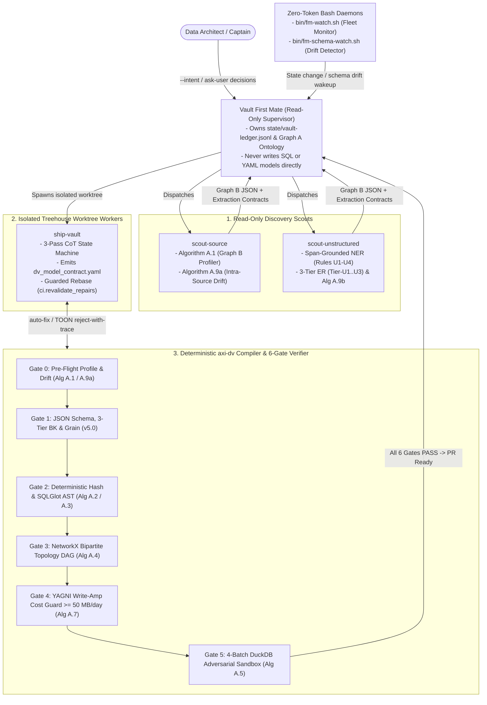

# `open-dv` — Open Agentic Data Vault 2.0 Modeller (`v6.0` Unified Edition: `dv-firstmate` + `no-mistakes` + `axi-dv`)

**`open-dv`** is an open neuro-symbolic multi-agent architecture, formal contract specification, and deterministic verification suite for autonomous **Data Vault 2.0 (DV 2.0)** enterprise data warehouse modelling, pragmatic $N=1 \to N+1$ schema evolution, and unstructured/multimodal vault integration.

Data Vault 2.0 achieves 100% historical auditability, decoupled parallel ingestion, and resilience to upstream operational schema drift by decomposing enterprise data into **Hubs** (identity), **Links** (associations and transactions), and **Satellites** (insert-only temporal state), joined via deterministic cryptographic hash keys (`_hk`) and change digests (`hash_diff`). However, when autonomous LLM agents design or evolve Data Vault schemas without formal guardrails, five fatal traps—**Source-Driven Hub Proliferation**, **Surrogate Key Leakage**, **Silent Hash Collisions**, **Soft Rule Contamination**, and **Destructive Satellite `UPDATE`s**—can silently corrupt historical lineage.

`open-dv` solves this through a **Neuro-Symbolic Verification Architecture** (`dv-firstmate` + `no-mistakes` + `axi-dv`):
1. **Dual-Graph Grounding & Constrained Contract Output (Zero Direct SQL Generation by LLMs):** Semantic modelling agents receive **Graph A** (Enterprise Core Business Concept Ontology) and **Graph B** (Bronze Empirical Profile: uniqueness $U(C)$, Shannon entropy $H(C)$, null rate $N_{\text{null}}(C)$, Jaccard inclusion $I(A.x \subseteq B.y)$, and change frequency $\lambda(c)$) and emit **only** a declarative YAML/JSON contract validated against [`schemas/no-mistake-dv2-contract-v5.schema.json`](schemas/no-mistake-dv2-contract-v5.schema.json) and [`schemas/dv2-canonical-ir.schema.json`](schemas/dv2-canonical-ir.schema.json).
2. **Pragmatic Cold-Start ($N=1$) & Additive Multi-Source ($N \to N+1$) Evolution:** Locks irreversible structural anchors on Day 1 (CBC Hub naming, 3-Tier `BKCC` Authority, Nullable-FK Link Splitter $U_{nn} \ge 0.95$, Insert-Only Raw Vault) while enforcing a **Gate 4 YAGNI Write-Amplification Cost Guard** ($W_{\text{amp}} \ge 50\text{ MB/day}$, $\ge 10$ cols, $\Delta\log_{10}(\lambda) \ge 2.0$) to prevent premature micro-satellite sprawl.
3. **The 6-Gate `axi-dv` & TOON Verification Pipeline (`Gates 0–5`):** Combines deterministic compilation (`Algorithm A.2`), `sqlglot` AST verification (`Algorithm A.3`), `networkx` bipartite DAG verification (`Algorithm A.4`), Gate 4 write-amplification cost guards (`Algorithm A.7`), and a **4-Batch Adversarial DuckDB Shadow Sandbox** (`Algorithm A.5`) with 3-way triage (`auto-fix`, token-dense `reject-with-trace` in TOON format, and `ask-user`).
4. **`dv-firstmate` Multi-Agent Swarm & Unstructured DV 2.0 (`Rules U1–U4`):** Coordinates a read-only `Vault First Mate` supervisor, `scout-source` (Bronze profiler & $S_k(t) \to S_k(t+1)$ drift detector), `scout-unstructured` (span-grounded NER + 3-Tier entity resolution `Tier-U1..U3` into `hub_document` and `mas_document_<cbc>_extraction`), and isolated `ship-vault` worktree workers with guarded rebase (`ci.revalidate_repairs`).

---

## Quick-Navigation Index

| Document / Artifact | Path | Description |
| :--- | :--- | :--- |
| **Master Agent Reference Guide (`v6.0`)** | [`docs/DV2_AGENT_REFERENCE_GUIDE.md`](docs/DV2_AGENT_REFERENCE_GUIDE.md) | End-to-end unified reference guide combining layer boundaries, entity DDL/DML templates, 6-stage canonical hashing, the 5 Fatal Traps, Cold-Start ($N=1$) pragmatism, `dv-firstmate` swarm, 6-Gate `axi-dv` pipeline, Unstructured DV 2.0 (`Rules U1–U4`), ELM calculus, and reference algorithms. |
| **Complete HTML Design & Implementation Guide** | [`docs/references/No-Mistake-Agentic-Data-Vault-2.0-Complete-Design-and-Implementation-Guide.html`](docs/references/No-Mistake-Agentic-Data-Vault-2.0-Complete-Design-and-Implementation-Guide.html) | Complete standalone HTML reference guide (*No-Mistake Agentic Data Vault 2.0: Complete Design & Implementation Guide*, `v6.0` Master Edition) with full mathematical proofs, visual callouts, schemas, and reference algorithms. |
| **01 — Core Modelling Specification** | [`docs/01-core-modelling-spec.md`](docs/01-core-modelling-spec.md) | Staging, Raw Vault, Business Vault, and Information Mart boundaries; Hub, Link (`lnk_`, `t_lnk_`, `sal_`, `hal_`, `x_lnk_`), and Satellite (`sat_`, `mas_`, `esat_`, `sts_`, `rts_`, `ref_`) specifications; PIT & Bridge tables; Zero Keys & Ghost Records; 6-stage canonicalization; the 5 Fatal Traps; and Node-Level SQLGlot AST Signatures. |
| **02 — Schema Stability, Cold-Start ($N=1$) & Evolution** | [`docs/02-schema-stability-and-evolution.md`](docs/02-schema-stability-and-evolution.md) | Fundamental stability invariants (`INV-01`–`INV-06`), source schema drift playbooks (`EVO-01`–`EVO-08`), key & bi-temporal rules (`KEY-01`–`KEY-05`, `TMP-01`–`TMP-04`), 15 anti-patterns (`AP-01`–`AP-15`), Asymmetric Reversibility Matrix, 3-Tier Business Key Authority, Nullable-FK Link Splitter, Gate 4 YAGNI Cost Guard, and 6-Scenario $N \to N+1$ / $S_k(t) \to S_k(t+1)$ evolution. |
| **03 — 6-Gate Verification & `dv-firstmate` Architecture** | [`docs/03-verification-and-agentic-architecture.md`](docs/03-verification-and-agentic-architecture.md) | Mathematical bipartite graph formulation, static rules (`DV-STR-*`, `DV-COL-*`, `DV-EVO-*`), runtime SQL templates (`DV-DYN-001`–`DV-DYN-015`), the 4 Adversarial Shadow Sandbox Batches, `dv-firstmate` multi-agent swarm (`Vault First Mate`, `scout-source`, `scout-unstructured`, `ship-vault`), and the 6-Gate `axi-dv` & TOON verification matrix. |
| **04 — Unstructured & Multi-Modal DV 2.0** | [`docs/04-unstructured-and-multimodal-dv2.md`](docs/04-unstructured-and-multimodal-dv2.md) | Architectural rules `U1`–`U4` for unstructured PDFs/audio/text, `hub_document` + `sat_document_blob_meta` + `lnk_document_<cbc>` + `mas_document_<cbc>_extraction` topology, Business Vault vector separation (`bsat_document_chunk_vector`), 3-Tier Entity Resolution (`Tier-U1..U3`), Algorithm `A.9b`, and Multimodal PIT/GraphRAG SQL (`Query D.10`). |
| **05 — ELM Calculus, 3-Pass CoT & Reference Algorithms** | [`docs/05-elm-calculus-and-reference-algorithms.md`](docs/05-elm-calculus-and-reference-algorithms.md) | Formal Graph B mathematical definitions ($U(C), H(C), N_{\text{null}}(C), I(A.x \subseteq B.y), \lambda(c), W_{\text{amp}}$), Ensemble Logical Modeling (ELM) calculus, 3-Pass CoT State Machine & Production System Prompt, and complete Python/SQL implementations for **Algorithms `A.1`–`A.9` + `D.10`**. |
| **No-Mistake DV 2.0 Contract V5 Schema** | [`schemas/no-mistake-dv2-contract-v5.schema.json`](schemas/no-mistake-dv2-contract-v5.schema.json) | JSON Schema (Draft 2020-12) for `NoMistakeDataVault2ContractV5` (3-Tier BK Authority, Nullable-FK Link Splitter, Gate 4 Cost Guard, Rejection Ledger, and Unstructured Extraction Rules). |
| **Canonical IR JSON Schema** | [`schemas/dv2-canonical-ir.schema.json`](schemas/dv2-canonical-ir.schema.json) | JSON Schema (Draft 2020-12) defining the low-level Canonical Intermediate Representation (IR) contract between semantic modelling agents and the deterministic compiler. |
| **Annotated Model Contract Example (`YAML`)** | [`examples/dv_model_contract.yaml`](examples/dv_model_contract.yaml) | Complete multi-source (`SAP_S4HANA`, `SFDC_CRM`, `SEC_EDGAR_PDF`) declarative Data Vault 2.0 model contract example demonstrating Tier-1/2/3 keys, optional link splitting, Gate 4 YAGNI justification, rejection ledger, and multimodal document links. |

---

## `dv-firstmate` + `axi-dv` 6-Gate Neuro-Symbolic Architecture



---

## Summary of Invariant, Verification, & Algorithm Taxonomy

| Namespace | ID Range | Enforcement Layer | Scope & Purpose |
| :--- | :--- | :--- | :--- |
| **Fundamental Stability Invariants** | `INV-01` – `INV-06` | Architectural Contract | Insert-only Raw Vault immutability, virtualized `LEAD(load_dts)` end-dating, Hub semantic grain invariance, Link Unit-of-Work grain invariance, strict Hub/Link/Satellite separation of concerns, and idempotent `hash_diff` delta suppression. |
| **Source Schema Drift Playbooks** | `EVO-01` – `EVO-08` & `Alg A.9a` | Schema Evolution (`fm-schema-watch.sh`) | Additive evolution patterns for `ADD_COLUMN` (`sat_*_ext_v2`), `DROP_COLUMN` (Staging `NULL` tombstone), `RENAME_COLUMN` (Staging alias), `TYPE_WIDENING`, `SEMANTIC_TYPE_CHANGE`, velocity splits, PII isolation, and $N \to N+1$ multi-source onboarding. |
| **Key Canonicalization & Authority** | `KEY-01` – `KEY-05` & `TIER_1`..`TIER_3` | Gate 1 & Gate 2 (`Alg A.2`) | 6-stage pre-hash canonicalization, length-prefixed (`<len>:<val>`) injective encoding, `TIER_1_GLOBAL_STANDARD` / `TIER_2_ENTERPRISE_SOR` (`BKCC='GLOBAL'`) passive integration, and `TIER_3_LOCAL_SCOPED` (`BKCC='<SOURCE_SYS>'`) collision isolation. |
| **Bi-Temporal & Multi-Timeline Rules** | `TMP-01` – `TMP-04` | Ingestion & Querying | Separation of `load_dts` (assertion time), `applied_dts` (business validity time), and `event_dts`; non-spoofing of `load_dts`; early-arriving fact Hub stubbing; and bi-temporal PIT queries (`Query D.10`). |
| **Unstructured & Multimodal Rules** | `Rule U1` – `Rule U4` & `Tier-U1..U3` | `scout-unstructured` & `Alg A.9b` | Content-addressable `hub_document` (`doc_sha256`), separation of Raw Vault claims (`mas_document_<cbc>_extraction`) from Business Vault vectors (`bsat_document_chunk_vector`), character-offset provenance (`span_start`, `span_end`), and 3-Tier Entity Resolution. |
| **Anti-Pattern Catalog** | `AP-01` – `AP-15` | Pre-Deploy Lint Gates | Catalog of 15 critical Data Vault failure modes (including physical `load_end_dts` updates, Sat-to-Sat chaining, missing Effectivity Satellite driving keys, `CONCAT_WS` NULL-skipping collisions, and source-system-specific Hubs). |
| **Static Graph, Column & AST Rules** | `DV-STR-001`–`014`, `DV-COL-001`–`012`, `DV-AST-001`–`006` | Gates 1–3 (`StaticVerifier` / `Alg A.3` / `Alg A.4`) | Bipartite Hub-Link topology ($\text{outdeg}(h)=0$, Link arity $\ge 2$, single-parent Satellites), Nullable-FK Link Splitter ($U_{nn} \ge 0.95$), alphabetical `hash_diff` sorting, and SQLGlot AST immutability enforcement. |
| **YAGNI Write-Amplification Guard** | `Gate 4` (`Alg A.7`) | Compile-Time Cost Guard | Permits single-source rate-of-change Satellite splits iff $\text{cols} \ge 10$, $\Delta\log_{10}(\lambda) \ge 2.0$, and $W_{\text{amp}} \ge 50\text{ MB/day}$ (or `PII`); otherwise triggers `auto-fix: merge_satellites`. |
| **Dynamic Runtime & Adversarial Batches** | `DV-DYN-001`–`015` & `Batches 1–4` (`Alg A.5`) | Gate 5 Shadow Sandbox (`DynamicVerifier`) | Executable SQL checks and 4 Adversarial DuckDB Sandbox Batches verifying Ghost Record `INNER JOIN` completeness (Batch 1), Replay Idempotency $\Delta\text{rows}=0$ (Batch 2), Single-Attribute Delta + Boundary-Shift Collision (Batch 3), and $N=1 \to N=2$ Cross-Source Collision (Batch 4). |

---

## Validating the JSON Schemas

To verify that both JSON Schema Draft 2020-12 specifications parse cleanly:

```bash
python3 -m json.tool schemas/dv2-canonical-ir.schema.json > /dev/null
python3 -m json.tool schemas/no-mistake-dv2-contract-v5.schema.json > /dev/null
```

---

## License

Licensed under the [Apache License, Version 2.0](LICENSE).
