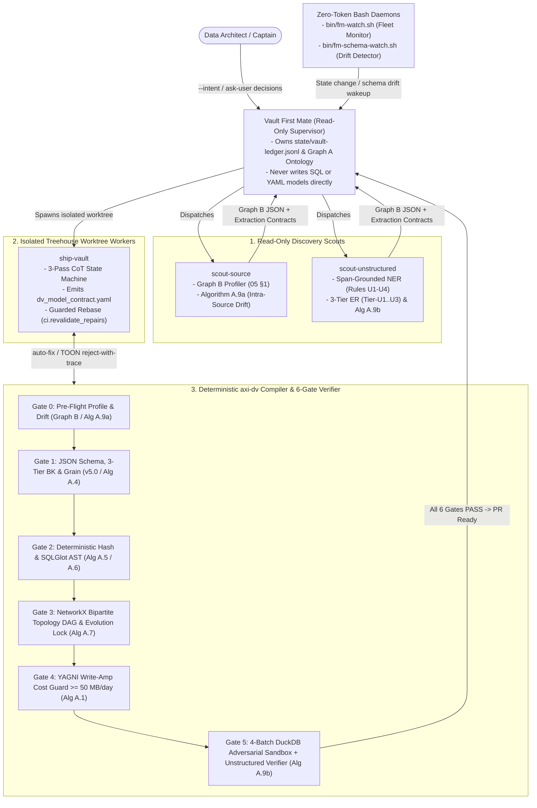

# `open-dv` — Open Agentic Data Vault 2.0 Modeller (`v6.0` Unified Edition: `dv-firstmate` + `no-mistakes` + `axi-dv`)

**`open-dv`** is an open neuro-symbolic multi-agent architecture, formal contract specification, and deterministic verification suite for autonomous **Data Vault 2.0 (DV 2.0)** enterprise data warehouse modelling, pragmatic $N=1 \to N+1$ schema evolution, and unstructured/multimodal vault integration.

Data Vault 2.0 achieves 100% historical auditability, decoupled parallel ingestion, and resilience to upstream operational schema drift by decomposing enterprise data into **Hubs** (identity), **Links** (associations and transactions), and **Satellites** (insert-only temporal state), joined via deterministic cryptographic hash keys (`_hk`) and change digests (`hash_diff`). However, when autonomous LLM agents design or evolve Data Vault schemas without formal guardrails, five fatal traps—**Source-Driven Hub Proliferation**, **Surrogate Key Leakage**, **Silent Hash Collisions**, **Soft Rule Contamination**, and **Destructive Satellite `UPDATE`s**—can silently corrupt historical lineage.

`open-dv` solves this through a **Neuro-Symbolic Verification Architecture** (`dv-firstmate` + `no-mistakes` + `axi-dv`):
1. **Dual-Graph Grounding & Constrained Contract Output (Zero Direct SQL Generation by LLMs):** Semantic modelling agents receive **Graph A** (Enterprise Core Business Concept Ontology) and **Graph B** (Bronze Empirical Profile: uniqueness $U(C)$, Shannon entropy $H(C)$, null rate $N_{\text{null}}(C)$, Jaccard inclusion $I(A.x \subseteq B.y)$, and change frequency $\lambda(c)$) and emit **only** a declarative YAML/JSON contract validated against [`schemas/no-mistake-dv2-contract-v5.schema.json`](schemas/no-mistake-dv2-contract-v5.schema.json) and [`schemas/dv2-canonical-ir.schema.json`](schemas/dv2-canonical-ir.schema.json).
2. **Pragmatic Cold-Start ($N=1$) & Additive Multi-Source ($N \to N+1$) Evolution:** Locks irreversible structural anchors on Day 1 (CBC Hub naming, 3-Tier `BKCC` Authority, Nullable-FK Link Splitter $U_{nn} \ge 0.95$, Insert-Only Raw Vault) while enforcing a **Gate 4 YAGNI Write-Amplification Cost Guard** ($W_{\text{amp}} \ge 50\text{ MB/day}$, $\ge 10$ cols, $\Delta\log_{10}(\lambda) \ge 2.0$) to prevent premature micro-satellite sprawl.
3. **The 6-Gate `axi-dv` & TOON Verification Pipeline (`Gates 0–5`):** Combines deterministic cold-start codemods (`Algorithms A.1`–`A.4`, including the Gate 4 write-amplification cost guard in `A.1`), length-prefixed hash compilation (`Algorithm A.5`), `sqlglot` AST verification (`Algorithm A.6`), the $N \to N+1$ additive-evolution lock (`Algorithm A.7`), the `axi-dv` orchestrator (`Algorithm A.8`), a `networkx.MultiDiGraph` bipartite DAG verifier (`gate3_networkx_dag`), and a **4-Batch Adversarial DuckDB Shadow Sandbox** (`DuckDbShadowSandbox`, `DV-DYN-001`–`015`, Batches 1–4) with 3-way triage (`auto-fix`, token-dense `reject-with-trace` in TOON format, and `ask-user`).
4. **`dv-firstmate` Multi-Agent Swarm & Unstructured DV 2.0 (`Rules U1–U4`):** Coordinates a read-only `Vault First Mate` supervisor, `scout-source` (Bronze profiler & $S_k(t) \to S_k(t+1)$ drift detector), `scout-unstructured` (span-grounded NER + 3-Tier entity resolution `Tier-U1..U3` into `hub_document` and `mas_document_<cbc>_extraction`), and isolated `ship-vault` worktree workers with guarded rebase (`ci.revalidate_repairs`).

---

## Quick-Navigation Index

| Document / Artifact | Path | Description |
| :--- | :--- | :--- |
| **Master Agent Reference Guide (`v6.0`)** | [`docs/DV2_AGENT_REFERENCE_GUIDE.md`](docs/DV2_AGENT_REFERENCE_GUIDE.md) | End-to-end unified reference guide combining layer boundaries, entity DDL/DML templates, 6-stage canonical hashing, the 5 Fatal Traps, Cold-Start ($N=1$) pragmatism, `dv-firstmate` swarm, 6-Gate `axi-dv` pipeline, Unstructured DV 2.0 (`Rules U1–U4`), ELM calculus, and reference algorithms. |
| **Complete HTML Design & Implementation Guide** | [`docs/references/No-Mistake-Agentic-Data-Vault-2.0-Complete-Design-and-Implementation-Guide.html`](docs/references/No-Mistake-Agentic-Data-Vault-2.0-Complete-Design-and-Implementation-Guide.html) | Complete standalone HTML reference guide (*No-Mistake Agentic Data Vault 2.0: Complete Design & Implementation Guide*, `v6.0` Master Edition) with full mathematical proofs, visual callouts, schemas, and reference algorithms. |
| **01 — Core Modelling Specification** | [`docs/01-core-modelling-spec.md`](docs/01-core-modelling-spec.md) | Staging, Raw Vault, Business Vault, and Information Mart boundaries; Hub, Link (`lnk_`, `t_lnk_`, `sal_`, `hal_`, `x_lnk_`), and Satellite (`sat_`, `mas_`, `esat_`, `sts_`, `rts_`, `ref_`) specifications; PIT & Bridge tables; Zero Keys & Ghost Records; 6-stage canonicalization; the 5 Fatal Traps; and Node-Level SQLGlot AST Signatures. |
| **02 — Schema Stability, Cold-Start ($N=1$) & Evolution** | [`docs/02-schema-stability-and-evolution.md`](docs/02-schema-stability-and-evolution.md) | Fundamental stability invariants (`INV-01`–`INV-06`), source schema drift playbooks (`EVO-01`–`EVO-08`), key & bi-temporal rules (`KEY-01`–`KEY-05`, `TMP-01`–`TMP-04`), 15 anti-patterns (`AP-01`–`AP-15`), Asymmetric Reversibility Matrix, 3-Tier Business Key Authority, Nullable-FK Link Splitter, Gate 4 YAGNI Cost Guard, and 6-Scenario $N \to N+1$ / $S_k(t) \to S_k(t+1)$ evolution. |
| **03 — 6-Gate Verification & `dv-firstmate` Architecture** | [`docs/03-verification-and-agentic-architecture.md`](docs/03-verification-and-agentic-architecture.md) | Mathematical bipartite graph formulation, static rules (`DV-STR-*`, `DV-COL-*`, `DV-EVO-*`), runtime SQL templates (`DV-DYN-001`–`DV-DYN-015`), the 4 Adversarial Shadow Sandbox Batches, `dv-firstmate` multi-agent swarm (`Vault First Mate`, `scout-source`, `scout-unstructured`, `ship-vault`), and the 6-Gate `axi-dv` & TOON verification matrix. |
| **04 — Unstructured & Multi-Modal DV 2.0** | [`docs/04-unstructured-and-multimodal-dv2.md`](docs/04-unstructured-and-multimodal-dv2.md) | Architectural rules `U1`–`U4` for unstructured PDFs/audio/text, `hub_document` + `sat_document_blob_meta` + `lnk_document_<cbc>` + `mas_document_<cbc>_extraction` topology, Business Vault vector separation (`bsat_document_chunk_vector`), 3-Tier Entity Resolution (`Tier-U1..U3`), Algorithm `A.9b`, and Multimodal PIT/GraphRAG SQL (`Query D.10`). |
| **05 — ELM Calculus, 3-Pass CoT & Reference Algorithms** | [`docs/05-elm-calculus-and-reference-algorithms.md`](docs/05-elm-calculus-and-reference-algorithms.md) | Formal Graph B mathematical definitions ($U(C), H(C), N_{\text{null}}(C), I(A.x \subseteq B.y), \lambda(c), W_{\text{amp}}$), Ensemble Logical Modeling (ELM) calculus, 3-Pass CoT State Machine & Production System Prompt, and complete Python/SQL implementations for **Algorithms `A.1`–`A.9` + `D.10`** (the Graph B profiler, `networkx` topology verifier, 4-Batch sandbox, and Ghost Record seeder are specified in `docs/03` without reference implementations). |
| **06 — Explainability, Observability & Visualization Architecture (`WB-00..WB-11`)** | [`docs/06-explainability-and-observability-spec.md`](docs/06-explainability-and-observability-spec.md) | Unified `VaultObservabilityEvent` JSONL telemetry architecture (`state/vault-ledger.jsonl`), 3-Layer Progressive Disclosure Standard, Semantic Hash Pills (`[HK: prefix..suffix \| BKCC:Label]`), the 12-View Explainability & Observability Workbench (`WB-00`–`WB-11`), and detailed designs for all 9 pipeline step views (`VIZ-PIPE-00`, `VIZ-STEP-01`–`08`) and 8 verification gate views (`VIZ-GATE-01`–`08`). |
| **07 — End-to-End Private Equity Modelling & Verification Demo** | [`docs/07-end-to-end-private-equity-demo.md`](docs/07-end-to-end-private-equity-demo.md) | Self-contained 7-Scene Private Equity Asset Management walkthrough (*Apex Horizon Capital*) across `INVESTRAN_FUND_ADMIN`, `DEALCLOUD_PE_CRM`, `LEGACY_GP_ADMIN`, and `OBJECT_STORE_S3` PDFs (`calpers_side_letter_fund_iv_2026.pdf`, `ic_q3_valuation_nordic_cloud.pdf`), tracing Dual-Graph grounding, 3-Tier ER, surrogate quarantine, `BKCC` collision isolation, TOON self-healing, Day-3 schema drift (`Alg A.9a`), 4-Batch DuckDB sandbox verification, and 4-Zone SQL + `Query D.10` compilation. |
| **08 — Platform MVP Monorepo (`proto` + `moon` + `uv` + `bun`) & Headless API Spec** | [`docs/08-platform-mvp-monorepo-and-api-spec.md`](docs/08-platform-mvp-monorepo-and-api-spec.md) | Complete Moonrepo (`proto` + `moon`) polyglot setup with `uv` (Python 3.12+) and `bun` (TypeScript), 9-package workspace topology (`packages/*` & `apps/*`), 5-tier RBAC data redaction, Content-Addressable Store (CAS), and the OpenAPI 3.1 REST + Server-Sent Events (SSE) NDJSON streaming contract (`/api/v1/projects`, `/runs`, `/events`, `/gates`, `/sandbox`, `/decisions`, `/artifacts`). |
| **09 — Agnostic Agent Harness & Dual-SDK Adapter Spec (`packages/opendv-agent-harness`)** | [`docs/09-agnostic-agent-harness-and-sdk-spec.md`](docs/09-agnostic-agent-harness-and-sdk-spec.md) | Vendor-neutral `VaultAgentHarness` Protocol, `AgentTaskSpec`, `AgentToolDefinition`, `SubagentSpec`, `reasoning`/`fast` semantic model-tier routing & `agent_models` per-agent overrides, automatic dual-SDK tool bridges, concrete `AgyCliHarnessAdapter` (`agy` CLI), `ClaudeCliHarnessAdapter` (`claude` CLI), `AntigravityHarnessAdapter` (`google.antigravity`), & `ClaudeAgentHarnessAdapter` (`claude_agent_sdk`) reference implementations, and `VaultObservabilityEvent` stream translation. |
| **10 — Decoupled UI Workbench, Protocol SDK & Theme Engine Spec (`WB-00..WB-11`)** | [`docs/10-decoupled-ui-workbench-and-theme-spec.md`](docs/10-decoupled-ui-workbench-and-theme-spec.md) | Zero-dependency `@opendv/protocol-ts` SDK (REST, SSE, offline `.jsonl` replay, Web Crypto `Alg A.5` Hash Pills), React 19 + Vite 6 + Tailwind CSS v4 + Zustand workbench on `bun`, CSS Custom Properties Theme Engine (`Obsidian Dark`, `Daylight Paper`, `High-Contrast Audit`), Responsive 3-Layer Progressive Disclosure Shell, `WorkbenchViewPlugin` API, and all 12 Workbench Views (`WB-00`–`WB-11`). |
| **11 — Master Agent Worker Implementation & Dispatch Plan (`WP-01..WP-12`)** | [`docs/11-agent-worker-implementation-plan.md`](docs/11-agent-worker-implementation-plan.md) | Turnkey, dependency-ordered Work Breakdown Structure (`WP-01` through `WP-12`) across 7 dispatch waves specifying target branch, agent tier (`reasoning` vs `fast`), `blocked-by` prerequisites, exact owned files, normative spec references (`docs/01`–`docs/10`), acceptance criteria, and `moon run` / `pytest` / `bun test` verification commands. |
| **12 — Agentic Pipeline Inputs, Harness Config & Auth Reference (`Claude` vs `Antigravity`)** | [`docs/12-agentic-pipeline-inputs-and-harness-guide.md`](docs/12-agentic-pipeline-inputs-and-harness-guide.md) | Field-by-field reference guide for `HarnessSetupConfig` & `HarnessAuthConfig` (`agy` / `antigravity` with `gemini-4-argon-high` / `gemini-3.8-flash-high` vs `claude`, semantic `model_overrides` `reasoning` / `fast`, fine-grained `agent_models`, `api_key_env`, `vertex_adc`, `aws_bedrock`, `cli_session`, `ambient_cli`), `PipelineInputSpec` (`pipeline_input.yaml` and per-wave `wave0`–`wave3` specs), `GraphAOntology` (`commerce_graph_a_ontology.yaml`), subsequent-CLI `--initial-contract` schema evolution workflow, validation diagnostic codes, and `AgenticPipelineReport`. |
| **13 — Real Agentic Pipeline Remediation Specification (`WP-01..WP-10`)** | [`docs/13-real-agentic-pipeline-remediation-spec.md`](docs/13-real-agentic-pipeline-remediation-spec.md) | Engineering specification for discovery-first agentic execution (`@vault-first-mate`, `@scout-source`, `@scout-unstructured`, `@ship-vault`), real neuro-symbolic domain tool wiring, fail-closed LLM harness adapters, generic 4-Zone SQL compilation, dynamic 4-Batch DuckDB sandbox verification, and subsequent-CLI incremental schema evolution via `--initial-contract` (`WP-07`–`WP-10`). |
| **No-Mistake DV 2.0 Contract V5 Schema** | [`schemas/no-mistake-dv2-contract-v5.schema.json`](schemas/no-mistake-dv2-contract-v5.schema.json) | JSON Schema (Draft 2020-12) for `NoMistakeDataVault2ContractV5`: column triage ledger, Hubs with 3-Tier BK Authority (`key_authority_tier`, `bkcc_prefix`), Links (including `where_filter_condition` for Nullable-FK split links and `UNSTRUCTURED_EXTRACTION_LINK`), Satellites (security classification and volatility tier), Reference Tables, and `unmapped_escalations`. Entity prefixes match the Canonical IR schema. |
| **Canonical IR JSON Schema** | [`schemas/dv2-canonical-ir.schema.json`](schemas/dv2-canonical-ir.schema.json) | JSON Schema (Draft 2020-12) defining the low-level Canonical Intermediate Representation (IR) contract between semantic modelling agents and the deterministic compiler. |
| **Observability Telemetry Event JSON Schema** | [`schemas/vault-observability-event.schema.json`](schemas/vault-observability-event.schema.json) | JSON Schema (Draft 2020-12) for `VaultObservabilityEvent` records emitted over `state/vault-ledger.jsonl` to drive the 12-View Explainability & Observability Workbench (`WB-00`–`WB-11`). |
| **Headless Platform OpenAPI 3.1.0 Schema** | [`schemas/openapi-v1.json`](schemas/openapi-v1.json) | Deterministic OpenAPI 3.1.0 (JSON Schema Draft 2020-12 dialect) specification for all `/api/v1` REST and SSE endpoints, exported via `moon run opendv-platform-api:export-openapi`. |
| **Annotated Model Contract Example (`YAML`)** | [`examples/dv_model_contract.yaml`](examples/dv_model_contract.yaml) | Multi-source (`SFDC_CRM`, `SAP_ERP`, `LEGACY_TICKET_DB`) declarative Data Vault 2.0 model contract for a single `hub_customer`, demonstrating Tier-1 global keys, a `BKCC`-scoped Tier-3 legacy key, the column triage ledger (including a dropped system surrogate), and source-aligned Satellites whose `PII_HIGH` column is split into `sat_customer_crm_pii` by `Algorithm A.1`. |
| **Private Equity Reference Package (`YAML` / `JSON`)** | [`examples/private_equity/dv_pe_model_contract.yaml`](examples/private_equity/dv_pe_model_contract.yaml) | Complete Private Equity Asset Management reference package: validated `NoMistakeDataVault2ContractV5` YAML ([`dv_pe_model_contract.yaml`](examples/private_equity/dv_pe_model_contract.yaml)), Canonical IR JSON ([`pe_canonical_ir.json`](examples/private_equity/pe_canonical_ir.json)), Enterprise CBC Ontology `Graph A` ([`pe_graph_a_ontology.yaml`](examples/private_equity/pe_graph_a_ontology.yaml)), and Empirical Bronze & PDF Span Profile `Graph B` ([`pe_graph_b_profile.json`](examples/private_equity/pe_graph_b_profile.json)). |
| **Multi-Wave Agentic Pipeline Sample (`YAML` / `CSV` / `TXT`)** | [`examples/pipeline_samples/global_commerce_vault/`](examples/pipeline_samples/global_commerce_vault/) | Turnkey 4-wave enterprise commerce dataset (`pipeline_input.yaml`, `harness_config.yaml`, `harness_config_agy.yaml`, `harness_config_antigravity.yaml`, `harness_config_claude.yaml`, `harness_config_claude_cli.yaml`, `ontology/commerce_graph_a_ontology.yaml`, CSV sources, and unstructured MSA text) exercising Cold Start ($N=1$), incremental $N=1 \to N=2$ `BKCC` onboarding, $S_1(t) \to S_1(t+1)$ schema drift (`Algorithm A.9a`), and unstructured span grounding (`Algorithm A.9b`). |
| **Executable `pytest` Specification Suite (`tests/`)** | [`tests/`](tests/) | Comprehensive, deterministic `pytest` suite (`200+` test cases) verifying Draft 2020-12 schemas, Gate 1–6 static/topological/AST verifiers, length-prefixed SHA-256 test vectors, deterministic AST codemods (`A.1`–`A.9b`), 5-tier observability redaction & PII leak detection, and 4-Zone `:memory:` DuckDB execution across all 4 adversarial shadow sandbox batches and bi-temporal queries (`D.10` & `D.10b`). |

---

## `dv-firstmate` + `axi-dv` 6-Gate Neuro-Symbolic Architecture



---

## Summary of Invariant, Verification, & Algorithm Taxonomy

| Namespace | ID Range | Enforcement Layer | Scope & Purpose |
| :--- | :--- | :--- | :--- |
| **Fundamental Stability Invariants** | `INV-01` – `INV-06` | Architectural Contract | Insert-only Raw Vault immutability, virtualized `LEAD(load_dts)` end-dating, Hub semantic grain invariance, Link Unit-of-Work grain invariance, strict Hub/Link/Satellite separation of concerns, and idempotent `hash_diff` delta suppression. |
| **Source Schema Drift Playbooks** | `EVO-01` – `EVO-08` & `Alg A.9a` | Schema Evolution (`fm-schema-watch.sh`) | Additive evolution patterns for `ADD_COLUMN` (`sat_*_ext_v2`), `DROP_COLUMN` (Staging `NULL` tombstone), `RENAME_COLUMN` (Staging alias), `TYPE_WIDENING`, `SEMANTIC_TYPE_CHANGE`, velocity splits, PII isolation, and $N \to N+1$ multi-source onboarding. |
| **Key Canonicalization & Authority** | `KEY-01` – `KEY-05` & `TIER_1`..`TIER_3` | Gate 1 & Gate 2 (`Alg A.4` / `Alg A.5`) | 6-stage pre-hash canonicalization, length-prefixed (`<len>:<val>`) injective encoding, `TIER_1_GLOBAL_STANDARD` / `TIER_2_ENTERPRISE_SOR` (`BKCC='GLOBAL'`) passive integration, and `TIER_3_LOCAL_SCOPED` (`BKCC='<SOURCE_SYS>'`) collision isolation. |
| **Bi-Temporal & Multi-Timeline Rules** | `TMP-01` – `TMP-04` | Ingestion & Querying | Separation of `load_dts` (assertion time), `applied_dts` (business validity time), and `event_dts`; non-spoofing of `load_dts`; early-arriving fact Hub stubbing; and bi-temporal PIT queries (`Query D.10`). |
| **Unstructured & Multimodal Rules** | `Rule U1` – `Rule U4` & `Tier-U1..U3` | `scout-unstructured` & `Alg A.9b` | Content-addressable `hub_document` (`doc_sha256`), separation of Raw Vault claims (`mas_document_<cbc>_extraction`) from Business Vault vectors (`bsat_document_chunk_vector`), character-offset provenance (`span_start`, `span_end`), and 3-Tier Entity Resolution. |
| **Anti-Pattern Catalog** | `AP-01` – `AP-15` | Pre-Deploy Lint Gates | Catalog of 15 critical Data Vault failure modes (including physical `load_end_dts` updates, Sat-to-Sat chaining, missing Effectivity Satellite driving keys, `CONCAT_WS` NULL-skipping collisions, and source-system-specific Hubs). |
| **Static Graph, Column & AST Rules** | `DV-STR-001`–`014`, `DV-COL-001`–`012`, `DV-AST-001`–`006` | Gates 1–3 (`StaticVerifier` / `Alg A.6` / `Alg A.7`) | Bipartite Hub-Link topology ($\text{outdeg}(h)=0$, Link arity $\ge 2$, single-parent Satellites), Nullable-FK Link Splitter ($U_{nn} \ge 0.95$), alphabetical `hash_diff` sorting, and SQLGlot AST immutability enforcement. |
| **YAGNI Write-Amplification Guard** | `Gate 4` (`Alg A.1`) | Compile-Time Cost Guard | Permits single-source rate-of-change Satellite splits iff $\text{cols} \ge 10$, $\Delta\log_{10}(\lambda) \ge 2.0$, and $W_{\text{amp}} \ge 50\text{ MB/day}$ (or `PII`); otherwise triggers `auto-fix: merge_satellites`. |
| **Dynamic Runtime & Adversarial Batches** | `DV-DYN-001`–`015` & `Batches 1–4` (`DV-DYN-*` templates) | Gate 5 Shadow Sandbox (`DynamicVerifier`) | Executable SQL checks and 4 Adversarial DuckDB Sandbox Batches verifying Ghost Record `INNER JOIN` completeness (Batch 1), Replay Idempotency $\Delta\text{rows}=0$ (Batch 2), Single-Attribute Delta + Boundary-Shift Collision (Batch 3), and $N=1 \to N=2$ Cross-Source Collision (Batch 4). |

---

## Monorepo Workspace & Polyglot Toolchain

The repository is organized as a polyglot monorepo managed with [`proto`](.prototools) (`moon 2.3.0`, `python 3.12.13`, `uv 0.11.11`, `bun 1.3.13`), [`moon`](.moon/workspace.yml), [`uv`](pyproject.toml), and [`bun`](package.json):

| Workspace Project | Language / Layer | Role |
| :--- | :--- | :--- |
| [`packages/opendv-core`](packages/opendv-core/) | Python library (`domain-core`) | Strict Pydantic v2 domain models (`NoMistakeDataVault2ContractV5`, `CanonicalIR`, `GraphAOntology`, `GraphBProfile`, `VaultObservabilityEvent`), Draft 2020-12 `SchemaRegistry`, ELM calculus (`elm_calculus`), and `Algorithm A.5` length-prefixed SHA-256 hashing & Zero Key resolution (`hashing`, `constants`). |
| [`packages/opendv-telemetry`](packages/opendv-telemetry/) | Python library (`telemetry`) | Append-only `VaultLedgerEmitter` & async SSE streaming (`ledger_emitter`), immutable SHA-256 `ContentAddressableStore` (`cas_store`), 5-tier RBAC redaction (`rbac_redactor`), adversarial PII & Shannon-entropy leak detection (`pii_detector`), Semantic Hash Pills (`hash_pills`), and W3C distributed `TraceContext` propagation (`trace_context`). |
| [`packages/opendv-axi-verifier`](packages/opendv-axi-verifier/) | Python library (`verifier`) | 6-Gate `axi-dv` orchestrator (`alg_a8_orchestrator`), deterministic contract & SQLGlot AST codemods (`A.1` 3-axis satellite split & Gate 4 YAGNI cost guard, `A.2` enum-to-ref demotion, `A.3` link `esat_*` injection, `A.4` 3-Tier `BKCC` & nullable-FK link splitter, `A.5` canonical SHA-256 hash AST, `A.9a` intra-source schema drift), static verifiers (`gate1_contract_grain`, `gate3_networkx_dag`, `A.6` SQLGlot AST, `A.7` evolution lock, `A.9b` unstructured span & 3-Tier ER), and `@toon_v1` codec (`toon_codec`). |
| [`packages/opendv-duckdb-sandbox`](packages/opendv-duckdb-sandbox/) | Python library (`duckdb-sandbox`) | Empirical `GraphBProfiler` & $S_k(t) \to S_k(t+1)$ schema drift detector (`graph_b_profiler`), `NoMistakeDataVault2ContractV5` $\to$ `CanonicalIR` lowerer & topological load wave planner (`ir_lowerer`), deterministic 4-Zone DuckDB SQL compiler (`compiler_4zone`), 4-Batch adversarial shadow sandbox executor (`adversarial_batches`), 15 runtime invariant evaluators `DV-DYN-001`–`015` (`dynamic_checks`), bi-temporal PIT query engine for `Query D.10` & `Query D.10b` (`pit_query_engine`), and high-level `DuckDbShadowSandbox` orchestrator with `VIZ-GATE-08` telemetry emission (`sandbox_engine`). |
| [`packages/opendv-agent-harness`](packages/opendv-agent-harness/) | Python library (`agent-harness`) | Hexagonal `VaultAgentHarness` protocol & W3C span lifecycle (`protocol`), vendor-neutral domain & budget/sandbox models (`models`), `ModelTier` routing (`reasoning` / `fast`), `agent_models` per-persona overrides, & `PERSONA_CAPABILITY_MATRIX` (`routing`), 8 RBAC-gated pure-Python domain tools (`tools.base`, `tools.catalog`), Dual-SDK Tool Bridge for Google Antigravity & Claude Agent SDK MCP (`tools.bridge`), concrete `AgyCliHarnessAdapter`, `ClaudeCliHarnessAdapter`, `AntigravityHarnessAdapter`, & `ClaudeAgentHarnessAdapter` production adapters (`adapters`; `DeterministicHarnessAdapter` is reserved strictly for internal `pytest` unit/integration mocking), provider registry & factory (`registry`), 4 canonical persona task/subagent builders (`personas`: `vault-first-mate`, `scout-source`, `scout-unstructured`, `ship-vault`), `StewardHoldManager` `ASK-USER` / `STEWARD_HOLD` lifecycle & session resumption (`hold_manager`), real-time `VaultObservabilityEvent` stream translation (`telemetry.translator`), and the end-to-end 8-stage neuro-symbolic `AgenticVaultPipeline` orchestrator & deterministic input/output validators (`pipeline`). |
| [`packages/opendv-protocol-ts`](packages/opendv-protocol-ts/) | TypeScript library (`protocol-sdk`) | Zero-dependency TypeScript protocol SDK (`@opendv/protocol-ts`): normative DTOs, REST/SSE clients, W3C SSE parser, offline `.jsonl` replay engine (`MockVaultEventStreamClient`), Web Crypto `Algorithm A.5` hashing & Semantic Hash Pills, RBAC redaction/filters, and Private Equity demo bundle. |
| [`apps/opendv-platform-api`](apps/opendv-platform-api/) | Python application (`api-server`) | Headless FastAPI ASGI server (`main`, `deps`), deterministic OpenAPI 3.1.0 exporter (`export_openapi` $\to$ [`schemas/openapi-v1.json`](schemas/openapi-v1.json)), RFC 9457 `application/problem+json` error handling, server-side 5-Tier RBAC redaction (`X-OpenDV-Role`), and `/api/v1` routers (`health`, `projects`, `runs` with SSE `Last-Event-ID` cursor replay, `run_complete` framing, & `/api/v1/runs/{run_id}/report`, `pipelines` with `/api/v1/pipelines/validate` & `/api/v1/pipelines/runs`, `gates`, `sandbox`, `decisions`, `workbench` `WB-00`–`WB-11`, `artifacts`). |
| [`apps/opendv-cli`](apps/opendv-cli/) | Python automation (`cli`) | Unified `opendv` and `axi-dv` command-line tools (`main`, `api_client`) supporting both `--local` (direct library invocation) and `--api-url` (remote HTTP API) modes across `pipeline`, `verify`, `profile`, `compile`, `sandbox`, `run`, and `hold` subcommands. |
| [`apps/opendv-web-workbench`](apps/opendv-web-workbench/) | TypeScript application (`web-ui`) | Decoupled 12-View Explainability & Observability Web Workbench (`@opendv/web-workbench`): zero-dependency Bun development server & `/api` proxy (`dev-server`), responsive 3-Layer Progressive Disclosure shell (`WorkbenchShell`, `Layer1StoryBanner`, `SidebarNav`, native `<dialog>` `Layer3ProofDrawer` with `inert` background workspace, `PlaybackControls`), semantic theme engine (`ThemeRegistry`, `ThemeToggle`, `Obsidian Dark` / `Daylight Paper` / `High-Contrast Audit` presets, zero-FOUC initializer, WCAG AA/AAA visual grammar), Zustand state store (`useWorkbenchStore`), extensible view & gate card plugin registry (`WorkbenchPluginRegistry`, `CustomEsgGateCard`), and all 12 Workbench Views `WB-00`–`WB-11` (`WB00CommandCenter` with interactive agentic pipeline launcher & report inspector `createPipelineLauncherStore`, `WB01DualGraphView`, `WB02EmpiricalProfiler`, `WB03UnstructuredView` with `CaptainHoldDecisionModal`, `WB04ColumnTriageView`, `WB05ELMTopologyView`, `WB06TopologicalDAGView` + `GrainAdjacencyMatrix`, `WB07LinkSplitterYagniView` + `WriteAmplificationGauge`, `WB08SelfHealingWorkbench` + `AttemptDiffViewer` + `ToonTraceHighlighter`, `WB09SchemaDriftRadar` + `DriftDeltaGrid`, `WB10DuckDBSandboxView` + `AdversarialBatchGrid` + `BiTemporalTimeline`, `WB11RosettaStoneView` + `PreHashStepper` + `FourZoneSQLViewer`) with co-located gate cards (`VIZ-GATE-01`–`08`). |

---

## Running the Normative `pytest` Suite & Validating Schemas

The [CI workflow](.github/workflows/ci.yml) runs on every push and pull request. It validates all JSON Schemas against Draft 2020-12, checks example contracts and Canonical IR documents, compiles every `python` code fence in `docs/`, executes the 4-Zone DuckDB SQL bundle, and runs the full normative `pytest` test suite under [`tests/`](tests/) alongside package and application unit tests under `packages/*/tests` and `apps/*/tests`:

| Test Module | Coverage Scope |
| :--- | :--- |
| [`tests/conftest.py`](tests/conftest.py) | Shared session/function fixtures for repository paths, JSON Schemas, YAML contracts, Canonical IR, Graph A/B profiles, extracted `docs/05`–`docs/07` Python algorithms, and ephemeral `:memory:` DuckDB connections. |
| [`tests/test_schemas_and_contracts.py`](tests/test_schemas_and_contracts.py) | Draft 2020-12 meta-validation of `schemas/*.json`, positive validation of `dv_model_contract.yaml`, `dv_pe_model_contract.yaml`, and `pe_canonical_ir.json`, parametrized negative/adversarial mutations (`DV-G1-001`, `DV-G3-002`, `DV-G3-003`, naming regexes, hash functions, and zero-key/ghost record policies), plus `docs/08`–`docs/11` platform MVP monorepo configs, RBAC redaction, SSE wire vectors, dual-SDK agent harness adapters, hash pill parity, and `WP-01`–`WP-12` dispatch wave verification. |
| [`tests/test_hashing_and_keys.py`](tests/test_hashing_and_keys.py) | Reference `compute_dv2_length_prefixed_sha256` verification, all 12 normative Private Equity SHA-256 test vectors (`docs/06` Table 2.4), delimiter-collision immunity (`['AB','C'] != ['A','BC']`), asymmetric case/whitespace normalization, `-1` null vs. `-2` empty-string sentinels, and Zero Key constants (`0x00..00` and `0xff..ff`). |
| [`tests/test_verification_gates_and_codemods.py`](tests/test_verification_gates_and_codemods.py) | Gate 2 `Algorithm A.1` ELM-to-DV2 folding & Link grain checks (Traps 1 & 2), Gate 3 `networkx.MultiDiGraph` topology verifier (`DV-G3-001`..`005`), Gate 4 `Algorithm A.4` YAGNI & 67/67 Graph B column triage completeness (Trap 3 `SPLIT_REQUIRED`), Gate 6 `Algorithm A.6` `sqlglot` AST SQL linter (`DV-G6-001`..`005`), and deterministic AST codemods (`A.1`–`A.8`) with idempotence and post-codemod gate convergence. |
| [`tests/test_observability_and_redaction.py`](tests/test_observability_and_redaction.py) | `VaultObservabilityEvent` positive & negative validation across all 8 pipeline phases (`P1_INGESTION`..`P8_OPERATIONS`) and conditional `allOf` rules, 5-tier data classification redaction (`PUBLIC`, `INTERNAL`, `CONFIDENTIAL`, `MNPI`, `RESTRICTED_PII`) with adversarial PII leak detection, `format_semantic_hash_pill`, 3-layer progressive disclosure invariants, and 12-view workbench (`WB-00`–`WB-11`) plus step/gate visualization (`VIZ-PIPE-00`, `VIZ-STEP-01`..`08`, `VIZ-GATE-01`..`08`) schema validation. |
| [`tests/test_multimodal_and_duckdb_e2e.py`](tests/test_multimodal_and_duckdb_e2e.py) | `Algorithm A.9b` 17/17 PDF character-offset grounding spans + adversarial span mutations (`DV-AUD-001`..`005`), cross-modal numerical discrepancy detection (25 bps & 50 bps fee deltas without mutating `raw_vault.sat_fund_investran`), `Algorithm A.9a` intra-source schema drift codemod, 4-Zone DuckDB warehouse execution, Zero Keys & Ghost Records, 0 orphans across 23 FK relationships, all 15 `DV-DYN-001`..`015` checks, all 4 Adversarial Shadow Sandbox Batches, and Bi-Temporal PIT Audit Queries `D.10` & `D.10b` at `2026-10-15 12:00:00` and `2026-11-20 23:59:59`. |
| [`packages/opendv-core/tests/test_core_models_and_hashing.py`](packages/opendv-core/tests/test_core_models_and_hashing.py) | Unit tests for `opendv-core` normative constants, `Algorithm A.5` length-prefixed SHA-256 hashing & Private Equity vectors, boundary-shift & positional `NULL` collision resistance, Zero Key FK resolution, ELM information-theoretic & temporal calculus (`W_amp = 4.20 MB/day`), Draft 2020-12 `SchemaRegistry`, and strict Pydantic v2 models (`NoMistakeDataVault2ContractV5`, `CanonicalIR`, `GraphAOntology`, `GraphBProfile`, `VaultObservabilityEvent`). |
| [`packages/opendv-telemetry/tests/test_telemetry_and_rbac.py`](packages/opendv-telemetry/tests/test_telemetry_and_rbac.py) | Unit and async tests for `opendv-telemetry`: Semantic Hash Pill formatting (`HK`, `LHK`, `HD`, `GHOST`, `ZERO-KEY`, `ERR-KEY`), `ContentAddressableStore` atomic writes & tamper detection, W3C distributed `TraceContext` propagation, 5-tier RBAC redaction (`PUBLIC`, `INTERNAL_MODELER`, `CONFIDENTIAL_ANALYST`, `PII_STEWARD`, `PRIVILEGED_CUSTODIAN`), PII/MNPI/64-hex/Shannon-entropy leak scanning, and `VaultLedgerEmitter` JSONL persistence & SSE `Last-Event-ID` cursor replay. |
| [`packages/opendv-axi-verifier/tests/test_codemods_and_static_gates.py`](packages/opendv-axi-verifier/tests/test_codemods_and_static_gates.py) | Unit tests for `opendv-axi-verifier`: deterministic contract & SQLGlot AST codemods (`A.1`–`A.5`, `A.9a`), Gate 1–6 static verifiers (`gate1_contract_grain`, `gate3_networkx_dag` `DV-STR-001`..`014` & `DV-COL-001`..`012`, `A.6` SQLGlot AST `DV-AST-001`..`006`, `A.7` evolution lock `DV-EVO-001`..`007`, `A.9b` unstructured span & 3-Tier ER routing), `@toon_v1` serializer/parser round-trip, and `Algorithm A.8` `run_axi_dv_verification_pipeline` end-to-end orchestration. |
| [`packages/opendv-duckdb-sandbox/tests/test_compiler_and_4batch_sandbox.py`](packages/opendv-duckdb-sandbox/tests/test_compiler_and_4batch_sandbox.py) | Unit and integration tests for `opendv-duckdb-sandbox`: `lower_contract_to_canonical_ir` & `topological_load_dag` (`dv_pe_model_contract.yaml` & `dv_model_contract.yaml`), `GraphBProfiler` empirical table/Parquet/CSV metrics & 5-class $S_k(t) \to S_k(t+1)$ schema drift detection, 4-Zone SQL compilation (`compile_canonical_ir_to_4zone_sql`), all 4 Adversarial Shadow Sandbox Batches in DuckDB `:memory:`, all 15 `DV-DYN-001`..`015` checks (including fault-injected orphan FK detection), Bi-Temporal `Query D.10` & `Query D.10b` (`12.80x` / `$216.28M` EV at `2026-10-15 12:00:00` and `14.50x` / `$245.00M` EV at `2026-11-15 23:59:59`), and `DuckDbShadowSandbox` `VIZ-GATE-08` (`WB-10`) `VaultObservabilityEvent` ledger emission. |
| [`packages/opendv-agent-harness/tests/test_tool_bridge_and_catalog.py`](packages/opendv-agent-harness/tests/test_tool_bridge_and_catalog.py) | Unit and async tests for `opendv-agent-harness`: `VaultAgentHarness` & `BaseVaultAgentHarness` task execution and `STEWARD_HOLD` transitions, `HarnessConfig` absolute-path validation, `ModelTier` (`reasoning` / `fast`) & `agent_models` routing & `PERSONA_CAPABILITY_MATRIX`, RBAC persona gating & CAS artifact persistence across all 8 canonical domain tools, Dual-SDK Tool Bridge (`to_antigravity_tool_callable` signature/docstring synthesis & `ToolContext` state sync, `build_claude_sdk_mcp_bundle` `mcp__opendv__*` packaging), and `HarnessTelemetryTranslator` JSONL ledger emission with Layer 1 64-hex scrubbing. |
| [`packages/opendv-agent-harness/tests/test_antigravity_adapter.py`](packages/opendv-agent-harness/tests/test_antigravity_adapter.py) | Unit and async tests for `AgyCliHarnessAdapter` (`agy` CLI subprocess runner) and `AntigravityHarnessAdapter` (`google.antigravity` mock SDK & Gemini REST fallback), `ModelTier` & `agent_models` overrides, 9-tier `policy.*` safety rules (read-only/writable workspace & dangerous shell command blocking), `SubagentConfig` delegation, concurrent `asyncio.TaskGroup` thought/tool/token streaming, `structured_output()` validation, `cancel_active_turn`, `create_agent_harness` / `register_harness`, all 4 persona task/subagent builders, and `StewardHoldManager` persistence, reload, resolution, and session resumption. |
| [`packages/opendv-agent-harness/tests/test_claude_adapter.py`](packages/opendv-agent-harness/tests/test_claude_adapter.py) | Unit and async tests for `ClaudeAgentHarnessAdapter` (`claude_agent_sdk` mock SDK), `ModelTier` & `agent_models` overrides, `strip_mcp_prefix("mcp__opendv__...")`, `ClaudeAgentOptions` & `AgentDefinition` subagent wiring, `HookMatcher` `PreToolUse` Bash guardrail, `ThinkingBlock` / `TextBlock` / `ToolUseBlock` / `ToolResultBlock` / `ResultMessage` streaming, `output_format` JSON Schema validation, `STEWARD_HOLD` session resumption (`resume`), and `cancel_active_turn` (`client.interrupt()`). |
| [`packages/opendv-agent-harness/tests/test_agentic_pipeline.py`](packages/opendv-agent-harness/tests/test_agentic_pipeline.py) | Unit and integration tests for `AgenticVaultPipeline` & `run_agentic_vault_pipeline`: deterministic pre-flight (`validate_pipeline_inputs`) and post-flight (`validate_pipeline_outputs`) validators, 4-wave Global Commerce Vault execution across `agy`, `antigravity`, and `claude` harness providers (plus internal `DeterministicHarnessAdapter` test mocks), standalone 4-call incremental `--initial-contract` schema evolution, `@toon_v1` closed-loop self-healing (`k=1 -> k=2`), `Tier-U3` `STEWARD_HOLD` policies (`auto_approve_top_candidate`, `pause`, `reject_on_hold`), and CAS SHA-256 artifact integrity. |
| [`packages/opendv-protocol-ts/tests/`](packages/opendv-protocol-ts/tests/) | Bun unit tests for `@opendv/protocol-ts`: Web Crypto `Algorithm A.5` length-prefixed SHA-256 hashing & Private Equity test vectors (`hash-pill.test.ts`), W3C SSE frame & stream parsing (`sse-parser.test.ts`), `OpenDVPlatformClient` & `VaultEventStreamClient` cursor/reconnection behavior (`client.test.ts`), and `MockVaultEventStreamClient` offline replay & `WB-00`–`WB-11` Private Equity demo bundle coverage (`mock-replay.test.ts`). |
| [`apps/opendv-platform-api/tests/test_platform_api_rest_and_sse.py`](apps/opendv-platform-api/tests/test_platform_api_rest_and_sse.py) | Unit and integration tests for `opendv-platform-api`: `/api/v1/health`, `/api/v1/platform/capabilities`, `/api/v1/projects` (including repository-root path containment), `/api/v1/runs`, `/api/v1/pipelines/validate`, `/api/v1/pipelines/runs`, `/api/v1/runs/{run_id}/report`, `/api/v1/runs/{run_id}/events` SSE streaming with `Last-Event-ID` replay & 5-Tier RBAC redaction (`X-OpenDV-Role`), `/api/v1/runs/{run_id}/gates` (`PASS` and `REJECT_WITH_TRACE` verdicts), `/api/v1/runs/{run_id}/sandbox` (`Query D.10` & `D.10b`), `/api/v1/runs/{run_id}/decisions` (`Tier-U3` Captain-Hold resolution), `/api/v1/runs/{run_id}/workbench/{view_id}` (`WB-00`–`WB-11`), `/api/v1/artifacts/{sha256}` CAS integrity, RFC 9457 `application/problem+json` errors, and deterministic `schemas/openapi-v1.json` export. |
| [`apps/opendv-platform-api/tests/test_e2e_private_equity_certification.py`](apps/opendv-platform-api/tests/test_e2e_private_equity_certification.py) | Full-stack Private Equity certification test exercising platform capabilities (`WB-00`–`WB-11`, `G0`–`G5`, `reasoning`/`fast` model tiers), project & run creation, W3C SSE `Last-Event-ID` replay, `Tier-U3` Captain-Hold resolution (`Horizon Sovereign Co-Invest Vehicle`), 6-Gate closed-loop verification, 4-Zone DuckDB SQL compilation, 4-Batch Adversarial Shadow Sandbox (`DV-DYN-001`–`015`, `Query D.10` / `D.10b` PIT verification), and `WB-00`–`WB-11` workbench projection endpoints with 5-Tier RBAC verification and zero unredacted PII/MNPI leaks. |
| [`apps/opendv-cli/tests/test_opendv_and_axi_dv_cli.py`](apps/opendv-cli/tests/test_opendv_and_axi_dv_cli.py) | Unit and integration tests for `opendv` and `axi-dv` CLI entrypoints across `--local` and `--api-url` (in-memory ASGI transport) modes: `pipeline` (`validate`, `run`, `report` with 5-Tier RBAC redaction and zero hardcoded sample paths), `verify` (including `--toon` output, default subcommand routing, and failing contract exit codes), `profile`, `compile`, `sandbox` (`Query D.10` / `D.10b` at custom `--cutoff`), `run` (`list`, `get`, `create`, `abort`, `events` with `--last-event-id` and `--role`), and `hold` (`list`, `approve`). |
| [`apps/opendv-web-workbench/tests/`](apps/opendv-web-workbench/tests/) | Bun unit and component tests for `@opendv/web-workbench`: 3-Layer Progressive Disclosure shell, theme engine, WCAG AA/AAA visual grammar, and zero-dependency Bun dev server & `/api` proxy (`shell-and-theme.test.ts`), Workbench Views `WB-00`–`WB-05` (`views-wb00-wb05.test.ts`), `WB-00` interactive agentic pipeline launcher & report inspector (`src/__tests__/wb00-pipeline-launcher.test.tsx`), and Workbench Views `WB-06`–`WB-11` & full 12-view plugin registration (`views-wb06-wb11.test.ts`). |

To provision the pinned polyglot toolchain (`proto`, `moon`, `uv`, `bun`) and run workspace lint, typecheck, schema validation, test, and build tasks:

```bash
proto install
uv sync --all-packages --locked
bun install --frozen-lockfile
moon run opendv-core:validate-schemas
moon run :lint :format-check :typecheck :test :build
uv run pytest -v
```

Or to install Python validation dependencies directly and run the `pytest` suite standalone:

```bash
python3 -m pip install pyyaml jsonschema duckdb pytest pytest-asyncio networkx sqlglot pydantic fastapi uvicorn httpx
pytest -v
```

For a quick standalone check that the JSON Schemas parse cleanly:

```bash
python3 -m json.tool schemas/dv2-canonical-ir.schema.json > /dev/null
python3 -m json.tool schemas/no-mistake-dv2-contract-v5.schema.json > /dev/null
python3 -m json.tool schemas/vault-observability-event.schema.json > /dev/null
python3 -m json.tool schemas/openapi-v1.json > /dev/null
```

---

## End-to-End Agentic Pipeline (`VaultFirstMate` + `No-Mistakes` + `axi-dv`)

`open-dv` implements a deterministic, closed-loop multi-agent Data Vault 2.0 pipeline modeled after `firstmate` and `no-mistakes`. Neither the CLI (`opendv`) nor the Platform API/Web Workbench hardcode sample file paths—every invocation accepts explicit input specifications and agent harness configurations and enforces deterministic pre-flight and post-flight validation.

### 1. 8-Stage Pipeline Lifecycle (`STAGE_00` through `STAGE_07`)

Each wave in a pipeline run executes the 8 canonical stages across Cold Start ($N=1$) and Incremental Evolution Waves ($N \to N+1$ multi-source onboarding, $S_k(t) \to S_k(t+1)$ intra-source schema drift, and multimodal unstructured document grounding):

| Stage ID | Active Persona | Responsibility & Deterministic Artifacts |
| :--- | :--- | :--- |
| `STAGE_00_ORCHESTRATION` | `@vault-first-mate` | Validates `GraphAOntology` (`Graph A`), initializes the wave worktree/state context, and plans wave execution. |
| `STAGE_01_SCOUT_SOURCE` | `@scout-source` | Profiles relational CSV/Parquet sources via `GraphBProfiler` ($U(C), H(C), N_{\text{null}}(C), I(A.x \subseteq B.y), \lambda(c)$) and runs `Algorithm A.9a` intra-source schema drift detection ($S_k(t) \to S_k(t+1)$). |
| `STAGE_02_SCOUT_UNSTRUCTURED` | `@scout-unstructured` | Grounds unstructured text/PDF spans (`[char_start, char_end]`), executes 3-Tier Entity Resolution (`Tier-U1..U3`), and enforces `Algorithm A.9b` (`hub_document`, `lnk_document_<cbc>`, `mas_document_<cbc>_extraction`). |
| `STAGE_03_SHIP_VAULT_PASS1` | `@ship-vault` | Executes Pass 1 Exhaustive 100% Column Triage (`BUSINESS_KEY`, `FOREIGN_KEY_REF`, `DESCRIPTIVE_PAYLOAD`, `SYSTEM_SURROGATE_DROPPED`). |
| `STAGE_04_SHIP_VAULT_PASS2` | `@ship-vault` | Synthesizes Pass 2/3 Ensemble Logical Model (ELM) topology (`Hubs`, `Links`, `Same-As Links`, `Satellites`, `PII Satellites`) with 3-Tier `BKCC` collision shields and `Algorithm A.7` additive evolution locks. |
| `STAGE_05_AXI_DV_STATIC_GATES` | `@axi-dv` | Runs Gates 0–4 (`gate1_contract_grain`, `Algorithm A.5/A.6` SQLGlot AST, `gate3_networkx_dag` bipartite topology, `Algorithm A.1` Gate 4 YAGNI cost guard) with closed-loop `@toon_v1` self-healing (`k=1 -> k=2`). |
| `STAGE_06_AXI_DV_DYNAMIC_SANDBOX` | `@axi-dv` | Executes Gate 5 in an ephemeral `:memory:` DuckDB Shadow Sandbox across all 4 Adversarial Batches and 15 runtime checks (`DV-DYN-001`–`015`). |
| `STAGE_07_DETERMINISTIC_COMPILER` | `@deterministic-compiler` | Lowers verified `NoMistakeDataVault2ContractV5` to `CanonicalIR`, compiles 4-Zone DuckDB SQL (`Zones 0–4`), executes bi-temporal `Query D.10` / `D.10b`, and seals all artifacts into the Content-Addressable Store (CAS). |

### 2. Inputs & Context (`PipelineInputSpec` — `pipeline_input.yaml` & Per-Wave Specs)

The pipeline accepts a declarative [`pipeline_input.yaml`](examples/pipeline_samples/global_commerce_vault/pipeline_input.yaml) (or standalone per-wave specs [`wave0_cold_start.yaml`](examples/pipeline_samples/global_commerce_vault/wave0_cold_start.yaml), [`wave1_incremental_billing.yaml`](examples/pipeline_samples/global_commerce_vault/wave1_incremental_billing.yaml), [`wave2_schema_drift.yaml`](examples/pipeline_samples/global_commerce_vault/wave2_schema_drift.yaml), [`wave3_unstructured_msa.yaml`](examples/pipeline_samples/global_commerce_vault/wave3_unstructured_msa.yaml)) validated by `PipelineInputSpec` (`pipeline_id`, `project_id`, `run_id`, `display_name`, `domain_namespace`, `graph_a_ontology_path`, `initial_contract_path`, `assertion_cutoff_ts`, `output_dir`, and `waves[]` with relational `sources[]` and `unstructured_documents[]`). See [`docs/12-agentic-pipeline-inputs-and-harness-guide.md` §2–§3](docs/12-agentic-pipeline-inputs-and-harness-guide.md) for the authoritative field-by-field reference tables for `PipelineInputSpec`, `PipelineWaveInput`, `PipelineSourceFeedInput`, `PipelineUnstructuredDocInput`, `GraphAOntology`, `NoMistakeDataVault2ContractV5`, and the subsequent-CLI `--initial-contract` schema evolution workflow.

### 3. Agent Harness & Authentication Configuration (`HarnessSetupConfig` & `HarnessAuthConfig`)

The pipeline accepts a harness configuration file ([`harness_config.yaml`](examples/pipeline_samples/global_commerce_vault/harness_config.yaml), [`harness_config_agy.yaml`](examples/pipeline_samples/global_commerce_vault/harness_config_agy.yaml), [`harness_config_antigravity.yaml`](examples/pipeline_samples/global_commerce_vault/harness_config_antigravity.yaml), or [`harness_config_claude.yaml`](examples/pipeline_samples/global_commerce_vault/harness_config_claude.yaml)) validated by `HarnessSetupConfig`:

- **Providers (`provider`):** `"agy"` / `"agy-cli"` (`AgyCliHarnessAdapter` on the local logged-in `agy` Coding CLI), `"antigravity"` (`AntigravityHarnessAdapter` on `google.antigravity` or Gemini REST fallback), or `"claude"` (`ClaudeAgentHarnessAdapter` on `claude_agent_sdk` or Anthropic Messages REST fallback). (`DeterministicHarnessAdapter` and SDK shims exist strictly inside internal `pytest` suites for unit/integration mocking and are rejected by the CLI and REST API.)
- **Semantic Model-Tier Routing (`model_overrides`) & Per-Agent Overrides (`agent_models`):** Maps semantic tiers `reasoning` (`ModelTier.HIGH_REASONING`, used for `STAGE_00` `@vault-first-mate` orchestration, `STAGE_03`/`STAGE_04` `@ship-vault` 3-Pass CoT contract modeling, and `STAGE_05` `@ship-vault` `@toon_v1` self-healing repair) and `fast` (`ModelTier.FAST_TIER`, used for `STAGE_01` `@scout-source` statistical profiling & drift triage and `STAGE_02` `@scout-unstructured` span extraction & 3-Tier ER triage) to concrete provider model IDs (`reasoning: gemini-4-argon-high` / `fast: gemini-3.8-flash-high` for Antigravity; `reasoning: claude-opus-4-6` / `fast: claude-haiku-4-5` for Claude). Optional `agent_models` (`vault-first-mate`, `scout-source`, `scout-unstructured`, `ship-vault`) supports fine-grained per-agent model overrides with 3-level precedence (`agent_models[persona]` $\to$ `model_overrides[tier]` $\to$ provider default map).
- **Declarative Authentication (`auth: HarnessAuthConfig`):** Supports `auth_mode` values `"api_key_env"` (`$GEMINI_API_KEY` or `$ANTHROPIC_API_KEY`), `"vertex_adc"` (Google Cloud Vertex AI ADC for both Antigravity and Claude), `"aws_bedrock"` (AWS Bedrock IAM/SSO for Claude), `"cli_session"` / `"ambient_cli"` (`agy` CLI session or `claude login`), and `"none"`. Credentials are resolved from environment variables at runtime (`auth.*` $\to$ `setup.env` $\to$ `os.environ`) and redacted in `report.harness_setup`.
- **Execution Guardrails:** Configured via `budget` (`HarnessBudget`), `sandbox` (`SandboxPolicy`), `steward_hold_policy` (`"auto_approve_top_candidate"` | `"pause"` | `"reject_on_hold"`), and `inject_adversarial_fault_on_attempt_1`.

See [`docs/12-agentic-pipeline-inputs-and-harness-guide.md` §1](docs/12-agentic-pipeline-inputs-and-harness-guide.md) for the complete `HarnessSetupConfig` and `HarnessAuthConfig` field reference, provider $\times$ `auth_mode` environment variable resolution matrix, and copy-paste YAML templates.

### 4. Deterministic Input & Output Validation

Every pipeline run executes two strict deterministic verification boundaries (see [`docs/12-agentic-pipeline-inputs-and-harness-guide.md` §4](docs/12-agentic-pipeline-inputs-and-harness-guide.md) for all diagnostic error codes):

1. **Pre-Flight Input Validation (`validate_pipeline_inputs`):**
   - Verifies path containment and readable file existence for `pipeline_input.yaml`, `harness_config.yaml`, `graph_a_ontology_path`, and `initial_contract_path` (or `--initial-contract`), plus provider/auth compatibility (`HARNESS_AUTH_INCOMPATIBLE`, `HARNESS_AUTH_MISSING`).
   - Validates `GraphAOntology` against its strict Pydantic v2 and Draft 2020-12 schema invariants.
   - Verifies every CSV/Parquet/JSON file in `waves[].sources[]` exists, is non-empty, and contains all declared columns.
   - Verifies every document in `waves[].unstructured_documents[]` exists and checks that every declared extraction span `[char_start, char_end]` is within bounds (`0 <= char_start < char_end <= len(text)`) and matches `verbatim_quote`.
2. **Post-Flight Output Validation (`validate_pipeline_outputs`):**
   - Validates every synthesized `NoMistakeDataVault2ContractV5`, `CanonicalIR`, `GraphBProfile`, and `VaultObservabilityEvent` against the normative JSON Schemas (Draft 2020-12).
   - Runs 5-tier RBAC `validate_no_pii_leaks` across all emitted telemetry events to guarantee zero unredacted `RESTRICTED_PII`, `MNPI`, or raw 64-hex digest leakage.
   - Verifies Content-Addressable Store (CAS) SHA-256 digest integrity for every registered intermediate and final artifact on disk.

### 5. Pipeline Output Report & Intermediate Artifacts (`AgenticPipelineReport`)

Upon completion, the pipeline writes a comprehensive JSON and Markdown report (`<output_dir>/pipeline_report.json` and `<output_dir>/pipeline_report.md`), sealed final deliverables (`final_contract.yaml`, `final_canonical_ir.json`, `final_four_zone.sql`, `vault-ledger.jsonl`), and per-wave intermediate artifacts in `<output_dir>/waves/wave_<w>/` (`wave_<w>_graph_b_profile.json`, `wave_<w>_schema_drift_report.json`, `wave_<w>_unstructured_grounding.json`, `wave_<w>_pass1_column_triage.json`, `wave_<w>_contract_attempt_1.yaml`, `wave_<w>_axi_trace_attempt_<k>.toon`, `wave_<w>_contract_verified.yaml`, `wave_<w>_canonical_ir.json`, and `wave_<w>_four_zone.sql`). See [`docs/12-agentic-pipeline-inputs-and-harness-guide.md` §5](docs/12-agentic-pipeline-inputs-and-harness-guide.md) for the complete `AgenticPipelineReport` schema and artifact catalog.

---

## Sample Multi-Wave Dataset (`examples/pipeline_samples/global_commerce_vault/`)

The repository includes a self-contained 4-wave enterprise commerce dataset under [`examples/pipeline_samples/global_commerce_vault/`](examples/pipeline_samples/global_commerce_vault/) alongside harness configurations ([`harness_config.yaml`](examples/pipeline_samples/global_commerce_vault/harness_config.yaml), [`harness_config_agy.yaml`](examples/pipeline_samples/global_commerce_vault/harness_config_agy.yaml), [`harness_config_antigravity.yaml`](examples/pipeline_samples/global_commerce_vault/harness_config_antigravity.yaml), and [`harness_config_claude.yaml`](examples/pipeline_samples/global_commerce_vault/harness_config_claude.yaml)).

### Why Incremental Updates Run as Subsequent CLI Calls (`--initial-contract`)

In a real enterprise Data Vault 2.0 platform, Day-1 Cold Start ($N=1$), new source system onboarding ($N \to N+1$), upstream operational schema drift ($S_k(t) \to S_k(t+1)$), and unstructured contract/PDF ingestion arrive asynchronously over days, weeks, or quarters as **separate operational releases**—never as a single upfront batch. Accordingly, [`examples/pipeline_samples/global_commerce_vault/`](examples/pipeline_samples/global_commerce_vault/) provides:
1. **4 Standalone Per-Wave Input Specs** ([`wave0_cold_start.yaml`](examples/pipeline_samples/global_commerce_vault/wave0_cold_start.yaml), [`wave1_incremental_billing.yaml`](examples/pipeline_samples/global_commerce_vault/wave1_incremental_billing.yaml), [`wave2_schema_drift.yaml`](examples/pipeline_samples/global_commerce_vault/wave2_schema_drift.yaml), and [`wave3_unstructured_msa.yaml`](examples/pipeline_samples/global_commerce_vault/wave3_unstructured_msa.yaml)) for **production-style subsequent CLI calls**, where each incremental CLI invocation references the prior run's verified `final_contract.yaml` via `--initial-contract <prev_final_contract.yaml>` (or `initial_contract_path`). Each call seeds the prior `NoMistakeDataVault2ContractV5` and baseline `GraphBProfile`, resolves cross-call foreign keys against already-deployed Hubs, and enforces `Algorithm A.7` additive evolution locks (`DV-EVO-001`–`007`) and `Algorithm A.9a` non-destructive drift codemods.
2. **A Combined 4-Wave Spec** ([`pipeline_input.yaml`](examples/pipeline_samples/global_commerce_vault/pipeline_input.yaml)) for single-command CI regression testing.

| Wave Index & Name | Per-Wave Input Spec & `--initial-contract` Reference | Input Data Sources | Architectural & Verification Scenarios Exercised |
| :--- | :--- | :--- | :--- |
| **Wave 0:** `COLD_START` | [`wave0_cold_start.yaml`](examples/pipeline_samples/global_commerce_vault/wave0_cold_start.yaml)<br>*(No `--initial-contract`; produces `wave0/final_contract.yaml`)* | `sources/wave0_cold_start/crm_customers.csv`<br>`sources/wave0_cold_start/erp_orders.csv` | **Cold Start ($N=1$, `COLD_START_N1`):** Quarantines and drops system surrogate key (`customer_row_seq`), isolates `RESTRICTED_PII` (`contact_email`, `tax_ssn_tin`) into a dedicated PII satellite (`Algorithm A.1`), and splits sparse optional promo foreign key (`promo_campaign_code`, $U_{nn} < 0.95$) into a dedicated link (`Algorithm A.4`). Produces 3 Hubs, 2 Links, and 4 Satellites. |
| **Wave 1:** `INCREMENTAL_SOURCE` | [`wave1_incremental_billing.yaml`](examples/pipeline_samples/global_commerce_vault/wave1_incremental_billing.yaml)<br>`--initial-contract <wave0_out>/final_contract.yaml` | `sources/wave1_incremental_billing/stripe_invoices.csv` | **Incremental Source Onboarding ($N=1 \to N=2$, `MULTI_SOURCE_EXPANSION`):** Onboards regional Stripe EU billing invoices using `TIER_3_LOCAL_SCOPED` `BKCC` namespace `STRIPE_EU` on `hub_customer`, adds `lnk_customer_sales_order` and `sat_customer_core` billing state, and enforces `Algorithm A.7` additive evolution locks (`zero` destructive mutations to Wave 0 Hubs/Links/Satellites). |
| **Wave 2:** `SCHEMA_DRIFT` | [`wave2_schema_drift.yaml`](examples/pipeline_samples/global_commerce_vault/wave2_schema_drift.yaml)<br>`--initial-contract <wave1_out>/final_contract.yaml` | `sources/wave2_schema_drift/crm_customers_v2.csv` | **Intra-Source Schema Drift ($S_1(t) \to S_1(t+1)$, `MULTI_SOURCE_EXPANSION`):** Detects additive columns (`loyalty_tier_code`, `annual_spend_band`) against the deployed contract and `baseline_data_path` (`sources/wave0_cold_start/crm_customers.csv`) via `Algorithm A.9a` and spawns additive companion satellite `sat_customer_core_ext_v2` without mutating `sat_customer_core` or historical `hash_diff` digests. |
| **Wave 3:** `UNSTRUCTURED_ONBOARDING` | [`wave3_unstructured_msa.yaml`](examples/pipeline_samples/global_commerce_vault/wave3_unstructured_msa.yaml)<br>`--initial-contract <wave2_out>/final_contract.yaml` | `sources/wave3_unstructured_msa/enterprise_msa_addendum_2026.txt` | **Multimodal Unstructured Grounding (`Rules U1–U4`, `MULTI_SOURCE_EXPANSION`):** Verifies verbatim `[char_start, char_end]` character spans via `Algorithm A.9b`, routes `Tier-U1` (`0.98`, `ext_msa_counterparty_u1`) and `Tier-U3` (`0.68`, `STEWARD_HOLD` resolution for `ext_msa_guarantor_u3`) entity candidates against existing `hub_customer`, and adds `hub_document`, `lnk_document_customer`, `sat_document_customer_ai_provenance`, and `mas_document_extractions`. |

---

## Triggering the Agentic Pipeline via CLI, Platform REST API & Web Workbench

### 1. Trigger via Unified CLI (`opendv pipeline`)

#### Recommended Production Workflow: Multi-Call Incremental Schema Evolution (`--initial-contract`)

In production, each schema lifecycle event is executed as a dedicated CLI call that passes the previous run's `final_contract.yaml` via `--initial-contract`:

```bash
# ------------------------------------------------------------------------------
# CLI Call 1 (Day-1 Cold Start, N=1):
# Onboards CRM customers + ERP orders -> produces /tmp/opendv-commerce/wave0/final_contract.yaml
# (COLD_START_N1: 3 Hubs, 2 Links, 4 Satellites)
# ------------------------------------------------------------------------------
uv run opendv pipeline run \
  --local \
  --role INTERNAL_MODELER \
  --input examples/pipeline_samples/global_commerce_vault/wave0_cold_start.yaml \
  --harness-config examples/pipeline_samples/global_commerce_vault/harness_config_agy.yaml \
  --output-dir /tmp/opendv-commerce/wave0 \
  --json

# ------------------------------------------------------------------------------
# CLI Call 2 (Incremental Source Onboarding, N=1 -> N=2):
# References Wave 0 final_contract.yaml via --initial-contract -> produces wave1/final_contract.yaml
# (MULTI_SOURCE_EXPANSION: adds STRIPE_EU Tier-3 BKCC source to hub_customer, adds
#  lnk_customer_sales_order and sat_customer_core, verified by Algorithm A.7 Evolution Lock)
# ------------------------------------------------------------------------------
uv run opendv pipeline run \
  --local \
  --role INTERNAL_MODELER \
  --input examples/pipeline_samples/global_commerce_vault/wave1_incremental_billing.yaml \
  --initial-contract /tmp/opendv-commerce/wave0/final_contract.yaml \
  --harness-config examples/pipeline_samples/global_commerce_vault/harness_config_agy.yaml \
  --output-dir /tmp/opendv-commerce/wave1 \
  --json

# ------------------------------------------------------------------------------
# CLI Call 3 (Intra-Source Schema Drift, S_1(t) -> S_1(t+1)):
# References Wave 1 final_contract.yaml via --initial-contract -> produces wave2/final_contract.yaml
# (MULTI_SOURCE_EXPANSION: Algorithm A.9a detects loyalty_tier_code & annual_spend_band
#  and spawns additive companion satellite sat_customer_core_ext_v2 without mutating sat_customer_core)
# ------------------------------------------------------------------------------
uv run opendv pipeline run \
  --local \
  --role INTERNAL_MODELER \
  --input examples/pipeline_samples/global_commerce_vault/wave2_schema_drift.yaml \
  --initial-contract /tmp/opendv-commerce/wave1/final_contract.yaml \
  --harness-config examples/pipeline_samples/global_commerce_vault/harness_config_agy.yaml \
  --output-dir /tmp/opendv-commerce/wave2 \
  --json

# ------------------------------------------------------------------------------
# CLI Call 4 (Unstructured Document Onboarding, Rules U1-U4):
# References Wave 2 final_contract.yaml via --initial-contract -> produces wave3/final_contract.yaml
# (MULTI_SOURCE_EXPANSION: Algorithm A.9b grounds verbatim spans and adds hub_document,
#  lnk_document_customer, sat_document_customer_ai_provenance, and mas_document_extractions)
# ------------------------------------------------------------------------------
uv run opendv pipeline run \
  --local \
  --role INTERNAL_MODELER \
  --input examples/pipeline_samples/global_commerce_vault/wave3_unstructured_msa.yaml \
  --initial-contract /tmp/opendv-commerce/wave2/final_contract.yaml \
  --harness-config examples/pipeline_samples/global_commerce_vault/harness_config_agy.yaml \
  --output-dir /tmp/opendv-commerce/wave3 \
  --json
```

#### Validation, Single-Command CI Regression & Report Inspection (`opendv pipeline validate | run | report`)

```bash
# 1. Deterministically validate a per-wave spec + --initial-contract (or combined pipeline_input.yaml)
uv run opendv pipeline validate \
  --input examples/pipeline_samples/global_commerce_vault/wave1_incremental_billing.yaml \
  --initial-contract /tmp/opendv-commerce/wave0/final_contract.yaml \
  --harness-config examples/pipeline_samples/global_commerce_vault/harness_config.yaml \
  --json

# 2. Execute the combined 4-wave CI regression spec in a single call
uv run opendv pipeline run \
  --local \
  --role INTERNAL_MODELER \
  --input examples/pipeline_samples/global_commerce_vault/pipeline_input.yaml \
  --harness-config examples/pipeline_samples/global_commerce_vault/harness_config.yaml \
  --output-dir /tmp/opendv-commerce-run \
  --json

# 3. Trigger an incremental wave remotely via the Platform API server (--api-url)
uv run opendv pipeline run \
  --api-url http://127.0.0.1:8420 \
  --role INTERNAL_MODELER \
  --input examples/pipeline_samples/global_commerce_vault/wave1_incremental_billing.yaml \
  --initial-contract /tmp/opendv-commerce/wave0/final_contract.yaml \
  --harness-config examples/pipeline_samples/global_commerce_vault/harness_config.yaml \
  --json

# 4. Inspect a completed pipeline run report (local file or remote run_id, RBAC-redacted)
uv run opendv pipeline report \
  --local \
  --role INTERNAL_MODELER \
  --report-path /tmp/opendv-commerce/wave3/pipeline_report.json \
  --json

uv run opendv pipeline report \
  --api-url http://127.0.0.1:8420 \
  --role INTERNAL_MODELER \
  --run-id run-global-commerce-sample-001 \
  --json
```

### 2. Trigger via Headless Platform REST API (`/api/v1/pipelines/*` & `/api/v1/runs`)

With the Platform API server running on `http://127.0.0.1:8420` (where `POST /api/v1/pipelines/runs` and `GET /api/v1/runs/{run_id}/report` enforce 5-Tier RBAC redaction on `observability_events` via `X-OpenDV-Role`, defaulting to `PUBLIC`):

```bash
# 1. Pre-flight deterministic input validation (with optional initial_contract_path)
curl -sS -X POST http://127.0.0.1:8420/api/v1/pipelines/validate \
  -H "Content-Type: application/json" \
  -d '{
    "input_spec_path": "examples/pipeline_samples/global_commerce_vault/wave1_incremental_billing.yaml",
    "initial_contract_path": "/tmp/opendv-commerce/wave0/final_contract.yaml",
    "harness_config_path": "examples/pipeline_samples/global_commerce_vault/harness_config.yaml",
    "provider_override": "antigravity",
    "steward_hold_policy": "auto_approve_top_candidate"
  }' | python3 -m json.tool

# 2. Execute an incremental wave or full multi-wave pipeline and receive the RBAC-redacted AgenticPipelineReport
curl -sS -X POST http://127.0.0.1:8420/api/v1/pipelines/runs \
  -H "Content-Type: application/json" \
  -H "X-OpenDV-Role: INTERNAL_MODELER" \
  -d '{
    "input_spec_path": "examples/pipeline_samples/global_commerce_vault/wave1_incremental_billing.yaml",
    "initial_contract_path": "/tmp/opendv-commerce/wave0/final_contract.yaml",
    "harness_config_path": "examples/pipeline_samples/global_commerce_vault/harness_config.yaml",
    "provider_override": "antigravity",
    "steward_hold_policy": "auto_approve_top_candidate"
  }' | python3 -m json.tool

# 3. Retrieve the RBAC-redacted AgenticPipelineReport for a run_id
curl -sS http://127.0.0.1:8420/api/v1/runs/run-global-commerce-sample-001/report \
  -H "X-OpenDV-Role: INTERNAL_MODELER" | python3 -m json.tool
```

### 3. Trigger via the 12-View Web Workbench (`WB-00` Command Center)

1. Start the Platform API (`moon run opendv-platform-api:dev`) and Web Workbench (`moon run opendv-web-workbench:dev`) and open [http://127.0.0.1:5173](http://127.0.0.1:5173).
2. In **`WB-00: Master Pipeline Command Center & 6-Gate Scoreboard`**, locate the **"Trigger Agentic Pipeline (`VaultFirstMate` + `No-Mistakes`)"** panel (`data-testid="wb00-pipeline-launcher"`).
3. All input fields initialize empty with zero hardcoded sample paths:
   - Enter `examples/pipeline_samples/global_commerce_vault/pipeline_input.yaml` in **Pipeline Input Path (`input_spec_path`)**.
   - Optionally enter `examples/pipeline_samples/global_commerce_vault/harness_config.yaml` in **Harness Config Path (`harness_config_path`)**.
   - Select the desired **Harness Provider Override** (`Use Config File`, `agy`, `antigravity`, or `claude`) and **Steward Hold Policy** (`auto_approve_top_candidate`, `pause`, or `reject_on_hold`).
4. Click **"Validate Inputs"** to run pre-flight deterministic validation (`POST /api/v1/pipelines/validate`), or click **"Run Agentic Pipeline"** (`POST /api/v1/pipelines/runs`) to execute the pipeline and inspect the resulting `AgenticPipelineReport` (waves, `STAGE_00..STAGE_07` step verdicts, and intermediate artifact SHA-256 digests) directly inside `WB-00`.

---

## Starting the Platform API, Web Workbench & Unified CLI

The `open-dv` system provides three coordinated execution interfaces: the headless FastAPI REST + SSE backend, the decoupled 12-View Web Workbench frontend, and the unified CLI (`opendv` and `axi-dv`).

### 1. Start the Headless Platform REST + SSE API Server

Launch the platform API server with live code reload:

```bash
# Using moonrepo task
moon run opendv-platform-api:dev

# Or directly using uv and uvicorn
uv run --package opendv-platform-api uvicorn opendv_platform_api.main:app --reload --port 8420
```

Once running:
- **Health Check:** [http://127.0.0.1:8420/api/v1/health](http://127.0.0.1:8420/api/v1/health)
- **Interactive OpenAPI Documentation (Swagger UI):** [http://127.0.0.1:8420/docs](http://127.0.0.1:8420/docs)
- **OpenAPI 3.1 Specification JSON:** [http://127.0.0.1:8420/openapi.json](http://127.0.0.1:8420/openapi.json)

### 2. Start the 12-View Explainability & Observability Web Workbench

Launch the zero-dependency Bun development server:

```bash
# Using moonrepo task
moon run opendv-web-workbench:dev

# Or directly in the web workbench workspace
cd apps/opendv-web-workbench && bun run dev
```

The Web Workbench binds strictly to localhost at:
- **Web UI:** [http://127.0.0.1:5173](http://127.0.0.1:5173)

> [!NOTE]
> The development server automatically proxies all `/api/*` requests to the Platform API server at `http://127.0.0.1:8420` by default. You can override the upstream target by setting the `OPENDV_API_URL` environment variable (e.g. `OPENDV_API_URL="http://127.0.0.1:8420" bun run dev`). If the upstream Platform API server is unreachable, the proxy returns a structured RFC 9457 `502 Bad Gateway` problem response.

### 3. Run the Unified CLI (`opendv` and `axi-dv`)

The unified CLI entrypoints (`opendv` and `axi-dv`) support all lifecycle subcommands (`pipeline`, `verify`, `profile`, `compile`, `sandbox`, `run`, `hold`) in both `--local` (direct in-process library execution) and `--api-url` (remote Platform API HTTP/SSE client) modes. All sample paths and run/project identifiers are passed explicitly via CLI flags.

#### Direct Local Execution (`--local`)

Execute directly against the workspace packages without running an HTTP server:

```bash
# Verify a Data Vault 2.0 contract through the 6-Gate AXI-DV pipeline
uv run --package opendv-cli opendv verify --local \
  --contract examples/private_equity/dv_pe_model_contract.yaml \
  --graph-a examples/private_equity/pe_graph_a_ontology.yaml \
  --graph-b examples/private_equity/pe_graph_b_profile.json

# Or with TOON token-dense trace output
uv run --package opendv-cli axi-dv verify --local --toon \
  --contract examples/private_equity/dv_pe_model_contract.yaml \
  --graph-a examples/private_equity/pe_graph_a_ontology.yaml \
  --graph-b examples/private_equity/pe_graph_b_profile.json

# Inspect empirical Bronze column profiles (Graph B)
uv run --package opendv-cli opendv profile --local \
  --graph-b examples/private_equity/pe_graph_b_profile.json

# Compile contract into Canonical IR & 4-Zone SQL
uv run --package opendv-cli opendv compile --local \
  --contract examples/private_equity/dv_pe_model_contract.yaml \
  --canonical-ir examples/private_equity/pe_canonical_ir.json

# Execute 4-Batch Adversarial DuckDB Sandbox verification & Query D.10 bi-temporal audit
uv run --package opendv-cli opendv sandbox --local \
  --contract examples/private_equity/dv_pe_model_contract.yaml \
  --canonical-ir examples/private_equity/pe_canonical_ir.json \
  --query-type ADVERSARIAL_BATCHES_1_TO_4 \
  --cutoff "2026-11-15 23:59:59"

# Create and inspect local pipeline runs
uv run --package opendv-cli opendv run list --local \
  --project-id proj-apex-horizon-pe
uv run --package opendv-cli opendv run get --local \
  --project-id proj-apex-horizon-pe \
  --run-id run-pe-apex-horizon-20261030

# Inspect and resolve Steward Captain-Holds
uv run --package opendv-cli opendv hold list --local \
  --run-id run-pe-apex-horizon-20261030
uv run --package opendv-cli opendv hold approve --local \
  --run-id run-pe-apex-horizon-20261030 \
  --hold-id hold-tier-u3-horizon-sovereign-vehicle \
  --candidate APEX_CO_I
```

#### Remote Platform API Execution (`--api-url`)

Execute against the live Platform API server on `http://127.0.0.1:8420`:

```bash
# Verify contract via remote Platform API
uv run --package opendv-cli opendv verify --api-url http://127.0.0.1:8420 \
  --run-id run-pe-apex-horizon-20261030 \
  --contract examples/private_equity/dv_pe_model_contract.yaml \
  --graph-a examples/private_equity/pe_graph_a_ontology.yaml \
  --graph-b examples/private_equity/pe_graph_b_profile.json

# Inspect Bronze profiles via remote Platform API
uv run --package opendv-cli opendv profile --api-url http://127.0.0.1:8420 \
  --run-id run-pe-apex-horizon-20261030 \
  --graph-b examples/private_equity/pe_graph_b_profile.json

# Compile contract via remote Platform API
uv run --package opendv-cli opendv compile --api-url http://127.0.0.1:8420 \
  --run-id run-pe-apex-horizon-20261030 \
  --contract examples/private_equity/dv_pe_model_contract.yaml \
  --canonical-ir examples/private_equity/pe_canonical_ir.json

# Execute 4-Batch sandbox & bi-temporal queries via remote Platform API
uv run --package opendv-cli opendv sandbox --api-url http://127.0.0.1:8420 \
  --run-id run-pe-apex-horizon-20261030 \
  --contract examples/private_equity/dv_pe_model_contract.yaml \
  --canonical-ir examples/private_equity/pe_canonical_ir.json \
  --query-type ADVERSARIAL_BATCHES_1_TO_4 \
  --cutoff "2026-11-15 23:59:59"

# Manage verification runs and stream real-time SSE observability events
uv run --package opendv-cli opendv run list --api-url http://127.0.0.1:8420 \
  --project-id proj-apex-horizon-pe
uv run --package opendv-cli opendv run get --api-url http://127.0.0.1:8420 \
  --project-id proj-apex-horizon-pe \
  --run-id run-pe-apex-horizon-20261030
uv run --package opendv-cli opendv run events --api-url http://127.0.0.1:8420 \
  --run-id run-pe-apex-horizon-20261030

# List and resolve Steward Captain-Holds via remote Platform API
uv run --package opendv-cli opendv hold list --api-url http://127.0.0.1:8420 \
  --run-id run-pe-apex-horizon-20261030
uv run --package opendv-cli opendv hold approve --api-url http://127.0.0.1:8420 \
  --run-id run-pe-apex-horizon-20261030 \
  --hold-id hold-tier-u3-horizon-sovereign-vehicle \
  --candidate APEX_CO_I
```

---

## License

Licensed under the [Apache License, Version 2.0](LICENSE).
