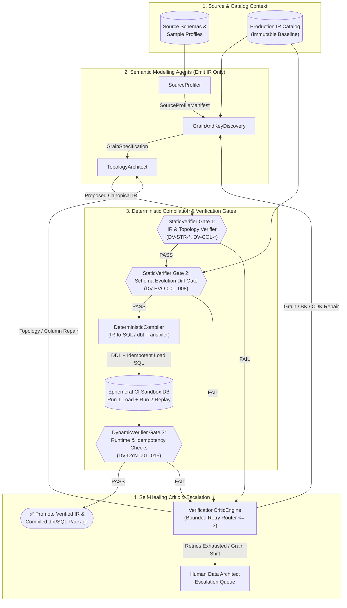

# `open-dv` — Open Agentic Data Vault 2.0 Modeller

**`open-dv`** is an open neuro-symbolic multi-agent architecture and reference specification for autonomous **Data Vault 2.0 (DV 2.0)** data warehouse modelling, non-breaking schema evolution, and formal verification.

Data Vault 2.0 achieves 100% historical auditability, decoupled parallel ingestion, and resilience to upstream operational schema drift by decomposing enterprise data into **Hubs** (identity), **Links** (associations and transactions), and **Satellites** (insert-only temporal state), joined via deterministic cryptographic hash keys (`_hk`) and change digests (`hash_diff`). However, when autonomous LLM agents design or evolve Data Vault schemas without formal guardrails, subtle structural or hashing errors can silently corrupt historical lineage.

`open-dv` solves this through a **Neuro-Symbolic Verification Architecture**:
1. **IR-First Agent Contract (Zero Direct SQL Generation by LLMs):** Semantic modelling agents (`SourceProfiler`, `GrainAndKeyDiscovery`, `TopologyArchitect`) emit and repair models exclusively in a strongly typed **Canonical Intermediate Representation (IR)** validated against [`schemas/dv2-canonical-ir.schema.json`](schemas/dv2-canonical-ir.schema.json).
2. **Deterministic Symbolic Compilation:** A non-LLM `DeterministicCompiler` transpiles verified IR into SQL DDL, 6-stage canonicalized staging views, Zero/Ghost record seed scripts, idempotent load DML, and runtime verification queries.
3. **Two-Phase Defense-in-Depth Verification (`StaticVerifier` + `DynamicVerifier`):** Every proposed model must pass 34 compile-time graph, column, and evolution diff gates (`DV-STR-*`, `DV-COL-*`, `DV-EVO-*`) and 15 runtime sandbox verification and two-run replay idempotency checks (`DV-DYN-001`–`DV-DYN-015`) before promotion.

---

## Quick-Navigation Index

| Document / Artifact | Path | Description |
| :--- | :--- | :--- |
| **Master Agent Reference Guide** | [`docs/DV2_AGENT_REFERENCE_GUIDE.md`](docs/DV2_AGENT_REFERENCE_GUIDE.md) | End-to-end unified reference guide combining layer boundaries, entity DDL/DML templates, 6-stage canonical hashing, stability invariants (`INV-*`, `EVO-*`, `KEY-*`, `TMP-*`, `AP-*`), static/dynamic verification rules (`DV-*`), and the multi-agent self-healing state machine. |
| **01 — Core Modelling Specification** | [`docs/01-core-modelling-spec.md`](docs/01-core-modelling-spec.md) | Deep dive into Staging, Raw Vault, Business Vault, and Information Mart boundaries; Hub, Link (`lnk_`, `t_lnk_`, `sal_`, `hal_`, `x_lnk_`), and Satellite (`sat_`, `mas_`, `esat_`, `sts_`, `rts_`, `ref_`) specifications; PIT & Bridge tables; Zero Keys & Ghost Records; and the 6-stage pre-hash canonicalization pipeline. |
| **02 — Schema Stability & Evolution** | [`docs/02-schema-stability-and-evolution.md`](docs/02-schema-stability-and-evolution.md) | Deep dive into fundamental stability invariants (`INV-01`–`INV-06`), source schema drift playbooks (`EVO-01`–`EVO-08`), key & bi-temporal rules (`KEY-01`–`KEY-05`, `TMP-01`–`TMP-04`), mathematical proofs of delimiter/NULL hash collisions, early-arriving fact Hub stubbing, and the 15 schema anti-patterns (`AP-01`–`AP-15`). |
| **03 — Verification & Agentic Architecture** | [`docs/03-verification-and-agentic-architecture.md`](docs/03-verification-and-agentic-architecture.md) | Deep dive into the mathematical bipartite graph formulation of DV 2.0, compile-time static rules (`DV-STR-*`, `DV-COL-*`, `DV-EVO-*`), runtime SQL verification templates (`DV-DYN-*`), multi-agent contracts, error-routing matrix, and closed-loop self-healing state machine. |
| **Canonical IR JSON Schema** | [`schemas/dv2-canonical-ir.schema.json`](schemas/dv2-canonical-ir.schema.json) | Formal JSON Schema (Draft 2020-12) defining the machine-validated Canonical Intermediate Representation (IR) contract between semantic modelling agents and the deterministic compiler. |

---

## System Architecture Overview



---

## Summary of Invariant & Verification Rule Taxonomy

`open-dv` organizes Data Vault 2.0 modelling, stability, and verification rules into eight machine-checkable namespaces:

| Rule Namespace | ID Range | Enforcement Phase | Scope & Purpose |
| :--- | :--- | :--- | :--- |
| **Fundamental Stability Invariants** | `INV-01` – `INV-06` | Architectural Contract | Insert-only Raw Vault immutability, virtualized `LEAD(load_dts)` end-dating, Hub semantic grain invariance, Link Unit-of-Work grain invariance, strict Hub/Link/Satellite separation of concerns, and idempotent `hash_diff` delta suppression. |
| **Source Schema Drift Playbooks** | `EVO-01` – `EVO-08` (`EVO-01a`) | Schema Evolution | Deterministic additive evolution patterns for added, dropped, renamed, widened, or incompatibly re-typed columns, velocity splits, PII isolation, and multi-source passive/active integration via Ghost-Record-backed PIT tables. |
| **Key Canonicalization Rules** | `KEY-01` – `KEY-05` | Staging & Compiler | 6-stage pre-hash canonicalization, asymmetric `NULL` and case handling (`UPPER_TRIM` for `_hk` vs. `EXACT_TRIM` for `hash_diff`), collision-free length-prefixed (`<len>:<val>`) or delimiter-escaped (`\||`, `\^^`) encoding, and `bkcc` namespace disambiguation. |
| **Bi-Temporal & Multi-Timeline Rules** | `TMP-01` – `TMP-04` | Ingestion & Querying | Separation of `load_dts` (system assertion time), `applied_dts` (business validity time), and `event_dts` (occurrence time); non-spoofing of `load_dts`; early-arriving fact Hub stubbing; and dual-timeline point-in-time reconstruction. |
| **Anti-Pattern Catalog** | `AP-01` – `AP-15` | Pre-Deploy Lint Gates | Catalog of 15 critical Data Vault failure modes (including physical `load_end_dts` updates, Sat-to-Sat chaining, missing Effectivity Satellite driving keys, `CONCAT_WS` NULL-skipping collisions, and hashing `rec_src`/`load_dts` into `_hk`). |
| **Static Graph Topology Rules** | `DV-STR-001` – `DV-STR-014` | Compile-Time (`StaticVerifier`) | Enforces bipartite Hub-Link connectivity ($\text{outdeg}(h)=0$, Link arity $\ge 2$), single-parent Satellites, role-disambiguated `SAME_AS`/`HIERARCHICAL` Links, valid `ESAT` driving keys, non-null `MAS` child dependent keys, and single-source Raw Satellites. |
| **Static Column & Hash Contract Rules** | `DV-COL-001` – `DV-COL-012` | Compile-Time (`StaticVerifier`) | Enforces vault-wide hash key type parity, non-nullable Hub BKs, exact `hk` input parity, alphabetical `hash_diff` column sorting, case-preserving `EXACT_TRIM` payload hashing, exclusion of `load_dts`/`rec_src` from hashes, and multi-source `bkcc` presence. |
| **Schema Evolution Diff Gate Rules** | `DV-EVO-001` – `DV-EVO-008` | Compile-Time (`StaticVerifier`) | Compares $IR_{\text{proposed}}$ against $IR_{\text{baseline}}$ to block hash config changes, entity/column deletions, Hub/Link/MAS grain mutations, destructive DML (`UPDATE`/`DELETE`/`DROP`/`TRUNCATE`), and narrowing column type changes. |
| **Dynamic Runtime & Replay Rules** | `DV-DYN-001` – `DV-DYN-015` | Sandbox CI & Post-Load (`DynamicVerifier`) | Executable SQL verification queries proving Hub/Link/SAT/MAS grain uniqueness, zero cryptographic/delimiter hash collisions, zero orphan FKs, true-delta consecutive `hash_diff` inequality, Zero/Ghost record presence, staging-to-vault completeness, and Two-Run Replay Idempotency ($\Delta \text{rows} = 0$). |

---

## Validating the Canonical IR JSON Schema

To verify that [`schemas/dv2-canonical-ir.schema.json`](schemas/dv2-canonical-ir.schema.json) is well-formed JSON:

```bash
python3 -m json.tool schemas/dv2-canonical-ir.schema.json > /dev/null
```

---

## License

Licensed under the [Apache License, Version 2.0](LICENSE).
