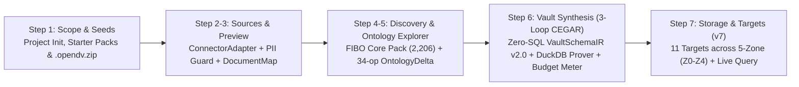

# `open-dv` — Neuro-Symbolic Data Vault 2.0 Modeller, CEGAR Prover & Multi-Dialect Compiler (`2.0.0`)

[](docs/designs/v2-clean-sheet-architecture.md)
[-181715.svg)](docs/DV2_AGENT_REFERENCE_GUIDE.md)
[](docs/components/modeling/user-guide.md)
[](DESIGN.md)
[](src/opendv/storage/)

**`open-dv`** is an open-source neuro-symbolic Data Vault 2.0 (**Hubs**, **Links**, **Satellites**, **PITs**, **Bridges**, and **Reference Tables**) platform that turns heterogeneous operational sources ($N = 1 \to N + 1$), drifting upstream schemas ($S_k(t) \to S_k(t+1)$), and unstructured enterprise documents into mathematically verified, insert-only Data Vault 2.0 architectures—**without ever trusting an LLM to write raw SQL DDL or DML**.

---

## Table of Contents

1. [What Is `open-dv` V2?](#1-what-is-open-dv-v2)
2. [5-Minute Developer Quick Start](#2-5-minute-developer-quick-start)
3. [7-Step Workbench Workflow & Explorer Surfaces](#3-7-step-workbench-workflow--explorer-surfaces)
4. [CLI Command Reference (`opendv`) & MCP Server](#4-cli-command-reference-opendv--mcp-server)
5. [Repository Structure & 5-Layer Architecture](#5-repository-structure--5-layer-architecture)
6. [11 Step-7 Dialect & Orchestrator Emitters](#6-11-step-7-dialect--orchestrator-emitters)
7. [Portable `.opendv.zip` Bundles & `data/public_am/` Walkthrough](#7-portable-opendvzip-bundles--datapublic_am-walkthrough)
8. [Documentation & Specification Map](#8-documentation--specification-map)
9. [Verification, Testing & Build Gates](#9-verification-testing--build-gates)

---

## 1. What Is `open-dv` V2?

Open-DV V2 separates **probabilistic business modeling** (handled by LLM agents over typed JSON proposals) from **deterministic Data Vault 2.0 verification and SQL emission** (handled by symbolic analyzers, an in-memory DuckDB 3-Loop CEGAR prover, and pure AST emitters):



### Core V2 Capabilities
- **Zero Unverified LLM SQL (`OBJ-01`):** Agents never generate SQL DDL or DML; they emit `OntologyDelta` (`34` operations) and declarative `VaultSchemaIR v2.0` (`UniversalVaultSchemaIR`) specifications compiled deterministically in Python.
- **Two-Mode DV 2.0 Modeling Engine ([User Guide](docs/components/modeling/user-guide.md) | [Architecture Design](docs/designs/dv2-modeling-engine-and-governance.md)):**
  - **Mode 1 (Stateless External-Agent CLI + Skill):** `opendv model spec | profile | verify` together with [`.agents/skills/opendv-modeling/SKILL.md`](.agents/skills/opendv-modeling/SKILL.md) lets external coding agents (Antigravity, Claude Code, Codex, Gemini CLI) profile sources, author `VaultSchemaIR v2.0`, and verify against deterministic `V1`–`V6b` gates plus real-row DuckDB proving with zero project DB setup.
  - **Mode 2 (Managed Autonomous CEGAR Engine):** `src/opendv/modeling/` (`opendv model run` and `opendv vault build`) orchestrates multi-turn synthesis, static/evolution/runtime `V1`–`V6b` gates, Horizon Critic (`V7`/`V8`) review, real-row DuckDB proving (`real_row_proving`, `proving_sample_rows`), large-catalog domain sharding, and `ModelingPreferences` (`business_context_hints`) governance.
- **5-Zone Standard (`Z0–Z4`):** `bronze` (`Z0`), `staging` (`Z1`), `raw_vault` (`Z2`), `business_vault` (`Z3`), and `information_mart` (`Z4`).
- **5-Layer Python Core (`src/opendv/`):** Consolidated clean-sheet package backed by SQLite WAL `project.sqlite` persistence (`5` tables), Win32/POSIX ACL-hardened `KeyringSecretStore`, and `34` closed `ErrorCode`s.
- **Unified `opendv` CLI + `:8420` Web Workbench:** One Python CLI (`52` subcommands defined in [`schemas/v2/cli-spec.json`](schemas/v2/cli-spec.json)) running either in-process or remotely via `--api-url`, plus a React 19 WCAG 2.1 AA Web Workbench ([`web/`](web/)) and read-only MCP bridge (`opendv mcp serve`).

---

## 2. 5-Minute Developer Quick Start

### Step 1: Prerequisites & Installation

Requires **Python 3.12+**, **`uv`**, and **Bun 1.x** (for the React 19 Web Workbench and Astro docs site):

```bash
# Install Python dependencies and unified opendv CLI entrypoint
uv sync

# Build the React 19 Web Workbench bundle into src/opendv/api/static/
bun install --cwd web
bun run --cwd web build

# Verify local environment, schema contracts, and agent harnesses
uv run opendv --json doctor
```

### Step 2: Configure Secrets & Harness Settings

Store LLM or catalog credentials securely in your OS keyring (`KeyringSecretStore`) or local development `.env` (see [`.env.example`](.env.example)), never inside project state or `project.sqlite`:

```bash
# Interactive/stdin secret storage (never echoed to telemetry or .opendv.zip exports)
uv run opendv secrets set ANTHROPIC_API_KEY --prompt
uv run opendv --json settings show
```

### Step 3: Initialize a Project, Attach Real Data & Build Through Step 7

Run an end-to-end Asset Management walkthrough using [`data/public_am/`](data/public_am/) (see [`examples/v2_asset_management/README.md`](examples/v2_asset_management/README.md) for the full script):

```bash
# 1. Create a project seeded with an Asset Management starter pack
uv run opendv project init --project am_demo --namespace asset_management --starter-pack multi_asset_ibor

# 2. Attach SQLite / CSV / Parquet / PDF sources (profiled & PII-checked locally)
uv run opendv source attach --project am_demo --kind csv --uri data/public_am/sec_13f_holdings.csv
uv run opendv source attach --project am_demo --kind pdf --uri data/public_am/am_custody_and_voting_guide.pdf

# 3. Ground ontology against FIBO Core Pack (2,206 concepts) + build VaultSchemaIR v2.0
uv run opendv ontology construct --project am_demo --discovery-mode incremental_new --wait
uv run opendv vault build --project am_demo --policy balanced --wait

# 4. Verify VaultSchemaIR and emit SQL / dbt deliverables for Step 7
uv run opendv --json vault verify --project am_demo
uv run opendv --json storage compile --project am_demo --target duckdb_local --verify-runtime
```

Or run the **stateless Mode 1 / standalone Mode 2 Modeling CLI** (`opendv model`) directly over any local file or profile without creating a project database (see [`docs/components/modeling/user-guide.md`](docs/components/modeling/user-guide.md)):

```bash
# Inspect the normative DV 2.0 VaultSchemaIR v2.0 spec & rule catalog
uv run opendv model spec --part overview

# Profile a local source and cache bounded real-row proving samples
uv run opendv --json model profile --source data/public_am/sec_13f_holdings.csv --out profile.json

# Verify an agent-authored VaultSchemaIR v2.0 draft (gates V1-V6b + real-row DuckDB proving)
uv run opendv --json model verify --draft-ir draft_ir.json --profile profile.json

# Or invoke the autonomous Mode-2 CEGAR modeling engine end-to-end
uv run opendv --json model run --profile profile.json --out modeling_result.json
```

### Step 4: Launch the Unified Server & 4-Tab Web Workbench (`:8420`)

```bash
# Windows PowerShell / CMD launchers also wrap: uv run opendv serve
uv run opendv serve --host 127.0.0.1 --port 8420
```

Open **`http://127.0.0.1:8420`** in your browser. Loopback access runs without login/token prompts; non-loopback `--host` binding fails closed with exit code `40` unless `--allow-remote-unauthenticated` is explicitly passed.

---

## 3. 7-Step Workbench Workflow & Explorer Surfaces

The React 19 Web Workbench ([`web/`](web/), governed by [`DESIGN.md`](DESIGN.md) WCAG 2.1 AA tokens) exposes **4 top-level tabs**:

| Topbar Tab | Route | Purpose |
| :--- | :--- | :--- |
| **Project Workflow** | `/projects/:id/step/1..7` | **7-Step** modeling track (**1. Scope & Seeds**, **2. Sources & Secrets**, **3. Preview & Clusters**, **4. Discovery**, **5. Ontology Explorer**, **6. Vault Synthesis**, **7. Storage & Targets**) with **`Guided ⇄ Observatory`** mode switch, **`Readiness` / `Revision`** status pills, and live **`Budget Meter`** (`Turns · Tokens · Active Seconds`). |
| **DV Schema Explorer** | `/projects/:id/explorer` | 4-View explorer (**Lineage Graph**, **Table Catalog**, **SQL & DDL**, **5-Zone Matrix**) built with accessible `@xyflow/react` canvases (`>= 3:1` edge contrast and `2px` `:focus-visible` focus rings). |
| **Run Explorer** | `/projects/:id/runs` | Per-run attempt timeline, CEGAR iteration diffs, live W3C SSE log inspector, budget adjustments (`+turns`/`+tokens`), and Horizon Critic (`v7`/`v8`) review actions. |
| **Settings** | `/settings` | Harness provider & tier selection (`agy`, `claude`, `gemini`), `CegarPolicy` presets, secret backend & workspace root trust management, and MCP server registration. |

---

## 4. CLI Command Reference (`opendv`) & MCP Server

All `52` subcommands are defined canonically in [`schemas/v2/cli-spec.json`](schemas/v2/cli-spec.json) and auto-documented in [`docs/16-cli-reference.md`](docs/16-cli-reference.md):

| Command Group | Key Subcommands | Purpose |
| :--- | :--- | :--- |
| `opendv project` | `init`, `list`, `show`, `delete`, `export`, `import` | Create, inspect, and export/import portable `.opendv.zip` archives (`core_project_state` default; `--full-demo` optional). |
| `opendv source` | `adapters`, `inspect`, `attach`, `list`, `reattach`, `detach`, `note`, `approve-scan` | Inspect/attach CSV, Parquet, SQLite, DuckDB, Postgres, PDF, Markdown, or unstructured notes with SSRF/PII checks. |
| `opendv model` | `spec`, `profile`, `verify`, `run` | Mode 1 stateless external-agent spec/profile/real-row IR verification (`V1`–`V6b`) and Mode 2 autonomous CEGAR modeling runs ([Component Guide](docs/components/modeling/user-guide.md)). |
| `opendv ontology` | `construct`, `answer`, `control`, `validate`, `commit`, `export`, `fibo-qa` | Construct & evolve `GraphAOntology` via CAS `OntologyDelta`s and FIBO BM25 citation resolution. |
| `opendv vault` | `build`, `status`, `control`, `hold`, `horizon`, `logs`, `verify`, `waive` | Run the 3-Loop CEGAR `VaultSchemaIR v2.0` builder, inspect SSE logs, resolve steward holds, manage waivers & Horizon Critic checks. |
| `opendv storage` | `compile`, `migrate`, `query`, `regenerate` | Lower verified `VaultSchemaIR v2.0` to any of the `11` Step-7 targets (`v7`), run sandbox/migrations, and issue guarded read-only SQL queries. |
| `opendv agents` / `mcp` | `agents list\|inspect`, `mcp list\|register\|remove\|serve` | Manage built-in agent harnesses and launch the read-only local MCP server (`opendv mcp serve`). |
| `opendv secrets` / `settings` / `doctor` / `serve` | `secrets set\|list\|delete`, `settings show\|set\|project-set\|trust-workspace`, `doctor`, `serve` | Manage OS keyring secrets, CEGAR & modeling policies, trusted workspaces, system health, and the `:8420` HTTP/SSE host. |

Use global `--api-url http://127.0.0.1:8420` to proxy any CLI command through a running `:8420` server, or omit it for direct in-process execution over `.opendv/projects/<id>/project.sqlite`.

---

## 5. Repository Structure & 5-Layer Architecture

```text
open-dv/
├── src/opendv/                    # Consolidated Python core (strict downward 5-layer DAG)
│   ├── models/                    # Layer 1: StrictModel DTOs, VaultSchemaIR v2.0, 34 ErrorCodes, RFC 8785 JCS
│   ├── sources/                   # Layer 2: ConnectorAdapter SPI, profiler, PII/NER taint, FIBO Core Pack (2,206)
│   ├── verifier/                  # Layer 2: 3-loop CEGAR prover, static/evolution rules, ProblemDetails patches
│   ├── storage/                   # Layer 2: DuckDB prover sandbox, readonly SQL guard, 11 Step-7 dialect emitters
│   ├── agents/                    # Layer 3: Harness adapters (agy, claude, gemini), MCP server, budget meter
│   ├── modeling/                  # Layer 3: DV 2.0 Modeling Engine (Mode 1/2, CEGAR loop, V7/V8 critics, sharding, steering)
│   ├── service/                   # Layer 4: OpenDVService, project.sqlite WAL store, zip_guard, KeyringSecretStore
│   ├── api/                       # Layer 5: FastAPI REST + SSE (:8420), loopback security guard, static UI host
│   └── cli/                       # Layer 5: Unified Typer CLI (52 subcommands) + schemas/v2 contract exporter
├── .agents/skills/opendv-modeling/# External-agent SKILL.md for Mode 1 stateless DV 2.0 modeling
├── web/                           # React 19 + Vite + Bun 4-tab WCAG 2.1 AA Web Workbench
├── apps/opendv-website/           # Astro documentation & V2 showcase site
├── schemas/v2/                    # Canonical cli-spec.json, error-codes.json, openapi.json, baseline-digests.json
├── data/public_am/                # Public Asset Management CSV, Parquet, SQLite, DuckDB & PDF test fixtures
├── examples/v2_asset_management/  # End-to-end V2 Asset Management quickstart guide
├── vectors/                       # Deterministic RFC 8785 JCS reference vectors (bm25.json, genesis.json)
├── scripts/                       # Contract/error-code/CLI-doc verification & FIBO vendoring scripts
├── tests/                         # Python unit, integration, parity, doc-sync, and 12 architecture guard suites
├── docs/                          # Specifications, UX/UAT guides (docs/29..33), & historical V1 records (docs/00..28)
├── DESIGN.md                      # Canonical WCAG 2.1 AA design tokens & UX spec
├── AGENTS.md / CLAUDE.md          # Agent & contributor constitutions
└── pyproject.toml                 # Single-package uv/hatchling configuration + ruff/mypy/pytest settings
```

---

## 6. 11 Step-7 Dialect & Orchestrator Emitters

`src/opendv/storage/` compiles verified `VaultSchemaIR v2.0` deterministically across **5 Zones (`Z0–Z4`)** for:
- **Analytical & Cloud Warehouses (`8` SQL Dialects):** `duckdb_local`, `databricks_uc`, `snowflake`, `postgres`, `bigquery`, `sqlserver_fabric`, `redshift`, `clickhouse`
- **Format & Orchestrator Bundles (`3` Format Targets):** `iceberg`, `parquet`, `dbt` (configurable SQL dialect via `--dbt-dialect`)

---

## 7. Portable `.opendv.zip` Bundles & `data/public_am/` Walkthrough

- **Portable Default (`core_project_state`):** `opendv project export --project <id> --out bundle.opendv.zip` packages canonical JSON/IR state, project manifest, ontology revisions, and SHA-256 checksums without leaking API secrets or bulky demo databases. Pass `--full-demo` to include raw fixture files.
- **Anti-Tamper Import Guard:** `opendv project import` verifies paths against zip-slip, decompression ratios against zip-bombs (`zip_guard.py`), and cryptographic SHA-256 digests (`BUNDLE_HASH_MISMATCH`).
- **Real Asset Management Dataset (`data/public_am/`):** Explore SEC 13F holdings, FRED Treasury rates, bi-temporal NAV restatements, EU custody LEI Parquet drift, `ds_cegar_12trap.duckdb` (`12` deliberate CEGAR modeling traps), and the custody/voting PDF in [`examples/v2_asset_management/README.md`](examples/v2_asset_management/README.md).

---

## 8. Documentation & Specification Map

- **DV 2.0 Modeling Component & Architecture:**
  - **Component User Guide:** [`docs/components/modeling/user-guide.md`](docs/components/modeling/user-guide.md) — Mode 1 (`opendv model spec|profile|verify`), Mode 2 (`opendv model run` / `opendv vault build`), `ModelingPreferences`, real-row proving, & troubleshooting
  - **Component Contributor Guide:** [`docs/components/modeling/contributor-guide.md`](docs/components/modeling/contributor-guide.md) — `src/opendv/modeling/` module map, Layer-3 import contracts, `D16` token budget, & extension recipes
  - **Architecture & Governance Design:** [`docs/designs/dv2-modeling-engine-and-governance.md`](docs/designs/dv2-modeling-engine-and-governance.md) — `src/opendv/modeling/` CEGAR loop, Horizon Critics (`V7`/`V8`), domain sharding, & IR-level governance
  - **External-Agent Modeling Skill:** [`.agents/skills/opendv-modeling/SKILL.md`](.agents/skills/opendv-modeling/SKILL.md) — normative Mode 1 protocol for external coding agents
- **Authoritative Sitemap:** [`docs/designs/SITEMAP.md`](docs/designs/SITEMAP.md)
- **Clean-Sheet V2 Architecture & UI Specs:** [`docs/designs/v2-clean-sheet-architecture.md`](docs/designs/v2-clean-sheet-architecture.md), [`docs/designs/v2-workbench-ui-design.md`](docs/designs/v2-workbench-ui-design.md)
- **V2 Discovery, Modeling, E2E & UAT Suite (`docs/29..33`):**
  - [`docs/29-discovery-grounding-and-evolution-scenarios.md`](docs/29-discovery-grounding-and-evolution-scenarios.md) — `SCEN-01..09`
  - [`docs/30-enterprise-dv2-modeling-and-loop-engineering.md`](docs/30-enterprise-dv2-modeling-and-loop-engineering.md) — Enterprise DV 2.0 + 3-Loop CEGAR blueprint
  - [`docs/31-v2-e2e-requirements-gaps-and-uat-spec.md`](docs/31-v2-e2e-requirements-gaps-and-uat-spec.md) — `OBS-01..48`, `REQ-01..68`, `89` UAT checks
  - [`docs/32-v2-user-experience-and-scenario-guide.md`](docs/32-v2-user-experience-and-scenario-guide.md) — Steps 1–7 UX & `20`-Scenario Playbook
  - [`docs/33-v2-phased-implementation-and-real-data-uat-plan.md`](docs/33-v2-phased-implementation-and-real-data-uat-plan.md) — Phased TDD & Live-Agent UAT Plan
- **CLI & DV 2.0 Reference:** [`docs/16-cli-reference.md`](docs/16-cli-reference.md) (generated), [`docs/16-human-and-agent-usage-guide.md`](docs/16-human-and-agent-usage-guide.md), [`docs/DV2_AGENT_REFERENCE_GUIDE.md`](docs/DV2_AGENT_REFERENCE_GUIDE.md)
- **Foundational Theory & Historical V1 Records:** [`docs/00`](docs/00-mission-vision-and-functional-requirements.md)–[`docs/28`](docs/28-unified-ontology-pipeline-design-and-plan.md) (annotated with V2 supersession headers)

---

## 9. Verification, Testing & Build Gates

```bash
# CLI & contract checks
uv run opendv --help
uv run opendv --json doctor
uv run python -m opendv.cli.export_contracts --check
uv run python scripts/check_error_codes.py --catalog schemas/v2/error-codes.json --baselines schemas/v2/baseline-digests.json --check-ast

# Python test suite & architecture guards
uv run pytest tests/ -q

# Python lint & static typecheck
uv run ruff check src tests scripts
uv run mypy src

# Web Workbench (web/) & marketing site (apps/opendv-website/)
bun run --cwd web typecheck && bun run --cwd web lint && bun run --cwd web build && bun run --cwd web test
bun run --cwd apps/opendv-website build
```

## License

Apache License 2.0. See `LICENSE` for details.
