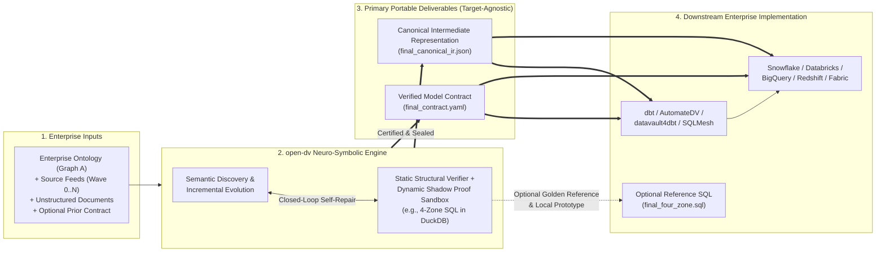
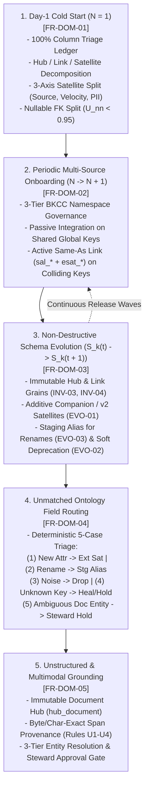

# 00 — Mission Statement, Product Vision, Strategic Objectives, and Non-Prescriptive Functional Requirements

> **Part of the [`open-dv` Reference Guide Suite](DV2_AGENT_REFERENCE_GUIDE.md)**  
> **Domain:** Product Charter, Architectural Philosophy ("What, Not How"), Portable Deliverable Boundaries (`contract.yaml` & `canonical_ir.json` vs. Internal Proof Sandbox), Normative Functional Requirements (`FR-DOM-*`, `FR-VER-*`, `FR-INT-*`), and Enhancement Conformance Rubric  
> **Companion Specifications:**
> - [🧭 **Root Agent & Contributor Constitution (`AGENTS.md`)**](../AGENTS.md)
> - [16 — Human & Autonomous Agent Usage & Integration Guide](16-human-and-agent-usage-guide.md)
> - [01 — Core Architecture, Entity Specifications, and Methodology Standards](01-core-modelling-spec.md)
> - [02 — Schema Stability, Cold-Start ($N=1$) Pragmatism, Evolution Mechanics, and Anti-Patterns](02-schema-stability-and-evolution.md)
> - [03 — Automated 6-Gate Verification, `dv-firstmate` Swarm, and Agentic Architecture](03-verification-and-agentic-architecture.md)
> - [04 — Unstructured & Multi-Modal Data Vault 2.0 Integration](04-unstructured-and-multimodal-dv2.md)
> - [05 — ELM Calculus, Graph B Profiling Math, 3-Pass CoT Prompt, and Reference Algorithms (`A.1`–`A.9` & `D.10`)](05-elm-calculus-and-reference-algorithms.md)
> - [12 — Agentic Pipeline Inputs, Harness Configuration & Authentication Reference Guide](12-agentic-pipeline-inputs-and-harness-guide.md)
> - [14 — End-to-End Consistency Review, Scenarios Audit, and Data Vault 2.0 Invariant Analysis](14-end-to-end-consistency-and-scenarios-audit.md)
> - [No-Mistake DV 2.0 Contract V5 Schema (`schemas/no-mistake-dv2-contract-v5.schema.json`)](../schemas/no-mistake-dv2-contract-v5.schema.json) & [Canonical IR Schema (`schemas/dv2-canonical-ir.schema.json`)](../schemas/dv2-canonical-ir.schema.json)

---

## 1. Mission Statement & Primary Purpose

### 1.1 Mission Statement

**`open-dv` is an open-source, neuro-symbolic Data Vault 2.0 (DV 2.0) modelling, evolution, and verification engine.** Its mission is to bridge the gap between probabilistic AI semantic discovery and deterministic enterprise data warehouse engineering—enabling data teams to onboard messy operational sources ($N=1 \to N+1$), absorb continuous upstream schema drift ($S_k(t) \to S_k(t+1)$), and ground unstructured business documents into mathematically verified Data Vault 2.0 models **without ever trusting a Large Language Model (LLM) to author unverified raw SQL directly**.

### 1.2 The Core Problem

Data Vault 2.0 provides 100% historical auditability, decoupled parallel loading, and resilience to upstream schema drift by decomposing enterprise data into **Hubs** (immutable business identity), **Links** (many-to-many associations and atomic transactions), and **Satellites** (insert-only temporal state logs). However, designing and evolving Data Vault 2.0 models across dozens of heterogeneous sources is labor-intensive, while naive LLM-driven schema generation routinely falls into **Five Fatal Traps**:

1. **Source-Driven Hub Proliferation (`AP-11`):** Cloning physical 3NF source tables into siloed Hubs (`hub_sap_customer`, `hub_sfdc_customer`) instead of integrating around canonical enterprise business concepts.
2. **Surrogate Key Leakage:** Anchoring Hubs on mutable or system-local sequence integers (`row_id`, auto-increment IDs) without namespace disambiguation.
3. **Silent Cryptographic Hash Collisions (`AP-08`, `AP-09`):** Using naive delimiter concatenation (`a || '||' || b`), `CONCAT_WS` NULL-skipping, or inconsistent character-vs-byte length encoding across runtimes.
4. **Soft Business Rule Contamination:** Embedding destructive filters, deduplication heuristics, or KPI aggregations inside Staging or the Raw Data Vault, permanently corrupting regulatory audit lineage.
5. **Destructive Evolution & Physical Satellite Mutations (`AP-01`, `AP-02`, `AP-10`, `AP-12`):** Executing `UPDATE`/`DELETE` statements on Raw Vault tables, altering existing Hub/Link grains in place, or triggering 100% false-positive delta reloads when adding columns.

### 1.3 Primary Portable Deliverables vs. Internal Proof Harness

A foundational architectural principle of `open-dv` is the strict distinction between its **primary portable deliverables for enterprise consumption** and its **internal dynamic proof harness**:

1. **Primary Portable Deliverables (`final_contract.yaml` & `final_canonical_ir.json`):**
   - **Verified Declarative Model Contract (`final_contract.yaml`):** The human- and machine-auditable specification of the Data Vault 2.0 topology (`Hubs`, `Links`, `Same-As Links`, `Satellites`, `Reference Tables`, 100% column triage ledger, 3-Tier `BKCC` governance, and steward escalations).
   - **Target-Agnostic Canonical Intermediate Representation (`final_canonical_ir.json`):** The normalized, lower-level logical and cryptographic specification (`CanonicalIR`) resolving all entity grains, pre-hash token orders, null-token semantics, and temporal window definitions independent of any SQL dialect.
   - **Zero Warehouse Lock-In:** Enterprise data teams whose goal is to perform rigorous Data Vault 2.0 modelling—especially when onboarding new sources periodically ($N \to N+1$) or handling upstream schema drift ($S_k(t) \to S_k(t+1)$)—and deploy physical tables in their own warehouse stack (**dbt / AutomateDV / datavault4dbt, SQLMesh, Snowflake, Databricks Delta/Iceberg, BigQuery, Synapse/Fabric, or Postgres**) **only need `final_contract.yaml` and `final_canonical_ir.json`**.
2. **Role of the 4-Zone SQL Bundle (`final_four_zone.sql`) and DuckDB Shadow Sandbox:**
   - **Internal Mathematical Proof Harness:** Before `open-dv` certifies and seals a `final_contract.yaml` and `final_canonical_ir.json`, it must prove that the model is not merely syntactically valid YAML, but **behaviorally sound under adversarial data loads**. The 4-Zone SQL compiler and in-memory DuckDB Shadow Sandbox serve internally as an automated theorem prover—executing multi-batch loads, duplicate replay tests, null/zero-key boundary checks, and bi-temporal point-in-time (PIT) queries to certify zero hash collisions, zero orphan foreign keys, and 100% replay idempotency.
   - **External Golden Reference & Local Prototyping Runtime:** Externally, `final_four_zone.sql` serves as an optional, batteries-included reference implementation for local prototyping, educational inspection, or lightweight DuckDB deployments—**never a mandatory runtime dependency for production enterprise data warehouses**.

---

## 2. Product Vision & Strategic Objectives

### 2.1 Vision Statement

To establish the universal, open-standard **Intermediate Representation and Verification Layer** for autonomous enterprise data modelling—where AI agents accelerate discovery and mapping by an order of magnitude, symbolic verifiers guarantee 100% mathematical and regulatory compliance, and human Data Stewards retain effortless governance over ambiguous business semantics.

### 2.2 Strategic Objectives (`OBJ-01` – `OBJ-06`)

| Objective ID | Strategic Objective | Target Outcome & Measurable Invariant |
| :--- | :--- | :--- |
| **`OBJ-01`** | **IR-First Neuro-Symbolic Safety** | 100% of LLM agent outputs are constrained to declarative contracts (`final_contract.yaml` / `final_canonical_ir.json`); 0% of unverified LLM-generated DDL/DML ever reaches a target database. |
| **`OBJ-02`** | **Continuous Multi-Wave Lifecycle Agility** | Seamless progression from Day-1 Cold Start ($N=1$) through periodic multi-source onboarding ($N \to N+1$), intra-source schema drift ($S_k(t) \to S_k(t+1)$), and multimodal document ingestion with **zero destructive mutations** to previously deployed Hubs, Links, or Satellites. |
| **`OBJ-03`** | **Target-Agnostic Enterprise Portability** | `final_contract.yaml` and `final_canonical_ir.json` capture 100% of the structural, cryptographic, and temporal metadata required for any downstream compiler or template framework (dbt, AutomateDV, SQLMesh, native cloud EDW) to materialize a compliant Data Vault 2.0 warehouse. |
| **`OBJ-04`** | **Static + Dynamic Mathematical Certification** | Every certified model passes both static graph/grain/evolution verification and dynamic multi-batch adversarial execution verification (proving idempotency, referential integrity, and bi-temporal reconstructability) prior to release. |
| **`OBJ-05`** | **Bounded Self-Healing & Human-in-the-Loop Governance** | Autonomous agents automatically repair mechanical structural/grain errors via compact machine-readable diagnostics within strict cost/turn budgets, while ambiguous domain semantics or low-confidence entity matches fail closed to human Data Stewards (`ASK-USER` / Captain-Hold). |
| **`OBJ-06`** | **Defense-in-Depth Privacy & Auditability** | 100% of source columns are accounted for in an immutable triage ledger; restricted PII/MNPI is isolated at the Satellite level and redacted across telemetry/APIs; every artifact is sealed by cryptographic digest. |

---

## 3. Architectural Philosophy: Non-Prescriptive Requirements ("What, Not How") & Design Rationale ("Why")

To keep `open-dv` resilient, extensible, and open to continuous engineering innovation, this specification strictly separates **Normative Functional Requirements (WHAT must be guaranteed)** from **Current Reference Architecture Choices (HOW `v6.0` happens to implement it today)**, grounded in explicit **Engineering & Domain Rationale (WHY both the guarantee and the flexibility exist)**.

> [!IMPORTANT]
> **The Non-Prescriptive Rule:** Any subsystem, algorithm, agent adapter, profiler, or compiler in `open-dv` may be refactored, replaced, or extended with alternative technologies **provided that all Normative Functional Requirements (`FR-*`) and Mathematical Stability Invariants (`INV-01..06`, `EVO-01..08`, `KEY-01..05`, `TMP-01..04`) continue to hold.**

### 3.1 Normative Guarantee (WHAT) vs. Implementation Flexibility (HOW) & Design Rationale (WHY) Matrix

| Architectural Concern | Normative Requirement (**WHAT Must Be Guaranteed**) | Non-Prescriptive Flexibility (**HOW Reference `v6.0` Implements It & How It May Evolve**) | Design Principle Rationale (**WHY We Mandate the "What" & Decouple the "How"**) |
| :--- | :--- | :--- | :--- |
| **1. Generative AI Boundary (IR-First Neuro-Symbolic Split)** | Semantic modelling agents MUST emit only schema-validated declarative model contracts and MUST NOT emit raw, unverified target DDL/DML directly. | Reference `v6.0` uses Pydantic v2 (`NoMistakeDataVault2ContractV5` & `CanonicalIR`) and JSON Schema Draft 2020-12. Future versions may evolve schema versions (`v6+`), Protobuf/Avro/OpenMetadata bindings, or alternative contract DSLs. | **Why Mandate the What:** LLMs excel at resolving semantic ambiguity (inferring business concepts from messy column names or unstructured text) but are inherently probabilistic; a single hallucinated SQL expression, unsorted `hash_diff` column list, or unescaped delimiter silently corrupts an insert-only Data Vault forever. Constraining LLMs to a declarative IR eliminates raw SQL hallucination by construction. **Why Decouple the How:** Metadata serialization standards evolve rapidly across enterprise stacks; decoupling the IR contract from a single wire format ensures long-term interoperability. |
| **2. Empirical Source Profiling & Drift Detection (Dual-Graph Grounding)** | The system MUST compute empirical uniqueness, null ratios, entropy, functional/inclusion dependencies, and column-level schema diffs between baseline $S_k(t)$ and incoming $S_k(t+1)$ feeds before modelling. | Reference `v6.0` implements `GraphBProfiler` over CSV/Parquet/JSON using Python/DuckDB and Levenshtein name similarity (`Algorithm A.9a`). Implementations may freely use Polars, Apache Arrow, DuckDB, DataFusion, or push-down warehouse metadata queries (`INFORMATION_SCHEMA`). | **Why Mandate the What:** Source table names and legacy DDLs frequently lie—a column named `account_id` may contain `NULL`s, duplicates, or recycled sequences, and an unsplit sparse foreign key ($U_{\text{nn}} < 0.95$) in an $N$-ary or binary Link will falsely cluster thousands of unrelated records onto a shared Zero Key (`Trap 2` & `Trap 3`). Empirical data physics (`Graph B`) must ground business ontology (`Graph A`) before any grain is locked. **Why Decouple the How:** Whether statistical metrics ($U(C), H(C), N_{\text{null}}, I$) are computed locally in DuckDB/Polars or pushed down into a cloud warehouse's native query engine does not alter the mathematical profile fed to the modeller. |
| **3. Agent Orchestration & Model Routing (Role-Scoped Sandboxing)** | The system MUST decouple domain discovery, contract synthesis, and verification across role-scoped tasks with configurable compute/cost budgets and workspace sandboxing. | Reference `v6.0` orchestrates 4 personas (`vault-first-mate`, `scout-source`, `scout-unstructured`, `ship-vault`) across 8 stages (`STAGE_00..07`) with `reasoning`/`fast` tiers and `agy`, `claude-cli`, `antigravity`, and `claude` adapters. Any single- or multi-agent topology, prompt strategy, or LLM vendor (OpenAI, Gemini, Claude, local open-weight models, MCP servers) is valid. | **Why Mandate the What:** Mixing source profiling, 3-pass contract modelling, and verification inside a single monolithic agent context leads to context pollution, self-grading bias (reward hacking where an agent weakens verification rules to pass its own output), and unbounded token spend. Role separation and read-only critic isolation guarantee objective verification and predictable cost ceilings. **Why Decouple the How:** Foundation models and agent SDKs change every quarter; abstracting model routing (`reasoning` vs. `fast`) and harness adapters prevents vendor lock-in. |
| **4. Static Structural & Evolution Verification (Compile-Time Proof)** | Every candidate contract MUST be deterministically checked for bipartite Hub-Link-Satellite legality, 100% column triage coverage, injective hashing rules, anti-pattern exclusion (`AP-01..15`), and additive-only evolution against any prior contract. | Reference `v6.0` implements the 6-Gate `axi-dv` pipeline using `networkx` DAG checks, `sqlglot` AST linting, and Python codemods (`Algorithms A.1–A.9b`). Implementations may use Rust/Go verifiers, Datalog/SMT solvers (Z3), or alternative SQL parsers. | **Why Mandate the What:** In Data Vault 2.0, structural mistakes (such as Hub-to-Hub foreign keys, Link-on-Link snowflaking, silent column drops, or mutating a deployed Hub's business key grain in Wave $k+1$) are asymmetric and costly to reverse once loaded in production. Deterministic compile-time gates catch 100% of topological and evolutionary violations in milliseconds before touching a database. **Why Decouple the How:** Graph topology and AST verification are pure symbolic math; any deterministic graph/AST engine or formal solver that enforces the invariant catalog is equally valid. |
| **5. Dynamic Behavioral Proof Harness (Runtime Execution Proof)** | Before sealing a model contract, the system MUST dynamically verify that compiled load logic is idempotent under duplicate batch replay, produces zero orphan foreign keys, preserves zero-key/ghost-record equi-joins, and accurately reconstructs bi-temporal states. | Reference `v6.0` compiles 4-Zone DuckDB SQL (`compiler_4zone.py`) and runs 4 Adversarial Batches (`DV-DYN-001..015`) in an ephemeral `:memory:` DuckDB instance. The internal proof engine may use DuckDB, SQLite, containerized Postgres, or an ephemeral cloud warehouse schema. | **Why Mandate the What:** Static schema checks cannot prove dynamic set-based runtime behavior under edge-case data—such as whether duplicate micro-batches are truly idempotent ($\Delta\text{rows}=0$), whether out-of-order bi-temporal restatements (`applied_dts`) compute deltas against the right timeline, or whether `INNER JOIN` PIT queries drop rows when optional FKs are `NULL`. Running adversarial batches in an internal sandbox acts as an automated theorem prover *before* certifying `canonical_ir.json`. **Why Decouple the How:** The dynamic sandbox is an internal proof harness, not the user's production warehouse; `:memory:` DuckDB provides instant zero-infrastructure verification today, while allowing any SQL execution engine to serve as the proof backend. |
| **6. Closed-Loop Self-Healing Diagnostics (Machine-Readable Critic Loop)** | Static or dynamic verification failures MUST be serialized into structured, deterministic diagnostic traces containing rule IDs, offending entity/column paths, and actionable repair directives for bounded agent retry. | Reference `v6.0` encodes diagnostics in the token-dense `@toon_v1` wire format with up to $K$ retries (`max_schema_validation_retries`). JSON-RPC, structured XML/Markdown diagnostics, or constrained decoding grammars are equally valid. | **Why Mandate the What:** Complex multi-source schemas frequently require 1–2 iterative refinements (e.g., adding a missing `BKCC` namespace prefix or splitting a high-velocity Satellite). Deterministic, rule-indexed diagnostic traces allow the modelling agent to self-heal autonomously without human toil, while a strict retry ceiling ($K_{\max}$) prevents infinite repair loops. **Why Decouple the How:** `@toon_v1` optimizes LLM context window efficiency (~65% token reduction over raw JSON), but the wire encoding itself is an optimization detail that can evolve alongside LLM structured-output capabilities. |
| **7. Downstream Target Compilation (Portable Model vs. Target SQL Separation)** | Certified `final_contract.yaml` and `final_canonical_ir.json` artifacts MUST be sufficient to deterministically generate target warehouse DDL/DML or transformation project files without further LLM inference. | Reference `v6.0` includes a built-in 4-Zone DuckDB SQL compiler. External or pluggable compilers can target **dbt (`AutomateDV` / `datavault4dbt`)**, **SQLMesh**, **Snowflake**, **Databricks**, **BigQuery**, or **Apache Iceberg**. | **Why Mandate the What:** Enterprise data platforms run on diverse warehouse engines and transformation frameworks (`dbt`, `AutomateDV`, `Snowflake`, `Databricks`, `BigQuery`). Making `final_contract.yaml` and `final_canonical_ir.json` 100% self-contained decouples **Data Vault 2.0 modelling & evolution** from **physical warehouse execution**, ensuring teams never need the DuckDB SQL bundle in production. **Why Decouple the How:** Once `CanonicalIR` is certified, emitting target SQL or `dbt` YAML is a pure deterministic template projection that any downstream compiler or macro package can perform natively. |
| **8. Steward Governance, Security & Telemetry (Fail-Closed Human Sovereignty)** | Ambiguous semantics MUST pause or escalate via auditable hold records; restricted PII/MNPI MUST be isolated and redacted by role; artifacts MUST be cryptographically fingerprinted. | Reference `v6.0` provides file-backed `StewardHoldManager`, JSONL telemetry (`vault-ledger.jsonl`), SHA-256 CAS storage, FastAPI (`:8420`), and a 12-View React Workbench (`WB-00..11`). Enterprise deployments may integrate with Jira/ServiceNow, OpenLineage/DataHub, S3/GCS, or BI portals. | **Why Mandate the What:** When an upstream feed introduces an unmapped ontology concept or an unstructured document yields a low-confidence entity match (`Tier-U3`), an autonomous agent must **never guess**—because a false entity link in an insert-only Vault permanently pollutes enterprise master data. Fail-closed Steward holds, PII Satellite isolation (for GDPR crypto-shredding), and SHA-256 CAS provenance are mandatory for enterprise trust and regulatory compliance. **Why Decouple the How:** Governance UIs, identity providers, and enterprise data catalogs vary by organization; the underlying hold and telemetry contracts must integrate cleanly into any enterprise control plane. |

---

## 4. Complete Lifecycle Coverage Overview

An enterprise Data Vault 2.0 warehouse is never a one-off static schema generation task; it is a living system that evolves across asynchronous operational waves. `open-dv` mandates full functional coverage across five core domain lifecycles:

---

## 5. Normative Functional Requirements Specification

All requirements below use RFC 2119 normative keywords (**MUST**, **MUST NOT**, **SHOULD**, **MAY**).

### 5.1 Domain Modelling & Lifecycle Requirements (`FR-DOM-01` – `FR-DOM-05`)

#### `FR-DOM-01`: Day-1 Cold Start Modelling ($N=1$)
When bootstrapping a Data Vault 2.0 model from an initial operational source dataset ($N=1$) and an enterprise domain ontology (`Graph A`):
1. **100% Column Triage Accounting:** Every physical column in every input source feed MUST be explicitly accounted for in the contract's column triage ledger. No source column may be silently ignored; each column MUST be classified into a deterministic role (`BUSINESS_KEY`, `FOREIGN_KEY_REF`, `DESCRIPTIVE_PAYLOAD`, `EFFECTIVE_TIMESTAMP`, `SYSTEM_SURROGATE_DROPPED`, or `OMITTED_INTENTIONALLY` with an auditable justification).
2. **Concept-Grounded Hub Identification & Surrogate Quarantine:** Hubs MUST represent canonical enterprise business concepts (`Graph A`) rather than 1:1 clones of source tables. Monotonic system sequences, technical row IDs, or unverified random UUIDs MUST be quarantined (`DROPPED_SURROGATE`) unless explicitly justified and scoped by a source-specific collision code (`BKCC`). All Hub business keys MUST be stored as text (`VARCHAR`/`STRING`) to preserve leading zeros and future alphanumeric key compatibility.
3. **Universal Many-to-Many ($M:N$) Link Decomposition:** All inter-Hub relationships, hierarchies (`hal_*`), and multi-party transactions MUST be modeled as Links (`lnk_*` or non-historized transactional `t_lnk_*`), never as foreign keys embedded inside Hubs or Satellites (`INV-05`, `AP-04`). Links MUST preserve the natural atomic Unit of Work (UoW) grain without referencing another Link's primary key ("No Link-on-Link").
4. **Orthogonal Satellite Decomposition & PII Isolation:** Descriptive payload attributes MUST be attached to exactly one parent Hub or Link (`INV-05`) and split across Satellites along three orthogonal axes:
   - *Source System Alignment:* Separate Satellites per distinct operational source feed.
   - *Security & Privacy Classification (`EVO-07`):* Columns classified as restricted PII or MNPI MUST be isolated into dedicated security Satellites (`sat_<entity>_pii`) to support independent RBAC masking and GDPR/CCPA crypto-shredding without destroying structural Hub/Link lineage.
   - *Velocity / Write-Amplification Cost Guard:* High-frequency volatile attributes SHOULD be separated from wide, low-frequency static attributes whenever mixing them exceeds a configurable write-amplification threshold (e.g., $W_{\text{amp}} \ge 50\text{ MB/day}$).
5. **Nullable / Sparse Foreign Key Handling ($U_{\text{nn}} < 0.95$):** When a foreign key column in a source relationship is optional or sparse (non-null ratio $U_{\text{nn}}$ below threshold, e.g., $0.95$), the modeller MUST NOT blindly map missing optional keys to a shared Zero Key in the base Link if doing so creates synthetic relationship clusters across unrelated transactions. This rule applies equally to **$N$-ary Links ($\text{arity} \ge 3$) and binary Links ($\text{arity} = 2$)**—the optional relationship MUST either be split into a filtered companion Link (`WHERE <fk> IS NOT NULL`), filtered at the binary Link level, or explicitly demoted according to governed modelling policy.

---

#### `FR-DOM-02`: Periodic Multi-Source Onboarding ($N \to N+1$)
When onboarding a new operational source system, business unit, or multi-tenant feed ($N+1$) into an existing Data Vault model:
1. **Anti-Silo Concept Consolidation (`AP-11`):** If an incoming source table represents a business concept that already has a deployed Hub in the prior contract, the system MUST integrate the feed into the existing canonical Hub rather than creating a source-specific duplicate Hub.
2. **3-Tier Business Key Collision Code (`BKCC`) Authority Governance (`KEY-04`):** Every Hub business key mapping MUST be classified into one of three authority tiers:
   - **`TIER_1_GLOBAL_STANDARD`** (e.g., ISO LEI, ISIN, tax ID) and **`TIER_2_ENTERPRISE_SOR`** (curated enterprise master UUID): Share a standardized global keyspace representation so identical real-world entities arriving from multiple sources produce the **exact same Hub hash key (`_hk`)**, achieving zero-lookup **Passive Integration**.
   - **`TIER_3_LOCAL_SCOPED`** (system-local sequences, regional codes, or multi-tenant IDs prone to homonym collision across sources): MUST be qualified with a deterministic `BKCC` namespace prefix (either a static source/domain literal scoped per `(table, column, target_hub)` tuple or a dynamic tenant identifier column expression) prior to hashing so colliding local identifiers (`SAP:1001` vs. `STRIPE:1001`) never collide in the Raw Hub.
3. **Active Identity Convergence via Same-As Links (`EVO-08`):** Cross-source entity deduplication across distinct business keys or distinct `BKCC` namespaces MUST never mutate or merge Raw Hub records. Active identity convergence MUST be modeled in the Business Data Vault using a **Same-As Link (`sal_<entity>`)** paired with an **Effectivity Satellite (`esat_sal_<entity>`)**, enforcing canonical edge ordering (`hk_master != hk_duplicate`, rejecting reflexive `(A, A)` loops and duplicate inverted pairs `(B, A)`).

---

#### `FR-DOM-03`: Non-Destructive Schema Evolution ($S_k(t) \to S_k(t+1)$)
When an already-onboarded upstream source $S_k$ undergoes operational schema drift between time $t$ and $t+1$, the evolved contract MUST preserve 100% backward compatibility with historical data and downstream consumers:
1. **Immutable Hub & Link Grains (`INV-03`, `INV-04`, `AP-12`):** Previously deployed Hub business key definitions (column count, order, and canonicalization formula) and previously deployed Link foreign-key arity and participating Hubs MUST remain strictly frozen. Grain shifts require introducing a new Hub or Link alongside a Business Vault bridging view—never mutating existing grain in place.
2. **Additive Column Drift (`EVO-01`, `EVO-01a`):** Newly added descriptive columns in $S_k(t+1)$ MUST be routed either to a **new additive companion/versioned Satellite** (`sat_<entity>_ext_v2`, preserving the existing Satellite's `hash_diff` formula untouched) or via a governed in-place `ADD COLUMN` migration that emits explicit idempotent migration metadata/DDL and prevents false-positive full-table `hash_diff` reload storms.
3. **Renamed Source Columns (`EVO-03`):** When a source column is renamed without changing semantic meaning or grain, the system SHOULD absorb the rename via a **Staging Layer Alias** (`stg.new_name AS canonical_attr_name`), requiring zero Raw Vault DDL changes and zero `hash_diff` recomputation.
4. **Dropped / Deprecated Source Columns (`EVO-02`):** Physical `DROP COLUMN` statements on Raw Vault Satellites are strictly forbidden. Missing upstream columns MUST be soft-deprecated by projecting `CAST(NULL AS <type>)` in Staging or transitioning to a new Satellite version while retaining historical columns intact.
5. **Type Widening vs. Incompatible Type Changes (`EVO-04`, `EVO-05`):** Lossless type widenings (`INT -> BIGINT`, `VARCHAR(50) -> VARCHAR(255)`) MUST preserve canonical string formatting so `hash_diff` digests remain invariant. Incompatible type changes MUST be isolated into a new Satellite column or versioned Satellite rather than overwriting historical values.

---

#### `FR-DOM-04`: Unmatched Ontology Field & Discrepancy Routing
When empirical source profiling (`Graph B`) or unstructured document extraction encounters fields or entities that do not cleanly match the declared enterprise ontology (`Graph A`), the system MUST deterministically classify and route every discrepancy into one of five canonical resolution paths:

| Case ID | Unmatched Field / Entity Scenario | Required Classification & Detection | Normative Resolution Path (`WHAT` Must Happen) |
| :--- | :--- | :--- | :--- |
| **Case 1 (`UF-1`)** | **New / Unmapped Descriptive Attribute on a Known Entity** | Detected as an additive non-key attribute on a table mapping to an existing Hub/Link. | Classify as `DESCRIPTIVE_PAYLOAD` and isolate into an additive companion Satellite (`sat_<entity>_<ext>`) or versioned Satellite (`sat_<entity>_v2`) under `EVO-01` without altering existing Hub/Link grains. |
| **Case 2 (`UF-2`)** | **Renamed Source Field (Semantic/Statistical Match, Name Mismatch)** | Detected via statistical profile/functional dependency match and string/semantic similarity against an existing ontology/contract attribute. | Classify under `EVO-03` (`RENAMED`) and bind `stg.<new_source_col> AS <existing_target_col>` in Staging so Raw Vault DDL and `hash_diff` remain 100% invariant. |
| **Case 3 (`UF-3`)** | **System / Operational Noise Field (No Business Ontology Counterpart)** | Identified as technical ETL metadata, CDC watermark, or internal row sequence with no business identity or analytical payload value. | Classify as `SYSTEM_SURROGATE_DROPPED` (or `OMITTED_INTENTIONALLY` with explicit rationale) in the Pass 1 Triage Ledger; exclude from Hub keys and Satellite `hash_diff` while preserving raw landing auditability. |
| **Case 4 (`UF-4`)** | **Unmatchable Business Key or Orphan Foreign Key (Absent Ontology Concept)** | Source table or foreign key references a business concept absent from `Graph A`. | Emit a structured diagnostic trace for bounded agent self-healing (to re-triage or link via `EVO-08`); if strict ontology firewalling blocks ungrounded Hub creation, **halt compilation (`ASK-USER`)** and escalate to a human Data Steward via `unmapped_escalations`. |
| **Case 5 (`UF-5`)** | **Unmatched or Low-Confidence Entity Extracted from Unstructured Documents** | Unstructured extraction candidate fails deterministic (`Tier-U1`) and high-margin hybrid (`Tier-U2`) entity resolution against existing Hubs. | Route to **`Tier-U3` Steward Captain-Hold**, persisting a pending hold record (`StewardHoldRecord`) and **blocking physical promotion into Raw Vault tables** until explicitly approved by a Steward. |

---

#### `FR-DOM-05`: Unstructured & Multimodal Document Grounding
When ingesting unstructured or semi-structured business documents (contracts, PDFs, side letters, memos, transcripts) alongside relational data:
1. **Immutable Document Identity (`hub_document`):** Every source document MUST be anchored in a dedicated Document Hub keyed by an immutable document business key or cryptographic content digest.
2. **Separation of Binary Blobs/Vectors from Relational Satellites (`Rule U1`):** Raw binary blobs (PDF bytes, images, audio) and high-dimensional embedding vectors MUST NOT be stored inside relational Raw Vault Satellites; relational Satellites store structured extracted attributes and URIs/pointers to content-addressable storage.
3. **Verbatim Span Provenance & Line-Ending Normalization (`Rule U2`, `Rule U3`):** Every extracted attribute or relationship assertion MUST carry an AI Provenance Satellite recording the extractor model identifier, execution timestamp, confidence score $c \in [0, 1]$, page number, and exact character span offsets `[char_start, char_end)` whose substring in the normalized source document text (after normalizing platform line endings `\r\n \to \n`) matches `verbatim_quote` byte-for-byte. Hallucinated or out-of-bounds spans MUST be rejected.
4. **3-Tier Entity Resolution & Steward Approval Gate (`Rule U4`):** Extracted entity mentions linked to enterprise Hubs (`lnk_document_<concept>`) MUST be routed by confidence and top-2 candidate margin $\Delta = s_1 - s_2$:
   - **`Tier-U1` (Deterministic / High Confidence)** and **`Tier-U2` (Hybrid High-Margin):** Eligible for automated linking.
   - **`Tier-U3` (Ambiguous / Low Confidence):** MUST trigger a Steward Captain-Hold. Furthermore, compiled downstream load logic (DML) for unstructured extraction links MUST enforce an explicit approval predicate (e.g., `WHERE steward_gate_status = 'APPROVED'`) so unapproved `Tier-U3` assertions can never leak into the Raw Vault even if compiled SQL is executed standalone.

---

### 5.2 Symbolic & Dynamic Verification & Self-Healing Requirements (`FR-VER-01` – `FR-VER-04`)

#### `FR-VER-01`: Static Structural, Cryptographic, Grain & Evolution Verification
Before any model contract is lowered to physical code or certified, a deterministic static verifier MUST validate:
1. **Schema & 100% Triage Completeness:** Strict conformance to the declarative Contract schema, 100% source column triage coverage, and valid `Graph A` ontology concept URI bindings.
2. **Bipartite Topology & Connectedness (`INV-05`):** The entity graph MUST form a valid Data Vault bipartite graph (Links connect only Hubs; Satellites attach to exactly one parent Hub or Link; zero Link-on-Link or Satellite-on-Satellite snowflaking). In production validation, isolated Hubs without any participating Link or explicit steward justification MUST be flagged.
3. **Injective Pre-Hash Canonicalization & Cross-Runtime Equivalence (`KEY-01`..`KEY-05`, `AP-08`, `AP-09`):**
   - All composite business keys (`_hk`) and Satellite payload change digests (`hash_diff`) MUST use an **injective (collision-free) serialization formula** (such as UTF-8 octet-length prefixing `<byte_len>:<norm_val>` separated by `||` with explicit positional null tokens `'-1:^^'` / `'^^'`) that mathematically prevents both delimiter-shift collisions (`('A||B', 'C')` vs. `('A', 'B||C')`) and `CONCAT_WS` NULL-skipping positional shifts (`('X', NULL, 'Y')` vs. `('X', 'Y', NULL)`).
   - **Cross-Runtime Byte & Casing Equivalence:** Any reference compiler or SQL generator MUST compute character lengths in **UTF-8 bytes (`OCTET_LENGTH`)** rather than Unicode codepoints (`STRLEN`) and normalize hexadecimal hash output casing identically (e.g., lowercase 64-character hex `[0-9a-f]{64}`) so multi-byte UTF-8 inputs (e.g., `'Nordisk Suverän Fond'`) produce the **exact same SHA-256 digest** across Python, TypeScript, and SQL engines.
   - **Consistent `BKCC` Prefixing:** Tier-1 Global Standard keys MUST follow a single, uniform prefixing rule across all verifiers, IR lowerers, and SQL compilers. Technical audit columns (`rec_src`, `load_dts`) MUST NEVER be hashed into Hub or Link primary keys.
4. **AST Anti-Pattern Linting (`AP-01`..`AP-15`):** Any compiled or template-generated SQL MUST be parsed into an Abstract Syntax Tree (AST) to reject forbidden operations on Raw Vault targets (`UPDATE`, `DELETE`, `TRUNCATE`, `MERGE ... UPDATE`, physical `load_end_dts` columns, `SELECT *`, non-deterministic clock functions), while explicitly permitting valid set-based idempotent micro-batch deduplication (`GROUP BY` / `ROW_NUMBER()`).
5. **Additive Evolution Lock Verification (`DV-EVO-001`..`008`):** When a prior baseline contract is supplied, the verifier MUST prove that zero deployed Hubs, Links, or Satellites suffer destructive grain, key, or column removals.

---

#### `FR-VER-02`: Dynamic Behavioral Sandbox Certification
Static verification is necessary but insufficient. Before sealing a certified contract, the system MUST execute dynamic behavioral verification in an isolated sandbox against synthetic or sample adversarial batches to prove:
1. **Zero Orphan Referential Integrity & Automated Early-Arriving Fact Stubbing (`TMP-03`, `AP-13`):** Every foreign hash key (`hk_<hub>`) in every Link and every parent key in every Satellite MUST resolve to an existing parent row. Link loading pipelines MUST support early-arriving facts via automated idempotent Hub stubbing (`rec_src = '<source> (STUB)'`) in the same load wave.
2. **Dual Zero Keys & Satellite Ghost Record Completeness (`KEY-02`):**
   - Every Hub and Link MUST be seeded with Dual Zero Keys: **Unknown / Missing Mandatory (`-1` $\to$ `'0'*64`)** and **Not Applicable / Error (`-2` $\to$ `'f'*64`)**, and Staging key-resolution logic MUST deterministically route both `-1`/`NULL` and `-2` tokens to their respective Zero Keys.
   - Every Satellite MUST be seeded with a **Ghost Record (`'0'*64` at epoch `'1900-01-01 00:00:00'`)** so Point-in-Time (`pit_*`) tables can execute pure `INNER JOIN`s (`EQUI-JOIN`s) across asynchronous Satellites with zero row loss.
3. **Full Replay Idempotency (`INV-01`, `INV-06`):** Re-executing the exact same batch load $M \ge 2$ times MUST insert **zero additional rows** across all Hubs, Links, and Satellites.
4. **Dual-Timeline Bi-Temporal Accuracy & Out-of-Order Restatement Handling (`TMP-01`..`TMP-04`):**
   - The system MUST maintain orthogonal timelines for **System Assertion Time (`load_dts`)** and **Business Effective Time (`applied_dts` / `effective_from_dt`)**, never spoofing or back-dating `load_dts` on late arrivals (`AP-14`).
   - Satellite delta suppression for bi-temporal feeds MUST evaluate state changes relative to the adjacent state on the business effective timeline (`(hk_parent, applied_dts)`) rather than blindly dropping out-of-order restatements whose timestamp is earlier than the latest state.
   - Point-in-Time queries parameterized by `(knowledge_cutoff_dts, effective_as_of_dts)` MUST accurately reconstruct both pre-restatement audit states and post-restatement corrected states.

---

#### `FR-VER-03`: Bounded Machine-Readable Feedback Loop for Agent Self-Repair
When a candidate contract fails any static (`FR-VER-01`) or dynamic (`FR-VER-02`) check:
1. **Deterministic Diagnostic Trace:** The verifier MUST emit a structured, machine-readable diagnostic payload identifying the exact gate/stage, rule code (`DV-STR-*`, `DV-COL-*`, `DV-EVO-*`, `DV-DYN-*`), offending entity/column path, mathematical violation details, and a concrete remediation hint.
2. **Bounded Retry Ceiling:** The orchestrator MUST feed the diagnostic trace back to the modelling agent for automated self-healing up to a strictly bounded retry limit ($K_{\max}$) and within hard token, tool-call, turn, and USD cost budgets.

---

#### `FR-VER-04`: Fail-Closed Governance Escalation (`ASK-USER` / Steward Captain-Hold)
1. **Fail-Closed Guarantee:** If an agent exhausts its self-healing retry budget ($K_{\max}$), hits a resource ceiling, encounters an unmapped ontology concept (`FR-DOM-04` Case 4), or triggers a low-confidence unstructured entity resolution hold (`FR-DOM-05` `Tier-U3`), the pipeline MUST fail closed—never promoting an unverified or ambiguous contract to certified status.
2. **Durable Steward Hold Lifecycle:** In interactive or governed mode (`pause`), the system MUST persist a durable `StewardHoldRecord` capturing the full context, candidate options, and provenance, allowing a human Data Steward to approve, reject, or supply a domain mapping and resume execution deterministically.

---

### 5.3 Target-Agnostic Interoperability, Security & Governance Requirements (`FR-INT-01` – `FR-INT-03`)

#### `FR-INT-01`: Portable `Contract` & `CanonicalIR` Export for External Warehouse Ecosystems
1. **Self-Contained Deliverable Completeness:** Every successful pipeline run MUST output a schema-validated **Model Contract (`final_contract.yaml`)** and **Canonical IR (`final_canonical_ir.json`)** that are 100% self-contained.
2. **Decoupled Downstream Compilation:** External enterprise toolchains (e.g., **dbt / AutomateDV / datavault4dbt**, **SQLMesh**, **Snowflake**, **Databricks**, **BigQuery**) MUST be able to consume `final_contract.yaml` and `final_canonical_ir.json` directly to generate native warehouse objects without invoking `open-dv`'s internal LLM harness or requiring DuckDB in production.

#### `FR-INT-02`: Multi-Tier RBAC & Zero-Leak PII/MNPI Redaction
1. **Role-Based Access Control (RBAC):** All CLI commands, REST/SSE APIs, run reports, and observability views MUST enforce multi-tier RBAC roles (e.g., `EXTERNAL_AUDITOR`, `DATA_STEWARD`, `INTERNAL_MODELER`, `SECURITY_ADMIN`, `PLATFORM_ROOT`).
2. **Zero-Leak Redaction Guarantee:** Post-flight validation MUST verify that zero unredacted `RESTRICTED_PII` values, `MNPI` payloads, secret credentials, or unauthorized raw 64-hex cryptographic digests leak into logs, telemetry ledgers, or lower-privilege API responses.

#### `FR-INT-03`: Content-Addressable Provenance & Progressive Explainability
1. **Cryptographic Artifact Sealing (CAS):** Every input artifact, intermediate wave contract, profile, generated SQL script, and final report MUST be sealed with a cryptographic SHA-256 content digest for end-to-end non-repudiation.
2. **Explainable Lineage:** Every modelled Hub, Link, and Satellite column MUST retain traceable lineage back to its source feed column (or verbatim document character span), the empirical `Graph B` statistics that justified its triage, and the verification gates that certified it.

---

## 6. Enhancement & Implementation Conformance Rubric

Whenever a human engineer or autonomous coding agent proposes a new feature, refactors an internal package, adds a target warehouse compiler, or resolves a bug in `open-dv`, the change MUST be evaluated against this **6-Point Conformance Rubric**.

### 6.1 The 6-Point Conformance Checklist

- [ ] **1. Deliverable Boundary Check (`FR-INT-01`):** Does this change preserve `final_contract.yaml` and `final_canonical_ir.json` as the authoritative, target-agnostic source of truth? *(No business/modelling semantics may be hidden exclusively inside a target-specific SQL generator like `compiler_4zone.py` without representation in the Contract/IR).*
- [ ] **2. Neuro-Symbolic Safety Check (`OBJ-01`):** Are generative LLM outputs strictly confined to proposing declarative contract structures that subsequently pass through deterministic static (`FR-VER-01`) and dynamic (`FR-VER-02`) verification?
- [ ] **3. Cross-Runtime Mathematical Parity Check (`FR-VER-01`):** Do all cryptographic pre-hash encodings, byte-length calculations (`OCTET_LENGTH`), hex-casing normalizations, `BKCC` prefixes, and Zero-Key/Ghost-Record sentinels produce bit-for-bit identical results across Python (`opendv-core`), TypeScript (`opendv-protocol-ts`), and SQL (`opendv-duckdb-sandbox` / downstream targets)?
- [ ] **4. Non-Destructive Lifecycle Check (`FR-DOM-01..05`):** Does the change hold across all lifecycle waves—Cold Start ($N=1$), Multi-Source Convergence ($N \to N+1$), Schema Drift ($S_k(t) \to S_k(t+1)$), Unmatched Ontology Routing, and Unstructured Document Grounding—without mutating deployed Hub/Link grains or triggering false Satellite delta reloads?
- [ ] **5. Fail-Closed Governance & Security Check (`FR-VER-04`, `FR-INT-02`):** Do low-confidence/unmapped structures fail closed into auditable Steward Holds (`APPROVED` gating enforced all the way to DML), and are PII/MNPI and credentials strictly redacted?
- [ ] **6. Non-Prescriptive Modularity Check (§3):** Is the implementation decoupled behind clean interfaces so that agent harnesses, profilers, and target SQL compilers remain swappable without breaking normative invariants?

---

## 7. Requirements-to-Scenarios & Open Issues Traceability Matrix

To ensure complete bi-directional traceability across product requirements, architectural invariants, test scenarios, and active engineering issues, the matrices below link every **Functional Requirement (`FR-DOM-*`, `FR-VER-*`, `FR-INT-*`)** to:
1. The **10 Data Input Scenarios (`S1`–`S10`)** and **5 Unmatched Ontology Field Routing Cases (`UF-1`–`UF-5`)** audited in [`docs/14-end-to-end-consistency-and-scenarios-audit.md`](14-end-to-end-consistency-and-scenarios-audit.md).
2. The **Normative DV 2.0 Invariants, Gates & Algorithms** enforced by `open-dv`.
3. The **13 Tracked GitHub Remediation & Enhancement Issues (`#30`–`#34`, `#37`–`#44`)**.

### 7.1 Part A: Functional Requirement Domains to Scenarios, Unmatched Cases & Issues

| Functional Requirement Domain | Core "What" Guarantee | Mapped Scenarios (`docs/14` §3) | Unmatched Ontology Field Cases (`docs/14` §2) | Enforced Invariants, Gates & Algorithms | Tracked GitHub Issues (`#30`–`#34`, `#37`–`#44`) |
| :--- | :--- | :--- | :--- | :--- | :--- |
| **`FR-DOM-01`: Day-1 Cold Start & Dual-Graph Discovery ($N=1$)** | Ground Hubs in `Graph A` enterprise concepts; profile `Graph B` statistics; account for 100% of columns; block surrogate keys; split sparse FKs ($U_{\text{nn}} < 0.95$); isolate PII & high-velocity attributes. | **S1** (Pure Cold Start $N=1$) **S5** (Nullable FK / $0..1$ Relationship) **S10** (Ghost Record & Zero Key Handling) | **UF-3** (System / Operational Noise $\to$ `SYSTEM_SURROGATE_DROPPED`) | `INV-01..06`, `KEY-01..05`, `AP-01..15`, `DV-G4-002` (100% Column Triage), `DV-G2-001` (Sparse FK Split), `DV-DYN-007` (Zero/Ghost Seed), `Algorithms A.1`, `A.4`, `A.5` | **[#31](https://github.com/nogoo9/open-dv/issues/31)** (`BUG-02`: Binary Link sparse FK split) **[#40](https://github.com/nogoo9/open-dv/issues/40)** (`GAP-09`: Tier-1 `'GLOBAL'` prefix invariant `DV-COL-013`) **[#43](https://github.com/nogoo9/open-dv/issues/43)** (`GAP-12`: Error Zero Key `-2` / `'f'*64` staging routing) |
| **`FR-DOM-02`: Periodic Multi-Source Onboarding ($N \to N+1$) & Multi-Tenant Isolation** | Passively integrate shared global keys (`TIER_1`); isolate colliding local/tenant keyspaces via `BKCC` (`TIER_3`); converge cross-source synonyms in Business Vault via `sal_*` + `esat_sal_*` without mutating Raw Vault. | **S2** (Multi-Source Entity Convergence) **S9** (Multi-Tenant / Multi-Unit Collisions) | **UF-4** (Unmatchable BK / Orphan FK $\to$ `@toon_v1` self-heal or `EVO-08` SAL / Hub escalation) | `KEY-04` (`BKCC` isolation), `ANTI_SILO_VIOLATION` (Gate 1), `DV-STR-004` / `DV-STR-015` (SAL directionality), `EVO-08`, `Algorithm A.4` & `A.5` | **[#39](https://github.com/nogoo9/open-dv/issues/39)** (`BUG-08`: Column-scoped `(table, col, hub)` BKCC mapping) **[#41](https://github.com/nogoo9/open-dv/issues/41)** (`GAP-10`: Canonical `sal_*` edge ordering `DV-STR-015`) **[#42](https://github.com/nogoo9/open-dv/issues/42)** (`GAP-11`: Dynamic `tenant_id` column BKCC expression) |
| **`FR-DOM-03` & `FR-DOM-04`: Intra-Source Schema Drift ($S_k(t) \to S_k(t+1)$) & Unmatched Ontology Governance** | Detect additive, renamed, widened, and deprecated columns via `Algorithm A.9a`; enforce additive-only evolution (`Algorithm A.7`); halt on unmapped ontology concepts (`ASK-USER` / `STEWARD_HOLD`). | **S3** (Unmapped Feed / Absent Ontology Concept) **S4** (Upstream Schema Drift) **S6** (Retroactive / Out-of-Order Event Arrival) | **UF-1** (New Descriptive Col $\to$ `EVO-01` Companion Sat) **UF-2** (Renamed Col $\to$ `EVO-03` Staging Alias) **UF-4** (Absent Ontology Concept $\to$ `DV-G4-001` Hold) | `EVO-01..08`, `DV-EVO-001..008`, `DV-G4-001` (Ontology Firewall), `TMP-01..04` (Bi-Temporal Dual Timeline), `Algorithms A.7`, `A.9a`, `D.10b` | **[#34](https://github.com/nogoo9/open-dv/issues/34)** (`BUG-05`: Bi-temporal `applied_dts` delta detection `DV-DML-003`) **[#38](https://github.com/nogoo9/open-dv/issues/38)** (`BUG-07`: Idempotent Zone 0 `ALTER TABLE ADD COLUMN` migration DDL) |
| **`FR-DOM-05`: Multimodal Unstructured Document Grounding & Steward Resolution** | Ingest documents via `hub_document` SHA-256 digest; ban blobs/vectors in Raw Satellites (`Rule U1`); verify exact `[char_start, char_end]` spans (`Rule U2/U3`); gate `Tier-U3` matches behind Steward approval (`Rule U4`). | **S8** (Unstructured Document Ingestion) **S3** (Steward Hold Escalation) | **UF-5** (Unmatched / Ambiguous Unstructured Extraction $\to$ `Tier-U3` Captain-Hold in `WB-03`) | `Rules U1–U4`, `Tier-U1..U3`, `SPAN_HALLUCINATION`, `BLOB_OR_VEC_IN_RAW_SAT`, `MISSING_PROVENANCE_SAT`, `Algorithm A.9b` | **[#32](https://github.com/nogoo9/open-dv/issues/32)** (`BUG-03`: Enforce `WHERE steward_gate_status = 'APPROVED'` in Zone 2 DML `DV-AST-007`) **[#33](https://github.com/nogoo9/open-dv/issues/33)** (`BUG-04`: Normalize Windows `CRLF` to `LF` before `Algorithm A.9b` span slicing) |
| **`FR-VER-01` – `FR-VER-04`: Symbolic 6-Gate Verification, Cryptographic Parity & Dynamic Shadow Sandbox** | Verify every candidate contract through Gates 0–4 (`axi-dv`) and Gate 5 (4-Batch DuckDB Adversarial Sandbox `DV-DYN-001..015`) with `@toon_v1` closed-loop repair; guarantee bit-identical hashing across Python & SQL. | **S7** (Malformed / Adversarial Raw Data) **S6** (Bi-Temporal PIT Audit) **S10** (Replay Idempotency & Ghost Completeness) | **UF-3**, **UF-4**, **UF-5** (Verified across Gates 0–5) | `DV-STR-001..015`, `DV-COL-001..012`, `DV-AST-001..006`, `DV-DYN-001..015`, `Algorithms A.5`, `A.6`, `A.8`, `D.10` | **[#30](https://github.com/nogoo9/open-dv/issues/30)** (`BUG-01`: Replace DuckDB `STRLEN` with UTF-8 byte-accurate `OCTET_LENGTH`) **[#37](https://github.com/nogoo9/open-dv/issues/37)** (`BUG-06`: Standardize SHA-256 hex casing across Python, IR & DuckDB) **[#44](https://github.com/nogoo9/open-dv/issues/44)** (`GAP-13`: Whitelist micro-batch deduplication `GROUP BY` in `DV-AST-006`) |
| **`FR-INT-01` – `FR-INT-03`: Target-Agnostic Contract / Canonical IR Export, RBAC & Provenance** | Emit verified `final_contract.yaml` and `final_canonical_ir.json` as primary vendor-neutral deliverables alongside CAS provenance, 5-Tier RBAC telemetry, and reference 4-Zone SQL. | **All Scenarios (`S1`–`S10`)** | **All Cases (`UF-1`–`UF-5`)** | `NoMistakeDataVault2ContractV5` Schema, `CanonicalIR` Schema, `VaultObservabilityEvent` Schema, 5-Tier RBAC (`validate_no_pii_leaks`) | Cross-cutting across **`#30`**, **`#37`**, **`#38`**, **`#39`**, **`#40`**, **`#42`**, **`#43`** (ensuring `CanonicalIR` and reference SQL compilers stay 100% aligned) |

---

### 7.2 Part B: Complete Per-Issue Conformance Lookup Table (`#30`–`#34`, `#37`–`#44`)

When picking up any tracked GitHub issue, use this table to locate the exact target package, governing requirement, scenario, and non-prescriptive verification criterion:

| GitHub Issue | Audit ID & Severity | Target Package & Module | Functional Requirement | Scenario & Unmatched Case | DV 2.0 Invariant / Rule | Non-Prescriptive Verification Criterion (How Conformance is Proven) |
| :---: | :--- | :--- | :---: | :--- | :--- | :--- |
| **[#30](https://github.com/nogoo9/open-dv/issues/30)** | `BUG-01` (**CRITICAL**) | `opendv-duckdb-sandbox` (`compiler_4zone.py`) | `FR-VER-01`, `FR-INT-01` | **S7** (Adversarial / Multi-byte UTF-8) | `Algorithm A.5`, `DV-HASH-004` (Injective byte-length prefixing) | Multi-byte UTF-8 test vectors (e.g., `'Nordisk Suverän Fond'`) MUST produce the exact same length-prefixed pre-hash string (`OCTET_LENGTH`) and SHA-256 digest in both Python `hashing.py` and SQL execution. |
| **[#31](https://github.com/nogoo9/open-dv/issues/31)** | `BUG-02` (**HIGH**) | `opendv-axi-verifier` (`alg_a4_cold_start.py`, `gate1_contract_grain.py`) | `FR-DOM-01` | **S5** (Nullable FK / $0..1$ Relationship) | `Algorithm A.4`, `DV-G2-001b` ($U_{\text{nn}} < 0.95$ Sparse FK Guard) | Any Link (including binary links with $\text{arity} = 2$) referencing an optional FK with $U_{\text{nn}} < 0.95$ MUST either carry `where_filter_condition = '<fk> IS NOT NULL'` or follow a governed demotion policy without Zero-Key clustering. |
| **[#32](https://github.com/nogoo9/open-dv/issues/32)** | `BUG-03` (**HIGH**) | `opendv-duckdb-sandbox` (`compiler_4zone.py` Zone 2 DML) | `FR-DOM-05`, `FR-VER-04` | **S8** (Unstructured Ingestion), **UF-5** | `Rule U4`, `Tier-U3`, `DV-AST-007` (Steward Gating) | Compiled load DML targeting an unstructured extraction link MUST enforce `WHERE steward_gate_status = 'APPROVED'` so unapproved `Tier-U3` rows never enter Raw Vault. |
| **[#33](https://github.com/nogoo9/open-dv/issues/33)** | `BUG-04` (**MEDIUM**) | `opendv-axi-verifier` (`alg_a9b_unstructured.py`) | `FR-DOM-05` | **S8** (Unstructured Ingestion), **UF-5** | `Rule U2`, `Algorithm A.9b` (`SPAN_HALLUCINATION`) | Normalize `\r\n` $\to$ `\n` before character-offset slicing so Windows CRLF files validate `[char_start, char_end]` identically across Windows, macOS, and Linux. |
| **[#34](https://github.com/nogoo9/open-dv/issues/34)** | `BUG-05` (**MEDIUM**) | `opendv-duckdb-sandbox` (`compiler_4zone.py` Zone 2 Sat DML) | `FR-DOM-03`, `FR-VER-02` | **S6** (Retroactive / Out-of-Order Arrival) | `TMP-01..04`, `DV-DML-003` (Bi-Temporal Delta Detection) | Bi-temporal Satellites carrying an `applied_dts` / `effective_from_dt` column MUST evaluate delta suppression relative to the business effective timeline so out-of-order historical restatements are neither dropped nor falsely duplicated. |
| **[#37](https://github.com/nogoo9/open-dv/issues/37)** | `BUG-06` (**MEDIUM**) | `opendv-core` (`hashing.py`) & `opendv-duckdb-sandbox` (`compiler_4zone.py`) | `FR-VER-01`, `FR-INT-01` | **S7** (Cross-Engine Hash Parity) | `Algorithm A.5`, `DV-COL-005` | Standardize SHA-256 hex digest casing (lowercase `[0-9a-f]{64}`) across Python `hashing.py`, `CanonicalIR`, TypeScript, test fixtures, and DuckDB `LOWER(SHA256(...))`. |
| **[#38](https://github.com/nogoo9/open-dv/issues/38)** | `BUG-07` (**MEDIUM**) | `opendv-duckdb-sandbox` (`compiler_4zone.py` Zone 0 DDL) | `FR-DOM-03`, `FR-INT-01` | **S4** (Upstream Schema Drift), **UF-1** | `EVO-01`, `DV-EVO-006`, `Algorithm A.7` | Emit idempotent `ALTER TABLE <sat> ADD COLUMN IF NOT EXISTS <col> <type>` in `zone_0_migration_sql` when non-breaking in-place column additions are declared. |
| **[#39](https://github.com/nogoo9/open-dv/issues/39)** | `BUG-08` (**MEDIUM**) | `opendv-duckdb-sandbox` (`compiler_4zone.py` Zone 1 Staging) | `FR-DOM-02`, `FR-INT-01` | **S2** (Multi-Source Convergence) | `KEY-04`, `Algorithm A.4` (3-Tier `BKCC` Authority) | Scope staging `bkcc_literal` resolution to `(bronze_table, column_name, target_hub)` rather than per-table so mixed-tier FKs in one table hash with their target Hub's exact `BKCC`. |
| **[#40](https://github.com/nogoo9/open-dv/issues/40)** | `GAP-09` (**MEDIUM**) | `opendv-core` (`hashing.py`, `constants.py`) & `opendv-axi-verifier` (`alg_a4_cold_start.py`) | `FR-DOM-01`, `FR-DOM-02`, `FR-VER-01` | **S1** (Cold Start), **S2** (Multi-Source Convergence) | `KEY-04`, `DV-COL-013` (Tier-1 Global BKCC Invariant) | Standardize Tier-1 Global Standard key prefixing (`'GLOBAL'` vs empty prefix) across `alg_a4_cold_start.py`, `hashing.py`, `CanonicalIR`, and `compiler_4zone.py`. |
| **[#41](https://github.com/nogoo9/open-dv/issues/41)** | `GAP-10` (**MEDIUM**) | `opendv-axi-verifier` (`gate3_networkx_dag.py`) & `opendv-duckdb-sandbox` (`compiler_4zone.py`, `dynamic_checks.py`) | `FR-DOM-02`, `FR-VER-01` | **S2** (Multi-Source Entity Convergence) | `DV-STR-004`, `DV-STR-015` (Canonical SAL Ordering), `DV-DYN-006` | Enforce canonical edge ordering on `sal_<entity>` (`hk_master != hk_duplicate`, `MASTER` at index 0 before `DUPLICATE` at index 1, and 3-Tier `BKCC` authority ranking) across Gate 3, Zone 2 SAL DML, and Gate 5 `DV-DYN-006`, rejecting reflexive `(A, A)` loops and duplicate inverted `(B, A)` pairs. |
| **[#42](https://github.com/nogoo9/open-dv/issues/42)** | `GAP-11` (**MEDIUM**) | `opendv-duckdb-sandbox` (`compiler_4zone.py`) & `opendv-core` (`canonical_ir.py`) | `FR-DOM-02`, `FR-INT-01` | **S9** (Multi-Tenant / Multi-Unit Collisions) | `KEY-04`, `Algorithm A.5` (Dynamic Tenant Namespace) | Support both static `bkcc_literal` and dynamic `bkcc_column_expr` in `CanonicalIR` and `build_algorithm_a5_sha256_sql` so single-table multi-tenant feeds dynamically prefix `_hk` with `tenant_id`. |
| **[#43](https://github.com/nogoo9/open-dv/issues/43)** | `GAP-12` (**MEDIUM**) | `opendv-duckdb-sandbox` (`compiler_4zone.py` Zone 1 Staging) | `FR-DOM-01`, `FR-VER-02` | **S10** (Ghost Record & Zero Key Handling) | `KEY-02b`, `DV-DYN-007` (Dual Zero-Key Sentinels) | Emit a 3-way conditional branch in Zone 1 staging SQL mapping `NULL`/`'-1'` $\to$ `REPEAT('0', 64)` (`ZERO_KEY_UNKNOWN`) and `'-2'` $\to$ `REPEAT('f', 64)` (`ZERO_KEY_ERROR`). |
| **[#44](https://github.com/nogoo9/open-dv/issues/44)** | `GAP-13` (**MEDIUM**) | `opendv-axi-verifier` (`alg_a6_sqlglot_ast.py`) | `FR-VER-01` | **S7** (Intra-Batch Deduplication) | `Algorithm A.6`, `DV-AST-006` (Raw Vault Aggregation Rule) | Whitelist idempotent micro-batch deduplication `GROUP BY` / `MIN(load_dts)` patterns in `DV-AST-006` while keeping business KPI aggregations (`SUM`, `AVG`, `COUNT`) blocked in Raw Vault. |
