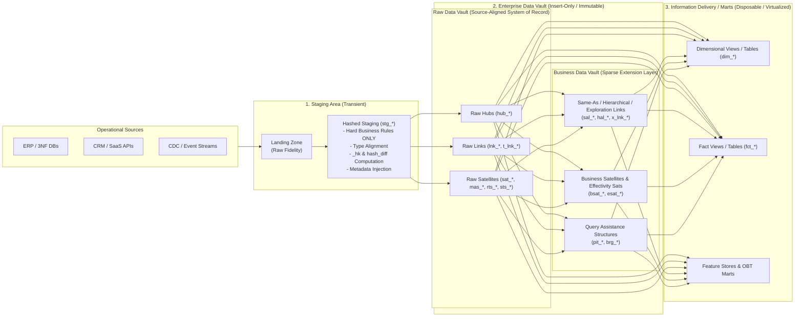
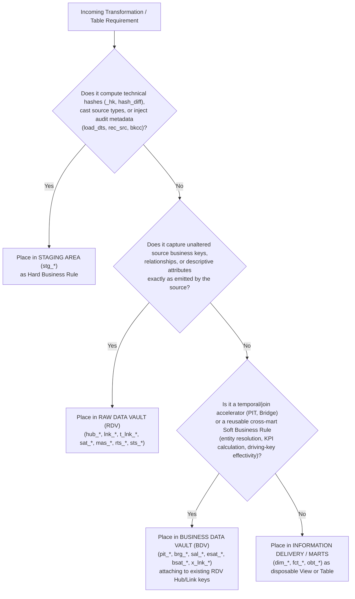
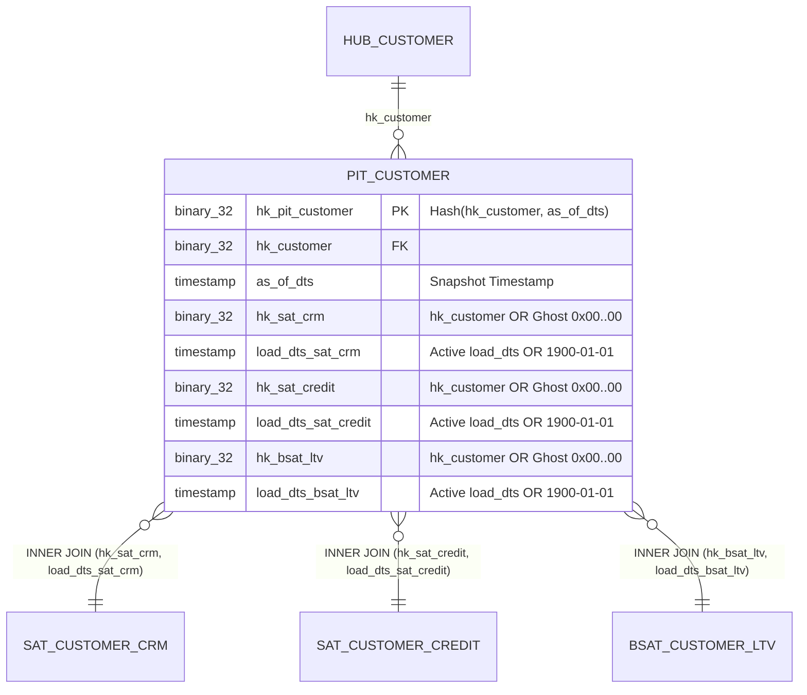
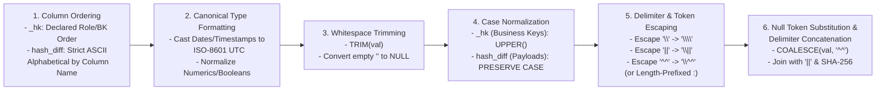
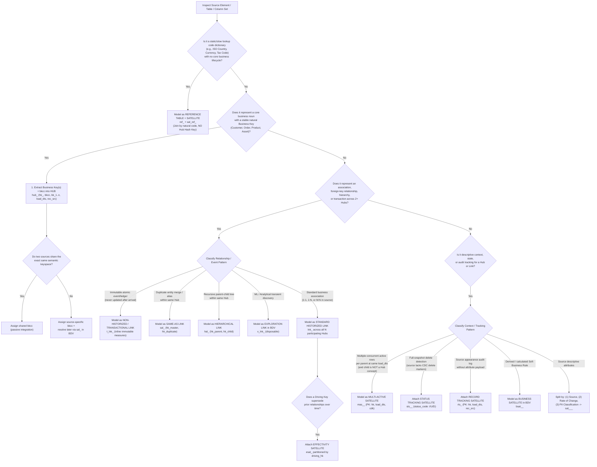

# 01 — Data Vault 2.0 Core Architecture, Entity Specifications, and Methodology Standards

> **Part of the [`open-dv` Reference Guide Suite](DV2_AGENT_REFERENCE_GUIDE.md)**  
> **Domain:** Core Architecture, Entity DDL/DML Specifications, Query Assistance Structures (PIT & Bridge), 6-Stage Pre-Hash Canonicalization Pipeline, Naming Taxonomy, Entity Classification Decision Trees, 5 Fatal Traps & Dual-Graph Grounding, and Node-Level SQLGlot AST Signatures  
> **Companion Specifications:**
> - [02 — Schema Stability, Cold-Start ($N=1$) Pragmatism, Evolution Mechanics, and Anti-Patterns](02-schema-stability-and-evolution.md)
> - [03 — Automated 6-Gate Verification, `dv-firstmate` Swarm, and Agentic Architecture](03-verification-and-agentic-architecture.md)
> - [04 — Unstructured & Multi-Modal Data Vault 2.0 Integration](04-unstructured-and-multimodal-dv2.md)
> - [05 — ELM Calculus, Graph B Profiling Math, 3-Pass CoT Prompt, and Reference Algorithms (`A.1`–`A.9` & `D.10`)](05-elm-calculus-and-reference-algorithms.md)
> - [Full HTML Reference Guide (`docs/references/No-Mistake-Agentic-Data-Vault-2.0-Complete-Design-and-Implementation-Guide.html`)](references/No-Mistake-Agentic-Data-Vault-2.0-Complete-Design-and-Implementation-Guide.html)
> - [Canonical IR JSON Schema (`schemas/dv2-canonical-ir.schema.json`)](../schemas/dv2-canonical-ir.schema.json) & [No-Mistake Contract V5 Schema (`schemas/no-mistake-dv2-contract-v5.schema.json`)](../schemas/no-mistake-dv2-contract-v5.schema.json)
> - [Annotated Multi-Source Model Contract (`examples/dv_model_contract.yaml`)](../examples/dv_model_contract.yaml)

---

## Executive Summary

Data Vault 2.0 (formalized by Dan Linstedt and Michael Olschimke, and operationalized in modern cloud data platforms through frameworks such as AutomateDV/dbtvault and datavault4dbt) is a hybrid relational-dimensional enterprise data warehouse architecture engineered for **100% historical auditability, deterministic parallel loading, and zero-reengineering resilience to source system evolution**.

Unlike Third Normal Form (3NF), which commingles identity, cardinality, and mutable attributes in the same table, and unlike Kimball Star Schemas, which apply destructive business rules and slowly changing dimension (SCD) mutations upstream of storage, Data Vault 2.0 enforces a strict **three-way orthogonal decomposition** of all enterprise data:
1. **Identity (Hubs):** Immutable registry of unique business keys (`_hk`, `bkcc`, business key(s), `load_dts`, `rec_src`).
2. **Association & Grain (Links):** Immutable registry of intersections, relationships, hierarchies, and atomic transactions across two or more Hubs, physically modeled as many-to-many ($M:N$) to insulate against source cardinality drift.
3. **Context & Temporal State (Satellites):** Strictly `INSERT`-only temporal change logs attached to exactly one parent Hub or Link, detecting state transitions via deterministic payload digests (`hash_diff`) and projecting validity intervals virtually via `LEAD(load_dts)` window functions rather than destructive physical `UPDATE` statements.

This specification establishes the formal architectural layer boundaries, entity schemas, SQL DDL/DML templates, query-assistance structures (PIT and Bridge tables), deterministic hashing standards, and agent-actionable decision trees required by an autonomous Data Vault 2.0 modelling agent in `open-dv`.

---

## 1. Architecture & Layer Boundaries

A compliant Data Vault 2.0 Enterprise Data Warehouse (EDW) enforces strict functional and mutability boundaries across four sequential architectural zones: **Landing / Staging**, **Raw Data Vault (RDV)**, **Business Data Vault (BDV)**, and **Information Delivery (Information Marts)**.



### 1.1 Layer Responsibilities & Rule Placement Taxonomy

The fundamental architectural invariant of Data Vault 2.0 is the strict separation between **Hard Business Rules** (technical alignment applied before or during Raw Vault ingestion) and **Soft Business Rules** (semantic interpretation, deduplication, and calculation applied in the Business Vault or Information Marts).

| Architectural Layer | Persistence & Lifespan | Permitted Transformations | Strictly Forbidden Operations | Target Entities |
| :--- | :--- | :--- | :--- | :--- |
| **Landing Zone** | Transient or Cold Archive (Object Storage / CDC Log) | Byte-exact extraction from source; format serialization (Parquet/Avro/JSON). | Filtering, casting, deduplicating, renaming, or joining. | Raw files / landing tables |
| **Staging Area (`stg_*`)** | Transient (Truncate-and-load per batch or sliding CDC window; often SQL Views in ELT) | **Hard Business Rules Only:** Technical data-type casting; trimming/case normalization for hashing; computing `_hk` and `hash_diff`; injecting `load_dts`, `rec_src`, `bkcc`, `batch_id`; intra-batch exact deduplication; substituting `-1`/`-2` Zero Keys for NULL foreign business keys. | Cross-table joins to other staging tables; filtering out "invalid" business values; currency conversion; status remapping; KPI aggregation. | `stg_<source>_<table_name>` |
| **Raw Data Vault (RDV)** | **Permanent, Immutable, Insert-Only** (System of Record / Audit Trail) | Idempotent set-based `INSERT` of unseen Hub keys (`_hk`), unseen Link intersections (`_hk`), and changed Satellite attribute states (`hash_diff != prev_hash_diff`). | **Any `UPDATE` or `DELETE`** (except legal GDPR crypto-shredding on isolated PII Satellites); any Soft Business Rules; altering source attribute values ("bad data in = bad data recorded"). | `hub_*`, `lnk_*`, `t_lnk_*`, `sat_*`, `mas_*`, `sts_*`, `rts_*`, `ref_*` |
| **Business Data Vault (BDV)** | **Sparse**, Semi-Permanent or Disposable (Derived from RDV) | **Soft Business Rules:** Cross-source entity resolution (`sal_*`); driving-key temporal resolution (`esat_*`); derived financial/risk metrics (`bsat_*`); multi-Satellite temporal alignment (`pit_*`); multi-hop join flattening (`brg_*`). | Duplicating Raw Vault tables unchanged (BDV is a *sparse overlay*, never a 1:1 mirror of RDV); mutating or overwriting RDV tables. | `sal_*`, `hal_*`, `x_lnk_*`, `bsat_*`, `esat_*`, `pit_*`, `brg_*` |
| **Information Delivery (Marts)** | **Disposable / Rebuildable** (SQL Views `CREATE VIEW` or scheduled materializations) | Star-schema projection (`DIM_*`, `FCT_*`), Snowflake schemas, One Big Table (OBT), slowly changing dimension (SCD Type 1/2/3/6) projection, Ghost-Record-accelerated `INNER JOIN` assembly, role-playing dimensions, BI security filtering. | Acting as a system of record; holding state that cannot be deterministically regenerated from RDV + BDV + Reference tables. | `dim_*`, `fct_*`, `obt_*`, `rpt_*` |

### 1.2 Why Raw Vault Stays Source-Aligned While Business Vault Holds Soft Rules

1. **Auditability and Regulatory Non-Repudiation:** Auditors require proof that the data warehouse reflects exact operational system records at the timestamp of ingestion. If a soft business rule (e.g., "exclude orders under $0" or "merge Customer A and Customer B if email matches") is applied before the Raw Vault, an erroneous rule permanently corrupts historical lineage. Keeping the Raw Vault 100% source-aligned ensures that when business logic changes in Year 3, the newly revised soft rule in the Business Vault or Information Mart can be retroactively re-evaluated across all 3 years of preserved Raw Vault history.
2. **Decoupled Parallel Ingestion:** Because Staging and Raw Vault loaders apply zero cross-table business rules and compute deterministic cryptographic hash keys (`_hk`) locally from natural keys, **Hubs, Links, and Satellites can all be loaded simultaneously in parallel** without foreign-key lookup bottlenecks or parent-child load ordering dependencies.
3. **Sparsity Principle of the Business Vault:** Agents must never copy every Raw Hub, Link, and Satellite into a `bv_` schema. A Business Vault entity is instantiated **if and only if**:
   - A complex soft calculation is reused across multiple downstream Information Marts (warranting a Business Satellite `bsat_*` attached directly to an existing Raw Hub/Link),
   - A cross-system master data deduplication or calculated relationship is required (`sal_*`, `x_lnk_*`, `esat_*`), or
   - Query SLA requires pre-materializing temporal/structural join paths (`pit_*`, `brg_*`).

### 1.3 Agent Decision Tree: Architectural Layer Placement



---

## 2. Core Entity Specifications (Hubs, Links, Satellites)

### 2.1 Hubs (`hub_<entity>`)

#### Formal Definition
A **Hub** establishes the canonical registry of unique **Business Keys** representing a core business noun/concept (e.g., `hub_customer`, `hub_product`, `hub_account`, `hub_invoice`, `hub_organizational_unit`). A Hub row is created the first time a distinct business key is observed by the enterprise and is never updated or deleted.

#### Structural Column Specification (`hub_<entity>`)

| Column Name | Logical Role | Data Type (Recommended) | Nullability | Constraint / Default | Description |
| :--- | :--- | :--- | :--- | :--- | :--- |
| `hk_<entity>` | Surrogate Hash Key | `BINARY(32)` (SHA-256) or `CHAR(64)` | `NOT NULL` | `PRIMARY KEY` | Deterministic hash of `(bkcc, [tenant_id,] bk_1, ..., bk_n)`. |
| `bkcc` | Business Key Collision Code | `VARCHAR(32)` | `NOT NULL` | Part of Logical Unique Key; `'DEFAULT'` if global keyspace | Disambiguates colliding keyspaces across uncoordinated source systems. |
| `tenant_id` | Multi-Tenant Partition Key *(Optional)* | `VARCHAR(64)` | `NOT NULL` | Part of Logical Unique Key (when multi-tenant) | Isolates multi-tenant SaaS data when tenants share identical keyspaces. |
| `<bk_col_1..n>` | Business Key(s) | `VARCHAR(255)` *(Always text!)* | `NOT NULL` | `UNIQUE (bkcc, [tenant_id,] bk_1, ..., bk_n)` | Single or composite natural key(s) as recognized by the business user. |
| `load_dts` | Load Date Timestamp | `TIMESTAMP_NTZ(9)` / `TIMESTAMPTZ` | `NOT NULL` | Technical arrival timestamp | Timestamp when this business key was **first loaded** into the Data Vault. |
| `rec_src` | Record Source | `VARCHAR(255)` | `NOT NULL` | System + object identifier | Source system and table/feed that **first registered** this business key. |

> [!IMPORTANT]
> **Why Business Keys Must Be Stored as `VARCHAR` in Hubs:** Even if a source system stores `customer_id` or `postal_code` as an integer (`INT` / `BIGINT`), the Hub MUST store business keys as `VARCHAR` (`TEXT` / `STRING`). Storing keys as integers strips significant leading zeros (e.g., `'00421'` becomes `421`) and breaks passive integration when a second source system emits alphanumeric keys (`'A-00421'`) for the same domain.

#### Business Key Taxonomy & Multi-Source Integration Rules
1. **Single Business Key:** One natural column identifies the entity (e.g., `vin` for `hub_vehicle`).
2. **Composite Business Key:** Multiple columns are jointly required to uniquely identify the entity (e.g., `(airline_iata_code, flight_number, scheduled_departure_date)` for `hub_flight`). All component columns are stored as separate columns in the Hub AND concatenated in fixed declaration order (separated by the canonical delimiter) to compute `hk_<entity>`.
3. **Multi-Source Passive Integration vs. `bkcc` Collision Prefixing:**
   - **Shared Semantic Keyspace (`bkcc = 'GLOBAL'` or omitted):** If Source A (`ERP`) and Source B (`CRM`) both identify customers using a standardized enterprise UUID or national tax ID where `'CUST-9981'` in ERP is guaranteed to be the exact same real-world customer as `'CUST-9981'` in CRM, both staging views emit the identical `bkcc` (`'GLOBAL'`). Their records hash to the **exact same `hk_customer`**, achieving *passive integration* in `hub_customer` without any ETL lookup.
   - **Colliding Source Keyspaces (`bkcc = '<DOMAIN_CODE>'`):** If Source A (`ERP_SAP`) uses an auto-incrementing integer `1001` for Acme Corp, and Source B (`LEGACY_MAINFRAME`) uses auto-incrementing integer `1001` for Globex Inc., hashing `'1001'` alone would cause a catastrophic semantic collision in `hub_customer`. Staging MUST assign distinct Business Key Collision Codes (`bkcc = 'ERP_SAP'` vs. `bkcc = 'LEGACY_MF'`) and prepend `bkcc` into the hash key input (`SHA256('ERP_SAP||1001') != SHA256('LEGACY_MF||1001')`). Later, when business rules determine that `ERP_SAP||1001` and `LEGACY_MF||4509` are the same legal customer, a **Same-As Link (`sal_customer`)** in the Business Vault links the two Hub keys without mutating the Raw Hub.

#### Attributes Strictly Forbidden in Hubs
An autonomous modelling agent MUST reject any Hub schema containing:
1. **Descriptive Attributes:** Names, descriptions, statuses, dates of birth, timestamps (`created_at`, `updated_at`), monetary amounts, or flags. *(Must move to a Satellite `sat_<hub>_*`).*
2. **Foreign Keys / Parent Keys:** A Hub must NEVER contain another Hub's hash key (`hk_parent`) or business key (`parent_id`), even if the source system asserts a strict `1:1` or `N:1` relationship (e.g., `store_id` on an `employee` table). Source cardinalities drift over time; all inter-Hub relationships MUST be modeled in a **Link (`lnk_*`)**.
3. **Temporal End-Dates or Change Digests:** `load_end_dts`, `is_current`, or `hash_diff` are strictly forbidden in Hubs. A business key's existence in the Hub is timeless; whether the key is currently active or deleted in a source system is tracked in a **Status Tracking Satellite (`sts_*`)** or **Effectivity Satellite (`esat_*`)**.
4. **System-Generated Source Surrogate Sequences Without Business Meaning:** If a source table has an internal row sequence `row_id` alongside a true natural key `order_number`, the Hub key MUST be `order_number`. (A source system surrogate key is only used as a Hub key if no natural key exists and the source surrogate key is exposed to business operations as the identifier, accompanied by a source-specific `bkcc`).

#### Concrete SQL DDL & Idempotent Loading Pattern (Hub)

```sql
-- DDL: Raw Data Vault Hub
CREATE TABLE rdv.hub_customer (
    hk_customer   BINARY(32)    NOT NULL,
    bkcc          VARCHAR(32)   NOT NULL,
    customer_id   VARCHAR(128)  NOT NULL,
    load_dts      TIMESTAMP_NTZ NOT NULL,
    rec_src       VARCHAR(128)  NOT NULL,
    CONSTRAINT pk_hub_customer PRIMARY KEY (hk_customer),
    CONSTRAINT uq_hub_customer_bk UNIQUE (bkcc, customer_id)
);

-- DML: Idempotent Set-Based Hub Load from Hashed Staging
-- If the same unseen business key appears multiple times in the staging batch,
-- pick the earliest load_dts (or deterministic MIN(rec_src) tie-breaker).
INSERT INTO rdv.hub_customer (
    hk_customer,
    bkcc,
    customer_id,
    load_dts,
    rec_src
)
SELECT
    src.hk_customer,
    src.bkcc,
    src.customer_id,
    src.load_dts,
    src.rec_src
FROM (
    SELECT
        stg.hk_customer,
        stg.bkcc,
        stg.customer_id,
        stg.load_dts,
        stg.rec_src,
        ROW_NUMBER() OVER (
            PARTITION BY stg.hk_customer
            ORDER BY stg.load_dts ASC, stg.rec_src ASC
        ) AS rn
    FROM stg.stg_crm_customers stg
    WHERE stg.hk_customer IS NOT NULL
) src
WHERE src.rn = 1
  AND NOT EXISTS (
      SELECT 1
      FROM rdv.hub_customer tgt
      WHERE tgt.hk_customer = src.hk_customer
  );
```

---

### 2.2 Links (`lnk_<association>`)

#### Formal Definition
A **Link** models the intersection, association, hierarchy, or business transaction between **two or more Hubs** (or two or more role-aliased references to the same Hub). In Data Vault 2.0, **every Link is physically modeled as a many-to-many ($M:N$) associative entity**, regardless of whether the operational source system currently enforces `1:1`, `1:N`, or `M:N`.

#### Why All Relationships Are Modeled as Links (Flexibility Invariant)
In 3NF, changing a `1:N` relationship (modeled as a foreign key column on the child table) to `M:N` requires destructive table refactoring and ETL rewrites. Because Data Vault 2.0 models every relationship as a Link from Day 1, a business rule change from "one customer has one account manager (`1:N`)" to "a customer is co-managed by a team of account managers (`M:N`)" requires **zero physical schema changes** to `hub_customer`, `hub_employee`, or `lnk_customer_account_mgr`.

#### Structural Column Specification (Standard Link `lnk_<association>`)

| Column Name | Logical Role | Data Type (Recommended) | Nullability | Constraint | Description |
| :--- | :--- | :--- | :--- | :--- | :--- |
| `hk_<link>` | Link Surrogate Hash Key | `BINARY(32)` / `CHAR(64)` | `NOT NULL` | `PRIMARY KEY` | Deterministic hash of all participating Hub business keys (plus their `bkcc`s) and any degenerate Link keys in fixed role order. |
| `hk_<hub_1>` | Hub 1 Foreign Hash Key | `BINARY(32)` / `CHAR(64)` | `NOT NULL` | `FOREIGN KEY` (Logical/Physical) | Hash key of the first participating Hub (or Zero Key `0x00..00` if optional/missing in source). |
| `hk_<hub_2>` | Hub 2 Foreign Hash Key | `BINARY(32)` / `CHAR(64)` | `NOT NULL` | `FOREIGN KEY` (Logical/Physical) | Hash key of the second participating Hub. |
| `[hk_<hub_k>]` | Hub $k$ Foreign Hash Key *(Optional, $k \ge 3$)* | `BINARY(32)` / `CHAR(64)` | `NOT NULL` | `FOREIGN KEY` | Additional Hub hash keys defining the Unit of Work grain. |
| `[<deg_key>]` | Degenerate / Pegged Child Key *(Optional)* | `VARCHAR(128)` | `NOT NULL` | Included in `hk_<link>` hash | Sub-entity qualifier (e.g., `order_line_no`) that participates in the Link grain without warranting its own Hub. |
| `load_dts` | Load Date Timestamp | `TIMESTAMP_NTZ(9)` | `NOT NULL` | Technical arrival timestamp | Timestamp when this specific association instance was **first observed**. |
| `rec_src` | Record Source | `VARCHAR(255)` | `NOT NULL` | System + object identifier | Source system and feed that first delivered this association. |

#### Unit of Work (UoW), Link Grain, and the "No Link-on-Link" Rule
1. **Unit of Work (UoW):** A Link must capture the full natural grain of a business transaction or relationship as emitted by the source system. If an Order Line in an ERP system associates an `Order`, a `Product`, a `Customer`, and a `Warehouse`, the Link is a 4-way Link `lnk_order_line(hk_lnk_order_line, hk_order, hk_product, hk_customer, hk_warehouse, order_line_no, load_dts, rec_src)`. Do NOT decompose a 4-way atomic business transaction into binary 2-way Links, as binary decomposition loses the atomic intersection grain (re-joining binary links produces Cartesian fan-traps).
2. **Computation of `hk_<link>` in Staging:** `hk_<link>` is computed in Staging directly from the **raw normalized Business Keys + `bkcc`s of the participating Hubs** (plus any degenerate Link keys), rather than hashing the already-hashed `hk_<hub>` values, or consistently hashing the ordered sequence of canonical business key tokens. Computing `hk_<link>` directly from the normalized business key tokens in the staging row enables `hub_*` and `lnk_*` tables to load in parallel with zero lookups.
3. **Strict Prohibition of Link-on-Link Foreign Keys:** A Link MUST NEVER reference another Link's `hk_<link>` as a foreign key. Why? Because coupling Link B to Link A's composite grain creates fragile cascading dependencies if Link A's grain evolves. If an associative concept has its own independent lifecycle and is referenced by downstream processes (e.g., a `Contract` or `Shipment` with its own identifier), promote that concept to a **Hub** (`hub_contract`, `hub_shipment`) and connect it via standard Hub-based Links.
4. **Driving Keys:** In a relationship where one Hub (or subset of Hubs) governs the active cardinality (e.g., in `lnk_customer_account_mgr`, a Customer can only have one active Account Manager at a time), `hk_customer` is declared the **Driving Key**. The Driving Key is metadata used by an attached **Effectivity Satellite (`esat_*`)** to detect when a new Link row (`C100 -> E02`) supersedes a prior Link row (`C100 -> E01`).

#### Specialized Link Variants

| Link Variant | Prefix | Layer | Primary Purpose | Key Structural Difference from Standard Link |
| :--- | :--- | :--- | :--- | :--- |
| **Standard Historized Link** | `lnk_` | Raw / Business Vault | Captures $M:N$ associations between 2+ Hubs; mutable context lives in attached Link Satellites (`sat_lnk_*`). | Contains only `hk_<link>`, `hk_<hub_1..n>`, optional degenerate key, `load_dts`, `rec_src`. |
| **Non-Historized / Transactional Link** | `t_lnk_` (or `nh_lnk_`) | Raw Vault | Captures high-velocity, immutable atomic events (financial ledger postings, IoT telemetry, clickstream, POS swipes) that **never update** after occurrence. | Embeds **immutable event payload measures and timestamps** (`amount`, `quantity`, `event_dts`, `transaction_no`) directly inside the Link table; **no Satellite or `hash_diff` is attached**. |
| **Same-As Link (SAL)** | `sal_` | Business Vault *(or Raw Vault if source-supplied)* | Entity resolution and master-data deduplication across duplicate/synonym business keys within the same domain. | Connects two role-aliased keys referencing the **exact same Hub**: `hk_<entity>_master` (or `_primary`) and `hk_<entity>_duplicate` (or `_secondary`). Order of keys in `hk_sal_*` is directional! |
| **Hierarchical Link (HAL)** | `hal_` | Raw / Business Vault | Recursive parent-child trees, bills of materials (BOM), organizational reporting lines, and chart-of-accounts rollups. | Connects two role-aliased keys referencing the **exact same Hub**: `hk_<entity>_parent` and `hk_<entity>_child` (plus optional `hierarchy_type`). Order in `hk_hal_*` is strictly directional! |
| **Exploration Link** | `x_lnk_` | Business Vault (Analytics Sandbox) | Transient relationships discovered by ML models, graph algorithms, or heuristic analytics (e.g., "churn contagion network", "household affinity"). | Explicitly **disposable and rebuildable**; carries algorithm metadata (`model_version`, `confidence_score`, `strength_metric`) either inline or in an Exploration Satellite. |

#### Concrete SQL DDL & Loading Patterns for Specialized Links

```sql
-- 1. Standard Historized 3-Way Link with Degenerate Key (Order Line Grain)
CREATE TABLE rdv.lnk_order_line (
    hk_lnk_order_line BINARY(32)    NOT NULL,
    hk_order          BINARY(32)    NOT NULL,
    hk_product        BINARY(32)    NOT NULL,
    hk_customer       BINARY(32)    NOT NULL,
    order_line_no     VARCHAR(32)   NOT NULL, -- Degenerate key defining line grain
    load_dts          TIMESTAMP_NTZ NOT NULL,
    rec_src           VARCHAR(128)  NOT NULL,
    CONSTRAINT pk_lnk_order_line PRIMARY KEY (hk_lnk_order_line)
);

-- 2. Non-Historized / Transactional Link (Immutable Payment Ledger Event)
CREATE TABLE rdv.t_lnk_payment_transaction (
    hk_t_lnk_payment  BINARY(32)     NOT NULL,
    hk_account_debit  BINARY(32)     NOT NULL,
    hk_account_credit BINARY(32)     NOT NULL,
    transaction_id    VARCHAR(128)   NOT NULL, -- Atomic transaction identifier
    transaction_dts   TIMESTAMP_NTZ  NOT NULL, -- Business event timestamp
    amount_minor_unit BIGINT         NOT NULL, -- Immutable payload measure
    currency_code     CHAR(3)        NOT NULL, -- Immutable payload code
    load_dts          TIMESTAMP_NTZ  NOT NULL,
    rec_src           VARCHAR(128)   NOT NULL,
    CONSTRAINT pk_t_lnk_payment PRIMARY KEY (hk_t_lnk_payment)
);

-- 3. Same-As Link (Cross-System Customer Entity Resolution in Business Vault)
CREATE TABLE bdv.sal_customer (
    hk_sal_customer       BINARY(32)    NOT NULL, -- Hash(bkcc_master, bk_master, bkcc_dup, bk_dup)
    hk_customer_master    BINARY(32)    NOT NULL,
    hk_customer_duplicate BINARY(32)    NOT NULL,
    load_dts              TIMESTAMP_NTZ NOT NULL,
    rec_src               VARCHAR(128)  NOT NULL,
    CONSTRAINT pk_sal_customer PRIMARY KEY (hk_sal_customer)
);

-- 4. Hierarchical Link (Self-Referencing Bill of Materials / Org Chart)
CREATE TABLE rdv.hal_org_unit_hierarchy (
    hk_hal_org_unit    BINARY(32)    NOT NULL, -- Hash(bkcc_parent, bk_parent, bkcc_child, bk_child)
    hk_org_unit_parent BINARY(32)    NOT NULL,
    hk_org_unit_child  BINARY(32)    NOT NULL,
    load_dts           TIMESTAMP_NTZ NOT NULL,
    rec_src            VARCHAR(128)  NOT NULL,
    CONSTRAINT pk_hal_org_unit PRIMARY KEY (hk_hal_org_unit)
);
```

---

### 2.3 Satellites (`sat_<parent>_<context>`)

#### Formal Definition
A **Satellite** stores all descriptive attributes (context) and tracks their temporal state changes over time as an immutable, `INSERT`-only Slowly Changing Dimension Type 2 (SCD2) log.

#### Strict Parentage & Topology Invariants
1. **Single Parent Rule:** Every Satellite (except Hub-less Reference Satellites) MUST attach to **exactly one parent Hub (`hk_<hub>`) OR exactly one parent Link (`hk_<link>`)**.
2. **No Satellite-on-Satellite (No Snowflaking):** A Satellite MUST NEVER be the parent of another Satellite.
3. **No Multi-Parent Satellites:** A Satellite MUST NEVER contain foreign hash keys to two different Hubs or Links. If descriptive attributes depend on the intersection of two Hubs, those attributes belong on a **Link Satellite (`sat_lnk_*`)** whose single parent is the Link (`hk_<link>`).
4. **No Standalone Surrogate Key:** A Satellite does NOT have its own standalone primary hash key `hk_sat`. Its composite primary key is strictly `(hk_<parent>, load_dts)` (or `(hk_<parent>, load_dts, <child_dependent_key>)` for Multi-Active Satellites, and `(hk_<parent>, load_dts, applied_dts)` for Bi-Temporal Satellites).

#### Satellite Splitting Strategy
An autonomous modelling agent should split attributes across multiple Satellites attached to the same Hub/Link along three orthogonal axes:
1. **By Source System:** `sat_customer_crm` vs. `sat_customer_erp` (prevents null-padding and allows independent source ingestion schedules).
2. **By Rate of Change (Velocity):** Separate high-frequency dynamic attributes (e.g., `sat_account_daily_balance`) from low-frequency static attributes (e.g., `sat_account_onboarding_kyc`). If high- and low-velocity attributes are mixed in one wide Satellite, every daily balance change duplicates 50 static KYC columns on every row.
3. **By Security / Regulatory Classification (PII Isolation):** Isolate Personally Identifiable Information (`full_name`, `ssn`, `email`, `home_address`) into a dedicated `sat_customer_pii` separate from behavioral/demographic attributes (`sat_customer_preferences`). This enables physical right-to-be-forgotten erasure or column-level encryption key revocation ("crypto-shredding") on `sat_customer_pii` without destroying the structural Hub (`hub_customer`), Links, or non-PII analytical history.

#### Why Data Vault 2.0 Forbids Physical `load_end_dts` Updates
In legacy Data Vault 1.0, Satellites physically stored a `load_end_dts` column initialized to `9999-12-31`, requiring an `UPDATE` statement on the previous active row whenever a new change arrived.
**Data Vault 2.0 strictly forbids physical `load_end_dts` columns on base Satellites** for four engineering reasons:
1. **Columnar MPP Bottlenecks:** Modern cloud data warehouses (Snowflake, BigQuery, Databricks Delta/Iceberg, Redshift, ClickHouse, DuckDB) store data in immutable columnar micro-partitions/Parquet files. Executing `UPDATE` rewrites entire micro-partitions, invalidating table clustering and doubling I/O costs.
2. **Audit Immutability:** An `INSERT`-only table guarantees that no historical record is ever mutated after landing.
3. **Late-Arriving / Out-of-Order Data Resilience:** If a batch arrives out of chronological order, an `INSERT`-only Satellite simply inserts the row; virtualizing `load_end_dts` dynamically via `LEAD(load_dts) OVER (PARTITION BY hk_<parent> ORDER BY load_dts ASC)` automatically stitches the timeline in exact chronological order without complex two-way `UPDATE` repairs.
4. **Zero-Lock Contention:** Insert-only pipelines never contend with concurrent reader queries or PIT builders.

#### Structural Column Specification (Standard Satellite `sat_<parent>_<context>`)

| Column Name | Logical Role | Data Type (Recommended) | Nullability | Constraint | Description |
| :--- | :--- | :--- | :--- | :--- | :--- |
| `hk_<parent>` | Parent Hub or Link Hash Key | `BINARY(32)` / `CHAR(64)` | `NOT NULL` | `PRIMARY KEY (part 1)`, `FOREIGN KEY` | References exactly one parent Hub (`hk_<hub>`) or Link (`hk_<link>`). |
| `load_dts` | Load Date Timestamp | `TIMESTAMP_NTZ(9)` | `NOT NULL` | `PRIMARY KEY (part 2)` | Timestamp when this attribute state version was loaded. |
| `hash_diff` | Payload Change Digest | `BINARY(32)` / `CHAR(64)` | `NOT NULL` | Indexed / Clustered with `hk_<parent>` | Deterministic hash of all descriptive payload columns sorted **alphabetically by column name**. |
| `<attr_1..m>` | Descriptive Payload Attributes | Domain-specific (`VARCHAR`, `NUMERIC`, `DATE`, etc.) | Nullable | Preserves exact source state | Source descriptive columns (never modified by soft business rules in Raw Vault). |
| `[applied_dts]` | Business / Source Effective Timestamp *(Optional)* | `TIMESTAMP_NTZ(9)` | Nullable | Bitemporal tracking | When the state change occurred in the real world / source system (distinct from `load_dts`). |
| `rec_src` | Record Source | `VARCHAR(255)` | `NOT NULL` | Audit lineage | Source system and object identifier that emitted this state version. |

#### Specialized Satellite Variants

| Satellite Variant | Prefix | Parent Type | Primary Key | Purpose & Mechanics |
| :--- | :--- | :--- | :--- | :--- |
| **Standard Satellite** | `sat_` | Hub or Link | `(hk_<parent>, load_dts)` | Tracks single-active-row temporal changes for descriptive attributes via `hash_diff`. |
| **Multi-Active Satellite (MAS)** | `mas_` (or `ma_sat_`) | Hub or Link | `(hk_<parent>, load_dts, <cdk>)` | Tracks **multiple concurrent active attribute rows** per parent key at the same `load_dts` using a **Child Dependent Key (`<cdk>`)** (e.g., `phone_type`, `address_usage_code`, `rider_seq`). Inserts a full new set of rows whenever the set-level `hash_diff` for `hk_<parent>` changes. |
| **Effectivity Satellite (E-Sat)** | `esat_` | **Link Only** | `(hk_<link>, load_dts)` | Tracks the active validity lifespan of a Link relationship across a declared **Driving Key** (`driving_hk_<hub>`). Records a new row whenever the Driving Key associates with a different target Hub key (including re-activations of a previously seen Link key!). |
| **Status Tracking Satellite (STS)** | `sts_` | Hub or Link | `(hk_<parent>, load_dts)` | Tracks source record existence transitions (`status_code IN ('I', 'U', 'D')` for Insert, Un-deleted/Re-appeared, Deleted) when ingesting full snapshots from source systems that perform hard physical `DELETE`s without emitting CDC delete tombstones. |
| **Record Tracking Satellite (RTS)** | `rts_` | Hub or Link | `(hk_<parent>, load_dts, rec_src)` | High-speed audit log containing **zero payload attributes** and **no `hash_diff`**. Records every timestamp and source (`rec_src`) from which `hk_<parent>` was observed, answering "Did source X deliver record Y today, even if none of its attributes changed?" |
| **Reference Table + Reference Satellite** | `ref_` / `sat_ref_` | Natural Code (`ref_code`) | `ref_`: `(ref_code)`<br>`sat_ref_`: `(ref_code, load_dts)` | Stores standardized lookup dictionaries (ISO-3166 country codes, ISO-4217 currencies, status lookup descriptions). Referenced by **natural code** rather than surrogate hash keys to prevent polluting Hubs and Links with low-cardinality lookup tables, while still preserving full `sat_ref_*` temporal history. |

> [!WARNING]
> **When to Use a Multi-Active Satellite (`mas_*`) vs. Promoting to a Hub + Link:**
> An agent should always check whether the repeating child element is actually an independent business concept. If the repeating child has its own lifecycle or participates in relationships with other entities (e.g., a `Bank Account` or `Insurance Policy`), **model it as a separate Hub + Link + Standard Satellite**, NOT a Multi-Active Satellite. Use `mas_*` **only** for dependent multi-valued attributes that have no independent identity outside their parent (e.g., multiple concurrent phone numbers, multiple tax exemption flags, or array-typed JSON tags on a product).

#### Concrete SQL DDL & Loading Patterns for Satellites

##### 1. Standard Satellite (`sat_customer_crm`) — Idempotent Load & Virtualized `load_end_dts` View
```sql
-- DDL: Standard Raw Satellite (Insert-Only, NO physical load_end_dts)
CREATE TABLE rdv.sat_customer_crm (
    hk_customer   BINARY(32)    NOT NULL,
    load_dts      TIMESTAMP_NTZ NOT NULL,
    hash_diff     BINARY(32)    NOT NULL,
    email_address VARCHAR(255)  NULL,
    full_name     VARCHAR(255)  NULL,
    loyalty_tier  VARCHAR(64)   NULL,
    rec_src       VARCHAR(128)  NOT NULL,
    CONSTRAINT pk_sat_customer_crm PRIMARY KEY (hk_customer, load_dts)
);

-- DML: Idempotent Standard Satellite Load
-- Compares incoming staging rows (deduplicated within batch by load_dts) against
-- the latest existing hash_diff in sat_customer_crm per hk_customer.
INSERT INTO rdv.sat_customer_crm (
    hk_customer,
    load_dts,
    hash_diff,
    email_address,
    full_name,
    loyalty_tier,
    rec_src
)
WITH latest_sat AS (
    SELECT
        s.hk_customer,
        s.hash_diff
    FROM rdv.sat_customer_crm s
    QUALIFY ROW_NUMBER() OVER (
        PARTITION BY s.hk_customer
        ORDER BY s.load_dts DESC
    ) = 1
),
staged_changes AS (
    SELECT
        stg.hk_customer,
        stg.load_dts,
        stg.hash_diff,
        stg.email_address,
        stg.full_name,
        stg.loyalty_tier,
        stg.rec_src,
        LAG(stg.hash_diff) OVER (
            PARTITION BY stg.hk_customer
            ORDER BY stg.load_dts ASC
        ) AS prev_stg_hash_diff,
        ROW_NUMBER() OVER (
            PARTITION BY stg.hk_customer
            ORDER BY stg.load_dts ASC
        ) AS stg_seq
    FROM stg.stg_crm_customers stg
)
SELECT
    sc.hk_customer,
    sc.load_dts,
    sc.hash_diff,
    sc.email_address,
    sc.full_name,
    sc.loyalty_tier,
    sc.rec_src
FROM staged_changes sc
LEFT JOIN latest_sat ls
    ON sc.hk_customer = ls.hk_customer
WHERE (
    -- First change in staging batch differs from latest stored Satellite state (or parent is new)
    (sc.stg_seq = 1 AND (ls.hash_diff IS NULL OR sc.hash_diff != ls.hash_diff))
    OR
    -- Subsequent intra-batch state transitions differ from immediately preceding intra-batch state
    (sc.stg_seq > 1 AND sc.hash_diff != sc.prev_stg_hash_diff)
);

-- Virtualized Temporal View over Standard Satellite (Deriving load_end_dts and is_current)
CREATE VIEW bdv.v_sat_customer_crm_temporal AS
SELECT
    hk_customer,
    load_dts AS eff_start_dts,
    COALESCE(
        LEAD(load_dts) OVER (PARTITION BY hk_customer ORDER BY load_dts ASC),
        CAST('9999-12-31 23:59:59.999999' AS TIMESTAMP_NTZ)
    ) AS eff_end_dts,
    CASE
        WHEN LEAD(load_dts) OVER (PARTITION BY hk_customer ORDER BY load_dts ASC) IS NULL
        THEN TRUE
        ELSE FALSE
    END AS is_current,
    hash_diff,
    email_address,
    full_name,
    loyalty_tier,
    rec_src
FROM rdv.sat_customer_crm;
```

##### 2. Multi-Active Satellite (`mas_customer_phone`) — Set-Level Change Detection
```sql
-- DDL: Multi-Active Satellite with Child Dependent Key (phone_type)
CREATE TABLE rdv.mas_customer_phone (
    hk_customer  BINARY(32)    NOT NULL,
    load_dts     TIMESTAMP_NTZ NOT NULL,
    phone_type   VARCHAR(32)   NOT NULL, -- Child Dependent Key (CDK)
    hash_diff    BINARY(32)    NOT NULL, -- Set-level or row-level hash_diff
    phone_number VARCHAR(64)   NOT NULL,
    is_primary   BOOLEAN       NOT NULL,
    rec_src      VARCHAR(128)  NOT NULL,
    CONSTRAINT pk_mas_customer_phone PRIMARY KEY (hk_customer, load_dts, phone_type)
);

-- DML Pattern for Multi-Active Satellite:
-- Compute an ordered set-level digest across all active CDK rows for hk_customer
-- (e.g., SHA256(LISTAGG(phone_type || '||' || phone_number || '||' || is_primary, '##')
--               WITHIN GROUP (ORDER BY phone_type ASC))).
-- When the set-level digest differs from the latest load_dts set-level digest in mas_customer_phone,
-- insert ALL active rows of the new set under the new load_dts.
-- This guarantees that querying WHERE load_dts = MAX(load_dts) returns the exact complete active set!
```

##### 3. Insert-Only Effectivity Satellite (`esat_customer_account_mgr`)
```sql
-- DDL: Insert-Only Effectivity Satellite attached to lnk_customer_account_mgr
-- Driving Key: hk_customer (a customer has 1 active account manager at any point in time)
CREATE TABLE bdv.esat_customer_account_mgr (
    hk_lnk_cust_acct_mgr BINARY(32)    NOT NULL,
    load_dts             TIMESTAMP_NTZ NOT NULL,
    driving_hk_customer  BINARY(32)    NOT NULL,
    rec_src              VARCHAR(128)  NOT NULL,
    CONSTRAINT pk_esat_cust_acct_mgr PRIMARY KEY (hk_lnk_cust_acct_mgr, load_dts)
);

-- Virtualized Effectivity View partitioning by the DRIVING KEY (driving_hk_customer):
-- Even if Customer C100 moves from Manager E01 -> E02 -> back to E01, partitioning LEAD(load_dts)
-- by driving_hk_customer accurately closes E01's first tenure when E02 starts, closes E02 when E01
-- restarts, and leaves E01's second tenure open (9999-12-31) with ZERO physical UPDATEs!
CREATE VIEW bdv.v_esat_customer_account_mgr AS
SELECT
    e.hk_lnk_cust_acct_mgr,
    e.driving_hk_customer AS hk_customer,
    l.hk_employee,
    e.load_dts AS start_dts,
    COALESCE(
        LEAD(e.load_dts) OVER (
            PARTITION BY e.driving_hk_customer
            ORDER BY e.load_dts ASC
        ),
        CAST('9999-12-31 23:59:59.999999' AS TIMESTAMP_NTZ)
    ) AS end_dts,
    CASE
        WHEN LEAD(e.load_dts) OVER (
            PARTITION BY e.driving_hk_customer
            ORDER BY e.load_dts ASC
        ) IS NULL THEN TRUE
        ELSE FALSE
    END AS is_active,
    e.rec_src
FROM bdv.esat_customer_account_mgr e
INNER JOIN rdv.lnk_customer_account_mgr l
    ON e.hk_lnk_cust_acct_mgr = l.hk_lnk_cust_acct_mgr;
```

##### 4. Status Tracking Satellite (`sts_customer_crm`) & Record Tracking Satellite (`rts_customer_crm`)
```sql
-- Status Tracking Satellite (Full-Snapshot Delete Detection)
CREATE TABLE rdv.sts_customer_crm (
    hk_customer BINARY(32)    NOT NULL,
    load_dts    TIMESTAMP_NTZ NOT NULL,
    status_code CHAR(1)       NOT NULL, -- 'I' = Inserted, 'D' = Deleted (absent in snapshot), 'U' = Re-appeared
    rec_src     VARCHAR(128)  NOT NULL,
    CONSTRAINT pk_sts_customer_crm PRIMARY KEY (hk_customer, load_dts),
    CONSTRAINT chk_sts_status_code CHECK (status_code IN ('I', 'U', 'D'))
);

-- Record Tracking Satellite (Source Observation Lineage)
CREATE TABLE rdv.rts_customer (
    hk_customer BINARY(32)    NOT NULL,
    load_dts    TIMESTAMP_NTZ NOT NULL,
    rec_src     VARCHAR(128)  NOT NULL,
    CONSTRAINT pk_rts_customer PRIMARY KEY (hk_customer, load_dts, rec_src)
);
```

---

## 3. Query Assistance Structures (PIT & Bridge Tables)

Because Data Vault 2.0 decomposes entities horizontally across multiple Satellites (split by source, velocity, and security) and vertically across Hubs and Links, querying raw Vault tables directly for historical star-schema reporting requires expensive correlated temporal range joins (`as_of_dts >= sat.load_dts AND as_of_dts < sat.load_end_dts`) and deep multi-hop joins.

To achieve sub-second BI query performance without sacrificing Raw Vault normalization, Data Vault 2.0 introduces **Point-in-Time (PIT) tables** and **Bridge tables** inside the **Business Data Vault**.

> [!IMPORTANT]
> **Disposable & Rebuildable Nature:** PIT and Bridge tables contain **zero original data**. They are purely derived index/pointer structures that can be truncated, dropped, or rebuilt from scratch at any time from the underlying Raw and Business Vault tables.

### 3.1 Zero Keys & Ghost Records Specification

Before constructing PIT, Bridge, or Information Mart tables, the Data Vault MUST seed two distinct types of system placeholder records so that all downstream joins can execute as fast **INNER Equi-Joins** without dropping rows or requiring `LEFT OUTER JOIN` + `COALESCE` logic.

| Concept | Target Tables | Surrogate Hash Key (`BINARY(32)` / `CHAR(64)`) | Business Key / Code Value | `load_dts` Value | Semantic Meaning & Usage |
| :--- | :--- | :--- | :--- | :--- | :--- |
| **Zero Key (Unknown / Missing Mandatory)** | **Hubs & Links** (`hub_*`, `lnk_*`) | `0x0000...0000` (32 zero bytes / 64 `'0'` hex chars) | `'-1'` (`bkcc = 'SYSTEM'`) | `'1900-01-01 00:00:00'` (or `'0001-01-01 00:00:00'`) | Substituted in Staging when a **mandatory** foreign business key on an incoming Link record is `NULL` or missing. Preserves Link referential integrity to the parent Hub. |
| **Zero Key (Not Applicable / Error / Optional)** | **Hubs & Links** (`hub_*`, `lnk_*`) | `0xFFFF...FFFF` (32 `0xFF` bytes / 64 `'F'` hex chars) | `'-2'` (`bkcc = 'SYSTEM'`) | `'1900-01-01 00:00:00'` | Substituted in Staging when an **optional** foreign business key on a Link is legitimately inapplicable (e.g., `promo_code` on a non-promotional order) or fails domain parsing. |
| **Ghost Record** | **Satellites** (`sat_*`, `mas_*`, `bsat_*`) | `0x0000...0000` (32 zero bytes / 64 `'0'` hex chars) | Descriptive strings = `'UNKNOWN'` (or `'N/A'`), numeric measures = `0` or `NULL` | `'1900-01-01 00:00:00'` | Seeded once into **every Satellite**. When a Hub key has no active row in Satellite $i$ at snapshot timestamp `as_of_dts`, the PIT table points `hk_sat_i = 0x00..00` and `load_dts_sat_i = '1900-01-01 00:00:00'`. |

### 3.2 Point-in-Time (PIT) Tables (`pit_<parent>`)

#### Purpose & Mechanics
A **Point-in-Time (PIT) table** is attached to a single Hub (or Link) that has two or more Satellites. For a configurable spine of snapshot timestamps (`as_of_dts`), the PIT table records the exact `(hk_<sat_i>, load_dts_<sat_i>)` coordinate that was active in each attached Satellite $i$ as of `as_of_dts`.
If Satellite $i$ had not yet received any record for `hk_<parent>` at `as_of_dts`, the PIT table populates the **Ghost Record pointer** `(0x00..00, '1900-01-01 00:00:00')`.



#### Logarithmic & Sliding Snapshot Windows
Materializing a daily PIT row for every Hub key across 5–10 years of history creates unnecessary row multiplication ($N_{\text{keys}} \times 3650$ rows). Data Vault 2.0 solves this using a **Logarithmic Snapshot Window** (or **Change-Driven + Logarithmic Spine**):
- **Tier 1 (T-0 to T-30 days):** **Daily** snapshots (31 snapshots) — supports granular operational troubleshooting.
- **Tier 2 (T-31 to T-365 days):** **Weekly** snapshots (e.g., Sunday 23:59:59, ~48 snapshots) — supports tactical trend analysis.
- **Tier 3 (Year 2 to Year 3):** **Monthly** snapshots (month-end or 1st of month, 24 snapshots) — supports year-over-year reporting.
- **Tier 4 (Year 4 to Year 5+):** **Quarterly or Yearly** snapshots (8 snapshots).

**Verified Storage Reduction:** Across a 5-year (1,825-day) horizon, a logarithmic window retains **111 snapshots instead of 1,825**, achieving a **93.9% reduction in PIT table row volume** while still satisfying all standard financial and historical reporting grains.

#### Concrete SQL DDL, Population, and Mart Equi-Join for PIT Tables

```sql
-- 1. DDL: Customer Point-in-Time Table
CREATE TABLE bdv.pit_customer (
    hk_pit_customer      BINARY(32)    NOT NULL,
    hk_customer          BINARY(32)    NOT NULL,
    as_of_dts            TIMESTAMP_NTZ NOT NULL,
    hk_sat_crm           BINARY(32)    NOT NULL,
    load_dts_sat_crm     TIMESTAMP_NTZ NOT NULL,
    hk_sat_credit        BINARY(32)    NOT NULL,
    load_dts_sat_credit  TIMESTAMP_NTZ NOT NULL,
    CONSTRAINT pk_pit_customer PRIMARY KEY (hk_pit_customer),
    CONSTRAINT uq_pit_customer_slice UNIQUE (hk_customer, as_of_dts)
);

-- 2. DML: Populate PIT Table using Ghost Record Fallback
INSERT INTO bdv.pit_customer (
    hk_pit_customer,
    hk_customer,
    as_of_dts,
    hk_sat_crm,
    load_dts_sat_crm,
    hk_sat_credit,
    load_dts_sat_credit
)
WITH as_of_spine AS (
    SELECT as_of_dts
    FROM bdv.ref_logarithmic_snapshot_spine
),
hub_spine AS (
    SELECT
        h.hk_customer,
        s.as_of_dts
    FROM rdv.hub_customer h
    CROSS JOIN as_of_spine s
    WHERE h.hk_customer NOT IN (
         TO_BINARY(REPEAT('00', 32), 'HEX'),
         TO_BINARY(REPEAT('FF', 32), 'HEX')
    )
      AND h.load_dts <= s.as_of_dts
)
SELECT
    SHA2_BINARY(CONCAT(HEX_ENCODE(hs.hk_customer), '||', TO_VARCHAR(hs.as_of_dts, 'YYYY-MM-DD"T"HH24:MI:SS.FF6')), 256) AS hk_pit_customer,
    hs.hk_customer,
    hs.as_of_dts,
    COALESCE(crm.hk_customer, TO_BINARY(REPEAT('00', 32), 'HEX'))           AS hk_sat_crm,
    COALESCE(crm.load_dts,    CAST('1900-01-01 00:00:00' AS TIMESTAMP_NTZ)) AS load_dts_sat_crm,
    COALESCE(cred.hk_customer, TO_BINARY(REPEAT('00', 32), 'HEX'))          AS hk_sat_credit,
    COALESCE(cred.load_dts,   CAST('1900-01-01 00:00:00' AS TIMESTAMP_NTZ)) AS load_dts_sat_credit
FROM hub_spine hs
LEFT JOIN LATERAL (
    SELECT c.hk_customer, c.load_dts
    FROM rdv.sat_customer_crm c
    WHERE c.hk_customer = hs.hk_customer
      AND c.load_dts <= hs.as_of_dts
    ORDER BY c.load_dts DESC
    LIMIT 1
) crm ON TRUE
LEFT JOIN LATERAL (
    SELECT cr.hk_customer, cr.load_dts
    FROM rdv.sat_customer_credit cr
    WHERE cr.hk_customer = hs.hk_customer
      AND cr.load_dts <= hs.as_of_dts
    ORDER BY cr.load_dts DESC
    LIMIT 1
) cred ON TRUE;

-- 3. Information Mart Dimensional View using PIT + Pure INNER Equi-Joins
CREATE VIEW mart.dim_customer_snapshot_v AS
SELECT
    p.hk_pit_customer AS dim_customer_sk,
    p.as_of_dts,
    h.bkcc,
    h.customer_id,
    s_crm.full_name,
    s_crm.email_address,
    s_crm.loyalty_tier,
    s_cred.credit_score,
    s_cred.risk_band
FROM bdv.pit_customer p
INNER JOIN rdv.hub_customer h
    ON p.hk_customer = h.hk_customer
INNER JOIN rdv.sat_customer_crm s_crm
    ON p.hk_sat_crm = s_crm.hk_customer
   AND p.load_dts_sat_crm = s_crm.load_dts
INNER JOIN rdv.sat_customer_credit s_cred
    ON p.hk_sat_credit = s_cred.hk_customer
   AND p.load_dts_sat_credit = s_cred.load_dts;
```

### 3.3 Bridge Tables (`brg_<subject_area>`)

#### Purpose & Mechanics
While a PIT table accelerates **radial joins** around a single Hub and its Satellites, a **Bridge Table** accelerates **axial multi-hop joins** across a chain of Hubs and Links (e.g., `hub_region` $\leftrightarrow$ `lnk_region_store` $\leftrightarrow$ `hub_store` $\leftrightarrow$ `lnk_store_order` $\leftrightarrow$ `hub_order` $\leftrightarrow$ `lnk_order_line` $\leftrightarrow$ `hub_product`).
A Bridge table pre-joins the structural hash keys (and optionally business keys or effectivity timestamps) along a high-frequency query path so that downstream Fact views (`fct_*`) can join any high-level dimension (`dim_region`, `dim_store`) directly to leaf-level metrics (`sat_lnk_order_line`) in a single hop.

#### Structural Column Specification (`brg_<subject_area>`)

| Column Name | Logical Role | Data Type | Nullability | Description |
| :--- | :--- | :--- | :--- | :--- |
| `hk_brg_<subject>` | Bridge Surrogate Key | `BINARY(32)` / `CHAR(64)` | `NOT NULL` (`PK`) | Hash of `as_of_dts` (if snapshot-grained) + all participating Link/Hub hash keys. |
| `as_of_dts` | Snapshot / Spine Timestamp | `TIMESTAMP_NTZ(9)` | `NOT NULL` | Point-in-time slice for which the multi-hop path was active (via `esat_*` or `load_dts`). |
| `hk_<lnk_1..p>` | Path Link Hash Keys | `BINARY(32)` / `CHAR(64)` | `NOT NULL` | Hash keys of every Link traversed along the path. |
| `hk_<hub_1..q>` | Path Hub Hash Keys | `BINARY(32)` / `CHAR(64)` | `NOT NULL` | Hash keys of every Hub traversed along the path. |
| `load_dts` | Bridge Build Timestamp | `TIMESTAMP_NTZ(9)` | `NOT NULL` | Technical timestamp when the Bridge row was materialized. |

---

## 4. Hashing, Keys & Metadata Conventions

### 4.1 Deterministic Cryptographic Hash Algorithm Selection

Data Vault 2.0 replaces stateful sequential integer surrogate keys (`IDENTITY` / `SERIAL`) with deterministic cryptographic hashes of natural business keys.

| Hash Algorithm | Digest Bit Length | Binary Storage (`BINARY`) | Hex String Storage (`CHAR`) | Birthday Bound ($50\%$ Collision Risk) | Collision Probability at $10^{11}$ Keys | `open-dv` Standard Recommendation |
| :--- | :--- | :--- | :--- | :--- | :--- | :--- |
| **SHA-256** | 256 bits | **32 bytes (`BINARY(32)`)** | 64 bytes (`CHAR(64)`) | $\approx 4.0 \times 10^{38}$ keys | $\approx 4.3 \times 10^{-56}$ (Astronomically zero) | **PRIMARY DEFAULT (`BINARY(32)`)** for all new Data Vault 2.0 deployments. |
| **MD5** | 128 bits | 16 bytes (`BINARY(16)`) | 32 bytes (`CHAR(32)`) | $\approx 2.2 \times 10^{19}$ keys | $\approx 1.5 \times 10^{-17}$ | Legacy compatibility only; prohibited in FIPS-140 regulated environments. |
| **SHA-1** | 160 bits | 20 bytes (`BINARY(20)`) | 40 bytes (`CHAR(40)`) | $\approx 1.4 \times 10^{24}$ keys | $\approx 3.4 \times 10^{-27}$ | Deprecated (not recommended over SHA-256). |

> [!TIP]
> **Always Prefer `BINARY(32)` (`BYTEA` / `VARBINARY`) Over `CHAR(64)` Hex Strings:** Storing SHA-256 hashes as raw 32-byte binary values cuts hash-column storage, memory footprint, and shuffle network I/O **in half (50% reduction)** compared to 64-character hexadecimal strings. If the target engine lacks native fixed-width binary joins, use **uppercase hexadecimal `CHAR(64)`** (`'0'..'9'`, `'A'..'F'`).

### 4.2 The 6-Stage Pre-Hash Canonicalization Pipeline

Naive concatenation (`SHA256(col1 || col2)`) is a **critical Data Vault vulnerability** that causes silent hash collisions and false-negative change detection. Every `open-dv` agent generating Staging SQL MUST enforce the following 6-stage canonicalization pipeline on every hash input:



#### Formal Specification of Each Canonicalization Stage

1. **Stage 1: Deterministic Column Ordering**
   - **Hub Surrogate Hash Keys (`hk_<hub>`):** Concatenate `(bkcc, [tenant_id,] bk_1, bk_2, ..., bk_n)` in the exact composite key order declared in the Hub's metadata contract.
   - **Link Surrogate Hash Keys (`hk_<link>`):** Concatenate `(bkcc_hub1, bk_hub1_1..n, bkcc_hub2, bk_hub2_1..n, ..., [deg_key_1..m])` in the exact **role-ordered Hub sequence** declared in the Link's metadata contract. *(Never sort Link keys alphabetically if roles are directional, such as `sal_*` Master/Duplicate or `hal_*` Parent/Child!)*
   - **Satellite Hash Diff (`hash_diff`):** Sort all participating descriptive payload column names in **strict ASCII alphabetical order** (`attr_a`, `attr_b`, `attr_c`, ...) before concatenation. This guarantees that physical column reordering during table rebuilds never invalidates historical `hash_diff` values.

2. **Stage 2: Canonical Data Type Formatting**
   - Cast `DATE` to `'YYYY-MM-DD'`.
   - Cast `TIMESTAMP` to `'YYYY-MM-DD"T"HH24:MI:SS.FF6'` (UTC normalized if `TIMESTAMPTZ`).
   - Cast `BOOLEAN` to `'TRUE'` / `'FALSE'`.
   - Cast `NUMERIC(p, s)` to fixed-scale string representation (or `TRIM` trailing fractional zeros if floating-point sources are integrated).

3. **Stage 3: Whitespace Trimming & Empty-String Unification**
   - Apply `NULLIF(TRIM(formatted_str), '')` so that leading/trailing spaces are stripped and whitespace-only strings (`'   '`) normalize identically to `NULL`.

4. **Stage 4: Asymmetric Case Normalization (`_hk` vs. `hash_diff`)**
   - **For Business Keys (`_hk` in Hubs and Links):** Apply **`UPPER(...)`** by default (unless the business key domain is explicitly flagged `case_sensitive: true`, such as Base64-encoded IDs or Salesforce 15-char IDs). This ensures `'cust-100'` from a web form and `'CUST-100'` from ERP passive-integrate to the same Hub key.
   - **For Descriptive Payloads (`hash_diff` in Satellites):** **NEVER apply `UPPER()` or `LOWER()`!** Case must be preserved so that a legitimate payload correction from `'mcdonald'` to `'McDonald'` generates a new `hash_diff` and inserts a new Satellite version.

5. **Stage 5: Delimiter and Null-Token Escaping (or Length-Prefixed Injection)**
   - Define structural column delimiter $D = \texttt{'||'}$ and null replacement token $N = \texttt{'\^\^'}$ (or `'-1:^^'` in length-prefixed mode).
   - Without escaping or length prefixing, `('A||B', 'C')` and `('A', 'B||C')` both concatenate to `'A||B||C'`, and `(NULL, 'A')` collides with literal `('^^', 'A')`.
   - **Escaped Mode (AutomateDV-compatible):** For every non-null string $s$, escape the escape character `\`, the delimiter `||`, and the null token `^^` before substitution:
     $$\text{escape}(s) = \text{REPLACE}\Big(\text{REPLACE}\big(\text{REPLACE}(s, \texttt{'\\'}, \texttt{'\\\\'}), \texttt{'||'}, \texttt{'\\||'}\big), \texttt{'\^\^'}, \texttt{'\\\^\^'}\Big)$$
   - **Length-Prefixed Mode (Bijective `<byte_len>:<val>`):** Prefix every non-null normalized string with its octet length and a colon (`OCTET_LENGTH(s) || ':' || s`) and map `NULL` to `'-1:^^'`. (See [Section 3.2 of `02-schema-stability-and-evolution.md`](02-schema-stability-and-evolution.md#32-proof-of-hash-collisions-in-naive-concatenation--the-canonical-hashing-formula) for the mathematical proof of injectivity).

6. **Stage 6: Null Substitution & Cryptographic Digest**
   - Wrap each escaped column expression in `COALESCE(escaped_col, '^^')` (never pass raw `NULL` into `CONCAT_WS`, which silently skips `NULL` arguments and shifts column positions!).
   - Concatenate all columns with `'||'` and pass UTF-8 bytes to `SHA2_BINARY(..., 256)`.

#### Canonical SQL Macro Template (Snowflake / DuckDB / ANSI SQL)

```sql
-- Example Staging View computing hk_customer, hk_lnk_cust_acct_mgr, and hash_diff
CREATE VIEW stg.stg_crm_customers AS
SELECT
    -- 1. Hub Hash Key (UPPER + TRIM + Escape + Null-Token '^^' + Delimiter '||')
    SHA2_BINARY(
        CONCAT_WS('||',
            COALESCE(REPLACE(REPLACE(REPLACE(UPPER( NULLIF(TRIM(CAST('CRM_US' AS VARCHAR)), '') ), '\\', '\\\\'), '||', '\\||'), '^^', '\\^^'), '^^'),
            COALESCE(REPLACE(REPLACE(REPLACE(UPPER( NULLIF(TRIM(CAST(src.customer_id AS VARCHAR)), '') ), '\\', '\\\\'), '||', '\\||'), '^^', '\\^^'), '^^')
        ),
        256
    ) AS hk_customer,

    -- 2. Satellite Hash Diff (Alphabetical Columns: email_address, full_name, loyalty_tier; CASE PRESERVED!)
    SHA2_BINARY(
        CONCAT_WS('||',
            COALESCE(REPLACE(REPLACE(REPLACE(NULLIF(TRIM(CAST(src.email_address AS VARCHAR)), ''), '\\', '\\\\'), '||', '\\||'), '^^', '\\^^'), '^^'),
            COALESCE(REPLACE(REPLACE(REPLACE(NULLIF(TRIM(CAST(src.full_name AS VARCHAR)), ''),     '\\', '\\\\'), '||', '\\||'), '^^', '\\^^'), '^^'),
            COALESCE(REPLACE(REPLACE(REPLACE(NULLIF(TRIM(CAST(src.loyalty_tier AS VARCHAR)), ''),  '\\', '\\\\'), '||', '\\||'), '^^', '\\^^'), '^^')
        ),
        256
    ) AS hash_diff,

    -- 3. Business Keys & Raw Payload
    'CRM_US'                               AS bkcc,
    TRIM(CAST(src.customer_id AS VARCHAR)) AS customer_id,
    src.email_address,
    src.full_name,
    src.loyalty_tier,

    -- 4. Technical Audit Metadata
    CAST(:batch_load_dts AS TIMESTAMP_NTZ) AS load_dts,
    'CRM_US.PUBLIC.CUSTOMERS'              AS rec_src
FROM landing.lnd_crm_customers src
WHERE NULLIF(TRIM(CAST(src.customer_id AS VARCHAR)), '') IS NOT NULL;
```

### 4.3 Standard Metadata Columns & Naming Conventions

#### Standard Metadata Column Reference

| Column Name | Required On | Data Type | Source / Generation Rule | Purpose |
| :--- | :--- | :--- | :--- | :--- |
| `hk_<entity>` | All Hubs, Links, PIT, Bridge | `BINARY(32)` / `CHAR(64)` | `SHA2_BINARY(...)` in Staging | Deterministic primary key of Hub/Link/PIT/Bridge. |
| `hk_<parent>` | All Satellites | `BINARY(32)` / `CHAR(64)` | Inherited from parent Hub/Link in Staging | Composite primary key part 1 + Foreign Key to parent Hub/Link. |
| `load_dts` | **Every DV Table** | `TIMESTAMP_NTZ(9)` | Batch execution timestamp (consistent across batch) or stream ingestion timestamp | Technical system-of-record arrival timestamp; composite PK part 2 on all Satellites. |
| `rec_src` | **Every DV Table** (except PIT/Bridge) | `VARCHAR(255)` | Standardized `'SYSTEM.SCHEMA.OBJECT'` string | Full audit lineage back to originating operational source or Business Vault rule ID. |
| `bkcc` | All Hubs (and Staging for Links) | `VARCHAR(32)` | Source domain code (e.g., `'SAP_EU'`, `'SFDC'`) or `'GLOBAL'` | Prevents accidental business key collision across uncoordinated sources. |
| `tenant_id` | Multi-tenant Hubs & Staging | `VARCHAR(64)` | Tenant context identifier | Partitioning key for multi-tenant SaaS environments. |
| `hash_diff` | Standard, Multi-Active, Business & Reference Satellites | `BINARY(32)` / `CHAR(64)` | `SHA2_BINARY(...)` over alphabetically sorted payload attributes | Enables $O(1)$ single-column change detection during Satellite ingestion. |
| `applied_dts` *(or `src_eff_dts`)* | Satellites & T-Links *(Optional)* | `TIMESTAMP_NTZ(9)` | Source CDC commit timestamp or business effective date | Tracks **business timeline** separately from **technical arrival timeline (`load_dts`)** for bitemporal compliance. |

#### Canonical Object & Column Naming Taxonomy (`open-dv` Standard)

| Object Class | Schema / Layer | Table / View Prefix | Surrogate Key Column | Foreign Key Column(s) | Example Table Name |
| :--- | :--- | :--- | :--- | :--- | :--- |
| **Staging View / Table** | `stg` | `stg_<src>_<obj>` | `hk_<hub>`, `hk_lnk_<name>` | `hk_<hub_1..n>` | `stg.stg_sfdc_account` |
| **Raw Hub** | `rdv` | `hub_<concept>` | `hk_<concept>` | *(Forbidden)* | `rdv.hub_customer` |
| **Business Hub** *(Rare)* | `bdv` | `bhub_<concept>` | `hk_<concept>` | *(Forbidden)* | `bdv.bhub_household_cluster` |
| **Standard Link** | `rdv` / `bdv` | `lnk_<hub1>_<hub2>[_<role>]` | `hk_lnk_<name>` | `hk_<hub1>`, `hk_<hub2>` | `rdv.lnk_customer_order` |
| **Transactional Link** | `rdv` | `t_lnk_<event>` | `hk_t_lnk_<event>` | `hk_<hub1>`, `hk_<hub2>` | `rdv.t_lnk_card_authorization` |
| **Same-As Link** | `bdv` / `rdv` | `sal_<concept>` | `hk_sal_<concept>` | `hk_<concept>_master`, `hk_<concept>_duplicate` | `bdv.sal_customer` |
| **Hierarchical Link** | `rdv` / `bdv` | `hal_<concept>` | `hk_hal_<concept>` | `hk_<concept>_parent`, `hk_<concept>_child` | `rdv.hal_employee_reporting` |
| **Exploration Link** | `bdv` | `x_lnk_<discovery>` | `hk_x_lnk_<discovery>` | `hk_<hub1>`, `hk_<hub2>` | `bdv.x_lnk_customer_co_purchase` |
| **Standard Satellite** | `rdv` | `sat_<parent>_<src>_<ctx>` | *(Composite PK: `hk_<parent>, load_dts`)* | `hk_<parent>` | `rdv.sat_customer_sfdc_profile` |
| **Business Satellite** | `bdv` | `bsat_<parent>_<rule_ctx>` | *(Composite PK: `hk_<parent>, load_dts`)* | `hk_<parent>` | `bdv.bsat_customer_churn_risk` |
| **Multi-Active Satellite** | `rdv` | `mas_<parent>_<ctx>` | *(Composite PK: `hk_<parent>, load_dts, <cdk>`)* | `hk_<parent>` | `rdv.mas_customer_phone` |
| **Effectivity Satellite** | `bdv` / `rdv` | `esat_<link_name>` | *(Composite PK: `hk_lnk_<name>, load_dts`)* | `hk_lnk_<name>`, `driving_hk_<hub>` | `bdv.esat_customer_account_mgr` |
| **Status Tracking Sat** | `rdv` | `sts_<parent>_<src>` | *(Composite PK: `hk_<parent>, load_dts`)* | `hk_<parent>` | `rdv.sts_customer_sfdc` |
| **Record Tracking Sat** | `rdv` | `rts_<parent>` | *(Composite PK: `hk_<parent>, load_dts, rec_src`)* | `hk_<parent>` | `rdv.rts_customer` |
| **Reference Table / Sat** | `rdv` | `ref_<domain>` / `sat_ref_<domain>` | `<domain>_code` / `(<domain>_code, load_dts)` | Natural `<domain>_code` | `rdv.ref_iso_country` / `rdv.sat_ref_iso_country` |
| **Point-in-Time Table** | `bdv` | `pit_<parent>` | `hk_pit_<parent>` | `hk_<parent>`, `hk_sat_*`, `load_dts_sat_*` | `bdv.pit_customer` |
| **Bridge Table** | `bdv` | `brg_<subject_area>` | `hk_brg_<subject_area>` | `hk_lnk_*`, `hk_<hub_*>` | `bdv.brg_order_fulfillment` |
| **Mart Dimension / Fact** | `mart` | `dim_<concept>` / `fct_<process>` | `<concept>_sk` / `<process>_sk` | `<dim>_sk` | `mart.dim_customer`, `mart.fct_sales` |

---

## 5. Agent-Actionable Entity Classification Decision Tree & Boundary Interfaces

### 5.1 Master Entity Classification Decision Tree for Autonomous Modelling Agents

When an `open-dv` modelling agent inspects a source table, API payload, or business requirement, it MUST traverse the following deterministic classification tree to assign every column and relationship to its exact Data Vault 2.0 target construct:



---

## 6. Reference Implementation & Empirical Verification Evidence

### 6.1 Reference Python Implementation of the 6-Stage Canonical Hash Pipeline

```python
import hashlib
from typing import List, Optional

def dv2_canonical_hash(
    values: List[Optional[str]],
    *,
    upper_case: bool = True,
    delimiter: str = "||",
    null_token: str = "^^",
    algo: str = "sha256",
) -> str:
    """
    Reference implementation of the 6-stage Data Vault 2.0 canonical hash pipeline.
    - upper_case=True for Hub/Link surrogate hash keys (_hk)
    - upper_case=False for Satellite payload digests (hash_diff)
    """
    normalized_parts: List[str] = []
    escape_char = "\\"
    for val in values:
        if val is None:
            normalized_parts.append(null_token)
            continue
        s = str(val).strip()
        if s == "":
            normalized_parts.append(null_token)
            continue
        if upper_case:
            s = s.upper()
        s = s.replace(escape_char, escape_char + escape_char)
        s = s.replace(delimiter, escape_char + delimiter)
        s = s.replace(null_token, escape_char + null_token)
        normalized_parts.append(s)

    concatenated = delimiter.join(normalized_parts).encode("utf-8")
    if algo.lower() == "md5":
        return hashlib.md5(concatenated).hexdigest().upper()
    return hashlib.sha256(concatenated).hexdigest().upper()
```

### 6.2 Empirical Verification Summary

All SQL DDL, Ghost Record / Zero Key mechanics, Point-in-Time (PIT) `INNER JOIN` resolution, virtualized `LEAD(load_dts)` windowing, logarithmic PIT window compression, and insert-only Effectivity Satellite (`esat_*`) driving-key transitions were verified against SQLite 3.45 / Python 3.12:

```text
=== 1. Verifying Canonical Hashing Invariants ===
[PASS] Boundary shift test: ('AB','C') != ('A','BC') -> DC884A66743E... != 20DCF2CD1398...
[PASS] Delimiter escaping test: literal '||' escaped distinctly from structural delimiter
[PASS] Null token & whitespace normalization: NULL != literal '^^', '   ' == NULL
[PASS] Case rules: Hub HK case-insensitive (BF37CBAE2FE0...), Sat hash_diff case-sensitive
[PASS] BKCC separation: ERP_EU:1001 (2AB9AACD2E2B...) != CRM_US:1001 (8E9C2A64CD5F...)

=== 2. Verifying Core Entities, PIT/Bridge & Ghost Record SQL Execution ===
[PASS] PIT + Ghost Record INNER Equi-Join resolved all 3 temporal slices accurately:
       ('2026-01-02T00:00:00', 'C100', 'Alice', 'Silver', -1, 'UNKNOWN')
       ('2026-01-06T00:00:00', 'C100', 'Alice', 'Silver', 780, 'LOW')
       ('2026-01-12T00:00:00', 'C100', 'Alice', 'Gold', 780, 'LOW')
[PASS] Virtualized load_end_dts via LEAD() window function verified without physical UPDATEs

=== 3. Verifying Logarithmic PIT Snapshot Window Compression ===
[PASS] Logarithmic PIT window over 5 years: 111 snapshots vs 1825 daily snapshots (93.9% storage reduction)

=== 4. Verifying MAS, Effectivity Sat, Status Tracking Sat, and Bridge Table ===
[PASS] Effectivity Satellite (Insert-Only Driving-Key Windowing) handled E01 -> E02 -> E01 transitions accurately
```

---

## 7. The 5 Fatal Traps & Dual-Graph Grounding Architecture (`no-mistakes` Pattern)

### 7.1 Why Naive LLM SQL Generators Fail at Data Vault 2.0

Allowing an LLM to generate raw Data Vault SQL DDL/DML from source table metadata alone consistently produces five catastrophic failure modes:

| Trap # | Failure Mode | Root Cause | Impact on Enterprise Data Warehouse |
| :--- | :--- | :--- | :--- |
| **Trap 1** | **Source-Driven Hub Proliferation** | Generating a Hub for every source PK or lookup table (`hub_order_status`, `hub_address_type`). | Rebuilds a 3NF operational database with 3x join overhead; destroys cross-system integration. |
| **Trap 2** | **Surrogate Key Leakage** | Promoting mutable sequence IDs (`customer_id = 48192`) to Hub Business Keys (`bk`). | Cross-system collisions (`SAP 48192 != Salesforce 48192`); complete lineage breakage on source DB migration. |
| **Trap 3** | **Silent Hash Collisions & Non-Deterministic `HASHDIFF`** | Naive `MD5(col1 \|\| col2)` without length-prefixing, `NULL` sentinels, or alphabetical sorting. | `"AB" + "C"` collides with `"A" + "BC"`; column re-ordering triggers 100% false-positive Satellite inserts. |
| **Trap 4** | **Soft Rule Contamination in the Raw Vault** | Embedding `WHERE status = 'ACTIVE'` or `COALESCE(revenue, 0)` inside Staging or Raw Vault loads. | Irreversibly destroys the audit trail; Raw Vault can no longer pass a 100% source reconciliation audit. |
| **Trap 5** | **Destructive `UPDATE` Operations on Satellites** | Writing `UPDATE sat_customer SET load_end_dts = NOW()` to close historical records. | Violates insert-only immutability, destroys cloud columnar micro-partitions, and breaks repeatable idempotency. |

### 7.2 Core Design Rule: The LLM is a Semantic Mapper, Never a SQL Boilerplate Generator

To guarantee a **Zero-Mistake Data Vault 2.0 architecture**, the system enforces a strict **Neuro-Symbolic Separation of Concerns**:

1. **Dual-Graph Grounding**: The LLM reasoning engine receives two deterministic inputs before proposing any mapping:
   - **Graph A (Top-Down Business Ontology / ELM)**: Enterprise Core Business Concepts (CBCs: *Party, Customer, Product, Agreement, Location, Financial Transaction*), canonical business key definitions, and event patterns.
   - **Graph B (Bottom-Up Bronze Empirical Profile)**: Deterministic statistical metrics computed directly from the Bronze/Staging data via **Algorithm A.1** ([`05-elm-calculus-and-reference-algorithms.md`](05-elm-calculus-and-reference-algorithms.md)): Uniqueness ratio $U(C)$, Shannon entropy $H(C)$, Null rate $N_{\text{null}}(C)$, Cross-table Jaccard inclusion $I(A.x \subseteq B.y)$, and historical update frequency $\lambda(c)$.
2. **Constrained Structured Output (`dv_model_contract.yaml` / JSON IR)**: The LLM is **physically prohibited** from emitting raw SQL DDL or DML. It outputs only a declarative model contract validated against [`schemas/no-mistake-dv2-contract-v5.schema.json`](../schemas/no-mistake-dv2-contract-v5.schema.json) (see example [`examples/dv_model_contract.yaml`](../examples/dv_model_contract.yaml)) and [`schemas/dv2-canonical-ir.schema.json`](../schemas/dv2-canonical-ir.schema.json).
3. **Deterministic Symbolic Compilation & 3-Way `axi-dv` Triage**: A deterministic compiler (`AutomateDV` / `datavault4dbt` macro generator + **Algorithm A.2** for hashing) renders all SQL from the verified contract, and the 6-Gate `axi-dv` verifier classifies any issue into one of three deterministic routing actions:
   - `auto-fix`: Deterministic mechanical fixes applied by the compiler without re-prompting the LLM (e.g., alphabetical sorting of `HASHDIFF` payload columns, injection of `load_dts`/`rec_src` metadata, Zero/Ghost seed unioning).
   - `reject-with-trace`: Structural or mathematical violations returned to the `ship-vault` worker via a token-dense **TOON** (Token-Oriented Object Notation) diagnostic trace for targeted YAML contract repair.
   - `ask-user`: True semantic ambiguities (e.g., an unrecognized `TIER_3_LOCAL_SCOPED` key with no matching CBC in Graph A) escalated to the human architect via an interactive decision gate.

---

## 8. Node-Level SQLGlot AST Signatures & Tiered `BKCC` Hash Standardization

### 8.1 Node-Level SQLGlot AST Signatures & Layer Boundaries

Every generated Data Vault node must conform to a strict **SQLGlot Abstract Syntax Tree (AST) signature** verified at **Gate 2** of the `axi-dv` pipeline (see **Algorithm A.3** in [`05-elm-calculus-and-reference-algorithms.md`](05-elm-calculus-and-reference-algorithms.md)):

| Node Type | Target Layer | Primary Key (`PK`) | Required Metadata Columns | Allowed Payload Columns | Required SQLGlot AST Signature |
| :--- | :--- | :--- | :--- | :--- | :--- |
| **Staging (`stg_*`)** | Stage (Views / Transient) | None (1:1 row parity with landing batch) | `load_dts`, `rec_src`, `bkcc`, all derived `hk_*` & `hash_diff_*` | All raw source columns + hard-rule technical casts | `SELECT` only; **0 `JOIN`**, **0 `WHERE`**, **0 `GROUP BY`**, **0 `HAVING`**; `UNION ALL` for Ghost Records (`0x00..00`, `0xFF..FF`). |
| **Hub (`hub_*`)** | Raw Vault (`INSERT`-Only) | `hk_<cbc>` (`BINARY(32)` / `CHAR(64)`) | `load_dts`, `rec_src`, `bkcc` | Clean Business Key column(s) `bk_*` ONLY (**0 descriptive attributes, 0 FKs**) | `INSERT INTO ... SELECT DISTINCT` with `LEFT JOIN ... WHERE tgt.hk IS NULL` or `WHERE NOT EXISTS`. **0 `UPDATE`/`DELETE`/`MERGE UPDATE`**. |
| **Standard Link (`lnk_*`)** | Raw Vault (`INSERT`-Only) | `hk_lnk_<rel>` | `load_dts`, `rec_src` | 2+ Parent Hub FKs (`hk_*`) + optional Dependent Child Keys (`cdk_*`) (**0 mutable attributes**) | `INSERT INTO ... SELECT DISTINCT` with `WHERE NOT EXISTS` on `hk_lnk_<rel>`. Every nullable FK wrapped in `COALESCE(hk, 0x00..00)`. |
| **Non-Historized Link (`t_lnk_*` / `nhl_*`)** | Raw Vault (`INSERT`-Only) | `hk_t_lnk_<event>` | `load_dts`, `rec_src`, `event_dts` | Parent Hub FKs + degenerate transaction ID + immutable event measures | `INSERT INTO ... WHERE NOT EXISTS`. Strictly append-only atomic event stream; no updates. |
| **Standard Satellite (`sat_*`)** | Raw Vault (`INSERT`-Only) | `(hk_<parent>, load_dts)` | `hash_diff`, `rec_src` | Descriptive attributes co-evolving at homogeneous frequency $\lambda$ (**0 `load_end_dts`, 0 `is_current`**) | Windowed latest-state subquery `QUALIFY ROW_NUMBER() OVER (PARTITION BY hk ORDER BY load_dts DESC) = 1` + `WHERE stg.hash_diff <> curr.hash_diff OR curr.hk IS NULL`. |
| **Multi-Active Satellite (`mas_*`)** | Raw Vault (`INSERT`-Only) | `(hk_<parent>, load_dts, cdk_<child>)` | `hash_diff` (or set-level `mas_set_hash_diff`), `rec_src` | Concurrent multi-valued child attributes | Set-level or grain-level delta comparison against current active child set; `INSERT`-only. |
| **Effectivity Satellite (`esat_*`)** | Raw / Business Vault (`INSERT`-Only) | `(hk_lnk_<rel>, load_dts)` | `driving_hk`, `rec_src`, `start_dts` | Active status / relationship validity derived from driving key | Partitioned strictly by `driving_hk` (`OVER (PARTITION BY driving_hk ORDER BY load_dts ASC)`), never by `hk_lnk`. |
| **Same-As / Hierarchical Link (`sal_*`, `hal_*`)** | Business Vault (`INSERT`-Only) | `hk_sal_<cbc>` / `hk_hal_<cbc>` | `load_dts`, `rec_src`, `match_confidence` | `(hk_<cbc>_master, hk_<cbc>_duplicate)` or `(hk_<cbc>_parent, hk_<cbc>_child)` | Idempotent `INSERT` from deterministic or ML/Steward entity resolution rules. |
| **Point-in-Time (`pit_*`) & Bridge (`brg_*`)** | Business Vault (Disposable / Rebuildable) | `(hk_<cbc>, as_of_dts)` | `as_of_dts` | Satellite FK pointers `(sat_N_hk, sat_N_load_dts)` or pre-joined Hub/Link keys | As-of temporal range join coalescing missing Satellite slices to Ghost Record `(0x00..00, '1900-01-01')` so Marts use 100% `INNER JOIN`. |

### 8.2 Tier-Aware `BKCC` Hash Key Standardization

To support **Zero-Refactor Multi-Source Integration ($N=1 \to N+1$)** (detailed in [`02-schema-stability-and-evolution.md`](02-schema-stability-and-evolution.md)), the deterministic compiler (`Algorithm A.2`) applies a **Tier-Aware Business Key Collision Code (`BKCC`) rule** when generating Hub and Link Hash Keys:

1. **Tier 1 (`TIER_1_GLOBAL_STANDARD`, e.g., ISO Country Code, LEI, ISBN, UUIDv4) & Tier 2 (`TIER_2_ENTERPRISE_SOR`, e.g., MDM Golden ID, Enterprise Tax/VAT ID)**:
   - Because two different source systems presenting the *same* Tier-1 or Tier-2 business key represent the **exact same real-world business entity**, the hash key prefix is set to `BKCC = 'GLOBAL'` (or canonical domain namespace):
     $$\text{HK}_{\text{Tier 1/2}} = \text{SHA256}\left(\text{'GLOBAL'} \mathbin{\Vert} \text{Canon}(bk_1) \mathbin{\Vert} \dots \mathbin{\Vert} \text{Canon}(bk_k)\right)$$
   - **Result**: When Source 1 (`ERP_SAP`) and Source 2 (`CRM_SFDC`) both emit `VAT_ID = 'DE123456789'`, their Hub Hash Keys passive-integrate **automatically into the exact same row in `hub_customer`** with zero table refactoring.
2. **Tier 3 (`TIER_3_LOCAL_SCOPED`, e.g., local auto-increment `customer_id = '1042'` when no natural key exists in the source)**:
   - Because `'1042'` in `ERP_SAP` and `'1042'` in `LEGACY_BILLING` are independent sequences that refer to *different* real-world entities, the compiler prefixes the hash input with the system-specific `BKCC` (e.g., `'ERP_SAP'` vs. `'LEGACY_BILLING'`):
     $$\text{HK}_{\text{Tier 3}} = \text{SHA256}\left(\text{BKCC}_{\text{source}} \mathbin{\Vert} \text{Canon}(bk_{\text{local}})\right)$$
   - **Result**: Zero cross-system false-positive key collisions in `hub_customer`; cross-system equivalence is later resolved non-destructively via a Business Vault **Same-As Link (`sal_customer`)**.

