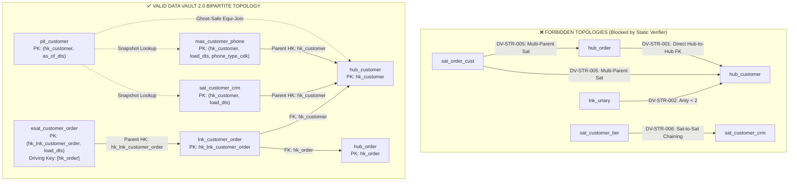
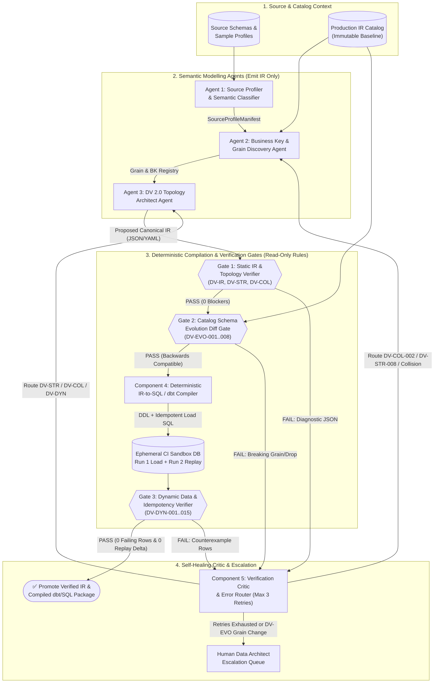
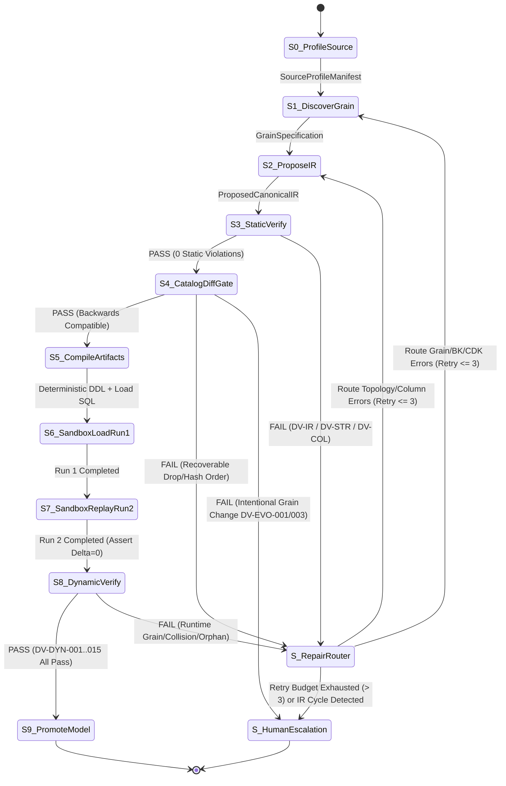
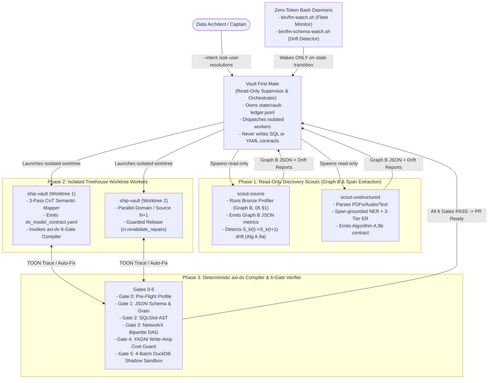

# 03 — Automated Verification Gates and Multi-Agent System Architecture for `open-dv`

> **Part of the [`open-dv` Reference Guide Suite](DV2_AGENT_REFERENCE_GUIDE.md)**  
> **Domain:** Mathematical Bipartite Graph Formulation, Static Rule Catalogs (`DV-STR-*`, `DV-COL-*`, `DV-EVO-*`), Dynamic Runtime SQL Verification Templates (`DV-DYN-001`–`DV-DYN-015`), 4 Adversarial Shadow Sandbox Batches, `dv-firstmate` Multi-Agent Swarm (`Vault First Mate`, `scout-source`, `scout-unstructured`, `ship-vault`), and the 6-Gate `axi-dv` & TOON Compiler Pipeline  
> **Companion Specifications:**
> - [01 — Core Architecture, Entity Specifications, and Methodology Standards](01-core-modelling-spec.md)
> - [02 — Schema Stability, Cold-Start ($N=1$) Pragmatism, Evolution Mechanics, and Anti-Patterns](02-schema-stability-and-evolution.md)
> - [04 — Unstructured & Multi-Modal Data Vault 2.0 Integration](04-unstructured-and-multimodal-dv2.md)
> - [05 — ELM Calculus, Graph B Profiling Math, 3-Pass CoT Prompt, and Reference Algorithms (`A.1`–`A.9` & `D.10`)](05-elm-calculus-and-reference-algorithms.md)
> - [Full HTML Reference Guide (`docs/references/No-Mistake-Agentic-Data-Vault-2.0-Complete-Design-and-Implementation-Guide.html`)](references/No-Mistake-Agentic-Data-Vault-2.0-Complete-Design-and-Implementation-Guide.html)
> - [Canonical IR JSON Schema (`schemas/dv2-canonical-ir.schema.json`)](../schemas/dv2-canonical-ir.schema.json) & [No-Mistake Contract V5 Schema (`schemas/no-mistake-dv2-contract-v5.schema.json`)](../schemas/no-mistake-dv2-contract-v5.schema.json)
> - [Annotated Multi-Source Model Contract (`examples/dv_model_contract.yaml`)](../examples/dv_model_contract.yaml)

---

## Executive Summary & Architectural Philosophy

Data Vault 2.0 (DV 2.0) achieves horizontal scalability, parallel loading, and audit-trail immutability by replacing traditional RDBMS-enforced foreign key constraints and sequential surrogate key generation with **deterministic cryptographic hash keys (`hk`)** and **insert-only decoupled table structures** (Hubs, Links, and Satellites). However, removing hard database constraints introduces a critical engineering risk: **structural topology errors, subtle hash normalization bugs, schema evolution drift, or broken delta-detection logic will silently corrupt the enterprise historical record unless caught by automated verification gates.**

When designing **`open-dv`**—an autonomous multi-agent system that designs, evolves, and operates Data Vault 2.0 models—this risk is compounded by LLM failure modes (hallucinated foreign keys between Hubs, non-alphabetical `hash_diff` column lists, destructive `DROP`/`UPDATE` migrations, or non-idempotent load queries).

To guarantee schema stability and data integrity, `open-dv` enforces a **Neuro-Symbolic Verification Architecture** built on three foundational principles:

1. **No Direct SQL Generation by LLMs (IR-First Contract)**:
   LLM agents never author raw SQL DDL or DML directly. Agents propose and repair models exclusively in a strongly typed **Canonical Intermediate Representation (IR)** validated against a strict JSON Schema ([`schemas/dv2-canonical-ir.schema.json`](../schemas/dv2-canonical-ir.schema.json)). A **Deterministic Symbolic Compiler** (backed by templates or `AutomateDV`/`datavault4dbt` macro transpilation) generates all SQL DDL, staging views, idempotent load queries, and verification tests from the verified IR.
2. **Two-Phase Verification Defense-in-Depth**:
   - **Phase 1: Compile-Time Static & Evolution Verification Gates (`DV-IR-*`, `DV-STR-*`, `DV-COL-*`, `DV-EVO-*`)** inspect the proposed IR graph, column contracts, hash expressions, and catalog diffs *before* any database connection is opened. Any `BLOCKER` violation halts compilation and routes a structured diagnostic payload back to the responsible modelling agent.
   - **Phase 2: Runtime Sandbox & Post-Load Verification Gates (`DV-DYN-*`)** execute the compiled DDL and load scripts twice (`Run 1` and `Run 2` replay) against representative staging data in an ephemeral sandbox (and subsequently as continuous post-load soft-constraint monitors in production) to verify grain uniqueness, asynchronous referential integrity, hash bijection (zero collisions), true-delta Satellite historization, Zero/Ghost record seeding, replay idempotency, and staging-to-vault reconciliation.
3. **Closed-Loop Self-Healing with Anti-Reward-Hacking Guardrails**:
   Verification gates are executed by an immutable symbolic **Verification Critic Engine** whose rules and baseline catalog snapshots reside in a read-only trust domain inaccessible to the modelling agents. Agents can resolve failures only by repairing the IR within a bounded retry budget (`max_retries = 3`) or escalating genuine business-grain ambiguities (`DV-EVO-*`) to human review.

---

## 1. Static Schema & Metadata Verification Checks (Compile-Time / Pre-Deploy)

### 1.1 Mathematical Graph Formulation of a Data Vault 2.0 Schema

A Data Vault 2.0 schema is formally represented at compile time as a typed directed multigraph:

$$G = (V, E), \quad V = V_H \cup V_L \cup V_S \cup V_B, \quad E = E_{LH} \cup E_{LL} \cup E_{SH} \cup E_{SL} \cup E_{BV}$$

where the vertex sets are mutually disjoint ($V_i \cap V_j = \emptyset$ for $i \neq j$):
- $V_H$: **Hubs** (core business concepts identified by immutable Business Keys).
- $V_L = V_{L\_STD} \cup V_{L\_HIER} \cup V_{L\_SAME} \cup V_{L\_NH} \cup V_{L\_EXP}$: **Links** (Standard associations, Hierarchical self-links, Same-As entity-resolution links, Non-Historized/Transactional links, and Exploration links).
- $V_S = V_{SAT} \cup V_{MAS} \cup V_{ESAT} \cup V_{STS} \cup V_{RTS}$: **Satellites** (Standard descriptive context Satellites, Multi-Active Satellites, Effectivity Satellites, Status Tracking Satellites, and Record Tracking Satellites).
- $V_B = V_{PIT} \cup V_{BRIDGE}$: **Business Vault Acceleration Structures** (Point-in-Time tables and Bridge tables).

Every directed edge $e = (u \xrightarrow{\text{fk}} v) \in E$ represents a child-to-parent hash-key reference (`u` holds a foreign hash key referencing the primary hash key of `v`). For $G$ to be a valid Data Vault 2.0 topology, it must satisfy the **Bipartite Hub-Link Invariant** and the **Satellite Single-Parent Invariant**:

1. **Zero Outgoing Edges from Hubs**: $\forall h \in V_H,\ \text{outdeg}(h) = 0$. Hubs are pure root vertices; a Hub never holds a foreign key to another Hub, Link, or Satellite.
2. **Bipartite Link Connectivity**: $\forall l \in V_L,\ \text{outdeg}_{V_H}(l) \ge 2$ (counting role-playing references with distinct `role_name` aliases as distinct outgoing edges in $E_{LH}$). Links connect Hubs to Hubs (and never reference other Links in a strict Raw Vault).
3. **Satellite Single-Parent Leaf Rule**: $\forall s \in V_S,\ \text{outdeg}(s) = 1$, with target $p(s) \in V_H \cup V_L$, and $\text{indeg}_{V_H \cup V_L \cup V_S}(s) = 0$ (only PIT tables $v \in V_{PIT}$ may reference Satellite primary keys $(hk, load\_dts)$).



---

### 1.2 Structural & Graph Topology Rule Catalog (`DV-STR-*`)

All structural rules are machine-evaluated over the Canonical IR before SQL compilation. Any rule with `BLOCKER` severity immediately rejects the IR proposal.

| Rule ID | Rule Name | Target Entity | Severity | Formal Pass Predicate (Logic / IR Property) | Failure Mode / Trap Prevented | Remediation Routing |
| :--- | :--- | :--- | :--- | :--- | :--- | :--- |
| **`DV-STR-001`** | **No Direct Hub-to-Hub Edges** | `HUB` | `BLOCKER` | $\forall h \in V_H,\ \text{outdeg}(h) = 0 \land \neg\exists c \in h.\text{columns}: c.\text{references} \in V$ | Embeds volatile 1:N parent-child foreign keys inside a Hub, breaking historical tracking when relationships change. | `TopologyArchitectAgent`: Extract foreign key into a dedicated `LINK` entity. |
| **`DV-STR-002`** | **Link Minimum Hub Arity ($\ge 2$)** | `LINK` | `BLOCKER` | $\forall l \in V_L,\ \|l.\text{hub\_references}\| \ge 2$ | Unary Links (1 Hub reference) are degenerate; attributes belong in a Hub Satellite or Multi-Active Satellite. | `TopologyArchitectAgent`: Add missing Hub reference or convert unary Link into `SAT` / `MAS`. |
| **`DV-STR-003`** | **Link Target Hub Existence** | `LINK` | `BLOCKER` | $\forall l \in V_L,\ \forall r \in l.\text{hub\_references},\ r.\text{target\_hub} \in V_H$ | Dangling graph edges referencing undefined Hub tables. | `TopologyArchitectAgent`: Define missing Hub in `$.hubs` or fix `target_hub` name. |
| **`DV-STR-004`** | **Self-Referencing Link Role Disambiguation** | `LINK` | `BLOCKER` | $\forall l \in V_L:\ \|\{r.\text{target\_hub}\}\| < \|l.\text{hub\_references}\| \implies l.\text{link\_type} \in \{\text{HIERARCHICAL}, \text{SAME\_AS}\} \land \|\{r.\text{role\_name}\}\| = \|l.\text{hub\_references}\| \land \|\{r.\text{fk\_column\_name}\}\| = \|l.\text{hub\_references}\|$ | Ambiguous column names and symmetric hash collisions in employee-manager hierarchies or master-duplicate Same-As Links. | `TopologyArchitectAgent`: Set `link_type` to `HIERARCHICAL` or `SAME_AS` and assign distinct `role_name` and `fk_column_name` (e.g., `hk_customer_master`, `hk_customer_duplicate`). |
| **`DV-STR-005`** | **Satellite Single-Parent Invariant** | `SATELLITE` | `BLOCKER` | $\forall s \in V_S,\ s.\text{parent\_entity} \in (V_H \cup V_L) \land \|s.\text{additional\_parents}\| = 0$ | Orphaned Satellites (0 parents) or multi-parent Satellites ($\ge 2$ parents) that conflate entity context with relationship context. | `TopologyArchitectAgent`: Attach Satellite to exactly one `HUB` or `LINK`. |
| **`DV-STR-006`** | **No Satellite-to-Satellite Chaining** | `SATELLITE` | `BLOCKER` | $\forall s \in V_S,\ s.\text{parent\_entity} \notin V_S$ | Creates snowflake chains of Satellites with cascading temporal join dependencies (`load_dts` range joins). | `TopologyArchitectAgent`: Re-parent child Satellite directly to the root `HUB`/`LINK` or model as `MULTI_ACTIVE` Satellite (`MAS`). |
| **`DV-STR-007`** | **Effectivity Satellite Driving Key Validity** | `ESAT` | `BLOCKER` | $\forall s \in V_{ESAT},\ s.\text{parent\_entity} \in V_L \land \emptyset \subsetneq s.\text{driving\_keys} \subsetneq \{r.\text{fk\_column\_name} \mid r \in p(s).\text{hub\_references}\}$ | Invalid Effectivity Satellite attached to a Hub, or driving key equal to $\emptyset$ or the entire Link FK set (which can never detect relationship replacement). | `TopologyArchitectAgent`: Attach `ESAT` to a `LINK` and specify the driving Hub FK(s) as a non-empty strict subset of the Link's Hub FKs. |
| **`DV-STR-008`** | **Multi-Active Satellite CDK Requirement** | `MAS` | `BLOCKER` | $\forall s \in V_{MAS},\ \|s.\text{child\_dependent\_keys}\| \ge 1 \land \forall k \in s.\text{child\_dependent\_keys},\ k.\text{nullable} = \text{false}$ | Primary key violation on `(hk, load_dts)` when multiple simultaneous active child rows arrive in the same batch. | `GrainDiscoveryAgent`: Identify non-null Child Dependent Key (`cdk` / `sub_seq`) column(s). |
| **`DV-STR-009`** | **Non-Historized Link Immutability & No Child Satellites** | `NH_LINK` | `ERROR` | $\forall l \in V_{L\_NH},\ \neg\exists s \in V_{SAT} \cup V_{MAS}: s.\text{parent\_entity} = l.\text{name}$ | Attaching mutable state Satellites to an immutable atomic event/transaction Link (`NH_LINK`), violating event-stream grain. | `TopologyArchitectAgent`: Embed immutable transaction measures directly in `NH_LINK` or change `link_type` to `STANDARD`. |
| **`DV-STR-010`** | **Duplicate Link Signature Detection (Chasm/Redundancy Trap)** | `LINK` | `WARNING` / `ERROR` | $\forall l_1, l_2 \in V_L (l_1 \neq l_2):\ (\text{multiset}(l_1.\text{target\_hubs}) = \text{multiset}(l_2.\text{target\_hubs}) \land l_1.\text{degenerate\_keys} = l_2.\text{degenerate\_keys}) \implies l_1.\text{semantic\_role} \neq l_2.\text{semantic\_role}$ | Two separate Links connect the exact same Hubs at the exact same grain without semantic role differentiation, fracturing relationship history. | `TopologyArchitectAgent`: Merge redundant Links into a single Link fed by multiple `source_mappings`, or declare explicit `semantic_role`. |
| **`DV-STR-011`** | **Chasm & Fan Trap Detection Across N-ary vs Binary Links** | `LINK` / `BRIDGE` | `WARNING` | A Bridge traversal path $H_1 \leftrightarrow L_1 \leftrightarrow H_2 \leftrightarrow L_2 \leftrightarrow H_3$ where both $L_1$ and $L_2$ are $M:N$ without an intersecting transaction Link $L_{123}(H_1, H_2, H_3)$ cannot be projected as a grain-preserving detail fact. | Cartesian fan-out / chasm trap when joining two independent $M:N$ Links through a shared Hub without a unifying N-ary Link or Bridge aggregation boundary. | `TopologyArchitectAgent`: Introduce N-ary Link if atomic $H_1\text{-}H_2\text{-}H_3$ grain exists in source, or isolate in separate Bridge tables. |
| **`DV-STR-012`** | **Raw Satellite Single-Source Split Rule** | `SATELLITE` | `ERROR` | $\forall s \in V_S,\ \|s.\text{source\_mappings}\| = 1$ | Combining multiple heterogeneous source systems into one Raw Vault Satellite causes column null-sprawl and false `hash_diff` flip-flopping across load schedules. | `TopologyArchitectAgent`: Split multi-source Satellite into source-specific Raw Satellites (`sat_<entity>_<src1>`, `sat_<entity>_<src2>`). |
| **`DV-STR-013`** | **Connected Component / Isolated Hub Island Check** | `HUB` | `WARNING` | $\forall h \in V_H,\ (\text{indeg}_{V_L}(h) + \text{indeg}_{V_S}(h)) \ge 1$ | Completely disconnected Hub with zero Satellites and zero Links provides no analytical context or relationships. | `TopologyArchitectAgent`: Attach at least one Satellite or Link, or remove unused Hub stub. |
| **`DV-STR-014`** | **Cyclic Hierarchy Termination Guarantee** | `LINK` | `ERROR` | $\forall l \in V_{L\_HIER},\ l.\text{max\_recursion\_depth} \in [1, 100] \land l.\text{cycle\_prevention\_predicate} = \text{true}$ | Recursive CTE queries over Hierarchical Links loop infinitely if cyclic data (`hk_parent == hk_child` or $A \to B \to A$) is not guarded. | `DeterministicCompiler`: Enforce `hk_parent <> hk_child` check and bounded recursive CTE cycle detection. |

---

### 1.3 Column, DDL, & Deterministic Hash Contract Checks (`DV-COL-*`)

#### 1.3.1 Entity-by-Entity Mandatory Column Contract Matrix

Every Data Vault 2.0 table type has a fixed structural column signature. The Static Verifier validates that no required metadata column is missing, nullable, or mistyped, and that no forbidden column pollutes the entity type:

| Entity Type | Primary Key (Logical Grain) | Required System & Key Columns (`NOT NULL`) | Allowed Descriptive / Payload Columns | Explicitly Forbidden Columns |
| :--- | :--- | :--- | :--- | :--- |
| **`HUB`** | `(hk_<hub>)` | `hk_<hub>`, `bk_1..bk_n` (plus `bkcc` if multi-domain), `load_dts`, `rec_src` | None (strictly keys + audit metadata only) | `hash_diff`, foreign keys (`hk_<other>`), descriptive/mutable payload columns, `end_dts` |
| **`LINK` (`STANDARD` / `HIERARCHICAL` / `SAME_AS`)** | `(hk_lnk_<name>)` | `hk_lnk_<name>`, `hk_<hub_1>..hk_<hub_k>` ($k \ge 2$), optional `degenerate_key_1..m`, `load_dts`, `rec_src` | None (descriptive relationship attributes belong in a Link Satellite) | `hash_diff`, mutable descriptive payload columns, `end_dts` |
| **`NH_LINK` (`NON_HISTORIZED` / `t_lnk_*`)** | `(hk_lnk_<name>)` | `hk_lnk_<name>`, `hk_<hub_1>..hk_<hub_k>` ($k \ge 2$), `txn_id` / `event_dts`, `load_dts`, `rec_src` | Immutable atomic transaction measures (e.g., `amount`, `quantity`) | `hash_diff` (no updates/deltas), `end_dts` |
| **`SAT` (`STANDARD`)** | `(hk_<parent>, load_dts)` | `hk_<parent>`, `load_dts`, `hash_diff`, `rec_src` | $\ge 1$ descriptive payload column (nullable allowed for business attributes) | Direct business keys (`bk`), foreign keys to other Hubs/Links, stored `end_dts` in Raw Vault (compute via `LEAD(load_dts)` view) |
| **`MAS` (`MULTI_ACTIVE`)** | `(hk_<parent>, load_dts, cdk_1..cdk_m)` | `hk_<parent>`, `load_dts`, `cdk_1..cdk_m` (`sub_seq`), `hash_diff`, `rec_src` | $\ge 1$ descriptive payload column | Nullable `cdk` columns, stored `end_dts` |
| **`ESAT` (`EFFECTIVITY`)** | `(hk_lnk_<parent>, load_dts)` | `hk_lnk_<parent>`, `load_dts`, `driving_hk_<hub>`, `rec_src` | Optional `hash_diff` | Unregistered driving keys, stored mutable `end_dts` in Raw Vault |
| **`STS` (`STATUS_TRACKING`)** | `(hk_<parent>, load_dts)` | `hk_<parent>`, `load_dts`, `status_code` (`I`/`U`/`D`), `rec_src` | None | Descriptive business columns, stored `end_dts` |
| **`RTS` (`RECORD_TRACKING`)** | `(hk_<parent>, load_dts, rec_src)` | `hk_<parent>`, `load_dts`, `rec_src` | Optional `stg_batch_id` | Payload columns, `hash_diff` |
| **`PIT` (`POINT_IN_TIME`)** | `(hk_<parent>, as_of_dts)` | `hk_<parent>`, `as_of_dts`, plus `(sat_i_hk, sat_i_ldts)` for each tracked Satellite $i \in \{1..k\}$ | None (pure key-lookup acceleration table) | Un-defaulted nullable Satellite pointers (must default to Ghost Record `0x00..00` and `'1900-01-01'`) |

#### 1.3.2 Deterministic Hash Expression Standard (`DV_HASH_KEY` & `DV_HASH_DIFF`)

A major source of silent Data Vault corruption is inconsistent hashing between Staging, Hubs, Links, and Satellites. `open-dv` enforces two distinct canonical hash macros in its compiler and verifies them statically via AST/IR inspection:

1. **Business Key & Link Hash Key Macro (`DV_HASH_KEY`)**:
   - **Purpose**: Maps 1 or more Business Key columns (and `bkcc`) to a fixed-width binary or hex digest (`SHA-256` $\to$ `BINARY(32)` / `CHAR(64)`).
   - **Normalization**: Business keys represent semantic identifiers; leading/trailing whitespace and casing anomalies from heterogeneous sources are normalized via `UPPER(TRIM(CAST(col AS VARCHAR)))` (unless the Hub explicitly sets `normalization: EXACT_TRIM` for case-sensitive base64/UUID tokens).
   - **Null Handling & Collision-Proof Length Encoding**: Each column is normalized with `NULLIF(..., '')`, length-prefixed (`<byte_len>:<val>`, with `NULL` positions encoded as `'-1:^^'`), and concatenated using `'||'`; the uppercase hex `SHA-256` digest is emitted (`Algorithm A.5`). If every business key column (excluding `bkcc`) is `NULL`, the key resolves to the Zero Key `REPEAT('0', 64)` instead of being hashed (`KEY-02b`).
2. **Satellite Payload Hash Diff Macro (`DV_HASH_DIFF`)**:
   - **Purpose**: Detects changes in descriptive attributes for a given parent key.
   - **Lexicographical Column Sorting (`ORDER BY column_alias ASC`)**: Payload columns (plus `child_dependent_keys` for `MAS`) **must** be sorted strictly alphabetically by their target column name in the IR. This guarantees that physical column ordering in Staging never alters `hash_diff`.
   - **Case-Preserving Normalization (`EXACT_TRIM`)**: Unlike Business Keys, Satellite payloads **must not** be converted to `UPPER()`, because a change from `'macdonald'` to `'MacDonald'` is a valid business update that must trigger a new Satellite row.
   - **Distinct Null Token (`'-1:^^'`)**: Null values are mapped to the length-prefixed null token `'-1:^^'`, which no non-null value can produce (its length prefix is never negative), and non-string scalar types (timestamps, dates, decimals) are formatted with explicit ISO-8601 / fixed-scale masks before hashing.

#### 1.3.3 Column & DDL Contract Rule Catalog (`DV-COL-*`)

| Rule ID | Rule Name | Target Entity | Severity | Formal Pass Predicate (IR / SQL AST Check) | Remediation Routing |
| :--- | :--- | :--- | :--- | :--- | :--- |
| **`DV-COL-001`** | **Primary Hash Key Non-Null & Vault-Wide Type Parity** | `ALL` | `BLOCKER` | $\forall e \in V,\ e.\text{hk\_column}.\text{nullable} = \text{false} \land e.\text{hk\_column}.\text{data\_type} = \text{ir.hash\_config.storage\_type}$ | `TopologyArchitectAgent`: Set `nullable: false` and match global `hash_config.storage_type` (`CHAR(64)` or `BINARY(32)`). |
| **`DV-COL-002`** | **Hub Business Keys Non-Nullable** | `HUB` | `BLOCKER` | $\forall h \in V_H,\ \|h.\text{business\_keys}\| \ge 1 \land \forall b \in h.\text{business\_keys},\ b.\text{nullable} = \text{false}$ | `GrainDiscoveryAgent`: Mark all Hub business key columns `nullable: false` (stage loader maps missing source keys to `-1` Zero Key before insert). |
| **`DV-COL-003`** | **Hub Hash Key Input Exact Parity** | `HUB` | `BLOCKER` | $\forall h \in V_H,\ h.\text{hk\_column}.\text{hash\_expression}.\text{input\_columns} = [b.\text{name} \mid b \in h.\text{business\_keys}] \land \text{algo} = \text{ir.hash\_config.algorithm}$ | `TopologyArchitectAgent`: Align `hk_column.hash_expression.input_columns` with the ordered `business_keys` list. |
| **`DV-COL-004`** | **Link Foreign Hash Key Type Parity & Non-Nullability** | `LINK` | `BLOCKER` | $\forall l \in V_L,\ \forall r \in l.\text{hub\_references},\ r.\text{nullable} = \text{false} \land r.\text{data\_type} = \text{hubs}[r.\text{target\_hub}].\text{hk\_column}.\text{data\_type}$ | `TopologyArchitectAgent`: Enforce `nullable: false` and exact data type parity with referenced Hub `hk`. |
| **`DV-COL-005`** | **Satellite Parent HK Type Parity & Non-Nullability** | `SATELLITE` | `BLOCKER` | $\forall s \in V_S,\ s.\text{parent\_hk\_column}.\text{nullable} = \text{false} \land s.\text{parent\_hk\_column}.\text{data\_type} = p(s).\text{hk\_column}.\text{data\_type}$ | `TopologyArchitectAgent`: Match Satellite `parent_hk_column` type and non-nullability to parent Hub/Link `hk`. |
| **`DV-COL-006`** | **Satellite `hash_diff` Lexicographical Input Ordering** | `SATELLITE` | `BLOCKER` | $\forall s \in V_S,\ s.\text{hash\_diff}.\text{input\_columns} = \text{sort}([c.\text{name} \mid c \in s.\text{payload\_columns} \cup s.\text{child\_dependent\_keys}])$ | `TopologyArchitectAgent`: Sort `hash_diff.input_columns` alphabetically and include all payload + CDK columns. |
| **`DV-COL-007`** | **Satellite `hash_diff` Case-Preserving Normalization** | `SATELLITE` | `ERROR` | $\forall s \in V_S,\ s.\text{hash\_diff}.\text{normalization} = \text{'EXACT\_TRIM'}$ | `TopologyArchitectAgent`: Set `normalization: EXACT_TRIM` on `hash_diff` so case changes in attributes are tracked. |
| **`DV-COL-008`** | **Exclusion of System Audit Columns from `hash_diff`** | `SATELLITE` | `BLOCKER` | $\forall s \in V_S,\ s.\text{hash\_diff}.\text{input\_columns} \cap \{\text{load\_dts}, \text{rec\_src}, s.\text{parent\_hk}\} = \emptyset$ | `TopologyArchitectAgent`: Remove `load_dts`, `rec_src`, and `hk` from `hash_diff` inputs (including `load_dts` in `hash_diff` forces a false delta on every batch run!). |
| **`DV-COL-009`** | **Mandatory Audit Columns (`load_dts`, `rec_src`) Presence & Type** | `ALL` | `BLOCKER` | $\forall e \in V_H \cup V_L \cup V_S,\ e.\text{load\_dts}.\text{nullable} = \text{false} \land e.\text{rec\_src}.\text{nullable} = \text{false} \land e.\text{load\_dts}.\text{data\_type} = \text{sys.load\_dts\_type}$ | `TopologyArchitectAgent`: Include non-nullable `load_dts` and `rec_src` with vault-standard data types on every entity. |
| **`DV-COL-010`** | **Delimiter & Null-Token Disjointness** | `MODEL` | `BLOCKER` | $\text{hash\_config.delimiter} \neq \text{hash\_config.null\_token\_bk} \land \text{hash\_config.delimiter} \neq \text{hash\_config.null\_token\_payload} \land \|\text{delimiter}\| \ge 1$ | `TopologyArchitectAgent`: Use disjoint tokens (e.g., delimiter `'||'` and length-prefixed null token `'-1:^^'`). |
| **`DV-COL-011`** | **Forbidden Stored `end_dts` in Raw Vault Satellites** | `SAT` / `MAS` | `WARNING` | $\forall s \in V_{SAT} \cup V_{MAS},\ \text{'end\_dts'} \notin \{c.\text{name} \mid c \in s.\text{payload\_columns}\}$ | `TopologyArchitectAgent`: Do not store mutable `end_dts` in Raw Satellites (which requires `UPDATE` on prior rows); derive `effective_to_dts` dynamically via `LEAD(load_dts) OVER (PARTITION BY hk ORDER BY load_dts)` in Business Vault views or PIT tables. |
| **`DV-COL-012`** | **Multi-Source Hub Business Key Collision Code (`bkcc`) Requirement** | `HUB` | `ERROR` | $\forall h \in V_H:\ \|h.\text{source\_mappings}\| > 1 \land \neg h.\text{verified\_global\_master\_key} \implies \exists b \in h.\text{business\_keys}: b.\text{is\_bkcc} = \text{true}$ | `GrainDiscoveryAgent`: Add a non-null `bkcc` (Business Key Collision Code) column to `business_keys` when integrating uncoordinated source systems whose local IDs (e.g. `1001`) could collide. |

---

### 1.4 Backwards-Compatibility, Schema Evolution & Immutability Diff Gates (`DV-EVO-*`)

Because a Data Vault 2.0 Raw Vault is an **append-only, immutable system of record**, schema evolution against an existing production catalog ($IR_{\text{baseline}} \to IR_{\text{proposed}}$) is governed by strict non-destructiveness gates.

#### 1.4.1 Safe vs. Destructive Schema Evolution Matrix

| Change Category | Proposed Operation | Gate Verdict | Technical Rationale & Required Evolution Pattern |
| :--- | :--- | :---: | :--- |
| **New Topology** | Add new `HUB`, `LINK`, `SAT`, `MAS`, `ESAT`, `PIT`, or `BRIDGE` | ✅ **ALLOWED** | Purely additive graph extension; zero impact on existing tables or hashes. |
| **New Source Mapping** | Add a new `source_mapping` to an existing `HUB` or `LINK` | ✅ **ALLOWED** | Standard DV 2.0 integration pattern, provided `business_keys` / `bkcc` grain is unchanged. |
| **Satellite Attribute Addition (Recommended)** | Create a new companion Satellite `sat_<entity>_<new_topic>` for new source columns | ✅ **ALLOWED** | Zero DDL mutation on existing Satellite; historical `hash_diff` values remain 100% untouched. |
| **Satellite Attribute Addition (In-Place)** | `ALTER TABLE sat ADD COLUMN col NULL` | ⚠️ **GUARDED (`DV-EVO-006`)** | Allowed **only** if the `hash_diff` formula either (a) pads missing historical values with the exact `null_token_payload` (`'-1:^^'`) in chronological order or (b) splits into a v2 Satellite view. Arbitrarily inserting a new column into the middle of an alphabetical `hash_diff` list without null-equivalence changes the hash of unchanged rows on the next batch load! |
| **Destructive Drops** | Drop an existing `HUB`, `LINK`, `SATELLITE`, or any column within them | ❌ **BLOCKED (`DV-EVO-002`, `DV-EVO-004`)** | Violates Raw Vault audit retention. Deprecated attributes simply receive `NULL` in new loads or are retired by stopping loads to that Satellite. |
| **Grain / Hash Mutation** | Add, remove, or reorder `business_keys` in a `HUB`, `hub_references` in a `LINK`, or `child_dependent_keys` in a `MAS` | ❌ **BLOCKED (`DV-EVO-003`)** | Invalidates every historical `hk` in the table and breaks all historical joins. Requires creating a new versioned entity or migration pipeline with human architect sign-off. |
| **Mutable DML in Load Scripts** | `UPDATE`, `DELETE`, `TRUNCATE`, `DROP`, `MERGE ... WHEN MATCHED THEN UPDATE` on Raw Vault tables | ❌ **BLOCKED (`DV-EVO-005`)** | Raw Vault tables (`hub_*`, `lnk_*`, `sat_*`, `mas_*`, `esat_*`, `sts_*`, `rts_*`) are strictly `INSERT`-only. |

#### 1.4.2 Schema Evolution & Diff Gate Catalog (`DV-EVO-*`)

| Rule ID | Rule Name | Target | Severity | Formal Pass Predicate ($IR_{\text{base}}$ vs. $IR_{\text{prop}}$ & SQL AST) | Remediation Routing |
| :--- | :--- | :--- | :--- | :--- | :--- |
| **`DV-EVO-001`** | **Global Hash Config Immutability** | `MODEL` | `BLOCKER` | $IR_{\text{base}}.\text{hash\_config} = IR_{\text{prop}}.\text{hash\_config}$ | `TopologyArchitectAgent` / `HumanEscalation`: Never alter hash algorithm, delimiter, or null tokens on an active Vault. |
| **`DV-EVO-002`** | **No Entity Deletion (Hub / Link / Satellite Retention)** | `ALL` | `BLOCKER` | $\forall k \in \{\text{hubs}, \text{links}, \text{satellites}\},\ \text{names}(IR_{\text{base}}[k]) \subseteq \text{names}(IR_{\text{prop}}[k])$ | `TopologyArchitectAgent`: Restore dropped table definition to `IR_prop`. |
| **`DV-EVO-003`** | **Hub, Link, and MAS Grain Immutability** | `HUB` / `LINK` / `MAS` | `BLOCKER` | $\forall e \in IR_{\text{base}}:\ \text{key\_signature}(e_{\text{base}}) = \text{key\_signature}(e_{\text{prop}})$ (exact ordered list of BKs, Link FKs + degenerate keys, or MAS CDKs) | `GrainDiscoveryAgent` / `HumanEscalation`: Keep existing entity grain intact; introduce a new Hub/Link/Satellite if a new business grain is required. |
| **`DV-EVO-004`** | **No Column Deletion in Existing Entities** | `ALL` | `BLOCKER` | $\forall e \in IR_{\text{base}}:\ \text{col\_names}(e_{\text{base}}) \subseteq \text{col\_names}(e_{\text{prop}})$ | `TopologyArchitectAgent`: Restore dropped column(s) to entity definition; map deprecated source columns to `NULL` in staging. |
| **`DV-EVO-005`** | **Insert-Only Raw Vault DML Enforcement** | `SQL_SCRIPT` | `BLOCKER` | $\forall \text{stmt} \in \text{SQL}_{\text{raw\_vault}}:\ \text{AST\_type}(\text{stmt}) \in \{\text{CREATE\_TABLE\_IF\_NOT\_EXISTS}, \text{ALTER\_TABLE\_ADD\_COLUMN}, \text{INSERT\_INTO\_SELECT}\}$ (Zero `UPDATE`, `DELETE`, `TRUNCATE`, `DROP`, or `CREATE OR REPLACE` on Raw Vault tables) | `DeterministicCompiler`: Recompile load script using strictly idempotent `INSERT INTO ... SELECT ... WHERE NOT EXISTS` / delta anti-join templates. |
| **`DV-EVO-006`** | **Hash-Diff Stability Under Satellite Evolution** | `SATELLITE` | `ERROR` | If $\text{col\_names}(s_{\text{prop}}) \supsetneq \text{col\_names}(s_{\text{base}})$, either (a) new columns are isolated in a new Satellite $s_{\text{ext}}$, or (b) $s_{\text{prop}}$ declares an explicit `hash_diff_migration_policy` verified to produce identical hashes when new columns are `NULL`. | `TopologyArchitectAgent`: Prefer splitting new attributes into a separate Satellite `sat_<entity>_<ext>` rather than mutating an existing Satellite's `hash_diff` input vector. |
| **`DV-EVO-007`** | **Column Data Type Widening Only** | `ALL` | `BLOCKER` | $\forall c \in \text{cols}(e_{\text{base}}):\ \text{type}(c_{\text{prop}}) = \text{type}(c_{\text{base}}) \lor \text{is\_lossless\_widening}(\text{type}(c_{\text{base}}), \text{type}(c_{\text{prop}}))$ (e.g., `VARCHAR(50)` $\to$ `VARCHAR(200)`) | `TopologyArchitectAgent`: Revert narrowing or incompatible type change; add a new column or Satellite if type semantics changed. |
| **`DV-EVO-008`** | **Nullable Constraint Monotonicity** | `SATELLITE` | `BLOCKER` | $\forall c \in \text{cols}(s_{\text{base}}):\ (c_{\text{base}}.\text{nullable} = \text{true} \implies c_{\text{prop}}.\text{nullable} = \text{true}) \land \forall c_{\text{new}} \in (\text{cols}(s_{\text{prop}}) \setminus \text{cols}(s_{\text{base}})):\ c_{\text{new}}.\text{nullable} = \text{true}$ | `TopologyArchitectAgent`: New payload columns added to an existing populated Satellite must be `nullable: true`, and previously nullable columns cannot be tightened to `NOT NULL`. |

---

## 2. Dynamic Data & Runtime Verification Checks (Post-Load / CI Testing)

Static checks prove that the *schema and SQL structure* are valid; **Dynamic Runtime Checks (`DV-DYN-*`)** prove that the *loaded data* satisfies Data Vault 2.0 invariants both in an **ephemeral pre-deployment CI sandbox** (where `BLOCKER` failures halt deployment and trigger agent self-repair) and in **production post-load observability** (where soft-constraint checks run asynchronously without blocking raw ingestion).

### 2.1 Dynamic Verification Rule Catalog (`DV-DYN-*`)

| Rule ID | Check Name | Target Entity | Severity (Sandbox CI / Prod) | Pass Predicate (SQL Result Set Criterion) | Execution Cadence |
| :--- | :--- | :--- | :--- | :--- | :--- |
| **`DV-DYN-001`** | **Hub Hash Key (`hk`) & Composite BK Uniqueness** | `HUB` | `BLOCKER` / `CRITICAL` | `COUNT(*) - COUNT(DISTINCT hk) = 0` AND `COUNT(*) - COUNT(DISTINCT composite_bk) = 0` | Every Sandbox CI Run & Every Batch Load |
| **`DV-DYN-002`** | **Hub & Link Cryptographic / Concatenation Hash Collision Check** | `HUB`, `LINK` | `BLOCKER` / `CRITICAL` | `SELECT hk FROM hub GROUP BY hk HAVING COUNT(DISTINCT composite_bk) > 1` returns `0` rows | Every Sandbox CI Run & Daily Production Audit |
| **`DV-DYN-003`** | **Link Hash Key (`hk_lnk`) & FK-Tuple Grain Uniqueness** | `LINK` | `BLOCKER` / `CRITICAL` | `COUNT(*) - COUNT(DISTINCT hk_lnk) = 0` AND `COUNT(*) - COUNT(DISTINCT (fk_1, .., fk_k, deg_1, ..)) = 0` | Every Sandbox CI Run & Every Batch Load |
| **`DV-DYN-004`** | **Standard & Effectivity Satellite `(hk, load_dts)` Grain Uniqueness** | `SAT`, `ESAT` | `BLOCKER` / `CRITICAL` | `SELECT hk, load_dts FROM sat GROUP BY hk, load_dts HAVING COUNT(*) > 1` returns `0` rows | Every Sandbox CI Run & Every Batch Load |
| **`DV-DYN-005`** | **Multi-Active Satellite `(hk, load_dts, cdk_1..m)` Grain Uniqueness** | `MAS` | `BLOCKER` / `CRITICAL` | `SELECT hk, load_dts, cdk_1..m FROM mas GROUP BY hk, load_dts, cdk_1..m HAVING COUNT(*) > 1` returns `0` rows | Every Sandbox CI Run & Every Batch Load |
| **`DV-DYN-006`** | **Satellite-to-Parent Referential Integrity (Orphan Detection)** | `SAT`, `MAS`, `ESAT` | `BLOCKER` (CI) / `WARNING` (Lag Window) | `SELECT COUNT(*) FROM sat LEFT JOIN parent ON sat.hk = parent.hk WHERE parent.hk IS NULL` = `0` (in Prod, filter `WHERE sat.load_dts < NOW() - INTERVAL '<sla>'`) | Every Sandbox CI Run & Post-Load Convergence Check |
| **`DV-DYN-007`** | **Link-to-Hub Foreign Key Referential Integrity (Orphan Detection)** | `LINK` | `BLOCKER` (CI) / `WARNING` (Lag Window) | For each $i \in \{1..k\}$: `SELECT COUNT(*) FROM lnk LEFT JOIN hub_i ON lnk.fk_i = hub_i.hk WHERE hub_i.hk IS NULL` = `0` | Every Sandbox CI Run & Post-Load Convergence Check |
| **`DV-DYN-008`** | **Satellite Consecutive `hash_diff` True-Delta Historization Check** | `SAT`, `ESAT` | `BLOCKER` / `ERROR` | `LAG(hash_diff) OVER (PARTITION BY hk ORDER BY load_dts) = hash_diff` returns `0` rows (no redundant unchanged versions inserted) | Every Sandbox CI Run & Every Batch Load |
| **`DV-DYN-009`** | **System Zero Keys (`-1`, `-2`) & Ghost Record (`1900-01-01`) Presence** | `HUB`, `LINK`, `SAT` | `BLOCKER` / `ERROR` | Every Hub/Link contains `0x00..00` (`-1`) and `0xFF..FF` (`-2`); every Satellite contains Ghost Record `(0x00..00, '1900-01-01T00:00:00')` | Every Sandbox CI Run & Post-Deploy Initialization |
| **`DV-DYN-010`** | **Staging-to-Hub & Staging-to-Link Completeness Reconciliation** | `HUB`, `LINK` | `BLOCKER` / `CRITICAL` | `SELECT COUNT(*) FROM stg LEFT JOIN hub ON stg.hk = hub.hk WHERE hub.hk IS NULL` = `0` (zero dropped business keys or relationships) | Every Sandbox CI Run & Every Batch Load |
| **`DV-DYN-011`** | **Staging-to-Satellite Current-State Payload Reconciliation** | `SAT`, `MAS` | `BLOCKER` / `CRITICAL` | Latest record per `hk` in Satellite (`ROW_NUMBER() OVER (PARTITION BY hk ORDER BY load_dts DESC) = 1`) has `sat.hash_diff = stg.hash_diff` for 100% of staged records | Every Sandbox CI Run & Every Batch Load |
| **`DV-DYN-012`** | **Two-Run Replay Idempotency Test** | `ALL_RAW_VAULT` | `BLOCKER` | Executing the load pipeline a second time ($L(S)$ at $t_2 > t_1$) on the same staging dataset $S$ yields $\Delta \text{row\_count} = 0$ across every Hub, Link, and Satellite | Every Sandbox CI Run |
| **`DV-DYN-013`** | **Effectivity Satellite Single Active Relationship per Driving Key** | `ESAT` | `BLOCKER` / `ERROR` | Joining `esat` (at current active state `is_active = TRUE` / `end_dts IS NULL`) to parent `lnk` (excluding Zero Key `0x00..00`) yields at most 1 active `hk_lnk` per driving key tuple | Every Sandbox CI Run & Every Batch Load |
| **`DV-DYN-014`** | **Ghost/Zero-Key Business Metric Leakage Guard** | `ESAT`, `BRIDGE`, `BV_VIEW` | `ERROR` | Active Effectivity timelines and Business Vault KPI aggregations exclude `hk = '0000...0000'` and `hk = 'ffff...ffff'` where required by business logic | Every Sandbox CI Run |
| **`DV-DYN-015`** | **PIT Table Completeness & Non-Null Pointer Integrity** | `PIT` | `BLOCKER` / `ERROR` | Every `(hk, as_of_dts)` in `PIT` resolves to a valid `(sat_hk, sat_load_dts)` present in each child Satellite (defaulting to the `'1900-01-01'` Ghost Record when no historical row existed at `as_of_dts`) | Every Sandbox CI Run & Post-PIT Rebuild |

---

### 2.2 Parametric SQL Verification Templates

Every template below is designed so that **a query returning 0 rows indicates `PASS`**, and **any returned row is an actionable counterexample** fed directly into the `VerificationCriticEngine` diagnostic report.

#### Template 1: Hub Uniqueness & Hash Collision Bijection (`DV-DYN-001`, `DV-DYN-002`)
```sql
-- [DV-DYN-001] Hub Primary Hash Key & Business Key Uniqueness
SELECT
    'HUB_DUPLICATE_HK' AS violation_type,
    hk_{{ entity_name }} AS offending_key,
    COUNT(*) AS row_count
FROM {{ schema }}.hub_{{ entity_name }}
GROUP BY hk_{{ entity_name }}
HAVING COUNT(*) > 1

UNION ALL

-- [DV-DYN-002] Cryptographic or Delimiter-Boundary Hash Collision Check
-- Detects if two distinct (bk_1, ..., bk_n) tuples produced the same hk
SELECT
    'HUB_HASH_COLLISION' AS violation_type,
    hk_{{ entity_name }} AS offending_key,
    COUNT(DISTINCT {{ bk_concat_expr }}) AS row_count
FROM {{ schema }}.hub_{{ entity_name }}
GROUP BY hk_{{ entity_name }}
HAVING COUNT(DISTINCT {{ bk_concat_expr }}) > 1;
```

#### Template 2: Satellite & Multi-Active Satellite Grain Uniqueness (`DV-DYN-004`, `DV-DYN-005`)
```sql
-- [DV-DYN-004] Standard / Effectivity Satellite Grain Check: (hk_parent, load_dts)
SELECT
    {{ parent_hk_col }},
    load_dts,
    COUNT(*) AS duplicate_count
FROM {{ schema }}.{{ sat_table_name }}
GROUP BY {{ parent_hk_col }}, load_dts
HAVING COUNT(*) > 1;

-- [DV-DYN-005] Multi-Active Satellite Grain Check: (hk_parent, load_dts, cdk_1, ..., cdk_m)
SELECT
    {{ parent_hk_col }},
    load_dts,
    {{ cdk_columns_csv }},
    COUNT(*) AS duplicate_count
FROM {{ schema }}.{{ mas_table_name }}
GROUP BY {{ parent_hk_col }}, load_dts, {{ cdk_columns_csv }}
HAVING COUNT(*) > 1;
```

#### Template 3: Asynchronous Soft Referential Integrity & Orphan Detection (`DV-DYN-006`, `DV-DYN-007`)
```sql
-- [DV-DYN-006] Satellite-to-Parent Orphan Detection
-- In Sandbox CI: {{ lag_tolerance_predicate }} is '1=1' (0 orphans tolerated).
-- In Production Streaming: e.g., "s.load_dts < CURRENT_TIMESTAMP - INTERVAL '15 minutes'"
SELECT
    s.{{ parent_hk_col }} AS orphan_hk,
    s.load_dts,
    s.rec_src
FROM {{ schema }}.{{ sat_table_name }} s
LEFT JOIN {{ schema }}.{{ parent_table_name }} p
  ON s.{{ parent_hk_col }} = p.{{ parent_hk_col }}
WHERE p.{{ parent_hk_col }} IS NULL
  AND ({{ lag_tolerance_predicate }});

-- [DV-DYN-007] Link-to-Hub Foreign Hash Key Orphan Detection
SELECT
    l.{{ link_hk_col }},
    l.{{ fk_col_i }} AS missing_hub_fk,
    '{{ target_hub_i }}' AS target_hub_table,
    l.load_dts
FROM {{ schema }}.{{ link_table_name }} l
LEFT JOIN {{ schema }}.{{ target_hub_i }} h
  ON l.{{ fk_col_i }} = h.{{ target_hub_i_hk_col }}
WHERE h.{{ target_hub_i_hk_col }} IS NULL
  AND ({{ lag_tolerance_predicate }});
```

#### Template 4: Satellite True-Delta Historization Integrity (`DV-DYN-008`)
```sql
-- [DV-DYN-008] Detects broken staging delta filters that insert consecutive rows
-- for the same hk with identical hash_diff values.
WITH chronological_versions AS (
    SELECT
        {{ parent_hk_col }},
        load_dts,
        hash_diff,
        LAG(hash_diff) OVER (
            PARTITION BY {{ parent_hk_col }}
            ORDER BY load_dts ASC
        ) AS prev_hash_diff
    FROM {{ schema }}.{{ sat_table_name }}
    WHERE {{ parent_hk_col }} NOT IN (
        '{{ zero_key_unknown_hash }}',
        '{{ zero_key_error_hash }}'
    )
)
SELECT
    {{ parent_hk_col }},
    load_dts,
    hash_diff,
    prev_hash_diff
FROM chronological_versions
WHERE hash_diff = prev_hash_diff;
```

#### Template 5: Zero Keys (`-1`, `-2`) & Ghost Record Presence (`DV-DYN-009`)
```sql
-- [DV-DYN-009] Verifies every Hub/Link has Unknown (-1) and Error (-2) Zero Keys
-- and every Satellite has its corresponding 1900-01-01 Ghost Record.
SELECT 'MISSING_UNKNOWN_ZERO_KEY' AS check_failure, '{{ hub_or_link_table }}' AS entity
WHERE NOT EXISTS (
    SELECT 1 FROM {{ schema }}.{{ hub_or_link_table }}
    WHERE {{ hk_col }} = '0000000000000000000000000000000000000000000000000000000000000000'
)
UNION ALL
SELECT 'MISSING_ERROR_ZERO_KEY' AS check_failure, '{{ hub_or_link_table }}' AS entity
WHERE NOT EXISTS (
    SELECT 1 FROM {{ schema }}.{{ hub_or_link_table }}
    WHERE {{ hk_col }} = 'ffffffffffffffffffffffffffffffffffffffffffffffffffffffffffffffff'
)
UNION ALL
SELECT 'MISSING_SATELLITE_GHOST_RECORD' AS check_failure, '{{ sat_table_name }}' AS entity
WHERE NOT EXISTS (
    SELECT 1 FROM {{ schema }}.{{ sat_table_name }}
    WHERE {{ parent_hk_col }} = '0000000000000000000000000000000000000000000000000000000000000000'
      AND load_dts = '1900-01-01T00:00:00'
);
```

#### Template 6: Staging-to-Vault Completeness & Current-State Reconciliation (`DV-DYN-010`, `DV-DYN-011`)
```sql
-- [DV-DYN-010] Staging-to-Hub Completeness (0 dropped business keys)
SELECT
    stg.{{ hk_col }},
    stg.rec_src
FROM {{ staging_schema }}.{{ staging_table }} stg
LEFT JOIN {{ schema }}.{{ hub_table }} h
  ON stg.{{ hk_col }} = h.{{ hk_col }}
WHERE h.{{ hk_col }} IS NULL;

-- [DV-DYN-011] Staging-to-Satellite Latest State Reconciliation
-- Verifies the latest Satellite version per hk matches the staged hash_diff
WITH latest_sat AS (
    SELECT
        {{ parent_hk_col }},
        hash_diff,
        ROW_NUMBER() OVER (
            PARTITION BY {{ parent_hk_col }}
            ORDER BY load_dts DESC
        ) AS rn
    FROM {{ schema }}.{{ sat_table_name }}
),
dedup_stg AS (
    SELECT DISTINCT
        {{ parent_hk_col }},
        hash_diff
    FROM {{ staging_schema }}.{{ staging_table }}
)
SELECT
    s.{{ parent_hk_col }},
    s.hash_diff AS staged_hash_diff,
    l.hash_diff AS vault_latest_hash_diff
FROM dedup_stg s
LEFT JOIN latest_sat l
  ON s.{{ parent_hk_col }} = l.{{ parent_hk_col }} AND l.rn = 1
WHERE l.{{ parent_hk_col }} IS NULL
   OR s.hash_diff <> l.hash_diff;
```

#### Template 7: Effectivity Satellite Active Driving-Key Uniqueness (`DV-DYN-013`)
```sql
-- [DV-DYN-013] Verifies that at most one relationship in a Link is currently active
-- for a given Driving Key (excluding the system Zero Key).
WITH current_esat AS (
    SELECT
        hk_lnk_{{ link_name }},
        driving_hk_{{ driving_entity }},
        LEAD(load_dts) OVER (
            PARTITION BY driving_hk_{{ driving_entity }}
            ORDER BY load_dts ASC
        ) AS next_load_dts
    FROM {{ schema }}.esat_{{ link_name }}
)
SELECT
    driving_hk_{{ driving_entity }},
    COUNT(*) AS concurrent_active_links
FROM current_esat
WHERE next_load_dts IS NULL
  AND hk_lnk_{{ link_name }} <> '0000000000000000000000000000000000000000000000000000000000000000'
  AND driving_hk_{{ driving_entity }} <> '0000000000000000000000000000000000000000000000000000000000000000'
GROUP BY driving_hk_{{ driving_entity }}
HAVING COUNT(*) > 1;
```

---

## 3. Agentic Modelling System Design & Enforcement Architecture (`open-dv`)

### 3.1 Multi-Agent System Topology & Separation of Concerns

To prevent LLM hallucinations from reaching the data warehouse, `open-dv` separates **semantic modelling agents** (which analyze source schemas, discover business keys, and propose IR graph topologies) from **deterministic symbolic engines** (which validate the IR, compile SQL/dbt artifacts, execute sandbox loads, and enforce verification gates).



---

### 3.2 Specialized Agent Roles, Contracts, and Security Boundaries

| Component / Agent | Type | Input Contract | Output Contract | Allowed Tools & Sandboxing Constraints |
| :--- | :--- | :--- | :--- | :--- |
| **1. `SourceProfilerAgent`** | LLM + Statistical Profiler | Raw source DDL, sample rows, CDC metadata | `SourceProfileManifest` (candidate uniqueness ratios, null rates, functional dependencies $X \to Y$, column volatility classification, PII tags) | Read-only `SELECT` on source/staging schemas. Cannot write IR or SQL. |
| **2. `GrainDiscoveryAgent`** | Semantic LLM Agent | `SourceProfileManifest` + existing Enterprise `HubRegistry` | `GrainSpecification` (maps source tables to Enterprise Business Concepts, selects Business Keys, assigns `bkcc` codes, identifies Multi-Active `child_dependent_keys` and Link driving keys) | Read-only access to `HubRegistry` and `SourceProfileManifest`. Cannot emit SQL. |
| **3. `TopologyArchitectAgent`** | Graph Modelling LLM Agent | `GrainSpecification` + `BaselineCatalogIR` + (optional) `CriticDiagnosticReport` | `ProposedCanonicalIR` ([`schemas/dv2-canonical-ir.schema.json`](../schemas/dv2-canonical-ir.schema.json)) | Can only emit/patch JSON/YAML IR documents. **Zero access** to SQL execution, warehouse credentials, or verifier code. |
| **4. `DeterministicCompiler`** | Pure Symbolic Transpiler (Non-LLM) | Statically verified `ProposedCanonicalIR` | Deterministic SQL DDL, Staging Hashing Views, Idempotent Load DML (or `AutomateDV` / `datavault4dbt` YAML + Jinja models), and `DV-DYN-*` SQL test suite | Pure function $f(\text{IR}) \to (\text{SQL}_{\text{DDL}}, \text{SQL}_{\text{DML}}, \text{SQL}_{\text{TESTS}})$. Enforces alphabetical `hash_diff` sorting, delimiter escaping, and Zero/Ghost record seeding by construction. |
| **5. `VerificationCriticEngine`** (`StaticVerifier` + `DynamicVerifier`) | Immutable Symbolic Gatekeeper | `ProposedCanonicalIR`, `BaselineCatalogIR`, compiled SQL, Sandbox DB connection | `CriticDiagnosticReport` (status `PASS` / `REPAIR` / `ESCALATE`, list of `RuleViolation` objects with `rule_id`, `json_path`, `sample_counterexamples`, `remediation_hint`, `routed_agent`) | Executes in isolated trust domain. Modelling agents have **no write permissions** to the Critic's rule definitions, test queries, or baseline catalog snapshots. |

---

### 3.3 Canonical Intermediate Representation (IR) Schema & Example

The complete Draft 2020-12 JSON Schema is stored at [`schemas/dv2-canonical-ir.schema.json`](../schemas/dv2-canonical-ir.schema.json). Below is an example canonical IR instance conforming to the schema:

```yaml
ir_version: "1.0.0"
model_name: "commerce_raw_vault"

hash_config:
  algorithm: "SHA256"
  storage_type: "CHAR(64)"        # Or BINARY(32) for native binary hash warehouses
  delimiter: "||"                 # Multi-char boundary separator
  encoding_scheme: "LENGTH_PREFIXED"  # <byte_len>:<val> per column (Algorithm A.5)
  null_token_bk: "-1:^^"          # Token substituted for NULL positions in composite business keys
  null_token_payload: "-1:^^"     # Token substituted for NULL payload attributes
  zero_key_unknown_token: "-1"    # Maps to 0x0000...0000
  zero_key_error_token: "-2"      # Maps to 0xffff...ffff

system_columns:
  load_dts_col: "load_dts"
  load_dts_type: "TIMESTAMP_NTZ(6)"
  rec_src_col: "rec_src"
  rec_src_type: "VARCHAR(255)"
  hash_diff_col: "hash_diff"

hubs:
  - name: "hub_customer"
    business_concept: "Customer"
    hk_column:
      name: "hk_customer"
      data_type: "CHAR(64)"
      nullable: false
      hash_expression:
        algorithm: "SHA256"
        input_columns: ["customer_id", "bkcc"]
        normalization: "UPPER_TRIM"
    business_keys:
      - { name: "customer_id", data_type: "VARCHAR(128)", nullable: false, is_bkcc: false }
      - { name: "bkcc", data_type: "VARCHAR(32)", nullable: false, is_bkcc: true }
    load_dts_column: { name: "load_dts", data_type: "TIMESTAMP_NTZ(6)", nullable: false }
    rec_src_column: { name: "rec_src", data_type: "VARCHAR(255)", nullable: false }
    source_mappings:
      - staging_table: "stg_crm_customer"
        bk_source_columns: ["cust_id", "bkcc_code"]
        rec_src_value: "CRM_PROD"

links:
  - name: "lnk_customer_order"
    link_type: "STANDARD"
    hk_column:
      name: "hk_lnk_customer_order"
      data_type: "CHAR(64)"
      nullable: false
      hash_expression:
        algorithm: "SHA256"
        input_columns: ["customer_id", "bkcc", "order_id"]
        normalization: "UPPER_TRIM"
    hub_references:
      - fk_column_name: "hk_customer"
        target_hub: "hub_customer"
        target_hk_column: "hk_customer"
        data_type: "CHAR(64)"
        nullable: false
        role_name: "ordering_customer"
      - fk_column_name: "hk_order"
        target_hub: "hub_order"
        target_hk_column: "hk_order"
        data_type: "CHAR(64)"
        nullable: false
        role_name: "placed_order"
    load_dts_column: { name: "load_dts", data_type: "TIMESTAMP_NTZ(6)", nullable: false }
    rec_src_column: { name: "rec_src", data_type: "VARCHAR(255)", nullable: false }
    source_mappings:
      - staging_table: "stg_oms_order"
        rec_src_value: "OMS_PROD"

satellites:
  - name: "sat_customer_crm"
    satellite_type: "STANDARD"
    parent_entity: "hub_customer"
    parent_hk_column:
      name: "hk_customer"
      target_column: "hk_customer"
      data_type: "CHAR(64)"
      nullable: false
    load_dts_column: { name: "load_dts", data_type: "TIMESTAMP_NTZ(6)", nullable: false }
    rec_src_column: { name: "rec_src", data_type: "VARCHAR(255)", nullable: false }
    hash_diff_column:
      name: "hash_diff"
      data_type: "CHAR(64)"
      nullable: false
      hash_expression:
        algorithm: "SHA256"
        input_columns: ["first_name", "last_name", "tier"] # Strictly sorted A-Z
        normalization: "EXACT_TRIM"
    payload_columns:
      - { name: "first_name", data_type: "VARCHAR(100)", nullable: true }
      - { name: "last_name", data_type: "VARCHAR(100)", nullable: true }
      - { name: "tier", data_type: "VARCHAR(32)", nullable: true }
    source_mapping:
      staging_table: "stg_crm_customer"
      rec_src_value: "CRM_PROD"
```

---

### 3.4 Closed-Loop Verification & Self-Healing State Machine

The `open-dv` orchestrator enforces a deterministic state machine that blocks invalid schema proposals before execution and routes verification failures to the exact agent capable of fixing them.



#### Deterministic Error Routing & Self-Healing Table

| Violation Code Group | Root Cause Class | Target Agent | Automated Self-Healing Action | Escalation Trigger |
| :--- | :--- | :--- | :--- | :--- |
| **`DV-IR-001`** | Malformed JSON/YAML syntax or missing required IR keys | `TopologyArchitectAgent` | Re-serialize IR strictly conforming to `dv2-canonical-ir.schema.json`. | $> 3$ consecutive schema validation failures. |
| **`DV-STR-001..007`, `009..013`** | Graph topology violation (Hub-to-Hub FK, Sat-to-Sat edge, multi-parent Sat, invalid ESAT driving key) | `TopologyArchitectAgent` | Apply graph rewrite transformation (e.g., extract Hub FK to Link, re-parent Satellite to root Hub/Link, split multi-source Satellite). | $> 3$ retries or cyclic IR hash detected ($H(\text{IR}_k) \in \{H(\text{IR}_0)..H(\text{IR}_{k-1})\}$). |
| **`DV-STR-008`, `DV-COL-002`, `DV-COL-012`** | Missing Multi-Active `child_dependent_keys`, nullable Hub BK, or missing `bkcc` | `GrainDiscoveryAgent` | Re-inspect `SourceProfileManifest` functional dependencies to select non-null composite grain / CDK / `bkcc`, then regenerate IR via `TopologyArchitectAgent`. | Source data genuinely lacks a unique sub-key (requires source remediation or surrogate sequence generation policy). |
| **`DV-COL-001`, `003..011`** | Column type mismatch, unsorted `hash_diff` inputs, or metadata included in `hash_diff` | `TopologyArchitectAgent` | Normalize data types to `hash_config.storage_type`, sort `hash_diff.input_columns` alphabetically, and strip audit columns from hash inputs. | $> 3$ retries. |
| **`DV-EVO-002`, `004`, `006`, `008`** | Accidental drop of existing table/column or in-place Satellite column addition | `TopologyArchitectAgent` | Restore dropped entities/columns from `BaselineCatalogIR` and move newly discovered attributes into a new companion Satellite `sat_<entity>_<ext>`. | Never escalates unless user explicitly requested destructive purge. |
| **`DV-EVO-001`, `003`, `007`** | Breaking mutation of Vault hash config or existing Hub/Link/MAS key grain | `HumanEscalation` | Immediately halt autonomous loop and emit a structured `SchemaEvolutionReviewRequest` comparing baseline vs. proposed grain. | Immediate (0 autonomous retries permitted for breaking grain mutations). |
| **`DV-DYN-001..005`, `013`** | Post-load duplicate grain rows in Hub, Link, SAT, MAS, or active ESAT | `GrainDiscoveryAgent` | Analyze sample duplicate counterexample rows from Sandbox DB; promote standard `SAT` to `MAS` with discovered CDK, or add missing degenerate key to `LINK`. | $> 3$ retries. |
| **`DV-DYN-006..007`, `010..011`** | Orphaned Satellite/Link keys or staging-to-vault reconciliation mismatch | `TopologyArchitectAgent` | Fix `source_mappings` join/filter misalignment so staging extracts feed both parent Hub and child Link/Satellite consistently. | $> 3$ retries. |
| **`DV-DYN-008`, `012`** | Consecutive identical `hash_diff` rows or non-idempotent duplicate rows on Run 2 replay | `DeterministicCompiler` | Bug in compiler template (e.g., missing `LEFT ANTI JOIN` or broken `LAG(hash_diff)` window filter); halt pipeline and alert platform engineering. | Immediate compiler defect alert. |

---

## 4. Deterministic Idempotent SQL Load Templates (`DeterministicCompiler` Output)

To guarantee that `DV-DYN-008` (True-Delta Historization) and `DV-DYN-012` (Two-Run Replay Idempotency) pass by construction, the `DeterministicCompiler` transpiles verified IR into the following standard idempotent `INSERT-ONLY` SQL patterns:

```sql
-- 1. Idempotent Hub Load Pattern (Anti-Join on hk + Deduplicated Batch)
INSERT INTO {{ schema }}.hub_{{ entity }} (
    hk_{{ entity }},
    {{ bk_cols_csv }},
    load_dts,
    rec_src
)
WITH staged_distinct AS (
    SELECT
        hk_{{ entity }},
        {{ bk_cols_csv }},
        MIN(load_dts) AS load_dts,
        MIN(rec_src) AS rec_src
    FROM {{ staging_schema }}.{{ staging_table }}
    WHERE hk_{{ entity }} IS NOT NULL
    GROUP BY hk_{{ entity }}, {{ bk_cols_csv }}
)
SELECT
    s.hk_{{ entity }},
    s.{{ bk_cols_csv }},
    s.load_dts,
    s.rec_src
FROM staged_distinct s
LEFT JOIN {{ schema }}.hub_{{ entity }} h
  ON s.hk_{{ entity }} = h.hk_{{ entity }}
WHERE h.hk_{{ entity }} IS NULL;

-- 2. Idempotent Link Load Pattern (Anti-Join on hk_lnk)
INSERT INTO {{ schema }}.lnk_{{ link_name }} (
    hk_lnk_{{ link_name }},
    {{ fk_cols_csv }},
    load_dts,
    rec_src
)
WITH staged_distinct AS (
    SELECT
        hk_lnk_{{ link_name }},
        {{ fk_cols_csv }},
        MIN(load_dts) AS load_dts,
        MIN(rec_src) AS rec_src
    FROM {{ staging_schema }}.{{ staging_table }}
    WHERE hk_lnk_{{ link_name }} IS NOT NULL
    GROUP BY hk_lnk_{{ link_name }}, {{ fk_cols_csv }}
)
SELECT
    s.hk_lnk_{{ link_name }},
    s.{{ fk_cols_csv }},
    s.load_dts,
    s.rec_src
FROM staged_distinct s
LEFT JOIN {{ schema }}.lnk_{{ link_name }} l
  ON s.hk_lnk_{{ link_name }} = l.hk_lnk_{{ link_name }}
WHERE l.hk_lnk_{{ link_name }} IS NULL;

-- 3. Idempotent Standard Satellite Load Pattern (Intra-Batch LAG + Target Latest Anti-Join)
INSERT INTO {{ schema }}.sat_{{ sat_name }} (
    {{ parent_hk_col }},
    load_dts,
    hash_diff,
    rec_src,
    {{ payload_cols_csv }}
)
WITH latest_vault_state AS (
    SELECT
        {{ parent_hk_col }},
        hash_diff,
        ROW_NUMBER() OVER (
            PARTITION BY {{ parent_hk_col }}
            ORDER BY load_dts DESC
        ) AS rn
    FROM {{ schema }}.sat_{{ sat_name }}
),
staged_dedup AS (
    SELECT
        {{ parent_hk_col }},
        load_dts,
        hash_diff,
        rec_src,
        {{ payload_cols_csv }},
        LAG(hash_diff) OVER (
            PARTITION BY {{ parent_hk_col }}
            ORDER BY load_dts ASC
        ) AS prev_staged_hash_diff,
        ROW_NUMBER() OVER (
            PARTITION BY {{ parent_hk_col }}
            ORDER BY load_dts ASC
        ) AS batch_seq
    FROM {{ staging_schema }}.{{ staging_table }}
)
SELECT
    s.{{ parent_hk_col }},
    s.load_dts,
    s.hash_diff,
    s.rec_src,
    s.{{ payload_cols_csv }}
FROM staged_dedup s
LEFT JOIN latest_vault_state v
  ON s.{{ parent_hk_col }} = v.{{ parent_hk_col }}
 AND v.rn = 1
WHERE (
    -- First chronological record in staging batch must differ from latest vault state
    (s.batch_seq = 1 AND (v.{{ parent_hk_col }} IS NULL OR v.hash_diff <> s.hash_diff))
    OR
    -- Subsequent intra-batch records must differ from immediately preceding staged record
    (s.batch_seq > 1 AND s.hash_diff <> s.prev_staged_hash_diff)
);
```

---

## 5. Empirical Verification Output

The static IR verifier, schema evolution diff gate, dynamic runtime SQL checks, and two-run idempotency harness were empirically validated against both flawed/anomalous proposals and repaired models:

```text
=== 1. STATIC VERIFICATION ON FLAWED AGENT PROPOSAL ===
Detected 7 static violations in flawed IR:
  [DV-STR-001] (BLOCKER) HUB:hub_order @ $.hubs[1].extra_columns -> Hub 'hub_order' contains foreign key or extra column 'hk_customer' referencing another Hub. [Route -> TopologyArchitectAgent]
  [DV-STR-006] (BLOCKER) SATELLITE:sat_customer_crm @ $.satellites[0].parent_entity -> Satellite 'sat_customer_crm' attaches to another Satellite 'mas_customer_phone' (forbidden Satellite-to-Satellite edge). [Route -> TopologyArchitectAgent]
  [DV-STR-008] (BLOCKER) SATELLITE:mas_customer_phone @ $.satellites[1].child_dependent_keys -> Multi-Active Satellite 'mas_customer_phone' is missing required child_dependent_keys (CDK / sub_seq). [Route -> GrainDiscoveryAgent]
  [DV-STR-007] (BLOCKER) SATELLITE:esat_customer_order @ $.satellites[2].driving_keys -> Effectivity Satellite 'esat_customer_order' driving_keys ['hk_customer', 'hk_order'] must be a non-empty strict subset of parent Link FKs ['hk_customer', 'hk_order']. [Route -> TopologyArchitectAgent]
  [DV-COL-002] (BLOCKER) HUB:hub_customer @ $.hubs[0].business_keys[0] -> Hub 'hub_customer' business key 'customer_id' cannot be nullable. [Route -> GrainDiscoveryAgent]
  [DV-COL-006] (BLOCKER) SATELLITE:sat_customer_crm @ $.satellites[0].hash_diff_column.hash_expression.input_columns -> Satellite 'sat_customer_crm' hash_diff input_columns ['tier', 'first_name', 'last_name'] must be strictly alphabetically sorted payload (+ CDK) columns: ['first_name', 'last_name', 'tier']. [Route -> TopologyArchitectAgent]
  [DV-COL-006] (BLOCKER) SATELLITE:mas_customer_phone @ $.satellites[1].hash_diff_column.hash_expression.input_columns -> Satellite 'mas_customer_phone' hash_diff input_columns ['phone_number', 'phone_type_cdk'] must be strictly alphabetically sorted payload (+ CDK) columns: ['phone_number']. [Route -> TopologyArchitectAgent]

=== 2. STATIC VERIFICATION ON REPAIRED CANONICAL IR ===
Detected 0 static violations in repaired canonical IR.

=== 3. SCHEMA EVOLUTION & IMMUTABILITY DIFF GATE ===
Detected 4 backwards-compatibility / immutability violations:
  [DV-EVO-003] (BLOCKER) HUB:hub_customer @ $.hubs[name=hub_customer].business_keys -> Hub 'hub_customer' business key grain mutated from ['customer_id', 'bkcc'] to ['customer_id'].
  [DV-EVO-004] (BLOCKER) SATELLITE:sat_customer_crm @ $.satellites[name=sat_customer_crm].payload_columns -> Satellite 'sat_customer_crm' dropped historical payload column(s): ['tier'].
  [DV-EVO-005] (BLOCKER) SQL_SCRIPT:stmt_0 @ $.compiled_sql[0] -> Forbidden mutable/destructive SQL operation 'UPDATE sat_customer_crm' detected on Raw Vault entity.
  [DV-EVO-005] (BLOCKER) SQL_SCRIPT:stmt_1 @ $.compiled_sql[1] -> Forbidden mutable/destructive SQL operation 'DELETE FROM' detected on Raw Vault entity.

=== 4. DYNAMIC RUNTIME CHECKS ON SEEDED ANOMALY SANDBOX ===
  [DV-DYN-001] HUB_HK_UNIQUENESS: FAIL (failing_rows=1)
  [DV-DYN-002] HUB_BK_HASH_COLLISION_BIJECTION: FAIL (failing_rows=1)
  [DV-DYN-003] LINK_GRAIN_AND_HK_UNIQUENESS: PASS (failing_rows=0)
  [DV-DYN-004] SAT_GRAIN_UNIQUENESS: PASS (failing_rows=0)
  [DV-DYN-005] MAS_GRAIN_UNIQUENESS: PASS (failing_rows=0)
  [DV-DYN-006] SAT_PARENT_REFERENTIAL_INTEGRITY: FAIL (failing_rows=2)
  [DV-DYN-007] LINK_FK_REFERENTIAL_INTEGRITY: FAIL (failing_rows=2)
  [DV-DYN-008] SAT_CONSECUTIVE_HASHDIFF_DELTA_INTEGRITY: FAIL (failing_rows=1)
  [DV-DYN-009] ZERO_KEY_AND_GHOST_RECORD_PRESENCE: FAIL (failing_rows=3)
  [DV-DYN-010] STAGING_TO_HUB_RECONCILIATION_COMPLETENESS: FAIL (failing_rows=1)
  [DV-DYN-011] STAGING_TO_SAT_CURRENT_STATE_RECONCILIATION: FAIL (failing_rows=1)

=== 5. DYNAMIC RUNTIME CHECKS & IDEMPOTENCY REPLAY ON CLEAN SANDBOX ===
  Counts after Load Run 1: {'hub_customer': 4, 'sat_customer_crm': 3, 'lnk_customer_order': 0, 'mas_customer_phone': 0}
  Counts after Load Run 2 (Replay): {'hub_customer': 4, 'sat_customer_crm': 3, 'lnk_customer_order': 0, 'mas_customer_phone': 0}
  [DV-DYN-012] IDEMPOTENCY_REPLAY_CHECK: PASS (delta_rows=0 across all tables)
  [DV-DYN-001] HUB_HK_UNIQUENESS: PASS (failing_rows=0)
  [DV-DYN-002] HUB_BK_HASH_COLLISION_BIJECTION: PASS (failing_rows=0)
  [DV-DYN-003] LINK_GRAIN_AND_HK_UNIQUENESS: PASS (failing_rows=0)
  [DV-DYN-004] SAT_GRAIN_UNIQUENESS: PASS (failing_rows=0)
  [DV-DYN-005] MAS_GRAIN_UNIQUENESS: PASS (failing_rows=0)
  [DV-DYN-006] SAT_PARENT_REFERENTIAL_INTEGRITY: PASS (failing_rows=0)
  [DV-DYN-007] LINK_FK_REFERENTIAL_INTEGRITY: PASS (failing_rows=0)
  [DV-DYN-008] SAT_CONSECUTIVE_HASHDIFF_DELTA_INTEGRITY: PASS (failing_rows=0)
  [DV-DYN-009] ZERO_KEY_AND_GHOST_RECORD_PRESENCE: PASS (failing_rows=0)
  [DV-DYN-010] STAGING_TO_HUB_RECONCILIATION_COMPLETENESS: PASS (failing_rows=0)
  [DV-DYN-011] STAGING_TO_SAT_CURRENT_STATE_RECONCILIATION: PASS (failing_rows=0)
```

---

## 6. Specification Version Evolution Matrix (`v1.0` through `v6.0`)

The `open-dv` / No-Mistake Agentic Data Vault 2.0 specification synthesizes six iterative architectural milestones into a single unified reference:

| Version | Milestone Focus | Core Architectural Additions |
| :--- | :--- | :--- |
| **`v1.0`** | **Core Neuro-Symbolic Foundation** | Identified the 5 Fatal LLM Traps; introduced Dual-Graph Grounding (Graph A Business Ontology + Graph B Bronze Empirical Profile) and prohibited direct LLM SQL generation in favor of YAML/JSON contracts compiled via AutomateDV/datavault4dbt. |
| **`v2.0`** | **Strict AST & Sandbox Verification** | Added length-prefixed canonical hashing (`Algorithm A.5`), SQLGlot AST verification (`Algorithm A.6`), NetworkX bipartite DAG verification (Gate 3 `DV-STR-*` rules), and the first 3 Adversarial Shadow Sandbox Batches (Section 7). |
| **`v3.0`** | **ELM Calculus & 3-Pass CoT State Machine** | Formalized Ensemble Logical Modeling (ELM) mathematical rules, Graph B information-theoretic thresholds ($U(C), H(C), I(A.x \subseteq B.y), \lambda(c)$), and the 3-Pass Chain-of-Thought System Prompt with an explicit column triage ledger. |
| **`v4.0`** | **Pragmatic Cold-Start ($N=1$) & $N \to N+1$ Evolution** | Added the Asymmetric Reversibility Matrix, 3-Tier Business Key Authority (`TIER_1`..`TIER_3`), Nullable-FK Link Splitter ($U_{nn} \ge 0.95$), Gate 4 YAGNI Write-Amplification Cost Guard ($W_{\text{amp}} \ge 50\text{ MB/day}$, `Algorithm A.1`), and Adversarial Batch 4 ($N=1 \to N=2$ collision test). |
| **`v5.0`** | **Unstructured & Multimodal DV 2.0 + Intra-Source Drift** | Added Unstructured DV 2.0 (`hub_document`, `sat_document_blob_meta`, `lnk_document_<cbc>`, `mas_document_<cbc>_extraction`, Vector BDV Separation, 3-Tier Entity Resolution `Tier-U1..U3`, `Algorithm A.9b`, `Query D.10`), Intra-Source Schema Drift (`Algorithm A.9a`), and `NoMistakeDataVault2ContractV5`. |
| **`v6.0`** | **Master Unified Architecture (`dv-firstmate` + `no-mistakes` + `axi-dv`)** | Integrated the `dv-firstmate` multi-agent fleet orchestration (`Vault First Mate`, `scout-source`, `scout-unstructured`, `ship-vault`), Treehouse worktrees with guarded rebase (`ci.revalidate_repairs`), zero-token bash watchers (`fm-watch.sh`, `fm-schema-watch.sh`), and the 6-Gate `axi-dv` TOON verification pipeline (`Algorithm A.8`). |

---

## 7. The Four Adversarial Shadow Sandbox Batches (Gate 5 Runtime Verification)

Before any compiled `ship-vault` worktree is allowed to open a Pull Request, **Gate 5** (built from the `DV-DYN-*` runtime SQL templates in this document; no Python reference implementation is provided in [`05-elm-calculus-and-reference-algorithms.md`](05-elm-calculus-and-reference-algorithms.md)) executes a 4-Batch Adversarial Simulation inside an ephemeral DuckDB / Snowflake-clone shadow sandbox:

| Batch # | Adversarial Batch Name | Injected Payload Scenario | Mandatory Verification Assertion |
| :--- | :--- | :--- | :--- |
| **Batch 1** | **T1 Initial Load + NULL Optional FK (Ghost Record Integrity)** | Initial batch containing valid parent entities (`CUST-100`) alongside rows where optional foreign keys (`promo_code`, `sales_rep`) are `NULL`. | 1. Zero rows dropped (`COUNT(stg) == COUNT(source)`).<br/>2. Ghost records `0x00..00` (`-1`) and `0xFF..FF` (`-2`) exist in every Hub and Satellite.<br/>3. `INNER JOIN` across `hub -> pit -> sat` returns 100% of Hub keys with zero orphan loss. |
| **Batch 2** | **T2 Exact Duplicate Replay (Strict Idempotency)** | Re-executes the exact same T1 batch payload a second time with a newer batch timestamp `T2 > T1`. | **`Delta Row Count == 0`** across every `hub_*`, `lnk_*`, `sat_*`, `mas_*`, and `esat_*` table (`COUNT_AFTER_T2 == COUNT_AFTER_T1`). Proves anti-join and `HASHDIFF` suppression correctness. |
| **Batch 3** | **T3 Single-Attribute Mutation + Delimiter/Case Perturbation** | Mutates exactly 1 descriptive column on 1 entity (`tier: 'SILVER' -> 'GOLD'`), while perturbing whitespace/casing on unchanged keys (`' cust-100 '`) and injecting boundary-shift test rows (`('A\|\|B', 'C')` vs `('A', 'B\|\|C')`) plus a `NULL` vs literal `'^^'` / `'-1'` payload pair. | 1. `hub_*` and `lnk_*` insert **0 new rows** for whitespace/case-perturbed existing keys.<br/>2. Boundary-shift test keys produce distinct `_hk` digests, and the `NULL` vs literal-token pair produces distinct `hash_diff` digests.<br/>3. `sat_*` inserts **exactly 1 new row** for the mutated entity, and virtual `LEAD(load_dts)` closes the T1 slice to `[T1, T3)` while opening `[T3, 9999-12-31)`. |
| **Batch 4** | **T4 Multi-Source ($N=1 \to N=2$) Cross-Source Collision Test** | Simulates onboarding a second source (`LEGACY_ERP`) that emits an overlapping local integer key (`id = '100'`) and an overlapping global key (`vat_id = 'DE999'`). | 1. **Tier-1/2 Passive Integration**: `vat_id = 'DE999'` from both sources resolves to the **same** `hk_customer` in `hub_customer`.<br/>2. **Tier-3 Collision Isolation**: Local `id = '100'` from `SAP` and `LEGACY_ERP` produce **distinct** `hk_customer` values via `BKCC` scoping, preventing cross-source data corruption. |

---

## 8. The `dv-firstmate` Multi-Agent Swarm Architecture

To prevent context-window degradation, reward hacking, and cross-branch schema conflicts when modeling large enterprise domains (50–500+ source tables and unstructured corpora), `open-dv` adapts the **Firstmate Fleet Orchestration Architecture** into **`dv-firstmate`**.



### 8.1 Core `dv-firstmate` Architectural Adaptations

| Firstmate Core Mechanism | `dv-firstmate` Data Vault 2.0 Adaptation | Engineering Problem Solved |
| :--- | :--- | :--- |
| **Hard Rule 1: Read-Only First Mate** | `Vault First Mate` never edits `models/`, `contracts/`, or `schemas/`. It reads `state/vault-ledger.jsonl`, dispatches scouts/workers, and merges validated PRs. | Prevents supervisor context pollution from 10,000-line SQL dumps and eliminates supervisor self-grading bias. |
| **Treehouse Disposable Worktrees + Guarded Rebase (`ci.revalidate_repairs`)** | Every `ship-vault` worker operates in an isolated git worktree (`treehouse`). Before pushing or merging after a rebase onto `main`, `ci.revalidate_repairs` re-runs all 6 `axi-dv` gates against the merged global Hub/Link registry. | Prevents two parallel workers from creating conflicting Hub names (`hub_client` vs `hub_customer`) or incompatible `BKCC` policies on `main`. |
| **Zero-Token Bash Watchers (`bin/fm-watch.sh` & `bin/fm-schema-watch.sh`)** | Lightweight cron/daemon shell scripts poll worker `.status` files and source `INFORMATION_SCHEMA.COLUMNS` checksums at **zero LLM token cost**, waking `Vault First Mate` only when a worker transitions state (`done`, `blocked`, `needs-decision`) or when source schema drift is detected. | Eliminates LLM polling loops and enables continuous 24/7 autonomous schema drift monitoring (`S_k(t) -> S_k(t+1)`). |
| **`--intent` Declaration & `/stow-vault` Ledger (`state/vault-ledger.jsonl`)** | Every worker launch records its explicit semantic intent (`--intent "Onboard CRM_SFDC onto shared hub_customer"`), and `/stow-vault` persists every approved Hub, Link, Satellite, `BKCC` namespace, and explicit column rejection into an append-only JSONL ledger. | Gives future $N+1$ workers deterministic institutional memory of *why* specific columns were rejected or mapped. |

### 8.2 The Four Specialized Agent Personas

1. **`Vault First Mate` (Supervisor & Global Ontology Steward)**
   - **Permissions**: Read-only on repository code; read/write on `state/vault-ledger.jsonl` and worker `.inbox` steering files.
   - **Responsibilities**: Maintains Graph A (Enterprise CBC Ontology), dispatches `scout-source` and `scout-unstructured` when new structured or unstructured sources arrive, assigns isolated `ship-vault` tasks per source domain, arbitrates `ask-user` escalations with the human Data Architect, and enforces cross-worktree rebase revalidation.
2. **`scout-source` (Deterministic Bronze Profiler & Drift Detective)**
   - **Permissions**: Read-only access to operational staging/landing metadata and sample statistics; writes empirical profiles to `data/<task>/graph_b_profile.json`.
   - **Responsibilities**: Computes (per the formal definitions in `05` §1; no reference implementation is provided) $U(C)$, $H(C)$, $N_{\text{null}}(C)$, $I(A.x \subseteq B.y)$, and $\lambda(c)$ without LLM guessing; runs **Algorithm A.9a** (`codemod_intra_source_schema_drift`) to classify `ADD_COLUMN`, `DROP_COLUMN`, `RENAME_COLUMN`, `TYPE_WIDENING`, and `SEMANTIC_TYPE_CHANGE`.
3. **`scout-unstructured` (Multimodal Document & Span-Grounded NER Scout)**
   - **Permissions**: Read-only access to document object stores (PDFs, SEC filings, clinical notes, call transcripts) and Enterprise Hub Key Indexes; writes `unstructured_extraction_contract.yaml`.
   - **Responsibilities**: Enforces Rules `U1`–`U4` (see [`04-unstructured-and-multimodal-dv2.md`](04-unstructured-and-multimodal-dv2.md)), extracts character-offset-grounded (`span_start`, `span_end`) propositions, executes the **3-Tier Entity Resolution Protocol (`Tier-U1` Exact, `Tier-U2` Hybrid RRF + Cross-Encoder, `Tier-U3` Abstention Queue)**, and emits the declarative multimodal contract for **Algorithm A.9b**.
4. **`ship-vault` (3-Pass CoT Semantic Modeler & Closed-Loop Repair Worker)**
   - **Permissions**: Full read/write inside its isolated disposable git worktree (`fm/<domain>-vault`).
   - **Responsibilities**: Executes the **3-Pass Chain-of-Thought State Machine** (Pass 1 Entity & Authority Classification, Pass 2 Cardinality & Nullable-FK Link Decomposition, Pass 3 Context Clustering & YAGNI Cost Guard) to author `dv_model_contract.yaml`, runs `axi-dv verify --contract dv_model_contract.yaml --output-format toon`, repairs any `reject-with-trace` diagnostics within $\le 3$ iterations, and opens a verified PR.

### 8.3 Reference `dv-firstmate` Repository Layout

```text
dv-firstmate/
├── bin/
│   ├── axi-dv                      # 6-Gate deterministic CLI compiler & verifier (TOON output)
│   ├── fm-watch.sh                 # Zero-token worker status monitor
│   └── fm-schema-watch.sh          # Zero-token INFORMATION_SCHEMA drift detector (Algorithm A.9a)
├── contracts/
│   ├── graph_a_ontology.yaml       # Enterprise Core Business Concepts (CBCs) & BKCC registry
│   └── domains/                    # Approved domain dv_model_contract.yaml files
├── models/                         # Deterministically compiled AutomateDV / dbt SQL models (Read-Only to LLMs)
│   ├── staging/
│   ├── raw_vault/                  # hub_*, lnk_*, t_lnk_*, sat_*, mas_*, esat_*
│   ├── business_vault/             # sal_*, hal_*, pit_*, brg_*, bsat_*
│   └── marts/                      # dim_*, fct_*, vw_*_multimodal_context
├── schemas/
│   ├── dv2-canonical-ir.schema.json
│   └── no-mistake-dv2-contract-v5.schema.json
└── state/
    ├── vault-ledger.jsonl          # Immutable history of approved grains, BKCCs, and rejected columns
    └── *.status / *.inbox          # Firstmate worker coordination channels
```

---

## 9. The 6-Gate `axi-dv` & TOON Verification Matrix & Implementation Roadmap

### 9.1 The 6-Gate `axi-dv` Verification Matrix (`Gates 0–5`)

Every model contract produced by `ship-vault` must pass sequentially through all six deterministic gates, orchestrated by **Algorithm A.8** (`run_axi_dv_verification_pipeline`) ([`05-elm-calculus-and-reference-algorithms.md`](05-elm-calculus-and-reference-algorithms.md)):

| Gate # | Gate Name | Underlying Engine / Algorithm | Verified Invariants | `auto-fix` Capabilities | `reject-with-trace` (TOON) Triggers | `ask-user` Escalation Triggers |
| :--- | :--- | :--- | :--- | :--- | :--- | :--- |
| **Gate 0** | **Pre-Flight Profile & Drift Gate** | Graph B profiler (`05` §1, no reference implementation) + `Algorithm A.9a` (`DuckDB` / `Polars`) | Ensures empirical Graph B statistics ($U, H, N_{\text{null}}, I, \lambda$) exist for every referenced source column and classifies any intra-source drift $S_k(t) \to S_k(t+1)$. | Injects `CAST(NULL AS <type>)` tombstones in Staging for dropped source columns (`DROP_COLUMN`). | Contract references a source table or column absent from Graph B profile. | Breaking semantic type change (`SEMANTIC_TYPE_CHANGE`) where business unit interpretation is ambiguous. |
| **Gate 1** | **Contract Schema, Grain & Authority Gate** | `Pydantic` / `JSON Schema Draft 2020-12` (`no-mistake-dv2-contract-v5.schema.json`) | Validates 3-Tier BK Authority (`TIER_1`..`TIER_3`), empirical uniqueness $U(BK) \ge 0.999$, Nullable-FK Link Splitter ($U_{nn} \ge 0.95$), and complete `column_triage_ledger` coverage (`100%` of source columns accounted for). | Alphabetically sorts `hash_diff` payload columns; injects mandatory `BKCC` namespace prefix on `TIER_3_LOCAL_SCOPED` keys; normalizes entity prefixes (`hub_`, `lnk_`, `sat_`). | Missing `column_triage_ledger` entries; Hub BK with $U(C) < 0.999$; packing optional FK ($N_{\text{null}} > 0.05$) into an $N$-ary kernel Link. | `TIER_3_LOCAL_SCOPED` surrogate key proposed for a new Hub when no Tier-1/2 key exists and CBC mapping is uncertain. |
| **Gate 2** | **Deterministic Compilation & SQLGlot AST Gate** | `Algorithm A.5` (Hash Codemod) + `Algorithm A.6` (`sqlglot` AST Verifier) | Compiles YAML contract to dialect SQL and verifies zero `UPDATE`/`DELETE`/`TRUNCATE`/`DROP` in Raw Vault, zero `JOIN`/`WHERE`/`GROUP BY` in Staging, length-prefixed collision-proof hashing, and Ghost Record `UNION ALL` seeding. | Re-renders canonical length-prefixed `SHA256` hash expressions and injects `load_dts`, `rec_src`, and Ghost Record seeds (`0x00..00`, `0xFF..FF`). | Any AST violation (`DV-AST-001`..`006`), missing Satellite `HASHDIFF` delta `WHERE` clause, or `esat_*` partitioned by `hk_lnk` instead of `driving_hk`. | None (100% deterministic). |
| **Gate 3** | **NetworkX Bipartite Topology & Evolution Gate** | `networkx` Graph Verifier (`DV-STR-*` rules, no reference implementation) + `Algorithm A.7` (Additive Evolution Lock) | Proves $\text{outdeg}(h)=0$ for all Hubs, $\text{outdeg}_{V_H}(l) \ge 2$ for all Links, single-parent leaf rule $\text{outdeg}(s)=1$ for all Satellites, acyclic dependency DAG, and zero breaking mutations against `vault-ledger.jsonl`. | Adds missing early-arriving fact stub-hub load dependencies to the execution DAG. | Hub-to-Hub FK (`DV-STR-001`), Link-to-Link FK (`DV-STR-004`), multi-parent Satellite (`DV-STR-005`), Sat-to-Sat chaining (`DV-STR-006`), or Hub grain mutation (`DV-EVO-003`). | Cross-worktree CBC merge conflict where two domains propose different canonical grains for the same enterprise concept. |
| **Gate 4** | **YAGNI Write-Amplification Cost Guard** | `Algorithm A.1` (Write-Amp Guard in the Satellite Partitioning Codemod) | Evaluates every proposed multi-satellite split on the same parent & source against the 3-part threshold: $\text{cols} \ge 10$, $\Delta\log_{10}(\lambda) \ge 2.0$, and $W_{\text{amp}} \ge 50\text{ MB/day}$ (exempting `PII` splits). | **`auto-fix: merge_satellites`**: Automatically merges over-split micro-satellites into a single source-aligned Satellite when $W_{\text{amp}} < 50\text{ MB/day}$. | Invalid or missing $\lambda(c)$ frequency references on forced custom splits. | Architect override request when regulatory/security policy requires isolating non-PII columns despite $W_{\text{amp}} < 50\text{ MB/day}$. |
| **Gate 5** | **4-Batch Adversarial Shadow Sandbox Gate** | `DuckDB` Ephemeral Sandbox (`DV-DYN-*` templates, no reference implementation) + `Algorithm A.9b` (Unstructured Span Verifier) | Executes compiled DDL/DML across **Batches 1–4** (T1 Initial + NULL FKs, T2 Duplicate Replay Idempotency, T3 Single-Attribute Delta + Boundary-Shift Collision, T4 $N=1 \to N=2$ Cross-Source Collision). | None (runtime verification gate). | Any row loss in `INNER JOIN` PIT check, `T2_delta_rows > 0`, missing T3 delta capture, or Tier-3 cross-source key collision. | Source data contains genuine duplicate primary keys in T1 batch violating source system contract. |

### 9.2 Deterministic Compiler vs. Static/Runtime Linter Responsibility Matrix

| Responsibility Domain | Handled By Deterministic Compiler (`Auto-Generated / Auto-Fixed`) | Enforced By `axi-dv` Verification Gates (`Blocked if Violated`) |
| :--- | :--- | :--- |
| **Cryptographic Hashing (`_hk`, `hash_diff`)** | Generates exact `SHA256` length-prefixed SQL (`Algorithm A.5`), alphabetical payload sorting, `UPPER(TRIM())` on BKs, and `'-1:^^'` NULL sentinels. | Gate 2 AST check verifies no raw column concatenation or unsorted `hash_diff` exists; Gate 5 Batch 3 tests boundary-shift pairs (`'A\|\|B','C'` vs `'A','B\|\|C'`) and `NULL` vs literal `'^^'`. |
| **Audit Metadata & Ghost Records** | Injects `load_dts`, `rec_src`, `bkcc`, and `UNION ALL` Ghost Records (`0x00..00`, `0xFF..FF`) into every target template. | Gate 1 checks metadata contract; Gate 5 Batch 1 verifies `INNER JOIN` across `hub -> pit -> sat` returns 100% of rows when optional FKs are `NULL`. |
| **Entity Classification & Grain Discovery** | Renders `hub_*`, `lnk_*`, `sat_*`, `mas_*`, `esat_*`, `sal_*`, `pit_*` DDL/DML from `dv_model_contract.yaml`. | Gate 1 verifies $U(BK) \ge 0.999$ and Nullable-FK Link Splitter ($U_{nn} \ge 0.95$); Gate 3 proves bipartite Hub-Link topology in NetworkX. |
| **Satellite Splitting & Storage Optimization** | Merges micro-satellites automatically (`auto-fix: merge_satellites`) when $W_{\text{amp}} < 50\text{ MB/day}$. | Gate 4 computes $W_{\text{amp}} = N_{\text{entities}} \cdot \lambda_{\text{fast}} \cdot \sum \text{AvgBytes}(c_{\text{slow}})$ and blocks unverified manual splits. |
| **Unstructured & Multimodal Integration** | Compiles `hub_document`, `sat_document_blob_meta`, `lnk_document_<cbc>`, `mas_document_<cbc>_extraction`, and `vw_<cbc>_multimodal_context` (`Algorithm A.9b` & `D.10`). | Gate 1 enforces Rules `U1`–`U4` (`span_start`/`span_end` provenance, vector separation from Raw Vault, and `Tier-U1..U3` resolution). |

### 9.3 5-Step Production Implementation Roadmap

1. **Step 1 — Bootstrap `axi-dv` Deterministic Core (`Week 1`)**: Deploy `schemas/no-mistake-dv2-contract-v5.schema.json`, `schemas/dv2-canonical-ir.schema.json`, and Algorithms `A.1`–`A.8` (cold-start codemods, length-prefixed hash codemod, `sqlglot` AST verifier, additive-evolution lock, and orchestrator); build the `DuckDB` Graph B profiler, `networkx` topology verifier, and 4-Batch shadow sandbox from the specifications in this document (no reference implementations are provided).
2. **Step 2 — Cold-Start First Domain at $N=1$ (`Week 2`)**: Run `scout-source` (Graph B profiler) on the first operational source system, initialize `contracts/graph_a_ontology.yaml` and `state/vault-ledger.jsonl`, and let `ship-vault` compile and verify the Day-1 Raw Vault under the Gate 4 YAGNI Cost Guard.
3. **Step 3 — Enable Continuous Intra-Source Drift Daemon (`Week 3`)**: Activate `bin/fm-schema-watch.sh` and **Algorithm A.9a** (`codemod_intra_source_schema_drift`) so operational `ADD COLUMN` / `DROP COLUMN` / type changes automatically generate non-breaking `_ext_v2` Satellites or Staging NULL projections.
4. **Step 4 — Scale to Multi-Source $N \to N+1$ Fleet (`Week 4`)**: Onboard secondary ERP/CRM sources in parallel `treehouse` worktrees with `ci.revalidate_repairs` guarded rebase, passive Tier-1/2 Hub integration (`BKCC='GLOBAL'`), and Business Vault Same-As Links (`sal_*`) for Tier-3 keys.
5. **Step 5 — Activate Unstructured & Multimodal Vault (`Week 5+`)**: Deploy `scout-unstructured` and **Algorithm A.9b** to link PDFs, contracts, and transcripts into the shared Enterprise Hubs via `hub_document`, `mas_document_<cbc>_extraction`, and Point-in-Time GraphRAG views (**Query D.10**).

