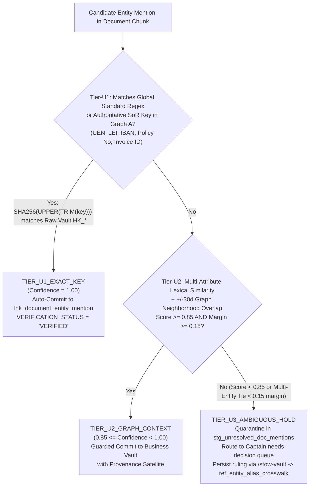

# 04 — Unstructured Data & Multi-Modal Integration in Data Vault 2.0

> **Part of the [`open-dv` Reference Guide Suite](DV2_AGENT_REFERENCE_GUIDE.md)**  
> **Domain:** Unstructured & Multi-Modal Data Vault 2.0 Architecture (Rules U1–U4), `hub_document` & Chunk/Vector Table Topology, 3-Tier Entity Resolution Protocol (`Tier-U1`/`Tier-U2`/`Tier-U3`), Cryptographic Span-Grounded Extraction, Gate 5 Verifier (`Algorithm A.9b`), and Bitemporal Multimodal Point-in-Time (PIT) + GraphRAG Retrieval (`D.10`)  
> **Companion Specifications:**
> - [01 — Core Architecture, Entity Specifications, and Methodology Standards](01-core-modelling-spec.md)
> - [02 — Schema Stability, Cold-Start Extensibility, and Evolution Mechanics](02-schema-stability-and-evolution.md)
> - [03 — Automated Verification Gates and `dv-firstmate` Swarm Architecture](03-verification-and-agentic-architecture.md)
> - [05 — ELM Calculus, Mathematical Formulations, and Reference Algorithms (`A.1`–`A.9`)](05-elm-calculus-and-reference-algorithms.md)
> - [HTML Reference Guide (`docs/references/No-Mistake-Agentic-Data-Vault-2.0-Complete-Design-and-Implementation-Guide.html`)](references/No-Mistake-Agentic-Data-Vault-2.0-Complete-Design-and-Implementation-Guide.html)

---

## Executive Summary

Over 80% of enterprise context—signed loan agreements, KYC passports, call-center recordings, underwriting emails, medical imaging reports, and vendor invoices—arrives as unstructured files. Traditional data warehouses ignore unstructured files completely, while modern AI pipelines frequently dump chunked text and embeddings into standalone vector stores with no historical auditability or key alignment to the enterprise data warehouse.

Drawing upon data-vault metadata modeling research for data lakes (Oreščanin et al., *IEEE Access* 2024) and semantic graph integration (Cuba, *Data Vault & Knowledge Graphs*; *The Data Vault Multiverse*), `open-dv` introduces a formal **Multi-Modal & Unstructured Data Vault 2.0 Subsystem** enforced by **Gate 5 (`axi-dv` Unstructured & Multimodal Integrity Gate)**.

---

## 1. The Four Architectural Tenets for Unstructured Data in Data Vault 2.0

To integrate unstructured artifacts without violating Data Vault 2.0's mathematical invariants (deterministic hashing, insert-only immutability, and strict separation of raw facts from soft business interpretations), Gate 5 enforces four non-negotiable rules:

1. **Rule U1 — Object-Store Binary Separation & Cryptographic Manifests:**
   Raw binary payloads (PDFs, audio, video, images) are stored in immutable Lakehouse Object Storage (S3/GCS/ADLS with Iceberg/Delta object tables). Relational Vault tables store only the canonical URI pointer, byte size, MIME metadata, and the content-addressable `SHA256(raw_bytes)` digest (`CONTENT_SHA256`).
2. **Rule U2 — Unstructured Artifacts as First-Class Hubs (`hub_document`):**
   Every unstructured artifact is registered in `hub_document` (or `hub_media_asset`) keyed by its authoritative source document identifier (`<DMS_SRC>||<doc_id>`) or content-addressable hash, with physical file versions historized in `sat_document_manifest`.
3. **Rule U3 — Strict Separation of Raw OCR/Text from Probabilistic AI Extractions:**
   Deterministic file metadata (`sat_document_manifest`) and raw OCR/ASR text (split by the Gate 4 Axis-2 PII boundary into `sat_document_raw_pii` and redacted `sat_document_parsed_text`) reside in the **Raw Vault**. Conversely, LLM-inferred entity mentions, sentiment, and extracted contract clauses are soft interpretations and **MUST reside in the Business Vault**.
4. **Rule U4 — Model-Scoped Vector Satellite Isolation:**
   Embedding vectors (e.g., 1,536-float arrays) mutate whenever the embedding model version changes. Embedding columns are strictly banned from standard descriptive Satellites and isolated into dedicated Business Vault Vector Satellites (`sat_doc_chunk_vec_<model>`) attached to deterministic document chunks (`hub_document_chunk`).

---

## 2. Complete Table Topology for Unstructured-to-Structured Integration

The topology diagram and specification table below define how an unstructured artifact (such as a signed commercial loan PDF or support call transcript) links directly into existing structured Hubs (`hub_customer`, `hub_contract`, `hub_product`):

```text
Lakehouse Object Storage (S3 / Iceberg Object Table: s3://vault-bronze/docs/loan_9941.pdf)
        │
        ▼ (SHA-256 Byte Manifest & OCR/ASR Ingestion)
┌──────────────────────────────────────┐       ┌──────────────────────────────────────────┐
│ RAW VAULT: hub_document              │◄─────┤ RAW VAULT: sat_document_manifest         │
│ PK: HK_DOCUMENT                      │       │ • OBJECT_URI, CONTENT_SHA256, MIME_TYPE  │
│ BK: DMS_SRC||DOC_ID                  ├──────►├──────────────────────────────────────────┤
└──────┬───────────────────────┬───────┘       │ RAW VAULT: sat_document_parsed_text      │
       │                       │               │ • REDACTED_MARKDOWN (PII split to _pii)  │
       │                       ▼               └──────────────────────────────────────────┘
       │        ┌──────────────────────────────────────────┐
       │        │ BUSINESS VAULT: lnk_document_chunk       │
       │        │ Connects HK_DOCUMENT ──► HK_DOC_CHUNK    │
       │        └──────────────────────┬───────────────────┘
       │                               ▼
       │        ┌──────────────────────────────────────────┐      ┌──────────────────────────────────────────┐
       │        │ BUSINESS VAULT: hub_document_chunk       │─────►│ BV: sat_doc_chunk_vec_text_emb_004       │
       │        │ BK: HK_DOCUMENT||STRATEGY||CHUNK_SEQ_NO  │      │ • VECTOR_ARRAY FLOAT[1536], MODEL_URI    │
       │        └──────────────────────┬───────────────────┘      └──────────────────────────────────────────┘
       │                               │
       └───────────────┐               │ (3-Tier Entity Resolution: Regex / Graph / LLM)
                       ▼               ▼
        ┌─────────────────────────────────────────────────┐       ┌──────────────────────────────────────────┐
        │ BUSINESS VAULT: lnk_document_entity_mention     │──────►│ BV: sat_lnk_doc_entity_ai_provenance     │
        │ HK_LNK_DOC_ENTITY = SHA256(HK_DOCUMENT ||       │       │ • EXTRACTOR_MODEL_ID, CONFIDENCE_SCORE   │
        │   HK_DOC_CHUNK || HK_CUSTOMER || ROLE_CODE)     │       │ • EXTRACTION_TIER, EVIDENCE_QUOTE_SPAN   │
        └─────────────────────┬───────────────────────────┘       └──────────────────────────────────────────┘
                              │
                              ▼ (Native Hash-Key Join to Structured Raw Vault!)
        ┌─────────────────────────────────────────────────┐       ┌──────────────────────────────────────────┐
        │ STRUCTURED RAW VAULT: hub_customer              │──────►│ STRUCTURED RAW VAULT: sat_customer_erp   │
        │ PK: HK_CUSTOMER (Tier-1 UEN / Tax ID)           │       │ • CREDIT_LIMIT_SGD, RISK_RATING          │
        └─────────────────────────────────────────────────┘       └──────────────────────────────────────────┘
```

### 2.1 Unstructured & Multi-Modal Entity Specification Matrix

| Table Name | Vault Layer | Primary / Hash Key Formula | Mandatory Columns & Verification Invariants (Gate 5) |
| :--- | :--- | :--- | :--- |
| **`hub_document`** | Raw Vault | `HK_DOCUMENT = SHA256(BKCC \|\| doc_uri_or_hash)` | `HK_DOCUMENT`, `DOC_NATURAL_KEY`, `LOAD_DTS`, `REC_SRC`. Binds to `urn:ontology:entity:document`. |
| **`sat_document_manifest`** | Raw Vault | `(HK_DOCUMENT, LOAD_DTS)` | `HASHDIFF`, `OBJECT_STORAGE_URI`, `CONTENT_SHA256`, `MIME_TYPE`, `BYTE_SIZE`, `PAGE_COUNT`. |
| **`sat_document_raw_pii`** & **`sat_document_parsed_text`** | Raw Vault | `(HK_DOCUMENT, LOAD_DTS)` | Enforces Gate 4 Axis-2 split: unredacted text with NRIC/SSN/names goes to `_pii`; PII-masked layout text goes to `_parsed_text`. |
| **`hub_document_chunk`** & **`lnk_document_chunk`** | Business Vault | `HK_DOC_CHUNK = SHA256(HK_DOCUMENT \|\| chunk_strategy \|\| seq_no)` | Deterministic semantic chunk identity storing `PAGE_NO`, `CHAR_START`, `CHAR_END`, and `SECTION_HEADER` in `sat_doc_chunk_meta`. |
| **`lnk_document_entity_mention`** | Business Vault | `HK_LNK_DOC_ENTITY = SHA256(HK_DOCUMENT \|\| HK_DOC_CHUNK \|\| HK_<TARGET> \|\| role)` | Links unstructured chunks to any structured Hub (`hub_customer`, `hub_contract`, `hub_claim`, `hub_asset`). |
| **`sat_lnk_doc_entity_ai_provenance`** | Business Vault | `(HK_LNK_DOC_ENTITY, LOAD_DTS)` | Mandatory on all AI-extracted links (Gate 5.2): records `EXTRACTOR_MODEL_ID`, `EXTRACTION_TIER`, `CONFIDENCE_SCORE`, `EVIDENCE_QUOTE`, `CHAR_SPAN`. |
| **`sat_contract_doc_extracted_bv`** | Business Vault | `(HK_CONTRACT, LOAD_DTS)` | Structured clauses/metrics extracted from PDFs (e.g., `governing_law`, `penalty_rate_pct`, `covenant_max_leverage_ratio`); requires `SOURCE_HK_DOCUMENT` and exact substring proof (Gate 5.4). |
| **`sat_doc_chunk_vec_<model>`** | Business Vault | `(HK_DOC_CHUNK, LOAD_DTS)` | Stores `VECTOR_ARRAY`, `MODEL_ID`, and `CHUNK_TEXT_SHA256`. Excluded from standard relational `HASHDIFF` scans. |

---

## 3. The 3-Tier Unstructured-to-Structured Entity Resolution Protocol

To prevent LLM entity-linking hallucinations from corrupting enterprise analytics, `scout-unstructured` and `axi-dv` Gate 5 classify every candidate link between a document chunk and a target Hub into three deterministic resolution tiers:



### 3.1 Detailed Resolution Tiers

1. **`Tier-U1`: Deterministic Natural Key Regex / Checksum Extraction (`Confidence = 1.00` • Auto-Commit):**
   Before invoking an LLM, a deterministic regex/checksum scanner extracts all strings matching Tier-1 Global Standard patterns or Tier-2 Authoritative SoR patterns defined in Graph A (e.g., Singapore UEN `201912345K`, LEI, IBAN, Policy Number, or Invoice ID). If the canonicalized hash `SHA256(UPPER(TRIM(extracted_key)))` matches an existing `HK_*` in the Raw Vault, `lnk_document_entity_mention` is committed automatically with `EXTRACTION_TIER = 'TIER_U1_EXACT_KEY'` and `VERIFICATION_STATUS = 'VERIFIED'`.

2. **`Tier-U2`: Multi-Attribute Lexical + Graph Neighborhood Resolution (`0.85 <= Confidence < 1.00` • Guarded BV Commit):**
   When a document refers to an entity by legal name and contextual attributes without an explicit UEN/ID (e.g., `"Borrower: Pacific Marine Holdings Ltd, 80 Raffles Place"` on a loan addendum signed on `2026-06-15`), the resolver computes a composite score combining:
   - **(a)** Jaro-Winkler / trigram similarity against active `sat_customer_*` name/address columns, and
   - **(b)** Graph neighborhood overlap (verifying whether that candidate `HK_CUSTOMER` participates in an active `lnk_customer_loan` within $\pm 30$ days of the document date).
   Candidates scoring $\ge 0.85$ with a separation margin $\ge 0.15$ over the runner-up are committed to the Business Vault with `EXTRACTION_TIER = 'TIER_U2_GRAPH_CONTEXT'`.

3. **`Tier-U3`: Ambiguous or Low-Confidence Entity Mentions (`Confidence < 0.85` or Multi-Entity Tie • Shadow Hold / Captain Escalation):**
   When an extracted mention matches multiple Hub rows within a $< 0.15$ margin (e.g., three subsidiaries named `"Pacific Marine..."`) or scores $< 0.85$, Gate 5 blocks insertion into `lnk_document_entity_mention`. The mention is routed to `stg_unresolved_doc_mentions` and surfaced via `firstmate`'s `needs-decision` queue for human disambiguation. Once confirmed by the Captain, `/stow-vault` records the alias mapping in `ref_entity_alias_crosswalk` so future documents resolve at Tier-U1/U2 automatically.

---

## 4. Span-Grounded Fact Extraction & Bitemporal Multimodal Point-in-Time (PIT) Queries

### 4.1 Cryptographic Span Grounding (`Gate 5` / `Algorithm A.9b`)

When extracting structured attributes from unstructured documents into a Business Vault Satellite (such as extracting `covenant_max_leverage_ratio` and `early_repayment_fee_pct` from a PDF credit agreement into `sat_contract_doc_extracted_bv`), Gate 5 enforces **Cryptographic Span Grounding**:
1. Every LLM extraction call uses grammar-constrained decoding requiring `{value, evidence_quote, page_no, char_start, char_end}`.
2. **Algorithm A.9b** deterministically checks `parsed_doc_samples[doc_id][char_start:char_end] == evidence_quote`. Any fabricated quote or mismatched span triggers an immediate `GATE5_ERROR [SPAN_HALLUCINATION]` (`reject-with-trace`) diagnostic back to the extraction agent.

```python
def verify_gate5_unstructured_invariants(
    contract: dict,
    parsed_doc_samples: dict[str, str],
) -> list[str]:
    """
    Algorithm A.9b: Gate 5 Verifier for Unstructured Data Vault 2.0 Integration.
    Enforces binary/vector isolation, provenance satellites on AI links, and exact
    character-span substring verification on LLM-extracted Business Vault attributes.
    """
    errors: list[str] = []
    sats_by_parent: dict[str, list[dict]] = {}

    for sat in contract.get("satellites", []):
        sats_by_parent.setdefault(sat["parent_entity"], []).append(sat)
        if sat.get("satellite_type") == "STANDARD_SATELLITE":
            for col in sat.get("payload_columns", []):
                if any(k in col.lower() for k in ("raw_blob", "embedding_vec", "binary_bytes")):
                    errors.append(
                        f"GATE5_ERROR [BLOB_OR_VEC_IN_RAW_SAT]: Satellite '{sat['name']}' "
                        f"includes '{col}'. Isolate binary files in Object Storage and "
                        f"embeddings in a dedicated VECTOR_SATELLITE."
                    )

    for lnk in contract.get("links", []):
        if lnk.get("link_type") == "UNSTRUCTURED_EXTRACTION_LINK":
            attached = sats_by_parent.get(lnk["name"], [])
            req_cols = {"extractor_model_id", "confidence_score", "evidence_quote"}
            if not any(
                s.get("satellite_type") == "AI_PROVENANCE_SATELLITE"
                and req_cols.issubset(set(s.get("payload_columns", [])))
                for s in attached
            ):
                errors.append(
                    f"GATE5_ERROR [MISSING_PROVENANCE_SAT]: Unstructured Link '{lnk['name']}' "
                    f"must attach an AI_PROVENANCE_SATELLITE containing {sorted(req_cols)}."
                )

    for sample in contract.get("sample_extractions", []):
        doc_id = sample["doc_id"]
        quote = sample.get("evidence_quote", "")
        start, end = sample.get("char_start", 0), sample.get("char_end", 0)
        body = parsed_doc_samples.get(doc_id, "")
        if not quote or body[start:end] != quote:
            errors.append(
                f"GATE5_ERROR [SPAN_HALLUCINATION]: Extracted attribute '{sample.get('attribute')}' "
                f"in document '{doc_id}' failed exact substring verification at [{start}:{end}]."
            )

    return errors
```

### 4.2 Canonical Multimodal Point-in-Time (PIT) + GraphRAG Retrieval SQL Query (`D.10`)

For downstream analytics and GraphRAG agents, a unified Multimodal Point-in-Time query joins structured Raw Vault satellites and unstructured document chunks/embeddings as of any historical timestamp `AS_OF_DTS`:

```sql
-- Canonical Multimodal Point-in-Time (PIT) + GraphRAG Retrieval Query (Appendix D.10)
SELECT
    h_cust.COMPANY_UEN,
    s_erp.CREDIT_LIMIT_SGD,
    s_cov.COVENANT_MAX_LEVERAGE_RATIO,
    s_cov.EVIDENCE_QUOTE          AS COVENANT_PDF_QUOTE,
    s_man.OBJECT_STORAGE_URI      AS SOURCE_PDF_URI,
    s_vec.VECTOR_ARRAY            AS CHUNK_EMBEDDING
FROM raw_vault.hub_customer h_cust
JOIN biz_vault.pit_customer p_cust
  ON h_cust.HK_CUSTOMER = p_cust.HK_CUSTOMER
 AND p_cust.AS_OF_DTS = TIMESTAMP '2026-10-29 00:00:00'
JOIN raw_vault.sat_customer_erp s_erp
  ON p_cust.HK_CUSTOMER = s_erp.HK_CUSTOMER
 AND p_cust.SAT_ERP_LOAD_DTS = s_erp.LOAD_DTS
JOIN biz_vault.lnk_document_entity_mention l_mention
  ON h_cust.HK_CUSTOMER = l_mention.HK_CUSTOMER
JOIN biz_vault.sat_lnk_doc_entity_ai_provenance s_prov
  ON l_mention.HK_LNK_DOC_ENTITY = s_prov.HK_LNK_DOC_ENTITY
 AND s_prov.CONFIDENCE_SCORE >= 0.85
 AND s_prov.LOAD_DTS <= p_cust.AS_OF_DTS
JOIN raw_vault.sat_document_manifest s_man
  ON l_mention.HK_DOCUMENT = s_man.HK_DOCUMENT
LEFT JOIN biz_vault.sat_contract_doc_extracted_bv s_cov
  ON l_mention.HK_DOCUMENT = s_cov.SOURCE_HK_DOCUMENT
 AND s_cov.LOAD_DTS <= p_cust.AS_OF_DTS
LEFT JOIN biz_vault.sat_doc_chunk_vec_text_emb_004 s_vec
  ON l_mention.HK_DOC_CHUNK = s_vec.HK_DOC_CHUNK;
```
