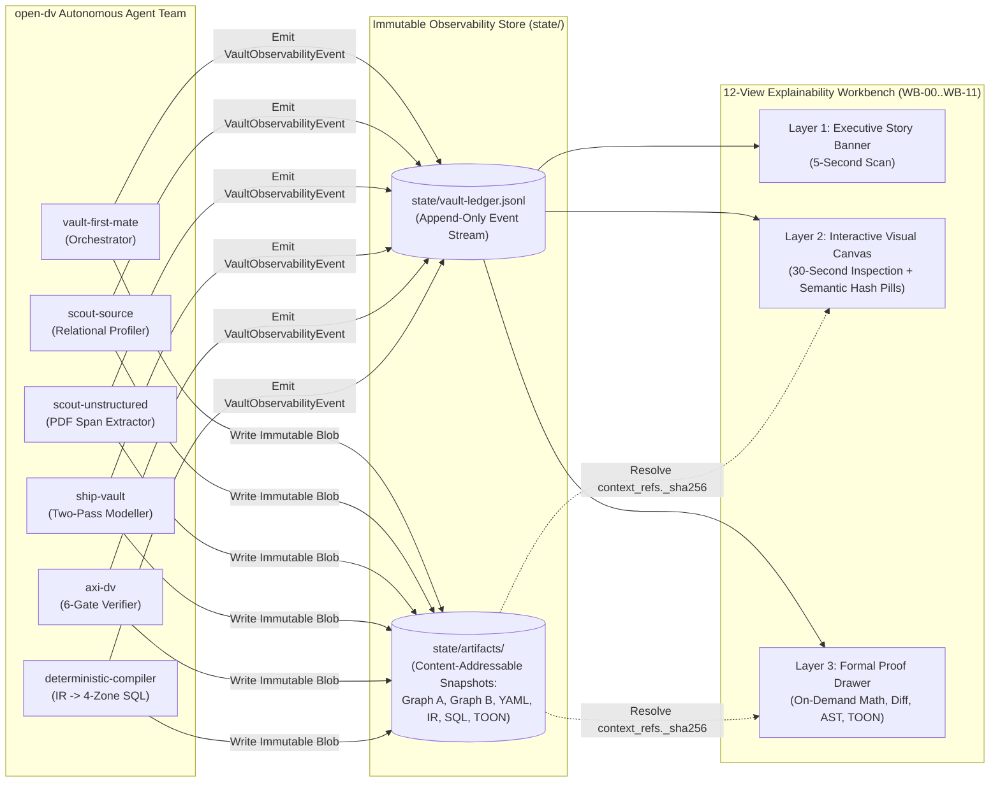
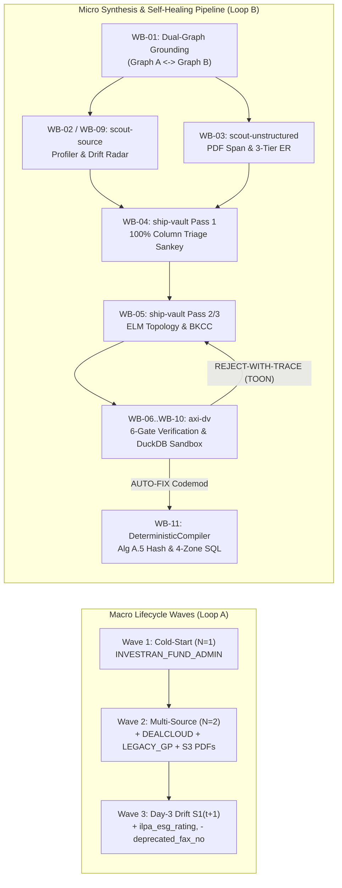
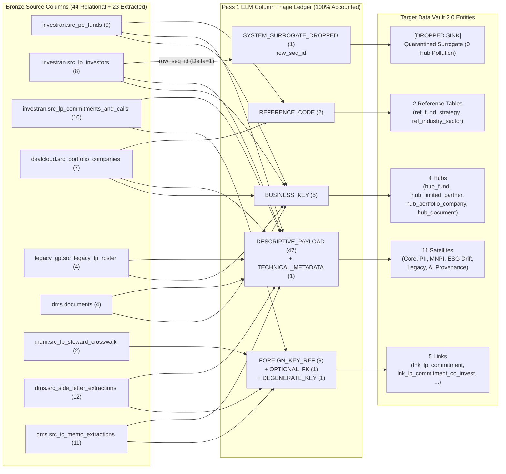

# Document 06: Explainability, Observability & Visualization Architecture (`open-dv`)

> ** Quick-Navigation Index**
> - **[Repository Root (`README.md`)](../README.md)** | **[Agent Reference Guide (`DV2_AGENT_REFERENCE_GUIDE.md`)](./DV2_AGENT_REFERENCE_GUIDE.md)**
> - **[Doc 01: Core Modelling Specification](./01-core-modelling-spec.md)**
> - **[Doc 02: Schema Stability, Cold-Start ($N=1$) & Evolution](./02-schema-stability-and-evolution.md)**
> - **[Doc 03: 6-Gate Verification & `dv-firstmate` Architecture](./03-verification-and-agentic-architecture.md)**
> - **[Doc 04: Unstructured & Multi-Modal DV 2.0](./04-unstructured-and-multimodal-dv2.md)**
> - **[Doc 05: ELM Calculus, 3-Pass CoT & Reference Algorithms](./05-elm-calculus-and-reference-algorithms.md)**
> - **[Doc 07: End-to-End Private Equity Modelling & Verification Demo](./07-end-to-end-private-equity-demo.md)**
> - **Executable Schemas:** [`schemas/vault-observability-event.schema.json`](../schemas/vault-observability-event.schema.json) | [`schemas/no-mistake-dv2-contract-v5.schema.json`](../schemas/no-mistake-dv2-contract-v5.schema.json) | [`schemas/dv2-canonical-ir.schema.json`](../schemas/dv2-canonical-ir.schema.json)
> - **Private Equity Reference Package:** [`examples/private_equity/dv_pe_model_contract.yaml`](../examples/private_equity/dv_pe_model_contract.yaml) | [`examples/private_equity/pe_canonical_ir.json`](../examples/private_equity/pe_canonical_ir.json) | [`examples/private_equity/pe_graph_a_ontology.yaml`](../examples/private_equity/pe_graph_a_ontology.yaml) | [`examples/private_equity/pe_graph_b_profile.json`](../examples/private_equity/pe_graph_b_profile.json)

---

## Executive Summary

Autonomous Data Vault 2.0 generation cannot operate as an opaque black box. When an agentic team ingests relational Bronze schemas and unstructured legal/financial documents, synthesizes Hubs, Links, and Satellites, enforces **99 formal invariants and verification checks**, repairs violations via closed-loop diagnostics, and compiles four-zone SQL DDL/DML, data architects and domain stewards require **auditable, human-readable explainability at every step**.

This specification defines the complete **Explainability, Observability, and Visualization Architecture** for `open-dv`:

1. **Section 1 — Observability & Telemetry Architecture (`VaultObservabilityEvent` over `state/vault-ledger.jsonl`):** Defines the append-only JSONL telemetry stream, W3C distributed trace/span correlation, content-addressable artifact store (`state/artifacts/<sha256>`), and Draft 2020-12 JSON Schema ([`schemas/vault-observability-event.schema.json`](../schemas/vault-observability-event.schema.json)).
2. **Section 2 — Readability Critique & The 3-Layer Progressive Disclosure Standard:** Diagnoses the five cognitive-load bottlenecks of raw agent telemetry (64-hex SHA-256 fatigue, set-theory notation walls, 55-badge overload, multi-panel fragmentation, and silent `auto-fix` mutations) and resolves them via **3-Layer Progressive Disclosure**, **Semantic Hash Pills (`[HK: prefix..suffix | BKCC:Label]`)**, **WCAG AA Shape + Color Grammar**, and the unified **12-View Explainability & Observability Workbench (`WB-00` through `WB-11`)**.
3. **Section 3 — Detailed Design for Pipeline & Step Visualizations (`VIZ-PIPE-00` & `VIZ-STEP-01` through `VIZ-STEP-08`):** Specifies the visual grammar, interactive controls, JSON data-binding contracts, and Private Equity ASCII + Mermaid wireframes for every agent task across `Vault First Mate`, `scout-source`, `scout-unstructured`, `ship-vault`, and `DeterministicCompiler`.
4. **Section 4 — Detailed Design for Constraint, 6-Gate `axi-dv`, & Self-Healing Visualizations (`VIZ-GATE-01` through `VIZ-GATE-08`):** Provides the master 99-check rule-family mapping matrix, the universal **4-Quadrant Counterfactual Proof Card**, and full visual specifications for static structural/column/AST gates, YAGNI write-amplification cost guards, TOON `reject-with-trace` self-healing loops, and the 4-Batch DuckDB adversarial shadow sandbox.

---

## Section 1: Observability & Telemetry Architecture (`VaultObservabilityEvent` over `state/vault-ledger.jsonl`)

### 1.1 Architectural Principles: Zero-Trust Telemetry & Content-Addressable Lineage

In `open-dv`, the Explainability & Observability Workbench never queries LLM conversation transcripts directly to infer model state. Instead, every agent persona (`vault-first-mate`, `scout-source`, `scout-unstructured`, `ship-vault`, `axi-dv`, and `deterministic-compiler`) emits structured, schema-validated `VaultObservabilityEvent` records to an append-only JSON Lines ledger at `state/vault-ledger.jsonl`.



#### Visibility & Redaction Policy for `CONFIDENTIAL`/MNPI and `RESTRICTED_PII` Values

Every event carries an optional `data_classification` (`PUBLIC`, `INTERNAL`, `CONFIDENTIAL`, or `RESTRICTED_PII`) set to the highest sensitivity of any value in its payload. A contract `security_classification` of `PII_HIGH` maps to `RESTRICTED_PII`.

- **Production deployments:** Layer 1 and Layer 2 banners and WB-03 document previews persisted to `state/vault-ledger.jsonl` mask `CONFIDENTIAL`/MNPI figures unless viewed by an RBAC role with `MNPI_CLEARED_STEWARD` access. `RESTRICTED_PII` values follow the same masking rule and are never written to banners in clear text.
- **Synthetic Private Equity demo:** Docs 06 and 07 display the unmasked `MNPI_CLEARED_STEWARD` view for pedagogical clarity. All figures in the demo are fictional.

### 1.2 W3C Distributed Trace Correlation & Content-Addressable Artifact Snapshots

Every `VaultObservabilityEvent` record enforces two structural guarantees:

1. **W3C Trace Context Correlation (`trace_id`, `span_id`, `parent_span_id`):**
   - `run_id` and `trace_id` (32-hex lowercase string) uniquely identify an end-to-end modelling lifecycle wave (e.g., Cold-Start $N=1$, Incremental Onboarding $N=2$, or Day-3 Schema Drift $S_1(t) \to S_1(t+1)$).
   - `span_id` (16-hex) and `parent_span_id` (16-hex) link every downstream verification gate (`axi-dv`) and self-healing retry (`ship-vault` Attempt 2) back to the exact upstream discovery or synthesis step that triggered it.
2. **Content-Addressable Artifact Snapshots (`context_refs`):**
   - Large artifacts are never duplicated inline inside every JSONL event. Instead, each artifact is written once to `state/artifacts/<sha256>` and referenced via `context_refs`:
     - `graph_a_sha256`: Top-down Enterprise CBC Ontology & 3-Tier BK Authority Registry YAML (`pe_graph_a_ontology.yaml`).
     - `graph_b_sha256`: Bottom-up Empirical Relational Profile & Unstructured Span Corpus JSON (`pe_graph_b_profile.json`).
     - `contract_yaml_pre_sha256` & `contract_yaml_post_sha256`: Pre-codemod and post-codemod snapshots of the `NoMistakeDataVault2ContractV5` YAML contract, enabling deterministic visual diffs for `auto-fix` and `reject-with-trace` repairs.
     - `canonical_ir_sha256`: Lowered `Canonical IR` JSON (`pe_canonical_ir.json`).
     - `compiled_sql_sha256`: Deterministic 4-Zone SQL DDL/DML bundle.
     - `toon_trace_sha256`: Token-Oriented Object Notation (`TOON`) diagnostic trace emitted by `axi-dv`.

### 1.3 Linkage to `schemas/vault-observability-event.schema.json`

All events appended to `state/vault-ledger.jsonl` are validated against [`schemas/vault-observability-event.schema.json`](../schemas/vault-observability-event.schema.json) (JSON Schema Draft 2020-12). The schema enforces:

| Field Group | Required Properties | Validation Invariant |
| :--- | :--- | :--- |
| **Envelope Identity & Lineage** | `event_id`, `run_id`, `timestamp_utc`, `stage_id`, `workbench_view_id`, `viz_id`, `agent_persona`, `status` | `stage_id` $\in \{\text{STAGE\_00..STAGE\_07}\}$; `workbench_view_id` $\in \{\text{WB-00..WB-11}\}$; `viz_id` $\in \{\text{VIZ-PIPE-00}, \text{VIZ-STEP-01..08}, \text{VIZ-GATE-01..08}\}$; `status` $\in \{\text{PASS}, \text{AUTO-FIX}, \text{REJECT-WITH-TRACE}, \text{ASK-USER}\}$. |
| **Layer 1: Story Banner** | `layer1_story_banner.headline`, `layer1_story_banner.business_impact`, `layer1_story_banner.verdict_pill` | `headline` $\le 140$ chars; `business_impact` $\le 200$ chars; zero raw 64-hex strings or LaTeX symbols permitted in Layer 1. |
| **Layer 2: Visual Canvas** | `layer2_visual_payload.semantic_hash_pills`, `layer2_visual_payload.summary_metrics` | Every hash key in Layer 2 is wrapped as a `semantic_hash_pill` object containing `pill_label` (`[HK: prefix..suffix | BKCC:Key Label]`), `full_sha256_hex` (`^[0-9A-Fa-f]{64}$`), `bkcc_prefix`, `business_key`, and `entity_label`. |
| **Data Classification** | `data_classification` *(optional)* | $\in \{\text{PUBLIC}, \text{INTERNAL}, \text{CONFIDENTIAL}, \text{RESTRICTED\_PII}\}$; drives the masking policy in §1.1. |
| **Layer 3: Formal Proof Drawer** | `layer3_formal_proof` *(optional, collapsed by default)* | Holds `algorithm_ref`, `formula_latex`, `toon_diagnostic_payload`, `contract_yaml_diff`, and `sqlglot_ast_summary` for on-demand inspection. |

### 1.4 Reference Python Telemetry Emitter & Validator

The following self-contained Python 3.12 module demonstrates how `open-dv` agents construct, validate, and append `VaultObservabilityEvent` records against [`schemas/vault-observability-event.schema.json`](../schemas/vault-observability-event.schema.json). The emitter sets `data_classification`, and values at `CONFIDENTIAL` or `RESTRICTED_PII` are masked in the persisted banner and preview fields per the §1.1 policy:

```python
from __future__ import annotations

import hashlib
import json
from pathlib import Path
from typing import Any


def format_semantic_hash_pill(
    kind: str,
    full_sha256_hex: str,
    bkcc_prefix: str,
    business_key: str,
    entity_label: str,
) -> dict[str, str]:
    """Build a Layer-2 Semantic Hash Pill that prevents 64-hex string fatigue."""
    digest = full_sha256_hex.upper()
    short_hex = f"{digest[:4]}..{digest[-4:]}"
    pill_label = f"[{kind}: {short_hex} | {bkcc_prefix}:{business_key} {entity_label}]"
    return {
        "pill_label": pill_label,
        "full_sha256_hex": digest,
        "bkcc_prefix": bkcc_prefix,
        "business_key": business_key,
        "entity_label": entity_label,
    }


def compute_dv2_length_prefixed_sha256(tokens: list[str | None]) -> str:
    """Compute Algorithm A.5 6-Stage Length-Prefixed Uppercase Hex SHA-256 Digest."""
    encoded_parts: list[str] = []
    for token in tokens:
        cleaned = "" if token is None else token.strip().upper()
        if not cleaned:
            encoded_parts.append("2:-1")
        else:
            byte_len = len(cleaned.encode("utf-8"))
            encoded_parts.append(f"{byte_len}:{cleaned}")
    canonical_payload = "||".join(encoded_parts).encode("utf-8")
    return hashlib.sha256(canonical_payload).hexdigest().upper()


def build_sample_gate4_yagni_event() -> dict[str, Any]:
    """Construct a schema-valid WB-07 / VIZ-GATE-05 YAGNI auto-fix telemetry event."""
    calpers_hk = compute_dv2_length_prefixed_sha256(["GLOBAL", "LP-101"])
    return {
        "event_id": "evt-0192ded0-7b40-7000-8000-000000000305",
        "run_id": "run-pe-apex-horizon-20261030",
        "trace_id": "4bf92f3577b34da6a3ce929d0e0e4736",
        "span_id": "00f067aa0ba902b7",
        "parent_span_id": "b9c7c989f97918e1",
        "timestamp_utc": "2026-10-30T14:25:12Z",
        "stage_id": "STAGE_05_AXI_DV_STATIC_GATES",
        "workbench_view_id": "WB-07",
        "viz_id": "VIZ-GATE-05",
        "agent_persona": "axi-dv",
        "status": "AUTO-FIX",
        "data_classification": "INTERNAL",
        "rule_ids_evaluated": ["ALG-A1"],
        "context_refs": {
            "graph_a_sha256": "A1B2C3D4E5F60718293A4B5C6D7E8F90A1B2C3D4E5F60718293A4B5C6D7E8F90",
            "graph_b_sha256": "B2C3D4E5F60718293A4B5C6D7E8F90A1B2C3D4E5F60718293A4B5C6D7E8F90A1",
            "contract_yaml_pre_sha256": "C3D4E5F60718293A4B5C6D7E8F90A1B2C3D4E5F60718293A4B5C6D7E8F90A1B2",
            "contract_yaml_post_sha256": "D4E5F60718293A4B5C6D7E8F90A1B2C3D4E5F60718293A4B5C6D7E8F90A1B2C3",
        },
        "layer1_story_banner": {
            "headline": "Merged 3 FX/NAV ticker columns into sat_lp_commitment_investran (4.20 MB/day < 50 MB/day)",
            "business_impact": "Eliminates an unnecessary Point-in-Time (PIT) join while keeping daily write amplification 91.6% below the 50 MB/day budget.",
            "verdict_pill": "AUTO-FIX",
        },
        "layer2_visual_payload": {
            "semantic_hash_pills": [
                format_semantic_hash_pill(
                    "HK", calpers_hk, "GLOBAL", "LP-101", "CalPERS"
                )
            ],
            "summary_metrics": {
                "general_column_count": 6,
                "min_split_column_threshold": 10,
                "write_amplification_mb_per_day": 4.20,
                "write_amplification_threshold_mb_per_day": 50.0,
                "pit_joins_saved": 1,
            },
        },
        "layer3_formal_proof": {
            "algorithm_ref": "Algorithm A.1 (Gate 4 YAGNI Cost Guard)",
            "formula_latex": "W_{amp} = R_{daily} \\times P(\\Delta C_{high}) \\times B_{low} = 157,000 \\times 0.85 \\times 33\\text{ B} = 4.20\\text{ MB/day} < 50\\text{ MB/day}",
            "contract_yaml_diff": "- name: sat_lp_commitment_fx_high_freq\n+ # Merged into sat_lp_commitment_investran via Gate 4 auto-fix",
        },
    }
```

---

## Section 2: Readability Critique & The 3-Layer Progressive Disclosure Standard

### 2.1 Critique of Raw Agent Telemetry: The Five Cognitive-Load Bottlenecks

When data architects and domain stewards inspect raw multi-agent Data Vault 2.0 logs, five cognitive-load bottlenecks consistently obscure architectural intent:

| # | Cognitive-Load Bottleneck | Failure Mode in Unfiltered Agent Output | Architectural Resolution in `open-dv` |
| :--- | :--- | :--- | :--- |
| **1** | **Cryptographic String Fatigue** | Displaying raw 64-character SHA-256 digests (`5D15EB10C8D7621D...`) in topology diagrams, diff tables, and staging previews makes it impossible to visually trace which row belongs to *CalPERS* vs. *Bavarian Pension Reserve Fund*. | **Semantic Hash Pills (`[HK: prefix..suffix \| BKCC:Key Label]`):** All Layer-2 canvases render compact, color-coded pills (e.g., `[HK: 5d15..0ae4 \| GLOBAL:LP-101 CalPERS]`). Full 64-hex digests appear only on hover or inside Layer 3. |
| **2** | **Mathematical & Set-Theory Notation Overload** | Exposing raw formulas ($\mathcal{I}(A.x \subseteq B.y) \ge 0.99$, $W_{\text{amp}} = R_{\text{daily}} \times P(\Delta C_{\text{high}}) \times B_{\text{low}}$, Tier-U2 composite entity-resolution scores) on primary UI cards alienates business SMEs and slows down review. | **Plain-English Executive Story Banner (Layer 1):** Every view opens with a 1-sentence plain-English headline and business-impact summary; formal formulas are tucked inside the **Layer 3 Formal Proof Drawer**. |
| **3** | **55-Badge Verification Overload** | Rendering all 55+ `DV-STR`, `DV-COL`, `DV-AST`, `DV-DYN`, and `DV-EVO` rule IDs simultaneously as a flat wall of badges buries the 1 or 2 active violations that actually occurred. | **Exception-First Hierarchical Scorecards:** Passing rule families collapse into a single green summary pill (`Gate 3 Topology: 14/14 PASS`). Only active `AUTO-FIX`, `REJECT-WITH-TRACE`, or `ASK-USER` exceptions expand automatically. |
| **4** | **17-Panel Context Switching** | Treating 9 pipeline step views (`VIZ-PIPE-00`, `VIZ-STEP-01..08`) and 8 constraint/gate views (`VIZ-GATE-01..08`) as 17 disconnected screens forces users to jump back and forth between *what the agent built* and *why the gate approved or repaired it*. | **Harmonized 12-View Workbench (`WB-00` through `WB-11`):** Every gate visualization is embedded directly into the step canvas where that constraint is evaluated (see Table 2.2). |
| **5** | **Silent Codemod Opacity** | When `axi-dv` executes a deterministic `auto-fix` (e.g., merging a low-volume high-frequency satellite under Gate 4 YAGNI), users only see the final model and wonder why the split disappeared. | **Inline Before/After Codemod Diff Cards:** Every `AUTO-FIX` and `REJECT-WITH-TRACE` event renders a side-by-side red/green topological and YAML diff card explaining the counterfactual harm prevented. |

---

### 2.2 The 3-Layer Progressive Disclosure Standard

Every screen in the `open-dv` Explainability & Observability Workbench strictly enforces a **3-Layer Progressive Disclosure Standard**:

```
+======================================================================================+
| LAYER 1: EXECUTIVE STORY BANNER (5-Second Scan — Always Visible)                     |
|  [Verdict Pill: PASS | AUTO-FIX | REJECT-WITH-TRACE | ASK-USER]                      |
|  • Plain-English Headline (<= 140 chars): What happened & which entity was affected  |
|  • Business Impact Subtitle (<= 200 chars): Why this matters to auditability / cost  |
+======================================================================================+
| LAYER 2: INTERACTIVE VISUAL CANVAS (30-Second Inspection — Default Workspace)        |
|  • Semantic Hash Pills: [HK: 5d15..0ae4 | GLOBAL:LP-101 CalPERS]                     |
|  • WCAG AA Dual-Encoded Topology Nodes (Shape + Color + Prefix Badge)                |
|  • Exception-First Rule Family Pills & Visual Threshold Gauges                       |
+======================================================================================+
| LAYER 3: ON-DEMAND FORMAL PROOF DRAWER (Collapsed by Default — Click [Inspect Proof])|
|  • Tab 3A: Mathematical Invariant & Threshold Derivation (LaTeX + Empirical Plug-In) |
|  • Tab 3B: Pre/Post Contract YAML & Canonical IR Diff                                |
|  • Tab 3C: SQLGlot AST Verification Tree & Full 64-Hex Cryptographic Test Vectors    |
|  • Tab 3D: Raw TOON Diagnostic Payload & VaultObservabilityEvent JSONL Record        |
+======================================================================================+
```

#### Semantic Hash Pill Grammar & WCAG AA Visual Encoding

1. **Semantic Hash Pill Format:**
   $$\texttt{[}\underbrace{\texttt{HK} \mid \texttt{LHK} \mid \texttt{HD}}_{\text{Digest Role}}\texttt{: }\underbrace{\texttt{5d15..0ae4}}_{\text{First 4 .. Last 4 Hex}}\texttt{ | }\underbrace{\texttt{GLOBAL} \mid \texttt{LEGACY\_GP\_ADMIN}}_{\text{BKCC Namespace}}\texttt{:}\underbrace{\texttt{LP-101}}_{\text{Natural Key}}\texttt{ }\underbrace{\texttt{CalPERS}}_{\text{Human Label}}\texttt{]}$$
   - **Special System Keys:**
     - Ghost Record (`0x00..00` at `1900-01-01T00:00:00Z`): `[GHOST: 0000..0000 | SYSTEM_GHOST (1900-01-01)]`
     - Missing / Unknown Zero Key (`-1`): `[ZERO-KEY: 6d4b..18b9 | UNKNOWN (-1)]`
     - Unresolved Error Zero Key (`-2`): `[ERR-KEY: c13f..f31c | ERROR (-2)]`

2. **WCAG AA Dual-Encoded Entity & Verdict Grammar (Shape + Color + Text Prefix):**
   Never rely on color alone. Every node and status badge combines a distinct geometric shape, an accessible WCAG AA color palette, and an explicit text prefix:

| Architectural Concept | Geometric Shape / Border | Color Token (Hex) | Text Prefix / Badge |
| :--- | :--- | :--- | :--- |
| **Hub (`hub_*`)** | Bold Rounded Rectangle (2px solid) | Royal Blue (`#1D4ED8`) | `[HUB]` |
| **Standard / Driving Link (`lnk_*`)** | Diamond / Rhombus (2px solid) | Emerald Green (`#047857`) | `[LNK]` |
| **Same-As / Non-Historized / Doc Link (`sal_*`, `nh_lnk_*`)** | Double-Bordered Diamond (2px dashed) | Teal (`#0F766E`) | `[SAL]` / `[DOC-LNK]` |
| **Standard / Business Satellite (`sat_*`)** | Pill / Stadium Node (1.5px solid) | Amber Gold (`#B45309`) | `[SAT]` |
| **PII / MNPI Confidential Satellite (`sat_*_pii`, `sat_*_mnpi`)** | Octagon with Lock Icon (2px dashed) | Crimson Purple (`#7E22CE`) | `[SAT-PII]` / `[SAT-MNPI]` |
| **Reference Table (`ref_*`)** | Flat Hexagon (1.5px dotted) | Slate Gray (`#475569`) | `[REF]` |
| **Dropped System Surrogate (`DROPPED`)** | Crossed Sink Node | Muted Neutral (`#64748B`) | `[DROPPED-SURROGATE]` |
| **Verdict: `PASS`** | Solid Circle Check (`●`) | Forest Green (`#15803D`) | `[PASS]` |
| **Verdict: `AUTO-FIX`** | Wrench Diamond (`◆`) | Electric Blue (`#0284C7`) | `[AUTO-FIX]` |
| **Verdict: `REJECT-WITH-TRACE`** | Octagon Stop (`■`) | Crimson Red (`#B91C1C`) | `[REJECT-WITH-TRACE]` |
| **Verdict: `ASK-USER` (Captain Hold)** | Warning Triangle (`▲`) | Amber Orange (`#D97706`) | `[ASK-USER]` |

---

### 2.3 Cross-Scout Harmonization & The 12-View Workbench (`WB-00` through `WB-11`)

To eliminate context switching between pipeline step views (`VIZ-PIPE-00`, `VIZ-STEP-01..08`) and verification gate views (`VIZ-GATE-01..08`), `open-dv` unifies all 17 specifications into **12 Workbench Views (`WB-00` through `WB-11`)**. Each gate visualization is co-located as an interactive overlay, drawer, or split pane inside the exact pipeline step where its rules fire:

| Workbench ID | Unified Workbench View Title | Primary Step View (`VIZ-STEP-*`) | Co-Located Gate / Check View (`VIZ-GATE-*`) | Primary Agent Persona(s) | Rules & Algorithms Visualized |
| :--- | :--- | :--- | :--- | :--- | :--- |
| **`WB-00`** | **Master Pipeline Command Center & 6-Gate Scoreboard** | `VIZ-PIPE-00` (Dual-Loop State Machine) | `VIZ-GATE-01` (6-Gate `axi-dv` Funnel & Matrix) | `vault-first-mate`, `axi-dv` | All 99 checks summarized by gate; W3C trace timeline. |
| **`WB-01`** | **Dual-Graph Grounding & Anti-Pattern Counterfactual Inspector** | `VIZ-STEP-01` (`Graph A` $\leftrightarrow$ `Graph B` Bipartite Map) | `VIZ-GATE-02` (5 Fatal Traps & `AP-01..15` Simulator) | `vault-first-mate` | Ontology coverage gauge; counterfactual simulation of `AP-01..15`. |
| **`WB-02`** | **Empirical Column Profiler & Candidate Discovery Matrix** | `VIZ-STEP-02` (4-Quadrant Scatter & Inclusion DAG) | — *(Feeds Gate 1 priors)* | `scout-source` | $U(C), U_{nn}(C), H(C), N_{\text{null}}(C), \mathcal{I}(A.x \subseteq B.y)$, surrogate step $\Delta=1$. |
| **`WB-03`** | **Unstructured PDF Span-Grounding & 3-Tier ER Inspector** | `VIZ-STEP-04` (PDF Span Highlighter & ER Funnel) | `VIZ-GATE-06` (Gate 5 `A.9b` & Rules `U1..U4` & Bi-Temporal Cut-Offs) | `scout-unstructured`, `axi-dv` | `Rules U1..U4`, `TMP-01..04`, character span `[start, end)`, `Tier-U1..U3`. |
| **`WB-04`** | **Pass 1 Exhaustive Column Triage Sankey & Surrogate Sink** | `VIZ-STEP-05` (100% Column Accounting Sankey) | `VIZ-GATE-05` *(Part A: Surrogate & Audit Ledger)* | `ship-vault`, `axi-dv` | Gate 1 `column_triage_ledger` (100% Column Accountability, Surrogate Drop). |
| **`WB-05`** | **Pass 2/3 ELM Topology & 3-Tier `BKCC` Collision Shield** | `VIZ-STEP-06` (ELM Hub/Link/Sat Graph) | `VIZ-GATE-04` (3-Tier BK Authority & `BKCC` Shield) | `ship-vault`, `axi-dv` | `KEY-01..05`, `DV-COL-012`, `Algorithm A.4`, `sal_*` Same-As Links. |
| **`WB-06`** | **Gate 3 Topological DAG & Grain Matrix Inspector** | — *(Dedicated Structural Verification View)* | `VIZ-GATE-03` (Bipartite DAG Proof & Grain Matrix) | `axi-dv` | `INV-01..06`, `DV-STR-001..014`, `networkx` Graph Verifier. |
| **`WB-07`** | **Nullable-FK Link Splitter & Gate 4 YAGNI Cost Guard** | — *(Co-located with Pass 2/3 Refinement)* | `VIZ-GATE-05` *(Part B: `Alg A.4` & `Alg A.1` Cost Guard)* | `axi-dv`, `ship-vault` | `Algorithm A.4` (Optional FK Split), `Algorithm A.1` ($W_{\text{amp}}$). |
| **`WB-08`** | **Closed-Loop Self-Healing Diff & `TOON` Diagnostic Workbench** | — *(Triggered on `AUTO-FIX` or `REJECT`)* | `VIZ-GATE-07` (TOON Trace & Attempt $1 \to 2$ Diff) | `axi-dv`, `ship-vault` | Closed-loop state machine (`PASS`, `AUTO-FIX`, `REJECT-WITH-TRACE`, `ASK-USER`). |
| **`WB-09`** | **Intra-Source Schema Drift Radar ($S_1(t) \to S_1(t+1)$)** | `VIZ-STEP-03` (Drift Classification Radar) | — *(Feeds Gate 5 Evolution Checks)* | `scout-source`, `vault-first-mate` | `Algorithm A.9a` (Additive, Soft-Deprecated, Rename, Type Widening, Key Drift). |
| **`WB-10`** | **Gate 5 Dynamic DuckDB Shadow Sandbox & Evolution Matrix** | — *(Pre-Compilation Runtime Gate)* | `VIZ-GATE-08` (4-Batch Adversarial Matrix & `EVO-01..08`) | `axi-dv` | `DV-DYN-001..015`, `EVO-01..08`, `DV-EVO-001..008`, Batches 1–4. |
| **`WB-11`** | **Pre-Hash Stepper (`Alg A.5`) & 4-Zone SQL Rosetta Stone (`DeterministicCompiler`)** | `VIZ-STEP-07` (Left) + `VIZ-STEP-08` (Right) | `DV-AST-001..006` (SQLGlot AST Badges) | `deterministic-compiler`, `axi-dv` | `Algorithm A.5`, `Algorithm A.6` (AST Verifier), Ghost Record `0x00..00`, Logarithmic `PIT`, `Query D.10`. |

---

### 2.4 Canonical Private Equity Entities & Cryptographic Digest Reference Table

To guarantee zero ambiguity across all wireframes in Section 3, Section 4, and [Document 07](./07-end-to-end-private-equity-demo.md), every visualization binds to the following canonical entities and verified `Algorithm A.5` length-prefixed SHA-256 digests (`SHA256(UTF8(CONCAT_WS('||', '<len>:<TOKEN>', ...)))`):

| Business Concept | Source System (`rsrc`) | Authority Tier & `BKCC` | Natural Key Value | Pre-Hash Canonical String (`Algorithm A.5`) | Verified SHA-256 Hex Prefix..Suffix | Layer-2 Semantic Hash Pill |
| :--- | :--- | :--- | :--- | :--- | :--- | :--- |
| **Fund IV** (*Apex Buyout Fund IV LP*) | `INVESTRAN_FUND_ADMIN` | Tier-2 (`GLOBAL`) | `APEX_BO_IV` | `6:GLOBAL\|\|10:APEX_BO_IV` | `94A60FCD..1D388759` | `[HK: 94A6..8759 \| GLOBAL:APEX_BO_IV Fund IV]` |
| **Fund I Co-Invest** (*Apex Co-Invest Fund I LP*) | `INVESTRAN_FUND_ADMIN` | Tier-2 (`GLOBAL`) | `APEX_CO_I` | `6:GLOBAL\|\|9:APEX_CO_I` | `E77712A2..499E4C7E` | `[HK: E777..4C7E \| GLOBAL:APEX_CO_I Co-Invest I]` |
| **CalPERS** (Hub Master Key)  | `INVESTRAN_FUND_ADMIN` | Tier-2 (`GLOBAL`) | `LP-101` | `6:GLOBAL\|\|6:LP-101` | `5D15EB10..4B820AE4` | `[HK: 5D15..0AE4 \| GLOBAL:LP-101 CalPERS]` |
| **Bavarian Pension Reserve Fund** (Colliding Local Key `LP-101`) | `LEGACY_GP_ADMIN` | Tier-3 (`LEGACY_GP_ADMIN`) | `LP-101` | `15:LEGACY_GP_ADMIN\|\|6:LP-101` | `6B7C7180..3EC5D8B9` | `[HK: 6B7C..D8B9 \| LEGACY_GP_ADMIN:LP-101 Bavarian Pension]` |
| **Nordic Sovereign Pension Fund** (SAL Master) | `INVESTRAN_FUND_ADMIN` | Tier-2 (`GLOBAL`) | `LP-104` | `6:GLOBAL\|\|6:LP-104` | `970AE134..561E5106` | `[HK: 970A..5106 \| GLOBAL:LP-104 Nordic Sovereign]` |
| **Nordisk Suverän Fond** (SAL Alias) | `LEGACY_GP_ADMIN` | Tier-3 (`LEGACY_GP_ADMIN`) | `LP-102` | `15:LEGACY_GP_ADMIN\|\|6:LP-102` | `0B27D3AF..3CBF9033` | `[HK: 0B27..9033 \| LEGACY_GP_ADMIN:LP-102 Nordisk Fond]` |
| **Nordic Cloud SaaS AB** (Portfolio Company) | `DEALCLOUD_PE_CRM` | Tier-1 (`GLOBAL`) | `529900T8BM49AURSDO55` | `6:GLOBAL\|\|20:529900T8BM49AURSDO55` | `0C1850CA..39B0454E` | `[HK: 0C18..454E \| GLOBAL:529900T8..DO55 Nordic Cloud]` |
| **CalPERS Fund IV Commitment Link** | `INVESTRAN_FUND_ADMIN` | Link (`GLOBAL`) | `APEX_BO_IV` + `LP-101` + `COMM-2026-001` | `6:GLOBAL\|\|10:APEX_BO_IV\|\|6:GLOBAL\|\|6:LP-101\|\|13:COMM-2026-001` | `EB156109..357A7C4E` | `[LHK: EB15..7C4E \| Fund IV <-> CalPERS]` |
| **CalPERS Side Letter PDF** | `OBJECT_STORE_S3` | Tier-2 (`GLOBAL`) | `s3://.../calpers_side_letter_fund_iv_2026.pdf` | `6:GLOBAL\|\|81:S3://.../CALPERS_SIDE_LETTER_FUND_IV_2026.PDF` | `864D5083..E502EE6B` | `[HK: 864D..EE6B \| S3:calpers_side_letter.pdf]` |
| **Nordic Cloud Q3 IC Valuation Memo PDF** | `OBJECT_STORE_S3` | Tier-2 (`GLOBAL`) | `s3://.../ic_q3_valuation_nordic_cloud.pdf` | `6:GLOBAL\|\|75:S3://.../IC_Q3_VALUATION_NORDIC_CLOUD.PDF` | `99D8178E..88F04158` | `[HK: 99D8..4158 \| S3:ic_q3_nordic_cloud.pdf]` |
| **System Ghost Record** (`1900-01-01 00:00:00`) | `SYSTEM_GHOST` | Ghost (`0x00..00`) | `'00' * 32` | Fixed 64-zero hex seed | `00000000..00000000` | `[GHOST: 0000..0000 \| SYSTEM_GHOST (1900-01-01)]` |

---
## Section 3: Detailed Design for Pipeline & Step Visualizations (`VIZ-PIPE-00` & `VIZ-STEP-01` through `VIZ-STEP-08`)

This section specifies the nine pipeline and step visualizations across the five agent roles (`vault-first-mate`, `scout-source`, `scout-unstructured`, `ship-vault`, and `deterministic-compiler`).

---

### 3.1 `VIZ-PIPE-00` (`WB-00`): Master End-to-End Orchestration & Dual-Loop State Machine Canvas

- **Agent Persona:** `vault-first-mate` (Orchestrator) + `axi-dv` (Scoreboard)
- **Workbench View:** `WB-00` (*Master Pipeline Command Center & 6-Gate Scoreboard*)
- **Architectural Purpose:** Provides the top-level "subway map" of the entire `open-dv` pipeline across both macro lifecycle waves (**Loop A:** Cold-Start $N=1 \to$ Incremental $N=2$ Source Onboarding $\to$ Day-3 Intra-Source Schema Drift $S_1(t) \to S_1(t+1)$) and the micro self-healing verification loop (**Loop B:** Pass 1/Pass 2 Synthesis $\to$ 6-Gate `axi-dv` $\to$ `auto-fix` / `reject-with-trace` / `ask-user` $\to$ `DeterministicCompiler`).

#### 3-Layer Progressive Disclosure Specification (`VIZ-PIPE-00`)
- **Layer 1 (Executive Story Banner):**
  - *Headline:* `"Apex Horizon PE Vault: 5 Sources Onboarded, 67 Bronze Columns Audited (100%), 2 Self-Healed Exceptions, 1 Captain Hold."`
  - *Business Impact:* `"All 4 Hubs, 5 Links, and 11 Satellites verified across 99 formal invariants; 4-Zone DuckDB SQL compiled with zero drift loss."`
  - *Verdict Pill:* `[PASS]` *(with `[1 ASK-USER HOLD]` badge on `Tier-U3` PDF span)*
- **Layer 2 (Interactive Visual Canvas):**
  - **Horizontal Stage Subway Map (`STAGE_00` $\to$ `STAGE_07`):** Displays live node badges for each stage, active wave selector (`Wave 1: Cold-Start N=1`, `Wave 2: Multi-Source N=2`, `Wave 3: Day-3 Drift S1(t+1)`), and click-to-drill navigation into `WB-01..WB-11`.
  - **Co-Located 6-Gate Scoreboard (`VIZ-GATE-01`):** Displays compact gate pills (`Gate 0 Drift: PASS`, `Gate 1 Authority: REJECT->FIXED`, `Gate 2 AST: PASS`, `Gate 3 DAG: PASS`, `Gate 4 YAGNI: AUTO-FIX`, `Gate 5 Sandbox: PASS`).
- **Layer 3 (On-Demand Formal Proof Drawer):**
  - Full W3C trace waterfall (`trace_id = 4bf92f3577b34da6a3ce929d0e0e4736`), stage latency breakdown, and JSONL event export from `state/vault-ledger.jsonl`.

#### Mermaid & ASCII Wireframe (`VIZ-PIPE-00` / `WB-00`)



```
+====================================================================================================+
| WB-00: MASTER PIPELINE COMMAND CENTER (VIZ-PIPE-00 + VIZ-GATE-01)                    [PASS | 99/99]|
| Story: Apex Horizon PE Vault compiled across 5 sources (67/67 cols accounted; 2 healed; 1 U3 hold) |
+----------------------------------------------------------------------------------------------------+
| ACTIVE WAVE: (o) All Waves Combined  ( ) Wave 1: Cold-Start N=1  ( ) Wave 2: N=2  ( ) Wave 3: Drift|
|                                                                                                    |
|  [STAGE 00] ---> [STAGE 01] ---> [STAGE 02] ---> [STAGE 03] ---> [STAGE 04] ---> [STAGE 05/06]     |
|  First Mate      scout-source    scout-unstruct  ship Pass 1     ship Pass 2     axi-dv 6-Gates    |
|  Graph A<->B     7 Tables, 44c   2 PDFs, 17 sp   67/67 Triage    4H, 5L, 11S     2 Healed, 1 Hold  |
|   [WB-01 ●]       [WB-02/09 ●]    [WB-03 ▲]       [WB-04 ●]       [WB-05 ●]       [WB-06..10 ◆]    |
|                                                                                         |          |
|                                                                                         v          |
|  +--- 6-GATE AXI-DV SCOREBOARD (Click any gate to open workbench) ---+           [STAGE 07]        |
|  | G0 Drift: [PASS] | G1 Authority: [FIXED (Attempt2)] | G2 AST: [PASS]|           Compiler        |
|  | G3 DAG: [PASS] | G4 YAGNI: [AUTO-FIX 4.2MB/d] | G5: [PASS]            |        4-Zone SQL + D.10|
|  +-------------------------------------------------------------------+            [WB-11 ●]        |
+====================================================================================================+
```

---

### 3.2 `VIZ-STEP-01` (`WB-01`): Dual-Graph Grounding Inspector (`Graph A` CBC Ontology $\leftrightarrow$ `Graph B` Relational Profile)

- **Agent Persona:** `vault-first-mate`
- **Workbench View:** `WB-01` *(Co-located with `VIZ-GATE-02` Anti-Pattern Counterfactual Modal)*
- **Architectural Purpose:** Visualizes how `open-dv` prevents **`AP-11` (Source-System-Specific Hubs)** and ontology hallucination by anchoring every physical Bronze table in `Graph B` ([`examples/private_equity/pe_graph_b_profile.json`](../examples/private_equity/pe_graph_b_profile.json)) to an enterprise Canonical Business Concept (`CBC`) in `Graph A` ([`examples/private_equity/pe_graph_a_ontology.yaml`](../examples/private_equity/pe_graph_a_ontology.yaml)) *before* any Hub or Link is proposed.

#### 3-Layer Progressive Disclosure Specification (`VIZ-STEP-01`)
- **Layer 1 (Executive Story Banner):**
  - *Headline:* `"Grounded 9 Bronze tables across 5 PE systems onto 4 Enterprise Business Concepts (80.0% Ontology Coverage; 0 Unmapped Tables)."`
  - *Business Impact:* `"investran.src_lp_investors and legacy_gp.src_legacy_lp_roster converge on urn:ontology:entity:limited_partner, preventing siloed source-specific Hubs."`
  - *Verdict Pill:* `[PASS]`
- **Layer 2 (Interactive Visual Canvas):**
  - **Left Column (`Graph A` Top-Down CBC Ontology):** Displays enterprise concepts (`Fund`, `LimitedPartner`, `PortfolioCompany`, `Document`, and unallocated `CustodianBank`), their 3-Tier BK Authority rules, and governance tags (`PII_HIGH`, `MNPI_CONFIDENTIAL`).
  - **Right Column (`Graph B` Bottom-Up Physical Sources):** Displays physical tables grouped by source system (`INVESTRAN_FUND_ADMIN`, `DEALCLOUD_PE_CRM`, `LEGACY_GP_ADMIN`, `OBJECT_STORE_S3`).
  - **Bipartite Grounding Edges:** Solid blue edges denote verified $N:1$ multi-source convergence onto shared CBCs; dashed gray node indicates unallocated `CustodianBank` (tracked in the Ontology Coverage Gauge without fabricating a phantom Hub).
- **Layer 3 (On-Demand Formal Proof Drawer):**
  - Raw `pe_graph_a_ontology.yaml` and `pe_graph_b_profile.json` snapshots and formal bipartite grounding relation $M \subseteq V_A \times V_B$.

#### ASCII Wireframe (`VIZ-STEP-01` / `WB-01`)

```
+====================================================================================================+
| WB-01: DUAL-GRAPH GROUNDING INSPECTOR (VIZ-STEP-01)                                        [PASS ●]|
| Story: 9 Bronze tables grounded onto 4 Enterprise CBCs; multi-source LPs unified into 1 Hub.       |
+----------------------------------------------------------------------------------------------------+
| GRAPH A: ENTERPRISE CBC ONTOLOGY (Top-Down)        GRAPH B: EMPIRICAL BRONZE PROFILE (Bottom-Up)   |
| [Coverage: 4/5 Active CBCs | 0 Phantom Hubs]       [5 Source Systems | 9 Tables | 67 Columns]      |
|                                                                                                    |
|  +---------------------------------------+          +-------------------------------------------+  |
|  | [CBC] urn:ontology:entity:fund        | <======= | investran.src_pe_funds (9 cols, 3 rows)   |  |
|  |  Hub key: fund_code | Alt: ISIN       |          +-------------------------------------------+  |
|  +---------------------------------------+                                                         |
|                                                     +-------------------------------------------+  |
|  +---------------------------------------+ <======= | investran.src_lp_investors (8 cols)       |  |
|  | [CBC] urn:ontology:entity:            |          +-------------------------------------------+  |
|  |       limited_partner                 |          +-------------------------------------------+  |
|  |  Hub key: lp_id | Alt: LEI            | <======= | legacy_gp.src_legacy_lp_roster (4 cols)   |  |
|  |  Tier-3: BKCC=LEGACY_GP_ADMIN:lp_num  |          |  [!] Collision: lp_num='LP-101'           |  |
|  |  Gov: wire_iban, tax_id -> [PII_HIGH] |          +-------------------------------------------+  |
|  +---------------------------------------+ <-(SAL)- | mdm.src_lp_steward_crosswalk (2 cols)     |  |
|                                                     +-------------------------------------------+  |
|                                                     +-------------------------------------------+  |
|  +---------------------------------------+ <======= | dealcloud.src_portfolio_companies (7 cols)|  |
|  | [CBC] urn:ontology:entity:            |          +-------------------------------------------+  |
|  |       portfolio_company               |          +-------------------------------------------+  |
|  |  Hub key: LEI | Alt: deal_code        | < - - -  | investran.src_lp_commitments_and_calls    |  |
|  |  Gov: valuation -> [MNPI_CONFIDENTIAL]| (Opt FK) |  (10 cols; links Fund + LP + Opt PortCo)  |  |
|  +---------------------------------------+          +-------------------------------------------+  |
|                                                                                                    |
|  +---------------------------------------+          +-------------------------------------------+  |
|  | [CBC] urn:ontology:entity:document    | <======= | dms.documents + 2 extraction tables (27c) |  |
|  +---------------------------------------+          +-------------------------------------------+  |
|                                                                                                    |
|  + - - - - - - - - - - - - - - - - - - - +                                                         |
|  | [CBC] urn:ontology:entity:            |  (Unallocated in Wave 1/2 — No Bronze table in Graph B; |
|  |       custodian_bank [UNALLOCATED]    |   Zero-Hallucination Guard prevents phantom hub_bank)   |
|  + - - - - - - - - - - - - - - - - - - - +                                                         |
|                                                                                                    |
|  [Simulate 5 Fatal Agentic Traps (VIZ-GATE-02)]                  [Inspect Layer 3 YAML/JSON Proof] |
+====================================================================================================+
```

---

### 3.3 `VIZ-STEP-02` (`WB-02`): Empirical Column Profiler & Candidate Discovery Matrix (`scout-source`)

- **Agent Persona:** `scout-source`
- **Workbench View:** `WB-02`
- **Architectural Purpose:** Visualizes how `scout-source` computes empirical uniqueness $U(C)$, non-null ratio $U_{nn}(C) = 1 - N_{\text{null}}(C)$ (`docs/02` §6.2.2), Shannon entropy $H(C)$, null rate $N_{\text{null}}(C)$, monotonic sequence step $\Delta = 1$, and cross-table inclusion $\mathcal{I}(A.x \subseteq B.y)$ to classify every column into one of four candidate quadrants before `ship-vault` writes a single line of YAML.

#### 3-Layer Progressive Disclosure Specification (`VIZ-STEP-02`)
- **Layer 1 (Executive Story Banner):**
  - *Headline:* `"Profiled 44 relational columns: 8 Key candidates, 1 Dropped Surrogate (row_seq_id), 1 Optional FK (28.6% non-null), 2 Ref Codes."`
  - *Business Impact:* `"Detects monotonic surrogate row_seq_id (Delta=1) and sparse co_invest_portco_lei (71.4% NULL) empirically before modelling begins."`
  - *Verdict Pill:* `[PASS]`
- **Layer 2 (Interactive Visual Canvas):**
  - **Left Pane — 4-Quadrant Uniqueness vs. Entropy Scatter Plot ($U(C)$ vs. $H(C)$):**
    - *Quadrant I (High $U \ge 0.99$, High $H(C)$ — Natural Business Keys):* `isin`, `fund_code`, `lei`, `lp_id`, `deal_code`, `doc_uri`.
    - *Quadrant II (High $U = 1.0$, Monotonic Integer Step $\Delta = 1$ — Surrogate Quarantine Zone):* `investran.src_lp_investors.row_seq_id` (`10001, 10002, 10003, 10004`) flagged in red `[SURROGATE_SEQUENCE]`.
    - *Quadrant III (Reference / Enumeration Codes matched to `Graph A` `allowed_codes`, because $U$ is unreliable on 3 sample rows):* `strategy` (`BUYOUT`, `CO_INVEST`), `sector` (`B2B_SAAS`, `INDUSTRIAL_TECH`).
    - *Quadrant IV (Moderate $U$, Variable Drift $\lambda(c)$ — Descriptive Payload & Foreign Keys):* `fund_name`, `commitment_amount_usd`, `eur_usd_rate` ($\lambda = 0.85$).
  - **Right Pane — Inclusion Dependency Chord / DAG ($\mathcal{I}(A.x \subseteq B.y)$):**
    - Shows `src_lp_commitments_and_calls.fund_code` $\subseteq$ `src_pe_funds.fund_code` ($\mathcal{I} = 1.00$, $N_{\text{null}} = 0\% \to$ Mandatory FK) vs. `co_invest_portco_lei` $\subseteq$ `src_portfolio_companies.lei` ($\mathcal{I}_{nn} = 1.00$, $N_{\text{null}} = 71.43\% \to$ Optional Contextual FK).
- **Layer 3 (On-Demand Formal Proof Drawer):**
  - Full column-level profile table from [`examples/private_equity/pe_graph_b_profile.json`](../examples/private_equity/pe_graph_b_profile.json) and DuckDB profiling SQL queries.

#### ASCII Wireframe (`VIZ-STEP-02` / `WB-02`)

```
+====================================================================================================+
| WB-02: EMPIRICAL COLUMN PROFILER & CANDIDATE DISCOVERY MATRIX (VIZ-STEP-02)                [PASS ●]|
| Story: 8 BK candidates found; row_seq_id quarantined as surrogate; co_invest_portco_lei flagged    |
+----------------------------------------------------------------------------------------------------+
| QUADRANT SCATTER: Uniqueness U(C) vs. Entropy H(C)                | INCLUSION DAG: I(A.x <= B.y)   |
|                                                                  |                                 |
| H(C) ^                                                           | src_lp_commitments_and_calls    |
| 2.8  |  [IV: Payload / Degenerate]   [I: Natural Business Keys]  |   |-- fund_code                 |
|      |   • commitment_amount_usd      • lei (LP & PortCo)        |   |    I = 1.00, Null = 0.0%    |
| 2.0  |   • wire_iban [PII_HIGH]       • lp_id, fund_code, isin   |   |    --> Mandatory Hub FK     |
|      |   • eur_usd_rate (lambda=0.85) • deal_code, doc_uri       |   |                             |
|      |                                +-----------------------+  |   |-- lp_id                     |
| 1.2  |  [III: Low-Card Ref Codes]     | [II: SURROGATE TRAP]  |  |   |    I = 1.00, Null = 0.0%    |
|      |   • strategy (BUYOUT/CO_INV)   |  ■ row_seq_id (U=1.0, |  |   |    --> Mandatory Hub FK     |
|      |   • sector (B2B_SAAS/IND)      |    Step Delta = +1)   |  |   |                             |
| 0.0  +--------------------------------+-----------------------+> |   +-- co_invest_portco_lei      |
|     0.0                             0.85                    1.0  |        I_nn = 1.00, Null = 71.4%|
|                                                       U(C)       |        --> [ALG A.4 SPLIT LINK] |
+====================================================================================================+
```

---

### 3.4 `VIZ-STEP-03` (`WB-09`): Intra-Source Schema Drift Radar ($S_1(t) \to S_1(t+1)$ `Algorithm A.9a`)

- **Agent Persona:** `scout-source` + `vault-first-mate`
- **Workbench View:** `WB-09` (*Intra-Source Schema Drift Radar*)
- **Architectural Purpose:** Visualizes **Algorithm A.9a** (`docs/05-elm-calculus-and-reference-algorithms.md`) when an already-onboarded source system evolves from schema $S_1(t)$ to $S_1(t+1)$ on Day 3. It classifies every column delta into one of five deterministic drift categories and shows why historical Satellite rows are **never** mutated or backfilled.

#### 3-Layer Progressive Disclosure Specification (`VIZ-STEP-03`)
- **Layer 1 (Executive Story Banner):**
  - *Headline:* `"Day-3 Schema Drift on INVESTRAN + DEALCLOUD: 4 Column Deltas Classified & Absorbed with Zero Historical Hash-Diff Rewrite."`
  - *Business Impact:* `"New ilpa_esg_rating routed to companion sat_fund_investran_esg; dropped deprecated_fax_no padded as NULL in staging."`
  - *Verdict Pill:* `[PASS]`
- **Layer 2 (Interactive Visual Canvas):**
  - **5-Spoke Drift Classification Matrix (`Algorithm A.9a`):**
    1. **Case 1 — Additive Attribute (`+ ilpa_esg_rating` on `investran.src_pe_funds`):** Routed to new companion satellite `sat_fund_investran_esg` (`volatility_tier: ADDITIVE_DRIFT_COMPANION`), leaving `sat_fund_investran.hash_diff` untouched (`EVO-01`).
    2. **Case 2 — Subtractive / Soft-Deprecated Attribute (`- deprecated_fax_no` dropped by upstream):** Retained in `sat_fund_investran` DDL; staging view injects `CAST(NULL AS VARCHAR(64)) AS deprecated_fax_no` (`EVO-02`).
    3. **Case 3 — Column Rename (`commitment_amount_usd` $\to$ `committed_amt` with Jaccard value overlap $J = 0.994 \ge 0.90$):** Resolved exclusively inside Zone 1 Staging (`committed_amt AS commitment_amount_usd`) with zero Raw Vault table change (`EVO-03`).
    4. **Case 4 — Compatible Type Widening (`company_name` on `dealcloud.src_portfolio_companies`, `VARCHAR(128)` $\to$ `VARCHAR(255)`):** Absorbed via canonical string trimming in `Algorithm A.5` (`EVO-04`).
    5. **Case 5 — Business Key Format Drift (`fund_code` format change):** Triggers an `[ASK-USER]` hard gate requiring a Same-As Link (`sal_*`) rather than silent Hub re-keying (`INV-03`, `AP-12`).
- **Layer 3 (On-Demand Formal Proof Drawer):**
  - Formal `Algorithm A.9a` decision tree, Jaccard value-overlap calculation $J(C_t, C_{t+1}) = \frac{|V_t \cap V_{t+1}|}{|V_t \cup V_{t+1}|} = 0.994$, and staging SQL diff.

#### ASCII Wireframe (`VIZ-STEP-03` / `WB-09`)

```
+====================================================================================================+
| WB-09: INTRA-SOURCE SCHEMA DRIFT RADAR (VIZ-STEP-03 | Algorithm A.9a)                      [PASS ●]|
| Story: Day-3 drift on INVESTRAN + DEALCLOUD absorbed across 4 columns with 0 historical rewrites.  |
+----------------------------------------------------------------------------------------------------+
| SOURCE DELTA: S1(t = 2026-10-28) ---> S1(t+1 = 2026-10-30)                                         |
|                                                                                                    |
|  +-------------------------------+------------------------+-------------------------------------+  |
|  | Upstream Schema Change        | Alg A.9a Classification| Deterministic Vault Action          |  |
|  +-------------------------------+------------------------+-------------------------------------+  |
|  | + ilpa_esg_rating VARCHAR(16) | [CASE 1: ADDITIVE]     | Spawn sat_fund_investran_esg        |  |
|  |   (investran.src_pe_funds)    |  New payload attribute | (Existing sat_fund_investran HD     |  |
|  |                               |                        |  digest remains 100% unchanged)     |  |
|  +-------------------------------+------------------------+-------------------------------------+  |
|  | - deprecated_fax_no dropped   | [CASE 2: SUBTRACTIVE]  | Mark soft_deprecated_columns;       |  |
|  |   (investran.src_pe_funds)    |  Missing in S1(t+1)    | Stage: CAST(NULL AS VARCHAR) -> '2:-1' |
|  +-------------------------------+------------------------+-------------------------------------+  |
|  | ~ commitment_amount_usd       | [CASE 3: RENAME]       | Alias in Zone 1 Staging View:       |  |
|  |   renamed -> committed_amt    |  Name Sim=0.78, J=0.994| committed_amt AS commitment_amount  |  |
|  +-------------------------------+------------------------+-------------------------------------+  |
|  | ~ company_name VARCHAR(128)   | [CASE 4: TYPE WIDEN]   | Stage Alg A.5 TRIM() absorbs width; |  |
|  |   (dealcloud) -> VARCHAR(255) |  Compatible superset   | ALTER TABLE sat COLUMN TYPE only    |  |
|  +-------------------------------+------------------------+-------------------------------------+  |
+====================================================================================================+
```

---

### 3.5 `VIZ-STEP-04` (`WB-03`): Unstructured Document Span-Grounding & 3-Tier Entity Resolution Funnel (`scout-unstructured`)

- **Agent Persona:** `scout-unstructured` + `axi-dv` (Gate 5 `A.9b` & Rules `U1..U4`)
- **Workbench View:** `WB-03` (*Unstructured PDF Span-Grounding & 3-Tier ER Inspector*, co-located with `VIZ-GATE-06`)
- **Architectural Purpose:** Demonstrates how `open-dv` extracts structured Private Equity facts from legal PDFs (`calpers_side_letter_fund_iv_2026.pdf`) and Investment Committee valuation memos (`ic_q3_valuation_nordic_cloud.pdf`) without hallucinating Hub keys or mutating historical relational Satellites.

#### 3-Layer Progressive Disclosure Specification (`VIZ-STEP-04`)
- **Layer 1 (Executive Story Banner):**
  - *Headline:* `"Extracted 17 PDF spans across 2 documents: 16 spans grounded & resolved (Confidence >= 0.96); 1 ambiguous vehicle held at Tier-U3."`
  - *Business Impact:* `"CalPERS 125 bps fee cap and Nordic Cloud 14.5x ($245M) restatement linked to exact PDF character offsets; 'Horizon Sovereign Co-Invest Vehicle' quarantined from hub_fund."`
  - *Verdict Pill:* `[ASK-USER]` *(1 `Tier-U3` Captain Hold on `[1112:1147]`; all 16 valid spans `[PASS]`)*
- **Layer 2 (Interactive Visual Canvas):**
  - **Left Pane — Verbatim PDF Document Viewer with Character-Offset Highlight Pills (`[span_start, span_end)`):**
    - Highlights exact substrings in `calpers_side_letter_fund_iv_2026.pdf` (`[134:180] "California Public Employees' Retirement System"`, `[227:247] "5493006MHB84DD0ZWV18"`, `[499:506] "125 bps"`, `[1112:1147] "Horizon Sovereign Co-Invest Vehicle"`) and `ic_q3_valuation_nordic_cloud.pdf` (`[226:246] "529900T8BM49AURSDO55"`, `[915:932] "EV/EBITDA = 14.5x"`, `[1033:1051] "USD 245,000,000.00"`).
  - **Center Pane — 3-Tier Entity Resolution (`ER`) Confidence Funnel (`docs/04` §3):**
    - **`Tier-U1` Deterministic Identifier Match ($S_{\text{er}} = 1.00$):** Exact regex match on ISO 17442 LEI (`5493006MHB84DD0ZWV18`, `529900T8BM49AURSDO55`) or SOR code (`DEAL-NC-2024`) $\to$ Direct binding to the existing `hub_limited_partner` or `hub_portfolio_company` master key (a CalPERS LEI match resolves through `sat_limited_partner_investran.lei` to `LP-101`).
    - **`Tier-U2` High-Confidence Hybrid Match ($S_{\text{er}} \ge 0.85$, Top-2 Margin $\ge 0.15$):** `"Nordic Cloud SaaS AB"` (`[186:206]`, $S_{\text{er}} = 0.96$, margin $= 0.31$) $\to$ Binds to `[HK: 0C18..454E | GLOBAL:529900T8..DO55 Nordic Cloud]`.
    - **`Tier-U3` Ambiguous Mention Quarantine ($S_{\text{er}} < 0.85$ or Margin $< 0.15$):** `"Horizon Sovereign Co-Invest Vehicle"` (`[1112:1147]`, $S_{\text{er}} = 0.81$, margin $= 0.02$ between `APEX_CO_I` and `APEX_BO_IV`) $\to$ Routed to `stg_unresolved_doc_mentions` and the `needs-decision` steward queue (Captain Hold) (`docs/04` §3.1: **Never mint a new Hub key from an unverified free-text string**).
  - **Right Pane — Target Vault Provenance Routing (`Rules U1..U3`, `VIZ-GATE-06`):**
    - Shows `hub_document` (`doc_uri`) + `sat_document_manifest` (`content_sha256`, `mime_type`, `byte_size`) + `lnk_document_lp_commitment` + `business_vault.sat_lp_side_letter_llm_ext` (`extractor_model_id`, `confidence_score`, and a row-level `chunk_id` + `evidence_quote` span `[38:1012]` that covers every attribute on the row; per-field spans render as UI highlight sub-spans).
- **Layer 3 (On-Demand Formal Proof Drawer):**
  - Tier-U2 composite score (lexical similarity + graph neighborhood overlap, `docs/04` §3.1), Python slice verification `doc_text[span_start:span_end] == verbatim_quote`, and bi-temporal assertion vs. effective date inequality.

#### ASCII Wireframe (`VIZ-STEP-04` + `VIZ-GATE-06` / `WB-03`)

```
+====================================================================================================+
| WB-03: UNSTRUCTURED PDF SPAN-GROUNDING & 3-TIER ER INSPECTOR (VIZ-STEP-04 + VIZ-GATE-06) [HOLD ▲]  |
| Story: 16/17 PDF spans grounded (Rules U1-U4 PASS); 1 ambiguous vehicle held for Steward.          |
+----------------------------------------------------------------------------------------------------+
| PDF CORPUS VIEWER (Byte-Exact Offsets)     | 3-TIER ENTITY RESOLUTION FUNNEL (docs/04 Sec. 3)      |
| [Doc 1: calpers_side_letter_fund_iv_2026]  |                                                       |
|                                            |  [TIER-U1: DETERMINISTIC ID MATCH (S_er = 1.00)]      |
| "...and [134:180 California Public         |   • "5493006MHB84DD0ZWV18" [227:247]                  |
| Employees' Retirement System] (... LEI:    |      --> lei lookup --> [HK: 5D15..0AE4 | LP-101]     |
| [227:247 5493006MHB84DD0ZWV18])...         |   • "529900T8BM49AURSDO55" [226:246]                  |
| annualized management fee rate of          |      --------------------> [HK: 0C18..454E]           |
| [499:506 125 bps]... standard              |                                                       |
| [607:614 175 bps]...                       | [TIER-U2: HYBRID EXACT MATCH (S_er>=0.85, m>=0.15)]   |
| [878:914 co-investment right of first      |   • "Nordic Cloud SaaS AB" [186:206] (S=0.96,m=0.31)  |
| refusal]... participation in the           |      --------------------> [HK: 0C18..454E]           |
| [1112:1147 Horizon Sovereign Co-Invest     |                                                       |
| Vehicle]..."                               | [TIER-U3: QUARANTINED / CAPTAIN HOLD (docs/04 3.1)]   |
|                                            |   ▲ "Horizon Sovereign Co-Invest Vehicle" [1112:1147] |
| [Doc 2: ic_q3_valuation_nordic_cloud.pdf]  |     S_er=0.81, Top-2 Margin=0.02 (<0.15 threshold)    |
| "...ASSET: [186:206 Nordic Cloud SaaS AB]  |     BLOCKED from hub_fund (No Hub Creation from LLM!) |
| (LEI: [226:246 529900T8BM49AURSDO55])...   |     [Action: Alias APEX_CO_I] [Action: Reject Span]   |
| [599:624 ASC_820_Level = 'Level 3']...     +-------------------------------------------------------+
| [915:932 EV/EBITDA = 14.5x]...             | GATE 5 UNSTRUCTURED RULES (VIZ-GATE-06):              |
| [1033:1051 USD 245,000,000.00]...          | [PASS ●] U1 PDFs in S3; URI + sha256 manifest only    |
| [1076:1105 Fair_Value_USD =                | [PASS ●] U2 hub_document + sat_document_manifest      |
| 245000000.00]..."                          | [PASS ●] U3 AI extractions in business_vault          |
|                                            | [PASS ●] U4 + A.9b No vectors; model, conf, quote     |
+====================================================================================================+
```

---

### 3.6 `VIZ-STEP-05` (`WB-04`): Pass 1 Exhaustive Column Triage Sankey & Surrogate Drop Sink (`ship-vault`)

- **Agent Persona:** `ship-vault` (Pass 1) + `axi-dv` (Gate 1 `column_triage_ledger`)
- **Workbench View:** `WB-04`
- **Architectural Purpose:** Visualizes the **100% Column Accountability Invariant (Gate 1)** enforced by `column_triage_ledger` in [`schemas/no-mistake-dv2-contract-v5.schema.json`](../schemas/no-mistake-dv2-contract-v5.schema.json). Every single column across all 9 Bronze tables ($67/67 = 100\%$) must flow through a conservation-of-mass Sankey diagram into its exact ELM classification and target Data Vault entity—or explicitly terminate in the **Dropped Surrogate Quarantine Sink (`DROPPED`)**.

#### 3-Layer Progressive Disclosure Specification (`VIZ-STEP-05`)
- **Layer 1 (Executive Story Banner):**
  - *Headline:* `"100% Column Accountability Verified: 67/67 Bronze Columns Triaged (0 Silent Drops; 1 System Surrogate Quarantined)."`
  - *Business Impact:* `"investran.src_lp_investors.row_seq_id explicitly routed to DROPPED sink; all 66 business, FK, reference, and payload columns mapped."`
  - *Verdict Pill:* `[PASS]`
- **Layer 2 (Interactive Visual Canvas):**
  - **Left Column (9 Bronze Source Tables, 67 Columns):** Grouped by table with column count badges (`src_pe_funds [9]`, `src_lp_investors [8]`, `src_lp_commitments_and_calls [10]`, `src_portfolio_companies [7]`, `src_legacy_lp_roster [4]`, `dms.documents [4]`, `src_lp_steward_crosswalk [2]`, `src_side_letter_extractions [12]`, `src_ic_memo_extractions [11]`).
  - **Center Column (9 ELM Classification Buckets):** `BUSINESS_KEY (5)`, `FOREIGN_KEY_REF (9)`, `OPTIONAL_FOREIGN_KEY_REF (1)`, `DEGENERATE_KEY (1)`, `DESCRIPTIVE_PAYLOAD (47)`, `REFERENCE_CODE (2)`, `TECHNICAL_METADATA (1)`, `SYSTEM_SURROGATE_DROPPED (1)`, `ESCALATED_AMBIGUOUS (0)`.
  - **Right Column (Target DV 2.0 Objects & Surrogate Sink):** `4 Hubs`, `5 Links`, `11 Satellites`, `2 Reference Tables`, and the `[DROPPED-SURROGATE]` sink for `row_seq_id`.
- **Layer 3 (On-Demand Formal Proof Drawer):**
  - Set-equality proof $\bigcup_{t \in \text{Tables}} \text{Cols}_{\text{GraphB}}(t) \equiv \text{Cols}(\text{column\_triage\_ledger})$ and full YAML ledger slice from [`examples/private_equity/dv_pe_model_contract.yaml`](../examples/private_equity/dv_pe_model_contract.yaml).

#### Mermaid & ASCII Wireframe (`VIZ-STEP-05` / `WB-04`)



---

### 3.7 `VIZ-STEP-06` (`WB-05`): Pass 2/3 ELM Topology, 3-Tier `BKCC` Synthesis & Satellite Split Graph (`ship-vault`)

- **Agent Persona:** `ship-vault` (Pass 2/3) + `axi-dv` (Gate 1 `VIZ-GATE-04`)
- **Workbench View:** `WB-05` (*Pass 2/3 ELM Topology & 3-Tier `BKCC` Collision Shield*)
- **Architectural Purpose:** Visualizes the synthesized Enterprise Data Vault 2.0 topology (4 Hubs, 5 Links, 11 Satellites, 2 Reference Tables) alongside the co-located **Gate 1 3-Tier Business Key Authority & `BKCC` Collision Shield (`VIZ-GATE-04`)**. It proves how multi-source integration works in practice:
  - **Passive Integration on the Hub Master Key:** `INVESTRAN` and `DEALCLOUD` share ISO 17442 LEI `529900T8BM49AURSDO55` (*Nordic Cloud SaaS AB*) $\to$ Both sources hash to the exact same `hub_portfolio_company` key `[HK: 0C18..454E | GLOBAL:529900T8..DO55 Nordic Cloud]`.
  - **Active Collision Isolation on Tier-3 Local Keys (`BKCC`):** `LEGACY_GP_ADMIN` reuses local code `lp_num = 'LP-101'` for *Bavarian Pension Reserve Fund*, the same value as `INVESTRAN` `lp_id = 'LP-101'` (*CalPERS*). Gate 1 enforces `bkcc_prefix = 'LEGACY_GP_ADMIN'`, isolating *Bavarian Pension* as `[HK: 6B7C..D8B9 | LEGACY_GP_ADMIN:LP-101 Bavarian Pension]` while *CalPERS* remains `[HK: 5D15..0AE4 | GLOBAL:LP-101 CalPERS]`, and links verified alias pairs via `sal_limited_partner`.

#### 3-Layer Progressive Disclosure Specification (`VIZ-STEP-06`)
- **Layer 1 (Executive Story Banner):**
  - *Headline:* `"Synthesized 4 Hubs, 5 Links, 11 Satellites, 2 Ref Tables; Prevented CalPERS vs. Bavarian Pension Key Collision via BKCC."`
  - *Business Impact:* `"Tier-3 prefix LEGACY_GP_ADMIN:LP-101 prevents $500M CalPERS commitment from merging with €25M Bavarian Pension account; PII & MNPI isolated."`
  - *Verdict Pill:* `[PASS]` *(after Gate 1 Attempt 2 self-healing)*
- **Layer 2 (Interactive Visual Canvas):**
  - **Interactive Bipartite DV 2.0 Topology Graph:** Uses WCAG AA shape + color grammar (`[HUB]` rounded blue rectangles, `[LNK]` green diamonds, `[SAL]` dashed teal diamonds, `[SAT]` amber pills, `[SAT-PII]` / `[SAT-MNPI]` locked purple octagons).
  - **Co-Located `VIZ-GATE-04` Collision Shield Drawer:** Shows side-by-side hash collision prevention between `GLOBAL:LP-101` (*CalPERS*) and `LEGACY_GP_ADMIN:LP-101` (*Bavarian Pension Reserve Fund*).
- **Layer 3 (On-Demand Formal Proof Drawer):**
  - Formal `Algorithm A.4` 3-Tier Business Key Resolution hierarchy, `NoMistakeDataVault2ContractV5` YAML `hubs` & `satellites` definitions, and RBAC column-masking policies for `sat_limited_partner_pii` and `sat_portco_valuation_mnpi`.

#### Mermaid Topology Diagram (`VIZ-STEP-06` / `WB-05`)

```mermaid
flowchart TB
    subgraph Hubs["Enterprise Hubs (Blue Rounded Rectangles)"]
        HF["[HUB] hub_fund\nHub key: fund_code | Alt: ISIN\n[HK: 94A6..8759 | GLOBAL:APEX_BO_IV]"]
        HLP["[HUB] hub_limited_partner\nHub key: lp_id | Alt: LEI | Tier-3: LEGACY_GP_ADMIN:lp_num\n[HK: 5D15..0AE4 CalPERS] & [HK: 6B7C..D8B9 Bavarian]"]
        HPC["[HUB] hub_portfolio_company\nHub key: LEI | Alt: deal_code\n[HK: 0C18..454E | GLOBAL:529900T8..DO55 Nordic Cloud]"]
        HDOC["[HUB] hub_document\nTier-2: doc_uri\n[HK: 864D..EE6B Side Letter] & [HK: 99D8..4158 IC Memo]"]
    end

    subgraph Links["Enterprise Relationships & Same-As Links (Green/Teal Diamonds)"]
        LLC{"[LNK] lnk_lp_commitment\n(Fund <-> LP + commitment_id)"}
        LCI{"[LNK] lnk_lp_commitment_co_invest\n(Fund <-> LP <-> PortCo + commitment_id | WHERE lei IS NOT NULL)"}
        SAL{"[SAL] sal_limited_partner\n(Master LP <-> Legacy Alias LP)"}
        LDSL{"[DOC-LNK] lnk_document_lp_commitment\n(Doc <-> Fund <-> LP)"}
        LDPC{"[DOC-LNK] lnk_document_portfolio_company\n(Doc <-> PortCo)"}
    end

    subgraph Satellites["Context, Governance & Provenance Satellites"]
        SF1(["[SAT] sat_fund_investran\n(STATIC + soft_deprecated fax)"])
        SF2(["[SAT] sat_fund_investran_esg\n(ADDITIVE_DRIFT_COMPANION)"])
        SLP1(["[SAT] sat_limited_partner_investran\n(INTERNAL)"])
        SLP2{{"[SAT-PII] sat_limited_partner_pii\n(PII_HIGH: wire_iban, tax_id)"}}
        SLP3(["[SAT] sat_limited_partner_legacy\n(LEGACY_GP_ADMIN)"])
        SLC(["[SAT] sat_lp_commitment_investran\n(YAGNI Merged: Core + 3 FX/NAV cols)"])
        SPC1(["[SAT] sat_portfolio_company_dealcloud\n(INTERNAL)"])
        SPC2{{"[SAT-MNPI] sat_portco_valuation_mnpi\n(CONFIDENTIAL: EBITDA & EV Multiple)"}}
        SDOC(["[SAT] sat_document_manifest\n(sha256, mime_type, byte_size)"])
        SSL(["[SAT-AI] business_vault.sat_lp_side_letter_llm_ext\n(125 bps cap, MFN=Y, quote)"])
        SAP(["[SAT-AI] business_vault.sat_lnk_doc_portco_ai_provenance\n(CONFIDENTIAL: 14.5x, $245M, quote)"])
    end

    HF --- LLC & LCI & LDSL
    HLP --- LLC & LCI & SAL & LDSL
    HPC --- LCI & LDPC
    HDOC --- LDSL & LDPC

    HF --- SF1 & SF2
    HLP --- SLP1 & SLP2 & SLP3
    LLC --- SLC
    HPC --- SPC1 & SPC2
    HDOC --- SDOC
    LDSL --- SSL
    LDPC --- SAP
```



---

### 3.8 `VIZ-STEP-07` (`WB-11` Left Pane): 6-Stage Pre-Hash Canonicalization & Cryptographic Digest Stepper (`Algorithm A.5`)

- **Agent Persona:** `deterministic-compiler` + `axi-dv` (Gate 2 `DV-AST-001..003`)
- **Workbench View:** `WB-11` *(Left Pane, synchronized with `VIZ-STEP-08` Right Pane)*
- **Architectural Purpose:** Opens the "black box" of Data Vault 2.0 hash key (`hk_*`) and `hash_diff` generation. By stepping interactively through all **6 stages of `Algorithm A.5`** (`docs/05-elm-calculus-and-reference-algorithms.md`), it proves both **Formatting Resilience** (why `' lp-101 '` with trailing whitespace produces the exact same Hub key as `'LP-101'`) and **Delimiter Collision Immunity** (why `['A||B', 'C']` and `['A', 'B||C']` never collide under length-prefixed encoding `4:A||B||1:C` vs. `1:A||4:B||C`).

#### 3-Layer Progressive Disclosure Specification (`VIZ-STEP-07`)
- **Layer 1 (Executive Story Banner):**
  - *Headline:* `"Algorithm A.5 6-Stage Length-Prefixed SHA-256 Verified: 0 Delimiter Collisions, 100% Whitespace/Case Normalization."`
  - *Business Impact:* `"Guarantees deterministic cross-platform hash parity across DuckDB, Snowflake, BigQuery, and Databricks."`
  - *Verdict Pill:* `[PASS]`
- **Layer 2 (Interactive Visual Canvas):**
  - **6-Stage Pipeline Stepper:** Users select any sample row (e.g., *CalPERS*, *Bavarian Pension*, or an adversarial delimiter-injection vector) and inspect the exact string state at Stage 1 (Data-Type Cast) $\to$ Stage 2 (Whitespace & Case Normalization) $\to$ Stage 3 (Null Sentinel Assignment `2:-1`) $\to$ Stage 4 (UTF-8 Byte-Length Prefixing `<len>:<token>`) $\to$ Stage 5 (Delimiter Concatenation `||`) $\to$ Stage 6 (SHA-256 Digest & Semantic Hash Pill).
- **Layer 3 (On-Demand Formal Proof Drawer):**
  - Mathematical injectivity proof of length-prefixed tuple encoding and SQLGlot AST verification of the generated `SHA256(CONCAT_WS('||', ...))` expression.

#### ASCII Wireframe (`VIZ-STEP-07` / `WB-11` Left Pane)

```
+====================================================================================================+
| WB-11 (LEFT PANE): 6-STAGE PRE-HASH CANONICALIZATION STEPPER (VIZ-STEP-07 | Alg A.5)      [PASS ●] |
+----------------------------------------------------------------------------------------------------+
| Select Test Vector: [ (o) CalPERS vs Bavarian Collision  ( ) Adversarial Delimiter 'A||B' + 'C' ]  |
|                                                                                                    |
| STAGE                        | VECTOR A: INVESTRAN (CalPERS)   | VECTOR B: LEGACY_GP (Bavarian)    |
| -----------------------------+---------------------------------+-----------------------------------|
| Raw Input Tuple (bkcc, key)  | ('GLOBAL', ' lp-101 ')          | ('LEGACY_GP_ADMIN', 'LP-101')     |
| 1. Type Canonicalization     | ('GLOBAL', ' lp-101 ')          | ('LEGACY_GP_ADMIN', 'LP-101')     |
| 2. TRIM() & UPPER() (Hub BK) | ('GLOBAL', 'LP-101')            | ('LEGACY_GP_ADMIN', 'LP-101')     |
| 3. NULL Sentinel ('2:-1')    | ('GLOBAL', 'LP-101')            | ('LEGACY_GP_ADMIN', 'LP-101')     |
| 4. UTF-8 Length Prefix (<L>:)| ('6:GLOBAL', '6:LP-101')        | ('15:LEGACY_GP_ADMIN', '6:LP-101')|
| 5. Join with '||' Delimiter  | '6:GLOBAL||6:LP-101'            | '15:LEGACY_GP_ADMIN||6:LP-101'    |
| 6. SHA-256 -> Semantic Pill  | [HK: 5D15..0AE4 | GLOBAL:LP-101]| [HK: 6B7C..D8B9 | LEGACY:LP-101]  |
| -----------------------------+---------------------------------+-----------------------------------|
| ADVERSARIAL DELIMITER PROOF: Tuple 1 ('A||B', 'C') -> '4:A||B||1:C' -> [HK: D9FD..549C]            |
|                              Tuple 2 ('A', 'B||C') -> '1:A||4:B||C' -> [HK: 51F8..DFB6] (DISTINCT!)|
+====================================================================================================+
```

---

### 3.9 `VIZ-STEP-08` (`WB-11` Right Pane): Deterministic Compiler 4-Zone Rosetta Stone (`Contract YAML` $\to$ `Canonical IR` $\to$ `4-Zone SQL` & `Query D.10`)

- **Agent Persona:** `deterministic-compiler` (verified by `Algorithm A.6`)
- **Workbench View:** `WB-11` *(Right Pane, synchronized with `VIZ-STEP-07` Left Pane)*
- **Architectural Purpose:** Proves that **no LLM ever free-hands SQL DDL or DML**. Once `axi-dv` clears the `NoMistakeDataVault2ContractV5` YAML contract and `Canonical IR` JSON, `DeterministicCompiler` lowers every declarative node into four synchronized SQL zones with line-by-line bidirectional highlighting ("Rosetta Stone" cursor sync) and SQLGlot AST verification badges (`DV-AST-001..006`).

#### 3-Layer Progressive Disclosure Specification (`VIZ-STEP-08`)
- **Layer 1 (Executive Story Banner):**
  - *Headline:* `"Deterministically Compiled 4-Zone DuckDB SQL from Validated Canonical IR (0 LLM SQL Tokens; 6/6 AST Invariants PASS)."`
  - *Business Impact:* `"Generates Zone 1 Hashed Staging, Zone 2 Idempotent Raw Vault + Ghost Seed (0x00..00), Zone 3 Business Vault + PIT, and Zone 4 Bi-Temporal Query D.10."`
  - *Verdict Pill:* `[PASS]`
- **Layer 2 (Interactive Visual Canvas):**
  - **3-Column Synchronized Rosetta Stone Viewer:**
    - *Column A:* `NoMistakeDataVault2ContractV5` YAML ([`examples/private_equity/dv_pe_model_contract.yaml`](../examples/private_equity/dv_pe_model_contract.yaml)).
    - *Column B:* `Canonical IR` JSON ([`examples/private_equity/pe_canonical_ir.json`](../examples/private_equity/pe_canonical_ir.json)).
    - *Column C:* 4-Zone Target SQL Tabs:
      1. **Zone 1 (`staging.stg_*`):** Pure projection + `Algorithm A.5` length-prefixed SHA-256 expressions (`DV-AST-001..003`).
      2. **Zone 2 (`raw_vault.hub_*`, `lnk_*`, `sat_*`):** Append-only DDL, System Ghost Record seed (`0x00..00` at `'1900-01-01 00:00:00'`), and idempotent `LEFT JOIN ... WHERE tgt.hk IS NULL` + `QUALIFY ROW_NUMBER() = 1` DML (`DV-AST-004..006`).
      3. **Zone 3 (`business_vault.pit_portfolio_company`):** Logarithmic Point-in-Time (`PIT`) table mapping missing satellite states to the `0x00..00` Ghost Record so downstream marts use fast `INNER JOIN`s without losing rows.
      4. **Zone 4 (`information_mart` / `Query D.10`):** Bi-Temporal Multimodal Audit Query joining structured commitment fees (`sat_lp_commitment_investran`) with span-grounded PDF Side Letter fee caps (`sat_lp_side_letter_llm_ext`) under dual temporal cutoffs (`ldts <= :assertion_cutoff_ts AND effective_date <= :state_cutoff_date`).
- **Layer 3 (On-Demand Formal Proof Drawer):**
  - Full SQLGlot AST node inspection proving zero `UPDATE`/`DELETE`/`DROP`/`TRUNCATE` statements (`DV-AST-004`) and alphabetical `hash_diff` column ordering (`DV-AST-002`).

#### ASCII Wireframe (`VIZ-STEP-08` / `WB-11` Right Pane)

```
+====================================================================================================+
| WB-11 (RIGHT PANE): DETERMINISTIC COMPILER 4-ZONE ROSETTA STONE (VIZ-STEP-08 | Compiler)   [PASS ●]|
+----------------------------------------------------------------------------------------------------+
| [Col A: Contract YAML]        | [Col B: Canonical IR JSON]    | [Col C: Compiled 4-Zone SQL]       |
|  satellites:                  |  "pit_tables": [{             |  [Z1:Stg] [Z2:Raw] [Z3:PIT] [Z4:D10|
|   - name: sat_portco_         |    "name": "pit_portfolio_    |  -- Zone 3: Logarithmic PIT View   |
|           valuation_mnpi      |            company",          |  SELECT h.hk_portfolio_company,    |
|     parent_entity:            |    "snapshot_window_policy":  |   snap.snapshot_ts,                |
|       hub_portfolio_company   |      "LOGARITHMIC",           |   COALESCE(s_val.hk_portfolio_co,  |
|     security_classification:  |    "tracked_satellites": [    |    '0000..0000') AS hk_sat_val     |
|       CONFIDENTIAL            |      "sat_portfolio_co_dc",   |  FROM raw_vault.hub_portfolio_co h |
|     payload_columns:          |      "sat_portco_val_mnpi"    |  CROSS JOIN snap_log_calendar snap |
|       - entry_ebitda_usd      |    ]                          |  LEFT JOIN LATERAL (...) s_val     |
|       - entry_ev_multiple     |  }]                           |  --> Enables O(1) Equi-Join Marts! |
|-------------------------------+-------------------------------+------------------------------------|
| SQLGLOT AST VERIFICATION BADGES: [DV-AST-001 Role-Ordered LHK ●] [DV-AST-002 Alphabetical HD ●]    |
| [DV-AST-003 Null Sentinel ●] [DV-AST-004 Zero UPDATE/DELETE ●] [DV-AST-005 Idempotent DML ●]       |
+====================================================================================================+
```

---
## Section 4: Detailed Design for Constraint, 6-Gate `axi-dv`, & Self-Healing Visualizations (`VIZ-GATE-01` through `VIZ-GATE-08`)

### 4.1 Master 99-Check Constraint & Verification Mapping Matrix

Every constraint, mathematical invariant, anti-pattern guard, static rule, AST rule, and runtime sandbox check across `docs/01` through `docs/05` maps deterministically to one of the eight gate visualizations (`VIZ-GATE-01` through `VIZ-GATE-08`) and its corresponding workbench view (`WB-00` through `WB-11`):

| Rule Family / Check ID Range | Count | Source Specification | Primary Gate View (`VIZ-GATE-*`) | Workbench View (`WB-*`) | Verification Mechanism & Remediation Policy |
| :--- | :---: | :--- | :--- | :--- | :--- |
| **Stability Invariants (`INV-01..06`)** | 6 | `docs/02` §1.1 | `VIZ-GATE-03` | `WB-06` | Insert-only immutability, virtual end-dating, Hub and Link grain invariance, triad separation, and idempotent delta suppression. |
| **Key Rules (`KEY-01..05`)** | 5 | `docs/02` §3.1, `Alg A.4`, `Alg A.5` | `VIZ-GATE-04`, `VIZ-STEP-07` | `WB-05`, `WB-11` | Key canonicalization, NULL handling, length-prefixed concatenation, `BKCC` namespace isolation, and fixed Link key order. |
| **Temporal Rules (`TMP-01..04`)** | 4 | `docs/02` §3.1, `Query D.10` | `VIZ-GATE-06`, `VIZ-GATE-08` | `WB-03`, `WB-10`, `WB-11` | Timeline separation (`load_dts` vs. `effective_date`), non-spoofed `load_dts`, Hub-first integrity, and out-of-order Satellite grain. |
| **Source Drift Playbooks (`EVO-01..08`)** | 8 | `docs/02` §2.1, `Alg A.9a` | `VIZ-STEP-03`, `VIZ-GATE-08` | `WB-09`, `WB-10` | Additive companion sat (`EVO-01`), soft-deprecation (`EVO-02`), staging alias (`EVO-03`), and new-source passive integration (`EVO-08`). |
| **Evolution Diff Gates (`DV-EVO-001..008`)** | 8 | `docs/03` §1.4.2, `Alg A.7` | `VIZ-GATE-08` | `WB-10` | Hash config and grain immutability, no entity or column deletion, insert-only DML, and `hash_diff` stability. |
| **Unstructured Tenets (`Rules U1..U4`)** | 4 | `docs/04` §1, `Alg A.9b` | `VIZ-GATE-06` | `WB-03` | Object-store binaries with manifests (`U1`), `hub_document` (`U2`), raw vs. Business Vault AI split (`U3`), and vector isolation (`U4`). |
| **15 Anti-Patterns (`AP-01..15`)** | 15 | `docs/02` §4.1 | `VIZ-GATE-02` | `WB-01` | Counterfactual simulation proving how each of the 15 Data Vault failure modes is blocked. |
| **Gate 1 Contract Schema (`NoMistakeDataVault2ContractV5`)** | 1 | `docs/03` §9.1 | `VIZ-GATE-01` | `WB-00` | Draft 2020-12 JSON Schema validation, 3-Tier BK authority, `Alg A.4` Nullable-FK split, and complete `column_triage_ledger`. |
| **Gate 3 Topological Rules (`DV-STR-001..014`)** | 14 | `docs/03` §1.2 | `VIZ-GATE-03` | `WB-06` | `networkx` graph verifier; `REJECT-WITH-TRACE` on forbidden edges. |
| **Column & Hash Contract Rules (`DV-COL-001..012`)** | 12 | `docs/03` §1.3.3 | `VIZ-GATE-04`, `VIZ-GATE-05` | `WB-04`, `WB-05`, `WB-07` | Hash key and BK non-nullability, type parity, `hash_diff` ordering and audit-column exclusion, and multi-source `bkcc` (`DV-COL-012`). |
| **Gate 2 SQLGlot AST Rules (`DV-AST-001..006`)** | 6 | `README.md`, `docs/03` §9.1, `Alg A.6` | `VIZ-STEP-08`, `VIZ-GATE-01` | `WB-11`, `WB-00` | SQLGlot AST verifier: sorted `hash_diff`, null sentinels, zero `UPDATE`/`DELETE`, and idempotent DML. |
| **Gate 4 YAGNI Write-Amplification Cost Guard (`Alg A.1`)** | 1 | `docs/02` §6.3, `docs/03` §9.1 | `VIZ-GATE-05` | `WB-07` | Evaluates $|C_{\text{general}}| \ge 10$ and $W_{\text{amp}} \ge 50\text{ MB/day}$; executes `auto-fix: merge_satellites` when below threshold. |
| **Gate 5 Dynamic DuckDB Sandbox (`DV-DYN-001..015` / Batches 1–4)** | 15 | `docs/03` §2.1, §7 | `VIZ-GATE-08` | `WB-10` | Ephemeral DuckDB execution across Batch 1 (Initial Load), Batch 2 (Replay), Batch 3 (Mutation), Batch 4 (Multi-Source Collision). |
| **TOTAL FORMAL VERIFICATION CHECKS** | **99** | `docs/01`–`docs/05`, `README.md` | `VIZ-GATE-01..08` | `WB-00..WB-11` | **100% Deterministic Coverage** |

---

### 4.2 Universal 4-Quadrant Counterfactual Proof Card Anatomy

Whenever a user clicks an active exception or rule badge in any `VIZ-GATE-*` view, the workbench renders a standardized **4-Quadrant Counterfactual Proof Card** that explains the violation without requiring Data Vault certification:

```
+----------------------------------------------------------------------------------------------------+
| RULE HEADER: [DV-COL-012 / KEY-04] Tier-3 Local Key Requires BKCC Namespace Qualifier              |
| Verdict: [REJECT-WITH-TRACE ■] -> Healed in Attempt 2 ([PASS ●]) | Agent: axi-dv -> ship-vault     |
+-------------------------------------------------+--------------------------------------------------+
| Q1: PLAIN-ENGLISH DIAGNOSIS (What Went Wrong?)  | Q2: COUNTERFACTUAL HARM (What Breaks If Ignored?)|
| Legacy GP table `src_legacy_lp_roster` uses     | Without BKCC, `LP-101` (Bavarian Pension,        |
| local code `lp_num = 'LP-101'` with             | €25M) hashes like `LP-101` (CalPERS, $500M) into |
| `key_authority_tier = TIER_3_LOCAL_SCOPED`, but | `hub_limited_partner`, corrupting institutional  |
| Attempt 1 omitted `bkcc_prefix`.                | capital call notices and audit trails.           |
+-------------------------------------------------+--------------------------------------------------+
| Q3: REMEDIATION DIFF (Before vs. After Repair)  | Q4: FORMAL PROOF & TOON TRACE (On-Demand)        |
| - require_src_qualifier: false                  | Invariant: J_entity(S1, S2) = 0.00 < 0.95        |
| - bkcc_prefix: null                             | Pill A: [HK: 5D15..0AE4 | GLOBAL:LP-101 CalPERS] |
| + require_src_qualifier: true                   | Pill B: [HK: 6B7C..D8B9 | LEGACY:LP-101 Bavaria] |
| + bkcc_prefix: "LEGACY_GP_ADMIN"                | [Expand Raw TOON Payload & SHA-256 Vectors]      |
+-------------------------------------------------+--------------------------------------------------+
```

---

### 4.3 `VIZ-GATE-01` (`WB-00` Scoreboard): 6-Gate `axi-dv` Verification Funnel & Rule Compliance Matrix

- **Workbench Placement:** Embedded in `WB-00` (*Master Pipeline Command Center*)
- **Purpose:** Summarizes all 6 verification gates as a progressive sieve so users see at a glance which gates passed cleanly (`Gate 0`, `Gate 2`, `Gate 3`), which gates executed a deterministic `auto-fix` (`Gate 1`, `Gate 4`), which gate triggered a closed-loop `reject-with-trace` self-healing cycle (`Gate 1`), and which gate raised a `Tier-U3` `ask-user` hold (`Gate 5 Unstructured`).

```
+====================================================================================================+
| VIZ-GATE-01: 6-GATE AXI-DV VERIFICATION FUNNEL & EXCEPTION-FIRST SCORECARD                         |
+----------------------------------------------------------------------------------------------------+
| [Gate 0: Pre-Flight Profile & Drift] ===> PASS ● (Graph B complete; Day-3 drift classified)        |
|          |                                                                                         |
|          v                                                                                         |
| [Gate 1: Contract, Grain & Authority] ===> 1 REJECT-WITH-TRACE ■ -> HEALED Attempt 2 ● (DV-COL-012)|
|          |                                  1 AUTO-FIX ◆ (Split co_invest_portco_lei via Alg A.4)  |
|          v                                                                                         |
| [Gate 2: Compilation & SQLGlot AST] =====> 6/6 PASS ● (DV-AST-001..006)                            |
|          |                                                                                         |
|          v                                                                                         |
| [Gate 3: Topology & Evolution] ==========> 14/14 PASS ● (DV-STR-001..014, Alg A.7)                 |
|          |                                                                                         |
|          v                                                                                         |
| [Gate 4: YAGNI Write-Amp Cost Guard] ====> 1 AUTO-FIX ◆ (Merged 3 FX/NAV cols: 4.20 < 50 MB/day)   |
|          |                                                                                         |
|          v                                                                                         |
| [Gate 5: DuckDB Sandbox & Unstructured] => 15/15 DYN PASS ● | 1 ASK-USER ▲ (Tier-U3 PDF Vehicle)   |
+====================================================================================================+
```

---

### 4.4 `VIZ-GATE-02` (`WB-01` Modal): The 5 Fatal Agentic Traps & 15 Anti-Pattern Counterfactual Simulator (`AP-01..15`)

- **Workbench Placement:** Interactive Counterfactual Simulator Drawer inside `WB-01`
- **Purpose:** Allows users to toggle any of the **5 Fatal Agentic Traps** (or the full catalog of **15 Anti-Patterns `AP-01..15`** from `docs/02` §4.1 and `docs/01` §7.1) on the Private Equity dataset and see side-by-side how a naive LLM corrupts the vault vs. how `open-dv` prevents it.

| Fatal Trap # | Anti-Pattern IDs | Naive LLM Failure on Apex Horizon PE Dataset | `open-dv` Deterministic Guard & Visual Proof |
| :--- | :--- | :--- | :--- |
| **Trap 1: Source-Driven Hub Proliferation** | `AP-11` | Creates `hub_investran_lp` and `hub_legacy_gp_lp`, forcing downstream analysts to manually `UNION` investor tables. | `Graph A` CBC Grounding (`VIZ-STEP-01`) binds both tables to `urn:ontology:entity:limited_partner` $\to$ single `hub_limited_partner`. |
| **Trap 2: Surrogate Key Leakage** | — *(Gate 1 ledger check)* | Hashes `investran.src_lp_investors.row_seq_id` (`10001..10004`) as the Hub Business Key; an upstream DB rebuild renumbers every LP. | `scout-source` (`VIZ-STEP-02`) flags $\Delta = 1$ sequence; Gate 1 routes `row_seq_id` to the `DROPPED` sink (`WB-04`). |
| **Trap 3: Silent Hash Collisions** | `AP-08` | Hashes `fund_code \|\| lp_id` without length prefixes or NULL sentinels, so shifted delimiters and NULLs collide. | `Algorithm A.5` (`VIZ-STEP-07`) length-prefixes every token; Gate 2 and Gate 5 Batch 3 verify it. |
| **Trap 4: Soft Rule Contamination** | — *(Staging AST check `DV-AST-004` / `Rule U3`)* | Embeds `COALESCE(called_usd, 0)` or an `ACTIVE`-only filter in Staging or Raw Vault loads. | `Algorithm A.6` rejects joins and filters in Staging; `Rule U3` keeps AI interpretations in the Business Vault. |
| **Trap 5: Destructive `UPDATE`s** | `AP-01`, `AP-02` | Runs `UPDATE sat_lp_commitment_investran SET load_end_dts = NOW()` to close prior rows. | `DV-EVO-005` and `INV-01` block mutating DML; end dates stay virtual (`INV-02`). |

The simulator adds four PE-specific counterfactuals: an unscoped `LP-101` merging *Bavarian Pension* with *CalPERS* (`DV-COL-012`, `KEY-04`), the FX/NAV over-split at $4.20\text{ MB/day}$ (Gate 4, `Alg A.1`), `ilpa_esg_rating` added in place to `sat_fund_investran.hash_diff` (`AP-10`, `EVO-01`), and a phantom Hub for `"Horizon Sovereign Co-Invest Vehicle"` (`docs/04` §3.1).

---

### 4.5 `VIZ-GATE-03` (`WB-06`): Gate 3 Topological DAG & Grain Matrix Inspector (`DV-STR-001..014`, `INV-01..06`)

- **Workbench Placement:** `WB-06` (*Gate 3 Topological DAG & Grain Matrix Inspector*)
- **Purpose:** Visualizes the NetworkX bipartite directed acyclic graph (`DAG`) verification (`networkx` Graph Verifier, `docs/03` §1.2). It proves that the model satisfies all 14 structural rules (`DV-STR-001..014`):
  - **Zero Hub-to-Hub Foreign Keys (`DV-STR-001`):** `hub_fund` and `hub_limited_partner` never reference each other directly; they connect solely via `lnk_lp_commitment`.
  - **Zero Link-to-Link Foreign Keys (`docs/01` §2.2):** `lnk_lp_commitment` never embeds `hk_lnk_lp_commitment_co_invest`; both resolve to independent Hubs (`hub_fund`, `hub_limited_partner`, `hub_portfolio_company`).
  - **Single-Parent Satellite Attachment (`DV-STR-005`):** Every Satellite attaches to exactly one Hub or Link (`in_degree(sat) == 1`) and has zero outbound children (`out_degree(sat) == 0`).

```
+====================================================================================================+
| WB-06: GATE 3 TOPOLOGICAL DAG & ADJACENCY MATRIX INSPECTOR (VIZ-GATE-03 | networkx)  [14/14 PASS ●]|
| Story: Bipartite DAG verified across 20 nodes (4 Hubs, 5 Links, 11 Satellites); 0 forbidden edges. |
+----------------------------------------------------------------------------------------------------+
| ADJACENCY BLOCK MATRIX (Rows = Source Parent, Cols = Target Reference)                             |
|                                                                                                    |
|                     | Target: HUBS (4)       | Target: LINKS (5)      | Target: SATELLITES (11)    |
| --------------------+------------------------+------------------------+----------------------------|
| From: HUBS (4)      | [ 0 ] (STR-001 PASS ●) | [ 0 ] (Terminal Root ●)| [ 0 ] (No Parent->Sat FK ●)|
|                     | Zero Hub->Hub FKs      |                        |                            |
| --------------------+------------------------+------------------------+----------------------------|
| From: LINKS (5)     | [ 12 Valid Hub Refs ● ]| [ 0 ] (No-LnkLnk ●)    | [ 0 ]                      |
|                     | All Links >= 2 Hubs    | Zero Link->Link FKs    |                            |
| --------------------+------------------------+------------------------+----------------------------|
| From: SATS (11)     | [ 8 Hub Sat Attachments| [ 3 Link Sat Attach ● ]| [ 0 ] (STR-006 PASS ●)     |
|                     |   Exactly 1 Parent ● ] | (1 Comm + 2 Doc-Links) | Zero Sat->Sat Chains       |
+====================================================================================================+
```

---

### 4.6 `VIZ-GATE-04` (`WB-05` Drawer): Gate 1 3-Tier Business Key Authority & `BKCC` Collision Shield (`KEY-01..05`, `DV-COL-012`)

- **Workbench Placement:** Co-located Collision Shield Drawer inside `WB-05`
- **Purpose:** Visualizes **Algorithm A.4** (`docs/05-elm-calculus-and-reference-algorithms.md`) and proves how Gate 1 catches and repairs cross-source Business Key collisions before any SQL is generated.

```
+====================================================================================================+
| VIZ-GATE-04 (WB-05 DRAWER): 3-TIER BUSINESS KEY AUTHORITY & BKCC COLLISION SHIELD          [PASS ●]|
| Story: Tier-3 BKCC prefix 'LEGACY_GP_ADMIN' isolated colliding key 'LP-101' (Bavarian vs CalPERS). |
+----------------------------------------------------------------------------------------------------+
| COUNTERFACTUAL COLLISION TEST ON `hub_limited_partner`:                                            |
|                                                                                                    |
|  [WITHOUT BKCC (Naive Attempt 1 — REJECTED by DV-COL-012 ■)]                                       |
|   INVESTRAN ('LP-101') -\                                                                          |
|                          +---> '6:GLOBAL||6:LP-101' --> [COLLISION! 1 Hub Row merges $500M CalPERS |
|   LEGACY_GP ('LP-101') -/                         with €25M Bavarian Pension Reserve Fund!]        |
|                                                                                                    |
|  [WITH 3-TIER BKCC SHIELD (Attempt 2 — VERIFIED PASS ●)]                                           |
|   Tier-2 INVESTRAN:   '6:GLOBAL||6:LP-101' ---------> [HK: 5D15..0AE4 | GLOBAL:LP-101 CalPERS]     |
|   Tier-3 LEGACY_GP:   '15:LEGACY_GP_ADMIN||6:LP-101' --> [HK: 6B7C..D8B9 | LP-101 Bavarian]        |
|                                                                                                    |
|   Cross-Source Alias Equivalence (When Steward confirms LP-104 == LEGACY_GP_ADMIN:LP-102):         |
|   [HK: 970A..5106 | GLOBAL:LP-104 Nordic Sovereign] <--- [SAL: sal_limited_partner] --->           |
|   [HK: 0B27..9033 | LEGACY_GP_ADMIN:LP-102 Nordisk Fond] (Non-destructive; 0 Hub history rewrites) |
+====================================================================================================+
```

---

### 4.7 `VIZ-GATE-05` (`WB-07`): Gate 1/2 Nullable-FK Link Splitter (`Alg A.4`) & Gate 4 YAGNI Cost Guard (`Alg A.1`)

- **Workbench Placement:** `WB-07` (*Nullable-FK Link Splitter & Gate 4 YAGNI Cost Guard*)
- **Purpose:** Visualizes the two structural/cost optimizations executed during Gate 1 and Gate 4:
  1. **Algorithm A.4 — Nullable Foreign Key Link Splitter (Gate 1):**
     - In `investran.src_lp_commitments_and_calls`, `co_invest_portco_lei` is NULL on $5/7$ rows ($N_{\text{null}} = 71.43\% > 5\%$). Including a nullable FK inside `lnk_lp_commitment` would inject `-1` Zero Keys into 71.4% of standard fund commitments.
     - `axi-dv` splits `co_invest_portco_lei` into a dedicated 3-Hub contextual Link at commitment grain `lnk_lp_commitment_co_invest` with `where_filter_condition: "co_invest_portco_lei IS NOT NULL"`.
  2. **Algorithm A.1 — Gate 4 YAGNI Write-Amplification Cost Guard:**
     - Evaluates whether splitting 3 daily FX/NAV columns (`eur_usd_rate`, `gbp_usd_rate`, `daily_interim_nav_usd`) out of `sat_lp_commitment_investran` satisfies the dual threshold:
       $$\text{Split Allowed} \iff |C_{\text{general}}| \ge 10 \;\land\; W_{\text{amp}} = R_{\text{daily}} \times P(\Delta C_{\text{high}}) \times B_{\text{low}} \ge 50\text{ MB/day}$$
     - **Case A (Commitment FX/NAV Ticker — Rejected Split $\to$ `AUTO-FIX: MERGE`):** $|C_{\text{general}}| = 6 < 10$ and $W_{\text{amp}} = 157,000 \times 0.85 \times 33\text{ B} = 4.20\text{ MB/day} < 50\text{ MB/day}$. Gate 4 merges the 3 columns back into `sat_lp_commitment_investran`, saving 1 PIT join.
     - **Case B (Contrast — High-Volume PortCo Valuation Telemetry Stream — Approved Split):** At $|C_{\text{general}}| = 12 \ge 10$ and $W_{\text{amp}} = 84.50\text{ MB/day} \ge 50\text{ MB/day}$ (or `CONFIDENTIAL` MNPI governance tag), the split into `sat_portco_valuation_mnpi` is preserved.

```
+====================================================================================================+
| WB-07: NULLABLE-FK LINK SPLITTER (Alg A.4) & GATE 4 YAGNI COST GUARD (Alg A.1)        [AUTO-FIX ◆] |
| Story: Split sparse co_invest_portco_lei (71.4% NULL) into contextual Link; merged 4.20 MB/d Sat.  |
+----------------------------------------------------------------------------------------------------+
| PART 1: ALGORITHM A.4 NULLABLE-FK LINK SPLITTER (Gate 1)                                           |
|  Before (3-Way N-ary Link with 71.4% Ghost Pollution):                                             |
|   ■ lnk_lp_commitment(hk_fund, hk_limited_partner, hk_portfolio_company [-1 on 71.4% of rows!])    |
|  After Deterministic Split (PASS ●):                                                               |
|   ● lnk_lp_commitment(hk_fund, hk_limited_partner)                    [100% Non-Null Core Grain]   |
|   ● lnk_lp_commitment_co_invest(fund, LP, portco, commitment_id) [WHERE lei NOT NULL]              |
+----------------------------------------------------------------------------------------------------+
| PART 2: GATE 4 YAGNI WRITE-AMPLIFICATION COST GUARD (Algorithm A.1)                                |
|                                                                                                    |
|  Write-Amp W_amp (MB/day):  0 MB/d [====|4.20 MB/d (COMMITMENT FX)------|50.0 MB/d THRESHOLD===>   |
|                                         ^ AUTO-FIX: MERGE INTO CORE SAT (Saves 1 PIT Join!)        |
|                                                                                                    |
|  Formula Evaluation: |C_general| = 6 (< 10 min cols) AND W_amp = 157,000 * 0.85 * 33B = 4.20 MB/d  |
|  Governance Override Check: security_classification = CONFIDENTIAL (Matches parent sat -> Merge OK)|
+====================================================================================================+
```

---

### 4.8 `VIZ-GATE-06` (`WB-03` Overlay): Gate 5 Unstructured Document Grounding & Bi-Temporal Cut-Off Inspector (`Rules U1..U4`, `TMP-01..04`)

- **Workbench Placement:** Co-located inside `WB-03` (and connected to `Query D.10` in `WB-11`)
- **Purpose:** Visualizes the four Unstructured Multimodal Rules (`Rules U1..U4`) and the Bi-Temporal Dual Cut-Off Plane (`ldts` warehouse assertion timestamp vs. `effective_date` legal/valuation business date) that prevents **Point-in-Time Leakage (`TMP-01`, `TMP-02`)**.

```
+====================================================================================================+
| VIZ-GATE-06: BI-TEMPORAL MULTIMODAL CUT-OFF PLANE (TMP-01..04 & Query D.10)                [PASS ●]|
| Story: Q3 Restatement ($245M, 14.5x) isolated by ldts cutoff; zero backdated leakage into Oct 15.  |
+----------------------------------------------------------------------------------------------------+
| Business Effective Date (effective_date: 2026-09-30 Q3 Valuation Quarter-End)                      |
|   |                                                                                                |
|   |   [Event A: DealCloud Entry Load]                 [Event B: Audited IC Memo PDF Extraction]    |
|   |   ldts = 2026-10-05 09:00:00Z                     ldts = 2026-11-14 16:30:00Z                  |
|   |   ev_ebitda_multiple = 12.8x ($216.28M)           ev_ebitda_multiple = 14.5x ($245.00M)        |
|   +-------------------+-------------------------------+----------------------------------------->  |
|                       |                               |                        Assertion Time (ldts|
|               Cutoff 1: 2026-10-15            Cutoff 2: 2026-11-20                                 |
|               Returns: 12.8x ($216.28M) ●     Returns: 14.5x ($245.00M) + PDF Quote [915:932] ●    |
|               (Event B invisible on Oct 15 -> Zero Point-in-Time Leakage!)                         |
+====================================================================================================+
```

---

### 4.9 `VIZ-GATE-07` (`WB-08`): Closed-Loop Self-Healing Diff & `TOON` Diagnostic Inspector (`auto-fix`, `reject-with-trace`, `ask-user`)

- **Workbench Placement:** `WB-08` (*Closed-Loop Self-Healing Diff & `TOON` Diagnostic Workbench*)
- **Purpose:** Visualizes the closed-loop interaction between `axi-dv` and `ship-vault` (`docs/03-verification-and-agentic-architecture.md`). Instead of returning prose error messages that bloat the LLM context window, `axi-dv` serializes compact **Token-Oriented Object Notation (`TOON`)** diagnostics (~60% fewer tokens than verbose JSON) and tracks the exact convergence from Attempt 1 (`FAIL`) to Attempt 2 (`PASS`) within the $K_{\max} = 3$ retry bound.

```
+====================================================================================================+
| WB-08: CLOSED-LOOP SELF-HEALING DIFF & TOON DIAGNOSTIC WORKBENCH (VIZ-GATE-07)    [CONVERGED K=2 ●]|
| Story: 2 Attempt-1 violations resolved deterministically (1 TOON reject-with-trace, 1 auto-fix).   |
+----------------------------------------------------------------------------------------------------+
| RETRY CONVERGENCE TIMELINE (Max Retries K_max = 3):                                                |
|  [Attempt 1: ship-vault] ---> [axi-dv Gate 1 & Gate 4] ---> [Attempt 2: ship-vault] ---> [PASS ●]  |
|   2 Violations Detected        Emits 48-token TOON Trace       Applies BKCC + YAGNI Merge   0 Errs |
+-------------------------------------------------+--------------------------------------------------+
| COMPACT TOON DIAGNOSTIC PAYLOAD (axi-dv -> LLM) | CONTRACT YAML SELF-HEALING DIFF (Attempt 1 -> 2) |
|                                                 |                                                  |
| @toon_v1                                        |  # hub_limited_partner (legacy_gp source):       |
| run_id: run-pe-apex-horizon-20261030            |    bronze_table: legacy_gp.src_legacy_lp_roster  |
| attempt: 1/3                                    |    key_columns: ["lp_num"]                       |
| status: REJECT-WITH-TRACE                       |    key_authority_tier: TIER_3_LOCAL_SCOPED       |
| violations[2]{gate,rule,action,target,fix}:     | -  require_src_qualifier: false                  |
|  G1,DV-COL-012,REJECT,hub_limited_partner,      | -  bkcc_prefix: null                             |
|   "Set require_src_qualifier=true &             | +  require_src_qualifier: true                   |
|    bkcc_prefix='LEGACY_GP_ADMIN' on lp_num"     | +  bkcc_prefix: "LEGACY_GP_ADMIN"                |
|  G4,ALG-A1,AUTO-FIX,sat_lp_comm_fx,             |                                                  |
|   "Merged 3 cols into sat_lp_commitment_inv     |  # sat_lp_commitment_fx_high_freq:               |
|    (W_amp=4.20 MB/d < 50.0 MB/d)"               | -  name: sat_lp_commitment_fx_high_freq          |
|                                                 | +  # Auto-merged into sat_lp_commitment_investran|
+====================================================================================================+
```

---

### 4.10 `VIZ-GATE-08` (`WB-10`): Gate 5 Dynamic DuckDB Shadow Sandbox & Schema Evolution Matrix (`DV-DYN-001..015`, `EVO-01..08`, Adversarial Batches 1–4)

- **Workbench Placement:** `WB-10` (*Gate 5 Dynamic DuckDB Shadow Sandbox & Evolution Matrix*)
- **Purpose:** Proves that compiled SQL is not merely syntactically valid—it is **runtime-verified inside an ephemeral in-memory DuckDB shadow warehouse** across **4 synthetic adversarial batches** (`docs/03` §7) before a single statement is promoted to production.

#### The 4-Batch Adversarial Verification Matrix (`DV-DYN-001..015` & `DV-EVO-001..008`)

| Batch # | Adversarial Workload Injected into Ephemeral DuckDB | Target Invariants Verified | Empirical Result on Private Equity Model |
| :--- | :--- | :--- | :--- |
| **Batch 1 (`t_0`)** | **Initial Load + NULL Optional FK + Ghost Seed (`0x00..00`):** Loads initial rows across `investran`, `dealcloud`, and `dms` plus the Zero Key rows (`0x00..00`, `0xFF..FF`) in every Hub and Link and the System Ghost Record (`1900-01-01`). | `DV-DYN-006`, `DV-DYN-007`, `DV-DYN-009`: zero orphan Satellite/Link FKs, both Zero Keys, and Ghost Record presence. | **PASS:** 12 Hub, 10 Link, and 27 Satellite business rows, excluding system rows; `0` orphans; `1` Ghost Record per Satellite. |
| **Batch 2 (`t_1`)** | **100% Duplicate Replay:** Re-runs the exact Batch 1 staging payload with a newer `load_dts` (`t_1 > t_0`). | `DV-DYN-012`: strict idempotency ($\Delta\text{Rows}_{\text{Hub}} = \Delta\text{Rows}_{\text{Link}} = \Delta\text{Rows}_{\text{Sat}} = 0$). | **PASS:** `0` rows inserted (`hash_diff` change detection suppressed every unchanged row). |
| **Batch 3 (`t_2`)** | **Single Mutation + Day-3 Drift $S_1(t+1)$:** Mutates 1 of 7 commitment `called_usd` values (14.3%), drops `deprecated_fax_no`, and adds `ilpa_esg_rating`. | `DV-DYN-008`, `DV-EVO-006`, `EVO-01..03`: only true deltas appended; companion `sat_fund_investran_esg` populated; zero historical `hash_diff` rewrites. | **PASS:** +5 Satellite rows: 1 commitment, 3 ESG, and 1 `sat_fund_investran` row for Fund IV, whose fax value became `NULL`. |
| **Batch 4 (`t_3`)** | **Multi-Source ($N=1 \to N=2$) Collision Test:** Onboards `legacy_gp` and `mdm` with overlapping keys `LP-101` and `LP-102`. | `DV-COL-012`, `DV-DYN-001`, `DV-DYN-002`, `KEY-04`: distinct Hub rows per `BKCC`; `sal_limited_partner` joins the verified alias. | **PASS:** +2 Hub, +1 Link, and +2 Satellite rows; `LP-101` and `LEGACY_GP_ADMIN:LP-101` isolated into distinct Hub keys. |

**Bi-Temporal Late Arrival (after Batch 4):** The audited Nordic Cloud Q3 IC memo arrives at `load_dts = 2026-11-14` with `effective_date = 2026-09-30` (`14.5x` / `$245M`), adding +1 Link and +1 Business Vault Satellite row (`TMP-01`, `TMP-02`, `Alg A.9b`). `Query D.10b` at assertion cutoff `2026-10-15` returns DealCloud entry `12.8x` (`$216.28M`); at cutoff `2026-11-20` it returns audited `14.5x` (`$245.00M`) with its PDF quote citation.

#### ASCII Wireframe (`VIZ-GATE-08` / `WB-10`)

```
+====================================================================================================+
| WB-10: GATE 5 DYNAMIC DUCKDB SHADOW SANDBOX & EVOLUTION MATRIX (VIZ-GATE-08)       [15/15 PASS ●]  |
| Story: Compiled 4-Zone SQL passed all 4 Adversarial Batches in DuckDB (0 orphans, 100% idempotent).|
+----------------------------------------------------------------------------------------------------+
| ADVERSARIAL BATCH                 | HUB DELTA | LINK DELTA | SAT DELTA  | ORPHANS | VERDICT        |
| ----------------------------------+-----------+------------+------------+---------+----------------|
| Batch 1 (t0: Initial + Ghost)     | +12 rows  | +10 rows   | +27 rows   | 0       | [PASS ●]       |
| Batch 2 (t1: 100% Replay Stress)  | +0 rows   | +0 rows    | +0 rows    | 0       | [PASS ●] (Idem)|
| Batch 3 (t2: Mutation + Drift)    | +0 rows   | +0 rows    | +5 rows    | 0       | [PASS ●] (EVO) |
| Batch 4 (t3: N=2 Collision Test)  | +2 rows   | +1 rows    | +2 rows    | 0       | [PASS ●] (KEY) |
| Late Arrival (IC Memo Backfill)   | +0 rows   | +1 doc-lnk | +1 rows    | 0       | [PASS ●] (TMP) |
+----------------------------------------------------------------------------------------------------+
| INVARIANT CHECKLIST: [DV-DYN-006/007 0 Orphans ●] [DV-DYN-009 Ghost Seed 0x00..00 ●]               |
| [DV-DYN-012 Replay Delta=0 ●] [DV-EVO-006 Additive ESG Sat ●] [DV-DYN-015 PIT Complete ●]          |
+====================================================================================================+
```
