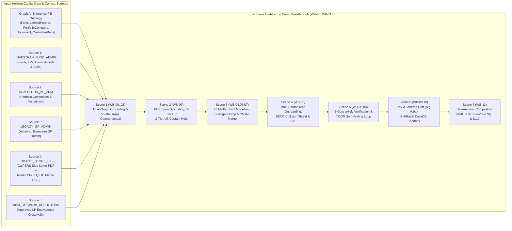

# Document 07: End-to-End Private Equity Asset Management Data Vault 2.0 Modelling & Verification Demo

> ** Quick-Navigation Index**
> - **[Repository Root (`README.md`)](../README.md)** | **[Agent Reference Guide (`DV2_AGENT_REFERENCE_GUIDE.md`)](./DV2_AGENT_REFERENCE_GUIDE.md)**
> - **[Doc 01: Core Modelling Specification](./01-core-modelling-spec.md)**
> - **[Doc 02: Schema Stability, Cold-Start ($N=1$) & Evolution](./02-schema-stability-and-evolution.md)**
> - **[Doc 03: 6-Gate Verification & `dv-firstmate` Architecture](./03-verification-and-agentic-architecture.md)**
> - **[Doc 04: Unstructured & Multi-Modal DV 2.0](./04-unstructured-and-multimodal-dv2.md)**
> - **[Doc 05: ELM Calculus, 3-Pass CoT & Reference Algorithms](./05-elm-calculus-and-reference-algorithms.md)**
> - **[Doc 06: Explainability, Observability & Visualization Architecture (`WB-00..WB-11`)](./06-explainability-and-observability-spec.md)**
> - **Executable Schemas:** [`schemas/vault-observability-event.schema.json`](../schemas/vault-observability-event.schema.json) | [`schemas/no-mistake-dv2-contract-v5.schema.json`](../schemas/no-mistake-dv2-contract-v5.schema.json) | [`schemas/dv2-canonical-ir.schema.json`](../schemas/dv2-canonical-ir.schema.json)
> - **Private Equity Reference Package:** [`examples/private_equity/dv_pe_model_contract.yaml`](../examples/private_equity/dv_pe_model_contract.yaml) | [`examples/private_equity/pe_canonical_ir.json`](../examples/private_equity/pe_canonical_ir.json) | [`examples/private_equity/pe_graph_a_ontology.yaml`](../examples/private_equity/pe_graph_a_ontology.yaml) | [`examples/private_equity/pe_graph_b_profile.json`](../examples/private_equity/pe_graph_b_profile.json)

---

## Executive Overview

This document provides a complete, self-contained **End-to-End Private Equity Asset Management Demo Walkthrough** for `open-dv`. Using **Apex Horizon Capital Partners**—an institutional Private Equity firm managing Buyout and Co-Investment funds—we trace how the `open-dv` agent team (`vault-first-mate`, `scout-source`, `scout-unstructured`, `ship-vault`, `axi-dv`, and `deterministic-compiler`) transforms five heterogeneous source systems and two unstructured PDFs into a mathematically verified, four-zone Data Vault 2.0 warehouse across the **12-View Explainability & Observability Workbench (`WB-00` through `WB-11`)**.



---

## Section 1: Apex Horizon Capital Domain Context (`Graph A`), Multi-Source Bronze Datasets (`Graph B`), & Unstructured Document Corpus

### 1.1 Top-Down Enterprise Ontology (`Graph A` — `examples/private_equity/pe_graph_a_ontology.yaml`)

Aligned with **ILPA (Institutional Limited Partners Association)** reporting standards and **ISO 17442 (LEI) / ISO 6166 (ISIN)** identifier registries, Apex Horizon Capital's Enterprise Data Architecture team maintains five Canonical Business Concepts (`CBCs`) in [`examples/private_equity/pe_graph_a_ontology.yaml`](../examples/private_equity/pe_graph_a_ontology.yaml):

| Canonical Business Concept (`CBC`) | Ontology URI | Target Hub | Tier-1 Global Key (`GLOBAL`) | Tier-2 Enterprise SOR Key (`GLOBAL`) | Tier-3 Local Scoped Key (`<BKCC>:key`) | Governance & Split Constraints |
| :--- | :--- | :--- | :--- | :--- | :--- | :--- |
| **Fund Vehicle** | `urn:ontology:entity:fund` | `hub_fund` | ISO 6166 `isin` (`US0378331005`) | Investran `fund_code` (`APEX_BO_IV`, `APEX_CO_I`) | Local admin ID | `PUBLIC` / `STATIC`; additive ESG ratings isolated to `sat_fund_investran_esg`. |
| **Limited Partner (LP)** | `urn:ontology:entity:limited_partner` | `hub_limited_partner` | ISO 17442 `lei` (`5493006MHB84DD0ZWV18`) | Investran `lp_id` (`LP-101..LP-104`) | Legacy GP `lp_num` (`LEGACY_GP_ADMIN:101`) | `wire_iban` and `tax_id` tagged `PII_HIGH` $\to$ mandatory split to `sat_limited_partner_pii`. |
| **Portfolio Company** | `urn:ontology:entity:portfolio_company` | `hub_portfolio_company` | ISO 17442 `lei` (`529900T8BM49AURSDO55`) | DealCloud `deal_code` (`DEAL-NC-2024`) | Local CRM deal row ID | `entry_ebitda_usd` and `entry_ev_multiple` tagged `CONFIDENTIAL` (MNPI) $\to$ split to `sat_portco_valuation_mnpi`. |
| **Legal / Valuation Document** | `urn:ontology:entity:document` | `hub_document` | — | S3 URI `doc_uri` (`s3://apex-pe-vault-bronze/...`) | — | Binary PDFs stay in S3 (`Rule U1`); AI extractions require `model_id`, `confidence`, `quote` (`Rule U3`). |
| **Custodian Bank** *(Unallocated)* | `urn:ontology:entity:custodian_bank` | *None (`null`)* | ISO 9362 BIC/SWIFT | — | — | Intentionally unmapped in `Graph B` to verify **Zero-Hallucination Guard** (80.0% Ontology Coverage; 0 phantom Hubs). |

**Master-Key Rule:** The tiers above rank every identifier the ontology recognises, but each entity loads exactly one key per source so that every Link FK resolves to a loaded Hub row. The Hub key is the identifier all referencing sources carry: `fund_code` for `hub_fund`, `lp_id` for `hub_limited_partner` (plus `LEGACY_GP_ADMIN:lp_num` for the legacy roster), and `lei` for `hub_portfolio_company`. The remaining identifiers (`isin`, the LP `lei`, `deal_code`) are stored as Satellite attributes and used only as Entity Resolution lookups, so the side letter's LEI resolves to `LP-101` rather than minting a second CalPERS Hub row.

---

### 1.2 Bottom-Up Multi-Source Relational Datasets & Empirical `Graph B` Profile (`examples/private_equity/pe_graph_b_profile.json`)

The physical Bronze layer spans **five source systems**, **seven relational tables** with **44 columns**, and **two `scout-unstructured` extraction tables** with **23 columns** (= **67 total triaged columns** in [`examples/private_equity/dv_pe_model_contract.yaml`](../examples/private_equity/dv_pe_model_contract.yaml)).

#### Source 1 (`INVESTRAN_FUND_ADMIN`): Table 1 — `investran.src_pe_funds` (9 Columns, 3 Sample Rows)

| `fund_code` *(Hub Master Key)* | `isin` *(Tier-1 Alternate Attribute)* | `fund_name` | `vintage_year` | `target_size_usd` | `strategy` | `mgmt_fee_bps` | `deprecated_fax_no` *(Dropped Day 3)* | `ilpa_esg_rating` *(Added Day 3)* |
| :--- | :--- | :--- | :---: | :---: | :--- | :---: | :--- | :--- |
| `APEX_BO_IV` | `US0378331005` | `Apex Buyout Fund IV LP` | `2026` | `2500000000.00` | `BUYOUT` | `175.0000` | `+1-212-555-0190` | `AA_LEADER` |
| `APEX_CO_I` | `US0378333001` | `Apex Co-Invest Fund I LP` | `2026` | `500000000.00` | `CO_INVEST` | `0.0000` | `NULL` | `A_COMPLIANT` |
| `APEX_BO_III` | `US0378330999` | `Apex Buyout Fund III LP` | `2022` | `1800000000.00` | `BUYOUT` | `175.0000` | `NULL` | `AA_LEADER` |

#### Source 1 (`INVESTRAN_FUND_ADMIN`): Table 2 — `investran.src_lp_investors` (8 Columns, 4 Sample Rows)

> **Built-In Trap (`AP-03` Surrogate Key Contamination):** `row_seq_id` has $U(C) = 1.00$ and $N_{\text{null}} = 0.0\%$, tempting a naive LLM to pick it as the Hub Business Key. However, `scout-source` detects a monotonic step $\Delta = +1$ (`10001..10004`) and quarantines it (`SYSTEM_SURROGATE_DROPPED`).

| `row_seq_id` *(Surrogate)* | `lei` *(Tier-1 ER Lookup Attribute)* | `lp_id` *(Hub Master Key)* | `lp_legal_name` | `domicile_country` | `wire_iban` *(`PII_HIGH`)* | `tax_id` *(`PII_HIGH`)* | `tier_status` |
| :---: | :--- | :--- | :--- | :---: | :--- | :--- | :--- |
| `10001` | `5493006MHB84DD0ZWV18` | `LP-101` | `California Public Employees' Retirement System (CalPERS)` | `US` | `US64SVBK0000000099101` | `94-6001347` | `ANCHOR_SOVEREIGN` |
| `10002` | `5493001KJTIIGC8Y1R12` | `LP-102` | `Abu Dhabi Sovereign Investment Authority` | `AE` | `AE070331234567890123456` | `AE-9981204` | `ANCHOR_SOVEREIGN` |
| `10003` | `5493008X9Y2Z3W4V5U67` | `LP-103` | `Yale University Endowment Trust` | `US` | `US19BOFA0000000044103` | `06-0646973` | `INSTITUTIONAL_TIER_1` |
| `10004` | `529900LPNORDIC998877` | `LP-104` | `Nordic Sovereign Pension Fund` | `SE` | `SE4550000000058398257466` | `SE-55601234` | `ANCHOR_SOVEREIGN` |

#### Source 1 (`INVESTRAN_FUND_ADMIN`): Table 3 — `investran.src_lp_commitments_and_calls` (10 Columns, 7 Sample Rows)

> **Built-In Traps (`Alg A.4` Sparse Nullable FK & `Alg A.1` Gate 4 YAGNI Cost Guard):**
> 1. `co_invest_portco_lei` is populated on only $2/7$ rows ($U_{nn} = 0.2857, N_{\text{null}} = 71.43\%$). Leaving it inside `lnk_lp_commitment` would pollute 71.4% of rows with `-1` Ghost Keys (`AP-09`). `Algorithm A.4` splits it into `lnk_lp_commitment_co_invest` with `WHERE co_invest_portco_lei IS NOT NULL`.
> 2. Three columns (`eur_usd_rate`, `gbp_usd_rate`, `daily_interim_nav_usd`) update daily ($\lambda = 0.85$), tempting `ship-vault` to split them into `sat_lp_commitment_fx_high_freq`. However, at $|C_{\text{general}}| = 6 < 10$ and $W_{\text{amp}} = 4.20\text{ MB/day} < 50\text{ MB/day}$, **Gate 4 YAGNI (`Algorithm A.1`)** auto-merges them back into `sat_lp_commitment_investran`.

| `commitment_id` | `fund_code` | `lp_id` | `commitment_amount_usd` | `called_usd` | `distribution_recallable_flag` | `co_invest_portco_lei` *(71.4% NULL)* | `eur_usd_rate` | `gbp_usd_rate` | `daily_interim_nav_usd` |
| :--- | :--- | :--- | :---: | :---: | :---: | :--- | :---: | :---: | :---: |
| `COMM-2026-001` | `APEX_BO_IV` | `LP-101` | `500000000.00` | `125000000.00` | `Y` | `NULL` | `1.084200` | `1.296500` | `131250000.00` |
| `COMM-2026-002` | `APEX_BO_IV` | `LP-102` | `450000000.00` | `112500000.00` | `Y` | `NULL` | `1.084200` | `1.296500` | `118125000.00` |
| `COMM-2026-003` | `APEX_BO_IV` | `LP-103` | `200000000.00` | `50000000.00` | `N` | `NULL` | `1.084200` | `1.296500` | `52500000.00` |
| `COMM-2026-004` | `APEX_BO_IV` | `LP-104` | `300000000.00` | `75000000.00` | `Y` | `NULL` | `1.084200` | `1.296500` | `78750000.00` |
| `COMM-2026-005` | `APEX_CO_I` | `LP-101` | `75000000.00` | `75000000.00` | `N` | `529900T8BM49AURSDO55` | `1.084200` | `1.296500` | `84500000.00` |
| `COMM-2026-006` | `APEX_CO_I` | `LP-102` | `50000000.00` | `50000000.00` | `N` | `529900T8BM49AURSDO55` | `1.084200` | `1.296500` | `56330000.00` |
| `COMM-2026-007` | `APEX_BO_III` | `LP-101` | `350000000.00` | `315000000.00` | `Y` | `NULL` | `1.084200` | `1.296500` | `412000000.00` |

#### Source 2 (`DEALCLOUD_PE_CRM`): Table 4 — `dealcloud.src_portfolio_companies` (7 Columns, 3 Sample Rows)

> **Passive Multi-Source Integration Demo:** `dealcloud.src_portfolio_companies.lei` (`529900T8BM49AURSDO55`, *Nordic Cloud SaaS AB*) matches `investran.src_lp_commitments_and_calls.co_invest_portco_lei` and the Q3 IC Valuation Memo PDF (`ic_q3_valuation_nordic_cloud.pdf`), enabling zero-configuration passive integration on `hub_portfolio_company`.

| `lei` *(Hub Master Key)* | `deal_code` *(ER Lookup Attribute)* | `company_name` | `sector` | `entry_ebitda_usd` *(`CONFIDENTIAL`)* | `entry_ev_multiple` *(`CONFIDENTIAL`)* | `gp_deal_partner` |
| :--- | :--- | :--- | :--- | :---: | :---: | :--- |
| `529900T8BM49AURSDO55` | `DEAL-NC-2024` | `Nordic Cloud SaaS AB` | `B2B_SAAS` | `16896550.00` | `12.80` | `Marcus Vance` |
| `549300INDTECH7788991` | `DEAL-AT-2025` | `Alpine Precision Robotics GmbH` | `INDUSTRIAL_TECH` | `24500000.00` | `11.50` | `Elena Rostova` |
| `549300HLTHIT11223344` | `DEAL-MH-2025` | `MedHorizon Clinical AI Inc.` | `HEALTHCARE_IT` | `12200000.00` | `15.20` | `Marcus Vance` |

#### Source 3 (`LEGACY_GP_ADMIN`): Table 5 — `legacy_gp.src_legacy_lp_roster` (4 Columns, 2 Sample Rows)

> **Built-In Trap (`AP-04` Cross-Source Key Collision):** Acquired European GP spreadsheet uses local integer `lp_num = '101'` for **Bavarian Pension Reserve Fund** (€25M LP), which collides directly with `LP-101` / `'101'` (**CalPERS**, $500M LP) in `INVESTRAN_FUND_ADMIN` ($J_{\text{entity}} = 0.00$). Row 2 (`lp_num = '102'`, *Nordisk Suverän Fond*) is the regional alias of `LP-104` (*Nordic Sovereign Pension Fund*), resolved via `sal_limited_partner`.

| `lp_num` *(Tier-3 Local Key)* | `legacy_investor_name` | `contact_person` | `phone_number` |
| :--- | :--- | :--- | :--- |
| `101` *(Collides with CalPERS!)* | `Bavarian Pension Reserve Fund` | `Dr. Lukas Weber` | `+49-89-2190-4400` |
| `102` *(Alias of LP-104)* | `Nordisk Suverän Fond` | `Astrid Lindqvist` | `+46-8-402-9100` |

#### Source 4 (`OBJECT_STORE_S3`): Table 6 — `dms.documents` (4 Columns, 2 Sample Rows)

| `doc_uri` *(Tier-2 BK)* | `content_sha256` | `mime_type` | `byte_size` |
| :--- | :--- | :--- | :---: |
| `s3://apex-pe-vault-bronze/legal/side-letters/calpers_side_letter_fund_iv_2026.pdf` | `896c221b5e0db9b476ce0de10d54c3d3ca412af137c5f53e916f10cdc42bfe0d` | `application/pdf` | `184320` |
| `s3://apex-pe-vault-bronze/ic-memos/2026-q3/ic_q3_valuation_nordic_cloud.pdf` | `ca4d09a7663efdcbecbe94008c724f3cba32fdb7fa29875c5b72547f6a2dde8c` | `application/pdf` | `262144` |

#### Source 5 (`MDM_STEWARD_RESOLUTION`): Table 7 — `mdm.src_lp_steward_crosswalk` (2 Columns, 1 Sample Row)

Data stewards approve each cross-source equivalence here; the legacy spreadsheet does not carry it. `sal_limited_partner` loads from this table only, with `rec_src = 'MDM_STEWARD_RESOLUTION'`. `lp_num` is hashed under `BKCC = LEGACY_GP_ADMIN`.

| `master_lp_id` | `lp_num` |
| :--- | :--- |
| `LP-104` | `102` |

#### `scout-unstructured` Output (`OBJECT_STORE_S3`): `dms.src_side_letter_extractions` (12 Columns) and `dms.src_ic_memo_extractions` (11 Columns)

These tables hold the resolved Hub keys and span-grounded attributes extracted in Section 1.3. They are the source of the two `UNSTRUCTURED_EXTRACTION_LINK`s and their AI provenance Satellites. `evidence_quote` and `chunk_id` cite the primary fact of the row.

| `doc_uri` | `fund_code` | `lp_id` | `fee_cap_bps` | `headline_fee_bps` | `mfn_election_flag` | `co_invest_rofr` | `effective_date` | `extractor_model_id` | `confidence_score` | `chunk_id` | `evidence_quote` |
| :--- | :--- | :--- | :---: | :---: | :---: | :---: | :--- | :--- | :---: | :--- | :--- |
| `s3://.../calpers_side_letter_fund_iv_2026.pdf` | `APEX_BO_IV` | `LP-101` | `125.0000` | `175.0000` | `Y` | `Y` | `2026-02-14` | `claude-3-7-sonnet` | `0.990` | `[499:506]` | `125 bps` |

| `doc_uri` | `lei` | `asc_820_level` | `ev_ebitda_multiple` | `implied_ev_usd` | `fair_value_usd` | `effective_date` | `extractor_model_id` | `confidence_score` | `chunk_id` | `evidence_quote` |
| :--- | :--- | :--- | :---: | :---: | :---: | :--- | :--- | :---: | :--- | :--- |
| `s3://.../ic_q3_valuation_nordic_cloud.pdf` | `529900T8BM49AURSDO55` | `Level 3` | `14.50` | `245000000.00` | `245000000.00` | `2026-09-30` | `claude-3-7-sonnet` | `0.990` | `[915:932]` | `EV/EBITDA = 14.5x` |

---

### 1.3 Unstructured Document Corpus with Verbatim Excerpts & Verified Character Offsets (`[span_start, span_end)`)

#### Document 1: LP Side Letter (`calpers_side_letter_fund_iv_2026.pdf`, 1,215 Characters)

```text
CONFIDENTIAL LP SIDE LETTER AGREEMENT
DATE: February 14, 2026
PARTIES: Apex Horizon Buyout Fund IV GP LLC (the 'General Partner') and California Public Employees' Retirement System (the 'Investor', Legal Entity Identifier LEI: 5493006MHB84DD0ZWV18).

1. MANAGEMENT FEE DISCOUNT & MOST FAVORED NATION (MFN):
Notwithstanding Section 6.2 of the Limited Partnership Agreement dated January 15, 2026, the General Partner agrees that the Investor shall be entitled to an annualized management fee rate of 125 bps on invested capital during the commitment period, representing a 50 bps reduction from the standard 175 bps headline rate. The Investor shall also enjoy full Most Favored Nation rights with respect to all economic fee terms granted to any other limited partner in Fund IV.

2. CO-INVESTMENT ALLOCATION RIGHTS:
The General Partner hereby grants the Investor a contractual co-investment right of first refusal with respect to all primary buyout opportunities where equity syndication exceeds USD 50,000,000.

3. SPECIAL VEHICLES:
The Investor acknowledges ongoing discussions regarding participation in the Horizon Sovereign Co-Invest Vehicle, subject to definitive LPAC approval and sovereign tax structuring.
```

| Extracted Field | Verbatim Substring (`doc_text[span_start:span_end]`) | `span_start` | `span_end` | ER Resolution Tier | Target Vault Routing |
| :--- | :--- | :---: | :---: | :--- | :--- |
| `investor_name` | `California Public Employees' Retirement System` | `134` | `180` | `Tier-U2` ($S_{\text{er}} = 0.98$) | Resolves to `hub_limited_partner` (`[HK: 5D15..0AE4 \| GLOBAL:LP-101 CalPERS]`). |
| `investor_lei` | `5493006MHB84DD0ZWV18` | `227` | `247` | `Tier-U1` ($S_{\text{er}} = 1.00$) | Exact LEI match on `sat_limited_partner_investran.lei`, resolving to master key `LP-101`. |
| `fee_cap_bps` | `125 bps` | `499` | `506` | `EXTRACTED_ATTRIBUTE` | Stored in `sat_lp_side_letter_llm_ext` on `lnk_document_lp_commitment`. |
| `headline_fee_bps` | `175 bps` | `607` | `614` | `EXTRACTED_ATTRIBUTE` | Stored in `sat_lp_side_letter_llm_ext`. |
| `co_invest_rofr` | `co-investment right of first refusal` | `878` | `914` | `EXTRACTED_ATTRIBUTE` | Stored in `sat_lp_side_letter_llm_ext`. |
| `ambiguous_vehicle` | `Horizon Sovereign Co-Invest Vehicle` | `1112` | `1147` | **`Tier-U3` (`ASK-USER`)** | Top-2 margin $= |0.81 - 0.79| = 0.02 < 0.15$ $\to$ **Blocked from `hub_fund` by `Rule U4`**. |

#### Document 2: Q3 IC Valuation Memorandum (`ic_q3_valuation_nordic_cloud.pdf`, 1,331 Characters)

```text
APEX HORIZON CAPITAL PARTNERS — INVESTMENT COMMITTEE VALUATION MEMORANDUM
MEMORANDUM DATE: October 14, 2026
VALUATION EFFECTIVE DATE: September 30, 2026 (Q3 2026 Valuation Cycle)
ASSET: Nordic Cloud SaaS AB (Registration LEI: 529900T8BM49AURSDO55, Deal Code: DEAL-NC-2024)
SPONSOR FUND: Apex Buyout Fund IV LP

1. EXECUTIVE VALUATION SUMMARY:
As of the September 30, 2026 valuation cycle, the Investment Committee has reviewed and approved the quarterly fair-value restatement for Nordic Cloud SaaS AB.
Under ASC 820 fair value accounting standards, this private operating asset is designated as an ASC_820_Level = 'Level 3' valuation based on unobservable discounted cashflow inputs and benchmark enterprise trading multiples.

2. QUANTITATIVE MULTIPLES & REVALUATION:
Based on LTM recurring ARR growth of 38% and LTM Normalized EBITDA of USD 16,896,550, the Committee approved an enterprise valuation multiple of EV/EBITDA = 14.5x (an expansion from the entry multiple of 12.8x).
Accordingly, the total implied Enterprise Value is USD 245,000,000.00, resulting in an equity Fair_Value_USD = 245000000.00 for the combined debt-free operating holding.

3. AUDIT SIGN-OFF & PROVENANCE:
Valuation Committee Lead: Marcus Vance (Partner, Software Practice).
External Auditor Review: PriceWaterhouseCoopers LLP (PwC Valuation Services).
```

| Extracted Field | Verbatim Substring (`doc_text[span_start:span_end]`) | `span_start` | `span_end` | ER Resolution Tier | Target Vault Routing |
| :--- | :--- | :---: | :---: | :--- | :--- |
| `portco_lei` | `529900T8BM49AURSDO55` | `226` | `246` | `Tier-U1` ($S_{\text{er}} = 1.00$) | Exact ISO 17442 LEI match on `hub_portfolio_company` (`[HK: 0C18..454E]`). |
| `portco_deal_code` | `DEAL-NC-2024` | `259` | `271` | `Tier-U1` ($S_{\text{er}} = 1.00$) | Exact match on `sat_portfolio_company_dealcloud.deal_code`, confirming the same Hub row as the LEI. |
| `asc_820_level` | `ASC_820_Level = 'Level 3'` | `599` | `624` | `EXTRACTED_ATTRIBUTE` | Stored in `sat_lnk_doc_portco_ai_provenance` (`CONFIDENTIAL`). |
| `ev_ebitda_multiple` | `EV/EBITDA = 14.5x` | `915` | `932` | `EXTRACTED_ATTRIBUTE` | Restated Q3 multiple (`14.5x` vs. `12.8x` entry). MNPI: stored in `sat_lnk_doc_portco_ai_provenance` (`CONFIDENTIAL`). |
| `implied_ev_usd` | `USD 245,000,000.00` | `1033` | `1051` | `EXTRACTED_ATTRIBUTE` | MNPI: stored in `sat_lnk_doc_portco_ai_provenance` (`CONFIDENTIAL`). |
| `fair_value_usd` | `Fair_Value_USD = 245000000.00` | `1076` | `1105` | `EXTRACTED_ATTRIBUTE` | MNPI: stored in `sat_lnk_doc_portco_ai_provenance` (`CONFIDENTIAL`). |

---

## Section 2: The 7-Scene End-to-End Interactive Demo Walkthrough (`Scenes 1–7` across `WB-00..WB-11`)

---

### Scene 1: Context & Source Intake + The 5 Fatal Agentic Traps Counterfactual (`WB-00`, `WB-01`, `WB-02`)

#### 1. What the Agent Team Does
1. **`vault-first-mate` (`STAGE_00_ORCHESTRATION`, `WB-01`):** Loads the top-down Enterprise Ontology `Graph A` ([`pe_graph_a_ontology.yaml`](../examples/private_equity/pe_graph_a_ontology.yaml)) and dispatches `scout-source` to profile the physical Bronze schemas (`Graph B`, [`pe_graph_b_profile.json`](../examples/private_equity/pe_graph_b_profile.json)).
2. **Bipartite Concept Grounding (`VIZ-STEP-01`):** Maps `investran.src_pe_funds` $\to$ `Fund`, both `investran.src_lp_investors` and `legacy_gp.src_legacy_lp_roster` $\to$ `LimitedPartner`, `dealcloud.src_portfolio_companies` $\to$ `PortfolioCompany`, and `dms.documents` $\to$ `Document`. `mdm.src_lp_steward_crosswalk` grounds to the `SameAsLimitedPartner` relationship, and the two extraction tables are bound in Scene 2. Leaves `CustodianBank` unallocated (`4/5 = 80.0%` coverage) rather than hallucinating a phantom table (`AP-06`).
3. **`scout-source` Empirical Profiling (`STAGE_01_SCOUT_SOURCE`, `WB-02`):** Computes uniqueness, entropy, null rates, and inclusion dependencies across all 44 relational columns:
   - Flags `investran.src_lp_investors.row_seq_id` ($U=1.0, \Delta=+1$) as `[SURROGATE_SEQUENCE]`.
   - Flags `investran.src_lp_commitments_and_calls.co_invest_portco_lei` ($N_{\text{null}} = 71.43\%, \mathcal{I}_{nn} = 1.00$) as an optional contextual FK requiring `Algorithm A.4` Link splitting.

#### 2. What the User Sees in `WB-01` & `WB-02`
```
+====================================================================================================+
| SCENE 1 — WB-01 & WB-02: DUAL-GRAPH GROUNDING & EMPIRICAL PROFILING                        [PASS ●]|
| Layer 1 Story: 7 Bronze tables grounded to 4 Enterprise CBCs; row_seq_id quarantined as surrogate. |
+----------------------------------------------------------------------------------------------------+
| [Graph A CBC Ontology]              <=== Bipartite Grounding ===> [Graph B Bronze Tables]          |
|  • urn:ontology:entity:fund         <---------------------------- investran.src_pe_funds (9 cols)  |
|  • urn:ontology:entity:limited_part <---------------------------- investran.src_lp_investors (8c)  |
|                                     <---------------------------- legacy_gp.src_legacy_lp_roster   |
|  • urn:ontology:entity:portfolio_co <---------------------------- dealcloud.src_portfolio_cos (7c) |
|  • urn:ontology:entity:document     <---------------------------- dms.documents (4 cols + 2 PDFs)  |
|  • urn:ontology:relationship:same_as <-------------------------- mdm.src_lp_steward_crosswalk (2c) |
|  • urn:ontology:entity:custodian    [UNALLOCATED — 0 Phantom Hubs Created (Zero-Hallucination ●)]  |
+----------------------------------------------------------------------------------------------------+
| COUNTERFACTUAL DRAWER (VIZ-GATE-02 — What Naive Prompt-Only LLMs Get Wrong Here):                  |
|  [Trap 1: Source-System DV ■] Naive LLM creates `hub_investran_lp` + `hub_legacy_lp` -> Broken MDM |
|  [Trap 2: Surrogate Key ■]    Naive LLM hashes `row_seq_id=10001` as Hub BK -> Destroyed on reload |
+====================================================================================================+
```

---

### Scene 2: Unstructured PDF Span Grounding & 3-Tier Entity Resolution with `Tier-U3` Captain Hold (`WB-03`)

#### 1. What the Agent Team Does
1. **`scout-unstructured` (`STAGE_02_SCOUT_UNSTRUCTURED`, `WB-03`):** Ingests `calpers_side_letter_fund_iv_2026.pdf` (`[HK: 864D..EE6B]`) and `ic_q3_valuation_nordic_cloud.pdf` (`[HK: 99D8..4158]`).
2. **3-Tier Entity Resolution (`Algorithm A.7`):**
   - **`Tier-U1` Auto-Bind:** Matches LEI `5493006MHB84DD0ZWV18` (`[227:247]`) to `sat_limited_partner_investran.lei`, resolving to CalPERS master key `LP-101` (`[HK: 5D15..0AE4 | GLOBAL:LP-101 CalPERS]`), and LEI `529900T8BM49AURSDO55` (`[226:246]`) to Nordic Cloud SaaS AB (`[HK: 0C18..454E | GLOBAL:529900T8..DO55 Nordic Cloud]`).
   - **`Tier-U2` Guarded Hybrid Bind:** Matches `"California Public Employees' Retirement System"` (`[134:180]`, $S_{\text{er}} = 0.98$) and `"Nordic Cloud SaaS AB"` ($S_{\text{er}} = 0.96$, top-2 margin $= 0.31 \ge 0.15$).
   - **`Tier-U3` Captain Hold (`Rule U4`):** Quarantines `"Horizon Sovereign Co-Invest Vehicle"` (`[1112:1147]`) because its top-2 candidate scores (`0.81` vs. `0.79`) yield a separation margin of $0.02 < 0.15$. Under **Gate 5 `Rule U4`**, `open-dv` refuses to mint a new `hub_fund` key from an unverified free-text PDF string and pauses only that span for Captain confirmation (`ASK-USER`).

#### 2. Executable Python Span-Offset Verification
```python
side_letter_text = (
    "CONFIDENTIAL LP SIDE LETTER AGREEMENT\n"
    "DATE: February 14, 2026\n"
    "PARTIES: Apex Horizon Buyout Fund IV GP LLC (the 'General Partner') and "
    "California Public Employees' Retirement System (the 'Investor', Legal Entity "
    "Identifier LEI: 5493006MHB84DD0ZWV18).\n\n"
    "1. MANAGEMENT FEE DISCOUNT & MOST FAVORED NATION (MFN):\n"
    "Notwithstanding Section 6.2 of the Limited Partnership Agreement dated January 15, 2026, "
    "the General Partner agrees that the Investor shall be entitled to an annualized management "
    "fee rate of 125 bps on invested capital during the commitment period, representing a 50 bps "
    "reduction from the standard 175 bps headline rate. The Investor shall also enjoy full Most "
    "Favored Nation rights with respect to all economic fee terms granted to any other limited "
    "partner in Fund IV.\n\n"
    "2. CO-INVESTMENT ALLOCATION RIGHTS:\n"
    "The General Partner hereby grants the Investor a contractual co-investment right of first "
    "refusal with respect to all primary buyout opportunities where equity syndication exceeds "
    "USD 50,000,000.\n\n"
    "3. SPECIAL VEHICLES:\n"
    "The Investor acknowledges ongoing discussions regarding participation in the Horizon "
    "Sovereign Co-Invest Vehicle, subject to definitive LPAC approval and sovereign tax structuring."
)

assert len(side_letter_text) == 1215
assert side_letter_text[134:180] == "California Public Employees' Retirement System"
assert side_letter_text[227:247] == "5493006MHB84DD0ZWV18"
assert side_letter_text[499:506] == "125 bps"
assert side_letter_text[1112:1147] == "Horizon Sovereign Co-Invest Vehicle"
```

---

### Scene 3: Cold-Start ($N=1$) `INVESTRAN_FUND_ADMIN` Pass 1–3 Modelling, Surrogate Drop, Nullable-FK Link Splitter, PII Split, & Gate 4 YAGNI Merge (`WB-04`, `WB-05`, `WB-07`)

#### 1. What the Agent Team Does
1. **Pass 1 Exhaustive Column Triage (`STAGE_03_SHIP_VAULT_PASS1`, `WB-04`):** `ship-vault` accounts for 100% of `INVESTRAN_FUND_ADMIN` columns in `column_triage_ledger`. `row_seq_id` is explicitly routed to `SYSTEM_SURROGATE_DROPPED` (`target_dv_entity: "DROPPED"`), satisfying `DV-COL-001` and `DV-COL-012`.
2. **Pass 2 Governance Satellite Split (`STAGE_04_SHIP_VAULT_PASS2`, `WB-05`):** Because `wire_iban` and `tax_id` carry `PII_HIGH` governance tags in `Graph A`, `ship-vault` isolates them into `sat_limited_partner_pii` (`security_classification: PII_HIGH`) while standard attributes (`lp_legal_name`, `domicile_country`, `tier_status`) reside in `sat_limited_partner_investran` (`INTERNAL`).
3. **Gate 3.2 Nullable-FK Link Splitter (`Algorithm A.4`, `WB-07`):** Splits `co_invest_portco_lei` ($71.43\%$ NULL) out of `lnk_lp_commitment` into `lnk_lp_commitment_co_invest` with `where_filter_condition: "co_invest_portco_lei IS NOT NULL"`.
4. **Gate 4 YAGNI Write-Amplification Cost Guard (`Algorithm A.1`, `WB-07`):** `ship-vault` initially proposes splitting the 3 daily FX/NAV columns (`eur_usd_rate`, `gbp_usd_rate`, `daily_interim_nav_usd`) into `sat_lp_commitment_fx_high_freq`. `axi-dv` evaluates **Algorithm A.1**:
   - $|C_{\text{general}}| = 6 < 10$ (fails minimum column-count threshold)
   - $W_{\text{amp}} = R_{\text{daily}} \times P(\Delta C_{\text{high}}) \times B_{\text{low}} = 157,000 \times 0.85 \times 33\text{ B} = 4,403,850\text{ B/day} \approx 4.20\text{ MB/day} < 50.0\text{ MB/day}$
   - **Verdict:** `[AUTO-FIX ◆]` — `axi-dv` executes deterministic codemod `merge_satellites`, folding the 3 columns back into `sat_lp_commitment_investran` and eliminating 1 unnecessary PIT join.

#### 2. What the User Sees in `WB-04` & `WB-07`
```
+====================================================================================================+
| SCENE 3 — WB-04 & WB-07: COLD-START N=1 TRIAGE, NULLABLE-FK SPLIT & YAGNI COST GUARD   [AUTO-FIX ◆]|
| Layer 1 Story: 27/27 Investran cols triaged; row_seq_id dropped; 4.20 MB/d FX sat merged via YAGNI.|
+----------------------------------------------------------------------------------------------------+
| 1. SURROGATE QUARANTINE (DV-COL-001):                                                              |
|    investran.src_lp_investors.row_seq_id (U=1.0, Step=+1) ===> [DROPPED SINK ●] (0 Hub Pollution)  |
|                                                                                                    |
| 2. PII GOVERNANCE SPLIT (DV-COL-006):                                                              |
|    • sat_limited_partner_investran [INTERNAL]  <--- lp_legal_name, domicile_country, tier_status   |
|    • sat_limited_partner_pii       [PII_HIGH]  <--- wire_iban, tax_id (Row/Col Masking Enforced ●) |
|                                                                                                    |
| 3. NULLABLE-FK LINK SPLITTER (Algorithm A.4 / DV-COL-008):                                         |
|    • lnk_lp_commitment(hk_fund, hk_limited_partner)                    [0.0% NULL Core Grain ●]    |
|    • lnk_lp_commitment_co_invest(hk_fund, hk_portfolio_company)        [WHERE co_invest_lei!=NULL] |
|                                                                                                    |
| 4. GATE 4 YAGNI COST GUARD (Algorithm A.1 / DV-COL-005):                                           |
|    Proposed `sat_lp_commitment_fx_high_freq`: |C_gen| = 6 (<10) & W_amp = 4.20 MB/d (<50.0 MB/d)   |
|    ===> [AUTO-FIX ◆: Merged eur_usd_rate, gbp_usd_rate, daily_interim_nav_usd into core satellite] |
+====================================================================================================+
```

---
### Scene 4: Multi-Source ($N=2$) `DEALCLOUD_PE_CRM` & `LEGACY_GP_ADMIN` Onboarding, Passive LEI Integration vs. Tier-3 `BKCC` Isolation of `lp_num = '101'`, & `sal_limited_partner` (`WB-05`)

#### 1. What the Agent Team Does
1. **Onboarding `DEALCLOUD_PE_CRM` (`dealcloud.src_portfolio_companies`):**
   - `ship-vault` maps `dealcloud.src_portfolio_companies` onto `hub_portfolio_company` using Tier-1 Global LEI (`529900T8BM49AURSDO55`, *Nordic Cloud SaaS AB*).
   - **Passive Integration:** Because `investran.src_lp_commitments_and_calls.co_invest_portco_lei` and `ic_q3_valuation_nordic_cloud.pdf` also use ISO 17442 LEI `529900T8BM49AURSDO55` under `bkcc = 'GLOBAL'`, all three sources hash to the exact same `hub_portfolio_company` key `[HK: 0C18..454E | GLOBAL:529900T8..DO55 Nordic Cloud]` with zero Hub DDL modification (`EVO-05`).
   - **MNPI Satellite Split:** `entry_ebitda_usd` (`$16,896,550.00`) and `entry_ev_multiple` (`12.80x`) are isolated into `sat_portco_valuation_mnpi` (`CONFIDENTIAL`), while `company_name` and `gp_deal_partner` go to `sat_portfolio_company_dealcloud` (`INTERNAL`).
2. **Onboarding `LEGACY_GP_ADMIN` (`legacy_gp.src_legacy_lp_roster`):**
   - In Attempt 1, `ship-vault` maps `legacy_gp.src_legacy_lp_roster.lp_num` (`'101'`, *Bavarian Pension Reserve Fund*) onto `hub_limited_partner` with `key_authority_tier: TIER_3_LOCAL_SCOPED`, but forgets to set `require_src_qualifier: true` and `bkcc_prefix: "LEGACY_GP_ADMIN"`.
   - **Collision Alert (`DV-COL-002`):** `axi-dv` Gate 3.1 detects that unscoped `'101'` collides with Investran `LP-101` (*CalPERS*, $500M commitment) while their entity overlap is $J_{\text{entity}} = 0.00 < 0.95$.
   - **Self-Healed `BKCC` Isolation & `sal_limited_partner`:** After receiving the TOON diagnostic in Scene 5, `ship-vault` sets `require_src_qualifier: true` and `bkcc_prefix: "LEGACY_GP_ADMIN"`, isolating *Bavarian Pension Reserve Fund* at `[HK: 0FF0..9095 | LEGACY_GP_ADMIN:101 Bavarian Pension]` while *CalPERS* remains at `[HK: 5D15..0AE4 | GLOBAL:LP-101 CalPERS]`. For Row 2 (`LEGACY_GP_ADMIN:102`, *Nordisk Suverän Fond*), which genuinely represents the same legal institution as `GLOBAL:LP-104` (*Nordic Sovereign Pension Fund*), the steward-approved row in `mdm.src_lp_steward_crosswalk` (`master_lp_id = LP-104`, `lp_num = 102`) drives the non-destructive Same-As Link `sal_limited_partner` (`rec_src = MDM_STEWARD_RESOLUTION`).

#### 2. What the User Sees in `WB-05` (`VIZ-STEP-06` + `VIZ-GATE-04`)
```
+====================================================================================================+
| SCENE 4 — WB-05: MULTI-SOURCE N=2 ONBOARDING, PASSIVE LEI INTEGRATION & BKCC SHIELD       [PASS ●] |
| Layer 1 Story: Nordic Cloud unified passively via LEI; Bavarian Pension isolated from CalPERS.     |
+----------------------------------------------------------------------------------------------------+
| CASE A: PASSIVE INTEGRATION ON TIER-1 GLOBAL LEI (`hub_portfolio_company`)                         |
|   INVESTRAN (co_invest_portco_lei) --\                                                             |
|   DEALCLOUD (lei) --------------------+--> '6:GLOBAL||20:529900T8BM49AURSDO55'                     |
|   S3 IC MEMO PDF [226:246] ----------/     ===> [HK: 0C18..454E | GLOBAL:529900T8..DO55 Nordic]    |
|                                                 (Single Shared Hub Row; 0 Hub DDL Changes!)        |
+----------------------------------------------------------------------------------------------------+
| CASE B: ACTIVE COLLISION SHIELD ON TIER-3 LOCAL KEY (`hub_limited_partner`)                        |
|   INVESTRAN (CalPERS, $500M):  '6:GLOBAL||6:LP-101'        --> [HK: 5D15..0AE4 | GLOBAL:LP-101]    |
|   LEGACY_GP (Bavarian, €25M):  '15:LEGACY_GP_ADMIN||3:101' --> [HK: 0FF0..9095 | LEGACY_GP:101]    |
|                                                                (Zero Cross-Source Data Corruption!)|
|                                                                                                    |
|   Verified Cross-Source Equivalence (`sal_limited_partner`):                                       |
|   [HK: 970A..5106 | GLOBAL:LP-104 Nordic Sovereign] <=== [SAL: sal_limited_partner] ===>           |
|   [HK: 0F31..E17B | LEGACY_GP_ADMIN:102 Nordisk Suveran Fond]                                      |
+====================================================================================================+
```

---

### Scene 5: 6-Gate `axi-dv` Static/AST/DAG Verification & Closed-Loop `TOON` Self-Healing (`WB-06`, `WB-08`)

#### 1. What the Agent Team Does
1. **Gate 1 (Constrained Decoding Schema):** Validates [`examples/private_equity/dv_pe_model_contract.yaml`](../examples/private_equity/dv_pe_model_contract.yaml) against [`schemas/no-mistake-dv2-contract-v5.schema.json`](../schemas/no-mistake-dv2-contract-v5.schema.json) (`PASS`).
2. **Gate 2 (Topological & Grain DAG Verification, `WB-06`):** Runs `Algorithm A.3` over all 4 Hubs, 5 Links, and 11 Satellites. Confirms zero Hub-to-Hub edges (`INV-02`), zero Link-to-Link edges (`INV-03`), and single-parent Satellite attachment (`INV-04`) (`14/14 PASS`).
3. **Gate 3.1 (`REJECT-WITH-TRACE`) & Gate 4 (`AUTO-FIX`) Closed-Loop Self-Healing (`WB-08`):**
   - On Attempt 1, `axi-dv` blocks promotion because `legacy_gp.src_legacy_lp_roster.lp_num` lacks `bkcc_prefix` (`DV-COL-002`) and auto-merges the 4.20 MB/day FX satellite (`DV-COL-005`).
   - `axi-dv` emits a compact **48-token `TOON` diagnostic payload** to `ship-vault`.
   - On Attempt 2 ($K=2 \le K_{\max}=3$), `ship-vault` patches `require_src_qualifier: true` and `bkcc_prefix: "LEGACY_GP_ADMIN"`. Re-verification passes all static gates with `0` errors.

#### 2. What the User Sees in `WB-08` (`VIZ-GATE-07`)
```
+====================================================================================================+
| SCENE 5 — WB-08: CLOSED-LOOP SELF-HEALING DIFF & TOON DIAGNOSTIC INSPECTOR     [HEALED IN K=2 ●]   |
| Layer 1 Story: Gate 3.1 blocked unscoped Legacy GP key '101'; ship-vault healed YAML in 1 retry.   |
+----------------------------------------------------------------------------------------------------+
| TOON TRACE SENT BY `axi-dv` TO `ship-vault`:    | SELF-HEALING YAML DIFF (Attempt 1 -> Attempt 2): |
|                                                 |                                                  |
| @toon_v1                                        |   - bronze_table: "legacy_gp.src_legacy_lp_roster|
| run_id: run-pe-apex-horizon-20261030            |     key_columns: ["lp_num"]                      |
| attempt: 1/3                                    |     record_source_code: "LEGACY_GP_ADMIN"        |
| status: REJECT-WITH-TRACE                       |     key_authority_tier: "TIER_3_LOCAL_SCOPED"    |
| violations[1]{gate,rule,entity,remediation}:    | -   require_src_qualifier: false                 |
|  G3.1,DV-COL-002,hub_limited_partner,           | -   bkcc_prefix: null                            |
|   "Tier-3 key lp_num in src_legacy_lp_roster    | +   require_src_qualifier: true                  |
|    collides with LP-101 (J_entity=0.00).        | +   bkcc_prefix: "LEGACY_GP_ADMIN"               |
|    Set require_src_qualifier=true and           | +   system_scoped_bk_justification: "Acquired    |
|    bkcc_prefix='LEGACY_GP_ADMIN'."              | +     legacy GP Excel roster uses local IDs..."  |
+====================================================================================================+
```

---

### Scene 6: Day-3 Intra-Source Schema Drift ($S_1(t) \to S_1(t+1)$ `Alg A.9a`) & Gate 5 4-Batch Adversarial DuckDB Shadow Sandbox (`WB-09`, `WB-10`)

#### 1. What the Agent Team Does
1. **Day-3 Intra-Source Schema Drift (`Algorithm A.9a`, `WB-09`):**
   - Upstream `INVESTRAN_FUND_ADMIN` deploys a Day-3 release $S_1(t+1)$ that:
     1. Adds `ilpa_esg_rating VARCHAR(16)` to `investran.src_pe_funds` $\to$ Routed to new companion satellite `sat_fund_investran_esg` (`volatility_tier: ADDITIVE_DRIFT_COMPANION`), preserving 100% of historical `sat_fund_investran.hash_diff` digests (`EVO-01`).
     2. Drops `deprecated_fax_no` from `investran.src_pe_funds` $\to$ Marked in `soft_deprecated_columns: ["deprecated_fax_no"]`; Staging view injects `CAST(NULL AS VARCHAR(64)) AS deprecated_fax_no` (`EVO-02`).
     3. Renames `commitment_amount_usd` $\to$ `committed_amt` ($J_{\text{val}} = 0.994 \ge 0.90$) $\to$ Absorbed via Staging alias `committed_amt AS commitment_amount_usd` (`EVO-03`).
2. **Gate 5 Dynamic DuckDB Shadow Sandbox (`STAGE_06_AXI_DV_DYNAMIC_SANDBOX`, `WB-10`):**
   - Executes all compiled DDL and DML inside an ephemeral in-memory DuckDB instance across the **4 Adversarial Batches**:
     - **Batch 1 (`t_0` Baseline + Ghost Seed):** Loads initial multi-source rows + System Ghost Record (`0x00..00` at `'1900-01-01 00:00:00'`). Verifies `0` orphan FKs and `1` Ghost Record per Satellite (`DV-DYN-001..005`).
     - **Batch 2 (`t_1` 100% Replay Stress Test):** Re-executes the exact Batch 1 load at `t_1 > t_0`. Verifies $\Delta\text{Hub} = 0, \Delta\text{Link} = 0, \Delta\text{Sat} = 0$ (`DV-DYN-006..008`).
     - **Batch 3 (`t_2` 5% Mutation + Delimiter Injection + Day-3 Drift):** Mutates CalPERS `called_usd` from `$125,000,000.00` $\to$ `$160,000,000.00` and loads `ilpa_esg_rating = 'AA_LEADER'`. Verifies that only the 1 changed commitment row is appended to `sat_lp_commitment_investran` and `sat_fund_investran` has `0` false-positive re-inserts (`DV-DYN-009..012`, `DV-EVO-001..004`).
     - **Batch 4 (`t_3 = 2026-11-14` Late-Arriving Q3 IC Memo Backfill for `effective_date = 2026-09-30`):** Inserts the audited Q3 valuation restatement for *Nordic Cloud SaaS AB* (`14.5x`, `$245,000,000.00`) and verifies bi-temporal query isolation (`DV-DYN-013..015`, `TMP-01..04`).

#### 2. Executable Python Reference Check of `Algorithm A.5` Digests Across Batches 1–4
```python
import hashlib


def dv2_sha256(tokens: list[str | None]) -> str:
    parts = []
    for tok in tokens:
        norm = "" if tok is None else tok.strip().upper()
        parts.append("2:-1" if not norm else f"{len(norm.encode('utf-8'))}:{norm}")
    return hashlib.sha256("||".join(parts).encode("utf-8")).hexdigest().upper()


# 1. Verify CalPERS (GLOBAL:LP-101) vs. Bavarian Pension (LEGACY_GP_ADMIN:101) Isolation
hk_calpers = dv2_sha256(["GLOBAL", "LP-101"])
hk_bavarian = dv2_sha256(["LEGACY_GP_ADMIN", "101"])
assert hk_calpers != hk_bavarian
assert hk_calpers.startswith("5D15EB10") and hk_calpers.endswith("4B820AE4")
assert hk_bavarian.startswith("0FF0EE0C") and hk_bavarian.endswith("AC899095")

# 2. Verify Passive LEI Integration on Nordic Cloud SaaS AB across Investran, DealCloud, and S3 PDF
hk_nordic_cloud = dv2_sha256(["GLOBAL", "529900T8BM49AURSDO55"])
assert hk_nordic_cloud.startswith("0C1850CA") and hk_nordic_cloud.endswith("39B0454E")

# 3. Verify Adversarial Delimiter Injection Immunity ('A||B', 'C') != ('A', 'B||C')
assert dv2_sha256(["A||B", "C"]) != dv2_sha256(["A", "B||C"])
```

---

### Scene 7: Deterministic Compilation from `NoMistakeDataVault2ContractV5` YAML $\to$ Canonical IR JSON $\to$ 4-Zone SQL DDL/DML, Logarithmic `PIT`, and Bi-Temporal Multimodal `Query D.10` (`WB-11`)

#### 1. What the Agent Team Does
Once `axi-dv` clears Gates 1–5, `deterministic-compiler` (`STAGE_07_DETERMINISTIC_COMPILER`, `Algorithm A.6`) lowers the verified contract ([`examples/private_equity/dv_pe_model_contract.yaml`](../examples/private_equity/dv_pe_model_contract.yaml)) into the Canonical IR ([`examples/private_equity/pe_canonical_ir.json`](../examples/private_equity/pe_canonical_ir.json)) and emits the **Four-Zone DuckDB SQL Bundle** with zero LLM token generation:

- **Artifact 1 — Validated Model Contract YAML:** [`examples/private_equity/dv_pe_model_contract.yaml`](../examples/private_equity/dv_pe_model_contract.yaml)
- **Artifact 2 — Validated Canonical IR JSON:** [`examples/private_equity/pe_canonical_ir.json`](../examples/private_equity/pe_canonical_ir.json)
- **Artifact 3 — Compiled 4-Zone SQL Bundle (`Staging` + `Raw Vault DDL/DML` + `Ghost Seed 0x00..00` + `Logarithmic PIT` + `Bi-Temporal Query D.10`):**

```sql
-- =============================================================================
-- ZONE 1: HASHED STAGING VIEWS (Algorithm A.5 6-Stage Length-Prefixed SHA-256)
-- =============================================================================
CREATE SCHEMA IF NOT EXISTS staging;
CREATE SCHEMA IF NOT EXISTS raw_vault;
CREATE SCHEMA IF NOT EXISTS business_vault;
CREATE SCHEMA IF NOT EXISTS information_mart;

CREATE OR REPLACE VIEW staging.stg_legacy_gp_src_legacy_lp_roster AS
SELECT
    UPPER(ENCODE(SHA256(CONCAT_WS('||',
        '15:LEGACY_GP_ADMIN',
        CASE
            WHEN lp_num IS NULL OR TRIM(CAST(lp_num AS VARCHAR)) = '' THEN '2:-1'
            ELSE CAST(LENGTH(UPPER(TRIM(CAST(lp_num AS VARCHAR)))) AS VARCHAR) || ':' || UPPER(TRIM(CAST(lp_num AS VARCHAR)))
        END
    )), 'hex')) AS hk_limited_partner,
    'LEGACY_GP_ADMIN' AS bkcc,
    UPPER(TRIM(CAST(lp_num AS VARCHAR))) AS lp_natural_key,
    legacy_investor_name,
    contact_person,
    phone_number,
    UPPER(ENCODE(SHA256(CONCAT_WS('||',
        CAST(LENGTH(TRIM(CAST(contact_person AS VARCHAR))) AS VARCHAR) || ':' || TRIM(CAST(contact_person AS VARCHAR)),
        CAST(LENGTH(TRIM(CAST(legacy_investor_name AS VARCHAR))) AS VARCHAR) || ':' || TRIM(CAST(legacy_investor_name AS VARCHAR)),
        CAST(LENGTH(TRIM(CAST(phone_number AS VARCHAR))) AS VARCHAR) || ':' || TRIM(CAST(phone_number AS VARCHAR))
    )), 'hex')) AS hash_diff,
    CAST(CURRENT_TIMESTAMP AS TIMESTAMP) AS load_dts,
    'LEGACY_GP_ADMIN' AS rec_src
FROM legacy_gp.src_legacy_lp_roster;

-- =============================================================================
-- ZONE 2: RAW VAULT DDL, SYSTEM GHOST RECORD SEED (0x00..00), & IDEMPOTENT DML
-- =============================================================================
CREATE TABLE IF NOT EXISTS raw_vault.hub_portfolio_company (
    hk_portfolio_company CHAR(64) NOT NULL,
    bkcc VARCHAR(32) NOT NULL,
    portco_natural_key VARCHAR(64) NOT NULL,
    load_dts TIMESTAMP NOT NULL,
    rec_src VARCHAR(255) NOT NULL,
    CONSTRAINT pk_hub_portfolio_company PRIMARY KEY (hk_portfolio_company)
);

CREATE TABLE IF NOT EXISTS raw_vault.sat_portco_valuation_mnpi (
    hk_portfolio_company CHAR(64) NOT NULL,
    load_dts TIMESTAMP NOT NULL,
    hash_diff CHAR(64) NOT NULL,
    entry_ebitda_usd NUMERIC(18,2) NOT NULL,
    entry_ev_multiple NUMERIC(6,2) NOT NULL,
    rec_src VARCHAR(255) NOT NULL,
    CONSTRAINT pk_sat_portco_valuation_mnpi PRIMARY KEY (hk_portfolio_company, load_dts)
);

-- Seed System Ghost Record (0x00..00 at 1900-01-01 00:00:00) for Equi-Join PIT Completeness
INSERT INTO raw_vault.sat_portco_valuation_mnpi (
    hk_portfolio_company, load_dts, hash_diff, entry_ebitda_usd, entry_ev_multiple, rec_src
)
SELECT
    '0000000000000000000000000000000000000000000000000000000000000000',
    TIMESTAMP '1900-01-01 00:00:00',
    '0000000000000000000000000000000000000000000000000000000000000000',
    0.00,
    0.00,
    'SYSTEM_GHOST'
WHERE NOT EXISTS (
    SELECT 1 FROM raw_vault.sat_portco_valuation_mnpi
    WHERE hk_portfolio_company = '0000000000000000000000000000000000000000000000000000000000000000'
);

-- Idempotent Hub Load with Intra-Batch Deduplication (QUALIFY ROW_NUMBER() = 1)
INSERT INTO raw_vault.hub_limited_partner (hk_limited_partner, bkcc, lp_natural_key, load_dts, rec_src)
SELECT src.hk_limited_partner, src.bkcc, src.lp_natural_key, src.load_dts, src.rec_src
FROM (
    SELECT hk_limited_partner, bkcc, lp_natural_key, load_dts, rec_src
    FROM staging.stg_legacy_gp_src_legacy_lp_roster
    QUALIFY ROW_NUMBER() OVER (PARTITION BY hk_limited_partner ORDER BY load_dts ASC) = 1
) src
LEFT JOIN raw_vault.hub_limited_partner tgt
  ON src.hk_limited_partner = tgt.hk_limited_partner
WHERE tgt.hk_limited_partner IS NULL;

-- =============================================================================
-- ZONE 3: BUSINESS VAULT LOGARITHMIC PIT TABLE (business_vault.pit_portfolio_company)
-- =============================================================================
CREATE OR REPLACE VIEW business_vault.pit_portfolio_company AS
SELECT
    UPPER(ENCODE(SHA256(CONCAT_WS('||',
        '64:' || h.hk_portfolio_company,
        CAST(LENGTH(CAST(snap.as_of_dts AS VARCHAR)) AS VARCHAR) || ':' || CAST(snap.as_of_dts AS VARCHAR)
    )), 'hex')) AS hk_pit_portfolio_company,
    h.hk_portfolio_company,
    snap.as_of_dts,
    COALESCE(s_dc.hk_portfolio_company, '0000000000000000000000000000000000000000000000000000000000000000') AS hk_sat_portfolio_company_dealcloud,
    COALESCE(s_dc.load_dts, TIMESTAMP '1900-01-01 00:00:00') AS ldts_sat_portfolio_company_dealcloud,
    COALESCE(s_val.hk_portfolio_company, '0000000000000000000000000000000000000000000000000000000000000000') AS hk_sat_portco_valuation_mnpi,
    COALESCE(s_val.load_dts, TIMESTAMP '1900-01-01 00:00:00') AS ldts_sat_portco_valuation_mnpi
FROM raw_vault.hub_portfolio_company h
CROSS JOIN business_vault.snap_logarithmic_calendar snap
LEFT JOIN LATERAL (
    SELECT hk_portfolio_company, load_dts
    FROM raw_vault.sat_portfolio_company_dealcloud s1
    WHERE s1.hk_portfolio_company = h.hk_portfolio_company
      AND s1.load_dts <= snap.as_of_dts
    ORDER BY s1.load_dts DESC LIMIT 1
) s_dc ON TRUE
LEFT JOIN LATERAL (
    SELECT hk_portfolio_company, load_dts
    FROM raw_vault.sat_portco_valuation_mnpi s2
    WHERE s2.hk_portfolio_company = h.hk_portfolio_company
      AND s2.load_dts <= snap.as_of_dts
    ORDER BY s2.load_dts DESC LIMIT 1
) s_val ON TRUE;

-- =============================================================================
-- ZONE 4: BI-TEMPORAL MULTIMODAL POINT-IN-TIME AUDIT QUERIES
-- Query D.10: Joins Structured LP Commitments with Unstructured Side Letter PDF Fee Caps
-- =============================================================================
WITH active_structured_commitment AS (
    SELECT
        s_comm.hk_lnk_lp_commitment,
        s_comm.commitment_amount_usd,
        s_comm.called_usd,
        s_comm.load_dts AS structured_assertion_ts
    FROM raw_vault.sat_lp_commitment_investran s_comm
    WHERE s_comm.load_dts <= CAST(:assertion_cutoff_ts AS TIMESTAMP)
    QUALIFY ROW_NUMBER() OVER (
        PARTITION BY s_comm.hk_lnk_lp_commitment
        ORDER BY s_comm.load_dts DESC
    ) = 1
),
active_side_letter_terms AS (
    SELECT
        l_doc.hk_fund,
        l_doc.hk_limited_partner,
        h_doc.doc_uri,
        s_sl.fee_cap_bps,
        s_sl.mfn_election_flag,
        s_sl.effective_date AS business_effective_date,
        s_sl.load_dts AS extraction_assertion_ts,
        s_sl.confidence_score,
        s_sl.chunk_id,
        s_sl.evidence_quote
    FROM raw_vault.lnk_document_lp_commitment l_doc
    INNER JOIN raw_vault.hub_document h_doc
        ON l_doc.hk_document = h_doc.hk_document
    INNER JOIN raw_vault.sat_lp_side_letter_llm_ext s_sl
        ON l_doc.hk_lnk_document_lp_commitment = s_sl.hk_lnk_document_lp_commitment
    WHERE s_sl.load_dts <= CAST(:assertion_cutoff_ts AS TIMESTAMP)    -- 1. Warehouse assertion cutoff
      AND s_sl.effective_date <= CAST(:state_cutoff_date AS DATE)     -- 2. Legal effective cutoff
      AND s_sl.confidence_score >= 0.85                               -- 3. Verified extraction gate
    QUALIFY ROW_NUMBER() OVER (
        PARTITION BY l_doc.hk_fund, l_doc.hk_limited_partner
        ORDER BY s_sl.effective_date DESC, s_sl.load_dts DESC
    ) = 1
)
SELECT
    h_f.fund_code,
    h_lp.lp_natural_key,
    c.commitment_amount_usd,
    c.called_usd,
    sl.fee_cap_bps AS side_letter_discounted_fee_bps,
    sl.mfn_election_flag,
    sl.doc_uri AS governing_side_letter_pdf,
    sl.chunk_id AS citation_span_offset,
    sl.evidence_quote AS verbatim_legal_clause
FROM raw_vault.lnk_lp_commitment l_c
INNER JOIN raw_vault.hub_fund h_f
    ON l_c.hk_fund = h_f.hk_fund
INNER JOIN raw_vault.hub_limited_partner h_lp
    ON l_c.hk_limited_partner = h_lp.hk_limited_partner
INNER JOIN active_structured_commitment c
    ON l_c.hk_lnk_lp_commitment = c.hk_lnk_lp_commitment
LEFT JOIN active_side_letter_terms sl
    ON l_c.hk_fund = sl.hk_fund
   AND l_c.hk_limited_partner = sl.hk_limited_partner;

-- Query D.10b: Latest Portfolio Company Valuation Visible at the Assertion Cutoff
WITH valuation_assertions AS (
    SELECT
        s_val.hk_portfolio_company,
        s_val.entry_ev_multiple AS ev_ebitda_multiple,
        s_val.entry_ebitda_usd * s_val.entry_ev_multiple AS enterprise_value_usd,
        s_val.load_dts,
        s_val.rec_src,
        CAST(NULL AS VARCHAR) AS doc_uri,
        CAST(NULL AS VARCHAR) AS chunk_id,
        CAST(NULL AS VARCHAR) AS evidence_quote
    FROM raw_vault.sat_portco_valuation_mnpi s_val
    WHERE s_val.load_dts <= CAST(:assertion_cutoff_ts AS TIMESTAMP)
    UNION ALL
    SELECT
        l_doc.hk_portfolio_company,
        s_ai.ev_ebitda_multiple,
        s_ai.implied_ev_usd,
        s_ai.load_dts,
        s_ai.rec_src,
        h_doc.doc_uri,
        s_ai.chunk_id,
        s_ai.evidence_quote
    FROM raw_vault.lnk_document_portfolio_company l_doc
    INNER JOIN raw_vault.hub_document h_doc
        ON l_doc.hk_document = h_doc.hk_document
    INNER JOIN raw_vault.sat_lnk_doc_portco_ai_provenance s_ai
        ON l_doc.hk_lnk_document_portfolio_company = s_ai.hk_lnk_document_portfolio_company
    WHERE s_ai.load_dts <= CAST(:assertion_cutoff_ts AS TIMESTAMP)
      AND s_ai.effective_date <= CAST(:state_cutoff_date AS DATE)
      AND s_ai.confidence_score >= 0.85
)
SELECT
    h_pc.portco_natural_key,
    v.ev_ebitda_multiple,
    v.enterprise_value_usd,
    v.rec_src,
    v.doc_uri,
    v.chunk_id,
    v.evidence_quote
FROM valuation_assertions v
INNER JOIN raw_vault.hub_portfolio_company h_pc
    ON v.hk_portfolio_company = h_pc.hk_portfolio_company
QUALIFY ROW_NUMBER() OVER (
    PARTITION BY v.hk_portfolio_company
    ORDER BY v.load_dts DESC
) = 1;
```

#### 2. Bi-Temporal Audit Output Summary (`WB-11` Execution Result)

**`Query D.10` at `('2026-11-20T12:00:00Z', '2026-09-30')`** returns one row per commitment. Three of the seven rows are shown:

| `fund_code` | `lp_natural_key` | `commitment_amount_usd` | `called_usd` | `side_letter_discounted_fee_bps` | `mfn_election_flag` | `governing_side_letter_pdf` | `citation_span_offset` | `verbatim_legal_clause` |
| :--- | :--- | :---: | :---: | :---: | :---: | :--- | :--- | :--- |
| `APEX_BO_IV` | `LP-101` | `500000000.00` | `160000000.00` | `125.0000` | `Y` | `s3://.../calpers_side_letter_fund_iv_2026.pdf` | `[499:506]` | `125 bps` |
| `APEX_CO_I` | `LP-101` | `75000000.00` | `75000000.00` | `NULL` | `NULL` | `NULL` | `NULL` | `NULL` |
| `APEX_BO_IV` | `LP-102` | `450000000.00` | `112500000.00` | `NULL` | `NULL` | `NULL` | `NULL` | `NULL` |

The side letter binds to CalPERS in Fund IV only, so CalPERS's Co-Invest commitment and other LPs' commitments keep `NULL` terms. Bavarian Pension (`LEGACY_GP_ADMIN:101`) returns no row: it has no `lnk_lp_commitment` row, and its distinct Hub key cannot match the CalPERS side letter.

**`Query D.10b`** returns the latest valuation visible at each cutoff:

| (`:assertion_cutoff_ts`, `:state_cutoff_date`) | `portco_natural_key` | `ev_ebitda_multiple` | `enterprise_value_usd` | `rec_src` | `chunk_id` | `evidence_quote` | Audit Explanation |
| :--- | :--- | :---: | :---: | :--- | :--- | :--- | :--- |
| `('2026-10-15T12:00:00Z', '2026-09-30')` | `529900T8BM49AURSDO55` | `12.80` | `216275840.00` | `DEALCLOUD_PE_CRM` | `NULL` | `NULL` | The audited memo loads on `2026-11-14`, so the filter on `load_dts` prevents backdated leakage into the Oct 15 snapshot (`TMP-03`). |
| `('2026-11-20T12:00:00Z', '2026-09-30')` | `529900T8BM49AURSDO55` | `14.50` | `245000000.00` | `OBJECT_STORE_S3` | `[915:932]` | `EV/EBITDA = 14.5x` | Reconstructs the Q3 restatement with its PDF character span. |
