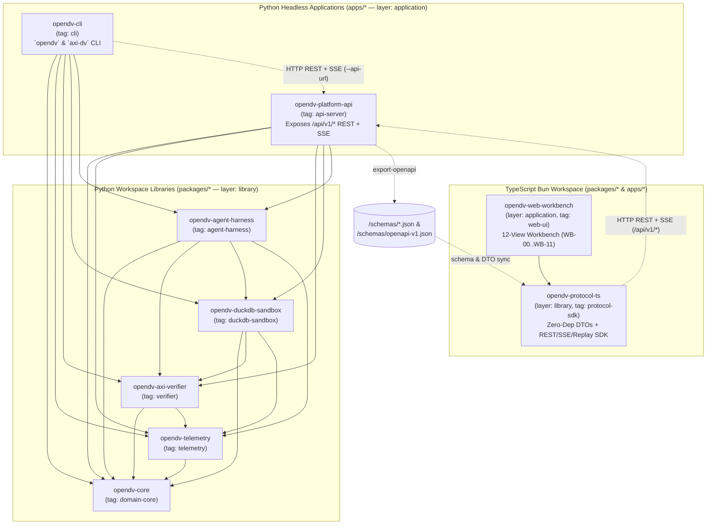

# 08 — Platform MVP Monorepo Toolchain (`proto` + `moon` + `uv` + `bun`) & Headless Platform API Specification

> **Module:** `docs/08-platform-mvp-monorepo-and-api-spec.md`  
> **Parent Specification:** [`DV2_AGENT_REFERENCE_GUIDE.md`](DV2_AGENT_REFERENCE_GUIDE.md) (`v6.0.0`)  
> **Companion Platform Specs:** [`09-agnostic-agent-harness-and-sdk-spec.md`](09-agnostic-agent-harness-and-sdk-spec.md) · [`10-decoupled-ui-workbench-and-theme-spec.md`](10-decoupled-ui-workbench-and-theme-spec.md) · [`11-agent-worker-implementation-plan.md`](11-agent-worker-implementation-plan.md)  
> **Scope:** Polyglot monorepo orchestration (`proto` + `moon` + `uv` + `bun`), package boundary topology (`packages/*` and `apps/*`), 5-tier RBAC data redaction, Content-Addressable Artifact Store (CAS), and the OpenAPI 3.1 REST + Server-Sent Events (SSE) NDJSON streaming contract (`/api/v1/...`) that guarantees 100% UI-to-backend decoupling.

---

## 1. Platform-Centric Design Philosophy & Decoupling Invariants

`open-dv` is architected as a **platform-centric, headless neuro-symbolic verification and compilation engine first**. Every capability of the system—from Enterprise Core Business Concept Ontology (`Graph A`) grounding and empirical DuckDB Bronze profiling (`Graph B`) to 3-Pass Chain-of-Thought (CoT) contract synthesis, 6-Gate `axi-dv` verification (`Algorithms A.1`–`A.9b`), `TOON` closed-loop self-healing, 4-Zone SQL compilation (`Query D.10` / `D.10b`), 4-Batch Adversarial DuckDB Shadow Sandbox execution (`DV-DYN-001`–`015`), and Human-in-the-Loop (`ASK-USER` / Captain-Hold) decision resolution—is exposed over versioned HTTP REST and Server-Sent Events (SSE) endpoints.

### 1.1 The Six Non-Negotiable Platform Invariants

1. **Zero Backend-to-UI Coupling:** No Python package (`packages/*`, `apps/opendv-platform-api`, `apps/opendv-cli`) may import or emit HTML, CSS, JSX, templating engines, or browser-specific state. The backend is a pure headless ASGI server (`apps/opendv-platform-api`) speaking `application/json` (REST), `application/problem+json` (RFC 9457 errors), and `text/event-stream` (SSE NDJSON frames) under `/api/v1/...`.
2. **Single Source of Protocol Truth (`schemas/` $\to$ `openapi-v1.json` $\to$ `@opendv/protocol-ts`):**
   - The normative Draft 2020-12 JSON Schemas in [`schemas/`](../schemas/) (`no-mistake-dv2-contract-v5.schema.json`, `dv2-canonical-ir.schema.json`, `vault-observability-event.schema.json`) and the FastAPI Pydantic v2 models in `apps/opendv-platform-api` deterministically export `schemas/openapi-v1.json` via `moon run opendv-platform-api:export-openapi`.
   - `packages/opendv-protocol-ts` consumes `schemas/*.json` to provide zero-dependency TypeScript DTOs, a typed `OpenDVPlatformClient` (REST), a resilient `VaultEventStreamClient` (SSE with `Last-Event-ID` replay), and an offline `MockVaultEventStreamClient` (`.jsonl` replay).
3. **1-Day UI Re-Implementation Guarantee:** Because the backend pre-computes view projections (`/api/v1/runs/{id}/workbench/{view_id}`) and streams self-contained `VaultObservabilityEvent` records (`/api/v1/runs/{id}/events`), any presentation client—whether `apps/opendv-web-workbench` (React 19 + Tailwind v4), a future Svelte/Vue/Solid web app, a Tauri/Electron desktop client, a VS Code extension, or `apps/opendv-cli`—can be built or replaced from scratch without touching a single line of backend code.
4. **Content-Addressable Artifact Store (CAS):** Every model contract YAML, Canonical IR JSON, `@toon_v1` diagnostic trace, compiled 4-Zone SQL bundle, and Graph B empirical profile is stored by its uppercase hex SHA-256 digest under `state/artifacts/<sha256>` and referenced in `VaultObservabilityEvent.context_refs` (`graph_a_sha256`, `graph_b_sha256`, `contract_yaml_pre_sha256`, `contract_yaml_post_sha256`, `canonical_ir_sha256`, `compiled_sql_sha256`, `toon_trace_sha256`).
5. **Server-Side 5-Tier RBAC Redaction Before Wire Serialization:** Every HTTP request and SSE connection is filtered through `opendv-telemetry`'s 5-tier RBAC classification engine *before* leaving the server process. Raw `CONFIDENTIAL` (MNPI) or `RESTRICTED_PII` values are masked unless the caller holds clearance, while identity keys are rendered as **Semantic Hash Pills** (`[HK: 5D15..0AE4 | GLOBAL:LP-101 CalPERS]`).
6. **First-Class Human-in-the-Loop (`ASK-USER` / Captain-Hold) Lifecycle:** When the pipeline encounters a genuine business-semantic ambiguity (`Tier-U3` unstructured entity resolution margin $< 0.15$, `DV-EVO-003` grain conflict, unmapped ontology concept, or `max_retries=3` exhaustion), the run transitions to `PAUSED_HOLD`, emits an `ASK-USER` event on the SSE stream, and parks until resolved via `POST /api/v1/runs/{id}/decisions`.

---

## 2. Polyglot Monorepo Architecture (`proto` + `moon` + `uv` + `bun`)

### 2.1 Complete Monorepo Directory Tree

```text
open-dv/
├── .prototools                                   # Moonrepo proto (>=0.55.4) deterministic runtime pins
├── .moon/
│   ├── workspace.yml                             # Moon (>=2.3.0) workspace graph, VCS, hasher & tag/layer rules
│   ├── toolchains.yml                            # Moon v2.3+ WASM toolchains (unstable_python, unstable_uv, bun, js, ts)
│   └── tasks/
│       ├── python.yml                            # Global inherited tasks for Python projects (lint, format-check, typecheck, test, build)
│       └── typescript.yml                        # Global inherited tasks for TypeScript projects (lint, typecheck, test, build)
├── pyproject.toml                                # Root uv (>=0.11.11) workspace manifest, shared ruff/mypy/pytest config
├── uv.lock                                       # Deterministic cross-platform Python lockfile
├── package.json                                  # Root Bun (>=1.3.13) workspace manifest & top-level moon script aliases
├── bun.lock                                      # Deterministic text-based Bun lockfile (--save-text-lockfile)
├── tsconfig.base.json                            # Shared strict TypeScript compiler options across all TS packages
├── tsconfig.json                                 # Root TypeScript solution-style project references
├── schemas/                                      # Normative Draft 2020-12 JSON Schemas & exported OpenAPI 3.1 contract
│   ├── no-mistake-dv2-contract-v5.schema.json    # Constrained decoding contract schema (v5.0)
│   ├── dv2-canonical-ir.schema.json              # Canonical Intermediate Representation (IR v1.0.0)
│   ├── vault-observability-event.schema.json     # VaultObservabilityEvent telemetry schema (WB-00..WB-11)
│   └── openapi-v1.json                           # Deterministically exported by `moon run opendv-platform-api:export-openapi`
├── examples/                                     # Reference contracts, Canonical IR, Graph A ontology, Graph B profile
│   ├── dv_model_contract.yaml
│   └── private_equity/
│       ├── dv_pe_model_contract.yaml
│       ├── pe_canonical_ir.json
│       ├── pe_graph_a_ontology.yaml
│       └── pe_graph_b_profile.json
├── docs/                                         # Normative specifications 01..11 & Master Agent Reference Guide
├── state/                                        # Runtime platform state (gitignored except .gitkeep)
│   ├── vault-ledger.jsonl                        # Append-only VaultObservabilityEvent stream
│   ├── artifacts/                                # Content-Addressable Store: state/artifacts/<sha256>
│   ├── sandboxes/                                # Persistent DuckDB shadow sandbox files: state/sandboxes/<run_id>.duckdb
│   └── holds/                                    # Durable Captain-Hold decision records: state/holds/<hold_id>.json
├── packages/
│   ├── opendv-core/                              # [Python Library] Domain Models, IR, Contract v5, ELM Math, Alg A.5 Hashing
│   ├── opendv-telemetry/                         # [Python Library] Ledger Emitter, CAS, 5-Tier RBAC Redaction, Hash Pills
│   ├── opendv-axi-verifier/                      # [Python Library] 6-Gate Verifier, Codemods A.1-A.9b, NetworkX, SQLGlot, TOON
│   ├── opendv-duckdb-sandbox/                    # [Python Library] Graph B Profiler, 4-Zone SQL Compiler, DuckDB 4-Batch Sandbox
│   ├── opendv-agent-harness/                     # [Python Library] Agnostic VaultAgentHarness + Antigravity & Claude SDK Adapters
│   └── opendv-protocol-ts/                       # [TypeScript Library] Zero-Dep Schema DTOs, REST Client, SSE Client & Replay Engine
└── apps/
    ├── opendv-platform-api/                      # [Python Application] Headless FastAPI ASGI Server (/api/v1 REST + SSE)
    ├── opendv-cli/                               # [Python Application] Unified `opendv` & `axi-dv` CLI (Remote API or Local Mode)
    └── opendv-web-workbench/                     # [TypeScript Application] Decoupled 12-View Explainability UI (WB-00..WB-11)
```

### 2.2 Workspace Project Dependency DAG & Layer Constraints



### 2.3 Four Empirical Toolchain Guardrails Baked into the Monorepo Configs

| # | Toolchain Trap | Root Cause in `moon 2.3+` / `uv 0.11+` / `bun 1.3+` | Normative Resolution |
| :---: | :--- | :--- | :--- |
| **1** | **`.moon/toolchains.yml` & WASM Plugin IDs** | In `moon >= 2.0` (`2.3.0`), toolchain configuration lives in `.moon/toolchains.yml` (plural) and uses WASM plugin keys `unstable_python` and `unstable_uv`. | Commit `.moon/toolchains.yml` with `unstable_python` and `unstable_uv` plugin keys (never the legacy Moon 1.x `.moon/toolchain.yml`). |
| **2** | **`$project` vs. `$projectName` Token Expansion in `.moon/tasks/python.yml`** | `$projectName` expands to `project.title` (containing spaces), breaking `uv run --package $projectName`. | Always use `$project` (which expands to the exact project ID, e.g. `opendv-core`) in `.moon/tasks/python.yml`. |
| **3** | **Moon Layer Constraint (`application` $\not\to$ `application`)** | `unstable_python` infers Moon graph edges from `pyproject.toml` `dependencies`. If `apps/opendv-cli` depends on `opendv-platform-api`, Moon raises `invalid_layer_relationship`. | Both `apps/opendv-platform-api` and `apps/opendv-cli` depend **only** on the 5 `packages/*` libraries (`layer: 'library'`). |
| **4** | **TypeScript `TS6305` Composite Project Reference Ordering** | Running `tsc --noEmit` in `apps/opendv-web-workbench` before `packages/opendv-protocol-ts` emits `.d.ts` declarations fails when `includeProjectReferenceSources: true`. | Set `includeProjectReferenceSources: false` in `.moon/toolchains.yml`, run `bun x tsc --emitDeclarationOnly && bun build ...` in `opendv-protocol-ts:build`, and declare `deps: ['^:build']` in `.moon/tasks/typescript.yml`. |

---

## 3. Verbatim Monorepo Configuration Blueprints

### 3.1 `.prototools` (Repository Root)

```toml
# /.prototools
# Deterministic toolchain version pins managed by moonrepo proto (>=0.55.0).
# Run `proto install` or `moon setup` to provision all pinned runtimes.

moon = "2.3.0"
python = "3.12.13"
uv = "0.11.11"
bun = "1.3.13"

[settings]
auto-install = true
auto-clean = false
detect-strategy = "first-available"
```

### 3.2 `.moon/workspace.yml`

```yaml
# /.moon/workspace.yml
$schema: './cache/schemas/workspace.json'

versionConstraint: '>=2.0.0'

projects:
  globs:
    - 'packages/*'
    - 'apps/*'
  globFormat: 'dir-name'

defaultProject: 'opendv-platform-api'

vcs:
  client: 'git'
  provider: 'github'
  defaultBranch: 'main'
  remoteCandidates:
    - 'origin'
    - 'upstream'

pipeline:
  autoCleanCache: true
  cacheLifetime: '7 days'
  inheritColorsForPipedTasks: true
  installDependencies: true
  logRunningCommand: false
  syncWorkspace: true
  syncProjects: true
  syncProjectDependencies: true

hasher:
  optimization: 'accuracy'
  walkStrategy: 'vcs'
  warnOnMissingInputs: true
  ignorePatterns:
    - '**/.DS_Store'
    - '**/__pycache__/**'
    - '**/.pytest_cache/**'
    - '**/.mypy_cache/**'
    - '**/.ruff_cache/**'
    - '**/node_modules/**'
    - '**/dist/**'
    - '**/state/sandboxes/*.duckdb*'

constraints:
  enforceLayerRelationships: true
  tagRelationships:
    domain-core: []
    telemetry: ['domain-core']
    verifier: ['domain-core', 'telemetry']
    duckdb-sandbox: ['domain-core', 'verifier', 'telemetry']
    agent-harness: ['domain-core', 'verifier', 'duckdb-sandbox', 'telemetry']
    api-server: ['domain-core', 'verifier', 'duckdb-sandbox', 'telemetry', 'agent-harness']
    cli: ['domain-core', 'verifier', 'duckdb-sandbox', 'telemetry', 'agent-harness']
    protocol-sdk: []
    web-ui: ['protocol-sdk']

telemetry: false
```

### 3.3 `.moon/toolchains.yml`

> [!IMPORTANT]
> In Moon v2.0+ (`2.3.0`), `.moon/toolchains.yml` is the canonical toolchain configuration filename. Worker `WP-01` creates `.moon/toolchains.yml` with the exact content below.

```yaml
# /.moon/toolchains.yml
$schema: './cache/schemas/toolchains.json'

proto:
  version: '0.55.4'

unstable_python:
  version: '3.12.13'
  packageManager: 'uv'
  venvName: '.venv'

unstable_uv:
  version: '0.11.11'
  syncArgs:
    - '--all-packages'
    - '--locked'

javascript:
  packageManager: 'bun'
  dependencyVersionFormat: 'workspace'
  inferTasksFromScripts: false
  syncProjectWorkspaceDependencies: true
  syncPackageManagerField: true
  dedupeOnLockfileChange: true

bun:
  version: '1.3.13'
  installArgs:
    - '--save-text-lockfile'

typescript:
  rootConfigFileName: 'tsconfig.json'
  rootOptionsConfigFileName: 'tsconfig.base.json'
  projectConfigFileName: 'tsconfig.json'
  syncProjectReferences: true
  syncProjectReferencesToPaths: true
  includeProjectReferenceSources: false
  includeSharedTypes: false
  createMissingConfig: false
  routeOutDirToCache: false
```

### 3.4 `.moon/tasks/python.yml` & `.moon/tasks/typescript.yml`

```yaml
# /.moon/tasks/python.yml
$schema: '../cache/schemas/tasks.json'

inheritedBy:
  languages: ['python']

fileGroups:
  sources:
    - 'src/**/*.py'
    - 'pyproject.toml'
  tests:
    - 'tests/**/*.py'
  schemas:
    - '/schemas/*.json'
  workspaceLock:
    - '/pyproject.toml'
    - '/uv.lock'

implicitInputs:
  - '/pyproject.toml'
  - '/uv.lock'
  - 'pyproject.toml'

taskOptions:
  cache: true
  outputStyle: 'buffer-only-failure'
  retryCount: 0
  runInCI: 'affected'

tasks:
  lint:
    description: 'Run Ruff linter check across Python project sources and tests.'
    command: 'uv'
    args:
      - 'run'
      - '--package'
      - '$project'
      - 'ruff'
      - 'check'
      - 'src'
      - 'tests'
    type: 'test'
    inputs:
      - '@group(sources)'
      - '@group(tests)'

  format-check:
    description: 'Verify Python code formatting using Ruff formatter.'
    command: 'uv'
    args:
      - 'run'
      - '--package'
      - '$project'
      - 'ruff'
      - 'format'
      - '--check'
      - 'src'
      - 'tests'
    type: 'test'
    inputs:
      - '@group(sources)'
      - '@group(tests)'

  typecheck:
    description: 'Run strict static typechecking via mypy across project sources.'
    command: 'uv'
    args:
      - 'run'
      - '--package'
      - '$project'
      - 'mypy'
      - '--strict'
      - 'src'
    type: 'test'
    deps:
      - '^:typecheck'
    inputs:
      - '@group(sources)'
      - '@group(schemas)'

  test:
    description: 'Execute pytest unit and integration test suite for the package.'
    command: 'uv'
    args:
      - 'run'
      - '--package'
      - '$project'
      - 'pytest'
      - 'tests'
      - '-q'
    type: 'test'
    deps:
      - '^:test'
    inputs:
      - '@group(sources)'
      - '@group(tests)'
      - '@group(schemas)'

  build:
    description: 'Build wheel and sdist artifacts for the Python package using uv build.'
    command: 'uv'
    args:
      - 'build'
      - '--package'
      - '$project'
      - '--out-dir'
      - 'dist'
    type: 'build'
    deps:
      - '^:build'
    inputs:
      - '@group(sources)'
    outputs:
      - 'dist/**'
```

```yaml
# /.moon/tasks/typescript.yml
$schema: '../cache/schemas/tasks.json'

inheritedBy:
  languages: ['typescript']

fileGroups:
  sources:
    - 'src/**/*.{ts,tsx,css,html}'
    - 'package.json'
    - 'tsconfig.json'
  tests:
    - 'tests/**/*.{ts,tsx}'
    - 'src/**/*.test.{ts,tsx}'
  configs:
    - '/package.json'
    - '/bun.lock'
    - '/tsconfig.base.json'

implicitInputs:
  - '/package.json'
  - '/bun.lock'
  - '/tsconfig.base.json'
  - 'package.json'
  - 'tsconfig.json'

taskOptions:
  cache: true
  outputStyle: 'buffer-only-failure'
  retryCount: 0
  runInCI: 'affected'

tasks:
  lint:
    description: 'Run TypeScript & Biome lint verification across project sources.'
    command: 'bun'
    args:
      - 'run'
      - 'lint'
    type: 'test'
    deps:
      - '^:build'
    inputs:
      - '@group(sources)'
      - '@group(tests)'

  typecheck:
    description: 'Run TypeScript compiler (tsc --noEmit) type verification.'
    command: 'bun'
    args:
      - 'x'
      - 'tsc'
      - '--noEmit'
    type: 'test'
    deps:
      - '^:build'
    inputs:
      - '@group(sources)'
      - '@group(tests)'

  test:
    description: 'Run Bun test runner across unit and protocol tests.'
    command: 'bun'
    args:
      - 'test'
    type: 'test'
    deps:
      - '^:build'
    inputs:
      - '@group(sources)'
      - '@group(tests)'

  build:
    description: 'Bundle TypeScript package or application into dist/.'
    command: 'bun'
    args:
      - 'run'
      - 'build'
    type: 'build'
    deps:
      - '^:build'
    inputs:
      - '@group(sources)'
    outputs:
      - 'dist/**'
```

### 3.5 Root `pyproject.toml`, `package.json`, `tsconfig.base.json`, and `tsconfig.json`

```toml
# /pyproject.toml
[project]
name = "opendv-workspace"
version = "0.1.0"
description = "Open-DV (v6.0): Neuro-Symbolic Agentic Data Vault 2.0 Modeller, 6-Gate AXI Verifier, and Headless Platform"
readme = "README.md"
requires-python = ">=3.12"
license = { text = "Apache-2.0" }
dependencies = []

[tool.uv.workspace]
members = [
    "packages/opendv-core",
    "packages/opendv-telemetry",
    "packages/opendv-axi-verifier",
    "packages/opendv-duckdb-sandbox",
    "packages/opendv-agent-harness",
    "apps/opendv-platform-api",
    "apps/opendv-cli",
]

[tool.uv.sources]
opendv-core = { workspace = true }
opendv-telemetry = { workspace = true }
opendv-axi-verifier = { workspace = true }
opendv-duckdb-sandbox = { workspace = true }
opendv-agent-harness = { workspace = true }
opendv-platform-api = { workspace = true }
opendv-cli = { workspace = true }

[dependency-groups]
dev = [
    "pytest>=9.0.0",
    "pytest-asyncio>=0.25.0",
    "httpx>=0.28.0",
    "ruff>=0.9.0",
    "mypy>=1.15.0",
    "types-PyYAML>=6.0.12",
]

[tool.ruff]
target-version = "py312"
line-length = 100
src = ["packages/*/src", "apps/*/src"]

[tool.ruff.lint]
select = ["E", "F", "I", "B", "UP", "N", "SIM", "RUF", "TID251"]

[tool.ruff.lint.flake8-tidy-imports.banned-api]
"antigravity".msg = "Import from 'google.antigravity', never Python stdlib 'antigravity' (xkcd/353)."

[tool.mypy]
python_version = "3.12"
strict = true
warn_return_any = true
warn_unused_configs = true
disallow_untyped_defs = true

[tool.pytest.ini_options]
minversion = "9.0"
addopts = "-ra -q --strict-markers"
testpaths = [
    "tests",
    "packages/opendv-core/tests",
    "packages/opendv-telemetry/tests",
    "packages/opendv-axi-verifier/tests",
    "packages/opendv-duckdb-sandbox/tests",
    "packages/opendv-agent-harness/tests",
    "apps/opendv-platform-api/tests",
    "apps/opendv-cli/tests",
]
```

```json
// /package.json
{
  "name": "opendv-monorepo",
  "version": "0.1.0",
  "private": true,
  "description": "Open-DV TypeScript Protocol SDK and Decoupled 12-View Explainability Web Workbench",
  "packageManager": "bun@1.3.13",
  "workspaces": [
    "packages/opendv-protocol-ts",
    "apps/opendv-web-workbench"
  ],
  "devDependencies": {
    "@biomejs/biome": "^1.9.4",
    "@types/bun": "^1.3.0",
    "typescript": "^5.8.0"
  },
  "scripts": {
    "lint": "moon run :lint",
    "typecheck": "moon run :typecheck",
    "test": "moon run :test",
    "build": "moon run :build"
  }
}
```

```json
// /tsconfig.base.json
{
  "compilerOptions": {
    "target": "ES2022",
    "module": "ESNext",
    "moduleResolution": "bundler",
    "lib": ["ES2022", "DOM", "DOM.Iterable"],
    "types": ["bun"],
    "strict": true,
    "noUncheckedIndexedAccess": true,
    "exactOptionalPropertyTypes": true,
    "noImplicitOverride": true,
    "noFallthroughCasesInSwitch": true,
    "forceConsistentCasingInFileNames": true,
    "isolatedModules": true,
    "verbatimModuleSyntax": true,
    "skipLibCheck": true,
    "declaration": true,
    "declarationMap": true,
    "sourceMap": true,
    "composite": true
  }
}
```

```json
// /tsconfig.json
{
  "extends": "./tsconfig.base.json",
  "files": [],
  "references": [
    { "path": "packages/opendv-protocol-ts" },
    { "path": "apps/opendv-web-workbench" }
  ]
}
```

### 3.6 Per-Project `moon.yml` Blueprints (`packages/*` & `apps/*`)

| Project Path | Moon `id` | `language` | `layer` | `tags` | `dependsOn` | Custom Tasks |
| :--- | :--- | :--- | :--- | :--- | :--- | :--- |
| `packages/opendv-core` | `opendv-core` | `python` | `library` | `['python', 'domain-core']` | `[]` | `validate-schemas` |
| `packages/opendv-telemetry` | `opendv-telemetry` | `python` | `library` | `['python', 'telemetry']` | `['opendv-core']` | Inherited (`lint`, `typecheck`, `test`, `build`) |
| `packages/opendv-axi-verifier` | `opendv-axi-verifier` | `python` | `library` | `['python', 'verifier']` | `['opendv-core', 'opendv-telemetry']` | Inherited (`lint`, `typecheck`, `test`, `build`) |
| `packages/opendv-duckdb-sandbox` | `opendv-duckdb-sandbox` | `python` | `library` | `['python', 'duckdb-sandbox']` | `['opendv-core', 'opendv-axi-verifier', 'opendv-telemetry']` | Inherited (`lint`, `typecheck`, `test`, `build`) |
| `packages/opendv-agent-harness` | `opendv-agent-harness` | `python` | `library` | `['python', 'agent-harness']` | `['opendv-core', 'opendv-axi-verifier', 'opendv-duckdb-sandbox', 'opendv-telemetry']` | Inherited (`lint`, `typecheck`, `test`, `build`) |
| `packages/opendv-protocol-ts` | `opendv-protocol-ts` | `typescript` | `library` | `['typescript', 'protocol-sdk']` | `[]` | `codegen`, `build` (`tsc --emitDeclarationOnly && bun build`) |
| `apps/opendv-platform-api` | `opendv-platform-api` | `python` | `application` | `['python', 'api-server']` | All 5 Python libraries | `export-openapi`, `dev` (port `8420`) |
| `apps/opendv-cli` | `opendv-cli` | `python` | `application` | `['python', 'cli']` | All 5 Python libraries | `dev` (`opendv` & `axi-dv` entrypoints) |
| `apps/opendv-web-workbench` | `opendv-web-workbench` | `typescript` | `application` | `['typescript', 'web-ui']` | `['opendv-protocol-ts']` | `dev` (Vite 6 on port `5173`) |

---

## 4. Decoupled Backend Package Specifications (`packages/*` & `apps/*`)

### 4.1 `packages/opendv-core` — Domain Models, Schemas, ELM Calculus & Hashing
- **Responsibilities:**
  1. Loads and validates Draft 2020-12 JSON Schemas from `/schemas/*.json` (`NoMistakeDataVault2ContractV5`, `CanonicalIR`, `VaultObservabilityEvent`).
  2. Implements the formal **Graph B Information-Theoretic Metrics** (`docs/05` §1): Uniqueness $U(C)$, Non-Null Ratio $U_{nn}(C) = 1 - N_{\text{null}}(C)$, Normalized Shannon Entropy $H_{\text{norm}}(C)$, Jaccard Inclusion $I(A.x \subseteq B.y)$, CDC Velocity $\lambda(c)$, and Write Amplification $W_{\text{amp}}$ (MB/day).
  3. Implements the **Algorithm A.5 6-Stage Length-Prefixed SHA-256 Hashing Recipe** (`<byte_len>:<val>`, `'-1:^^'` null token, `'0'*64` / `'f'*64` Zero Keys).

### 4.2 `packages/opendv-telemetry` — Append-Only Ledger, CAS & 5-Tier RBAC Redaction
- **Responsibilities:**
  1. Manages the immutable Content-Addressable Store (`state/artifacts/<sha256>`) and appends validated `VaultObservabilityEvent` records to `state/vault-ledger.jsonl`.
  2. Broadcasts live events to in-memory `asyncio.Queue` subscribers for low-latency SSE streaming (`/api/v1/runs/{id}/events`) with `Last-Event-ID` cursor replay.
  3. Enforces the **5-Tier RBAC Data Classification & Redaction Matrix** (`PUBLIC`, `INTERNAL`, `CONFIDENTIAL`, `MNPI`, `RESTRICTED_PII`) and formats **Semantic Hash Pills** (`[HK: 5D15..0AE4 | GLOBAL:LP-101 CalPERS]`).

### 4.3 `packages/opendv-axi-verifier` — 6-Gate Verifier, Codemods (`A.1`–`A.9b`) & `TOON`
- **Responsibilities:**
  1. Executes deterministic cold-start codemods (`Algorithm A.1` 3-Axis Satellite Split & Gate 4 YAGNI Cost Guard $W_{\text{amp}} \ge 50\text{ MB/day}$, `Algorithm A.2` Enum-to-Ref Demotion, `Algorithm A.3` Link Effectivity Satellite `esat_*` Injection, `Algorithm A.4` 3-Tier `BKCC` Authority & Nullable-FK Link Splitter $U_{nn} \ge 0.95$, `Algorithm A.9a` Intra-Source Schema Drift).
  2. Executes static verification gates (`Gate 1` Contract & 100% `column_triage_ledger` coverage, `Gate 2` `Algorithm A.5`/`A.6` SQLGlot AST verification, `Gate 3` `networkx` Bipartite DAG `DV-STR-001`–`014` + `Algorithm A.7` $N \to N+1$ Additive Evolution Lock, `Gate 5` `Algorithm A.9b` Unstructured Span Substring Verifier).
  3. Serializes `REJECT-WITH-TRACE` violations into **Token-Oriented Object Notation (`@toon_v1`)** via `Algorithm A.8`.

### 4.4 `packages/opendv-duckdb-sandbox` — Graph B Profiler, 4-Zone SQL Compiler & 4-Batch Sandbox
- **Responsibilities:**
  1. Profiles relational tables/Parquet files in DuckDB to produce `Graph B` JSON profiles and detect $S_k(t) \to S_k(t+1)$ schema drift.
  2. Lowers verified `NoMistakeDataVault2ContractV5` contracts into `CanonicalIR` (`schemas/dv2-canonical-ir.schema.json`) and compiles **4-Zone SQL** (Zone 0 Schemas & Ghost/Zero Records, Zone 1 Hashed Staging Views, Zone 2 Insert-Only Raw Vault DDL/DML, Zone 3 Business Vault `sal_*`/`esat_*`/`pit_*`, and Zone 4 Bi-Temporal `Query D.10` / `D.10b`).
  3. Runs the **4 Adversarial Shadow Sandbox Batches** (Batch 1 Null-FK & Ghost `INNER JOIN` Completeness, Batch 2 Replay Idempotency $\Delta\text{rows}=0$, Batch 3 Single-Attribute Delta & Boundary-Shift Collision, Batch 4 $N=1 \to N=2$ Cross-Source Collision) and evaluates `DV-DYN-001`–`015`.

### 4.5 `packages/opendv-agent-harness` — Vendor-Neutral Agent Runtime (`VaultAgentHarness`)
- Fully specified in [`docs/09-agnostic-agent-harness-and-sdk-spec.md`](09-agnostic-agent-harness-and-sdk-spec.md). Provides `VaultAgentHarness`, the 8 pure-Python domain tools, `AntigravityHarnessAdapter` (`google.antigravity`), and `ClaudeAgentHarnessAdapter` (`claude_agent_sdk`).

### 4.6 `apps/opendv-platform-api` & `apps/opendv-cli` — Headless ASGI Server & CLI
- `apps/opendv-platform-api` exposes all platform capabilities over `/api/v1/...` REST + SSE endpoints.
- `apps/opendv-cli` provides the `opendv` and `axi-dv` command-line tools, operating either against a remote `--api-url http://localhost:8420` server or directly against the local Python libraries (`--local`).

---

## 5. OpenAPI 3.1 REST + Server-Sent Events (SSE) NDJSON Streaming Contract (`/api/v1/...`)

### 5.1 Complete Endpoint Catalog

All endpoints are versioned under `/api/v1`. Error responses conform to **RFC 9457 Problem Details** (`application/problem+json`).

| Resource Group | HTTP Method & Path | Description | Primary Backing Package |
| :--- | :--- | :--- | :--- |
| **Health & Capabilities** | `GET /api/v1/health` | Liveness, DuckDB version, active harness adapters (`antigravity`, `claude`), and schema versions. | `opendv-platform-api` |
| **Health & Capabilities** | `GET /api/v1/platform/capabilities` | Supported model tiers (`argon`, `flash`), RBAC tiers, 6 gates, and 12 workbench views (`WB-00`–`WB-11`). | `opendv-platform-api` |
| **Projects** | `POST /api/v1/projects` | Register a project workspace with `Graph A` ontology, Bronze source feeds, and optional baseline contract. | `opendv-core` |
| **Projects** | `GET /api/v1/projects` | List registered projects and their latest pipeline run status. | `opendv-core` |
| **Projects** | `GET /api/v1/projects/{project_id}` | Inspect project manifest, `Graph A` ontology summary, and registered Bronze tables/documents. | `opendv-core` |
| **Pipeline Runs** | `POST /api/v1/runs` | Launch a full or stage-scoped pipeline run using `antigravity` or `claude` harness. | `opendv-agent-harness` |
| **Pipeline Runs** | `GET /api/v1/runs` | List pipeline runs filtered by `project_id`, `status`, or `harness_provider`. | `opendv-telemetry` |
| **Pipeline Runs** | `GET /api/v1/runs/{run_id}` | Get run summary, current `stage_id`, 6-Gate scoreboard, active Captain-Holds, and CAS `context_refs`. | `opendv-telemetry` |
| **Pipeline Runs** | `POST /api/v1/runs/{run_id}/abort` | Cancel an active run (`AntigravityHarnessAdapter.cancel_active_turn` / `ClaudeSDKClient.interrupt`). | `opendv-agent-harness` |
| **SSE Event Stream** | `GET /api/v1/runs/{run_id}/events` | **Real-time SSE stream (`text/event-stream`)** of `VaultObservabilityEvent` JSON/NDJSON frames with `Last-Event-ID` replay. | `opendv-telemetry` |
| **Run Gate Verdicts** | `GET /api/v1/runs/{run_id}/gates` | Retrieve the 6-Gate verification matrix (`Gates 0–5`), applied codemods (`A.1`–`A.5`, `A.9a`), and `@toon_v1` diagnostic traces for `run_id`. | `opendv-axi-verifier` |
| **Run Gate Evaluation** | `POST /api/v1/runs/{run_id}/gates` | Trigger or re-evaluate static/topological/AST gates and preview codemod diffs on a candidate contract. | `opendv-axi-verifier` |
| **Run Shadow Sandbox** | `GET /api/v1/runs/{run_id}/sandbox` | Retrieve the 4-Batch Adversarial DuckDB Shadow Sandbox results and `DV-DYN-001`–`015` check matrix for `run_id`. | `opendv-duckdb-sandbox` |
| **Run Shadow Sandbox** | `POST /api/v1/runs/{run_id}/sandbox` | Execute Adversarial Batches `1–4` or run Bi-Temporal Point-in-Time `Query D.10` / `D.10b` at custom `assertion_cutoff_ts`. | `opendv-duckdb-sandbox` |
| **Captain-Hold Decisions** | `GET /api/v1/runs/{run_id}/decisions` | List pending and resolved `ASK-USER` / Captain-Hold escalations (e.g., `Tier-U3` entity resolution or `DV-EVO-003`). | `opendv-agent-harness` |
| **Captain-Hold Decisions** | `POST /api/v1/runs/{run_id}/decisions` | Submit a human steward decision (`APPROVE`, `REJECT`, `ANSWER`) to resolve a Captain-Hold and resume the run. | `opendv-agent-harness` |
| **Workbench Projections** | `GET /api/v1/runs/{run_id}/workbench/{view_id}` | Fetch pre-computed, RBAC-redacted 3-Layer view state for `WB-00` through `WB-11`. | `opendv-platform-api` |
| **CAS Artifacts** | `GET /api/v1/artifacts/{sha256}` | Fetch immutable content-addressable artifact (`YAML`, `CanonicalIR` JSON, `4-Zone SQL`, `@toon_v1` trace) by SHA-256. | `opendv-telemetry` |
| **CAS Artifacts** | `POST /api/v1/artifacts` | Upload a content-addressable artifact and return its verified uppercase hex `sha256` digest. | `opendv-telemetry` |

### 5.2 Reference Python Implementation of the Headless Platform API Contracts (`apps/opendv-platform-api`)

The following self-contained Python reference module defines the canonical Pydantic v2 wire DTOs, the 5-Tier RBAC redaction logic, the SSE NDJSON/event-stream framing generator, and the `/api/v1/...` route handlers for `apps/opendv-platform-api`.

```python
from __future__ import annotations

import hashlib
import json
from collections.abc import AsyncIterator
from datetime import datetime, timezone
from enum import StrEnum
from typing import Any, Literal

from pydantic import BaseModel, ConfigDict, Field


class RunStatus(StrEnum):
    PENDING = "PENDING"
    RUNNING = "RUNNING"
    PAUSED_HOLD = "PAUSED_HOLD"
    COMPLETED = "COMPLETED"
    FAILED = "FAILED"
    ABORTED = "ABORTED"


class RbacRole(StrEnum):
    PUBLIC = "PUBLIC"
    INTERNAL_MODELER = "INTERNAL_MODELER"
    DATA_STEWARD = "DATA_STEWARD"
    AUDITOR_FINANCE = "AUDITOR_FINANCE"
    RESTRICTED_PII_CUSTODIAN = "RESTRICTED_PII_CUSTODIAN"


class CreateProjectRequest(BaseModel):
    model_config = ConfigDict(extra="forbid")

    project_id: str = Field(pattern=r"^[a-z0-9][a-z0-9_-]{2,63}$")
    display_name: str
    domain_namespace: str
    graph_a_ontology_path: str
    bronze_sources: list[str] = Field(min_length=1)


class ProjectResponse(BaseModel):
    project_id: str
    display_name: str
    domain_namespace: str
    graph_a_sha256: str
    latest_run_id: str | None = None
    created_at_utc: str


class CreateRunRequest(BaseModel):
    model_config = ConfigDict(extra="forbid")

    project_id: str
    harness_provider: Literal["antigravity", "claude"] = "antigravity"
    model_tier_override: Literal["argon", "flash"] | None = None
    contract_path: str | None = None
    max_repair_retries: int = Field(default=3, ge=0, le=5)
    run_sandbox_batches: bool = True


class GateScorecardSummary(BaseModel):
    gate_0_profile_drift: Literal["PENDING", "PASS", "AUTO-FIX", "AUTO_REPAIRED", "REJECT-WITH-TRACE", "ASK-USER"] = "PENDING"
    gate_1_contract_grain: Literal["PENDING", "PASS", "AUTO-FIX", "AUTO_REPAIRED", "REJECT-WITH-TRACE", "ASK-USER"] = "PENDING"
    gate_2_sqlglot_ast: Literal["PENDING", "PASS", "AUTO-FIX", "AUTO_REPAIRED", "REJECT-WITH-TRACE", "ASK-USER"] = "PENDING"
    gate_3_networkx_dag: Literal["PENDING", "PASS", "AUTO-FIX", "AUTO_REPAIRED", "REJECT-WITH-TRACE", "ASK-USER"] = "PENDING"
    gate_4_yagni_cost_guard: Literal["PENDING", "PASS", "AUTO-FIX", "AUTO_REPAIRED", "REJECT-WITH-TRACE", "ASK-USER"] = "PENDING"
    gate_5_duckdb_sandbox: Literal["PENDING", "PASS", "AUTO-FIX", "AUTO_REPAIRED", "REJECT-WITH-TRACE", "ASK-USER"] = "PENDING"


class ProjectRunDTO(BaseModel):
    run_id: str
    project_id: str
    harness_provider: Literal["antigravity", "claude"]
    status: RunStatus
    started_at_utc: str
    completed_at_utc: str | None = None
    current_stage_id: str
    current_view_id: str
    event_count: int
    gate_scorecard: GateScorecardSummary = Field(default_factory=GateScorecardSummary)
    active_hold_ids: list[str] = Field(default_factory=list)
    events_sse_url: str
    gates_url: str
    sandbox_url: str
    decisions_url: str


class CaptainHoldDecisionRequest(BaseModel):
    model_config = ConfigDict(extra="forbid")

    event_id: str
    hold_id: str | None = None
    decision_type: Literal["RESOLVE_CAPTAIN_HOLD"] = "RESOLVE_CAPTAIN_HOLD"
    action: Literal["APPROVE", "REJECT", "ANSWER"]
    selected_candidate_id: str | None = None
    resolution_notes: str | None = None


class CaptainHoldDecisionResponse(BaseModel):
    decision_id: str
    status: Literal["ACCEPTED", "REJECTED"]
    resumed_run_id: str
    next_stage_id: str
    next_event_id: str


class SandboxQueryRequest(BaseModel):
    model_config = ConfigDict(extra="forbid")

    query_type: Literal["ADVERSARIAL_BATCHES_1_TO_4", "QUERY_D10_PIT", "QUERY_D10B_VALUATION"]
    assertion_cutoff_ts: str = "2026-11-15 23:59:59"


class SandboxExecutionResponse(BaseModel):
    run_id: str
    all_batches_passed: bool
    batch_verdicts: dict[str, Literal["PASS", "FAIL"]]
    dynamic_rules_passed: int
    dynamic_rules_total: int = 15
    replay_delta_rows: int = 0
    query_d10_rows: list[dict[str, Any]] = Field(default_factory=list)


ROLE_CLEARANCE_LEVELS: dict[RbacRole, frozenset[str]] = {
    RbacRole.PUBLIC: frozenset({"PUBLIC"}),
    RbacRole.INTERNAL_MODELER: frozenset({"PUBLIC", "INTERNAL"}),
    RbacRole.DATA_STEWARD: frozenset({"PUBLIC", "INTERNAL", "CONFIDENTIAL"}),
    RbacRole.AUDITOR_FINANCE: frozenset({"PUBLIC", "INTERNAL", "CONFIDENTIAL", "MNPI"}),
    RbacRole.RESTRICTED_PII_CUSTODIAN: frozenset(
        {"PUBLIC", "INTERNAL", "CONFIDENTIAL", "MNPI", "RESTRICTED_PII"}
    ),
}


def redact_event_for_role(event: dict[str, Any], role: RbacRole) -> dict[str, Any]:
    """
    Enforce Server-Side 5-Tier RBAC Redaction (docs/06 §1.1 & docs/08 §1.1)
    before any VaultObservabilityEvent is serialized over REST or SSE.
    """
    cloned: dict[str, Any] = json.loads(json.dumps(event))
    classification = str(cloned.get("data_classification", "INTERNAL"))
    cleared_tiers = ROLE_CLEARANCE_LEVELS.get(role, frozenset({"PUBLIC"}))

    if classification not in cleared_tiers:
        stage_id = cloned.get("stage_id", "UNKNOWN_STAGE")
        banner = cloned.get("layer1_story_banner", {})
        banner["headline"] = (
            f"[REDACTED {classification}] Stage {stage_id} telemetry masked for role '{role.value}'."
        )
        banner["business_impact"] = (
            f"Sensitive {classification} payload masked for role '{role.value}'."
        )

        layer2 = cloned.get("layer2_visual_payload", {})
        raw_pills = layer2.get("semantic_hash_pills", [])
        redacted_pills: list[dict[str, Any]] = []
        for pill in raw_pills:
            pill_copy = dict(pill)
            pill_copy["business_key"] = "[REDACTED]"
            pill_copy["entity_label"] = "[REDACTED]"
            digest = str(pill_copy.get("full_sha256_hex", ""))
            short_hex = f"{digest[:4]}..{digest[-4:]}" if len(digest) >= 8 else "REDACTED"
            bkcc = pill_copy.get("bkcc_prefix", "GLOBAL")
            pill_copy["pill_label"] = f"[HK: {short_hex} | {bkcc}:[REDACTED]]"
            redacted_pills.append(pill_copy)

        cloned["layer2_visual_payload"] = {
            "semantic_hash_pills": redacted_pills,
            "summary_metrics": {
                "redacted": True,
                "required_classification": classification,
            },
        }

        if "layer3_formal_proof" in cloned and isinstance(cloned["layer3_formal_proof"], dict):
            proof = cloned["layer3_formal_proof"]
            cloned["layer3_formal_proof"] = {
                k: (v if k == "algorithm_ref" else f"[REDACTED {classification}]")
                for k, v in proof.items()
            }
    return cloned


async def format_sse_event_stream(
    events: list[dict[str, Any]],
    *,
    role: RbacRole = RbacRole.INTERNAL_MODELER,
    last_event_id: str | None = None,
) -> AsyncIterator[str]:
    """
    Stream schema-valid VaultObservabilityEvent records as W3C Server-Sent Events (SSE)
    supporting seamless Last-Event-ID reconnection and terminal 'run_complete' signalling.
    """
    skipping = last_event_id is not None
    for raw_event in events:
        ev_id = str(raw_event["event_id"])
        if skipping:
            if ev_id == last_event_id:
                skipping = False
            continue
        redacted = redact_event_for_role(raw_event, role)
        payload_json = json.dumps(redacted, sort_keys=True)
        yield f"id: {ev_id}\ndata: {payload_json}\n\n"

    yield "event: run_complete\ndata: {\"status\":\"COMPLETED\"}\n\n"


def store_cas_artifact(artifacts_store: dict[str, bytes], content: str | bytes) -> str:
    """Store an artifact in the Content-Addressable Store and return its 64-char uppercase SHA-256."""
    raw = content.encode("utf-8") if isinstance(content, str) else content
    sha256_hex = hashlib.sha256(raw).hexdigest().upper()
    artifacts_store[sha256_hex] = raw
    return sha256_hex
```

### 5.3 SSE Wire Framing & Offline `.jsonl` Parity

Every `VaultObservabilityEvent` emitted by the platform is simultaneously:
1. Appended as a single-line JSON object to `state/vault-ledger.jsonl` (enabling zero-server offline replay via `MockVaultEventStreamClient.loadFromJSONL()`).
2. Broadcast over `GET /api/v1/runs/{run_id}/events` using standard SSE framing:

```text
id: evt-pe-001
data: {"event_id":"evt-pe-001","run_id":"run-pe-apex-horizon-20261030","trace_id":"4bf92f3577b34da6a3ce929d0e0e4736","span_id":"00f067aa0ba902b7","parent_span_id":null,"timestamp_utc":"2026-10-30T09:00:01Z","stage_id":"STAGE_00_ORCHESTRATION","workbench_view_id":"WB-01","viz_id":"VIZ-STEP-01","agent_persona":"vault-first-mate","status":"PASS","rule_ids_evaluated":["DV-STR-001","KEY-04"],"data_classification":"INTERNAL","layer1_story_banner":{"headline":"Enterprise Ontology Grounded: 4 core business concepts anchored to 44 physical columns.","business_impact":"Prevents siloed source-system Data Vault schemas across Investran, DealCloud, and Legacy GP.","verdict_pill":"PASS"},"layer2_visual_payload":{"semantic_hash_pills":[{"pill_label":"[HK: 5D15..0AE4 | GLOBAL:LP-101 CalPERS]","full_sha256_hex":"5D15EB10C8D7621D3167849C41C5F9CD9244FD79FB720CB17104D49E4B820AE4","bkcc_prefix":"GLOBAL","business_key":"LP-101","entity_label":"CalPERS"}],"summary_metrics":{"ontology_coverage_pct":100.0,"unmapped_concepts":0}}}

id: evt-pe-004
data: {"event_id":"evt-pe-004","run_id":"run-pe-apex-horizon-20261030","trace_id":"4bf92f3577b34da6a3ce929d0e0e4736","span_id":"a2fb4a1d1a96d312","parent_span_id":"00f067aa0ba902b7","timestamp_utc":"2026-10-30T09:00:08Z","stage_id":"STAGE_02_SCOUT_UNSTRUCTURED","workbench_view_id":"WB-03","viz_id":"VIZ-GATE-06","agent_persona":"scout-unstructured","status":"ASK-USER","rule_ids_evaluated":["ALG-A9B"],"data_classification":"CONFIDENTIAL","layer1_story_banner":{"headline":"Extracted 4 terms from calpers_side_letter.pdf: 2 LEIs bound; 1 mention held for Captain.","business_impact":"Prevents hallucinated Fund Hub keys from unverified PDF text; awaits steward confirmation.","verdict_pill":"ASK-USER"},"layer2_visual_payload":{"semantic_hash_pills":[{"pill_label":"[HK: 864D..EE6B | GLOBAL:calpers_side_letter.pdf]","full_sha256_hex":"864D5083723B9FD7FE69085C2C31B646BD5E3DEAEF61B64C08D545EDE502EE6B","bkcc_prefix":"GLOBAL","business_key":"s3://apex-pe-vault-bronze/legal/side-letters/calpers_side_letter_fund_iv_2026.pdf","entity_label":"CalPERS Side Letter"}],"summary_metrics":{"spans_extracted":4,"tier_u1_bound":2,"tier_u2_bound":1,"tier_u3_held":1}}}

event: run_complete
data: {"status":"COMPLETED"}
```
