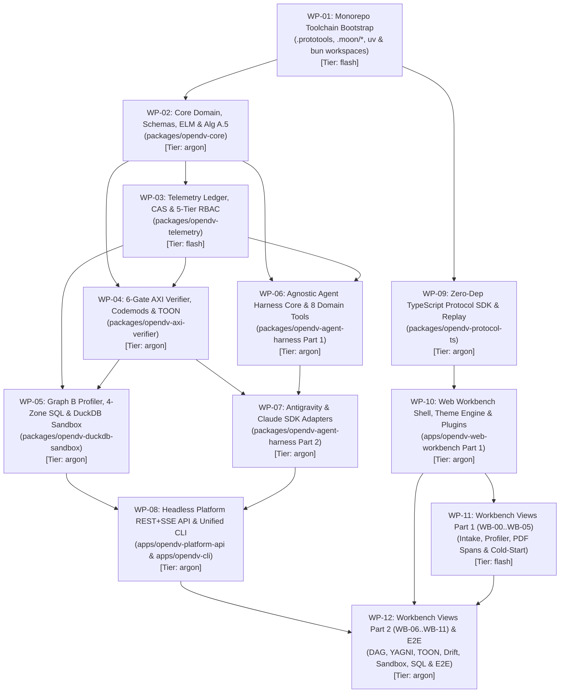

# 11 — Master Agent Worker Implementation & Dispatch Plan (`WP-01` through `WP-12`)

> **Module:** `docs/11-agent-worker-implementation-plan.md`  
> **Parent Specification:** [`DV2_AGENT_REFERENCE_GUIDE.md`](DV2_AGENT_REFERENCE_GUIDE.md) (`v6.0.0`)  
> **Companion Platform Specs:** [`08-platform-mvp-monorepo-and-api-spec.md`](08-platform-mvp-monorepo-and-api-spec.md) · [`09-agnostic-agent-harness-and-sdk-spec.md`](09-agnostic-agent-harness-and-sdk-spec.md) · [`10-decoupled-ui-workbench-and-theme-spec.md`](10-decoupled-ui-workbench-and-theme-spec.md)  
> **Scope:** Turnkey, dependency-ordered Work Breakdown Structure (`WP-01` through `WP-12`) for autonomous agent workers (`argon` high-reasoning tier and `flash` fast-execution tier) to build the complete `open-dv` Platform MVP with zero file-ownership collisions.

---

## 1. Master Dependency DAG & Parallel Dispatch Waves

The `open-dv` Platform MVP implementation is partitioned into **12 self-contained Work Packages (`WP-01` through `WP-12`)** organized across **7 sequential/parallel dispatch waves**. Every Work Package owns a disjoint set of file paths so parallel workers never conflict on git rebases.



### 1.1 Wave Dispatch Schedule & Summary Matrix

| Wave | Work Package ID | Target Branch | Scope / Package | Assigned Tier | `blocked-by` |
| :---: | :--- | :--- | :--- | :---: | :--- |
| **Wave 1** | **`WP-01`** | `fm/wp01-monorepo-bootstrap` | `.prototools`, `.moon/*`, root `pyproject.toml` & `package.json`, 9 project scaffolds | `flash` | `None` |
| **Wave 2** | **`WP-02`** | `fm/wp02-opendv-core` | `packages/opendv-core` (Schemas, Contract v5, Canonical IR, ELM Math, Alg A.5) | `argon` | `WP-01` |
| **Wave 2** | **`WP-09`** | `fm/wp09-protocol-ts-sdk` | `packages/opendv-protocol-ts` (Zero-Dep DTOs, `OpenDVPlatformClient`, `VaultEventStreamClient`, `MockVaultEventStreamClient`) | `argon` | `WP-01` |
| **Wave 3** | **`WP-03`** | `fm/wp03-opendv-telemetry` | `packages/opendv-telemetry` (`VaultObservabilityEvent` JSONL, CAS, 5-Tier RBAC, Hash Pills) | `flash` | `WP-02` |
| **Wave 3** | **`WP-10`** | `fm/wp10-web-workbench-shell` | `apps/opendv-web-workbench` (Part 1: React 19 + Vite 6 + Tailwind v4, Theme Engine, 3-Layer Shell, Plugin Registry) | `argon` | `WP-09` |
| **Wave 4** | **`WP-04`** | `fm/wp04-opendv-axi-verifier` | `packages/opendv-axi-verifier` (Codemods `A.1`–`A.5`, `A.9a`, Gates `A.6`, `A.7`, `A.9b`, `networkx` DAG, `TOON`, `A.8`) | `argon` | `WP-02`, `WP-03` |
| **Wave 4** | **`WP-06`** | `fm/wp06-agent-harness-core` | `packages/opendv-agent-harness` (Part 1: `VaultAgentHarness` Protocol, 8 Domain Tools, Dual-SDK Tool Bridge, Router) | `argon` | `WP-02`, `WP-03` |
| **Wave 4** | **`WP-11`** | `fm/wp11-workbench-views-00-05` | `apps/opendv-web-workbench` (Part 2: Views `WB-00` through `WB-05` including `Tier-U3` Captain-Hold Modal) | `flash` | `WP-10` |
| **Wave 5** | **`WP-05`** | `fm/wp05-opendv-duckdb-sandbox` | `packages/opendv-duckdb-sandbox` (Graph B Profiler, 4-Zone SQL Compiler, 4 Batches, `DV-DYN-001`–`015`, `Query D.10`) | `argon` | `WP-03`, `WP-04` |
| **Wave 5** | **`WP-07`** | `fm/wp07-agent-harness-adapters` | `packages/opendv-agent-harness` (Part 2: `AntigravityHarnessAdapter`, `ClaudeAgentHarnessAdapter`, Personas) | `argon` | `WP-04`, `WP-06` |
| **Wave 6** | **`WP-08`** | `fm/wp08-platform-api-and-cli` | `apps/opendv-platform-api` (`/api/v1/*` REST + SSE + OpenAPI 3.1) & `apps/opendv-cli` (`opendv` / `axi-dv`) | `argon` | `WP-05`, `WP-07` |
| **Wave 7** | **`WP-12`** | `fm/wp12-workbench-views-06-11-e2e` | `apps/opendv-web-workbench` (Part 3: Views `WB-06` through `WB-11`) + Full-Stack E2E Private Equity Certification Suite | `argon` | `WP-08`, `WP-10`, `WP-11` |

---

## 2. Detailed Work Package Specifications (`WP-01` through `WP-12`)

### `WP-01`: Monorepo Toolchain Bootstrap (`proto` + `moon` + `uv` + `bun`)
- **Target Branch / Scope:** `fm/wp01-monorepo-bootstrap` (Root workspace & 9 package scaffolds)
- **Assigned Agent Tier:** `flash`
- **Prerequisites (`blocked-by`):** `None`
- **Normative Spec References:** [`docs/08-platform-mvp-monorepo-and-api-spec.md`](08-platform-mvp-monorepo-and-api-spec.md) (§2–§3)
- **Exact Files to Create / Modify:**
  - `.prototools`
  - `.moon/workspace.yml`
  - `.moon/toolchains.yml`
  - `.moon/tasks/python.yml`
  - `.moon/tasks/typescript.yml`
  - `pyproject.toml` and `uv.lock`
  - `package.json`, `bun.lock`, `tsconfig.base.json`, `tsconfig.json`
  - Per-project `moon.yml`, `pyproject.toml`/`package.json`, `src/.../__init__.py`, and `tests/test_smoke.py` across all 9 workspace projects (`packages/opendv-core`, `packages/opendv-telemetry`, `packages/opendv-axi-verifier`, `packages/opendv-duckdb-sandbox`, `packages/opendv-agent-harness`, `packages/opendv-protocol-ts`, `apps/opendv-platform-api`, `apps/opendv-cli`, `apps/opendv-web-workbench`).
- **Acceptance Criteria:**
  1. `moon sync projects` registers all 9 workspace projects with zero layer or tag relationship violations.
  2. `uv lock --check` and `bun install --frozen-lockfile` succeed with deterministic lockfiles.
  3. Ruff rule `TID251` bans bare `import antigravity` across the workspace.
- **Verification Commands:**
  ```bash
  ( cd /path/to/worktree && moon sync projects && uv lock --check && bun install --frozen-lockfile && moon run :lint :typecheck :test :build )
  ```

---

### `WP-02`: Core Domain, Schemas, ELM Calculus & Algorithm A.5 Hashing (`packages/opendv-core`)
- **Target Branch / Scope:** `fm/wp02-opendv-core` (`packages/opendv-core`)
- **Assigned Agent Tier:** `argon`
- **Prerequisites (`blocked-by`):** `WP-01`
- **Normative Spec References:** [`docs/01-core-modelling-spec.md`](01-core-modelling-spec.md) (§3–§4), [`docs/02-schema-stability-and-evolution.md`](02-schema-stability-and-evolution.md) (§1–§3), [`docs/05-elm-calculus-and-reference-algorithms.md`](05-elm-calculus-and-reference-algorithms.md) (§1, §3.5), [`docs/08-platform-mvp-monorepo-and-api-spec.md`](08-platform-mvp-monorepo-and-api-spec.md) (§4.1)
- **Exact Files to Create / Modify:**
  - `packages/opendv-core/src/opendv_core/__init__.py`
  - `packages/opendv-core/src/opendv_core/constants.py` (`ZERO_KEY_UNKNOWN = '0'*64`, `ZERO_KEY_ERROR = 'f'*64`, `GHOST_DTS = '1900-01-01 00:00:00'`, `NULL_TOKEN = '-1:^^'`)
  - `packages/opendv-core/src/opendv_core/hashing.py` (`Algorithm A.5` 6-stage length-prefixed SHA-256 computation)
  - `packages/opendv-core/src/opendv_core/elm_calculus.py` ($U(C), U_{nn}(C), H_{\text{norm}}(C), I(A.x \subseteq B.y), \lambda(c), W_{\text{amp}}$)
  - `packages/opendv-core/src/opendv_core/schema_registry.py` (Draft 2020-12 validator for `/schemas/*.json`)
  - `packages/opendv-core/src/opendv_core/models/{contract_v5,canonical_ir,graph_a,graph_b,observability}.py`
  - `packages/opendv-core/src/opendv_core/cli_validate_schemas.py`
  - `packages/opendv-core/tests/test_core_models_and_hashing.py`
- **Acceptance Criteria:**
  1. All 3 schemas in `schemas/*.json` and all examples in `examples/**` validate cleanly through `opendv_core.schema_registry`.
  2. `compute_dv2_length_prefixed_sha256` passes boundary-shift collision tests (`('ANNE||O', 'BRIEN')` $\ne$ `('ANNE', 'O||BRIEN')`) and positional NULL tests (`('VAL_X', None, 'VAL_Y')` $\ne$ `('VAL_X', 'VAL_Y', None)`).
- **Verification Commands:**
  ```bash
  ( cd /path/to/worktree && moon run opendv-core:lint opendv-core:typecheck opendv-core:test opendv-core:validate-schemas )
  ```

---

### `WP-03`: Telemetry Ledger, Content-Addressable Store & 5-Tier RBAC Redaction (`packages/opendv-telemetry`)
- **Target Branch / Scope:** `fm/wp03-opendv-telemetry` (`packages/opendv-telemetry`)
- **Assigned Agent Tier:** `flash`
- **Prerequisites (`blocked-by`):** `WP-02`
- **Normative Spec References:** [`docs/06-explainability-and-observability-spec.md`](06-explainability-and-observability-spec.md) (§1), [`docs/08-platform-mvp-monorepo-and-api-spec.md`](08-platform-mvp-monorepo-and-api-spec.md) (§4.2, §5.2)
- **Exact Files to Create / Modify:**
  - `packages/opendv-telemetry/src/opendv_telemetry/__init__.py`
  - `packages/opendv-telemetry/src/opendv_telemetry/hash_pills.py` (`format_semantic_hash_pill`)
  - `packages/opendv-telemetry/src/opendv_telemetry/cas_store.py` (`state/artifacts/<sha256>` read/write/verify)
  - `packages/opendv-telemetry/src/opendv_telemetry/rbac_redactor.py` (5-tier RBAC classification redaction & PII/MNPI masker)
  - `packages/opendv-telemetry/src/opendv_telemetry/pii_detector.py` (Regex + entropy scanner blocking raw 64-hex or PII in Layer 1)
  - `packages/opendv-telemetry/src/opendv_telemetry/trace_context.py` (W3C 32-hex `trace_id` & 16-hex `span_id`)
  - `packages/opendv-telemetry/src/opendv_telemetry/ledger_emitter.py` (`state/vault-ledger.jsonl` writer + async SSE pub/sub bus)
  - `packages/opendv-telemetry/tests/test_telemetry_and_rbac.py`
- **Acceptance Criteria:**
  1. Every emitted event validates against `schemas/vault-observability-event.schema.json`.
  2. `CONFIDENTIAL`, `MNPI`, and `RESTRICTED_PII` payloads (including semantic hash pill business keys and labels) are masked when queried by roles without tier clearance (e.g., `PUBLIC` or `INTERNAL_MODELER`).
  3. `Last-Event-ID` cursor replay returns exact missing events in monotonic order.
- **Verification Commands:**
  ```bash
  ( cd /path/to/worktree && moon run opendv-telemetry:lint opendv-telemetry:typecheck opendv-telemetry:test )
  ```

---

### `WP-04`: 6-Gate `axi-dv` Static Verifier, AST Codemods & `TOON` Codec (`packages/opendv-axi-verifier`)
- **Target Branch / Scope:** `fm/wp04-opendv-axi-verifier` (`packages/opendv-axi-verifier`)
- **Assigned Agent Tier:** `argon`
- **Prerequisites (`blocked-by`):** `WP-02`, `WP-03`
- **Normative Spec References:** [`docs/03-verification-and-agentic-architecture.md`](03-verification-and-agentic-architecture.md) (§1–§3, §6), [`docs/04-unstructured-and-multimodal-dv2.md`](04-unstructured-and-multimodal-dv2.md) (§4.1), [`docs/05-elm-calculus-and-reference-algorithms.md`](05-elm-calculus-and-reference-algorithms.md) (§3.1–§3.9), [`docs/08-platform-mvp-monorepo-and-api-spec.md`](08-platform-mvp-monorepo-and-api-spec.md) (§4.3)
- **Exact Files to Create / Modify:**
  - `packages/opendv-axi-verifier/src/opendv_axi_verifier/__init__.py`
  - `packages/opendv-axi-verifier/src/opendv_axi_verifier/codemods/{alg_a1_satellite_split,alg_a2_enum_demotion,alg_a3_link_effectivity,alg_a4_cold_start,alg_a5_sqlglot_hash,alg_a9a_schema_drift}.py`
  - `packages/opendv-axi-verifier/src/opendv_axi_verifier/verifiers/{gate1_contract_grain,alg_a6_sqlglot_ast,gate3_networkx_dag,alg_a7_evolution_lock,alg_a9b_unstructured}.py`
  - `packages/opendv-axi-verifier/src/opendv_axi_verifier/toon_codec.py` (`@toon_v1` serializer & parser)
  - `packages/opendv-axi-verifier/src/opendv_axi_verifier/alg_a8_orchestrator.py` (`run_axi_dv_verification_pipeline`)
  - `packages/opendv-axi-verifier/tests/test_codemods_and_static_gates.py`
- **Acceptance Criteria:**
  1. Reference algorithms `A.1` through `A.9b` pass all Private Equity test cases (`docs/07`): `A.1` merges `sat_lp_commitment_fx` ($4.20\text{ MB/day} < 50\text{ MB/day}$) while preserving `sat_limited_partner_pii`; `A.4` splits `co_invest_portco_lei` ($U_{nn} = 0.286 < 0.95$) into `lnk_lp_commitment_co_invest` and injects `BKCC = 'LEGACY_GP_ADMIN'` on Tier-3 Hubs.
  2. `gate3_networkx_dag` enforces `DV-STR-001`–`014` ($\text{outdeg}(h)=0$, Link arity $\ge 2$, $\text{outdeg}(s)=1$, DAG acyclicity).
- **Verification Commands:**
  ```bash
  ( cd /path/to/worktree && moon run opendv-axi-verifier:lint opendv-axi-verifier:typecheck opendv-axi-verifier:test )
  ```

---

### `WP-05`: Graph B Profiler, 4-Zone SQL Compiler & 4-Batch Adversarial DuckDB Sandbox (`packages/opendv-duckdb-sandbox`)
- **Target Branch / Scope:** `fm/wp05-opendv-duckdb-sandbox` (`packages/opendv-duckdb-sandbox`)
- **Assigned Agent Tier:** `argon`
- **Prerequisites (`blocked-by`):** `WP-03`, `WP-04`
- **Normative Spec References:** [`docs/03-verification-and-agentic-architecture.md`](03-verification-and-agentic-architecture.md) (§2, §7), [`docs/05-elm-calculus-and-reference-algorithms.md`](05-elm-calculus-and-reference-algorithms.md) (§3.10), [`docs/07-end-to-end-private-equity-demo.md`](07-end-to-end-private-equity-demo.md) (Scene 6–7), [`docs/08-platform-mvp-monorepo-and-api-spec.md`](08-platform-mvp-monorepo-and-api-spec.md) (§4.4)
- **Exact Files to Create / Modify:**
  - `packages/opendv-duckdb-sandbox/src/opendv_duckdb_sandbox/__init__.py`
  - `packages/opendv-duckdb-sandbox/src/opendv_duckdb_sandbox/graph_b_profiler.py`
  - `packages/opendv-duckdb-sandbox/src/opendv_duckdb_sandbox/ir_lowerer.py`
  - `packages/opendv-duckdb-sandbox/src/opendv_duckdb_sandbox/compiler_4zone.py`
  - `packages/opendv-duckdb-sandbox/src/opendv_duckdb_sandbox/sandbox_engine.py`
  - `packages/opendv-duckdb-sandbox/src/opendv_duckdb_sandbox/dynamic_checks.py` (`DV-DYN-001`–`015`)
  - `packages/opendv-duckdb-sandbox/src/opendv_duckdb_sandbox/adversarial_batches.py` (Batches 1–4)
  - `packages/opendv-duckdb-sandbox/src/opendv_duckdb_sandbox/pit_query_engine.py` (`Query D.10` & `Query D.10b`)
  - `packages/opendv-duckdb-sandbox/tests/test_compiler_and_4batch_sandbox.py`
- **Acceptance Criteria:**
  1. Executes the 4-Zone SQL bundle and all 4 Adversarial Batches in DuckDB `:memory:` with 0 orphans, both Zero Keys (`'0'*64`, `'f'*64`) in every Hub/Link, 1 Ghost Record (`SYSTEM_GHOST`) in every Satellite, and Batch 2 replay $\Delta\text{rows} = 0$.
  2. `Query D.10b` returns `14.50x` ($245M EV) at `assertion_cutoff_ts = '2026-11-15 23:59:59'` and `12.80x` ($216.28M EV) at `assertion_cutoff_ts = '2026-10-15 12:00:00'`.
- **Verification Commands:**
  ```bash
  ( cd /path/to/worktree && moon run opendv-duckdb-sandbox:lint opendv-duckdb-sandbox:typecheck opendv-duckdb-sandbox:test )
  ```

---

### `WP-06`: Agnostic Agent Harness Core, 8 Domain Tools & Dual-SDK Bridge (`packages/opendv-agent-harness` Part 1)
- **Target Branch / Scope:** `fm/wp06-agent-harness-core` (`packages/opendv-agent-harness`)
- **Assigned Agent Tier:** `argon`
- **Prerequisites (`blocked-by`):** `WP-02`, `WP-03`
- **Normative Spec References:** [`docs/09-agnostic-agent-harness-and-sdk-spec.md`](09-agnostic-agent-harness-and-sdk-spec.md) (§1–§3, §5)
- **Exact Files to Create / Modify:**
  - `packages/opendv-agent-harness/src/opendv_agent_harness/__init__.py`
  - `packages/opendv-agent-harness/src/opendv_agent_harness/models.py`
  - `packages/opendv-agent-harness/src/opendv_agent_harness/protocol.py` (`VaultAgentHarness`, `BaseVaultAgentHarness`)
  - `packages/opendv-agent-harness/src/opendv_agent_harness/routing.py` (`ModelTier` `argon`/`flash` & 4 Persona profiles)
  - `packages/opendv-agent-harness/src/opendv_agent_harness/tools/{__init__,base,catalog,bridge}.py`
  - `packages/opendv-agent-harness/src/opendv_agent_harness/telemetry/{__init__,translator}.py`
  - `packages/opendv-agent-harness/tests/test_tool_bridge_and_catalog.py`
- **Acceptance Criteria:**
  1. All 8 pure-Python domain tools enforce `allowed_personas` RBAC, validate inputs/outputs with Pydantic v2, and write CAS artifacts.
  2. `to_antigravity_tool_callable` synthesizes callables with exact `inspect.Signature` and Google docstrings; `build_claude_sdk_mcp_bundle` generates `mcp__opendv__<tool_name>` descriptors.
- **Verification Commands:**
  ```bash
  ( cd /path/to/worktree && moon run opendv-agent-harness:lint opendv-agent-harness:typecheck opendv-agent-harness:test )
  ```

---

### `WP-07`: Google Antigravity Adapter & Claude Agent SDK Adapter (`packages/opendv-agent-harness` Part 2)
- **Target Branch / Scope:** `fm/wp07-agent-harness-adapters` (`packages/opendv-agent-harness`)
- **Assigned Agent Tier:** `argon`
- **Prerequisites (`blocked-by`):** `WP-04`, `WP-06`
- **Normative Spec References:** [`docs/09-agnostic-agent-harness-and-sdk-spec.md`](09-agnostic-agent-harness-and-sdk-spec.md) (§4–§5)
- **Exact Files to Create / Modify:**
  - `packages/opendv-agent-harness/src/opendv_agent_harness/registry.py` (`create_agent_harness`, `register_harness`, `list_available_harnesses`)
  - `packages/opendv-agent-harness/src/opendv_agent_harness/adapters/{__init__,antigravity_adapter,claude_adapter}.py`
  - `packages/opendv-agent-harness/src/opendv_agent_harness/personas/{vault_first_mate,scout_source,scout_unstructured,ship_vault}.py`
  - `packages/opendv-agent-harness/src/opendv_agent_harness/hold_manager.py`
  - `packages/opendv-agent-harness/tests/{test_antigravity_adapter,test_claude_adapter}.py`
- **Acceptance Criteria:**
  1. `AntigravityHarnessAdapter` configures `google.antigravity.LocalAgentConfig`, 9-tier `policy.*` rules, `SubagentConfig`, concurrent `thoughts`/`tool_calls`/token streaming, and `response_schema`.
  2. `ClaudeAgentHarnessAdapter` configures `ClaudeSDKClient`, `ClaudeAgentOptions`, `create_sdk_mcp_server`, `AgentDefinition` subagents, `HookMatcher` guardrails, `output_format` JSON Schema, and `mcp__opendv__` prefix stripping.
- **Verification Commands:**
  ```bash
  ( cd /path/to/worktree && moon run opendv-agent-harness:lint opendv-agent-harness:typecheck opendv-agent-harness:test )
  ```

---

### `WP-08`: Headless Platform REST + SSE API Server & Unified CLI (`apps/opendv-platform-api` & `apps/opendv-cli`)
- **Target Branch / Scope:** `fm/wp08-platform-api-and-cli` (`apps/opendv-platform-api` and `apps/opendv-cli`)
- **Assigned Agent Tier:** `argon`
- **Prerequisites (`blocked-by`):** `WP-05`, `WP-07`
- **Normative Spec References:** [`docs/08-platform-mvp-monorepo-and-api-spec.md`](08-platform-mvp-monorepo-and-api-spec.md) (§4.6, §5)
- **Exact Files to Create / Modify:**
  - `apps/opendv-platform-api/src/opendv_platform_api/{__init__,main,deps,export_openapi}.py`
  - `apps/opendv-platform-api/src/opendv_platform_api/routers/{health,projects,runs,gates,sandbox,decisions,workbench,artifacts}.py`
  - `apps/opendv-platform-api/tests/test_platform_api_rest_and_sse.py`
  - `apps/opendv-cli/src/opendv_cli/{__init__,main,api_client}.py`
  - `apps/opendv-cli/src/opendv_cli/commands/{verify,profile,compile,sandbox,run,hold}.py`
  - `apps/opendv-cli/tests/test_opendv_and_axi_dv_cli.py`
  - `schemas/openapi-v1.json` (generated by `moon run opendv-platform-api:export-openapi`)
- **Acceptance Criteria:**
  1. Exposes all `/api/v1/projects`, `/api/v1/runs`, `/api/v1/runs/{id}/events` (SSE), `/api/v1/runs/{id}/gates`, `/api/v1/runs/{id}/sandbox`, `/api/v1/runs/{id}/decisions`, `/api/v1/runs/{id}/workbench/{view_id}`, and `/api/v1/artifacts/{sha256}` endpoints.
  2. `moon run opendv-platform-api:export-openapi` deterministically generates `schemas/openapi-v1.json`.
  3. `opendv` and `axi-dv` CLI commands pass unit tests in both `--local` and `--api-url` modes.
- **Verification Commands:**
  ```bash
  ( cd /path/to/worktree && moon run opendv-platform-api:export-openapi opendv-platform-api:lint opendv-platform-api:typecheck opendv-platform-api:test opendv-cli:lint opendv-cli:typecheck opendv-cli:test )
  ```

---

### `WP-09`: Zero-Dependency TypeScript Protocol SDK & Offline Replay Engine (`packages/opendv-protocol-ts`)
- **Target Branch / Scope:** `fm/wp09-protocol-ts-sdk` (`packages/opendv-protocol-ts`)
- **Assigned Agent Tier:** `argon`
- **Prerequisites (`blocked-by`):** `WP-01`
- **Normative Spec References:** [`docs/10-decoupled-ui-workbench-and-theme-spec.md`](10-decoupled-ui-workbench-and-theme-spec.md) (§2)
- **Exact Files to Create / Modify:**
  - `packages/opendv-protocol-ts/src/index.ts`
  - `packages/opendv-protocol-ts/src/types/{common,observability-event,canonical-ir,contract-v5,api-dtos}.ts`
  - `packages/opendv-protocol-ts/src/client/{platform-client,sse-client,mock-client}.ts`
  - `packages/opendv-protocol-ts/src/utils/{hash-pill,event-filters,sse-parser}.ts`
  - `packages/opendv-protocol-ts/src/demo/pe-demo-bundle.ts`
  - `packages/opendv-protocol-ts/tests/{client,sse-parser,hash-pill,mock-replay}.test.ts`
- **Acceptance Criteria:**
  1. `packages/opendv-protocol-ts/package.json` has zero runtime `dependencies`.
  2. `computeDv2LengthPrefixedSha256` uses `'-1:^^'` null token and matches Python `Algorithm A.5` test vectors (`5D15..0AE4` CalPERS, `94A6..8759` Fund IV, `6B7C..D8B9` Bavarian Pension).
  3. `VaultEventStreamClient` (SSE with jittered backoff + deduplication) and `MockVaultEventStreamClient` (`.jsonl` replay with speed/step/seek controls) pass 100% of Bun unit tests.
- **Verification Commands:**
  ```bash
  ( cd /path/to/worktree && moon run opendv-protocol-ts:lint opendv-protocol-ts:typecheck opendv-protocol-ts:test opendv-protocol-ts:build )
  ```

---

### `WP-10`: Decoupled Web Workbench Shell, Semantic Theme Engine & Plugin Registry (`apps/opendv-web-workbench` Part 1)
- **Target Branch / Scope:** `fm/wp10-web-workbench-shell` (`apps/opendv-web-workbench`)
- **Assigned Agent Tier:** `argon`
- **Prerequisites (`blocked-by`):** `WP-09`
- **Normative Spec References:** [`docs/10-decoupled-ui-workbench-and-theme-spec.md`](10-decoupled-ui-workbench-and-theme-spec.md) (§1, §3)
- **Exact Files to Create / Modify:**
  - `apps/opendv-web-workbench/index.html` (with zero-FOUC theme initializer)
  - `apps/opendv-web-workbench/vite.config.ts`
  - `apps/opendv-web-workbench/src/index.css` (`--dv-*` tokens for `obsidian`, `paper`, and `high-contrast`)
  - `apps/opendv-web-workbench/src/theme/{theme-registry.ts,ThemeToggle.tsx}`
  - `apps/opendv-web-workbench/src/store/workbench-store.ts` (Zustand store binding Live SSE & Offline Replay)
  - `apps/opendv-web-workbench/src/plugins/{plugin-types.ts,plugin-registry.ts,custom-esg-gate-plugin.tsx}`
  - `apps/opendv-web-workbench/src/components/shell/{WorkbenchShell,Layer1StoryBanner,SidebarNav,Layer3ProofDrawer,PlaybackControls}.tsx`
  - `apps/opendv-web-workbench/tests/shell-and-theme.test.ts`
- **Acceptance Criteria:**
  1. Zero backend imports; imports exclusively from `@opendv/protocol-ts`, `react`, `react-dom`, and `zustand`.
  2. Instant switching across `Obsidian Dark`, `Daylight Paper`, `High-Contrast Audit` (WCAG AAA), and custom registered themes via `ThemeRegistry`.
  3. 3-Layer Progressive Disclosure Shell renders Layer 1 Story Banner (`aria-live="polite"`), Layer 2 Canvas, and Layer 3 `<dialog>` Proof Drawer (`inert` background focus management + keyboard shortcuts).
- **Verification Commands:**
  ```bash
  ( cd /path/to/worktree && moon run opendv-web-workbench:lint opendv-web-workbench:typecheck opendv-web-workbench:test opendv-web-workbench:build )
  ```

---

### `WP-11`: Workbench Views Part 1 — Intake, Empirical Profiler, PDF Span-Grounding & Cold-Start (`WB-00`–`WB-05`)
- **Target Branch / Scope:** `fm/wp11-workbench-views-00-05` (`apps/opendv-web-workbench/src/views/wb00..wb05`)
- **Assigned Agent Tier:** `flash`
- **Prerequisites (`blocked-by`):** `WP-10`
- **Normative Spec References:** [`docs/06-explainability-and-observability-spec.md`](06-explainability-and-observability-spec.md) (§2–§3), [`docs/10-decoupled-ui-workbench-and-theme-spec.md`](10-decoupled-ui-workbench-and-theme-spec.md) (§4)
- **Exact Files to Create / Modify:**
  - `apps/opendv-web-workbench/src/views/wb00/{WB00CommandCenter,SixGateFunnelCard,MultiAgentTimeline}.tsx`
  - `apps/opendv-web-workbench/src/views/wb01/{WB01DualGraphView,BipartiteMapCanvas,CounterfactualTrapDrawer}.tsx`
  - `apps/opendv-web-workbench/src/views/wb02/{WB02EmpiricalProfiler,FourQuadrantScatterPlot,InclusionDependencyDAG}.tsx`
  - `apps/opendv-web-workbench/src/views/wb03/{WB03UnstructuredView,DocumentSpanHighlighter,ThreeTierERFunnel,CaptainHoldDecisionModal}.tsx`
  - `apps/opendv-web-workbench/src/views/wb04/{WB04ColumnTriageView,ColumnAccountingSankey,TriageLedgerTable}.tsx`
  - `apps/opendv-web-workbench/src/views/wb05/{WB05ELMTopologyView,TopologyCanvas,BkccCollisionShieldDrawer}.tsx`
  - `apps/opendv-web-workbench/tests/views-wb00-wb05.test.ts`
- **Acceptance Criteria:**
  1. Registers `WB-00` through `WB-05` via `WorkbenchPluginRegistry.registerView(...)`.
  2. `WB-03` highlights exact PDF character spans and wires `CaptainHoldDecisionModal` to `submitDecision` (`POST /api/v1/runs/{id}/decisions`) and local replay state.
  3. `WB-05` renders dual-encoded WCAG AA entity badges (`[HUB]`, `[LNK]`, `[SAL]`, `[SAT]`, `[SAT-PII]`) and the `BKCC` Collision Shield (`GLOBAL:LP-101` vs `LEGACY_GP_ADMIN:LP-101`).
- **Verification Commands:**
  ```bash
  ( cd /path/to/worktree && moon run opendv-web-workbench:lint opendv-web-workbench:typecheck opendv-web-workbench:test opendv-web-workbench:build )
  ```

---

### `WP-12`: Workbench Views Part 2 (`WB-06`–`WB-11`) & Full-Stack End-to-End Platform Certification
- **Target Branch / Scope:** `fm/wp12-workbench-views-06-11-e2e` (`apps/opendv-web-workbench/src/views/wb06..wb11` & E2E certification tests)
- **Assigned Agent Tier:** `argon`
- **Prerequisites (`blocked-by`):** `WP-08`, `WP-10`, `WP-11`
- **Normative Spec References:** [`docs/06-explainability-and-observability-spec.md`](06-explainability-and-observability-spec.md) (§2–§3), [`docs/07-end-to-end-private-equity-demo.md`](07-end-to-end-private-equity-demo.md) (Scenes 1–7), [`docs/10-decoupled-ui-workbench-and-theme-spec.md`](10-decoupled-ui-workbench-and-theme-spec.md) (§4)
- **Exact Files to Create / Modify:**
  - `apps/opendv-web-workbench/src/views/wb06/{WB06TopologicalDAGView,GrainAdjacencyMatrix}.tsx`
  - `apps/opendv-web-workbench/src/views/wb07/{WB07LinkSplitterYagniView,WriteAmplificationGauge}.tsx`
  - `apps/opendv-web-workbench/src/views/wb08/{WB08SelfHealingWorkbench,AttemptDiffViewer,ToonTraceHighlighter}.tsx`
  - `apps/opendv-web-workbench/src/views/wb09/{WB09SchemaDriftRadar,DriftDeltaGrid}.tsx`
  - `apps/opendv-web-workbench/src/views/wb10/{WB10DuckDBSandboxView,AdversarialBatchGrid,BiTemporalTimeline}.tsx`
  - `apps/opendv-web-workbench/src/views/wb11/{WB11RosettaStoneView,PreHashStepper,FourZoneSQLViewer}.tsx`
  - `apps/opendv-web-workbench/tests/views-wb06-wb11.test.ts`
  - `apps/opendv-platform-api/tests/test_e2e_private_equity_certification.py`
- **Acceptance Criteria:**
  1. All 12 Workbench Views (`WB-00`–`WB-11`) are registered, render 3-Layer Progressive Disclosure state, and pass unit tests.
  2. Full-stack Private Equity certification test exercises project creation, run launch, `Tier-U3` Captain-Hold resolution, 6-Gate verification, 4-Zone SQL compilation, 4-Batch DuckDB Shadow Sandbox (`DV-DYN-001`–`015`), `Query D.10` / `D.10b` PIT verification, and `WB-00`–`WB-11` projection endpoints with zero unredacted PII/MNPI leaks.
- **Verification Commands:**
  ```bash
  ( cd /path/to/worktree && moon run :lint :typecheck :test :build )
  ```

---

## 3. Reference Python Work Package DAG Validator & Dispatch Scheduler

The following self-contained Python reference module encodes the `WP-01` through `WP-12` dispatch manifest, verifies that the dependency graph is a valid Directed Acyclic Graph (DAG) with 100% disjoint `owned_paths`, and computes the 7 topological execution waves for `firstmate`.

```python
from __future__ import annotations

from dataclasses import dataclass


@dataclass(frozen=True)
class WorkPackageSpec:
    wp_id: str
    branch: str
    tier: str
    blocked_by: tuple[str, ...]
    owned_paths: tuple[str, ...]
    normative_docs: tuple[str, ...]
    verify_cmd: str


WORK_PACKAGE_MANIFEST: tuple[WorkPackageSpec, ...] = (
    WorkPackageSpec(
        wp_id="WP-01",
        branch="fm/wp01-monorepo-bootstrap",
        tier="flash",
        blocked_by=(),
        owned_paths=(
            ".prototools",
            ".moon/",
            "pyproject.toml",
            "uv.lock",
            "package.json",
            "bun.lock",
            "tsconfig.base.json",
            "tsconfig.json",
        ),
        normative_docs=("docs/08-platform-mvp-monorepo-and-api-spec.md",),
        verify_cmd="moon sync projects && moon run :lint :typecheck :test :build",
    ),
    WorkPackageSpec(
        wp_id="WP-02",
        branch="fm/wp02-opendv-core",
        tier="argon",
        blocked_by=("WP-01",),
        owned_paths=("packages/opendv-core/",),
        normative_docs=("docs/01-core-modelling-spec.md", "docs/05-elm-calculus-and-reference-algorithms.md", "docs/08-platform-mvp-monorepo-and-api-spec.md"),
        verify_cmd="moon run opendv-core:lint opendv-core:typecheck opendv-core:test opendv-core:validate-schemas",
    ),
    WorkPackageSpec(
        wp_id="WP-03",
        branch="fm/wp03-opendv-telemetry",
        tier="flash",
        blocked_by=("WP-02",),
        owned_paths=("packages/opendv-telemetry/",),
        normative_docs=("docs/06-explainability-and-observability-spec.md", "docs/08-platform-mvp-monorepo-and-api-spec.md"),
        verify_cmd="moon run opendv-telemetry:lint opendv-telemetry:typecheck opendv-telemetry:test",
    ),
    WorkPackageSpec(
        wp_id="WP-04",
        branch="fm/wp04-opendv-axi-verifier",
        tier="argon",
        blocked_by=("WP-02", "WP-03"),
        owned_paths=("packages/opendv-axi-verifier/",),
        normative_docs=("docs/03-verification-and-agentic-architecture.md", "docs/05-elm-calculus-and-reference-algorithms.md", "docs/08-platform-mvp-monorepo-and-api-spec.md"),
        verify_cmd="moon run opendv-axi-verifier:lint opendv-axi-verifier:typecheck opendv-axi-verifier:test",
    ),
    WorkPackageSpec(
        wp_id="WP-05",
        branch="fm/wp05-opendv-duckdb-sandbox",
        tier="argon",
        blocked_by=("WP-03", "WP-04"),
        owned_paths=("packages/opendv-duckdb-sandbox/",),
        normative_docs=("docs/03-verification-and-agentic-architecture.md", "docs/07-end-to-end-private-equity-demo.md", "docs/08-platform-mvp-monorepo-and-api-spec.md"),
        verify_cmd="moon run opendv-duckdb-sandbox:lint opendv-duckdb-sandbox:typecheck opendv-duckdb-sandbox:test",
    ),
    WorkPackageSpec(
        wp_id="WP-06",
        branch="fm/wp06-agent-harness-core",
        tier="argon",
        blocked_by=("WP-02", "WP-03"),
        owned_paths=(
            "packages/opendv-agent-harness/src/opendv_agent_harness/__init__.py",
            "packages/opendv-agent-harness/src/opendv_agent_harness/models.py",
            "packages/opendv-agent-harness/src/opendv_agent_harness/protocol.py",
            "packages/opendv-agent-harness/src/opendv_agent_harness/routing.py",
            "packages/opendv-agent-harness/src/opendv_agent_harness/tools/",
            "packages/opendv-agent-harness/src/opendv_agent_harness/telemetry/",
            "packages/opendv-agent-harness/tests/test_tool_bridge_and_catalog.py",
        ),
        normative_docs=("docs/09-agnostic-agent-harness-and-sdk-spec.md",),
        verify_cmd="moon run opendv-agent-harness:lint opendv-agent-harness:typecheck opendv-agent-harness:test",
    ),
    WorkPackageSpec(
        wp_id="WP-07",
        branch="fm/wp07-agent-harness-adapters",
        tier="argon",
        blocked_by=("WP-04", "WP-06"),
        owned_paths=(
            "packages/opendv-agent-harness/src/opendv_agent_harness/registry.py",
            "packages/opendv-agent-harness/src/opendv_agent_harness/adapters/",
            "packages/opendv-agent-harness/src/opendv_agent_harness/personas/",
            "packages/opendv-agent-harness/src/opendv_agent_harness/hold_manager.py",
            "packages/opendv-agent-harness/tests/test_antigravity_adapter.py",
            "packages/opendv-agent-harness/tests/test_claude_adapter.py",
        ),
        normative_docs=("docs/09-agnostic-agent-harness-and-sdk-spec.md",),
        verify_cmd="moon run opendv-agent-harness:lint opendv-agent-harness:typecheck opendv-agent-harness:test",
    ),
    WorkPackageSpec(
        wp_id="WP-08",
        branch="fm/wp08-platform-api-and-cli",
        tier="argon",
        blocked_by=("WP-05", "WP-07"),
        owned_paths=(
            "apps/opendv-platform-api/src/",
            "apps/opendv-platform-api/tests/test_platform_api_rest_and_sse.py",
            "apps/opendv-cli/",
            "schemas/openapi-v1.json",
        ),
        normative_docs=("docs/08-platform-mvp-monorepo-and-api-spec.md", "docs/09-agnostic-agent-harness-and-sdk-spec.md"),
        verify_cmd="moon run opendv-platform-api:export-openapi opendv-platform-api:lint opendv-platform-api:typecheck opendv-platform-api:test opendv-cli:lint opendv-cli:typecheck opendv-cli:test",
    ),
    WorkPackageSpec(
        wp_id="WP-09",
        branch="fm/wp09-protocol-ts-sdk",
        tier="argon",
        blocked_by=("WP-01",),
        owned_paths=("packages/opendv-protocol-ts/",),
        normative_docs=("docs/08-platform-mvp-monorepo-and-api-spec.md", "docs/10-decoupled-ui-workbench-and-theme-spec.md"),
        verify_cmd="moon run opendv-protocol-ts:lint opendv-protocol-ts:typecheck opendv-protocol-ts:test opendv-protocol-ts:build",
    ),
    WorkPackageSpec(
        wp_id="WP-10",
        branch="fm/wp10-web-workbench-shell",
        tier="argon",
        blocked_by=("WP-09",),
        owned_paths=(
            "apps/opendv-web-workbench/index.html",
            "apps/opendv-web-workbench/vite.config.ts",
            "apps/opendv-web-workbench/src/index.css",
            "apps/opendv-web-workbench/src/theme/",
            "apps/opendv-web-workbench/src/store/",
            "apps/opendv-web-workbench/src/plugins/",
            "apps/opendv-web-workbench/src/components/shell/",
            "apps/opendv-web-workbench/tests/shell-and-theme.test.ts",
        ),
        normative_docs=("docs/06-explainability-and-observability-spec.md", "docs/10-decoupled-ui-workbench-and-theme-spec.md"),
        verify_cmd="moon run opendv-web-workbench:lint opendv-web-workbench:typecheck opendv-web-workbench:test opendv-web-workbench:build",
    ),
    WorkPackageSpec(
        wp_id="WP-11",
        branch="fm/wp11-workbench-views-00-05",
        tier="flash",
        blocked_by=("WP-10",),
        owned_paths=(
            "apps/opendv-web-workbench/src/views/wb00/",
            "apps/opendv-web-workbench/src/views/wb01/",
            "apps/opendv-web-workbench/src/views/wb02/",
            "apps/opendv-web-workbench/src/views/wb03/",
            "apps/opendv-web-workbench/src/views/wb04/",
            "apps/opendv-web-workbench/src/views/wb05/",
            "apps/opendv-web-workbench/tests/views-wb00-wb05.test.ts",
        ),
        normative_docs=("docs/06-explainability-and-observability-spec.md", "docs/10-decoupled-ui-workbench-and-theme-spec.md"),
        verify_cmd="moon run opendv-web-workbench:lint opendv-web-workbench:typecheck opendv-web-workbench:test opendv-web-workbench:build",
    ),
    WorkPackageSpec(
        wp_id="WP-12",
        branch="fm/wp12-workbench-views-06-11-e2e",
        tier="argon",
        blocked_by=("WP-08", "WP-10", "WP-11"),
        owned_paths=(
            "apps/opendv-web-workbench/src/views/wb06/",
            "apps/opendv-web-workbench/src/views/wb07/",
            "apps/opendv-web-workbench/src/views/wb08/",
            "apps/opendv-web-workbench/src/views/wb09/",
            "apps/opendv-web-workbench/src/views/wb10/",
            "apps/opendv-web-workbench/src/views/wb11/",
            "apps/opendv-web-workbench/tests/views-wb06-wb11.test.ts",
            "apps/opendv-platform-api/tests/test_e2e_private_equity_certification.py",
        ),
        normative_docs=("docs/06-explainability-and-observability-spec.md", "docs/07-end-to-end-private-equity-demo.md", "docs/10-decoupled-ui-workbench-and-theme-spec.md"),
        verify_cmd="moon run :lint :typecheck :test :build",
    ),
)


def verify_disjoint_owned_paths(manifest: tuple[WorkPackageSpec, ...]) -> None:
    """Ensure no two Work Packages claim overlapping file or directory prefixes."""
    for i, wp_a in enumerate(manifest):
        for wp_b in manifest[i + 1 :]:
            for path_a in wp_a.owned_paths:
                for path_b in wp_b.owned_paths:
                    if path_a == path_b:
                        raise ValueError(f"Duplicate owned path '{path_a}' in {wp_a.wp_id} and {wp_b.wp_id}")
                    if path_a.endswith("/") and path_b.startswith(path_a):
                        raise ValueError(
                            f"Path prefix collision: {wp_a.wp_id} ('{path_a}') overlaps {wp_b.wp_id} ('{path_b}')"
                        )
                    if path_b.endswith("/") and path_a.startswith(path_b):
                        raise ValueError(
                            f"Path prefix collision: {wp_b.wp_id} ('{path_b}') overlaps {wp_a.wp_id} ('{path_a}')"
                        )


def compute_dispatch_waves(manifest: tuple[WorkPackageSpec, ...]) -> list[list[str]]:
    """Verify DAG acyclicity, disjoint file ownership, and partition Work Packages into waves."""
    by_id = {wp.wp_id: wp for wp in manifest}
    assert len(by_id) == 12, f"Expected 12 Work Packages (WP-01..WP-12), got {len(by_id)}"
    verify_disjoint_owned_paths(manifest)
    completed: set[str] = set()
    waves: list[list[str]] = []

    while len(completed) < len(by_id):
        ready = sorted(
            wp_id
            for wp_id, wp in by_id.items()
            if wp_id not in completed and all(dep in completed for dep in wp.blocked_by)
        )
        if not ready:
            raise ValueError("Cycle detected in Work Package dependency graph!")
        waves.append(ready)
        completed.update(ready)

    return waves
```
