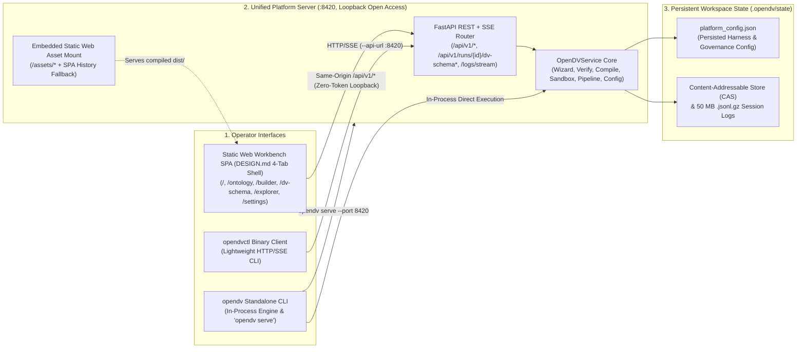

# 12 — Unified Platform Server, Static Web Workbench & CLI Configuration Guide (`v7.0`)

> [!WARNING]
> **OPEN-DV V2 CLEAN-SHEET — SUPERSEDED / HISTORICAL (2026-11-21):** V1 6-step setup & CLI guide is superseded by the V2 7-step Project workflow, Settings Hub, and `.opendv.zip` bundle flow (`docs/32`). See [`docs/designs/SITEMAP.md`](designs/SITEMAP.md).

This guide explains how `open-dv` packages its FastAPI REST/SSE backend (`apps/opendv-platform-api`) and Claude [`DESIGN.md`](../DESIGN.md)-aligned React 19 Web Workbench (`apps/opendv-web-workbench`) into a **single auth-free (loopback-only) unified application served on port `:8420`**, exposing the **4-tab shell** (`Ontology & Pipeline`, `DV Schema Explorer`, `Run Explorer`, `Settings`), the **Unified 6-Step Wizard**, the **4-View DV Schema Explorer** (`/dv-schema`), **`SessionLogsInspector`**, and CLI configuration commands (`opendv config`, `opendv serve`, and `opendvctl config`).

> **Related Specifications:**
> - [`DESIGN.md`](../DESIGN.md) — Canonical Claude-aligned design tokens, `54px` 4-tab Workbench shell, and `5-Zone (Z0–Z4)` + `information_mart` UI standard.
> - [`docs/27-unified-ontology-pipeline-requirements-and-uat.md`](27-unified-ontology-pipeline-requirements-and-uat.md) & [`docs/28-unified-ontology-pipeline-design-and-plan.md`](28-unified-ontology-pipeline-design-and-plan.md) — Normative Unified 6-Step Wizard (`D1`–`D28`) and 4-View DV Schema Explorer specification.
> - [`docs/12-agentic-pipeline-inputs-and-harness-guide.md`](12-agentic-pipeline-inputs-and-harness-guide.md) — Deep-dive reference on `PipelineInputSpec` (`pipeline_input.yaml`), `VaultBlueprint`, and `HarnessSetupConfig` (`harness_config.yaml`).
> - [`docs/08-platform-mvp-monorepo-and-api-spec.md`](08-platform-mvp-monorepo-and-api-spec.md) — Headless Platform REST + SSE API, 5-Tier RBAC redaction, and Content-Addressable Store (CAS).
> - [`docs/09-agnostic-agent-harness-and-sdk-spec.md`](09-agnostic-agent-harness-and-sdk-spec.md) — Multi-provider Agent Harness (`agy`, `agy-cli`, `antigravity`, `claude`, `claude-cli`, `claude-code`).

---

## 1. Unified Single-App Architecture & Loopback Open Access (`D18`)

`open-dv` eliminates split frontend/backend dev-server deployment by serving both the REST/SSE API and the compiled Web Workbench SPA from a single ASGI process (`opendv-platform-api`) on `:8420`, paired with two contract-identical CLIs generated from [`packages/opendv-contracts/schemas/cli-spec.json`](../packages/opendv-contracts/schemas/cli-spec.json):

- **Loopback Zero-Auth Open Access (`D18`):** Requests on `127.0.0.1` / `localhost` / `::1` require zero login tokens, cookies, `#token=` fragments, or CSRF headers (`StudioPrincipal(subject="human:local_user", role="admin")`). DNS-rebinding `Host`/`Origin` validation, path containment, and privacy/SSRF guards remain enforced.
- **Non-Loopback Guard (Exit Code `40`):** `opendv serve` and `opendv-platform` refuse non-loopback `--host` bindings (`0.0.0.0`, `::`, LAN IPs) with **exit code `40`** unless `--allow-remote-unauthenticated` is explicitly passed (which emits a loud startup warning and displays a coral `RemoteUnauthenticatedBanner` across the Workbench UI).
- **Desktop-First Responsive Shell (`D26`):** Full interactive editing is calibrated for `1440×920` and `1024×768` viewports; below `768px`, navigation/steppers collapse into single-column stacks with view-only graph and SQL inspection.



### Route & Component Topology on `:8420`

| Route / Endpoint Prefix | Served By | Responsibility |
| :--- | :--- | :--- |
| `/api/v1/*` | FastAPI REST + SSE Routers | Headless verification, async pipeline runs, `DV Schema Explorer` endpoints (`/runs/{id}/dv-schema*`), Ontology Wizard routes (`/ontology/studio/*`, `/logs/stream` `EventSource`), Steward holds, and `/platform/config`. |
| `/docs`, `/openapi.json` | FastAPI OpenAPI 3.1.0 | Interactive Swagger UI and machine-readable OpenAPI 3.1.0 specification. |
| `/assets/*` | Static Asset Mount | Compiled, content-hashed JavaScript and CSS bundles from `apps/opendv-web-workbench/dist/assets`. |
| `/`, `/ontology`, `/builder` | SPA History Fallback | **Tab 1 — `Ontology & Pipeline` (`OntologyWizardShell`)**: Unified 6-Step Wizard replacing legacy separate `/ontology` and `/builder` screens (`D19`). |
| `/dv-schema` | SPA History Fallback | **Tab 2 — `DV Schema Explorer` (`DvSchemaExplorerView`)**: 4-View interactive Data Vault 2.0 topology, 100% column triage & wave diff, live DuckDB row preview + Safe Read-Only SQL Runner (`D11`), and `5-Zone (Z0–Z4)` + `information_mart` SQL/IR inspector. |
| `/explorer`, `/stages/00..07` | SPA History Fallback | **Tab 3 — `Run Explorer`**: Run overview, gate scorecards, and per-stage drilldowns (`STAGE_00`–`STAGE_07`). |
| `/settings` | SPA History Fallback | **Tab 4 — `Settings` (`PlatformSettingsView`)**: Shared `<AgentHarnessConfigCard />` (provider, semantic model tiers, per-persona overrides, auth env vars, `HarnessBudget`, sandbox/hold policies, live provider readiness). Agent-only UI (`D28`: zero deterministic mode toggle). |

---

## 2. Quick Start: Building & Running the Single App

### Step 1: Build the Static Web Workbench Bundle

Compile the React 19 + TypeScript Web Workbench into `apps/opendv-web-workbench/dist` so `opendv-platform-api` automatically mounts and serves it at `/`:

```bash
# Install dependencies (if not already installed)
bun install

# Build the production static Web Workbench bundle into apps/opendv-web-workbench/dist/
bun run --cwd apps/opendv-web-workbench build
```

> [!TIP]
> You can verify whether the static bundle is detected at any time via `GET /api/v1/platform/config` or `uv run opendv config show --json` (`"web_ui_bundled": true`).

### Step 2: Launch the Unified Platform Server (`:8420`)

Start the single-app server using either `opendv serve` or `opendv-platform`:

```bash
# Option A: Launch on loopback via standalone opendv CLI (clean URL, zero auth tokens)
uv run opendv serve --host 127.0.0.1 --port 8420 --open

# Option B: Launch via the opendv-platform entrypoint
uv run opendv-platform --host 127.0.0.1 --port 8420

# Option C: Launch with an explicit opendv.config.yaml and workspace root
uv run opendv serve --port 8420 --config opendv.config.yaml --workspace .

# Option D: Bind a non-loopback host explicitly (omitting --allow-remote-unauthenticated exits with code 40)
uv run opendv serve --host 0.0.0.0 --port 8420 --allow-remote-unauthenticated
```

Once running, open **[http://127.0.0.1:8420](http://127.0.0.1:8420)** in your browser:
- **Tab 1 — `Ontology & Pipeline` (6-Step Wizard):** `http://127.0.0.1:8420/` (also `/ontology` and `/builder`)
- **Tab 2 — `DV Schema Explorer`:** `http://127.0.0.1:8420/dv-schema`
- **Tab 3 — `Run Explorer`:** `http://127.0.0.1:8420/explorer` (and `/stages/00..07`)
- **Tab 4 — `Settings`:** `http://127.0.0.1:8420/settings`
- **OpenAPI Documentation & Health:** `http://127.0.0.1:8420/docs` | `http://127.0.0.1:8420/api/v1/health`

*(Optional for frontend hot-reload development only: run `bun run --cwd apps/opendv-web-workbench dev` on `:5173`, which proxies `/api/*` to `:8420`.)*

---

## 3. Web Workbench Workflows (4-Tab `DESIGN.md` Shell)

### 3.1 Tab 1: Unified 6-Step Wizard (`Ontology & Pipeline`)

The Unified 6-Step Wizard replaces the retired `/ontology` and `/builder` screens (`D19`) and walks from domain scope through verified `5-Zone (Z0–Z4)` + `information_mart` SQL generation:

1. **Step 1 — Scope & Baseline:** Create a new session (`Blank v0.0.0`, Workspace Seed, or 6 Asset-Management Starter Packs) or import/evolve an existing `.yaml`/`.json`/`.ttl` baseline (`POST /sessions/import-ontology`). New wizard sessions record `wizard_schema_version` (`D25`); `GET /sessions` filters to new-schema sessions and surfaces a single notice line if legacy sessions exist (`legacy_session_count`) for CLI export.
2. **Step 2 — Sources & Domain Notes:** Attach tabular connectors (`SQLite`, `DuckDB`, `Databricks UC`, `CSV`/`Parquet`/`XLSX`/`JSONL` via `POST .../sources/connectors`), upload unstructured documents (`PDF`, `DOCX`, `MD`, `TXT` with `ocr=auto|force|off` and `do_not_send_to_agent` privacy perimeter), or enter Inline Domain Notes.
3. **Step 3 — Preview Evidence & Fast-Forward (`D8`):** Inspect inferred SQL types, PK/FK hints, and `<= 50` local sample rows (`3a`) alongside parsed document chunks and spans (`3b`). When starting from an already-finalized ontology baseline, click **`Fast-Forward to Step 6`** (`D8`) to skip Step 4–5 synthesis.
4. **Step 4 — Agent Setup Gate (`422`), Single-Pass Discovery & Citations (`4a`–`4c`):**
   - **Agent-Only UI & Fail-Closed Gate (`D28`, `FR-AGT-01`):** The Workbench exposes zero deterministic mode toggle (`stage_output_policy="strict"`). If no configured real LLM provider is ready, discovery fails closed with HTTP **`422 AGENT_NOT_CONFIGURED`** and renders the shared **`<AgentHarnessConfigCard />`** inline in Step 4a (`Verify & Save` flips the header `● Agent Ready` status live).
   - **Single-Pass Synthesis & Dual FIBO Q&A (`D1`–`D5`, `D7`):** Runs `@term-scout -> @domain-clarifier -> @ontology-architect`, supports parent-to-child cascading cherry-pick, inline edits, an unchecked-by-default **`MAJOR · Opt-In`** breaking-change bucket, interactive **`Ask FIBO`** (`POST .../fibo-qa`), and **`CitationInspectorDrawer`** (`4c`) for highlighted document spans, table profiles, and side-by-side `fibo-core` definitions.
5. **Step 5 — Visual Diff, DAG & Export (`D9`, `D15`):** Review `+FIBO`/`+Custom`/`~Enriched` diffs and the warm dot-grid `elkjs` DAG, optionally open **`VisualEditorDrawer`** (`+ Add / Edit Concept, Attribute or Link`), export standalone `.yaml`/`.ttl` via **`Export Ontology Only`** (`D9`), or commit atomically to CAS.
6. **Step 6 — DV 2.0 Build & Run (`D10`, `D12`, `D14`, `D21`, `D27`):**
   - Defaults `deployed_contract` to the active session's latest certified run with an inline Baseline Picker (`D12`) and `DuckDB` / `Databricks Delta` dialect selection.
   - Displays a **7-pill live execution console (`00`..`06`)** projected over the 8 internal stages (`STAGE_00`..`STAGE_07`, where `03 Synth` = `STAGE_03+04`, `04 Repair` = `STAGE_05`, `05 Lower` = `STAGE_07`, `06 Prover` = `STAGE_06`; see [`docs/28 §4.4`](28-unified-ontology-pipeline-design-and-plan.md)).
   - Enforces **one active job per session** (`409 SESSION_JOB_ACTIVE`, `D27`) by disabling duplicate start triggers while keeping Cancel and live logs active.
   - Surfaces **5-Zone (`Z0–Z4`)** + `information_mart` SQL previews (backed internally by `compiler_4zone` / `final_four_zone.sql` parity outputs), inline **`StewardHoldModal`** (`D14`), fail-closed **`BudgetHold`** (`D21`) tied to the header **Cost Meter** (`Raise budget & resume` / `Abort`), **`↺ Sync Drift to Step 4`** (`D10`) for unmodeled Stage 02 drift, and **`Explore Generated DV 2.0 Schema ➔`**.

### 3.2 Tab 2: 4-View `DV Schema Explorer` (`/dv-schema`)

Navigating to **`/dv-schema`** (or clicking **`Explore Generated DV 2.0 Schema ➔`** from Step 6) renders four views projected from `CanonicalIR`, `NoMistakeDataVault2ContractV5`, and persisted DuckDB sandboxes (`GET /api/v1/runs/{run_id}/dv-schema*`):
1. **Interactive DV 2.0 Graph:** Bipartite `elkjs` + `@xyflow/react` Hub–Link–Satellite–PIT–Bridge graph with Zone filters (`Z0–Z4`), PII/Delta pills, `Algorithm A.5` hash formula inspector, and DDL/DML dialogs.
2. **100% Triage & Wave Diff:** Filterable `DV-G4-002` column triage ledger + multi-wave schema diff (`W1 -> W2 -> W3`).
3. **Vault Rows & Safe SQL (`D11`):** Paginated live Hub/Link/Sat/PIT row browser and a **read-only Safe SQL Runner** (`POST /api/v1/runs/{run_id}/dv-schema/query`) enforced by `validate_safe_sql()` (`SELECT`/`UNION` allowlist only, zero file/metadata scans).
4. **5-Zone SQL (`Z0–Z4`) & IR:** Per-zone (`Z0–Z4` including `information_mart`) DuckDB and Databricks Delta SQL alongside `final_contract.yaml` and `final_canonical_ir.json`.

### 3.3 `SessionLogsInspector` (`Logs & Traces`)

Accessible via the header **`Logs & Traces (<count>)`** button or **`View Stage Logs ↗`** links on Steps 2, 4, 5, and Step 6 pills `00`..`06`, **`SessionLogsInspector`** opens a live **`EventSource`** stream (`GET /api/v1/ontology/studio/sessions/{id}/logs/stream`) with `● Follow Live Tail`, filtering by `wizard_step`, `stage_id` (`STAGE_00..07` or `00..06`), `persona`, and `source_id`, plus 4 deep inspection tabs (`Masked Prompt & Context`, `Streaming / Structured LLM Response`, `Tool Calls & @toon_v1 Traces`, `Raw JSON Event`). Full PII-masked prompts and responses persist for the session lifetime using `50 MB` `.gz` segment rotation and export inside `.odvstudio.zip` / `.jsonl` bundles (`D24`).

### 3.4 Tab 4: Settings View (`/settings`)

Navigating to **`/settings`** opens `PlatformSettingsView`, embedding the exact same **`<AgentHarnessConfigCard />`** used in Step 4a and backed by `GET / PUT /api/v1/platform/config` and `POST /api/v1/platform/config/validate`:

1. **Agent Harness Provider & Execution Mode (`D28` Agent-Only UI):**
   - Select from all 6 supported identifiers (`agy`, `agy-cli`, `claude-cli`, `claude-code`, `antigravity`, `claude`). UI sessions enforce `stage_output_policy="strict"` (no deterministic toggle is exposed in Settings or the Wizard).
2. **Semantic Model Tiers & Per-Persona Overrides:**
   - Configure `model_overrides.reasoning` (`ModelTier.HIGH_REASONING`), `model_overrides.fast` (`ModelTier.FAST_TIER`), and optional `agent_models` overrides (`@vault-first-mate`, `@scout-source`, `@scout-unstructured`, `@ship-vault`).
3. **Authentication & Cloud Routing (`HarnessAuthConfigDTO`):**
   - Configure `auth_mode` (`cli_session`, `api_key`, `vertex_adc`, `aws_bedrock`, `none`), `api_key_env_var` (env var name only, never raw secrets), `api_base_url`, Vertex AI (`gcp_project`, `gcp_location`), or AWS Bedrock (`aws_region`, `aws_profile`).
4. **Execution Budgets (`HarnessBudget` / `D21`), Sandbox Policy & Governance Defaults:**
   - Tune `max_turns`, `max_input_tokens`, `max_output_tokens`, `timeout_seconds`, and `max_cost_usd` (enforced by the live header Cost Meter and fail-closed `BudgetHold`), toggle sandbox isolation, and set `steward_hold_policy` (`auto_approve_top_candidate`, `pause`, `reject_on_hold`) and `ontology_policy`.
5. **Live Provider Readiness Cards:**
   - Real-time binary/SDK detection, credential env-var checks, and status diagnostics (`● Agent Ready`).

---

## 4. Lightweight CLI (`opendvctl`) & Standalone CLI (`opendv`) Configuration

Both the standalone in-process Python CLI (`opendv`) and the lightweight Bun HTTP client binary (`opendvctl`) provide identical `config show`, `config set`, and `config validate` subcommands.

### 4.1 Inspect Active Configuration & Provider Readiness (`config show`)

```bash
# Remote lightweight client against the unified server on :8420
opendvctl config show --api-url http://127.0.0.1:8420 --json

# Standalone in-process CLI (zero HTTP server required)
uv run opendv config show --json
```

### 4.2 Update Default Provider, Model Routing & Governance Policies (`config set`)

Updates are validated and persisted to `.opendv/state/platform_config.json`:

```bash
# Switch default provider to claude-cli, set reasoning/fast models, and pause on Steward Holds
opendvctl config set \
  --api-url http://127.0.0.1:8420 \
  --provider claude-cli \
  --reasoning-model claude-opus-4-6 \
  --fast-model claude-haiku-4-5 \
  --auth-mode cli_session \
  --hold-policy pause \
  --ontology-policy recommend \
  --max-turns 40 \
  --timeout-seconds 360 \
  --json

# Or import a full harness_config.yaml file and override specific flags via standalone CLI
uv run opendv config set \
  --harness-config examples/pipeline_samples/global_commerce_vault/harness_config_agy.yaml \
  --hold-policy auto_approve_top_candidate \
  --json
```

### 4.3 Pre-Flight Validate Candidate Harness Settings (`config validate`)

Returns exit code `0` when `passed: true` and exit code `1` with structured `diagnostics[]` when invalid:

```bash
# Validate a candidate provider or harness_config.yaml via opendvctl
opendvctl config validate \
  --api-url http://127.0.0.1:8420 \
  --harness-config examples/pipeline_samples/global_commerce_vault/harness_config_claude_cli.yaml \
  --json

# Validate in-process via standalone opendv CLI
uv run opendv config validate \
  --provider agy \
  --harness-config examples/pipeline_samples/global_commerce_vault/harness_config_agy.yaml \
  --json
```
