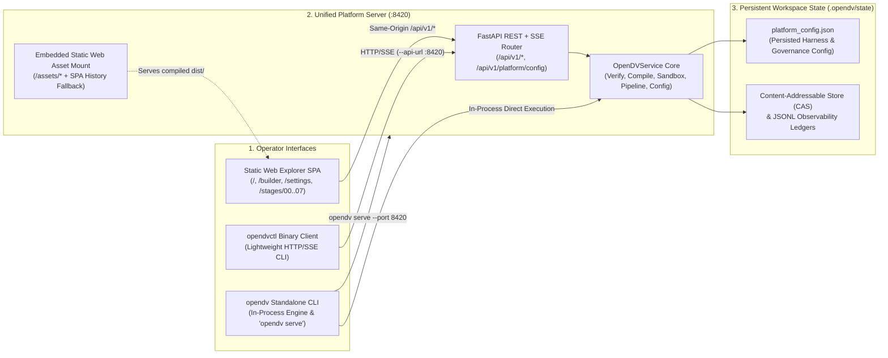

# 12 — Unified Platform Server, Static Web Explorer & CLI Configuration Guide (`v6.0`)

This guide explains how `open-dv` packages its FastAPI REST/SSE backend (`apps/opendv-platform-api`) and 3-Level Explainability & Observability React 19 Web Workbench (`apps/opendv-web-workbench`) into a **single unified application served on port `:8420`**, alongside the interactive Web Explorer workflows (`/`, `/builder`, `/settings`, `/stages/00..07`) and CLI configuration commands (`opendv config`, `opendv serve`, and `opendvctl config`).

> **Related Specifications:**
> - [`docs/12-agentic-pipeline-inputs-and-harness-guide.md`](12-agentic-pipeline-inputs-and-harness-guide.md) — Deep-dive reference on `PipelineInputSpec` (`pipeline_input.yaml`) and `HarnessSetupConfig` (`harness_config.yaml`).
> - [`docs/08-platform-mvp-monorepo-and-api-spec.md`](08-platform-mvp-monorepo-and-api-spec.md) — Headless Platform REST + SSE API, 5-Tier RBAC redaction, and Content-Addressable Store (CAS).
> - [`docs/09-agnostic-agent-harness-and-sdk-spec.md`](09-agnostic-agent-harness-and-sdk-spec.md) — Multi-provider Agent Harness (`agy`, `agy-cli`, `antigravity`, `claude`, `claude-cli`, `claude-code`).

---

## 1. Unified Single-App Architecture

`open-dv` eliminates split frontend/backend dev-server deployment by serving both the REST/SSE API and the compiled Web Explorer SPA from a single ASGI process (`opendv-platform-api`) on `:8420`, paired with two contract-identical CLIs generated from [`packages/opendv-contracts/schemas/cli-spec.json`](../packages/opendv-contracts/schemas/cli-spec.json):



### Route & Component Topology on `:8420`

| Route / Endpoint Prefix | Served By | Responsibility |
| :--- | :--- | :--- |
| `/api/v1/*` | FastAPI REST + SSE Routers | Headless verification (`/verify`, `/compile`, `/profile`, `/sandbox`), async pipeline runs (`/pipelines/runs`, `/runs/{id}/events`), Steward holds, ontology governance, and platform configuration (`/platform/config`). |
| `/docs`, `/openapi.json` | FastAPI OpenAPI 3.1.0 | Interactive Swagger UI and machine-readable OpenAPI 3.1.0 specification. |
| `/assets/*` | Static Asset Mount | Compiled, content-hashed JavaScript and CSS bundles from `apps/opendv-web-workbench/dist/assets`. |
| `/` | SPA History Fallback | **3-Level Explorer Overview**: Executive Pipeline Summary, Stage `00`–`07` cards, Gate `0`–`5` scorecard, Enterprise vs. Discovered Ontology coverage, and topological DAG. |
| `/builder` | SPA History Fallback | **Interactive Pipeline Builder & YAML Upload**: Visual multi-wave pipeline composer, live bidirectional YAML preview, pre-flight validation, and two-step pipeline execution. |
| `/settings` | SPA History Fallback | **Full-Page Platform & Harness Settings View**: Provider selection, semantic tier & per-persona model routing, auth & cloud routing, budgets, sandbox policies, Steward Hold / Ontology policies, and live Provider Readiness diagnostics. |
| `/stages/00` .. `/stages/07` | SPA History Fallback | **Stage Drilldown Views**: Deep-dive inspection for each of the 8 pipeline stages, including column triage ledgers, ELM topology graphs, `@toon_v1` traces, and 4-Zone SQL / DuckDB sandbox audits. |

---

## 2. Quick Start: Building & Running the Single App

### Step 1: Build the Static Web Explorer Bundle

Compile the React 19 + TypeScript Web Explorer into `apps/opendv-web-workbench/dist` so `opendv-platform-api` automatically mounts and serves it at `/`:

```bash
# Install dependencies (if not already installed)
bun install

# Build the production static Web Explorer bundle into apps/opendv-web-workbench/dist/
bun run --cwd apps/opendv-web-workbench build
```

> [!TIP]
> You can verify whether the static bundle is detected at any time via `GET /api/v1/platform/config` or `uv run opendv config show --json` (`"web_ui_bundled": true`).

### Step 2: Launch the Unified Platform Server (`:8420`)

Start the single-app server using either `opendv serve` or `opendv-platform`:

```bash
# Option A: Launch via the standalone opendv CLI (supports --host, --port, --config, --workspace, --open)
uv run opendv serve --host 127.0.0.1 --port 8420 --open

# Option B: Launch via the opendv-platform entrypoint
uv run opendv-platform --host 127.0.0.1 --port 8420

# Option C: Launch with an explicit opendv.config.yaml and workspace root
uv run opendv serve --port 8420 --config opendv.config.yaml --workspace .
```

Once running, open **[http://127.0.0.1:8420](http://127.0.0.1:8420)** in your browser:
- **Web Explorer UI**: `http://127.0.0.1:8420/`
- **Interactive Pipeline Builder**: `http://127.0.0.1:8420/builder`
- **Full-Page Settings View**: `http://127.0.0.1:8420/settings`
- **OpenAPI Documentation**: `http://127.0.0.1:8420/docs`
- **Health & Readiness Probe**: `http://127.0.0.1:8420/api/v1/health`

*(Optional for frontend hot-reload development only: run `bun run --cwd apps/opendv-web-workbench dev` on `:5173`, which proxies `/api/*` to `:8420`.)*

---

## 3. Web Explorer Workflows

### 3.1 Interactive Pipeline Builder (`/builder`) vs. YAML Upload & Two-Step Execution

The **Pipeline Builder (`/builder`)** and the **Upload / Load Modal** support two complementary ways to define a pipeline run, both governed by a strict **two-step Stage/Validate -> Explicit Run** workflow:

1. **Define or Upload Pipeline Specification**:
   - **Visual Interactive Builder (`/builder`)**: Configure pipeline metadata (`pipeline_id`, `project_id`, `domain_namespace`, `graph_a_ontology_path`, optional `initial_contract_path`, `output_dir`), add or reorder **Waves (`wave0`, `wave1`, ...)**, attach relational **Source Feeds** (`source_system`, `table_name`, `file_path`, `format`, `primary_key_hint`, `tenant_id`), attach **Unstructured Documents** (`doc_id`, `file_path`, `document_class`), and set optional per-run harness overrides. A live YAML preview stays synchronized with the form.
   - **YAML Upload / Paste**: Upload an existing `pipeline_input.yaml`, `dv_model_contract.yaml`, or `vault-ledger.jsonl` file from disk or paste YAML/JSON directly.
2. **Step 1 — Stage & Pre-Flight Validate (`Validate & Stage Pipeline`)**:
   - Clicking **Validate & Stage** (or uploading a YAML spec) runs deterministic pre-flight checks (`POST /api/v1/pipelines/validate`) verifying path containment, Graph A ontology schema, source file existence, and harness readiness **without starting an LLM run**.
   - Once staged, the header displays a `STAGED: <pipeline_id>` badge and reveals the **`▶ Run Pipeline`** action button.
3. **Step 2 — Explicit Execution (`▶ Run Pipeline`)**:
   - Uploading a file or staging a pipeline **never** auto-starts execution.
   - Execution begins **only** when the operator explicitly clicks **`▶ Run Pipeline`**, which dispatches `POST /api/v1/pipelines/runs` and attaches the live W3C Server-Sent Events (`SSE`) telemetry stream.

### 3.2 Live Pipeline Run Progress Indicators

While a pipeline run is active (or paused on a Steward Hold), the Web Explorer provides real-time multi-level progress visibility:

- **Top-Level `PipelineRunProgressBar`**:
  - Displays a horizontal **8-Stage Stepper (`00`–`07`)** (`STAGE_00_ORCHESTRATION` through `STAGE_07_DETERMINISTIC_COMPILER`) with active stage pulsing, completed checkmarks, and percentage completion bar (`completedStages / 8`).
  - Streams live telemetry counters: **Active Wave ID**, **Active Agent Persona & Model ID**, **Elapsed Wall-Clock Time**, **Event Count**, and **Live LLM Token / Thinking Delta Previews**.
  - Surfaces an **Abort Run** control and a one-click jump to the **Steward Hold Drawer** whenever a `PAUSED_HOLD` / `ASK_USER` escalation occurs.
- **Per-Stage Card Status Indicators (Level 1 Overview)**:
  - Each of the 8 stage cards on `/` updates dynamically with high-contrast status badges and border treatments:
    - `RUNNING`: Animated accent border, spinner badge, and live token/step ticker.
    - `COMPLETED` / `PASS`: Emerald verification badge with execution duration (`ms`) and artifact count.
    - `HOLD` / `ASK-USER`: Amber Steward Hold alert badge linking directly to candidate resolution options.
    - `QUEUED` / `PENDING`: Muted slate badge awaiting upstream stage completion.

### 3.3 Full-Page Settings View (`/settings`)

Navigating to **`/settings`** (or clicking the **Settings** gear icon in the top navigation bar) opens the full-page **Platform & Agent Harness Configuration** workspace backed by `GET / PUT /api/v1/platform/config` and `POST /api/v1/platform/config/validate`:

1. **Agent Harness Provider & Execution Mode**:
   - Select the default platform harness provider across all 6 supported identifiers:
     - CLI Subprocess Adapters: `agy` / `agy-cli` (Google Antigravity CLI) and `claude-cli` / `claude-code` (Claude Code CLI).
     - Native SDK Adapters: `antigravity` (Google GenAI / Antigravity SDK) and `claude` (Anthropic Claude Agent SDK).
2. **Semantic Model Tiers & Per-Persona Overrides**:
   - Configure `model_overrides.reasoning` (`ModelTier.HIGH_REASONING`) and `model_overrides.fast` (`ModelTier.FAST_TIER`).
   - Optionally configure fine-grained `agent_models` overrides for `@vault-first-mate`, `@scout-source`, `@scout-unstructured`, and `@ship-vault`, with a live **Resolved Persona Model Table** showing effective model routing.
3. **Authentication & Cloud Routing (`HarnessAuthConfigDTO`)**:
   - Configure `auth_mode` (`cli_session`, `api_key`, `vertex_adc`, `aws_bedrock`, `none`), `api_key_env_var` (stores **only** the environment variable name such as `GEMINI_API_KEY` or `ANTHROPIC_API_KEY`—never raw secret values), `api_base_url`, Vertex AI (`gcp_project`, `gcp_location`), or AWS Bedrock (`aws_region`, `aws_profile`).
4. **Execution Budgets, Sandbox Policy & Governance Defaults**:
   - Tune `max_turns`, `max_input_tokens`, `max_output_tokens`, `timeout_seconds`, and `max_cost_usd`.
   - Toggle sandbox isolation (`read_only_workspace`, `allow_shell_execution`, `allow_network_access`).
   - Set platform defaults for `steward_hold_policy` (`auto_approve_top_candidate`, `pause`, `reject_on_hold`), `ontology_policy` (`off`, `recommend`, `auto_accept`), and `stage_output_policy` (`llm_only`, `symbolic_completion`).
5. **Live Provider Readiness Cards**:
   - Displays real-time binary/SDK installation detection, credential env-var presence checks, and status diagnostics for every registered provider.

---

## 4. Lightweight CLI (`opendvctl`) & Standalone CLI (`opendv`) Configuration

Both the standalone in-process Python CLI (`opendv`) and the lightweight Bun HTTP client binary (`opendvctl`) provide identical `config show`, `config set`, and `config validate` subcommands.

### 4.1 Inspect Active Configuration & Provider Readiness (`config show`)

```bash
# Remote lightweight client against the unified server on :8420
opendvctl config show --api-url http://127.0.0.1:8420 --json

# Standalone in-process CLI (zero HTTP server required)
uv run opendv config show --json
```

### 4.2 Update Default Provider, Model Routing & Governance Policies (`config set`)

Updates are validated and persisted to `.opendv/state/platform_config.json`:

```bash
# Switch default provider to claude-cli, set reasoning/fast models, and pause on Steward Holds
opendvctl config set \
  --api-url http://127.0.0.1:8420 \
  --provider claude-cli \
  --reasoning-model claude-opus-4-6 \
  --fast-model claude-haiku-4-5 \
  --auth-mode cli_session \
  --hold-policy pause \
  --ontology-policy recommend \
  --max-turns 40 \
  --timeout-seconds 360 \
  --json

# Or import a full harness_config.yaml file and override specific flags via standalone CLI
uv run opendv config set \
  --harness-config examples/pipeline_samples/global_commerce_vault/harness_config_agy.yaml \
  --hold-policy auto_approve_top_candidate \
  --json
```

### 4.3 Pre-Flight Validate Candidate Harness Settings (`config validate`)

Returns exit code `0` when `passed: true` and exit code `1` with structured `diagnostics[]` when invalid:

```bash
# Validate a candidate provider or harness_config.yaml via opendvctl
opendvctl config validate \
  --api-url http://127.0.0.1:8420 \
  --harness-config examples/pipeline_samples/global_commerce_vault/harness_config_claude_cli.yaml \
  --json

# Validate in-process via standalone opendv CLI
uv run opendv config validate \
  --provider agy \
  --harness-config examples/pipeline_samples/global_commerce_vault/harness_config_agy.yaml \
  --json
```
