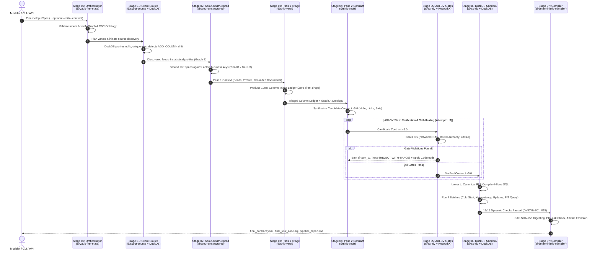
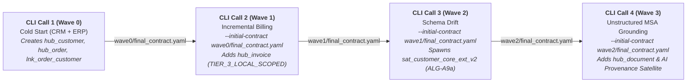

# Open-DV Architecture & End-to-End Pipeline Technical Specification
*Authoritative Reference for Interactive Visualizations, Architecture Walkthroughs, and System Inspectors*

---

## 1. System Overview & Core Paradigms

**Open-DV** is an enterprise-grade, neuro-symbolic Data Vault 2.0 modeling and code-generation platform. It solves the critical fragility of pure LLM code generators by sandwiching high-reasoning AI agents between rigorous, deterministic formal verification gates and an embedded analytical execution engine.

### Core Architectural Invariants:
1. **Zero Hallucination Tolerance (Neuro-Symbolic Sandwich)**: AI agents propose semantic classifications and contract ASTs, but **deterministic compilers, mathematical graph verifiers (NetworkX), and DuckDB execution engines** strictly gate production deployment.
2. **Immutable Audit Lineage & Content-Addressable Storage (CAS)**: Every proposed contract, intermediate ledger, diagnostic trace, and compiled SQL file is SHA-256 hashed and stored in a CAS store (`cas/<sha256>`).
3. **100% Column Accounting (Zero Silent Drops)**: Under Data Vault rules `DV-COL-012` and `DV-G4-002`, every single raw physical column from every onboarded table must be explicitly accounted for in the Column Triage Ledger.
4. **Offline, In-Process Dynamic Verification**: Every contract must pass a 4-batch dynamic execution sequence in an ephemeral in-memory **DuckDB** sandbox, mathematically verifying idempotency, bi-temporal update handling, and Point-in-Time (PIT) reconstruction before code generation.

---

## 2. High-Level System Architecture & Component Drill-Down

```
┌──────────────────────────────────────────────────────────────────────────────────────────────────┐
│                                       USER / CI / AGENTS                                         │
│                    CLI (`opendv`)  │  Platform REST API  │  Web Workbench (Explorer)             │
└────────────────────────────────────────────────┬─────────────────────────────────────────────────┘
                                                 │
                                                 ▼
┌──────────────────────────────────────────────────────────────────────────────────────────────────┐
│                             OPENDV-AGENT-HARNESS (Hexagonal Core)                                │
│  ┌───────────────────────┐  ┌───────────────────────┐  ┌───────────────────────┐                 │
│  │ AgyCliHarnessAdapter  │  │ AntigravityHarness    │  │ ClaudeHarnessAdapter  │                 │
│  │ (Local logged-in agy) │  │ (Google GenAI SDK)    │  │ (Anthropic SDK)       │                 │
│  └───────────────────────┘  └───────────────────────┘  └───────────────────────┘                 │
│                 Model Routing: HIGH_REASONING (argon) vs FAST_TIER (flash)                       │
└────────────────────────────────────────────────┬─────────────────────────────────────────────────┘
                                                 │
                                                 ▼
┌──────────────────────────────────────────────────────────────────────────────────────────────────┐
│                           8-STAGE NEURO-SYMBOLIC PIPELINE ENGINE                                 │
│  [Stage 00]  Orchestration & Supervisor Governance          (@vault-first-mate)                  │
│  [Stage 01]  Bronze Source Profiling & Schema Drift         (@scout-source + DuckDB)             │
│  [Stage 02]  Unstructured Document Entity Resolution        (@scout-unstructured)                │
│  [Stage 03]  Pass 1: 100% Column Triage Ledger              (@ship-vault)                        │
│  [Stage 04]  Pass 2: DV 2.0 Contract AST Synthesis          (@ship-vault)                        │
│  [Stage 05]  AXI-DV 6-Gate Static Verification & Healing    (@axi-dv + NetworkX + @toon_v1)      │
│  [Stage 06]  Dynamic Shadow Sandbox (4-Batch Execution)     (@axi-dv + DuckDB)                   │
│  [Stage 07]  Deterministic Compiler & Artifact Certification(@deterministic-compiler)            │
└────────────────────────────────────────────────┬─────────────────────────────────────────────────┘
                                                 │
                                                 ▼
┌──────────────────────────────────────────────────────────────────────────────────────────────────┐
│                               OUTPUT ARTIFACTS & AUDIT TRAILS                                    │
│   final_contract.yaml  │  final_canonical_ir.json  │  final_four_zone.sql  │  vault-ledger.jsonl │
└──────────────────────────────────────────────────────────────────────────────────────────────────┘
```

### Primary Subsystems
- **`opendv-core`**: Core Pydantic v2 schemas for Data Vault 2.0 contracts (`NoMistakeDataVault2ContractV5`), Canonical IR (`CanonicalIR`), ELM calculus, and Algorithm A.5 length-prefixed hashing.
- **`opendv-agent-harness`**: Execution framework providing agent personas, tool dispatch, model routing, and provider adapters (`agy`, `antigravity`, `claude`, `deterministic`).
- **`opendv-axi-verifier`**: The formal static validation engine. Runs Gates G0–G5, drives the `@toon_v1` diagnostic trace protocol, and executes deterministic AST codemods.
- **`opendv-duckdb-sandbox`**: Embedded DuckDB execution engine. Performs empirical column profiling (Graph B), detects schema drift, compiles 4-Zone SQL, and runs 4-batch dynamic integration tests.
- **`opendv-telemetry`**: Content-Addressable Storage (CAS), append-only JSONL ledger emitter, and 5-tier Role-Based Access Control (RBAC) PII redaction.
- **`opendv-platform-api` & `opendv-cli`**: Headless FastAPI server and unified Click/Typer CLI for running pipelines, inspecting gates, resolving holds, and streaming live Server-Sent Events (SSE).
- **`opendv-web-workbench`**: Decoupled, zero-FOUC web frontend (Vite/React/Zustand) exposing 3-Level Explorer views.

---

## 3. Step-by-Step E2E Pipeline Walkthrough (Stages 00 – 07)



---

### Detailed Stage Breakdown

### Stage 00: Orchestration & Supervisor Governance
- **Agent Persona**: `@vault-first-mate` (Model Tier: `HIGH_REASONING` / `gemini-4-argon-high`).
- **Primary Goal**: Validate all filesystem inputs, verify the Graph A Core Business Concept (CBC) ontology, and establish supervisor boundaries and wave execution schedules.
- **Detailed Explanation**:
  Before any LLM touches data, the engine checks for path traversal (`../`), verifies file existence, and loads the semantic ontology (`graph_a_ontology.yaml`). `@vault-first-mate` assesses risks, establishes maximum self-healing retry limits (default: 3), and assigns wave order.
- **Inputs**:
  - `PipelineInputSpec`: `pipeline_id`, `project_id`, `domain_namespace`, paths to ontology and data feeds.
  - Optional `initial_contract_path`: Deployed contract from prior wave/call.
  - `GraphAOntology`: YAML specifying CBCs, target Hub names, and 3-Tier Key Authority rules.
- **Outputs**:
  - `art-stage00-graph-a-ontology` (`stage_00/graph_a_ontology.yaml`): Standardized, CAS-registered Graph A ontology.
  - `Stage00OrchestrationPlanOutput`: Structured plan specifying `wave_execution_order`, `recommended_max_retries`, and risk rationale.
  - Telemetry event emitted to `vault-ledger.jsonl`.

---

### Stage 01: Scout-Source (Bronze Profiling & Schema Drift Detection)
- **Agent Persona**: `@scout-source` (Model Tier: `FAST_TIER` / `gemini-3.8-flash-high`) + `GraphBProfiler` (DuckDB).
- **Primary Goal**: Calculate exact physical statistics across all Bronze relational sources and detect intra-source schema drift (`ADD_COLUMN`).
- **Detailed Explanation**:
  DuckDB loads raw CSV/Parquet files into an ephemeral in-memory database to compute exact metrics: row counts, physical column types, null counts, total uniqueness ($U_{tot}$), and non-null uniqueness ($U_{nn}$). If a baseline table or `--initial-contract` is provided, DuckDB performs an automated schema diff to flag drift events. The agent uses these statistics to hypothesize candidate roles:
  - $U_{nn} \ge 0.95$ and $\text{null\_rate} == 0.0 \implies$ Candidate Business Key (`BUSINESS_KEY`).
  - Columns matching pattern `(^|_)(sk|seq|id)$` and non-business $\implies$ Candidate System Surrogate (`SYSTEM_SURROGATE_DROPPED`).
  - Columns with PII keywords (`email`, `ssn`, `tax_id`) $\implies$ `PII_RESTRICTED_PAYLOAD`.
- **Inputs**:
  - Physical Bronze data files (`crm_customers.csv`, `erp_orders.csv`, `stripe_invoices.csv`).
  - Deployed contract dictionary (for cross-call column history).
- **Outputs**:
  - `art-w<N>-stage01-graph-b-profile` (`waves/wave_<N>/wave_<N>_graph_b_profile.json`): Complete physical statistical profile.
  - `art-w<N>-stage01-schema-drift` (`waves/wave_<N>/wave_<N>_schema_drift_report.json`) *(if drift detected)*: List of added/mutated columns and prescriptive codemod actions (`SPAWN_COMPANION_SATELLITE_ALG_A9A`).
  - `Stage01SourceDiscoveryOutput`: Discovered semantic classifications for each feed.

---

### Stage 02: Scout-Unstructured (Entity Resolution & Span Grounding)
- **Agent Persona**: `@scout-unstructured` (Model Tier: `HIGH_REASONING` / `gemini-4-argon-high`).
- **Primary Goal**: Extract entities and contractual clauses from unstructured text (contracts, PDFs, MSAs) and ground them against active Data Vault Hub business keys.
- **Detailed Explanation**:
  The engine scans raw document text using known entities and regex boundaries. Extracted candidate mentions are classified into 3 distinct Entity Resolution (ER) tiers:
  - **Tier-U1 (Deterministic Auto-Match)**: Exact business key match or confidence $\ge 0.92$. Auto-approved for Link/Satellite attachment.
  - **Tier-U2 (Hybrid Exact Match)**: High confidence ($\ge 0.75$) with top-2 margin $\ge 0.15$.
  - **Tier-U3 (Captain Hold)**: Ambiguous mentions (e.g. "Apex Sovereign Co-Invest Vehicle"). Automatically pauses the pipeline or records a diagnostic hold requiring human Steward confirmation.
  Every candidate's character offsets (`char_start`, `char_end`) are strictly grounded against the document text.
- **Inputs**:
  - Unstructured documents (e.g. `enterprise_msa_addendum_2026.txt`).
  - Known entity tuples `(target_hub, business_key, legal_name)` from active relational sources or `--initial-contract`.
- **Outputs**:
  - `art-w<N>-stage02-unstructured-grounding` (`waves/wave_<N>/wave_<N>_unstructured_grounding.json`): Grounded extraction records with verbatim quotes, character offsets, and ER tier scores.
  - `Stage02UnstructuredDiscoveryOutput`: Structured candidates and document metadata.

---

### Stage 03: Ship-Vault Pass 1 (100% Column Triage Ledger)
- **Agent Persona**: `@ship-vault` (Model Tier: `HIGH_REASONING` / `gemini-4-argon-high`).
- **Primary Goal**: Synthesize an exhaustive column accounting ledger covering 100% of physical columns across all active sources.
- **Detailed Explanation**:
  Data Vault 2.0 rules `DV-COL-012` and `DV-G4-002` forbid silent column drops. Pass 1 maps every column from every table to its precise target entity and role:
  - `SYSTEM_SURROGATE_DROPPED` $\to$ `DROPPED_SURROGATE` (system sequences stripped to prevent hash key contamination).
  - `BUSINESS_KEY` $\to$ `hub_<entity>` (primary business keys).
  - `FOREIGN_KEY_REF` $\to$ `lnk_<entity1>_<entity2>` (relationship keys).
  - `OPTIONAL_FOREIGN_KEY_REF` $\to$ Split nullable-FK Link (preventing null-poisoned relationship hashes).
  - `DESCRIPTIVE_PAYLOAD` $\to$ `sat_<entity>_core` (standard context).
  - `PII_RESTRICTED_PAYLOAD` $\to$ `sat_<entity>_pii` (isolated GDPR/confidential attributes).
- **Inputs**:
  - Graph A CBC Ontology, Graph B Statistical Profile, Discovered Feeds, Grounded Document Records.
- **Outputs**:
  - `art-w<N>-stage03-pass1-triage` (`waves/wave_<N>/wave_<N>_pass1_column_triage.json`): The complete, audited Pass 1 Column Triage Ledger.
  - `Stage03ColumnTriageOutput`: Validated Pydantic model of the ledger.

---

### Stage 04: Ship-Vault Pass 2 (Candidate Contract AST Synthesis)
- **Agent Persona**: `@ship-vault` (Model Tier: `HIGH_REASONING` / `gemini-4-argon-high`).
- **Primary Goal**: Synthesize a complete declarative Data Vault 2.0 Contract Specification v5.0 (`NoMistakeDataVault2ContractV5`).
- **Detailed Explanation**:
  Using the Pass 1 ledger and Graph A CBCs, the agent constructs the full object graph:
  - **Hubs**: Name, concept URI, business key columns, source mappings, key authority tier (`TIER_1_GLOBAL_STANDARD` vs `TIER_3_LOCAL_SCOPED`), and required `bkcc_prefix`.
  - **Links**: Two or more Hub references with role aliases and composite hash definitions.
  - **Satellites**: Parent entity binding, security classification (`PUBLIC`, `INTERNAL`, `PII_HIGH`), volatility tier (`STANDARD` vs `ADDITIVE_DRIFT_COMPANION`), and payload column list.
  - **Unstructured Entities**: Adds `hub_document`, `UNSTRUCTURED_EXTRACTION_LINK`, `AI_PROVENANCE_SATELLITE` (confidence scores, model IDs), and `MULTI_ACTIVE_SATELLITE` (extracted spans).
- **Inputs**:
  - Pass 1 Column Triage Ledger, Graph A Ontology, Graph B Profile, Deployed Contract.
- **Outputs**:
  - `art-w<N>-stage04-contract-attempt1` (`waves/wave_<N>/wave_<N>_contract_attempt_1.yaml`): Candidate Contract AST.
  - `Stage04ContractSynthesisOutput`: Pydantic container wrapping `NoMistakeDataVault2ContractV5`.

---

### Stage 05: AXI-DV Static Gates & @toon_v1 Self-Healing
- **Agent Persona**: `@axi-dv` (Model Tier: `FAST_TIER` / `gemini-3.8-flash-high`) + Deterministic Verifiers.
- **Primary Goal**: Subject the candidate contract to 6 rigorous static gates and drive iterative self-healing via `@toon_v1` diagnostic traces.
- **Detailed Explanation**:
  The candidate contract must clear **6 Static Gates**:
  1. **Gate 0 (JSON Schema)**: Strict conformance to `schemas/dv2-contract-v5.json`.
  2. **Gate 1 (Ontology & Grain)**: Verifies CBC URI bindings, rejects phantom hubs, and validates natural grain.
  3. **Gate 2 (Key & FK Discipline)**: Enforces 3-Tier BKCC authority. Tier-3 sources *must* specify a `bkcc_prefix` (e.g. `STRIPE_EU`) and `require_src_qualifier: true`.
  4. **Gate 3 (NetworkX Bipartite DAG)**: Loads the contract into a `networkx.MultiDiGraph` and enforces 14 formal topology rules:
     - `DV-STR-001`: Hub $\text{outdeg} == 0$ (no Hub-to-Hub edges).
     - `DV-STR-002`: Link $\text{outdeg} \ge 2$ (minimum binary arity).
     - `DV-STR-003`: Link targets must be Hubs (no Link-to-Link edges).
     - `DV-STR-005` & `006`: Satellite $\text{outdeg} == 1$ and parent $\notin V_{sat}$ (no Satellite chaining).
     - `DV-STR-014`: Graph must be acyclic (`nx.is_directed_acyclic_graph(G) == True`).
  5. **Gate 4 (YAGNI & 100% Ledger Coverage)**: Asserts every column in the ledger exists in the contract, and enforces satellite splitting if write amplification exceeds thresholds ($W_{amp} \ge 50\text{ MB/d}$).
  6. **Gate 5 (Unstructured Grounding)**: Validates verbatim quote matches and character offsets against raw text.
  
  *Self-Healing Loop*: If any gate fails, a `@toon_v1` diagnostic trace is produced (e.g. `status: REJECT-WITH-TRACE`). The engine executes deterministic AST codemods (`ALG_A1` for PII splitting, `ALG_A4` for nullable FK link splitting, `ALG_A9A` for companion drift satellites) and re-evaluates the contract across Attempts 1, 2, and 3 until status is `PASS`.
- **Inputs**:
  - Candidate Contract AST, Graph A Ontology, Graph B Profile, Deployed Contract, Raw Document Text.
- **Outputs**:
  - `art-w<N>-stage05-toon-attempt<k>` (`waves/wave_<N>/wave_<N>_axi_trace_attempt_<k>.toon`): Diagnostic traces.
  - `art-w<N>-stage05-contract-verified` (`waves/wave_<N>/wave_<N>_contract_verified.yaml`): Formally certified Contract v5.0.

---

### Stage 06: AXI-DV Dynamic Sandbox (4-Batch Execution)
- **Agent Persona**: `@axi-dv` (Model Tier: `FAST_TIER` / `gemini-3.8-flash-high`) + DuckDB Sandbox Engine.
- **Primary Goal**: Lower the contract to Canonical IR, compile 4-Zone SQL, and execute 4 integration batches in DuckDB to evaluate rules `DV-DYN-001` through `DV-DYN-015`.
- **Detailed Explanation**:
  The verified contract is lowered to `CanonicalIR` (engine-agnostic AST) and compiled into **4-Zone SQL**:
  - **Zone 0**: DDL & Ghost Record seeds (`1900-01-01` and Dual Zero Keys `'0'*64` Unknown, `'f'*64` Error).
  - **Zone 1**: Staging views with Algorithm A.5 length-prefixed SHA-256 hashing.
  - **Zone 2**: Insert-only Raw Vault ELT pipelines (`WHERE NOT EXISTS` and anti-joins).
  - **Zone 3**: Business Vault PIT tables (`pit_*`) and Bridge tables (`brg_*`).
  - **Zone 4**: Bi-temporal point-in-time audit queries (`Query D.10 / D.10b`).
  
  DuckDB executes the compiled SQL across **4 Batches**:
  - **Batch 1 (Cold Start)**: Ingests initial wave data; verifies zero DDL/DML runtime errors.
  - **Batch 2 (Replay Idempotency)**: Re-executes the exact same batch; asserts **0 new rows inserted** across all Hubs, Links, and Satellites.
  - **Batch 3 (Out-of-Order & Updates)**: Loads changed attributes and back-dated timestamps; verifies satellite hash diffs and timeline immutability.
  - **Batch 4 (Point-in-Time)**: Executes `Query D.10b` parameterizing `SET VARIABLE assertion_cutoff_ts = ...` to prove exact historical reconstruction.
- **Inputs**:
  - Verified Contract v5.0, Bronze source data files.
- **Outputs**:
  - `art-w<N>-stage06-canonical-ir` (`waves/wave_<N>/wave_<N>_canonical_ir.json`): Lowered Canonical IR AST.
  - `art-w<N>-stage06-four-zone-sql` (`waves/wave_<N>/wave_<N>_four_zone.sql`): Production-grade executable SQL script.
  - Dynamic sandbox verdict (15/15 `DV-DYN` checks passed).

---

### Stage 07: Deterministic Compiler & Root Certification
- **Agent Persona**: `@deterministic-compiler` (Model Tier: `FAST_TIER` / `gemini-3.8-flash-high`).
- **Primary Goal**: Seal all intermediate artifacts, certify CAS SHA-256 integrity, verify zero PII leakage into logs, and materialize the final deliverables.
- **Detailed Explanation**:
  The compiler verifies that every generated file matches its SHA-256 hash in the CAS store, ensures no un-redacted PII is present in telemetry events, and writes the final root contract, SQL, and report files. If this run was a wave in a multi-call sequence, `final_contract.yaml` is now ready to serve as `--initial-contract` for the next CLI call.
- **Outputs Materialized at Output Root**:
  1. `final_contract.yaml`: Cumulative certified Data Vault 2.0 contract v5.0.
  2. `final_canonical_ir.json`: Agnostic Canonical IR model.
  3. `final_four_zone.sql`: Certified 4-Zone SQL deployment bundle.
  4. `vault-ledger.jsonl`: Complete, immutable event audit log.
  5. `pipeline_report.md`: Markdown summary report with scorecard and artifact tables.
  6. `pipeline_report.json`: Machine-readable execution report model (`AgenticPipelineReport`).

---

## 4. Multi-Wave Incremental Evolution (`--initial-contract`)

Open-DV does not execute schema evolution as a single batch guess. It operates through **independent, sequential CLI calls**, where each wave produces a `final_contract.yaml` that feeds into the next wave via `--initial-contract`:



---

## 5. Summary Matrix for UI / HTML Drill-Down Views

When building an interactive visualization or inspector, use this schema matrix to map each stage to its components, agents, models, and artifacts:

| Stage ID | Stage Name | Persona & Agent | Model Tier | Input Artifacts | Output Artifacts | Primary Verification Rules |
| :--- | :--- | :--- | :---: | :--- | :--- | :--- |
| **`STAGE_00`** | Orchestration & Governance | `@vault-first-mate` | `argon` | `PipelineInputSpec`, `graph_a_ontology.yaml` | `graph_a_ontology.yaml`, `Stage00OrchestrationPlanOutput` | Path traversal check, input schema validation, CBC ontology verification |
| **`STAGE_01`** | Scout-Source (Profiling & Drift) | `@scout-source` | `flash` | Bronze CSV/Parquet files, prior contract | `wave_<N>_graph_b_profile.json`, `wave_<N>_schema_drift_report.json` | Empirical null rates, $U_{non\_null} \ge 0.95$, `ADD_COLUMN` drift detection |
| **`STAGE_02`** | Scout-Unstructured (Entity Resolution) | `@scout-unstructured` | `argon` | Text files/MSAs, active Hub keys | `wave_<N>_unstructured_grounding.json` | Character offset grounding, Tier-U1 ($\ge 0.92$) vs Tier-U3 Steward hold |
| **`STAGE_03`** | Ship-Vault Pass 1 (Column Triage) | `@ship-vault` | `argon` | Graph A CBCs, Graph B profile, Grounded spans | `wave_<N>_pass1_column_triage.json` | `DV-COL-012`, `DV-G4-002` (100% column accounting, 0 silent drops) |
| **`STAGE_04`** | Ship-Vault Pass 2 (Contract Synthesis) | `@ship-vault` | `argon` | Pass 1 Ledger, Graph A Ontology, Deployed contract | `wave_<N>_contract_attempt_<k>.yaml` | 3-Tier BKCC authority, Nullable-FK Link splitting, PII satellite isolation |
| **`STAGE_05`** | AXI-DV Static Gates & Healing | `@axi-dv` | `flash` | Candidate Contract v5.0, Graph A, Graph B | `wave_<N>_axi_trace_attempt_<k>.toon`, `wave_<N>_contract_verified.yaml` | Gates G0–G5, NetworkX Bipartite DAG (`DV-STR-001`..`014`), `@toon_v1` trace |
| **`STAGE_06`** | Dynamic Shadow Sandbox | `@axi-dv` | `flash` | Verified Contract v5.0, Bronze data | `wave_<N>_canonical_ir.json`, `wave_<N>_four_zone.sql` | DuckDB Batches 1–4, Idempotency (0 dupes), Bi-temporal PIT (`DV-DYN-001`..`015`) |
| **`STAGE_07`** | Deterministic Compiler & Root Certification | `@deterministic-compiler` | `flash` | All wave artifacts, CAS store | `final_contract.yaml`, `final_four_zone.sql`, `final_canonical_ir.json`, `pipeline_report.md` | CAS SHA-256 integrity, Zero PII leaks, 5-Tier RBAC certification |
