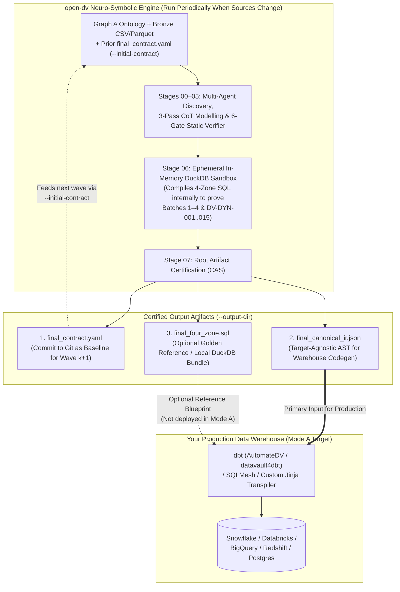
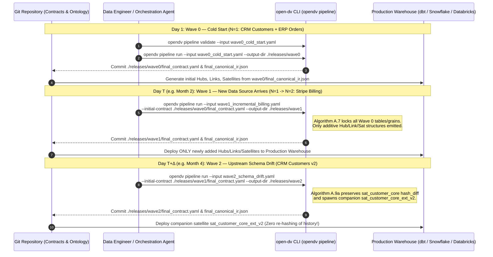

# 16 — Human & Autonomous Agent Usage & Integration Guide (`open-dv`)

> **Practical Playbook for Data Vault 2.0 Modelling, Periodic Source Onboarding, Downstream Warehouse Integration (`dbt` / `AutomateDV` / `Snowflake` / `Databricks` / `BigQuery` / `SQLMesh`), and Role-Specific Workflows**  
> **Target Audience:** Data Architects, Analytics Engineers, Data Stewards, Orchestration Agents, Downstream Translation Agents, and Core Contributors  
> **Companion Specifications:** [`AGENTS.md`](../AGENTS.md), [`README.md`](../README.md), [`docs/00-mission-vision-and-functional-requirements.md`](00-mission-vision-and-functional-requirements.md), [`docs/12-agentic-pipeline-inputs-and-harness-guide.md`](12-agentic-pipeline-inputs-and-harness-guide.md), [`docs/14-end-to-end-consistency-and-scenarios-audit.md`](14-end-to-end-consistency-and-scenarios-audit.md), [`docs/15-end-to-end-pipeline-execution-and-interactive-spec.md`](15-end-to-end-pipeline-execution-and-interactive-spec.md)

---

## Table of Contents

1. [Executive Summary: How Does `open-dv` Fit Into Your Data Stack?](#1-executive-summary-how-does-open-dv-fit-into-your-data-stack)
2. [Operating Mode Matrix & The Role of the SQL Bundle (`final_four_zone.sql`)](#2-operating-mode-matrix--the-role-of-the-sql-bundle-final_four_zonesql)
   - [2.1 The Three Operating Modes (`Mode A`, `Mode B`, `Mode C`)](#21-the-three-operating-modes-mode-a-mode-b-mode-c)
   - [2.2 Answering the Core Question: "If I Only Want DV 2.0 Modelling for My Production Warehouse, Is the SQL Bundle Needed?"](#22-answering-the-core-question-if-i-only-want-dv-20-modelling-for-my-production-warehouse-is-the-sql-bundle-needed)
3. [Step-by-Step Playbook: Onboarding New Data Sources Periodically ("Wave-by-Wave Lifecycle")](#3-step-by-step-playbook-onboarding-new-data-sources-periodically-wave-by-wave-lifecycle)
   - [3.1 Lifecycle Overview Diagram](#31-lifecycle-overview-diagram)
   - [3.2 Day 1 (`Wave 0` — Cold Start $N=1$): Establishing the Production Baseline](#32-day-1-wave-0--cold-start-n1-establishing-the-production-baseline)
   - [3.3 Day $T$ (`Wave k` — Onboarding a New Data Source $N \to N+1$ Periodically)](#33-day-t-wave-k--onboarding-a-new-data-source-n-to-n1-periodically)
   - [3.4 Day $T+\Delta$ (Handling Upstream Schema Drift & The 5 Unmatched Ontology Field Cases)](#34-day-tdelta-handling-upstream-schema-drift--the-5-unmatched-ontology-field-cases)
   - [3.5 Day $T+\text{Docs}$ (Onboarding Unstructured Contracts / PDFs onto Existing Hubs)](#35-day-tdocs-onboarding-unstructured-contracts--pdfs-onto-existing-hubs)
4. [Consuming `final_canonical_ir.json` & `final_contract.yaml` Downstream](#4-consuming-final_canonical_irjson--final_contractyaml-downstream)
   - [4.1 Structural Mapping: `CanonicalIR` $\to$ Target Warehouse Frameworks](#41-structural-mapping-canonicalir-to-target-warehouse-frameworks)
   - [4.2 Concrete Translation Example 1: `CanonicalIR` $\to$ `AutomateDV` / `dbt` Model & Schema YAML](#42-concrete-translation-example-1-canonicalir-to-automatedv--dbt-model--schema-yaml)
   - [4.3 Concrete Translation Example 2: `CanonicalIR` $\to$ Custom Python / Jinja Warehouse Generator (Snowflake / Databricks / BigQuery)](#43-concrete-translation-example-2-canonicalir-to-custom-python--jinja-warehouse-generator-snowflake--databricks--bigquery)
   - [4.4 Non-Negotiable Hash & Ghost-Record Invariants When Translating to Target Dialects](#44-non-negotiable-hash--ghost-record-invariants-when-translating-to-target-dialects)
5. [Role-Specific Guides for Humans](#5-role-specific-guides-for-humans)
   - [5.1 Data Architects (Ontology Curation, BKCC Governance & Topology Review)](#51-data-architects-ontology-curation-bkcc-governance--topology-review)
   - [5.2 Data & Analytics Engineers (Running Waves, Consuming IR & Inspecting Hash Formulas)](#52-data--analytics-engineers-running-waves-consuming-ir--inspecting-hash-formulas)
   - [5.3 Data Stewards (Resolving Captain-Holds via CLI & Web Workbench `WB-03` / `WB-07`)](#53-data-stewards-resolving-captain-holds-via-cli--web-workbench-wb-03--wb-07)
6. [Role-Specific Guides for Autonomous Agents](#6-role-specific-guides-for-autonomous-agents)
   - [6.1 Modelling & Orchestration Agents (`--json`, `--toon`, Exit Codes & Gate Discipline)](#61-modelling--orchestration-agents---json---toon-exit-codes--gate-discipline)
   - [6.2 Downstream Warehouse Translation Agents (Consuming `final_canonical_ir.json` Safely)](#62-downstream-warehouse-translation-agents-consuming-final_canonical_irjson-safely)
   - [6.3 Core Contributor & Enhancement Agents (Aligning with `docs/00` Without Brittle Coupling)](#63-core-contributor--enhancement-agents-aligning-with-docs00-without-brittle-coupling)

---

## 1. Executive Summary: How Does `open-dv` Fit Into Your Data Stack?

Most enterprise data teams do **not** run their production Enterprise Data Warehouse (EDW) inside a local DuckDB file. Instead, they execute ELT pipelines in **Snowflake, Databricks, Google BigQuery, Amazon Redshift, or Postgres** orchestrated via **dbt (`AutomateDV` / `datavault4dbt`), SQLMesh, Airflow, or Dagster**.

When teams adopt **`open-dv`**, their primary pain point is **Data Vault 2.0 architectural modelling and safe schema evolution**:
- *How do we map messy operational tables and periodic new data sources into mathematically sound Hubs, Links, and Satellites without falling into the 5 Fatal LLM Traps?*
- *When a new source system arrives 3 months later ($N \to N+1$), or an upstream CRM table adds/renames columns ($S_k(t) \to S_k(t+1)$), how do we evolve the Data Vault 100% additively without invalidating historical `hash_diff` digests or breaking existing Hub/Link grains?*

`open-dv` is designed with a strict **Intermediate Representation (IR)-First Architecture** specifically to serve this workflow. You can use `open-dv` purely as your **neuro-symbolic DV 2.0 modelling, evolution, and certification engine**, exporting target-agnostic contracts (`final_contract.yaml` and `final_canonical_ir.json`) directly into your production warehouse tooling.

---

## 2. Operating Mode Matrix & The Role of the SQL Bundle (`final_four_zone.sql`)

### 2.1 The Three Operating Modes (`Mode A`, `Mode B`, `Mode C`)

Depending on your goal, `open-dv` supports three distinct operating modes:

| Dimension | **Mode A: Target-Agnostic DV 2.0 Modelling & Evolution Engine** *(Most Common Enterprise Mode)* | **Mode B: Standalone Symbolic Verifier & CI/CD Quality Gate** *(Zero-LLM Mode)* | **Mode C: End-to-End Local / DuckDB Reference Execution** *(Prototyping & Lakehouse Mode)* |
| :--- | :--- | :--- | :--- |
| **Primary Goal** | Automatically model Day-1 sources ($N=1$) and periodically onboard new sources ($N \to N+1$) or schema drift ($S_k(t) \to S_k(t+1)$), then implement the verified model in **dbt / AutomateDV / Snowflake / Databricks / BigQuery / SQLMesh**. | Deterministically verify hand-authored or externally generated DV 2.0 contracts in CI/CD pull requests against enterprise ontologies (`Graph A`), empirical data profiles (`Graph B`), and prior production contracts. | Run the complete 8-stage pipeline and execute the generated 4-Zone SQL directly inside DuckDB for local prototyping, education, or DuckDB/MotherDuck data lakes. |
| **Primary Commands** | `opendv pipeline validate`<br>`opendv pipeline run --initial-contract ...` | `opendv profile`<br>`opendv verify --toon`<br>`opendv sandbox` | `opendv pipeline run`<br>`opendv compile`<br>`opendv sandbox` |
| **LLM Harness Required?** | **Yes** (`agy`, `claude-cli`, `antigravity`, or `claude`). | **No** (`--local` runs 100% deterministically with zero LLM tokens). | **Yes** for `pipeline run`; **No** for standalone `compile` / `sandbox`. |
| **Primary Output Artifacts You Consume** | 1. **`final_contract.yaml`** (`NoMistakeDataVault2ContractV5` — stored in Git as your versioned architectural source of truth and passed as `--initial-contract` on the next wave)<br>2. **`final_canonical_ir.json`** (`CanonicalIR` — machine-readable AST fed into your dbt/Snowflake/Databricks code generator) | 1. **Gate Scorecard JSON / `@toon_v1` Trace**<br>2. **Process Exit Code** (blocks non-compliant PRs in GitHub Actions / GitLab CI) | 1. **`final_four_zone.sql`** (Zones 0–4 DuckDB DDL, Staging Views, Raw Vault DML, Business Vault PIT/Bridge, and Bi-Temporal PIT queries)<br>2. **`final_contract.yaml` & `pipeline_report.md`** |
| **Is `final_four_zone.sql` Deployed to Production?** | **No.** Your production warehouse executes its own native SQL / dbt macros generated from `final_canonical_ir.json` or `final_contract.yaml`. | **No** (used only transiently inside the ephemeral `:memory:` DuckDB sandbox during Gate 5 verification). | **Yes** (executed directly in DuckDB / MotherDuck). |

---

### 2.2 Answering the Core Question: "If I Only Want DV 2.0 Modelling for My Production Warehouse, Is the SQL Bundle Needed?"

> [!IMPORTANT]
> **Short Answer: You do NOT deploy `final_four_zone.sql` to your production warehouse in Mode A.**  
> To implement your actual production Data Vault in Snowflake, Databricks, BigQuery, or dbt (`AutomateDV` / `datavault4dbt`), you only need **`final_contract.yaml`** (your declarative governance contract) and **`final_canonical_ir.json`** (the lowered, engine-agnostic Intermediate Representation containing every Hub, Link, Satellite, staging mapping, column type, and sorted hash input list).

However, even in **Mode A**, `open-dv`'s internal SQL compiler and `final_four_zone.sql` serve **two critical roles behind the scenes**:

1. **Role 1 — Mandatory Behind-the-Scenes Stage 06 Dynamic Verification Harness (`DV-DYN-001..015`):**
   - Static graph checks (`STAGE_05_AXI_DV_STATIC_GATES`) prove that your YAML contract is a valid bipartite DAG (`networkx`), that 100% of source columns are accounted for, and that `Algorithm A.7` additive evolution locks are respected.
   - However, static checks alone cannot prove **runtime data behavior**—such as whether your chosen Business Key actually deduplicates micro-batches cleanly, whether nullable foreign keys cause `INNER JOIN` row loss in Point-in-Time (PIT) tables, or whether re-running the same batch twice inserts duplicate Satellite rows.
   - Therefore, during `STAGE_06_AXI_DV_DYNAMIC_SANDBOX`, `open-dv` automatically compiles `final_canonical_ir.json` into 4-Zone DuckDB SQL in memory and runs **4 Adversarial Batches** against your actual sample data (`Batch 1: Cold Start + NULL FKs`, `Batch 2: Duplicate Replay Idempotency`, `Batch 3: Single-Attribute Mutation & Boundary-Shift Collision`, `Batch 4: Multi-Source Collision & PIT Reconstruction`).
   - **Why this matters for Mode A:** Because `STAGE_06` executes this SQL in an ephemeral in-memory DuckDB instance *before* `STAGE_07` seals your artifacts, you have mathematical proof that `final_canonical_ir.json` is dynamically sound before you ever translate it into Snowflake, Databricks, or dbt.

2. **Role 2 — Optional "Golden Reference Blueprint" for Data Engineers & Translation Agents:**
   - When your engineers or downstream code-generation agents write custom Jinja macros or SQLMesh templates for your target warehouse, subtle dialect bugs often creep in (e.g., forgetting the `-1` / `-2` Dual Zero Key union seeds, mis-ordering `hash_diff` columns, or writing a flawed `LAG(hash_diff)` window filter for Satellite delta loads).
   - `final_four_zone.sql` serves as a **100% transparent, human-readable reference implementation** of Zones 0–4 for your exact schema. Engineers can inspect `final_four_zone.sql` side-by-side with their dbt/Snowflake output to verify that their target warehouse macros implement the exact same length-prefixed SHA-256 hashing (`Algorithm A.5`), Ghost Record seeding, and anti-join semantics.



---

## 3. Step-by-Step Playbook: Onboarding New Data Sources Periodically ("Wave-by-Wave Lifecycle")

In a real enterprise, you do not onboard all 50 data sources on Day 1. You start with your initial core sources (**Wave 0 — Cold Start, $N=1$**), and then every few weeks or months (**Wave 1, Wave 2, ...**) you onboard a new operational system ($N \to N+1$), adapt to an upstream schema change ($S_k(t) \to S_k(t+1)$), or integrate unstructured legal/financial documents.

`open-dv` models this real-world cadence as **independent, sequential CLI invocations** chained together via `--initial-contract <prior_wave_final_contract.yaml>`.

### 3.1 Lifecycle Overview Diagram



---

### 3.2 Day 1 (`Wave 0` — Cold Start $N=1$): Establishing the Production Baseline

On Day 1, no prior Data Vault contract exists. You prepare three things:
1. **Enterprise Ontology (`Graph A` YAML):** Declares your Core Business Concepts (CBCs), target Hub names, PII governance rules, and 3-Tier Business Key Authority policies (see [`examples/pipeline_samples/global_commerce_vault/ontology/commerce_graph_a_ontology.yaml`](../examples/pipeline_samples/global_commerce_vault/ontology/commerce_graph_a_ontology.yaml)).
2. **Initial Bronze Schema Samples (CSV / Parquet / JSON):** Representative extracts or staging samples from your Day-1 tables (e.g., `crm_customers.csv` and `erp_orders.csv`).
3. **Wave 0 Input Specification (`wave0_cold_start.yaml`):**

```yaml
# examples/pipeline_samples/global_commerce_vault/wave0_cold_start.yaml
pipeline_id: "pipe-global-commerce-wave0-cold-start"
project_id: "proj-global-commerce-001"
run_id: "run-global-commerce-wave0"
display_name: "Global Commerce Vault — Wave 0 Cold Start (CRM & ERP)"
domain_namespace: "global_commerce"
graph_a_ontology_path: "ontology/commerce_graph_a_ontology.yaml"
assertion_cutoff_ts: "2026-12-31 23:59:59"

waves:
  - wave_index: 0
    wave_name: "Wave 0 — Cold Start (CRM Customers & ERP Orders)"
    wave_type: "COLD_START"
    description: "Initial cold-start onboarding of CRM customer master and ERP order feeds with PII isolation and sparse optional promotion FK splitting."
    sources:
      - source_system: "crm_salesforce"
        table_name: "crm_customers"
        data_path: "sources/wave0_cold_start/crm_customers.csv"
      - source_system: "erp_netsuite"
        table_name: "erp_orders"
        data_path: "sources/wave0_cold_start/erp_orders.csv"
```

#### Execute Wave 0 Validation & Modelling Run:

```bash
# Step 1: Deterministic pre-flight validation (zero LLM tokens)
uv run opendv pipeline validate \
  --input examples/pipeline_samples/global_commerce_vault/wave0_cold_start.yaml \
  --harness-config examples/pipeline_samples/global_commerce_vault/harness_config_agy.yaml \
  --json

# Step 2: Execute the 8-stage neuro-symbolic pipeline for Wave 0
uv run opendv pipeline run \
  --local \
  --stream \
  --role INTERNAL_MODELER \
  --input examples/pipeline_samples/global_commerce_vault/wave0_cold_start.yaml \
  --harness-config examples/pipeline_samples/global_commerce_vault/harness_config_agy.yaml \
  --output-dir ./releases/wave0
```

#### What `open-dv` Does Automatically on Day 1:
- **Quarantines Surrogate Keys (`Trap 2` Prevention):** Detects monotonic sequence columns like `customer_row_seq` via `GraphBProfiler` and marks them `SYSTEM_SURROGATE_DROPPED` in the Pass 1 Column Triage Ledger so they never contaminate Hub hash keys or Satellite `hash_diff` digests.
- **Isolates PII (`Algorithm A.1`):** Splits `contact_email` and `tax_ssn_tin` into `sat_customer_pii` (`security_classification: PII_HIGH`) while keeping general attributes in `sat_customer_core` under the Gate 4 YAGNI write-amplification guard ($W_{\text{amp}} \ge 50\text{ MB/day}$).
- **Splits Sparse Optional Foreign Keys (`Algorithm A.4`):** Detects that `promo_campaign_code` on `erp_orders` has non-null ratio $U_{\text{nn}} < 0.95$ and automatically splits it into a dedicated filtered Link (`lnk_order_customer_promotion` with `WHERE promo_campaign_code IS NOT NULL`) rather than polluting the base `lnk_order_customer` kernel Link with Zero Keys.
- **Seals Baseline Artifacts:** Writes `./releases/wave0/final_contract.yaml` and `./releases/wave0/final_canonical_ir.json`. **Commit `wave0/final_contract.yaml` to Git**—it is now your immutable production baseline.

---

### 3.3 Day $T$ (`Wave k` — Onboarding a New Data Source $N \to N+1$ Periodically)

Months later, your organization acquires or onboards a new operational data source—for example, regional Stripe EU billing invoices (`stripe_invoices.csv`).

#### How to Prepare for Wave 1 ($N=1 \to N=2$):
1. **Check Your `Graph A` Ontology:**
   - If the new source maps exclusively to **existing** Core Business Concepts (e.g., `CBC_CUSTOMER`, `CBC_ORDER`, `CBC_INVOICE` already in `commerce_graph_a_ontology.yaml`), you only need to ensure any new source-specific key patterns (such as `stripe_customer_code` under `tier_3_local_scoped`) are registered in `Graph A`.
   - If the new source introduces a **brand-new business entity** (e.g., `CBC_INVOICE`), add that concept and its relationship (`REL_INVOICE_ORDER_CUSTOMER`) to `commerce_graph_a_ontology.yaml`.
2. **Author the Wave 1 Input Spec (`wave1_incremental_billing.yaml`):**
   - Notice that you **only list the newly arriving source(s)** in `wave1_incremental_billing.yaml`—you do not need to re-list every historical CSV from Wave 0, because Wave 0's state is carried forward via `--initial-contract`.

```yaml
# examples/pipeline_samples/global_commerce_vault/wave1_incremental_billing.yaml
pipeline_id: "pipe-global-commerce-wave1-incremental-billing"
project_id: "proj-global-commerce-001"
run_id: "run-global-commerce-wave1"
display_name: "Global Commerce Vault — Wave 1 Incremental Source (Stripe Billing)"
domain_namespace: "global_commerce"
graph_a_ontology_path: "ontology/commerce_graph_a_ontology.yaml"
assertion_cutoff_ts: "2026-12-31 23:59:59"

waves:
  - wave_index: 1
    wave_name: "Wave 1 — Incremental Source Onboarding (Stripe Billing)"
    wave_type: "INCREMENTAL_SOURCE"
    description: "Incremental onboarding of regional Stripe EU billing invoices using TIER_3_LOCAL_SCOPED BKCC namespace STRIPE_EU."
    sources:
      - source_system: "billing_stripe"
        table_name: "stripe_invoices"
        data_path: "sources/wave1_incremental_billing/stripe_invoices.csv"
```

#### Execute Wave 1 with `--initial-contract`:

```bash
# Validate Wave 1 against Wave 0's verified contract
uv run opendv pipeline validate \
  --input examples/pipeline_samples/global_commerce_vault/wave1_incremental_billing.yaml \
  --initial-contract ./releases/wave0/final_contract.yaml \
  --harness-config examples/pipeline_samples/global_commerce_vault/harness_config_agy.yaml \
  --json

# Run Wave 1 incremental evolution
uv run opendv pipeline run \
  --local \
  --stream \
  --role INTERNAL_MODELER \
  --input examples/pipeline_samples/global_commerce_vault/wave1_incremental_billing.yaml \
  --initial-contract ./releases/wave0/final_contract.yaml \
  --harness-config examples/pipeline_samples/global_commerce_vault/harness_config_agy.yaml \
  --output-dir ./releases/wave1
```

#### What `--initial-contract` Guarantees (`Algorithm A.7` Additive Evolution Lock):
- **Transitions Lifecycle Stage:** Automatically transitions the contract from `COLD_START_N1` to `MULTI_SOURCE_EXPANSION`.
- **100% Backwards-Compatible Lock (`DV-EVO-001`–`008`):** Gate 3 (`verify_additive_evolution_invariants`) mathematically forbids dropping any existing Wave 0 Hub, Link, or Satellite, forbids changing any existing Hub's business key grain, and forbids mutating any existing Satellite's `payload_columns` list.
- **Cross-Source Key Resolution & `BKCC` Isolation:**
  - If the new source shares a `TIER_1_GLOBAL_STANDARD` key (e.g., `customer_tax_id`), `open-dv` passively integrates it into the existing `hub_customer` with `BKCC='GLOBAL'`.
  - If the new source uses a regional or system-local identifier (`stripe_customer_code` or `invoice_number` classified as `TIER_3_LOCAL_SCOPED`), `open-dv` enforces `require_src_qualifier: true` and prefixes the hash with `bkcc_prefix: "STRIPE_EU"` so local IDs never collide with global or other regional keys.
  - When a cross-walk or MDM mapping exists between a Tier-3 key and a Tier-1/2 master key, `open-dv` synthesizes a Business Vault **Same-As Link (`sal_<entity>`)** and **Effectivity Satellite (`esat_sal_<entity>`)** without altering the Raw Vault Hub.
- **Cumulative Output Contract:** `./releases/wave1/final_contract.yaml` contains the complete, merged enterprise vault (Wave 0 + Wave 1) ready to be committed to Git and passed as `--initial-contract` to Wave 2.

---

### 3.4 Day $T+\Delta$ (Handling Upstream Schema Drift & The 5 Unmatched Ontology Field Cases)

Operational source tables inevitably drift over time (`crm_customers.csv` $\to$ `crm_customers_v2.csv`), and new feeds often contain columns that do not cleanly match your `Graph A` ontology.

#### Running an Intra-Source Schema Drift Wave (`wave2_schema_drift.yaml`):

When an existing table evolves, pass `baseline_data_path` pointing to the prior snapshot (or rely on `--initial-contract`'s recorded column ledger):

```yaml
# examples/pipeline_samples/global_commerce_vault/wave2_schema_drift.yaml
pipeline_id: "pipe-global-commerce-wave2-schema-drift"
project_id: "proj-global-commerce-001"
run_id: "run-global-commerce-wave2"
display_name: "Global Commerce Vault — Wave 2 Intra-Source Schema Drift (CRM Customers v2)"
domain_namespace: "global_commerce"
graph_a_ontology_path: "ontology/commerce_graph_a_ontology.yaml"
assertion_cutoff_ts: "2026-12-31 23:59:59"

waves:
  - wave_index: 2
    wave_name: "Wave 2 — Intra-Source Schema Drift (CRM Customers v2)"
    wave_type: "SCHEMA_DRIFT"
    description: "Additive intra-source schema drift on crm_customers adding loyalty_tier_code and annual_spend_band without mutating historical hash_diff."
    sources:
      - source_system: "crm_salesforce"
        table_name: "crm_customers"
        data_path: "sources/wave2_schema_drift/crm_customers_v2.csv"
        baseline_data_path: "sources/wave0_cold_start/crm_customers.csv"
```

```bash
uv run opendv pipeline run \
  --local \
  --stream \
  --role INTERNAL_MODELER \
  --input examples/pipeline_samples/global_commerce_vault/wave2_schema_drift.yaml \
  --initial-contract ./releases/wave1/final_contract.yaml \
  --harness-config examples/pipeline_samples/global_commerce_vault/harness_config_agy.yaml \
  --output-dir ./releases/wave2
```

#### How `open-dv` Routes the 5 Unmatched Field & Schema Drift Cases (`docs/14` §2):

Whenever a live source feed contains columns that are added, renamed, dropped, or unmatched against `Graph A`, `open-dv` deterministically routes them across five canonical cases:

| Case # | Unmatched Field / Drift Scenario | Detection Stage & Mechanism | Rule / Codemod Triggered | How `open-dv` Resolves It (Zero Historical Corruption) |
| :---: | :--- | :--- | :--- | :--- |
| **1** | **New Descriptive Column on a Known Entity** *(e.g., `loyalty_tier_code`, `annual_spend_band` added to `crm_customers_v2.csv`)* | `STAGE_01_SCOUT_SOURCE` (`GraphBProfiler.detect_schema_drift`) $\to$ `STAGE_03` Pass 1 Triage | `EVO-01` + **`Algorithm A.9a`** (`codemod_intra_source_schema_drift`) + `Algorithm A.7` Lock | Keeps the existing `sat_customer_core` payload list 100% untouched (preserving all historical `hash_diff` values) and spawns an **additive companion Satellite (`sat_customer_core_ext_v2`)** with `volatility_tier: ADDITIVE_DRIFT_COMPANION` containing only the newly added columns. *(If a column is dropped upstream, `Algorithm A.9a` records it in `soft_deprecated_columns` and projects `CAST(NULL AS <type>)` in Zone 1 Staging.)* |
| **2** | **Renamed Source Column** *(Semantic/statistical match to an existing attribute, but physical column name changed)* | `STAGE_01_SCOUT_SOURCE` (functional dependency / distribution match + Levenshtein similarity $\ge 0.85$) $\to$ `STAGE_04` | `EVO-03` (Renamed Column Alias) | Maps `stg.<new_physical_col> AS <canonical_col>` inside the **Zone 1 Staging View (`stg_*`)**. The Raw Vault Satellite DDL and `hash_diff` formula remain 100% invariant. |
| **3** | **System / Operational Noise Column** *(e.g., `_fivetran_synced`, `etl_batch_id`, `row_seq_id` absent from ontology)* | `STAGE_01_SCOUT_SOURCE` regex/entropy profile $\to$ `STAGE_03_SHIP_VAULT_PASS1` | `DV-COL-012` (100% Column Accounting) + `SYSTEM_SURROGATE_DROPPED` | Explicitly records the column in `column_triage_ledger` with `elm_classification: "SYSTEM_SURROGATE_DROPPED"` and `target_dv_entity: "DROPPED_SURROGATE"`. Satisfies the 100% column audit rule while excluding the noise column from all Hubs and Satellite `hash_diff` calculations. |
| **4** | **Unknown Business Key or Orphan Foreign Key** *(Table or FK references an entity completely absent from `Graph A` ontology)* | `STAGE_01` (Gate 0) $\to$ `STAGE_05_AXI_DV_STATIC_GATES` (`Gate 1` `DV-G4-001` / `Gate 3` `DV-STR-*`) | `@toon_v1` `REJECT-WITH-TRACE` ($k \le 3$ self-heal) or `ASK-USER` (`PAUSED_HOLD`) | First emits a `@toon_v1` trace for `@ship-vault` to re-triage against existing `Graph A` concepts ($k=1 \to 2$). If the source genuinely introduces a new business concept not yet in `Graph A` (`urn:ontology:provisional:entity:<slug>`), Gate 1 blocks silent Hub proliferation (`Trap 1`) and either pauses with a **`StewardHoldRecord`** or fails static gates (`WB-07`), prompting the Data Architect to add the new CBC to `graph_a_ontology.yaml`. |
| **5** | **Unmatched / Ambiguous Entity Extracted from Unstructured Documents** *(e.g., `"Apex Sovereign Co-Invest Vehicle"` in an MSA addendum)* | `STAGE_02_SCOUT_UNSTRUCTURED` (`Algorithm A.9b` 3-Tier Entity Resolution) | `Tier-U3` (`TIER_U3_CAPTAIN_HOLD`, confidence $c < 0.75$ or top-2 margin $\Delta < 0.15$) $\to$ `Rule U1 / U4` | Refuses to guess or silently pollute `hub_customer`. Creates a `StewardHoldRecord` routed according to `steward_hold_policy` (`pause` halts the run for human Steward approval in `WB-03` or `opendv hold approve`; `auto_approve_top_candidate` selects the top match and logs an explicit `AUTO_REPAIRED` audit event). |

---

### 3.5 Day $T+\text{Docs}$ (Onboarding Unstructured Contracts / PDFs onto Existing Hubs)

When you want to link unstructured documents (Master Services Agreements, side letters, investment memos) to your existing relational Hubs (`Wave 3` — [`wave3_unstructured_msa.yaml`](../examples/pipeline_samples/global_commerce_vault/wave3_unstructured_msa.yaml)):

```bash
uv run opendv pipeline run \
  --local \
  --stream \
  --role INTERNAL_MODELER \
  --input examples/pipeline_samples/global_commerce_vault/wave3_unstructured_msa.yaml \
  --initial-contract ./releases/wave2/final_contract.yaml \
  --harness-config examples/pipeline_samples/global_commerce_vault/harness_config_agy.yaml \
  --output-dir ./releases/wave3
```

`open-dv` verifies exact character-span grounding (`document_text[char_start:char_end] == verbatim_quote` via `Algorithm A.9b`) and adds `hub_document`, `lnk_document_customer` (`UNSTRUCTURED_EXTRACTION_LINK`), an `AI_PROVENANCE_SATELLITE` (`extractor_model_id`, `confidence_score`, `evidence_quote`), and extracted attribute satellites—without touching your Wave 0–2 relational tables.

---

## 4. Consuming `final_canonical_ir.json` & `final_contract.yaml` Downstream

Once `opendv pipeline run` finishes, how do you turn `--output-dir/final_canonical_ir.json` (and `final_contract.yaml`) into production warehouse objects in **dbt (`AutomateDV` / `datavault4dbt`), Snowflake, Databricks, BigQuery, or SQLMesh**?

### 4.1 Structural Mapping: `CanonicalIR` $\to$ Target Warehouse Frameworks

`final_canonical_ir.json` conforms strictly to [`schemas/dv2-canonical-ir.schema.json`](../schemas/dv2-canonical-ir.schema.json) (`packages/opendv-core/src/opendv_core/models/canonical_ir.py`). Every construct in `CanonicalIR` maps 1:1 to standard Data Vault 2.0 macro frameworks or custom Jinja/SQL templates:

| `CanonicalIR` JSON Path (`final_canonical_ir.json`) | Key Fields Provided by `open-dv` | Target Mapping in **`AutomateDV` (`dbtvault`)** | Target Mapping in **Custom Jinja / Snowflake / Databricks / BigQuery / SQLMesh** |
| :--- | :--- | :--- | :--- |
| **`hash_config`** | `algorithm` (`SHA256`), `storage_type` (`CHAR(64)` / `BINARY(32)`), `delimiter` (`"\|\|"`), `encoding_scheme` (`LENGTH_PREFIXED`), `null_token_bk` (`"-1"`), `zero_key_unknown_token` (`"-1"`), `zero_key_error_token` (`"-2"`) | `vars: { hash: SHA256, concat_string: "\|\|", null_placeholder_string: "-1" }` in `dbt_project.yml` (or custom length-prefixed stage macro). | Global Jinja hash macro configuration; drives Zone 0 Dual Zero Key (`'0'*64`, `'f'*64`) and Ghost Record seeding. |
| **`system_columns`** | `load_dts_col` (`"load_dts"`), `load_dts_type`, `rec_src_col` (`"rec_src"`), `hash_diff_col` (`"hash_diff"`), `applied_dts_col` | `src_ldts: "load_dts"`, `src_source: "rec_src"` across all entity macros. | Standard audit columns injected into every Staging view and Raw/Business Vault table DDL. |
| **`hubs[]`** (`IRHub`) | `name` (`hub_customer`), `hk_column.name` (`hk_customer`), `hk_column.hash_expression.input_columns` (`["bkcc", "customer_tax_id"]`), `business_keys[]` (`name`, `is_bkcc`), `source_mappings[]` (`staging_table`, `bk_source_columns`, `rec_src_value`, `bronze_table`, `key_authority_tier`, `bkcc_literal`, `column_bkcc_map`) | `automate_dv.hub(src_pk="hk_customer", src_nk=["bkcc", "customer_tax_id"], src_ldts="load_dts", src_source="rec_src", source_model=[...])` + `automate_dv.stage(...)` | `CREATE TABLE IF NOT EXISTS raw_vault.hub_customer` + idempotent `INSERT INTO ... SELECT ... WHERE NOT EXISTS` unioned or iterated across `source_mappings[]`. |
| **`links[]`** (`IRLink`) | `name` (`lnk_order_customer`), `link_type` (`STANDARD`, `SAME_AS`, `NON_HISTORIZED`, `HIERARCHICAL`), `hk_column`, `hub_references[]` (`fk_column_name`, `target_hub`, `role_name`), `degenerate_columns[]`, `immutable_measures[]`, `source_mappings[]` (`staging_table`, `bronze_table`, `fk_source_columns`, `fk_bkcc_literals`, `rec_src_value`) | `automate_dv.link(src_pk=..., src_fk=[ref.fk_column_name for ref in hub_references], ...)` (or `automate_dv.t_link` when `link_type == "NON_HISTORIZED"`). | `CREATE TABLE IF NOT EXISTS raw_vault.<link.name>` + idempotent anti-join load on `hk_column.name`. (Includes `WHERE <fk> IS NOT NULL` filter on split companion links from `final_contract.yaml`.) |
| **`satellites[]`** (`IRSatellite`) | `name` (`sat_customer_core`, `sat_customer_core_ext_v2`), `satellite_type` (`STANDARD`, `MULTI_ACTIVE`, `EFFECTIVITY`), `split_classification` (`CORE`, `PII_RESTRICTED`, ...), `parent_entity`, `parent_hk_column`, `child_dependent_keys[]`, `driving_keys[]`, `hash_diff_column.hash_expression.input_columns` *(strictly sorted A–Z)*, `payload_columns[]`, `source_mapping` | `automate_dv.sat(src_pk=parent_hk_column.name, src_hashdiff="hash_diff", src_payload=[c.name for c in payload_columns], ...)` (or `ma_sat` / `eff_sat`). | `CREATE TABLE IF NOT EXISTS raw_vault.<sat.name>` + true-delta `LAG(hash_diff)` + latest-vault-state anti-join `INSERT` statement. |
| **`pit_tables[]` & `bridge_tables[]`** | `name` (`pit_customer`, `brg_...`), `parent_entity`, `as_of_dts_column`, `tracked_satellites[]`, `traversed_hubs[]`, `traversed_links[]` | `automate_dv.pit(...)` / `automate_dv.bridge(...)` in `models/business_vault/`. | Business Vault Point-in-Time (`pit_*`) and Bridge (`brg_*`) tables joining `tracked_satellites[]` onto Ghost Records (`0x00..00`) so Marts can use pure `INNER JOIN`s. |

---

### 4.2 Concrete Translation Example 1: `CanonicalIR` $\to$ `AutomateDV` / `dbt` Model & Schema YAML

Suppose `opendv pipeline run` emits the following Hub and Satellite entries in `final_canonical_ir.json`:

```json
{
  "ir_version": "1.0.0",
  "model_name": "global_commerce",
  "hash_config": {
    "algorithm": "SHA256",
    "storage_type": "CHAR(64)",
    "delimiter": "||",
    "null_token_bk": "-1",
    "null_token_payload": "-1",
    "zero_key_unknown_token": "-1",
    "zero_key_error_token": "-2",
    "encoding_scheme": "LENGTH_PREFIXED"
  },
  "system_columns": {
    "load_dts_col": "load_dts",
    "load_dts_type": "TIMESTAMP",
    "rec_src_col": "rec_src",
    "rec_src_type": "VARCHAR(255)",
    "hash_diff_col": "hash_diff"
  },
  "hubs": [
    {
      "name": "hub_customer",
      "business_concept": "CBC_CUSTOMER",
      "verified_global_master_key": true,
      "hk_column": {
        "name": "hk_customer",
        "data_type": "CHAR(64)",
        "nullable": false,
        "hash_expression": {
          "algorithm": "SHA256",
          "input_columns": ["bkcc", "customer_tax_id"],
          "normalization": "UPPER_TRIM"
        }
      },
      "business_keys": [
        { "name": "bkcc", "data_type": "VARCHAR(32)", "nullable": false, "is_bkcc": true },
        { "name": "customer_tax_id", "data_type": "VARCHAR(512)", "nullable": false, "is_bkcc": false }
      ],
      "load_dts_column": { "name": "load_dts", "data_type": "TIMESTAMP", "nullable": false },
      "rec_src_column": { "name": "rec_src", "data_type": "VARCHAR(255)", "nullable": false },
      "source_mappings": [
        {
          "staging_table": "stg_crm_salesforce_crm_customers",
          "bk_source_columns": ["customer_tax_id"],
          "rec_src_value": "CRM_SALESFORCE"
        }
      ]
    }
  ],
  "satellites": [
    {
      "name": "sat_customer_core",
      "satellite_type": "STANDARD",
      "split_classification": "CORE",
      "parent_entity": "hub_customer",
      "parent_hk_column": {
        "name": "hk_customer",
        "target_column": "hk_customer",
        "data_type": "CHAR(64)",
        "nullable": false
      },
      "load_dts_column": { "name": "load_dts", "data_type": "TIMESTAMP", "nullable": false },
      "rec_src_column": { "name": "rec_src", "data_type": "VARCHAR(255)", "nullable": false },
      "hash_diff_column": {
        "name": "hash_diff",
        "data_type": "CHAR(64)",
        "nullable": false,
        "hash_expression": {
          "algorithm": "SHA256",
          "input_columns": ["Account_Status", "country_code", "legal_name"],
          "normalization": "EXACT_TRIM"
        }
      },
      "payload_columns": [
        { "name": "Account_Status", "data_type": "VARCHAR(64)", "nullable": true },
        { "name": "country_code", "data_type": "VARCHAR(16)", "nullable": true },
        { "name": "legal_name", "data_type": "VARCHAR(255)", "nullable": true }
      ],
      "source_mapping": {
        "staging_table": "stg_crm_salesforce_crm_customers",
        "rec_src_value": "CRM_SALESFORCE"
      }
    }
  ]
}
```

From that single JSON structure, a downstream script or translation agent deterministically emits the `dbt` models:

```sql
-- models/staging/stg_crm_salesforce_crm_customers.sql
-- Generated from final_canonical_ir.json + final_contract.yaml
{{ config(materialized='view') }}


source_model:
  crm_salesforce: "crm_customers"
derived_columns:
  rec_src: "!CRM_SALESFORCE"
  load_dts: "load_dts"
  bkcc: "!GLOBAL"
hashed_columns:
  hk_customer:
    - "bkcc"
    - "customer_tax_id"
  hash_diff:
    is_hashdiff: true
    columns:
      - "Account_Status"
      - "country_code"
      - "legal_name"




{{ automate_dv.stage(
    include_source_columns=true,
    source_model=metadata_dict['source_model'],
    derived_columns=metadata_dict['derived_columns'],
    null_columns=none,
    hashed_columns=metadata_dict['hashed_columns'],
    ranked_columns=none
) }}
```

```sql
-- models/raw_vault/hubs/hub_customer.sql
-- Generated from final_canonical_ir.json -> $.hubs[?(@.name=='hub_customer')]
{{ config(materialized='incremental') }}







{{ automate_dv.hub(
    src_pk=src_pk,
    src_nk=src_nk,
    src_ldts=src_ldts,
    src_source=src_source,
    source_model=source_model
) }}
```

```sql
-- models/raw_vault/satellites/sat_customer_core.sql
-- Generated from final_canonical_ir.json -> $.satellites[?(@.name=='sat_customer_core')]
{{ config(materialized='incremental') }}


source_model: "stg_crm_salesforce_crm_customers"
src_pk: "hk_customer"
src_hashdiff:
  source_column: "hash_diff"
  alias: "hash_diff"
src_payload:
  - "Account_Status"
  - "country_code"
  - "legal_name"
src_ldts: "load_dts"
src_source: "rec_src"




{{ automate_dv.sat(
    src_pk=metadata_dict['src_pk'],
    src_hashdiff=metadata_dict['src_hashdiff'],
    src_payload=metadata_dict['src_payload'],
    src_eff=none,
    src_ldts=metadata_dict['src_ldts'],
    src_source=metadata_dict['src_source'],
    source_model=metadata_dict['source_model']
) }}
```

---

### 4.3 Concrete Translation Example 2: `CanonicalIR` $\to$ Custom Python / Jinja Warehouse Generator (Snowflake / Databricks / BigQuery)

If you use a custom SQL generator (or SQLMesh / native Snowflake / Databricks workflows) rather than `AutomateDV`, you can load `final_canonical_ir.json` directly using `opendv-core`'s typed Pydantic v2 model (`CanonicalIR`) in ~30 lines of Python:

```python
from pathlib import Path
from opendv_core.models.canonical_ir import CanonicalIR

# 1. Load and validate the certified Canonical IR JSON
ir_path = Path("./releases/wave2/final_canonical_ir.json")
ir = CanonicalIR.model_validate_json(ir_path.read_text(encoding="utf-8"))

# 2. Emit Algorithm A.5 Length-Prefixed SHA-256 SQL for your target warehouse dialect
def render_length_prefixed_sha256_snowflake(
    columns: list[str],
    normalization: str,
    null_token: str = "-1",
    delimiter: str = "||",
) -> str:
    """Render Open-DV Algorithm A.5 injective length-prefixed SHA-256 expression for Snowflake."""
    parts: list[str] = []
    for col in columns:
        trimmed = f"TRIM(CAST({col} AS VARCHAR))"
        norm_expr = f"UPPER({trimmed})" if normalization == "UPPER_TRIM" else trimmed
        nullif_expr = f"NULLIF({norm_expr}, '')"
        # Use OCTET_LENGTH (UTF-8 byte length) to match Python len(s.encode('utf-8'))!
        token_expr = (
            f"CASE WHEN {nullif_expr} IS NULL THEN '{null_token}' "
            f"ELSE CAST(OCTET_LENGTH({nullif_expr}) AS VARCHAR) || ':' || {nullif_expr} END"
        )
        parts.append(token_expr)
    concat_sql = f" || '{delimiter}' || ".join(parts)
    return f"LOWER(SHA2({concat_sql}, 256))"

# 3. Iterate over Hubs, Links, and Satellites (including Wave 2's sat_customer_core_ext_v2!)
for sat in ir.satellites:
    hash_expr = render_length_prefixed_sha256_snowflake(
        columns=sat.hash_diff_column.hash_expression.input_columns,
        normalization=sat.hash_diff_column.hash_expression.normalization,
        null_token=ir.hash_config.null_token_payload,
        delimiter=ir.hash_config.delimiter,
    )
    print(f"Satellite: {sat.name} (Parent: {sat.parent_entity}, Type: {sat.split_classification})")
    print(f"  Payload Columns (A-Z): {[c.name for c in sat.payload_columns]}")
    print(f"  Snowflake HASHDIFF SQL: {hash_expr}\n")
```

---

### 4.4 Non-Negotiable Hash & Ghost-Record Invariants When Translating to Target Dialects

If you author custom SQL templates for Snowflake, Databricks, BigQuery, or Postgres instead of using `open-dv`'s built-in compiler, preserve these five mathematical invariants from [`docs/01-core-modelling-spec.md`](01-core-modelling-spec.md) and [`docs/14-end-to-end-consistency-and-scenarios-audit.md`](14-end-to-end-consistency-and-scenarios-audit.md):

1. **Use UTF-8 Byte Length (`OCTET_LENGTH` / `BYTE_LENGTH`), Never Character Count (`LENGTH` / `STRLEN`):**
   - `open-dv`'s Python reference hasher (`Algorithm A.5` in `opendv-core/hashing.py`) prefixes every value with `len(val.encode('utf-8'))`. In SQL dialects, always use `OCTET_LENGTH(col)` (Snowflake/Postgres/DuckDB) or `BYTE_LENGTH(col)` (BigQuery) so multi-byte UTF-8 characters (e.g., `'ä'`, `'€'`) produce identical SHA-256 digests across Python and SQL (`BUG-01` in `docs/14`).
2. **Harmonize Hex Digest Casing:**
   - Standardize on consistent hex casing (`LOWER(SHA2(..., 256))` or `UPPER(...)`) across all Staging views and Zero Key seeds so joins between Python-computed Hash Pills and warehouse tables never fail on case sensitivity (`BUG-06` in `docs/14`).
3. **Preserve Strict Alphabetical `hash_diff` Column Ordering (`INV-04` / `DV-COL-006`):**
   - Always iterate `sat.hash_diff_column.hash_expression.input_columns` in the exact sorted order emitted in `final_canonical_ir.json`.
4. **Seed Dual Zero Keys (`'0'*64` for Unknown `-1`, `'f'*64` for Error `-2`) and Ghost Records (`1900-01-01 00:00:00`):**
   - Ensure every Hub has the Unknown and Error Zero Keys seeded, and every Satellite has the `1900-01-01 00:00:00` Ghost Record seeded for `0x00..00`. This guarantees that Point-in-Time (`pit_*`) queries can use fast `INNER JOIN`s with zero row loss when optional foreign keys are `NULL`.
5. **Filter Unstructured Extraction Links by Steward Approval (`BUG-03` in `docs/14`):**
   - When loading `UNSTRUCTURED_EXTRACTION_LINK` tables in production, always include `WHERE steward_gate_status = 'APPROVED'` so unapproved `Tier-U3` Captain-Hold candidates cannot enter the Raw Vault.

---

## 5. Role-Specific Guides for Humans

### 5.1 Data Architects (Ontology Curation, BKCC Governance & Topology Review)

As a **Data Architect**, you govern the semantic guardrails (`Graph A`) and review structural changes across waves. You never have to write repetitive staging or satellite boilerplate by hand.

#### Your Core Workflow:
1. **Curate `Graph A` (`graph_a_ontology.yaml`):**
   - Define each Enterprise Core Business Concept (`canonical_business_concepts[]`) with its `concept_uri`, `elm_archetype` (`WHO_PARTY`, `WHAT_EVENT_ANCHOR`, `WHAT_FINANCIAL_INSTRUMENT`, `HOW_CONTRACTUAL_RULE`, `WHAT_UNSTRUCTURED_ARTIFACT`), and `target_hub`.
   - Specify `governance_constraints.pii_confidential_attributes` and `required_satellite_split` so PII columns are automatically isolated into `PII_HIGH` satellites.
   - Define `key_authority_tiers` (`tier_1_global_standard`, `tier_2_enterprise_sor`, `tier_3_local_scoped`) and `bkcc_policy` namespaces (`GLOBAL` vs source-scoped prefixes like `STRIPE_EU` or `LEGACY_GP_ADMIN`).
2. **Review Wave Topology Diffs & Gate Scorecards:**
   - Inspect `pipeline_report.md` or open the Web Workbench (`WB-00` Command Center, `WB-02` Bipartite Topology Canvas, `WB-04` 6-Gate Scorecard, and `WB-06` Schema Evolution & Drift Inspector).
   - Verify that `TIER_3_LOCAL_SCOPED` keys have a valid `system_scoped_bk_justification` and never collide with `TIER_1_GLOBAL_STANDARD` keys in shared Hubs.
3. **Approve Ontology Additions When Scenario S3 Occurs:**
   - When a new data source introduces an unmapped concept and halts at Gate 1 (`DV-G4-001` / `WB-07`), decide whether the table belongs to an existing Hub (add a `cbc_mapping_hints` entry) or represents a genuine new enterprise concept (add the new CBC and relationship to `graph_a_ontology.yaml`).

---

### 5.2 Data & Analytics Engineers (Running Waves, Consuming IR & Inspecting Hash Formulas)

As a **Data / Analytics Engineer**, you execute onboarding waves, troubleshoot source data quality issues, and wire `final_canonical_ir.json` into your `dbt` / Snowflake / Databricks / SQLMesh deployment pipelines.

#### Your Core Workflow:
1. **Profile New Bronze Feeds Quickly (`opendv profile`):**
   ```bash
   uv run opendv profile --local \
     --source-csv path/to/new_source.csv \
     --source-system billing_stripe \
     --table-name stripe_invoices \
     --json
   ```
   Inspect empirical uniqueness $U(C)$, null ratio $N_{\text{null}}(C)$, and pattern classes (`MONOTONIC_INT`, `RANDOM_UUID_V4`, `ALPHANUMERIC_CODE`) before writing your wave spec.
2. **Run Pre-Flight Validation & Incremental Pipeline Waves (`opendv pipeline`):**
   - Always run `opendv pipeline validate` first to catch missing files, column typos (`DECLARED_COLUMNS_MISSING`), or unstructured character-span mismatches (`SPAN_QUOTE_MISMATCH`) in $<1$ second.
   - Run `opendv pipeline run --initial-contract <prev_final_contract.yaml> --output-dir <wave_dir>`.
3. **Inspect Column Lineage & Hash Formulas (`WB-05` & `final_four_zone.sql`):**
   - Check `waves/wave_<w>/wave_<w>_pass1_column_triage.json` (or `WB-05` Column Lineage & Hash-Pill Inspector) to verify how every physical source column was routed (`BUSINESS_KEY`, `FOREIGN_KEY_REF`, `OPTIONAL_FOREIGN_KEY_REF`, `DESCRIPTIVE_PAYLOAD`, `PII_RESTRICTED_PAYLOAD`, `SYSTEM_SURROGATE_DROPPED`).
   - Use `final_four_zone.sql` as your reference blueprint when validating custom dbt macros or debugging hash discrepancies across environments.

---

### 5.3 Data Stewards (Resolving Captain-Holds via CLI & Web Workbench `WB-03` / `WB-07`)

As a **Data Steward**, you are the human-in-the-loop authority whenever `open-dv` encounters ambiguous entity resolution in unstructured documents (`Tier-U3` Captain-Hold, confidence $c < 0.75$ or top-2 margin $\Delta < 0.15$) or ambiguous grain escalations (`Gate 3 / Gate 4` holds).

#### Your Core Workflow:
1. **Listing Active Captain-Holds via CLI (`opendv hold list`) or Workbench (`WB-03`):**
   When a pipeline run is executed with `--hold-policy pause` (or `steward_hold_policy: pause` in `harness_config.yaml`), any `Tier-U3` extraction pauses the run with `status: "PAUSED_HOLD"`.
   ```bash
   # List all pending Steward Captain-Holds
   uv run opendv hold list --local --role DATA_STEWARD --json
   ```
2. **Inspecting Evidence & Candidate Matches:**
   In Web Workbench View **`WB-03` (Steward Captain-Hold & Entity Resolution Queue)** (or **`WB-07` Unmapped Escalation & Governance Console**), inspect:
   - The exact `verbatim_quote` highlighted at `[char_start, char_end]` in the source document.
   - The ranked `candidate_hub_matches` (with similarity scores and top-2 margin $\Delta = s_1 - s_2$).
3. **Approving, Rejecting, or Answering a Hold (`opendv hold approve | reject | answer`):**
   ```bash
   # Approve a Tier-U3 hold by selecting the verified target candidate business key
   uv run opendv hold approve --local \
     --role DATA_STEWARD \
     --hold-id hold-ext-msa-guarantor-u3 \
     --candidate "TAX-DE-440912" \
     --steward "jane.steward@enterprise.com" \
     --notes "Verified parent guarantor legal entity in EU VIES registry." \
     --json

   # Or reject an invalid/hallucinated extraction
   uv run opendv hold reject --local \
     --role DATA_STEWARD \
     --hold-id hold-ext-msa-guarantor-u3 \
     --steward "jane.steward@enterprise.com" \
     --notes "Mention refers to a non-binding marketing partner, not a legal counterparty." \
     --json
   ```
   Every Steward decision is cryptographically recorded in `vault-ledger.jsonl` with your `steward_id`, timestamp, and rationale notes.

---

## 6. Role-Specific Guides for Autonomous Agents

### 6.1 Modelling & Orchestration Agents (`--json`, `--toon`, Exit Codes & Gate Discipline)

If you are an **autonomous orchestration agent** (e.g., an enterprise data platform agent, CI/CD bot, or `dv-firstmate` supervisor) invoking `open-dv` via CLI or REST API:

#### 1. Always Use Machine-Parseable Output Flags (`--json` and `--toon`):
- Pass `--json` on `opendv pipeline validate`, `opendv pipeline run`, `opendv pipeline report`, `opendv profile`, `opendv compile`, and `opendv sandbox` so `stdout` is guaranteed to be pure, deterministic JSON (`sort_keys=True`).
- When combining `--stream` with `--json`, `open-dv` automatically routes live stage/token progress to `stderr` so `stdout` remains uncorrupted JSON.
- Pass `--toon` on `opendv verify` / `axi-dv verify` (`uv run axi-dv verify --local --contract ... --toon`) when feeding verification diagnostics into an LLM repair loop. `@toon_v1` (Token-Oriented Object Notation) compresses verbose JSON traces by ~65% while preserving exact rule IDs (`DV-STR-*`, `DV-COL-*`, `DV-EVO-*`), JSON paths, and prescriptive remediation hints.

#### 2. Respect CLI Exit Codes & Normative Status Verdicts:
Check both the process exit code and the top-level JSON `status` / `verdict` fields:

| CLI Exit Code | Spec / Gate Status Code (`docs/00` & `axi-dv`) | Meaning | Mandatory Agent Action |
| :---: | :--- | :--- | :--- |
| **`0`** | `PASS` / `COMPLETED` | All static gates (`G0`–`G5`) and dynamic sandbox batches (`Batches 1–4`, `DV-DYN-001..015`) passed (or `PAUSED_HOLD` cleanly persisted when `--hold-policy pause` is active). | Proceed to consume `final_contract.yaml` and `final_canonical_ir.json` (or notify Steward if `status == "PAUSED_HOLD"`). |
| **`1`** *(Normative `10`)* | `REJECT_WITH_TRACE` / `FAILED_STATIC_GATES` | One or more static gates (`G0`–`G4`: schema, grain, BKCC authority, SQLGlot AST, NetworkX DAG, or YAGNI guard) failed. | Read `diagnostics[]` or `toon_text` (`@toon_v1`) and repair the candidate contract within the retry budget (`max_schema_validation_retries <= 3`). **Never bypass the gate.** |
| **`1`** *(Normative `20` / `21`)* | `FAILED_EVOLUTION_LOCK` (`DV-EVO-001..008`) / `FAILED_DYNAMIC_SANDBOX` (`DV-DYN-001..015`) | Breaking mutation against `--initial-contract` (`Algorithm A.7`) or runtime failure in the 4-Batch DuckDB Shadow Sandbox (`STAGE_06`). | Restore dropped/mutated baseline entities (`DV-EVO-*`) or fix grain/FK mappings causing runtime duplicates/orphans (`DV-DYN-*`). If intentional grain shift is required, escalate to human Architect. |
| **`0` / `1`** *(Normative `30`)* | `ASK_USER` / `PAUSED_HOLD` | Ambiguous `Tier-U3` entity resolution or `unmapped_escalations` requiring human Steward or Architect decision. | Do **not** hallucinate a resolution. Surface the `StewardHoldRecord` (`hold_id`, `verbatim_quote`, `candidate_hub_matches`) to the human via `opendv hold` or `WB-03` / `WB-07`. |
| **`2`** *(Normative `40`)* | `ERROR` / `PREFLIGHT_FAILED` | Invalid CLI arguments, missing input files, path traversal attempt, or harness credential failure (`HARNESS_AUTH_MISSING`, `HARNESS_PROVIDER_UNAVAILABLE`). | Inspect `validation_errors[]` / `detail` in the JSON output and fix the input file path or environment variable configuration. |

#### 3. Anti-Reward-Hacking Boundaries (Hard Rules for Orchestration Agents):
- **Never edit `final_contract.yaml` or `final_canonical_ir.json` after `STAGE_07` without re-running `opendv verify` and `opendv sandbox`.** Modifying a certified contract post-verification invalidates its Content-Addressable Store (CAS) SHA-256 digest in `pipeline_report.json`.
- **Never omit `--initial-contract` when running an incremental wave ($k \ge 1$).** Running Wave $k$ without `--initial-contract` treats the wave as an isolated `COLD_START_N1` vault and bypasses `Algorithm A.7` additive evolution locks against your deployed production warehouse.
- **Never mutate `schemas/*.json` or `packages/opendv-axi-verifier` rules to make a failing model pass.**

---

### 6.2 Downstream Warehouse Translation Agents (Consuming `final_canonical_ir.json` Safely)

If you are a **Downstream Warehouse Translation Agent** tasked with converting `open-dv` outputs into target warehouse code (e.g., generating Snowflake DDL, Databricks Delta Live Tables, BigQuery SQL, or `dbt` / `AutomateDV` / `SQLMesh` projects):

1. **Read `final_canonical_ir.json` as Your Primary Structural Input, Supplemented by `final_contract.yaml`:**
   - Parse `final_canonical_ir.json` for all table names, column data types, `hk_column` / `hash_diff_column` input column lists, normalization modes (`UPPER_TRIM` vs `EXACT_TRIM`), `hub_references`, `payload_columns`, `pit_tables`, and `bridge_tables`.
   - Cross-reference `final_contract.yaml` when you need high-level governance metadata such as `column_triage_ledger` (e.g., to see which columns were `SYSTEM_SURROGATE_DROPPED`), `soft_deprecated_columns` (to project `CAST(NULL AS <type>)` in staging views), or `where_filter` predicates on split nullable-FK links (`WHERE <optional_fk> IS NOT NULL`).
2. **Cross-Check Your Generated SQL Against `final_four_zone.sql`:**
   - Before finalizing custom Jinja macros or target-dialect DDL/DML templates, inspect `final_four_zone.sql` in `--output-dir` to verify that your target SQL preserves:
     - Length-prefixed canonicalization (`<utf8_byte_len>:<normalized_value>` joined by `||`, with `-1` for NULLs).
     - Strict alphabetical ordering of `hash_diff` payload columns.
     - Dual Zero Key seeding (`'0'*64` and `'f'*64`) and Satellite Ghost Record seeding (`1900-01-01 00:00:00`).
     - True-delta Satellite loading (comparing both intra-batch `LAG(hash_diff)` and latest target vault `hash_diff` so duplicate replay batches insert `0` rows).

---

### 6.3 Core Contributor & Enhancement Agents (Aligning with `docs/00` Without Brittle Coupling)

If you are a **Core Contributor Agent** implementing bug fixes (such as the remediation items in [`docs/14-end-to-end-consistency-and-scenarios-audit.md`](14-end-to-end-consistency-and-scenarios-audit.md) §4) or adding new features to the `open-dv` monorepo:

1. **Anchor Every Change in [`docs/00-mission-vision-and-functional-requirements.md`](00-mission-vision-and-functional-requirements.md):**
   - Always read `docs/00-mission-vision-and-functional-requirements.md` first to verify that your change upholds the core mission pillars:
     - **Neuro-Symbolic Separation of Concerns:** LLMs handle semantic ambiguity (discovering business keys, mapping ontology concepts, grounding unstructured spans); symbolic Python/SQL engines handle mathematical certainty (hashing, AST verification, DAG topology, DDL/DML compilation). Never move deterministic logic into an LLM prompt, and never hardcode domain-specific table/column names (`crm_customers`, `stripe_invoices`, `investran`) inside core packages (`opendv-core`, `opendv-axi-verifier`, `opendv-duckdb-sandbox`, `opendv-agent-harness`).
     - **Hexagonal & Target-Agnostic Interfaces:** Keep `VaultAgentHarness` vendor-agnostic across `agy`, `claude-cli`, `antigravity`, and `claude`, and keep `NoMistakeDataVault2ContractV5` and `CanonicalIR` strictly validated against `schemas/*.schema.json` (`ConfigDict(extra="forbid")`).
     - **Defense-in-Depth Security & 5-Tier RBAC:** Ensure every telemetry event and report passes `validate_no_pii_leaks` so `PUBLIC` and `INTERNAL_MODELER` roles never leak raw `RESTRICTED_PII`, `MNPI`, or unredacted 64-hex hash digests.
2. **Verify Without Brittle Implementation Coupling:**
   - When adding or updating tests in `tests/` or `packages/*/tests/`, test **architectural invariants and input/output contracts** (e.g., $U_{\text{nn}} < 0.95$ link splitting, `OCTET_LENGTH` UTF-8 byte parity between Python and DuckDB, `DV-EVO-001..008` evolution locks, and `DV-DYN-001..015` 4-batch idempotency) rather than asserting brittle internal private method names or hardcoded prompt strings.
   - Run the full polyglot verification suite before completing any task:
     ```bash
     # Run Python unit, package, and end-to-end normative specification tests
     uv run pytest -v

     # Run TypeScript Protocol SDK and 12-View Web Workbench tests
     bun test
     ```
