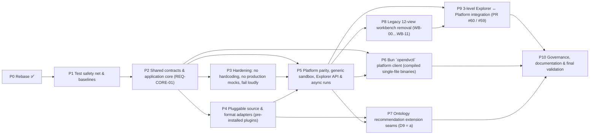
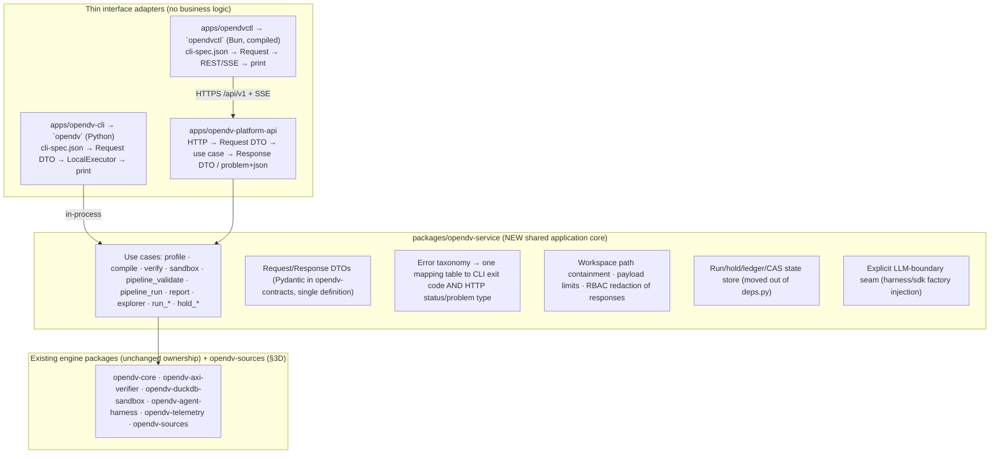
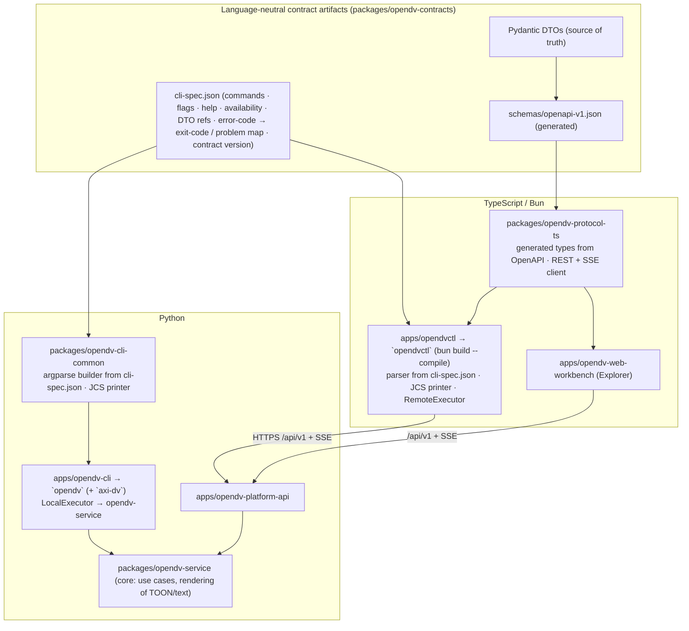
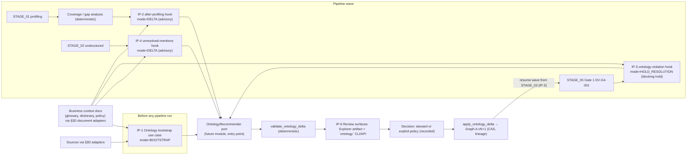

# 18 — Implementation Plan (v3.9): Platform Parity & Architecture — Shared Core, Two Consistent CLIs, Pluggable Source Adapters, Hardening, Ontology-Recommender Seams, Legacy Workbench Removal & 3-Level Explorer Integration

> **Module:** `docs/18-implementation-plan-platform-parity-and-architecture.md` · **Revision:** v3.9 (2026-11-04)
> **Status:** Approved plan. Implementation is tracked in the master tracker [#63](https://github.com/nogoo9/open-dv/issues/63), with phase sub-issues #64, #70, #76, #82, #89, #96, #101, #109, #114 and #120, and their task sub-issues. P0 (rebase) is done.
> **Governing docs:** [`docs/00`](00-mission-vision-and-functional-requirements.md) (mission & FRs) · [`docs/17`](17-testing-scenarios-and-datasets.md) (test ledger) · [`docs/design/open-dv-workbench/HANDOFF.md`](design/open-dv-workbench/HANDOFF.md) (on PR #60) · [`AGENTS.md`](../AGENTS.md)
> **How to use this document:** future agents and contributors pick up a **task issue** (`P<phase>.<n>`), read the referenced sections here, and deliver one PR per task that passes full CI and no-mistakes. Requirements (`REQ-*`), decisions (`D1`–`D9`), tests (`T1`–`T17`, goldens `GT-01`–`GT-06`) and risks (`R1`–`R19`) are referenced by ID. §0 is the revision history of how the plan evolved.

---

## 0. What changed since v2

| # | Improvement | Why |
| :--- | :--- | :--- |
| 1 | **Commit order changed so nothing breaks partway through.** New parity endpoints and tests land *before* the legacy `WB-*` routes are deleted. | In v2, deleting `WB-02`/`WB-11` first would break `opendv profile/compile --api-url` at an intermediate commit. |
| 2 | **Four design decisions surfaced (§2).** | v2 assumed server-side file paths. That only works when the CLI and server share a filesystem, so `--api-url` against a real remote server would fail. |
| 3 | **A scenario registry plus a meta-test tie the parity suite to `docs/17` (§7.3).** | Without it, a future agent can add a `docs/17` scenario that never gets parity coverage, and the rule stays honour-system only. |
| 4 | **Parity is checked as normalized three-way equality, not "each mode passes" (§7.2).** | Three green runs can still give different outputs. Byte-identical artifact SHA-256s are the real parity proof. |
| 5 | **Coverage matrix for S1–S10 and UF-1–UF-5, with new datasets for gaps (§7.4).** | S3, UF-2 and UF-4 have no dataset anywhere today. S9 exists only on unmerged PR #42. |
| 6 | **Test categories added:** error/exit-code parity, security, RBAC matrix, SSE, Explorer invariants, hold lifecycle, cross-language contracts, removal guards, frontend, baselines, live-provider. | v2 only had the scenario-parity table. |
| 7 | **CI changes (§7.7).** | CI runs only `pytest -v` today. `bun test`, `tsc` and the OpenAPI drift check never run, so the frontend and TS SDK tests are not enforced. |
| 8 | **Risks and coordination with open scenario PRs (§9).** | Updated in v3.1: only PR #58 (#32) is still open. |
| 9 | **v3.1: test cases re-based on `main` `f0c2881` (§3, §7.3–§7.5).** | Main merged 11 scenario PRs (#50–#55, #57, #61, #62). `docs/17` grew from 3 to 13 issue sections plus an S1–S10 catalog table. The audit also found broken `docs/17` references and datasets that exist only as inline test data, so the CLI and API cannot use them. |
| 10 | **v3.2: a golden test, defined in `docs/17` §G (§7.8).** | Parity only proves the transports agree with each other, so all three could drift together unnoticed. Committed goldens plus a manifest mirrored in `docs/17` make every expected-output change visible and justified in review. |
| 11 | **v3.3: REQ-CORE-01, one shared application core with no CLI/Platform duplication (§3A, step S1b, T13).** | An audit found verify orchestrated twice, sandbox on two different code paths (the root cause of GAP-04), profile/compile only in the CLI, path containment implemented four times, and the CLI importing the 2,665-line API module. One core makes consistency architectural, and the T13 tests plus the clone check keep it that way. |
| 12 | **v3.4: all design decisions resolved; no backward compatibility (§2).** | D1 = inline content or path. D2 = **async-only** pipeline runs. D3 = **drop** `workbench_view_id`/`viz_id` outright. D4 = single PR. D5 = new `opendv-service` package. Compatibility hedges were removed: no sync mode, no deprecated schema fields, no legacy ledger fixture, no `reference_benchmark` fallback. The breaking changes are listed in §2.1 for the PR description. |
| 13 | **v3.5: REQ-CFG-01 (no hardcoded paths), REQ-MOCK-01 (mocks only in tests) and REQ-FAIL-01 (fail loudly, opt-in visible fallbacks only) (§3B, step S1c, T14).** | An audit of `main` found the platform rooted in the source checkout, hardcoded PE example paths, runtime reads of `docs/07`, inconsistent endpoint literals (`:8000` vs `:8420`), hardcoded OS install paths for agent CLIs, and PE-identity branching in the compiler and sandbox. It also found the deterministic test adapter in the production package, a seeded demo project with canned events, demo bundles plus a demo-data fallback in the Explorer, the production pipeline substituting synthesized output for LLM output, silent SDK→REST transport fallback, and swallowed `except Exception` blocks. |
| 14 | **v3.6: two CLIs, a standalone `opendv` and a thin `opendvctl` platform client, kept consistent by construction (§3C, REQ-CLI-01/02, D6, T15).** | Today one `opendv` binary does both jobs, and its "remote" mode still installs all engines plus the API server. Splitting into a standalone engine CLI and a light API wrapper serves both audiences. Generating both from one command spec, presenter and error map (new `opendv-contracts` + `opendv-cli-common` packages), plus the T15 tests, keeps them consistent for future changes. |
| 15 | **v3.7: `opendvctl` in TypeScript on Bun, compiled into single-file binaries with no Python dependency (D7, §3C rewritten).** | Platform users get one download per OS. Cross-language consistency is kept by moving definitions into `cli-spec.json` and OpenAPI-generated types, rendering into the core (`rendered.*`), and using RFC 8785 JCS for JSON, so neither CLI contains behaviour the other could diverge from. |
| 16 | **v3.7: pluggable source and format adapters (§3D, REQ-SRC-01/02, step S1d, T16, D8).** | An audit found the suffix-dispatch reader copy-pasted in four places, a CSV-only profile CLI, PDFs "supported" by reading their bytes as UTF-8 text, and no path for non-file sources. One adapter port with a conformance suite, entry-point plugins and a `source:` spec lets new systems and formats be added without touching the pipeline, profiler, sandbox, service, API or CLIs. |
| 17 | **v3.8: future-ready Ontology Recommender extension: injection points IP-1…IP-6, port and DTOs, governance (§3E, REQ-ONT-01/02, step S3b, T17, D9).** | Graph A is a hand-authored, unversioned prerequisite. Unmapped concepts become silently synthesized provisional URIs, hold options are untyped, and the pipeline has no hooks. The new seams (versioned Graph A, typed additive `OntologyDelta` with a deterministic validator and evolution lock, coverage analysis, pipeline hooks, typed hold options, an entry-point port) let an independent module suggest ontology from data or business context without core changes. Suggestions never apply without a recorded decision. |
| 18 | **v3.9: decisions D6/D8/D9 resolved, D4 revised; the plan is broken into 10 phases with independent tasks and GitHub tracking (§1).** | D6 = `opendv` + `opendvctl`. D8 = adapters are pre-installed plugin packages (optional extras), with a core-only install failing loudly. D9 = seams only (P7). Delivery moves to one PR per task issue, each validated by CI and no-mistakes, with a master tracker → phase sub-issues → task sub-issues. |

---

## 1. Phased Delivery Plan: Phases, Independent Tasks & PR Strategy

> **Tracking:** master tracker [#63](https://github.com/nogoo9/open-dv/issues/63). Each phase has a phase issue (a sub-issue of the tracker), and each task has a task issue (a sub-issue of its phase). Task IDs (`P<phase>.<n>`) are used in branch names, commits and PR titles.

### 1.1 Delivery rules
- **One PR per task issue** (decision D4, revised), targeting `main`. PRs merge in dependency order. A phase issue closes when all its task issues are merged.
- **Every PR keeps `main` green:** full CI (`uv run pytest`, `bun test`, `tsc`, OpenAPI and golden drift) **plus no-mistakes validation** before merge. No PR may weaken a parity, golden or guard test to pass.
- **Independent tasks run in parallel** (no dependency between them inside the phase). Dependent tasks wait for their listed predecessors. Phases P3 and P4 can run in parallel after P2. P6.1 can start right after P2. P8 can run in parallel with P7.
- **PR #60** (the Explorer design implementation) stays open as the vehicle for **Phase P9**. It is rebased once P5 and P8 have landed, and it merges only through P9's task PRs. Issue #59 is linked under the P9 phase issue.

### 1.2 Phase dependency graph



### 1.3 Phase overview

| Phase | Title | Depends on | Tasks | Phase issue |
| :--- | :--- | :--- | :---: | :--- |
| **P0** | Rebase onto `main` | — | — | ✅ done (§3) |
| **P1** | Test safety net & baselines | P0 | 5 | [#64](https://github.com/nogoo9/open-dv/issues/64) |
| **P2** | Shared contracts & application core (REQ-CORE-01) | P1 | 5 | [#70](https://github.com/nogoo9/open-dv/issues/70) |
| **P3** | Hardening: no hardcoding, no production mocks, fail loudly | P2 | 5 | [#76](https://github.com/nogoo9/open-dv/issues/76) |
| **P4** | Pluggable source & format adapters (pre-installed plugins) | P2 | 6 | [#82](https://github.com/nogoo9/open-dv/issues/82) |
| **P5** | Platform parity, generic sandbox, Explorer API & async runs | P2, P3, P4 | 6 | [#89](https://github.com/nogoo9/open-dv/issues/89) |
| **P6** | Bun `opendvctl` platform client (compiled single-file binaries) | P2, P5 | 4 | [#96](https://github.com/nogoo9/open-dv/issues/96) |
| **P7** | Ontology recommendation extension seams (D9 = a) | P4, P5 | 7 | [#101](https://github.com/nogoo9/open-dv/issues/101) |
| **P8** | Legacy 12-view workbench removal (WB-00…WB-11) | P5 | 4 | [#109](https://github.com/nogoo9/open-dv/issues/109) |
| **P9** | 3-level Explorer ↔ Platform integration (PR #60 / #59) | P5, P8 | 5 | [#114](https://github.com/nogoo9/open-dv/issues/114) |
| **P10** | Governance, documentation & final validation | P1, P2, P3, P4, P5, P6, P7, P8, P9 | 3 | [#120](https://github.com/nogoo9/open-dv/issues/120) |

### 1.4 Phases and their tasks

#### P1 — Test safety net & baselines ([#64](https://github.com/nogoo9/open-dv/issues/64))
- **Goal:** Put the docs/17-grounded parity harness, scenario registry, golden infrastructure and CI gates in place before any refactor, so every later phase is protected by tests that run against main.
- **Depends on:** P0 (done)
- **Plan references:** §7.1–§7.4, §7.6–§7.8, §3 (Phase 0 findings)
- **Exit criteria:**
  - Parity harness runs existing capabilities on standalone CLI + REST, with GAP-01…04 as `xfail(strict)`.
  - docs/17 meta-test green on main; broken docs/17 references fixed.
  - Golden infrastructure live with GT-04 and baseline GT-01/GT-02 captured.
  - CI runs `uv run pytest`, `bun test`, `tsc` and the OpenAPI drift check.

| Task | Title | Depends on | Parallelizable | Plan ref | Issue |
| :--- | :--- | :--- | :---: | :--- | :--- |
| **P1.1** | Parity harness skeleton (registry, transports, normalizer) | — | ✅ | §7.1, §7.2 | [#65](https://github.com/nogoo9/open-dv/issues/65) |
| **P1.2** | docs/17 ↔ registry meta-test and docs/17 reference fixes | P1.1, P1.3 | after deps | §7.3, §7.4 | [#66](https://github.com/nogoo9/open-dv/issues/66) |
| **P1.3** | Promote inline datasets and author missing S3/UF-4 and UF-2 datasets | — | ✅ | §7.4 (C) | [#67](https://github.com/nogoo9/open-dv/issues/67) |
| **P1.4** | Golden test infrastructure (docs/17 §G) with baseline goldens | P1.1 | after deps | §7.8 | [#68](https://github.com/nogoo9/open-dv/issues/68) |
| **P1.5** | CI workflow gates (uv, bun, tsc, OpenAPI drift) | — | ✅ | §7.7 | [#69](https://github.com/nogoo9/open-dv/issues/69) |

#### P2 — Shared contracts & application core (REQ-CORE-01) ([#70](https://github.com/nogoo9/open-dv/issues/70))
- **Goal:** Implement every capability once: language-neutral contracts, a shared `opendv-service` core, thin API routers and a spec-driven standalone `opendv`, with architecture tests that keep it that way.
- **Depends on:** P1
- **Plan references:** §3A, §3C.3 (contracts, cli-spec.json)
- **Exit criteria:**
  - No business logic in CLI or API layers; `deps.py` is dissolved into `opendv-service`.
  - Standalone `opendv` is generated from `cli-spec.json`; the `--local`/`--api-url` flags are removed.
  - T13 architecture tests are green; all P1 parity and golden tests pass unchanged.

| Task | Title | Depends on | Parallelizable | Plan ref | Issue |
| :--- | :--- | :--- | :---: | :--- | :--- |
| **P2.1** | Create `opendv-contracts` (DTOs, error map, JCS, cli-spec.json) | — | ✅ | §3A.3, §3C.3 | [#71](https://github.com/nogoo9/open-dv/issues/71) |
| **P2.2** | Extract `opendv-service` from `deps.py` and the CLI commands | P2.1 | after deps | §3A.2–§3A.4 | [#72](https://github.com/nogoo9/open-dv/issues/72) |
| **P2.3** | Thin API routers on the shared core | P2.2 | after deps | §3A.3 | [#73](https://github.com/nogoo9/open-dv/issues/73) |
| **P2.4** | Spec-driven standalone `opendv` (opendv-cli-common) | P2.2 | after deps | §3C.3 | [#74](https://github.com/nogoo9/open-dv/issues/74) |
| **P2.5** | Architecture & no-duplication tests (T13) | P2.3, P2.4 | after deps | §7.5 T13 | [#75](https://github.com/nogoo9/open-dv/issues/75) |

#### P3 — Hardening: no hardcoding, no production mocks, fail loudly ([#76](https://github.com/nogoo9/open-dv/issues/76))
- **Goal:** Make every runtime location derive from inputs or settings, keep test doubles out of shipped code, and turn silent fallbacks into visible errors or registered opt-in fallbacks.
- **Depends on:** P2
- **Plan references:** §3B (REQ-CFG-01, REQ-MOCK-01, REQ-FAIL-01)
- **Exit criteria:**
  - All §3B.2 findings resolved except CFG-07 (done in P5.2).
  - T14 guards and ruff blind-except rules green; the suite passes when run outside the checkout.

| Task | Title | Depends on | Parallelizable | Plan ref | Issue |
| :--- | :--- | :--- | :---: | :--- | :--- |
| **P3.1** | `OpenDVSettings` and removal of hardcoded paths/endpoints (CFG-01…05) | — | ✅ | §3B.2–§3B.3 | [#77](https://github.com/nogoo9/open-dv/issues/77) |
| **P3.2** | `opendv-testkit` and removal of demo seeding / canned data (MOCK-01…03) | — | ✅ | §3B.2 | [#78](https://github.com/nogoo9/open-dv/issues/78) |
| **P3.3** | Remove silent fallbacks; add the opt-in fallback registry (FAIL-01…04) | P3.2 | after deps | §3B.2, §3B.4 | [#79](https://github.com/nogoo9/open-dv/issues/79) |
| **P3.4** | Agent CLI binary resolution without OS install paths (CFG-06) | — | ✅ | §3B.2 | [#80](https://github.com/nogoo9/open-dv/issues/80) |
| **P3.5** | Hardening guards (T14) and lint rules | P3.1, P3.2, P3.3, P3.4 | after deps | §7.5 T14 | [#81](https://github.com/nogoo9/open-dv/issues/81) |

#### P4 — Pluggable source & format adapters (pre-installed plugins) ([#82](https://github.com/nogoo9/open-dv/issues/82))
- **Goal:** Route all data reading through one adapter port. Ship every concrete adapter as a plugin package (an optional extra) that the official distributions pre-install.
- **Depends on:** P2
- **Plan references:** §3D (REQ-SRC-01/02), D8
- **Exit criteria:**
  - No reader or extension branching outside `opendv-sources` and its plugins.
  - Standard plugins pre-installed in `opendv`, the API and the server image; the core alone fails loudly with `UNSUPPORTED_FORMAT`.
  - T16 green, including cross-format equivalence and PDF/txt offset equality.

| Task | Title | Depends on | Parallelizable | Plan ref | Issue |
| :--- | :--- | :--- | :---: | :--- | :--- |
| **P4.1** | `opendv-sources` core: ports, registry, source spec, conformance kit | — | ✅ | §3D.3 | [#83](https://github.com/nogoo9/open-dv/issues/83) |
| **P4.2** | Plugins: `opendv-source-file` (CSV/TSV/Parquet/JSON/JSONL) and `opendv-source-inline` | P4.1 | after deps | §3D.3 | [#84](https://github.com/nogoo9/open-dv/issues/84) |
| **P4.3** | Plugin: `opendv-source-duckdb-attach` (SQLite/DuckDB tables) | P4.1 | after deps | §3D.3 | [#85](https://github.com/nogoo9/open-dv/issues/85) |
| **P4.4** | Plugins: `opendv-source-text` and `opendv-source-pdf` (pypdf) with PDF fixture | P4.1 | after deps | §3D.3–§3D.4 | [#86](https://github.com/nogoo9/open-dv/issues/86) |
| **P4.5** | Migrate all callers to adapters and the `source:` spec | P4.2, P4.4 | after deps | §3D.3 | [#87](https://github.com/nogoo9/open-dv/issues/87) |
| **P4.6** | Pre-installed plugin distribution, T16 and the docs/17 adapter matrix | P4.2, P4.3, P4.4, P4.5 | after deps | §3D.4 | [#88](https://github.com/nogoo9/open-dv/issues/88) |

#### P5 — Platform parity, generic sandbox, Explorer API & async runs ([#89](https://github.com/nogoo9/open-dv/issues/89))
- **Goal:** Close GAP-01…07 by exposing shared use cases over REST, run the sandbox on compiled contracts only, serve the 3-level Explorer bundle, and make pipeline runs async with live SSE.
- **Depends on:** P2, P3, P4
- **Plan references:** §4 (GAP-01…07), §3B CFG-07, D1, D2
- **Exit criteria:**
  - All GAP `xfail`s removed; parity green on standalone + REST.
  - No `is_pe_domain` or static PE SQL; GT-02 D.10/D.10b values reproduced through the compiled path.
  - Full goldens GT-01…GT-05 committed.

| Task | Title | Depends on | Parallelizable | Plan ref | Issue |
| :--- | :--- | :--- | :---: | :--- | :--- |
| **P5.1** | Profile/compile/verify/sandbox REST routes with inline upload (GAP-01…04) | — | ✅ | §4 | [#90](https://github.com/nogoo9/open-dv/issues/90) |
| **P5.2** | Generic compiled sandbox: remove `is_pe_domain`, PE maps and static PE SQL (CFG-07, R1) | — | ✅ | §4 GAP-04, §3B.2 CFG-07, §9 R1/R11 | [#91](https://github.com/nogoo9/open-dv/issues/91) |
| **P5.3** | Explorer endpoints `GET /runs/{id}/explorer` and `/artifacts/{id}` (GAP-05) | — | ✅ | §4 GAP-05, §7.5 T6 | [#92](https://github.com/nogoo9/open-dv/issues/92) |
| **P5.4** | Async-only pipeline runs with live SSE stage/token events (GAP-06, D2) | — | ✅ | §4 GAP-06, §7.5 T5 | [#93](https://github.com/nogoo9/open-dv/issues/93) |
| **P5.5** | Run creation options: initial contract and `wave_id` (GAP-07) | — | ✅ | §4 GAP-07 | [#94](https://github.com/nogoo9/open-dv/issues/94) |
| **P5.6** | Generate full goldens GT-01…GT-05 across transports | P5.1, P5.2, P5.3, P5.4 | after deps | §7.8 | [#95](https://github.com/nogoo9/open-dv/issues/95) |

#### P6 — Bun `opendvctl` platform client (compiled single-file binaries) ([#96](https://github.com/nogoo9/open-dv/issues/96))
- **Goal:** Ship the thin platform client as Bun-compiled binaries with no Python dependency, kept consistent with `opendv` through `cli-spec.json`, OpenAPI-generated types, core-rendered text and JCS.
- **Depends on:** P2, P5
- **Plan references:** §3C (REQ-CLI-01/02), D6, D7
- **Exit criteria:**
  - `opendvctl` binaries for 5 targets with checksums; no-runtime container smoke green.
  - T15 green; `CLIENT_CLI` is a full parity transport; the docs/16 CLI reference is generated.

| Task | Title | Depends on | Parallelizable | Plan ref | Issue |
| :--- | :--- | :--- | :---: | :--- | :--- |
| **P6.1** | Generate TS types from OpenAPI into `@opendv/protocol-ts` | — | ✅ | §3C.3 | [#97](https://github.com/nogoo9/open-dv/issues/97) |
| **P6.2** | `apps/opendvctl`: spec-driven parser, REST/SSE executor, JCS printer | P6.1 | after deps | §3C.3 | [#98](https://github.com/nogoo9/open-dv/issues/98) |
| **P6.3** | Release builds: 5 targets, checksums, no-runtime smoke | P6.2 | after deps | §3C.3, §7.7 | [#99](https://github.com/nogoo9/open-dv/issues/99) |
| **P6.4** | Two-CLI consistency tests (T15), CLIENT_CLI transport and generated CLI reference | P6.2 | after deps | §3C.4, §7.5 T15 | [#100](https://github.com/nogoo9/open-dv/issues/100) |

#### P7 — Ontology recommendation extension seams (D9 = a) ([#101](https://github.com/nogoo9/open-dv/issues/101))
- **Goal:** Make the core and pipeline able to host a future, independent Ontology Recommender: a versioned Graph A, typed additive deltas, deterministic validation and application, hooks, typed holds and a port. Exercise all of it with a test-only recommender.
- **Depends on:** P4, P5
- **Plan references:** §3E (REQ-ONT-01/02), D9
- **Exit criteria:**
  - T17 and GT-06 green on all transports; with policy `off`, existing scenarios and goldens are unchanged.
  - No Graph A write path outside the decision-gated `apply_ontology_delta`.

| Task | Title | Depends on | Parallelizable | Plan ref | Issue |
| :--- | :--- | :--- | :---: | :--- | :--- |
| **P7.1** | Versioned Graph A via source adapter with CAS lineage (ONT-01) | — | ✅ | §3E.2 | [#102](https://github.com/nogoo9/open-dv/issues/102) |
| **P7.2** | Ontology delta DTOs, deterministic validate/apply/diff and ONT-EVO lock (ONT-02) | — | ✅ | §3E.4 | [#103](https://github.com/nogoo9/open-dv/issues/103) |
| **P7.3** | Ontology coverage artifact; stop silent provisional-URI synthesis (ONT-03) | — | ✅ | §3E.2 | [#104](https://github.com/nogoo9/open-dv/issues/104) |
| **P7.4** | Typed hold options and wave resumption on a new ontology version (ONT-04) | P7.2 | after deps | §3E.3 IP-3 | [#105](https://github.com/nogoo9/open-dv/issues/105) |
| **P7.5** | Pipeline extension hooks and `OntologyRecommender` port/registry/policy (ONT-05) | P7.2, P7.3 | after deps | §3E.3–§3E.4 | [#106](https://github.com/nogoo9/open-dv/issues/106) |
| **P7.6** | `ontology` command group, API routes and Explorer artifact kinds (IP-1, IP-6) | P7.2, P7.5 | after deps | §3E.3 | [#107](https://github.com/nogoo9/open-dv/issues/107) |
| **P7.7** | Testkit recommender, T17 and the docs/17 ontology extension section | P7.4, P7.5, P7.6 | after deps | §3E.5 | [#108](https://github.com/nogoo9/open-dv/issues/108) |

#### P8 — Legacy 12-view workbench removal (WB-00…WB-11) ([#109](https://github.com/nogoo9/open-dv/issues/109))
- **Goal:** Remove the legacy workbench UI, SDK surface, router, schema fields and docs once the Explorer API replaces them.
- **Depends on:** P5
- **Plan references:** §5, D3
- **Exit criteria:**
  - T9 guards green with no exceptions; docs/10 deleted.

| Task | Title | Depends on | Parallelizable | Plan ref | Issue |
| :--- | :--- | :--- | :---: | :--- | :--- |
| **P8.1** | Remove legacy workbench UI (shell, plugins, store, theme, views, tests) | — | ✅ | §5 | [#110](https://github.com/nogoo9/open-dv/issues/110) |
| **P8.2** | Remove legacy SDK exports and `pe-demo-bundle.ts` | — | ✅ | §5 | [#111](https://github.com/nogoo9/open-dv/issues/111) |
| **P8.3** | Remove `/workbench` router and drop `workbench_view_id`/`viz_id` (D3) | — | ✅ | §5, §2 D3 | [#112](https://github.com/nogoo9/open-dv/issues/112) |
| **P8.4** | Removal guards (T9), delete docs/10, scrub WB-*/VIZ-* references | P8.1, P8.2, P8.3 | after deps | §7.5 T9 | [#113](https://github.com/nogoo9/open-dv/issues/113) |

#### P9 — 3-level Explorer ↔ Platform integration (PR #60 / #59) ([#114](https://github.com/nogoo9/open-dv/issues/114))
- **Goal:** Finish the HANDOFF.md Explorer on top of the platform: live runs, async launches, SSE refresh, wave filter, Steward Hold (including ontology options), exported-run viewing and accessibility.
- **Depends on:** P5, P8
- **Plan references:** §6, HANDOFF.md, §3B (no demo fallback)
- **Exit criteria:**
  - PR #60 rebased, `tsc` clean, T10 + GT-05 green; Explorer never shows demo data.

| Task | Title | Depends on | Parallelizable | Plan ref | Issue |
| :--- | :--- | :--- | :---: | :--- | :--- |
| **P9.1** | Rebase PR #60, fix the 11 tsc errors, restrict Bun test roots | — | ✅ | §3 (Phase 0 results) | [#115](https://github.com/nogoo9/open-dv/issues/115) |
| **P9.2** | `ExplorerDataSource`: live REST/SSE + exported-run file mode, explicit error UX | P9.1 | after deps | §6 | [#116](https://github.com/nogoo9/open-dv/issues/116) |
| **P9.3** | Run selector, async New Pipeline Run, wave filter, live SSE refresh | P9.2 | after deps | §6 | [#117](https://github.com/nogoo9/open-dv/issues/117) |
| **P9.4** | Steward Hold form, including ontology delta options and ontology artifact viewers | P9.2 | after deps | §6, §3E IP-6 | [#118](https://github.com/nogoo9/open-dv/issues/118) |
| **P9.5** | Frontend tests (T10), accessibility and GT-05 render golden | P9.3, P9.4 | after deps | §7.5 T10, §7.8 | [#119](https://github.com/nogoo9/open-dv/issues/119) |

#### P10 — Governance, documentation & final validation ([#120](https://github.com/nogoo9/open-dv/issues/120))
- **Goal:** Bring all normative docs and agent rules in line with the delivered architecture, and validate the end state with full CI and no-mistakes.
- **Depends on:** P1, P2, P3, P4, P5, P6, P7, P8, P9
- **Plan references:** §8, §10
- **Exit criteria:**
  - Definition of Done (§10) fully satisfied; tracker closed.

| Task | Title | Depends on | Parallelizable | Plan ref | Issue |
| :--- | :--- | :--- | :---: | :--- | :--- |
| **P10.1** | Governance and normative docs update | — | ✅ | §8 | [#121](https://github.com/nogoo9/open-dv/issues/121) |
| **P10.2** | docs/17 normative parity rule and §G finalization | — | ✅ | §8, §7.8 | [#122](https://github.com/nogoo9/open-dv/issues/122) |
| **P10.3** | Final verification and no-mistakes validation | P10.1, P10.2 | after deps | §10 | [#123](https://github.com/nogoo9/open-dv/issues/123) |

### 1.5 Mapping from the earlier step list (S0–S7) to phases

| Earlier step | Now |
| :--- | :--- |
| S0 Rebase | P0 (done) |
| S1 Parity harness, datasets, tsc | P1 (TS fixes moved to P9.1, because the Explorer code lives on PR #60) |
| S1b Shared core + CLI split | P2 (core, contracts, standalone `opendv`) + P6 (Bun `opendvctl`) |
| S1c Hardening | P3 |
| S1d Source adapters | P4 |
| S2 / S3 Parity endpoints, generic sandbox, Explorer API, async | P5 |
| S3b Ontology seams | P7 |
| S4 Legacy workbench removal | P8 |
| S5 Frontend integration | P9 |
| S6 Docs & governance | P10.1, P10.2 (each phase also updates the docs it touches) |
| S7 Final verification | P10.3 |

Any remaining references to S-steps in later sections should be read through this mapping. Where a later section says "this PR", it means the phase PR(s) that deliver it.

---

## 2. Design Decisions — ✅ Resolved (2026-11-04)

> [!IMPORTANT]
> **Overriding principle (from review): no backward compatibility.** Do what is best for the target design. Remove old fields, endpoints, modules, flags and code paths outright. There are no deprecation periods, compatibility shims, legacy fixtures or dual modes. Every compatibility-motivated hedge in v3.3 has been removed below.

| ID | Decision | **Resolved** | Consequences for the plan |
| :--- | :--- | :--- | :--- |
| **D1** | How `--api-url` sends local files | **(b) Inline content, or a workspace path.** The CLI reads files and sends YAML/JSON text, and CSV/Parquet/JSON data as multipart. Endpoints accept inline content or a workspace-contained path. | `RemoteExecutor` always sends inline content, so it works against a server that cannot see the client's disk. Paths are for server-resident fixtures only. Security tests in T4 cover size limits, the safe YAML loader and content types. |
| **D2** | How live events reach clients | **(b) Async runs, and async is the only mode.** With no backward compatibility, there is no synchronous variant of `POST /api/v1/pipelines/runs`. It always returns `202 {run_id, status_url, events_sse_url}` and runs in a background task. | One execution model instead of two. CLI `pipeline run --api-url` submits, then follows the SSE stream (with `--stream` / `--stream-tokens` rendering) until `run_complete`, then fetches the report. The terminal UX and exit codes match `--local`. CLI `--local` calls the same use case in-process and waits on its completion handle. T5 and T2 test only this model. |
| **D3** | `workbench_view_id` / `viz_id` in the event schema and ledgers | **Drop them entirely.** | Removed from `schemas/vault-observability-event.schema.json` (properties, `required` and `allOf`), the Pydantic models, constants, emitters, the TS SDK and every fixture. No deprecation note, no legacy ledger fixture, no replay test. Events are keyed by `stage_id` / `phase` / `wave_index`. Existing ledgers containing these fields simply fail schema validation, which is accepted. |
| **D4** | PR shape | **Revised (2026-11-04): one PR per task issue**, merged to `main` in dependency order (supersedes "single PR #60"). | Each PR passes full CI plus no-mistakes. PR #60 stays open as the Phase P9 vehicle (§1.1). |
| **D5** | Location of the shared core | **(a) New package `packages/opendv-service`** (layer `library`, depends on the 5 engine packages). | `opendv-cli` and `opendv-platform-api` both depend on it. `opendv-cli` drops its dependency on `opendv-platform-api`. `docs/08` package DAG and moon `dependsOn` are updated. |
| **D6** | Names for the two CLIs (§3C) | **Resolved: `opendv` (standalone, Python) + `opendvctl` (platform client, Bun).** | Accepted recommendation. `opendv` stays the default local tool, and `-ctl` follows the control-plane client convention. |
| **D7** | **Language of the platform client** | (a) Python `opendvctl` (needs Python 3.12 + venv). (b) **TypeScript on Bun, compiled with `bun build --compile` into single-file binaries.** (c) Go. | **Resolved: (b).** No Python, Node or Bun is needed on user machines. It reuses the existing zero-dependency `@opendv/protocol-ts` client (shared with the Explorer), and Bun is already pinned in the repo. Consistency with Python `opendv` is kept by language-neutral `cli-spec.json`, OpenAPI-generated types, core-rendered text and RFC 8785 JCS output (§3C.3). (c) would add a third toolchain and still need the same spec work. |
| **D8** | Source adapter packaging & scope (§3D) | **Resolved: every concrete adapter is a plugin package shipped as an optional extra and pre-installed by the official distributions.** The core `opendv-sources` contains only the ports, registry and conformance kit. | Standard plugins, pre-installed in `opendv`, the API and the server image via extras: `opendv-source-file` (CSV/TSV/Parquet/JSON/JSONL), `opendv-source-inline`, `opendv-source-duckdb-attach` (SQLite/DuckDB), `opendv-source-text` (txt/md), and `opendv-source-pdf` (using `pypdf`: pure Python, BSD). They use the same entry-point mechanism as third-party plugins, so they can be removed or replaced. Future plugins (S3/GCS/Azure, Postgres/MySQL, Snowflake/BigQuery, Excel, DOCX/HTML, OCR) are optional extras as separate follow-up issues. |
| **D9** | Ontology Recommender scope (§3E) | **Resolved: (a) seams only**, delivered in Phase P7. | Versioned Graph A, typed deltas plus deterministic validate/apply/diff/coverage, hooks, typed hold options, the port, registry and policy, the `ontology` commands, and a testkit recommender with T17. The real recommender module is a separate package and release. |

### 2.1 Intentional breaking changes (to be listed in the PR #60 description)

| Area | Breaking change |
| :--- | :--- |
| REST API | `GET /api/v1/runs/{id}/workbench/{view_id}` removed. `POST /api/v1/pipelines/runs` now returns `202` (async only). `workbench_views` removed from `/platform/capabilities`. The PE-only static sandbox path (`execute_pe_sandbox_query`) is removed; the sandbox always runs the compiled request/run contract. Request/response DTOs are redefined in `opendv-service`; field names may change where clearer. |
| Event schema | `workbench_view_id` and `viz_id` removed (not deprecated). |
| Python packages | `opendv_platform_api.deps` is broken up. Its service logic moves to `opendv_service`, and imports of the old module path stop working. The CLI no longer imports the API package. |
| CLI | **Split into two binaries (§3C).** `opendv` (+ `axi-dv`) is standalone and in-process. `opendvctl` is a thin platform client. The `--local` / `--api-url` mode flags are removed from `opendv`; remote usage moves to `opendvctl --api-url …`. Both are generated from one command spec, so flags may be renamed for consistency. `--run-id` becomes optional where a stateless call makes sense. The JSON output shape is the shared Response DTO from `opendv-contracts`. |
| TS SDK | `WORKBENCH_VIEW_IDS`, `WorkbenchViewId`, `VIZ_IDS`, `WorkbenchViewProjectionDTO`, `getWorkbenchView()`, `filterByWorkbenchView()` and `pe-demo-bundle.ts` are removed. |
| Web Workbench | The legacy 12-view shell, plugins, store and theme are removed, along with the `useLegacyShell` toggle. |
| Docs | `docs/10` is deleted, and all `WB-*` / `VIZ-*` references are removed. |
| Configuration (§3B) | The platform no longer uses the source checkout as its workspace. `workspace_root` is a required setting in server mode. The CLI remote mode requires `--api-url` / `OPENDV_API_URL` (no localhost default). CORS origins and the dev-server upstream come from settings/env. |
| Demo & mocks (§3B) | No seeded `proj-apex-horizon-pe` project, no canned PE events, no `PE_DEMO_CONTEXT_REFS`. `DeterministicHarnessAdapter` and the SDK shims move to dev-only `opendv-testkit` and are no longer exported by `opendv_agent_harness`. TS demo bundles are removed from the SDK; `MockVaultEventStreamClient` becomes `LedgerReplayClient`. |
| Failure behaviour (§3B) | Invalid LLM output fails the stage instead of being synthesized. A missing SDK fails instead of silently switching to REST. Agent CLI binaries are no longer searched for in home/OS directories. Any fallback must be enabled explicitly and is reported in `fallbacks_applied[]`. |
| Engine | The sandbox/compiler APIs require an IR. There is no PE default when `ir` is `None`, and `is_pe_domain` is removed. |
| Data sources (§3D) | `data_path` / `file_path` / `baseline_data_path` / `document_path` are replaced by a `source:` block (adapter, uri, format, options, `credentials_ref`). `GraphBProfiler.profile_csv` / `profile_parquet` are removed in favour of `profile_relation`. PDFs are extracted for real; they are no longer read as UTF-8 text. |
| Distribution (§3C) | `opendvctl` ships as Bun-compiled single-file binaries (5 targets), not as a Python package. The TS DTOs in `protocol-ts` are generated from OpenAPI instead of hand-written. |
| Ontology (§3E) | Graph A is supplied through a `source:` block and is CAS-versioned. The report carries `graph_a_sha256`, `ontology_version` and `parent_sha256`, and the Graph A schema gains lineage metadata (`parent_sha256`, `decision_refs`). `StewardHoldRecord.options` becomes a typed union. A new `ontology` command group and `/api/v1/ontology/*` routes are added. The pipeline no longer synthesizes provisional URIs silently; gaps appear in the `ontology_coverage` artifact. |

---

## 3. P0 — Rebase onto `origin/main` ✅ Done (2026-11-04)

**Result:** clean rebase of the single branch commit, no conflicts.
- **1st rebase:** onto `f0c2881`, pushed as `aba9028`.
- **2nd rebase:** onto `7ca597a`, which adds PR #58 / #32, the steward-gate filter. Force-pushed with lease as **`7125848`**.

Local backups: `backup/workbench-explorer-pre-rebase-20261104` and `…-20261104b`.

| Check after rebase | Result | Follow-up |
| :--- | :--- | :--- |
| `uv run pytest -q` | ✅ all pass (~421 tests after the 2nd rebase) | — |
| `bun test` | ✅ 96 pass | ⚠️ Bun also picks up the stale, git-ignored `apps/opendv-web-workbench/dist/__tests__/*.js` build output, so WB-00 tests run twice. **S1:** restrict Bun test roots to `src/` + `tests/` (e.g. `bunfig.toml` `[test] root`, or exclude `dist/`). |
| `bun x tsc -b --pretty` | ❌ **11 errors** | They predate the rebase and come from PR #60's own code; main changed only 8 lines of protocol types. Ten are `exactOptionalPropertyTypes` violations (passing `X \| undefined` to an optional prop) in `commerce-explorer-bundle.ts`, `ArtifactFullModal.tsx`, `ArtifactVisualizers.tsx`, `explorer-store.ts`, `OpenDVWorkbenchExplorer.tsx`, `PipelineOverviewView.tsx` and `StageDrillDownView.tsx`. One is in `src/index.ts`: `createElement(useLegacyShell ? WorkbenchShell : OpenDVWorkbenchExplorer)` fails on the union prop types, and that legacy toggle is deleted in S4 anyway. **Fix the first ten in S1; the eleventh goes away in S4.** `tsc` becomes a CI gate (§7.7), so this cannot regress unnoticed. |

What main now contains that the tests must build on: lowercase-hex hashing (#37), CRLF spans (#33), the `DV-AST-006` dedup whitelist (#44), 3-way Zero Keys (#43), `zone_0_migration_sql` (#38), sparse binary link split (#31), `DV-STR-015` SAL ordering (#41), bi-temporal adjacent-state loads (#34), `OCTET_LENGTH(ENCODE())` UTF-8 hashing (#30), dynamic `bkcc_column_expr` (#42), `DV-COL-013` Tier-1 GLOBAL (#40), and per-`(table, column, target_hub)` BKCC scoping (#39).

---

## 3A. Requirement — One Shared Application Core, No Duplicated Code Between CLI and Platform

### 3A.1 Normative requirement (WHAT)
> **REQ-CORE-01:** The CLIs (standalone `apps/opendv-cli` and Bun platform client `apps/opendvctl`, §3C) and the Platform API (`apps/opendv-platform-api`) MUST NOT contain duplicated application logic. Every capability (profile, compile, verify, sandbox, pipeline validate/run/report, run and hold management, Explorer bundle building, RBAC response redaction, path containment, input/payload validation, error classification) MUST be implemented **once**, in a shared application core. That core is called in-process by the standalone `opendv` and by the Platform API route handlers. The thin `opendvctl` calls the Platform API, which calls the same core.
>
> **Rationale (WHY):** two implementations of one capability drift apart, and the drift is the bug. GAP-04 is exactly this: the CLI sandbox compiles the user's contract while the API runs fixed PE SQL. One core makes CLI/API consistency a **property of the architecture**. The parity and golden tests (§7) then *confirm* that property rather than being the only thing holding it together.
>
> **Flexibility (HOW, not prescribed):** the package name, module layout and internal patterns are up to the implementer, as long as the enforcement checks in §3A.5 pass.

### 3A.2 Current duplication and layering problems (found on `main` `f0c2881`)

| # | Finding | Evidence | Consequence |
| :--- | :--- | :--- | :--- |
| **DUP-01** | **Verify is orchestrated twice.** | `apps/opendv-cli/.../commands/verify.py` and `apps/opendv-platform-api/.../routers/gates.py` each call `run_axi_dv_verification_pipeline` and build their own response. | Response shapes and options already differ (no `--toon`/`prior_contract` remotely → GAP-03). |
| **DUP-02** | **Sandbox has two different code paths.** | CLI `commands/sandbox.py` drives `DuckDbShadowSandbox` directly; the API uses `deps.execute_pe_sandbox_query` (fixed PE SQL from `docs/07`). | This *is* GAP-04: the same command gives different behaviour by transport. |
| **DUP-03** | **Profile and compile exist only in the CLI.** | `commands/profile.py` / `commands/compile.py` call `GraphBProfiler`, `lower_contract_to_canonical_ir` and `compile_canonical_ir_to_4zone_sql` inline. | Adding `/profile` and `/compile` routers the obvious way would create a second copy. |
| **DUP-04** | **Path resolution / containment is implemented 4 times.** | `commands/verify.py:resolve_repo_path`, `deps.py:PlatformStateContainer._resolve_repo_path`, `pipeline.py:_resolve_and_check_safe_path`, `tools/catalog.py:_resolve_existing_file`. | Security logic that can disagree. A traversal blocked in one place may pass in another (T4). |
| **LAY-01** | **The CLI depends on the server application.** | `hold.py`, `pipeline.py`, `run.py`, `sandbox.py` and `verify.py` import `opendv_platform_api.deps`, a 2,665-line module that mixes FastAPI app state with business logic. | The CLI cannot be installed without the API server. Service logic is trapped in an HTTP-layer module. Moon layer rules are bent (the `automation` layer depends on `application`). |
| **LAY-02** | **The test LLM seam is a monkeypatch of a server module.** | CLI and API tests monkeypatch `opendv_platform_api.deps.run_agentic_vault_pipeline` (15 occurrences) to inject the deterministic SDK shim. | Fragile, and couples tests to module internals instead of an explicit seam. |

### 3A.3 Target architecture (recommended; satisfies REQ-CORE-01)



Key design points:
1. **One executor interface, two CLIs (see §3C).** Every command is `parse args → build Request DTO → executor.<use_case>(dto) → presenter(dto_response)`. The parser and presenter are generated once in `opendv-cli-common`. The **standalone `opendv`** plugs in `LocalExecutor` (calls `opendv_service` in-process). The **thin `opendvctl`** plugs in `RemoteExecutor` (calls the REST endpoint and deserializes into **the same Response DTO type** from `opendv-contracts`). The two CLIs therefore differ *only* in executor and transport flags.
2. **Route handlers are adapters.** Each route parses the request, calls exactly one use case, and serializes the DTO. RBAC redaction and error mapping come from the core, not from the router.
3. **DTOs are defined once.** OpenAPI (`schemas/openapi-v1.json`) is generated from the core's DTOs, and the TS SDK types are checked against that OpenAPI schema and the golden JSON (T8, §7.8). There are no hand-copied Python response shapes in the CLI.
4. **One error taxonomy.** Core errors (`InputValidationError`, `NotFoundError`, `PathContainmentError`, `PayloadTooLargeError`, `ProviderConfigurationError`, …) map in **one table** to both CLI exit codes and HTTP status/problem types. Gate rejections are *results*, not errors. This makes the T3 error-parity table true by construction.
5. **Explicit LLM seam.** Use cases take an injectable harness/SDK factory. Tests inject the deterministic shim through it, for CLI and API alike. Production entrypoints refuse the deterministic provider, as they do today.
6. **The dependency direction is enforced.** `opendv-cli → opendv-service`, `opendv-platform-api → opendv-service`, `opendv-service → engine packages`. The CLI no longer depends on `opendv-platform-api`.

### 3A.4 Migration approach (behaviour-preserving, inside the commit order)
1. **The safety net comes first.** The parity harness and the golden tests (S1) are in place before any code moves. They must pass unchanged across the refactor.
2. **Move, then delete.** Move `PlatformStateContainer` service logic, `build_gate_scorecard_from_axi_result`, the sandbox execution, path containment and the CLI local payload builders into `opendv_service`. Point both CLI and API at the new location **in the same commit**, and delete the old copies. No long-lived re-export shims: a shim is a second import path, and future code would drift back to it.
3. **Collapse DUP-04** into a single `resolve_workspace_path()` in `opendv-core`, the lowest layer every caller already depends on, so there is no dependency cycle (R9). It is used by `opendv-service` (and therefore the CLI and API), `pipeline.py` and `tools/catalog.py`.
4. **After this step, GAP-01…GAP-04 are mostly wiring:** each new route exposes a use case that already exists, so no new logic is written for the API side.

### 3A.5 Acceptance criteria & enforcement (tests and CI, see T13)
- **Import contracts** (AST-based pytest, or `import-linter`):
  - `opendv_cli` imports nothing from `opendv_platform_api`.
  - `opendv_platform_api` routers import no engine packages (`opendv_axi_verifier`, `opendv_duckdb_sandbox`, `opendv_agent_harness`) directly; they import only `opendv_service`.
  - `opendv_service` imports nothing from `fastapi`, `starlette`, `argparse`, `opendv_cli` or `opendv_platform_api`.
- **One capability surface.** Use cases register in a single registry. A test asserts that every CLI subcommand and every capability route resolves to a registered use case, and that **the CLI set equals the API set** (or an entry carries an explicit, reasoned `cli_only` / `api_only` exemption, such as `run events` streaming). A capability missing on either side fails the build, which also catches future parity gaps.
- **Adapter thinness.** A test inspects each route handler and CLI command: each calls exactly one use case and contains no engine calls. This is enforced through the import contracts plus registry wiring, not by brittle line counts.
- **No code clones.** `pylint --disable=all --enable=duplicate-code --min-similarity-lines=8` runs across `apps/opendv-cli/src`, `apps/opendv-platform-api/src` and `packages/opendv-service/src` in CI and must report zero clones.
- **One path-containment function.** A test asserts there is exactly one workspace-path resolver definition and that the T4 traversal suite exercises it via CLI, API, pipeline and tool catalog alike.
- **Packaging.** `apps/opendv-cli` (`opendv`) does not list `opendv-platform-api`. `apps/opendvctl` is a Bun app whose only runtime dependency is workspace `@opendv/protocol-ts` (T15). A subprocess test runs `opendv verify` and `opendv compile` and asserts that neither `fastapi` nor `opendv_platform_api` appears in `sys.modules`.

---

## 3B. Requirements — No Hardcoding, No Production Mocks, Fail Loudly

### 3B.1 Normative requirements (WHAT / WHY)

| ID | Requirement (WHAT) | Rationale (WHY) |
| :--- | :--- | :--- |
| **REQ-CFG-01 — No hardcoded paths, endpoints or domain identifiers** | Every runtime location, endpoint and dataset choice is **derived from the conditions of the call**: CLI flags, request fields, the input spec's own directory, or one settings object populated from flags → environment → config file. Production code contains no literal repository paths (`examples/…`, `docs/…`, `schemas/…`), no home-directory or OS install paths, no host/port literals outside the settings defaults, and no domain-specific identifiers (PE table/project/run names) used to choose behaviour. A missing required setting fails with a message naming every source that was checked; it never silently resolves to the source checkout. | Hardcoded paths tie the product to one developer's checkout and one demo dataset. They pass tests in the repo and fail for real users (`--api-url` against a remote server, a pip-installed CLI, a workspace outside the repo). Behaviour chosen by dataset name is hidden coupling: the PE demo works and everything else silently takes a different path. |
| **REQ-MOCK-01 — Mocks, shims and demo data exist only in tests** | Test doubles (the deterministic harness adapter, SDK shims, fake fetch/clients), canned events, demo bundles, seeded demo projects and fixture datasets live **only** under test locations (`tests/`, `*/tests/`, and a dev-only `packages/opendv-testkit`). No production package, app, CLI or SDK may import, register or ship them. Production entrypoints reject any test-only provider. | A mock reachable from production can be selected or fallen back to by accident, and then produces plausible-looking but fabricated output. That is the worst failure mode for a verification product. Keeping doubles out of the shipped code makes "this output came from real execution" a structural guarantee. |
| **REQ-FAIL-01 — Failures escalate visibly; no silent fallbacks** | Any failure (invalid or missing LLM output, missing SDK/CLI/credentials, unreadable input, CAS mismatch, DuckDB error, unreachable backend) surfaces as a typed error: CLI non-zero exit + stderr message, REST `problem+json`, SSE `error` frame, and a report diagnostic. No code path silently substitutes a default, an alternative transport, synthesized output, demo data or a swallowed exception. **A fallback is allowed only if all three hold:** (1) the user explicitly enables it through a documented setting with a stated valid use case; (2) it is off by default; (3) every time it is applied it is recorded visibly (`fallbacks_applied[]` in the report, a `FALLBACK_APPLIED` event, CLI warning line, Explorer badge). | Silent fallbacks turn "it failed" into "it looks like it worked", which defeats the fail-closed governance in `FR-VER-04`. Visible escalation lets humans and agents act on the real cause. Opt-in fallbacks keep legitimate flexibility without hiding anything. |

These extend REQ-CORE-01 (§3A) and are enforced by T14 (§7.5). As with every requirement here, the *how* is flexible as long as the T14 checks pass.

### 3B.2 Current violations found on `main` `7ca597a`

| ID | Violation | Evidence | Required fix |
| :--- | :--- | :--- | :--- |
| **CFG-01** | The platform roots everything in the source checkout. | `deps.py:58 REPO_ROOT = find_workspace_root()`; state, path resolution and OpenAPI export all derive from it (`deps.py:1301,1348`, `export_openapi.py:32,49`). | Settings object (`workspace_root`, `state_dir`, `cas_dir`) from flags/env/config. `export_openapi` takes `--out` (the moon task passes the path). No `find_workspace_root()` in runtime code. |
| **CFG-02** | Hardcoded PE example paths seed the platform. | `deps.py:1397-1400` (`examples/private_equity/*.yaml/json`). | Deleted with the demo seeding (MOCK-02). |
| **CFG-03** | The app reads documentation at runtime. | `deps.py:1166` reads `docs/07-end-to-end-private-equity-demo.md` to get sandbox SQL. | Deleted (GAP-04). The sandbox runs the compiled contract. |
| **CFG-04** | Endpoint literals are scattered and inconsistent. | CLI `api_client.py:37` defaults to `http://127.0.0.1:8000`; `workbench-store.ts:578` uses `:8000`; `explorer-store.ts:656` and `dev-server.ts:6` use `:8420`; CORS origins are a hardcoded localhost list (`main.py:90-93`). | One settings source per runtime: Python `OpenDVSettings`, TS dev-server config from env. The CLI requires `--api-url` or `OPENDV_API_URL` for remote mode, with no implicit localhost. CORS origins come from settings. |
| **CFG-05** | The frontend has a hardcoded sample input path. | `explorer-store.ts:577` defaults to `examples/pipeline_samples/global_commerce_vault/pipeline_input.yaml`. | No default; the New-Run modal requires user input (or upload, per D1). |
| **CFG-06** | Hardcoded OS install paths are used to find agent CLIs. | `agy_cli_adapter.py:340-347` (`~/AppData/Local/agy/bin/agy.exe`, `~/.local/bin/agy`, `/usr/local/bin/agy`); same pattern in `claude_cli_adapter.py:183-191`. | Resolve only via explicit config (`extra_provider_options.*_binary`), env (`OPENDV_AGY_CLI_BIN` / `OPENDV_CLAUDE_CLI_BIN`) or `PATH`. If none works, fail with `HARNESS_PROVIDER_UNAVAILABLE`, listing the sources checked. |
| **CFG-07** | Engine behaviour is chosen by dataset identity. | `compiler_4zone.py:1803 is_pe_domain()` and `… or ir is None` branches in `adversarial_batches.py:288,453` and `dynamic_checks.py:184,334,394,486,630,750` default to hardcoded PE maps. There are about 100 PE-specific literals across the sandbox sources. | `ir` is required (no `None` → PE default). Remove `is_pe_domain` and the PE maps; PE becomes an ordinary input. Guarded by R1 and the GT-02 golden values. |
| **MOCK-01** | The test-only deterministic adapter ships in the production package. | `packages/opendv-agent-harness/src/opendv_agent_harness/adapters/deterministic_adapter.py` (plus the `build_deterministic_*_sdk_shim` exports). | Move it to dev-only `packages/opendv-testkit`. It is no longer exported from `opendv_agent_harness`, and the import contract forbids it in production. |
| **MOCK-02** | The platform seeds a demo project and canned events by default. | `PlatformStateContainer(seed_demo_project=True)` → `_seed_canonical_pe_demo()`; `build_pe_canonical_events()`; `PE_DEMO_CONTEXT_REFS`; `project_id == "proj-apex-horizon-pe"` special case (`deps.py:470,1346-1476`). | Delete. The platform starts empty. Tests and goldens create projects from registry datasets through the public API. |
| **MOCK-03** | Demo bundles ship in the SDK and the app falls back to them. | `packages/opendv-protocol-ts/src/demo/{pe-demo-bundle,commerce-explorer-bundle}.ts`; Explorer offline fallback (v3.4 §6). | Move to test fixtures (golden JSON). Offline viewing means the user explicitly opens an **exported real run** (explorer bundle / report / ledger file). Rename `MockVaultEventStreamClient` → `LedgerReplayClient` over user-supplied files. |
| **FAIL-01** | The production pipeline substitutes synthesized output for LLM output. | `pipeline.py:3821,3984,4214` call `synthesize_stage_output_from_prompt(...)` (the same function the deterministic test adapter uses) and use it as the canonical ledger, contract or repair. A second heuristic fallback picks business keys at `pipeline.py:5142`, and another hub fallback sits at `pipeline.py:6154`. | Default: invalid or missing structured output → bounded retry (each attempt recorded) → stage `ERROR` / `REJECT_WITH_TRACE` with diagnostics. Symbolic completion is permitted only under an explicit `stage_output_policy: symbolic_completion` (default `llm_only`), and every completed field is listed in `fallbacks_applied[]`. |
| **FAIL-02** | Silent transport fallback when an SDK is missing. | `antigravity_adapter.py:104,416` / `claude_adapter.py:101,366`: "return `None` for REST fallback". | The transport is explicit in harness config (`transport: sdk \| rest`). If the selected transport is unavailable, raise `ProviderConfigurationError`. Never switch implicitly. |
| **FAIL-03** | Implicit retries change the prompt. | `agy_cli_adapter.py:589-605`, `claude_cli_adapter.py:445-466` retry with a different prompt (no inline schema). | Allowed only as a declared, bounded retry policy recorded per attempt in the step report and events. Off unless configured. |
| **FAIL-04** | Broad exceptions are swallowed. | `except Exception:` with no re-raise or diagnostic at `deps.py:1635,1868,2571`, `api_client.py:70`, `pipeline.py:339,984,2165,2190,2398,2613`, `tools/catalog.py:563,569,978,1145,1197`, and the deterministic adapter. | Catch narrowly and convert to a typed error or a visible diagnostic. Broad catches are allowed only at the two outer boundaries (CLI `main`, API exception handler), which render the error visibly. |

### 3B.3 Settings model (satisfies REQ-CFG-01)
- **One settings object per runtime:** Python `opendv_service.settings.OpenDVSettings`, used by both the CLI and API (REQ-CORE-01), and TS dev-server config. Precedence: explicit argument/flag → environment (`OPENDV_*`) → config file (`--config` / `OPENDV_CONFIG`) → documented default.
- **Defaults are derived from conditions, never from the source checkout:**
  - `state_dir` defaults to `<workspace_root>/.opendv/state`, and `workspace_root` has no default in server mode (it is required).
  - Standalone `opendv` uses the current working directory as `workspace_root` unless `--workspace` is given.
  - Input-relative paths resolve against the directory of the spec that references them.
- **Startup validation:** the API refuses to start, and the CLI exits 2, when a required setting is missing or invalid. The message lists each source checked. `GET /api/v1/health` reports the effective settings (secrets redacted).

### 3B.4 Explicit opt-in fallback registry (satisfies REQ-FAIL-01)
All permitted fallbacks are declared in **one registry** (`opendv_service.fallbacks`), each with:
- a config key;
- a default (always off);
- a valid use case;
- a visible recording (`fallbacks_applied[]` entry, event, CLI warning, Explorer badge).

Initial entries, all off by default:
- `stage_output_policy: symbolic_completion`, for offline or degraded-LLM experimentation;
- `harness.retry_policy` (bounded prompt-variant retries);
- `harness.transport: rest`. This is an explicit transport choice rather than a fallback, and it is listed so it can be audited.

Any fallback-like code path not in the registry fails T14.

---

## 3C. Requirement — Two CLIs: a Standalone Python Engine CLI and a Compiled Bun Platform Client, Kept Consistent

### 3C.1 Normative requirement (WHAT / WHY)
> **REQ-CLI-01:** `open-dv` ships **two command-line tools**:
> 1. **Standalone CLI `opendv` (Python, + `axi-dv` alias for `verify`).** Runs the full end-to-end pipeline and every capability **in-process, without a platform server**: profile, verify, compile, sandbox, pipeline validate/run/report, and run/hold management against a local state directory. It depends on the shared core (`opendv-service`) and the engine packages, never on the platform API. It is Python because the engines are Python (DuckDB, SQLGlot, NetworkX, agent harness).
> 2. **Platform client `opendvctl` (TypeScript on Bun, decision D7).** A **lightweight wrapper over the Platform REST/SSE API**, compiled with `bun build --compile` into **single-file executables that need no Python, Node or Bun installed**. It contains no engine logic. It is built on `@opendv/protocol-ts`, the same zero-runtime-dependency client the Web Explorer uses.
>
> **REQ-CLI-02 (lasting consistency across languages):** both CLIs expose the **same command tree, flags, input semantics, output (JSON / `@toon_v1` / human text), exit codes and error messages** for every shared capability, now and for future changes. Because the CLIs are in different languages, nothing that defines behaviour may be written twice. Instead it is defined **once, as language-neutral data or as output of the shared core**, and both CLIs only *interpret* it (§3C.3). Tests fail on any divergence.
>
> **Rationale (WHY):**
> - Platform users get a single download per OS that starts instantly and holds no engines or credentials.
> - Standalone users get the full engine with zero infrastructure.
> - Sharing `@opendv/protocol-ts` between `opendvctl` and the Explorer adds a third consistency guarantee: the CLI and the web UI talk to the platform through identical code.
> - Moving the command spec, types and rendering into language-neutral artifacts is what makes a two-language design compatible with REQ-CORE-01 (no duplicated logic).
>
> **Flexibility (HOW):** binary names (D6), the argument-parsing library and internal layout are up to the implementer, as long as the §3C.4 checks pass.

### 3C.2 Today vs. target

| Aspect | Today (`main` `7ca597a`) | Target |
| :--- | :--- | :--- |
| Binaries | One Python `opendv` (+ `axi-dv`) with `--local` / `--api-url` modes | **`opendv`** (Python, standalone) and **`opendvctl`** (Bun-compiled single-file binary per OS/arch) |
| Remote-mode install | Python 3.12 plus all 5 engine packages plus `opendv-platform-api` | Download one executable. No language runtime required. |
| Command definitions | Hand-written argparse with `if api_url:` branches | One **`cli-spec.json`** (language-neutral data, validated by a JSON Schema). The Python and TS parsers are both generated from it. |
| Request/response types | Python Pydantic models plus hand-written TS DTOs in `protocol-ts` | Pydantic models in `opendv-contracts` (source of truth) → `schemas/openapi-v1.json` (generated) → TS types generated into `protocol-ts` at build time |
| Output formatting | Python-only presenter code | Canonical JSON (RFC 8785 JCS) in both CLIs. `@toon_v1` and human text are **rendered by the core** and returned in the DTO (`rendered.toon`, `rendered.text`); both CLIs only print them. |
| Mode flag | `--local` vs `--api-url` on every command | Removed. The binary *is* the mode (no backward compatibility, §2). |

### 3C.3 Target architecture



**What each CLI may and may not contain:**
- **Allowed in each CLI:** turning argv into a Request DTO (driven by `cli-spec.json`); calling its executor (in-process use case, or REST/SSE); printing the DTO as canonical JSON or printing `rendered.*` fields; mapping the error code to an exit code via the spec table; reading local files to send inline (D1).
- **Not allowed in either CLI:** formatting rules, verdict logic, status interpretation, help text or flag definitions written in code. Any such logic belongs in the core (rendering) or in `cli-spec.json` (definitions).
- **Canonical JSON:** RFC 8785 (JCS) in both languages, so key order, spacing, Unicode escaping and number formatting are byte-identical. Shared test vectors (non-ASCII, floats such as `1.0` and `12.80`, nested ordering) run in pytest and in `bun test`.
- **`opendvctl` specifics:**
  - It requires `--api-url` / `OPENDV_API_URL` with no default (REQ-CFG-01).
  - It uploads local files inline (D1) and follows SSE for async runs (D2), using `protocol-ts`'s `VaultEventStreamClient`.
  - It sends harness config without secrets; credentials resolve server-side.
  - It embeds its contract version and compares it with `GET /api/v1/health`. A mismatch gives exit 2 with both versions printed (REQ-FAIL-01).
- **Distribution:**
  - CI builds `opendvctl` for `linux-x64`, `linux-arm64`, `darwin-x64`, `darwin-arm64` and `windows-x64` with `bun build --compile --target=…`.
  - Each binary is published with SHA-256 checksums.
  - macOS signing/notarization and Windows signing are tracked as release hardening (R15).

### 3C.4 Acceptance criteria & enforcement (T15)
- **One command tree:** `cli-spec.json` validates against its JSON Schema. Both CLIs have a hidden `--dump-cli-tree` flag that prints their *effective* parsed command tree as JCS. A test asserts both dumps equal the tree derived from the spec, apart from declared transport flags and reasoned `standalone_only` / `client_only` entries.
- **No commands defined outside the spec:** an AST scan of `apps/opendv-cli` and a TS scan of `apps/opendvctl` find no hand-written command or flag registration outside the spec-driven builder.
- **Identical behaviour:**
  - The parity transports are `STANDALONE_CLI` (`opendv`), `CLIENT_CLI` (`opendvctl` run from source via `bun run` against a real Uvicorn server on an ephemeral port with a temp workspace) and `DIRECT_REST`.
  - Every registry scenario (§7.4), T2 flag case, T3 error case and golden (§7.8) gives byte-identical normalized stdout, identical stderr error lines and identical exit codes on both CLIs.
  - The **release job** repeats the T1/§7.8 subset with the **compiled binary**.
- **No Python needed by `opendvctl`:** the compiled `linux-x64` binary runs the smoke subset in a container image **without Python, Node or Bun** (only the binary and CA certificates). Native smoke runs (`--help`, health and version check, `verify` against a test server) cover macOS and Windows runners.
- **Thin by construction:**
  - `apps/opendvctl/package.json` has no runtime `dependencies` other than workspace `@opendv/protocol-ts`, and `protocol-ts` keeps zero runtime dependencies (existing rule).
  - A bundle scan finds no engine-like code paths.
  - Startup time (`opendvctl --help`) and binary size are recorded per target as trends.
- **Standalone stays standalone:** `opendv` runs the GT-01 4-wave chain with sockets blocked and never imports `fastapi`, `opendv_platform_api` or `httpx`.
- **Generated types are fresh:** regenerating TS types from `schemas/openapi-v1.json` and the CLI reference (`docs/16`) from `cli-spec.json` produces no diff in CI.
- **Contract-version guard:** `opendvctl` against a server reporting a different contract version gives exit 2, names both versions and makes no further calls.
- **Capability-registry equality (extends T13):** `cli-spec.json` commands ≡ `opendv` commands ≡ `opendvctl` commands ≡ API capability routes ≡ registered use cases.

### 3C.5 How future changes stay consistent
- **A new capability is added in this order:**
  1. a DTO in `opendv-contracts`;
  2. a use case in `opendv-service`, including `rendered.*` output;
  3. a route in `opendv-platform-api`;
  4. an entry in `cli-spec.json`;
  5. regenerate OpenAPI and the TS types;
  6. a `docs/17` scenario plus a registry entry (and a golden if the output is normative).

  Neither CLI's source should need editing for a standard capability. T13, T15 and the §7.3 meta-test fail if a step is missing.
- `AGENTS.md` states this order as a rule. Adding a command to only one CLI, hand-writing flags or formatting logic in either CLI, or hand-editing generated TS types is forbidden.

## 3D. Requirement — Pluggable Data Source Adapters (Sources × Formats)

### 3D.1 Normative requirement (WHAT / WHY)
> **REQ-SRC-01:** All reading of input data goes through **one adapter port** with pluggable implementations, so new **source kinds** (local files, inline uploads, embedded/attached databases, object storage, warehouses, APIs) and **formats** (CSV/TSV, Parquet, JSON, JSONL/NDJSON, …; text, Markdown, PDF, …) can be added without changing the pipeline, profiler, sandbox, service, API or CLIs. This covers relational feeds, baselines and unstructured documents. No component outside the adapter layer may open, parse or branch on a file extension or source type.
>
> **REQ-SRC-02:** adapters follow REQ-CFG-01 and REQ-FAIL-01:
> - **Location and format are explicit or unambiguously inferred.** `format` may be inferred from a well-known extension or content type. Unknown or ambiguous input fails, naming the supported formats; it is never guessed.
> - **Credentials are references, never values.** A source spec names an environment variable or secret reference, and that name is redacted in reports.
> - **Read failures surface as typed errors** (`SOURCE_FILE_MISSING`, `SOURCE_LOAD_ERROR`, `SOURCE_TABLE_EMPTY`, `DOCUMENT_EXTRACTION_FAILED`, `UNSUPPORTED_FORMAT`). There is no silent skipping and no "read as text" fallback.
>
> **Rationale (WHY):** real Data Vault onboarding draws on many systems and formats. Hardcoding them breaks the "periodic new sources" promise (`FR-DOM-02`). Today the same suffix `if/elif` is copy-pasted across packages, and a PDF is "supported" by reading its bytes as UTF-8 text, which silently corrupts span grounding (`FR-DOM-05`). One port means one place to add a source, one conformance suite and identical behaviour in every caller.
>
> **Flexibility (HOW):** the package name, adapter API shape and plugin mechanism are up to the implementer, as long as §3D.4 passes.

### 3D.2 Current problems found on `main` `7ca597a`

| ID | Finding | Evidence |
| :--- | :--- | :--- |
| **SRC-01** | The file-format dispatch is duplicated in at least four places. | `pipeline.py:951-963` (`read_parquet` / `read_json_auto` / `read_csv_auto` by suffix), `tools/catalog.py:185-196`, `compiler_4zone.py:2235-2243`, plus the suffix allow-list at `pipeline.py:2387`. |
| **SRC-02** | The profiler is tied to formats. | `GraphBProfiler.profile_csv` / `profile_parquet` / `profile_table_columns`. CLI `profile` supports CSV only (`commands/profile.py:84`). |
| **SRC-03** | PDFs are read as text. | `deps.py:2316-2317` treats `.txt/.md/.pdf` alike; `pipeline.py:1637,3459` and `tools/catalog.py:347` call `read_text(encoding="utf-8", errors="replace")`. There is no PDF library in the repo, and the only document fixture is a `.txt` file. |
| **SRC-04** | Only local files are supported. | There is no path for database tables, object storage or warehouse sources. Inline upload (D1) would add yet another reader. |
| **SRC-05** | Config-document loading (YAML/JSON by suffix) is duplicated. | `pipeline.py:113`, `deps.py:1327`, `schema_registry.py:103`. This is a separate concern from data sources; it is consolidated into one `load_structured_document()` in `opendv-core`. |

### 3D.3 Target design
- **New package `packages/opendv-sources`** (depends on `opendv-core` and DuckDB; the engines, service and testkit depend on it) with two ports:
  - **`TabularSourceAdapter`:**
    - `describe() -> SourceDescriptor` (columns, types, row-count estimate, adapter, format, redacted location);
    - `register(conn, relation_name)`, which exposes the data as a **DuckDB relation**, the single internal representation that the profiler, pipeline and sandbox consume;
    - `fingerprint()`, a content hash or snapshot id recorded in CAS provenance, so results are reproducible;
    - `capabilities` (baseline/drift support, pushdown, streaming).
  - **`DocumentSourceAdapter`:**
    - `list()` returns document references;
    - `extract(ref) -> ExtractedDocument`, with normalized text (newline normalization from #33 lives here, once), a page map, the original media type and the `sha256` of the raw bytes.

    Character offsets used by Algorithm A.9b are defined on this normalized text, so span grounding behaves the same for every format.
- **Source spec (replaces `data_path` / `file_path` / `baseline_data_path` / `document_path`; no backward compatibility):**

  ```yaml
  source:
    adapter: file              # file | inline | duckdb_attach | <plugin>
    uri: sources/wave0/crm_customers.csv   # resolved relative to the spec file (REQ-CFG-01)
    format: csv                # optional when unambiguous from extension / content type
    options: { delimiter: ",", header: true }
    credentials_ref: null      # e.g. env:PG_PASSWORD (never a literal secret)
  ```

- **Registry and plugins:** adapters register under the Python entry-point group `opendv.source_adapters`, plus a format sub-registry inside the `file` and `inline` adapters. Third parties add sources by installing a package, with no core change. Unknown adapter or format → `UNSUPPORTED_FORMAT`, listing what is registered.
- **Packaging (D8): plugins as optional extras, pre-installed.** `opendv-sources` holds only the ports, registry and conformance kit. Every concrete adapter is its own plugin package registered through the `opendv.source_adapters` entry point, exactly like a third-party plugin. The official distributions (`opendv` CLI, platform API, server image) **pre-install the standard set** through extras (`[file]`, `[inline]`, `[db]`, `[text]`, `[pdf]`, and `[standard]` = all of them):
  - `opendv-source-file`: CSV, TSV/delimited, Parquet, JSON, JSONL/NDJSON (via DuckDB readers);
  - `opendv-source-inline`: bytes plus a declared format. This is how API uploads and `opendvctl` (D1) enter the system, through the *same* format readers;
  - `opendv-source-duckdb-attach`: tables from a local DuckDB or SQLite database file via `ATTACH`, which proves the non-file abstraction offline;
  - `opendv-source-text` (plain text, Markdown) and `opendv-source-pdf` (**real text extraction and a page map** via `pypdf`).
- **With only the core installed**, every source fails loudly with `UNSUPPORTED_FORMAT`, listing the installed adapters (no hidden built-ins).
- **Future plugins (optional extras, one follow-up issue each):** S3/GCS/Azure object storage (DuckDB `httpfs`), Postgres/MySQL (DuckDB scanners), Snowflake/BigQuery, Excel, DOCX/HTML documents, OCR for scanned PDFs.
- **Who uses it:**
  - pipeline Stage 01/02 and baseline drift detection;
  - the profile use case (`opendv profile --source …`, `POST /api/v1/profile`);
  - the `profile_source_feed` and `extract_pdf_spans` agent tools;
  - sandbox seeding of `bronze.*` tables;
  - pre-flight validation (`SOURCE_*` / `DOCUMENT_*` diagnostics).

  `GraphBProfiler` keeps only `profile_relation(conn, relation_name)`; `profile_csv` and `profile_parquet` are deleted.
- **CLI and API:** `cli-spec.json` defines `--source`, `--format` and `--source-option k=v` once for both CLIs.
  - `opendv` resolves sources locally.
  - `opendvctl` uploads `file` sources inline. Server-resolvable adapters (`duckdb_attach` on server paths, future object stores) are passed by reference and resolved with **server-side** credentials.
  - Each adapter declares `client_uploadable` / `server_resolved` in its metadata, and the CLIs reject invalid combinations loudly.

### 3D.4 Acceptance criteria & enforcement (T16)
- **Adapter conformance suite:** one parametrized suite that **every registered adapter and format must pass**, including test-only plugins from `opendv-testkit`. It checks:
  - `describe` matches the data;
  - `register` exposes all rows and columns;
  - `fingerprint` is stable across runs and changes when the content changes;
  - an empty source gives `SOURCE_TABLE_EMPTY`; an unreadable or corrupt source gives `SOURCE_LOAD_ERROR`; an unknown format gives `UNSUPPORTED_FORMAT` with the supported list;
  - credentials are redacted in descriptors and reports;
  - no network access occurs unless the adapter declares it.

  A new adapter is "supported" only when it passes this suite.
- **Cross-format equivalence:** the wave-0 global-commerce CSVs are converted by a fixture (in `tmp`, derived from committed files) into TSV, Parquet, JSONL and a SQLite/DuckDB database. Running `PAR-S1-W0` from each produces an identical Graph B profile (modulo type differences declared per format), an identical final contract and an identical compiled-SQL SHA-256, through `opendv`, `opendvctl` (inline upload) and REST.
- **Document extraction:**
  - The committed `.txt` MSA, plus a **committed small PDF fixture** containing the same MSA text across two pages, must give identical normalized text and identical A.9b span offsets, with page numbers from the page map.
  - A corrupt PDF gives `DOCUMENT_EXTRACTION_FAILED`, never text decoded with replacement characters.
  - A CRLF variant gives the same offsets (ties to #33).
- **Extensibility proof:** a test-only adapter registered through the entry point from `opendv-testkit` (for example an in-memory "records" source) runs a registry scenario end to end with **no change to core packages**.
- **No readers outside the adapter layer:** a static scan of production sources outside `opendv-sources` finds no `read_csv_auto`, `read_parquet`, `read_json_auto`, `read_text(` on source or document inputs, `.suffix` / extension branching on data inputs, or direct PDF parsing.
- **Source-spec validation:** a legacy `data_path` field is rejected (`INPUT_SPEC_SCHEMA_INVALID`, extra fields forbidden). A literal secret in `options` is rejected, and `credentials_ref` must use `env:` or `secret:` form.
- **`docs/17` coverage:** a new section, *"Source & Format Adapter Matrix"*, documents the conformance suite, the cross-format dataset derivation and the PDF fixture. The §7.3 meta-test requires a registry entry for it (`PAR-SRC-MATRIX`).

---

## 3E. Future-Ready Extension — Ontology Recommendation Module (Injection Points & Interface)

### 3E.1 Requirement (WHAT / WHY)
> **REQ-ONT-01:** The core and pipeline MUST let a future, **independently developed and independently installed Ontology Recommender module** suggest Graph A (business ontology) content from **data** (Graph B profiles, bounded samples, unresolved document mentions) and/or **business context** (glossaries, data dictionaries, policies, industry standards, free-text briefs). Adding it must need **no change** to the core, pipeline, service, API or CLIs beyond installing the module and enabling a policy.
>
> **REQ-ONT-02 (governance):** recommendations are **proposals only**.
> - A recommender never writes Graph A, the contract or the vault.
> - A proposal becomes ontology only through a deterministic validator plus a recorded decision: a human steward, or an explicit, visible, default-off automation policy (REQ-FAIL-01).
> - Gate 1 keeps checking contracts only against the **accepted** ontology. Provisional URIs never pass.
>
> **Rationale (WHY):**
> - Graph A is today a hand-authored prerequisite (`graph_a_ontology_path` is required), which is the main barrier for new domains and for new, unknown sources (scenario S3 / UF-4 only escalates).
> - Ontology is the anti-silo guardrail (Trap 1), so automation must assist the human without bypassing governance.
> - Defining the seams now (versioned ontology, typed deltas, hook points, a port) avoids reworking the pipeline later and lets the module evolve on its own release cycle.
>
> **Flexibility (HOW):** the recommender's method (LLM, embeddings, statistical matching, standards lookup such as FIBO or schema.org) is entirely up to the module. Only the port, the DTOs and the governance rules below are fixed.

### 3E.2 What blocks this on `main` today

| ID | Gap | Evidence | Needed seam |
| :--- | :--- | :--- | :--- |
| **ONT-01** | Graph A is a bare file path with no version or lineage. | `PipelineInputSpec.graph_a_ontology_path`; `GraphAOntology` (`extra="forbid"`) has only `ontology_version: str`. | Load Graph A through a `source:` adapter (§3D). Record `graph_a_sha256`, `ontology_version` and `parent_sha256` in CAS and in the report. |
| **ONT-02** | There is no typed way to express an ontology change. | Changes mean hand-editing YAML. | Typed, additive **`OntologyDelta`** plus deterministic `validate_ontology_delta` / `apply_ontology_delta` / `ontology_diff`. |
| **ONT-03** | Unmapped concepts are invented silently as provisional URIs. | `pipeline.py:2016` returns `urn:ontology:provisional:entity:{slug}`; Gate 1 then fails (`DV-G4-001`). | A deterministic **ontology coverage / gap analysis** artifact per wave, so gaps are explicit inputs to a recommender and to humans. |
| **ONT-04** | Hold options are untyped. | `StewardHoldRecord.options: list[dict[str, Any]]` (`hold_manager.py:53`). | A typed option union that includes `OntologyDeltaOption`. A decision can accept specific delta ops and resume the wave on the new ontology version. |
| **ONT-05** | There are no extension hooks in the pipeline. | Stages call internals directly. | A small **`PipelineExtensionHooks`** interface with read-only contexts, used by the recommender (and by future extensions). |

### 3E.3 Injection points



| IP | Where | When it fires | Mode | Blocking? | Output goes to |
| :--- | :--- | :--- | :--- | :--- | :--- |
| **IP-1 Bootstrap** | New use case `ontology_suggest` (service), exposed as `opendv ontology suggest` / `opendvctl ontology suggest` / `POST /api/v1/ontology/suggestions` | On demand, before the first pipeline run of a new domain | `BOOTSTRAP` (no current ontology) or `DELTA` (existing ontology plus new sources or context) | n/a (standalone call) | `OntologyProposal` artifact → review → `ontology accept` → Graph A v1 / vN+1 |
| **IP-2 After profiling** | Pipeline hook `on_after_profiling(wave_ctx)`, between STAGE_01 and STAGE_03 | When the coverage analysis finds unmapped tables/columns and the policy is not `off` | `DELTA` | **Advisory.** The wave continues on the *current* accepted ontology. | Proposal attached to the wave report and the Explorer. Unmapped columns follow the existing UF-routing (escalation / Gate 1). |
| **IP-3 Ontology violation** | Pipeline hook `on_ontology_violation(gate_ctx)`, when Gate 1 raises `DV-G4-001` / provisional URI (S3 / UF-4) | When a wave would otherwise end in `ASK-USER` | `HOLD_RESOLUTION` | **Blocking via the existing Steward Hold.** No silent continuation. | Typed `OntologyDeltaOption`s on the `StewardHoldRecord`. Accept → apply → **resume the wave from STAGE_03** with Graph A vN+1. Reject → the hold resolves as rejected and the wave stays failed. |
| **IP-4 Unresolved mentions** | Pipeline hook `on_unresolved_mentions(doc_ctx)`, after STAGE_02 | When Tier-U3 mentions have **no** candidate hub/concept | `DELTA` (focus = mentions) | **Advisory** | Proposal attached to the wave report. Existing Tier-U3 hold behaviour is unchanged. |
| **IP-5 Business context input** | `context_documents` / `business_context` in every request, read through §3D document adapters | All modes | — | — | Evidence references with exact character spans, the same way A.9b grounds spans. |
| **IP-6 Review & decision surfaces** | Explorer artifact kinds `ontology_coverage`, `ontology_proposal`, `ontology_diff`; `ontology` command group (`suggest`, `validate-delta`, `diff`, `accept`, `reject`); hold decisions via `POST /api/v1/runs/{id}/decisions` | Human review | — | — | Decision records in the ledger. Accepted ops become a new Graph A version. |

**Not an injection point, by design:** agents (`@ship-vault`, etc.) cannot apply ontology changes. If a future agent tool lets them *request* a suggestion, it returns a proposal reference only, the same as IP-2.

### 3E.4 Interface (port and DTOs)

These live in `opendv-contracts` (DTOs, JSON Schemas) and `opendv-service` (port, registry, policy). Modules register under the entry-point group **`opendv.ontology_recommenders`**.

```python
class OntologyRecommender(Protocol):
    """Port implemented by an independently installed recommendation module."""
    recommender_id: str                      # e.g. "acme-fibo-recommender"
    recommender_version: str
    capabilities: RecommenderCapabilities    # modes, input kinds, needs_llm, max_input_sizes

    async def recommend(self, request: OntologyRecommendationRequest) -> OntologyProposal: ...
```

| DTO | Key fields |
| :--- | :--- |
| `OntologyRecommendationRequest` | `request_id`, `mode` (`BOOTSTRAP` \| `DELTA` \| `HOLD_RESOLUTION`), `domain_namespace`, `base_ontology` (+ `base_ontology_sha256`, or `null` for BOOTSTRAP), `deployed_contract_summary` (hub/link/satellite names + concept URIs only), `profiles: list[GraphBProfile]`, `samples` (bounded, **RBAC-redacted** at `recommender_clearance`, default `INTERNAL`, so no raw PII/MNPI), `context_documents: list[ExtractedDocument]`, `business_context` (industry, standards refs, free-text brief), `focus` (unmapped tables/columns, provisional URIs, unresolved mentions), `budget` (time/tokens/cost), `provenance` (run_id, wave_index, hook point, requested_by) |
| `OntologyProposal` | `proposal_id`, `recommender_id` / `version`, `base_ontology_sha256`, `delta: OntologyDelta`, `coverage_before` / `coverage_after` (projected), `diagnostics`, `created_at` |
| `OntologyDelta` | Ordered **additive** ops, each with `op_id`, `confidence` (0–1), `rationale`, `evidence: list[EvidenceRef]` and `alternatives`. Op types: `AddConcept`, `AddRelationship`, `AddReferenceEnumeration`, `AddSynonym` / `AddSourceHint` (column/table → concept), `AddKeyAuthorityPattern`, `AddGovernanceConstraint` (PII/MNPI attributes, required satellite split), `RefineDefinition`. **No delete or rename ops:** those remain manual, governed edits. |
| `EvidenceRef` | `kind` (`column_profile` \| `sample_values` \| `document_span` \| `standard_reference` \| `existing_concept`), plus a pointer: `bronze_table` / `column`, or `doc_sha256` + `char_start` / `char_end`, or standard id + URI |
| `OntologyDecision` | `decision_id`, `proposal_id`, `accepted_op_ids`, `rejected_op_ids`, `decided_by` (steward id or `policy:<name>`), `notes`, `resulting_ontology_sha256` |

**Deterministic core functions (shipped in this PR, used with or without a recommender):**
- `compute_ontology_coverage(graph_a, graph_b, contract)` gives mapped and unmapped tables, columns and mentions.
- `validate_ontology_delta(base, delta, deployed_contract)` checks:
  - schema and URN patterns;
  - no duplicate `concept_uri` / `target_hub`;
  - endpoints exist;
  - additive-only.
  - **Ontology evolution lock** (`ONT-EVO-001…`): never break a `concept_uri` or `target_hub` referenced by the deployed contract, and no provisional URIs in an accepted ontology.
- `apply_ontology_delta(base, accepted_op_ids)` produces the new version with `parent_sha256` and `decision_refs`. It is deterministic and idempotent.
- `ontology_diff(a, b)`.

**Policy** (setting `ontology_recommendation.policy`; part of the §3B.4 registry discipline):
- `off` (default): hooks are never invoked.
- `suggest_only`: IP-1/2/4 produce proposals; IP-3 behaves as today (plain ASK-USER).
- `steward_review`: IP-3 hold options are populated from the proposal.
- `auto_accept_above: <threshold>`: an explicit opt-in automation, recorded as `decided_by: policy:auto_accept_above`, listed in `fallbacks_applied[]`-style visibility, and still subject to the validator and evolution lock.

**Failure behaviour (REQ-FAIL-01):**
- Policy enabled but no recommender registered → fail loudly (`ONTOLOGY_RECOMMENDER_UNAVAILABLE`, CLI exit 2 / 422).
- Recommender error in an advisory hook (IP-2/4) → visible diagnostic plus `recommender_errors[]` in the report. The wave proceeds because its result never depended on the suggestion.
- Recommender error in IP-3 → the hold stays open with the error shown.

### 3E.5 Scope (D9 = a, delivered in Phase P7) and acceptance (T17)
**In scope (seams only; the recommender module itself is future work):** ONT-01…05 seams, the DTOs and JSON Schemas, the port, registry and policy, the deterministic coverage/validate/apply/diff functions, the three pipeline hooks (no-op when `off`), typed hold options, wave resumption on a new ontology version, the `ontology` command group in `cli-spec.json` (deterministic subcommands work; `suggest` fails loudly without a module), and the Explorer rendering of the three artifact kinds (a generic JSON view is acceptable).

**T17 — Ontology extension seams** (using a **test-only recommender in `opendv-testkit`** registered through the entry point; REQ-MOCK-01 is kept because production ships none):
- **Port conformance:** the testkit recommender's proposals validate. Destructive or invalid ops, duplicate URIs and evolution-lock breaks are rejected with `ONT-EVO-*` diagnostics.
- **Delta application:** `apply_ontology_delta` is deterministic and idempotent and records lineage. A golden **GT-06** covers base ontology + delta → resulting ontology YAML and diff.
- **IP-1 parity:** `ontology suggest` / `validate-delta` / `diff` / `accept` give identical results through `opendv`, `opendvctl` and REST. Without a module, `suggest` gives `ONTOLOGY_RECOMMENDER_UNAVAILABLE` on all three.
- **IP-2 / IP-4 (advisory):**
  - With `suggest_only`, an unmapped-column dataset gets a proposal attached, and the contract and Graph A are **unchanged**.
  - With `off`, the recommender is **never called** (asserted via the seam) and no proposal artifacts exist.
  - A recommender exception gives a visible diagnostic, and the wave still completes.
- **IP-3 (blocking):**
  - On `PAR-S3-UF4` with `steward_review`, the hold carries typed ontology options.
  - Accepting via `opendv`, `opendvctl` or REST creates Graph A vN+1 (CAS, lineage), resumes the wave from STAGE_03, and Gate 1 passes.
  - Rejecting leaves the wave failed or held.
  - Every path writes an `OntologyDecision` to the ledger.
- **No silent mutation:** a static and behavioural check finds that no code path writes Graph A except `apply_ontology_delta` called with an `OntologyDecision`. Recommender modules receive frozen, read-only contexts.
- **Data protection:** at the default `INTERNAL` clearance, the testkit recommender asserts it never receives raw PII/MNPI sample values (the redactor is applied). The report records the clearance used.
- **`docs/17`:** a new section, *"Ontology Recommendation Extension Points"*, with registry entries `PAR-ONT-BOOTSTRAP`, `PAR-ONT-ADVISORY` and `PAR-ONT-HOLD`, each run on all 3 transports with the testkit recommender.

---

## 4. Parity Gaps, Endpoints & Acceptance Criteria (delivered in P5)

All new endpoints share these rules:
- They accept **inline content or a workspace path** (per D1).
- Errors use RFC 9457 `application/problem+json`.
- Responses are redacted by the `X-OpenDV-Role` RBAC tier.
- Response JSON uses `sort_keys` and comes from the **shared application core** (§3A). The route calls the same use case that CLI `--local` calls, and returns the same Response DTO. Parity therefore holds by construction, and the API side has no logic of its own.

| Gap | Change | Acceptance criteria (each maps to tests in §7) |
| :--- | :--- | :--- |
| **GAP-01** profile | `POST /api/v1/profile` (any registered **source adapter**, §3D: inline upload or server-resolved source, optional baseline source for drift; *or* a Graph B document to validate). `opendvctl profile` uses it. | The normalized JSON from `profile --local`, `profile --api-url` and `POST /profile` is identical for every fixture in §7.4. Drift events match `GraphBProfiler.detect_schema_drift`. Empty CSV gives the same diagnostic (`SOURCE_TABLE_EMPTY`) in all three. |
| **GAP-02** compile | `POST /api/v1/compile` (contract, optional IR) returns IR, 4-Zone SQL (including `zone_0_migration_sql`), counts, and CAS SHA-256s. | `canonical_ir_sha256` and `four_zone_sql_sha256` are **byte-identical** across all three transports. An invalid contract gives the same diagnostics list, and CLI exit 1 ↔ HTTP 422 problem. |
| **GAP-03** verify | Stateless `POST /api/v1/verify`; `prior_contract_path`/`prior_contract` on both verify routes; `--toon` honoured remotely; `--run-id` optional. | Verdict, per-gate statuses, ordered rule IDs and `toon_text` are identical. An Algorithm A.7 violation (dropped hub) gives `DV-EVO-*` in all three modes. |
| **GAP-04** sandbox | Standalone `POST /api/v1/sandbox`; run-scoped sandbox compiles the run's or request's contract/IR and runs `DuckDbShadowSandbox.run_full_verification(source=ir)`. **The static PE SQL path (`execute_pe_sandbox_query`, which loads SQL from `docs/07`) is deleted; there is no `reference_benchmark` flag and no fallback.** | Non-PE contracts (`dv_model_contract.yaml`, global-commerce IR) execute their own tables; the assertion checks table names in the result. Batch verdicts and `DV-DYN` counts match across modes. PE `Query D.10b` still returns 12.80x / USD 216.28M at `2026-10-15 12:00:00` and 14.50x / USD 245.00M at `2026-11-15 23:59:59` **through the compiled path** (see risk R1). |
| **GAP-05** explorer | `GET /runs/{id}/explorer[?wave_id=]` → `ExplorerBundleDTO`; `GET /runs/{id}/artifacts/{artifact_id}` → descriptor + content. | See the invariants in §7.5-T6. |
| **GAP-06** live SSE | Async-only runs (D2): `POST /pipelines/runs` → `202`. Wire `on_stage_start` / `on_stage_complete` / `on_stream_event` into the ledger and SSE bus. The CLI `--api-url` follows the SSE stream to completion. | See §7.5-T5. |
| **GAP-07** run options | `initial_contract_path`/inline `initial_contract` and `wave_id` on `CreateRunRequest` / `ProjectRunDTO`; `opendv run create` forwards them. | A run created with an initial contract reports `lifecycle_stage: MULTI_SOURCE_EXPANSION` and enforces A.7, identically to `pipeline run --initial-contract`. |

---

## 5. Legacy Workbench Removal (`WB-00`–`WB-11`) (delivered in P8)

The inventory is unchanged from v2 (UI shell/plugins/store/theme/views, `pe-demo-bundle.ts`, `WORKBENCH_VIEW_IDS`/`VIZ_IDS`/`getWorkbenchView`, `routers/workbench.py`, emitters, `docs/10`). Additions:
- **Theme handling:** HANDOFF.md defines its own tokens (`design-tokens.ts`). The removal must not delete anything the Explorer imports. A `tsc -b` + import-graph check confirms `src/explorer/**` has no imports from deleted paths.
- **Schema:** apply D3. `workbench_view_id`/`viz_id` are **deleted** from the schema (properties, `required`, `allOf`), the Pydantic models, constants, emitters, the TS SDK and all fixtures. There is no deprecation note and no legacy fixture.
- **Capabilities:** `/api/v1/platform/capabilities` drops `workbench_views` and adds `explorer_views` and `parity_endpoints`.
- **No demo data in the SDK or app (REQ-MOCK-01):** `pe-demo-bundle.ts` **and** `commerce-explorer-bundle.ts` leave `packages/opendv-protocol-ts/src/`. Test suites get Explorer data only from the §7.8 golden JSON, which is **generated from real API runs**, not hand-written.

---

## 6. Frontend ↔ Platform Integration (delivered in P9)

Unchanged in intent from v2 (header run selector + "New Pipeline Run", wave filter, live SSE refresh, Steward Hold form). **The demo-data fallback is removed (REQ-MOCK-01, REQ-FAIL-01).** Clarifications:
- **Data source:** the Explorer store depends on an injected client interface (`ExplorerDataSource`) with two production implementations: live REST/SSE, and **an exported-run file the user explicitly opens** (explorer bundle / `pipeline_report.json` / `vault-ledger.jsonl`, replayed by `LedgerReplayClient`). Test fakes are injected only from test code; no global `fetch` patching.
- **API base URL:** comes from runtime config (`OPENDV_API_URL` via the dev-server proxy, or the deployment's same-origin `/api`). There is no hardcoded host/port in the store (CFG-04).
- **No hardcoded sample data:** HANDOFF.md requires this. It is enforced by a test that renders two structurally different bundles and asserts the DOM reflects each.
- **Error UX:** if the backend is unreachable or returns a problem, the Explorer shows a **blocking, explicit error state** (cause, endpoint, retry action, and an "Open exported run…" action). It never substitutes demo data. A 502 problem from the dev proxy is rendered as a structured error, not as an empty run. Data loaded from a file is permanently labelled with its source file name.

---

## 7. Test Strategy (Comprehensive)

### 7.1 Principles
1. **`docs/17` is the single source of truth for scenarios and datasets.** Tests reference `docs/17` section IDs; they do not invent private fixtures.
2. **One scenario runs on three transports with one set of assertions.** The transports are `STANDALONE_CLI` (Python `opendv`, in-process, no server), `CLIENT_CLI` (Bun `opendvctl` as a subprocess against a live test server, §7.2) and `DIRECT_REST` (`httpx` against the same server). **Terminology:** wherever this plan says "CLI `--local`" it means the standalone `opendv`, and "CLI `--api-url`" means `opendvctl` (§3C).
3. **Parity is normalized equality**, plus byte-identical artifact digests. "Each mode passes" is not enough.
4. **Zero mocks of the neuro-symbolic core.** The only test double is the LLM boundary: `build_deterministic_agy_sdk_shim()`, injected through the **explicit core seam** (§3A.3). The old `monkeypatch` of `deps.run_agentic_vault_pipeline` is deleted along with `deps.py`. The shim stays pytest-only, and a test asserts production CLI/API reject `provider: deterministic`.
5. **Every failure path is tested at least as hard as the happy path.**

### 7.2 Harness architecture (`tests/parity/`)

| Module | Responsibility |
| :--- | :--- |
| `scenarios.py` | `ScenarioSpec` registry: `id`, `docs17_anchor` (e.g. `"Issue #37 — Scenario S7"`), `scenarios` (`S1`..`S10`), `uf_cases`, `fixtures` (paths), `operations` (ordered list such as `profile`, `compile`, `verify`, `sandbox`, `pipeline_validate`, `pipeline_run`, `hold_approve`, `explorer`), `expected` (assertion callables), `surface` (`cli+api` or `library_only(reason)`), `marks` (`slow`, …). |
| `transports.py` | `Transport` protocol with `profile/compile/verify/sandbox/pipeline_validate/pipeline_run/report/explorer/hold_list/hold_decide/events`. `STANDALONE_CLI` gets its own temp workspace and local state dir. `CLIENT_CLI` and `DIRECT_REST` share one **live Uvicorn server on an ephemeral port** (session-scoped, its own temp workspace). `CLIENT_CLI` runs `bun run apps/opendvctl/src/main.ts` as a subprocess, and the release job swaps in the compiled binary. No transport ever sees the repo checkout as its workspace (REQ-CFG-01). |
| `normalize.py` | `normalize_for_parity(payload)` strips **only** an explicit allow-list: `mode`, `run_id`*, `*_at`/`timestamp_utc`, `*duration_ms`, `trace_id`/`span_id`/`parent_span_id`, absolute `file_path` prefixes (rewritten to `<OUT>/…`). Everything else must match exactly. *`run_id` is replaced by a stable placeholder and its cross-references are rewritten consistently. |
| `conftest.py` | Fixtures: `transport` (parametrized ×3), `deterministic_llm_boundary` (injects the shim through the **explicit core seam** from §3A.3, once for all transports, with no monkeypatching of module attributes), `wave_chain` (session-scoped and computed once per transport, so the 4-wave chain doesn't run 12× per test), and markers. |
| `test_docs17_registry.py` | Meta-test (see §7.3). |
| `test_parity_scenarios.py` | Runs every registry entry × 3 transports and asserts `normalize(LOCAL) == normalize(REMOTE) == normalize(DIRECT)` plus scenario-specific expectations. |

### 7.3 `docs/17` ↔ registry coverage meta-test
`docs/17` on main has two parts: a **catalog table** (one row per S1–S10) and **13 `## Issue #N — Scenario …` sections** (#30, #31, #32, #33, #34, #37, #38, #39, #40, #41, #42, #43, #44). The meta-test checks both:
- **Every catalog row S1–S10 and every issue heading** must map to ≥1 registry entry.
- **Fail** if an entry is `library_only` without a non-empty reason.
- **Fail** if an entry's `docs17_anchor` no longer exists, unless it is marked `pending_upstream="#PR"`. After the second rebase (main `7ca597a`, PR #58 merged), **no scenario PR is open, so no entry is pending**. The marker stays available for future scenario PRs.
- **Fail** if any repository path cited in `docs/17` (examples, tests, packages, CSV names inside backticks) does not exist. This check would **fail on main today**, so the docs must be fixed in S6:
  - `packages/opendv-agent-harness/tests/test_hold_manager_and_pipeline.py` (S3 catalog row) does not exist. The real S3 test is `tests/test_verification_gates_and_codemods.py::test_algorithm_a4_negative_phantom_unmapped_hub_triggers_dv_g4_001`.
  - S1 and S4 catalog rows cite `sources/crm_customers_w0.csv`, `sources/erp_orders_w0.csv` and `sources/crm_customers_w2_drifted.csv`. The real files are `sources/wave0_cold_start/{crm_customers,erp_orders}.csv` and `sources/wave2_schema_drift/crm_customers_v2.csv`.
- **Fail** if a section's verification commands lack an `opendvctl` or `/api/v1/*` equivalent next to the standalone `opendv` command, unless the entry is `library_only`.
- **Fail** if a registry dataset is defined only inline inside a test module (see "promote to `examples/`" in §7.4). The CLI and REST transports need real files.

### 7.4 Scenario & dataset coverage matrix (re-based on `main` `f0c2881`)

**A. Registry entries: one per `docs/17` section, each run through all 3 transports**

| Registry ID | `docs/17` anchor | Scenarios / UF | Dataset (must be a file under `examples/`) | Operations run through 3 transports | Key parity + expected assertions |
| :--- | :--- | :--- | :--- | :--- | :--- |
| `PAR-S1-W0` | Catalog S1 | S1, UF-3 | `global_commerce_vault/wave0_cold_start.yaml` | `profile` (each source CSV), `pipeline validate`, `pipeline run`, `report`, `explorer` | 3 hubs / 2 links / 4 sats. `customer_row_seq` gives `SYSTEM_SURROGATE_DROPPED`. PII split into `sat_customer_pii`. Identical `final_contract`/IR/SQL SHA-256. |
| `PAR-I40-T1` | Issue #40 (S1 + S2) | S1, S2 | **Promote** the inline CSVs from `tests/test_issue40_tier1_global_bkcc_e2e.py` to `examples/scenarios/issue_40_tier1_global_bkcc/` (`accounts.csv`, `invoices.csv`, `tickets.csv`, contract W0/W1) | `profile`, `verify` (W0; W1 with `--prior-contract`), `compile`, `sandbox` | `202601234K` hashes to `452e5f90…92e8` in W0 **and** W1 (passive convergence). `1001` hashes to `28f087bb…488f` (Tier-3 isolation). Missing GLOBAL on Tier-1 gives `DV-COL-013` with exit 1 ↔ 200 REJECT. |
| `PAR-I39-BKCC` | Issue #39 (S2) | S2, S9 | `pipeline_samples/scenario_s2_issue39_bkcc/` (contract + Graph A/B + 4 CSVs) | `verify`, `compile`, `sandbox` | Per-`(table, column, target_hub)` BKCC scoping is visible in compiled staging SQL. Same SQL SHA-256 across transports. Physical `bkcc` column kept when there is no literal override. |
| `PAR-S2-W1` | Catalog S2 | S2 | `global_commerce_vault/wave1_incremental_billing.yaml` + W0 `final_contract` | `pipeline validate/run --initial-contract`, `explorer` | `MULTI_SOURCE_EXPANSION`. `STRIPE_EU` Tier-3 source is appended to `hub_customer` without duplicating the hub. A.7 passes. |
| `PAR-I41-SAL` | Issue #41 (S2) | S2 | PE contract + SAL mutations from the #41 section (inverted roles, reflexive `(A,A)`, duplicate `(B,A)`) | `verify`, `sandbox` | Each mutation gives `DV-STR-015` identically (exit 1 ↔ 200 REJECT). The clean contract passes and `DV-DYN-006` passes. |
| `PAR-S3-UF4` | Catalog S3 | S3, UF-4 | ❌ **No dataset exists.** Author `examples/scenarios/s3_unmapped_feed/` (a feed whose concept is absent from Graph A, plus an orphan FK column) | `verify`, `pipeline run --hold-policy pause`, `hold list/answer`, `explorer` | `DV-G4-001` gives `PAUSED_HOLD`/`ASK-USER`, with the identical hold record (`hold_id`, reason, candidates) across transports. The explorer shows `HOLD` on `STAGE_05`. |
| `PAR-S4-W2` | Catalog S4 | S4, UF-1 | `global_commerce_vault/wave2_schema_drift.yaml` + W1 `final_contract` | `profile --baseline-csv`, `pipeline run --initial-contract`, `explorer` | Drift events `loyalty_tier_code` and `annual_spend_band`. `sat_customer_core_ext_v2` added. `sat_customer_core` payload and `hash_diff` columns unchanged. |
| `PAR-I38-MIG` | Issue #38 (S4, UF-1) | S4, UF-1 | `sources/wave0_cold_start/crm_customers.csv` → `sources/wave2_schema_drift/crm_customers_v2.csv` with an in-place add contract | `compile` | `zone_0_migration_sql` contains `ALTER TABLE raw_vault.sat_customer_core ADD COLUMN IF NOT EXISTS loyalty_tier_code …`. Byte-identical across transports. |
| `PAR-I31-S5` | Issue #31 (S5) | S5 | `global_commerce_vault/scenarios/s5_sparse_binary_link/` | `profile`, `pipeline validate`, `pipeline run`, `verify` | Null rate 0.50 on `customer_tax_id` gives a filtered binary link (`WHERE … IS NOT NULL`). An unfiltered variant gives `DV-G2-001b`. |
| `PAR-PE-S5` | Catalog S5 | S5 | `examples/private_equity/*` | `verify`, `compile` | `co_invest_portco_lei` (U_nn 0.286) is split into `lnk_lp_commitment_co_invest`. |
| `PAR-I34-S6` | Issue #34 (S6) | S6 | `examples/scenarios/issue_34_bitemporal_s6/` | `compile`, `sandbox` (all query types) | Seven waves give exactly +1 / +0 / +1 / +1 / +0 / +1 rows, as the section specifies. Identical across transports. |
| `PAR-PE-S6` | Catalog S6 | S6, S10 | `examples/private_equity/*` | `sandbox` (`ADVERSARIAL_BATCHES_1_TO_4`, `QUERY_D10_PIT`, `QUERY_D10B_VALUATION` at both cutoffs) | D.10b: 12.80x / USD 216.28M at `2026-10-15 12:00:00` and 14.50x / USD 245.00M at `2026-11-15 23:59:59` (risk R1). All 4 batches and `DV-DYN-001..015` pass. |
| `PAR-I37-HASH` | Issue #37 (S7) | S7 | PE contract + the #37 vector table | `compile`, `sandbox`. Vectors are also `library_only` (Python ↔ SQLGlot ↔ DuckDB engine parity is not an interface concern). | Lowercase `[0-9a-f]{64}` everywhere. CalPERS `5d15eb10…0ae4`, Bavarian `6b7c7180…d8b9`, Fund IV `94a60fcd…8759`, zero keys. |
| `PAR-I30-UTF8` | Issue #30 (S7) | S7 | `examples/scenarios/s7_multibyte_utf8/` | `profile`, `verify`, `compile`, `sandbox` | UTF-8 byte-length prefixes: `'Nordisk Suverän Fond'` gives `21:` and `8f158a69…1ff7`; the CJK row gives `54:` and `b537f8a1…07d1`; the emoji row gives `19:` and `49828efa…2ae0`. `profile` output is identical on non-ASCII CSV across transports. Also tests the multipart upload path (D1). |
| `PAR-I44-DEDUP` | Issue #44 (S7) | S7 | `examples/dv_model_contract.yaml` + duplicate-key batch from the #44 section | `verify`, `compile`, `sandbox` | Hub/Link `GROUP BY` with `MIN(load_dts)` is accepted. Satellite `GROUP BY`/`HAVING`/`SUM` gives `DV-AST-006`. One row per duplicated key, with the earliest `load_dts`. |
| `PAR-S8-W3` | Catalog S8 | S8, UF-5 | `global_commerce_vault/wave3_unstructured_msa.yaml` + W2 `final_contract` | `pipeline validate/run --initial-contract`, `hold list/approve/reject`, `explorer`, `artifacts/{id}` | Tier-U1 (0.98) is auto-linked. Tier-U3 (0.68) gives a hold. Adds `hub_document` and `lnk_document_customer`. The span artifact content round-trips with `document_text[start:end] == quote`. |
| `PAR-I33-CRLF` | Issue #33 (S8, UF-5) | S8, UF-5 | PE PDF corpus and the W3 MSA rewritten with CRLF line endings (written to `tmp` by the fixture from the committed LF files) | `verify`, `pipeline validate`, `pipeline run` | No false `SPAN_HALLUCINATION`. A fabricated quote is still rejected, and only once. |
| `PAR-I42-S9` | Issue #42 (S9) | S9 | **Promote** the inline `tenant_accounts.csv` / `tenant_subscriptions.csv` from the #42 tests to `examples/scenarios/s9_multitenant/` (+ contract with `bkcc_column_expr: tenant_id`) | `profile`, `verify`, `compile`, `sandbox` | `(TENANT_EU, ACCT-1001)` → `2530e2e2…8c4b`. `(TENANT_US, ACCT-1001)` → `05732713…07a5`. `(TENANT_US, ACCT-1002)` → `aa878e01…4e8d`. A NULL account gives the zero key. Whitespace-only `bkcc_column_expr` gives `DV-COL-012`. |
| `PAR-I43-ZK` | Issue #43 (S10) | S10 | PE `dealcloud.src_portfolio_companies` rows from the #43 section, plus global-commerce rows with valid / NULL / `-1` / `-2` keys | `compile`, `sandbox` | `NULL`/`''`/`-1` give `'0'*64`. `-2` gives `'f'*64`. Valid keys give the A.5 digest. The 3-way `CASE` appears in the compiled staging SQL. |
| `PAR-I32-GATE` | Issue #32 (S8, UF-5). PR #58 **merged into main `7ca597a`** | S8, UF-5 | PE `pe_canonical_ir.json` (the `unstructured_vdr.src_llm_extractions` rows are injected into DuckDB by the test, so row-level promotion stays `library_only`) | `compile` through 3 transports; the injected-row DuckDB run stays `library_only` with reason "seed rows are injected in-process, not supplied through an interface" | Zone 2 SQL for every `UNSTRUCTURED_EXTRACTION_LINK` and attached link-satellite contains `WHERE steward_gate_status = 'APPROVED'` (`DV-AST-007`), byte-identical across transports. Removing the filter gives `DV-AST-007` in `verify`. Library level: `EXT-SL-HOLD-003` / `EXT-IC-HOLD-004` are blocked from `raw_vault`, and `DV-DYN-013` flags a promoted row with confidence below 0.85. |
| `PAR-UF2-RENAME` | *New section to add* | S4, UF-2 | ❌ **No dataset exists.** Author `examples/scenarios/uf2_renamed_column/` (column rename with Levenshtein ≥ 0.85) | `profile --baseline-csv`, `pipeline run --initial-contract`, `compile` | The staging view aliases `new_col AS canonical_col`. Raw Vault DDL and `hash_diff` are byte-identical to the prior wave. |
| `PAR-SRC-MATRIX` | *New section: "Source & Format Adapter Matrix"* | S1 (plus S8 for documents) | Derived in `tmp` from `global_commerce_vault/sources/wave0_cold_start/*.csv` (TSV, Parquet, JSONL, SQLite/DuckDB), plus the committed `.txt` MSA and a **new committed 2-page PDF fixture** (`examples/scenarios/src_matrix/enterprise_msa_addendum_2026.pdf`) | `profile`, `pipeline run` (W0, and W3 for documents), `compile` | Identical Graph B profile (declared type differences only), final contract and SQL SHA-256 across formats. PDF and `.txt` give identical normalized text, A.9b offsets and Tier outcomes, with page numbers. Corrupt inputs give typed errors. |
| `PAR-ONT-BOOTSTRAP` | *New section: "Ontology Recommendation Extension Points"* | S1, S3 | Wave-0 global-commerce sources plus a committed small business-glossary document (`examples/scenarios/ontology_ext/business_glossary.md`); testkit recommender | `ontology suggest` (BOOTSTRAP), `ontology validate-delta`, `ontology diff`, `ontology accept` | Identical proposal, validation diagnostics, diff and resulting Graph A SHA-256 across transports. Without the testkit module, `ONTOLOGY_RECOMMENDER_UNAVAILABLE` everywhere. |
| `PAR-ONT-ADVISORY` | same section | S4, UF-1, UF-5 | `wave2_schema_drift.yaml` (unmapped drift columns) and `wave3_unstructured_msa.yaml` (Tier-U3 mention with no candidate), policy `suggest_only` | `pipeline run` | A proposal is attached to the wave report and Explorer; final contract and Graph A are byte-identical to a policy-`off` run; with `off`, the recommender is never invoked. |
| `PAR-ONT-HOLD` | same section | S3, UF-4 | `examples/scenarios/s3_unmapped_feed/` (from §7.4), policy `steward_review` | `pipeline run`, `hold list`, `hold approve` (accept ops), `explorer` | The hold carries typed ontology options. Accept → Graph A vN+1 with lineage → wave resumes from STAGE_03 → Gate 1 passes. Reject → wave stays failed. The decision is in the ledger. Identical across transports. |

**B. Coverage check (asserted by the meta-test from the registry, not maintained by hand)**

| | S1 | S2 | S3 | S4 | S5 | S6 | S7 | S8 | S9 | S10 | UF-1 | UF-2 | UF-3 | UF-4 | UF-5 |
| :--- | :-: | :-: | :-: | :-: | :-: | :-: | :-: | :-: | :-: | :-: | :-: | :-: | :-: | :-: | :-: |
| Entries | 4 | 5 | 3★ | 4 | 2 | 2 | 3 | 4 | 2 | 2 | 3 | 1★ | 1 | 2★ | 4 |

★ = dataset must be authored in this PR. Every column must stay ≥ 1. A second meta-test fails if any S/UF column drops to 0.

**C. Dataset hygiene rules (enforced by tests)**
- Registry datasets live under `examples/`; inline-only data is not allowed (it blocks the CLI and REST transports). Variants such as CRLF are derived in `tmp` from committed files by fixtures.
- Promoted datasets (#40, #42) keep their original test modules passing by switching those tests to read the new files. The CSV content is unchanged, so the pinned hashes still hold.
- Each new dataset (S3/UF-4, UF-2, plus promoted #40/#42) gets a `docs/17` section in the existing template, with standalone `opendv`, client `opendvctl` and REST commands.

### 7.5 Test catalog

**T1 — Scenario parity** (`tests/parity/test_parity_scenarios.py`): every registry entry × 3 transports, normalized three-way equality, scenario expectations. Marks: `parity`; the 4-wave chain is also `slow`.

**T2 — Command-level parity** (one parametrized test per subcommand × flag set):

| Subcommand | Flag/variant matrix |
| :--- | :--- |
| `profile` | `--source-csv` (CSV, Parquet, JSONL), `--baseline-csv` drift, `--graph-b` validate, `--json` |
| `compile` | contract only; contract + IR; IR mismatch; `--json` |
| `verify` / `axi-dv verify` | with and without `--run-id`; `--toon`; `--prior-contract`; default-subcommand routing for `axi-dv` |
| `sandbox` | `ADVERSARIAL_BATCHES_1_TO_4`, `QUERY_D10_PIT`, `QUERY_D10B_VALUATION`; both cutoffs; non-PE contract |
| `pipeline` | `validate`; `run` (async-only remote: submit → follow SSE → report; in-process locally); `--stream` / `--stream-tokens` rendering; `--initial-contract`; `--hold-policy pause/auto_approve_top_candidate/reject_on_hold`; `report` |
| `run` | `list` / `get` / `create` (with `initial_contract`, `wave_id`) / `abort` / `events --last-event-id --role` |
| `hold` | `list` / `approve` / `reject` / `answer` |

**T3 — Error & exit-code parity** (normative mapping, asserted for every operation):

| Condition | Standalone `opendv` exit | Client `opendvctl` exit | REST status |
| :--- | :---: | :---: | :--- |
| Pass / `COMPLETED` / clean `PAUSED_HOLD` | 0 | 0 | 200 (202 for async start) |
| Gate rejection (`REJECT_WITH_TRACE`, `DV-EVO-*`, `DV-DYN-*`) | 1 | 1 | **200** with a failing verdict (a domain result, not a transport error) |
| Schema-invalid input / bad args | 2 | 2 | 422 problem |
| Missing file / unknown run/artifact/hold | 2 | 2 | 404 problem |
| Path traversal / outside workspace | 2 | 2 | 400 problem |
| Unreachable API | n/a | 2, with a clear message | n/a |
| `provider: deterministic` requested | 2 | 2 | 422 problem |

The problem `type`/`title` must be stable, and the CLI must surface the same `detail`.

**T4 — Security & RBAC:**
- **Path containment** for every path-accepting field on every new endpoint: `..` segments, absolute paths outside the workspace, Windows drive/UNC paths, symlink escape, URL-encoded traversal.
- **Inline payload limits:** oversize contract or CSV → 413 problem; malformed YAML → 422; YAML bombs (alias expansion) rejected.
- **Sandbox resource safety:** an execution timeout and a DuckDB memory limit are configured and tested (a pathological contract returns a problem instead of hanging); identifier-regex enforcement blocks injection through table/column names.
- **RBAC matrix:** 5 roles (`PUBLIC`, `INTERNAL_MODELER`, `DATA_STEWARD`, `AUDITOR_FINANCE`, `RESTRICTED_PII_CUSTODIAN`) × every read endpoint (`report`, `events`, `explorer`, `artifacts/{id}`, `profile`, `compile`, `verify`, `sandbox`). For each cell: run `validate_no_pii_leaks` on the response, check the role sees fields at or below its clearance, and check identical redaction between `--api-url --role X` and REST `X-OpenDV-Role: X`.
- **Missing/unknown role header** defaults to `PUBLIC`.

**T5 — SSE & live streaming** (async-only runs, D2):
- `POST /pipelines/runs` returns `202` with `run_id`, `status_url` and `events_sse_url` for every request. No request shape yields a synchronous report.
- `opendvctl pipeline run` (submit → follow SSE → fetch report) and standalone `opendv pipeline run` (in-process) produce the same normalized report and exit code, and the same rendered `--stream` lines (stage start/complete per wave).
- Ordered `stage_started`→`stage_completed` pairs for `STAGE_00..07` per wave, with event IDs strictly increasing and no duplicates.
- Terminal `run_complete` frame carrying the final status. `PAUSED_HOLD` emits a hold frame and keeps the stream resumable.
- Resuming with `Last-Event-ID` from a mid-run disconnect delivers exactly the missing events.
- `token_delta` frames are redacted for `PUBLIC` and capped in size; a slow consumer does not block the pipeline (backpressure test).
- `GET /runs/{id}/events` for an unknown run returns a 404 problem.

**T6 — Explorer bundle invariants** (applied to the explorer of every T1 run, and to every committed fixture):
- Each wave has exactly 8 stages (`STAGE_00`..`STAGE_07`) in order, and stage status is consistent with the report's `step_reports`.
- Every `ArtifactDescriptorDTO.sha256` is lowercase 64-hex, exists in CAS, and the bytes from `artifacts/{id}` hash to it.
- Every artifact referenced by a stage's inputs/outputs exists in the bundle (no dangling refs), and every non-final artifact is produced by some stage.
- `?wave_id=w` returns a strict subset whose artifacts all have `wave_index == w`; an unknown `wave_id` returns a 404 problem.
- A `PAUSED_HOLD` run shows `status: HOLD` on the right stage/artifact, and the hold payload includes candidates and the verbatim span.
- An artifact from run A requested under run B returns 404, so artifacts cannot be enumerated across runs.
- The Pydantic DTO round-trips to JSON and back losslessly.

**T7 — Steward Hold lifecycle** (via REST and via CLI `hold`, cross-checked):
`pause` → `PAUSED_HOLD` → the explorer shows HOLD → approve via transport A → run resumes → explorer `COMPLETED` → the decision is in the ledger with steward id and notes, and readable via transport B. Variants: reject; answer; double approval (409 problem, idempotent); approval with a candidate not in the list (422); RBAC (only `DATA_STEWARD`+ may decide); `auto_approve_top_candidate` writes an `AUTO_REPAIRED` audit event; `reject_on_hold` → `FAILED`.

**T8 — Contract & schema tests:**
- **OpenAPI drift:** `export_openapi` output equals the committed `schemas/openapi-v1.json`, checked in CI with `git diff --exit-code`. It contains the new routes and no `/workbench/` path.
- **Python ↔ TypeScript golden fixtures:** the Bun contract tests read the **golden files from §7.8** (GT-01/GT-02 `explorer_bundle.json`, verify/compile/sandbox JSON) directly, with no separate fixture copy. They validate them with the TS type guards and decode them through `OpenDVPlatformClient` using an injected fetch. Response DTOs not covered by a golden (`ProfileResponseDTO`) get a small golden case added to GT-01 (the W0 `profile` output).
- **JSON Schema:** every event emitted in T1/T5 validates against `vault-observability-event.schema.json`. An event carrying `workbench_view_id` or `viz_id` **fails** validation (asserts that D3 really removed the fields).

**T9 — Legacy removal guards:**
- `test_no_legacy_workbench_references`: a repo scan (code + docs + fixtures, excluding only git history and the PR #60 breaking-changes note in `docs/`) finds **no** matches for `WB-[0-1][0-9]`, `VIZ-(PIPE|STEP|GATE)-`, `workbench_view_id`, `viz_id`, `execute_pe_sandbox_query`, `useLegacyShell` or `docs/10-decoupled`. There are no exceptions for deprecation notes or legacy fixtures (D3).
- `GET /api/v1/runs/{id}/workbench/WB-00` → 404. Capabilities have no `workbench_views`.
- `@opendv/protocol-ts` exports no `getWorkbenchView`, `WORKBENCH_VIEW_IDS` or `VIZ_IDS` (Bun export-surface snapshot).
- No module under `apps/opendv-web-workbench/src/explorer/**` imports a deleted path.

**T10 — Frontend (Bun):**
- Store: load, select stage/artifact, wave filter, live refresh on SSE event, **explicit exported-run file mode**, **an unreachable-backend error state that never shows demo data**, and a 502 proxy error state, all with an injected `ExplorerDataSource`.
- No hardcoded data: two different bundles render different DOM.
- Hold form: submit sends the exact `CaptainHoldDecisionRequest` payload; disabled while pending; shows server problem details.
- New-run modal: validate → run flow, with validation diagnostics rendered.
- Accessibility per HANDOFF.md: keyboard traversal of stages/artifacts, focus trap and return in the full-view modal, `aria-live` for status changes, colour plus text status labels.
- `tsc -b` strict with zero errors.
- Dev-server `/api` proxy (existing test retained).

**T11 — Regression baselines** (golden values that must not drift; every value below is already pinned somewhere on main, so T11 asserts them **through the CLI/REST transports** as well):
- PE D.10b at both cutoffs: 12.80x / USD 216.28M and 14.50x / USD 245.00M.
- `docs/17` #37 hash vectors (`5d15eb10…0ae4`, `6b7c7180…d8b9`, `94a60fcd…8759`, zero keys `'0'*64` / `'f'*64`).
- #40 Tier-1 GLOBAL vectors: `452e5f90…92e8` (`6:GLOBAL||10:202601234K`), `0b26bb84…4895` (`6:GLOBAL||16:INV-SG-2026-0001`), `28f087bb…488f` (`16:LEGACY_TICKET_DB||4:1001`).
- #30 UTF-8 vectors: `8f158a69…1ff7`, `e8cdf47e…4f57`, `b537f8a1…07d1`, `49828efa…2ae0`.
- #42 tenant vectors: `2530e2e2…8c4b`, `05732713…07a5`, `aa878e01…4e8d`.
- #34 bi-temporal row deltas: +1 / +0 / +1 / +1 / +0 / +1.
- Global-commerce 4-call chain topology per `docs/12` §3.3: Call 1 has 3 hubs / 2 links / 4 sats; Call 3 adds `sat_customer_core_ext_v2` with `sat_customer_core` payload unchanged; Call 4 adds `hub_document` and `lnk_document_customer`.
- The `compile` SQL SHA-256 is pinned for the PE contract **and** each registry dataset. A change requires updating the golden value in the same commit with a justification.
- **Single source:** these values are not duplicated in Python. Hash vectors live in the `docs/17` §G GT-04 table, and D.10 values and SQL digests live in the §7.8 golden files and manifest. `tests/parity/golden.py` only loads and parses them.

**T12 — Live-provider smoke (opt-in):** `@pytest.mark.live_provider` runs the wave-0 parity scenario (local vs remote) against a real `agy`/`claude-cli` provider. It is skipped unless credentials are present and is never required in CI. Because the output is non-deterministic, it checks structural parity only (statuses, gate verdicts, schema validity), not normalized equality.

**T13 — Architecture & no-duplication guards (REQ-CORE-01, §3A.5):**
- **Import contracts:** both CLIs ↛ `opendv_platform_api`; `opendvctl` ↛ `opendv_service` and all engine packages; routers ↛ engine packages; `opendv_service` ↛ `fastapi`/`starlette`/`argparse`/interface apps; `opendv_contracts` and `opendv_cli_common` ↛ any engine, service or app package. Implemented as an AST scan in `tests/architecture/test_import_contracts.py`, so it needs no extra tooling. Each violation is reported with file and line.
- **Capability registry equality:** standalone `opendv` commands ≡ `opendvctl` commands ≡ API capability routes ≡ registered use cases. Exemptions must be explicit and carry a reason. The test also asserts every use case has ≥ 1 `docs/17` registry scenario (it is joined against the §7.4 registry), so a new capability cannot ship untested.
- **One spec, one rendering, two executors:** for every command, the Python `LocalExecutor` returns an `opendv-contracts` DTO and the TS executor in `opendvctl` returns the OpenAPI-generated type of the same schema (checked by comparing the JSON Schemas). Both CLIs print only JCS or `rendered.*` fields, which T15's identical-output tests verify.
- **One error map:** every core error class has exactly one row in the error-mapping table, giving both its CLI exit code and its HTTP status/problem type. A test raises each error through both interfaces and asserts the mapped outcome (this feeds T3).
- **One path resolver:** exactly one definition of the workspace-path resolver exists in the repository (AST scan for path-containment helpers outside the core fails the test). The T4 traversal cases run against CLI, API, pipeline input validation and the tool catalog.
- **Clone detection:** `pylint duplicate-code` (min 8 similar lines) across `opendv`, `opendv-cli-common`, `opendv-contracts`, the API and the service sources reports zero clones (run in CI; also wrapped as a `slow` pytest so it fails locally). Cross-language duplication is excluded by design: definitions live in `cli-spec.json`/OpenAPI and rendering lives in the core (§3C.3).
- **Standalone independence from the platform:** covered by T15. `opendv` never imports `fastapi`, `opendv_platform_api` or `httpx`, and completes GT-01 with networking blocked.
- **LLM seam:** no test monkeypatches module attributes to inject the deterministic shim. A scan of `tests/**` and `apps/*/tests/**` for `monkeypatch.setattr(…run_agentic_vault_pipeline…)` must find nothing; all injection goes through the explicit seam fixture.

**T14 — No hardcoding, no production mocks, fail-loud guards (REQ-CFG-01, REQ-MOCK-01, REQ-FAIL-01, §3B):**
- **Static scans of production sources** (`packages/*/src`, `apps/*/src`; tests, `opendv-testkit` and the single settings module excluded):
  - No `"examples/` / `"docs/` / `"schemas/` literals, `/tmp`, `Path.home()`, `expanduser`, OS install paths, `find_workspace_root()` or `REPO_ROOT`.
  - No `127.0.0.1` / `localhost` / port literals.
  - No PE dataset identifiers (`hub_fund`, `hub_limited_partner`, `LP-101`, `proj-apex`, `run-pe-apex`, `investran`, `calpers`) and no `is_pe_domain`.

  Each finding is reported with file and line. Domain identifiers in docs and tests are fine.
- **Import contract for mocks:** no production module imports `opendv_testkit`, `unittest.mock`, `pytest` or any `*deterministic*`/`*shim*`/`*fake*`/`*demo*` module. `packages/opendv-protocol-ts/src` and `apps/opendv-web-workbench/src` contain no `demo/` directory and no `Mock*` exports (Bun export-surface snapshot). `opendv-testkit` is listed only in dev dependency groups, never in a runtime `dependencies` list (pyproject parse).
- **Lint rules for swallowed errors:** ruff `BLE001` (blind except), `S110` / `S112` (try-except-pass/continue) and `TRY` (selected rules) are enabled for production sources. The only allowed `noqa: BLE001` are at the CLI `main` and API exception-handler boundaries, each with a reason. A test asserts the allowlist has exactly those two entries.
- **Runs outside the repository:** CLI `--local` and the API run with `cwd`, workspace, state dir and inputs in a temp directory **outside the checkout** (and with a path containing spaces and non-ASCII characters). The registry scenarios in T1 still pass, which proves no repo-relative assumptions. A Windows-style path case runs on Windows CI or via `PureWindowsPath` unit cases.
- **Missing configuration is loud:**
  - The API without `workspace_root` refuses to start, listing the sources checked.
  - `opendvctl` without `--api-url` / `OPENDV_API_URL` exits 2 with that message.
  - With the agent CLI binary absent from config, env and `PATH`, the run fails with `HARNESS_PROVIDER_UNAVAILABLE`, listing exactly those three sources. The test proves the home/OS directories are **not** probed by placing a binary there and asserting it is ignored.
- **No transport fallback:** with `transport: sdk` and the SDK missing, the result is a `ProviderConfigurationError` (CLI exit 2 / REST 422 problem), and the REST code path is never called (asserted through the seam).
- **No synthesized LLM output by default:** the deterministic seam returns invalid or missing structured output for STAGE_03 / STAGE_04 / repair. The stage retries up to its budget (each attempt in `step_reports`), then fails with `ERROR`/`REJECT_WITH_TRACE` diagnostics. `fallbacks_applied` is empty and no contract is produced.
- **Opt-in fallback is visible:** the same failure with `stage_output_policy: symbolic_completion` completes, but `fallbacks_applied[]` lists each completed stage and field, a `FALLBACK_APPLIED` event is emitted, the CLI prints a warning line, and the Explorer bundle carries the fallback badge data. Parity (T1) holds for this report too.
- **Fallback registry completeness:** every `fallbacks_applied` kind emitted anywhere maps to a registry entry with key, default `off` and use case. A scan for fallback-like branches (`fallback`, `or <default>` on provider/transport/output resolution) outside the registry fails the test.
- **Platform starts empty:** a fresh `PlatformStateContainer` / API has zero projects and runs. `GET /projects/proj-apex-horizon-pe` → 404. No canned events exist.
- **Fault injection is visible:** a corrupted CAS blob gives `CAS_INTEGRITY_FAILURE`; an unreadable input gives `SOURCE_LOAD_ERROR`; a forced DuckDB execution error gives a sandbox `problem+json` and a failed step; an SSE consumer gets an `error` frame. Each surfaces through CLI (exit code + stderr), REST and the report. None is swallowed, and the error map (T13) covers it.
- **Frontend:** with the backend unreachable, the Explorer shows the explicit error state and **no** artifact or stage data (DOM assertion). Exported-file mode shows the source-file label. No hardcoded API URL appears in the built bundle (scan for `127.0.0.1` / `:8420` / `:8000` in `dist/` after `bun run build`).

**T15 — Two-CLI consistency (REQ-CLI-01/02, §3C.4):**
- **Spec-derived trees:** `cli-spec.json` validates against its schema. The `--dump-cli-tree` JCS output of `opendv` and of `opendvctl` both equal the tree derived from the spec, apart from declared transport flags and reasoned single-sided entries.
- **Spec only:** an AST scan of `apps/opendv-cli` and a TS scan of `apps/opendvctl` find no hand-written command or flag registration outside the spec-driven builders.
- **Same results:** registry scenarios (T1), flag matrix (T2), error cases (T3) and goldens (§7.8) produce byte-identical normalized stdout (JCS), identical stderr error lines and identical exit codes on `opendv` (in-process) and `opendvctl` (from source via `bun run`, against a live Uvicorn test server). The release job repeats a subset with the compiled binary.
- **Canonical JSON vectors:** shared RFC 8785 test vectors (non-ASCII, floats such as `1.0` / `12.80`, nested key order, large integers) give identical bytes in pytest and `bun test`.
- **No Python needed:** the compiled `opendvctl` runs the smoke subset in a container without Python, Node or Bun. Its `package.json` has no runtime dependencies besides workspace `@opendv/protocol-ts`, which keeps zero runtime dependencies. Binary size and `--help` startup time are tracked per target.
- **Standalone without the platform:** `opendv` runs the GT-01 4-wave chain with sockets blocked and never imports `fastapi`, `opendv_platform_api` or `httpx`.
- **Contract-version guard:** `opendvctl` against a mismatched server contract version exits 2, names both versions and makes no further calls.
- **Generated artifacts are fresh:** TS types regenerated from `schemas/openapi-v1.json` and the `docs/16` CLI reference regenerated from `cli-spec.json` produce no diff.

**T16 — Source & format adapters (REQ-SRC-01/02, §3D.4):**
- **Conformance suite:** every registered adapter and format (file CSV/TSV/Parquet/JSON/JSONL, `inline`, `duckdb_attach`, text/Markdown/PDF documents, and the test-only plugin) passes one parametrized suite: describe, register, stable fingerprint, empty → `SOURCE_TABLE_EMPTY`, corrupt → `SOURCE_LOAD_ERROR`, unknown → `UNSUPPORTED_FORMAT` (with supported list), credential redaction, no undeclared network access.
- **Cross-format equivalence:** `PAR-S1-W0` derived into TSV, Parquet, JSONL and SQLite/DuckDB yields an identical Graph B profile (declared type differences only), final contract and compiled-SQL SHA-256 through `opendv`, `opendvctl` (inline upload) and REST.
- **Documents:** the committed `.txt` MSA and the committed 2-page PDF fixture produce identical normalized text and A.9b offsets, with correct page numbers. A CRLF variant gives the same offsets. A corrupt PDF gives `DOCUMENT_EXTRACTION_FAILED`, never replacement-character text.
- **Extensibility:** a test-only entry-point adapter from `opendv-testkit` runs a registry scenario end to end with no core change.
- **Static scan:** no `read_csv_auto` / `read_parquet` / `read_json_auto`, data-input `read_text(` or extension branching, and no PDF parsing outside `opendv-sources`. A single `load_structured_document()` handles YAML/JSON config documents (SRC-05).
- **Source-spec validation:** legacy `data_path` / `file_path` / `document_path` fields are rejected. Literal secrets in `options` are rejected, and `credentials_ref` must use the `env:` / `secret:` form. `opendvctl` rejects a `server_resolved`-only adapter used with a local path, and vice versa, with a clear error.

**T17 — Ontology recommendation seams (REQ-ONT-01/02, §3E.5):** port conformance with the testkit recommender; `ONT-EVO-*` rejection of destructive or invalid deltas; deterministic, idempotent `apply_ontology_delta` with lineage (golden GT-06); `ontology` command parity on all 3 transports; advisory hooks (IP-2/IP-4) attach proposals without changing Graph A or the contract, and are never called when the policy is `off`; blocking hook (IP-3) hold → accept → Graph A vN+1 → resume from STAGE_03 → Gate 1 pass; no Graph A write path other than `apply_ontology_delta` plus `OntologyDecision`; no raw PII/MNPI reaches a recommender at default clearance; `ONTOLOGY_RECOMMENDER_UNAVAILABLE` is loud when the policy is enabled without a module. Full list in §3E.5.

### 7.6 Markers, runtime & isolation
- Register `parity`, `golden`, `hardening`, `slow` and `live_provider` in `[tool.pytest.ini_options].markers`, and add the `--update-golden` option in the root `conftest.py`. This is **required**, because `addopts` uses `--strict-markers` and unregistered markers fail collection.
- Every test gets its own `tmp_path` state dir and CAS. No test writes under the repo, **except** `--update-golden`, which may write only `tests/golden/**` and the `docs/17` §G manifest table. A guard fixture asserts `git status --porcelain` is otherwise unchanged after the session.
- Budget: the default `uv run pytest` stays under about 10 minutes. The 4-wave chain is session-cached per transport. `-m "not slow"` gives a fast inner loop.

### 7.7 CI changes (`.github/workflows/ci.yml`)
Today CI installs via pip and runs only `pytest -v`. Add:
1. `uv sync --all-packages --locked` and `uv run pytest` (so workspace packages and the parity suite run as developers run them).
2. `bun install --frozen-lockfile`, `bun test`, `bun x tsc -b --pretty`.
3. The OpenAPI drift check (T8).
4. The golden-file freshness and manifest check (§7.8).
5. The legacy-reference guard (T9). It already runs inside pytest; it is listed separately so its failures are explicit.
6. The golden test (§7.8): `uv run pytest -m golden` with **no** `--update-golden`, then `git diff --exit-code tests/golden docs/17-testing-scenarios-and-datasets.md`.
7. The no-duplication guards (T13): `uv run pytest tests/architecture` and `uv run pylint --disable=all --enable=duplicate-code --min-similarity-lines=8 apps/opendv-cli/src apps/opendv-platform-api/src packages/opendv-service/src`. Add `pylint` as a dev dependency.
8. The §3B guards (T14): `uv run ruff check packages apps` with `BLE001`, `S110`, `S112` and the selected `TRY` rules enabled for production sources, plus `uv run pytest -m "hardening"`. This includes the outside-repo run, which CI performs from a temp working directory.
9. The two-CLI checks (T15): `uv run pytest tests/architecture/test_two_cli_consistency.py`, `bun test` in `apps/opendvctl` (including shared JCS vectors), the TS-types-from-OpenAPI and `docs/16`-from-spec drift checks, and a **release job** that runs `bun build --compile` for `linux-x64`, `linux-arm64`, `darwin-x64`, `darwin-arm64` and `windows-x64`. That job runs the compiled `linux-x64` binary in a container **without Python, Node or Bun** against a started API (smoke + T1/§7.8 subset), runs native smoke tests on macOS and Windows runners, and publishes checksums.
10. The source-adapter checks (T16): the conformance suite, cross-format equivalence, the PDF fixture, the plugin extensibility test and the static reader scan, all inside `uv run pytest`, plus a CI check that the committed PDF fixture regenerates byte-identically from its text source (or is pinned by SHA-256).
11. The ontology-seam checks (T17) inside `uv run pytest`, plus GT-06 in the golden job.

### 7.8 Golden Test, defined in `docs/17` (new section "§G — Golden Test Suite")

**Purpose.** The parity suite (T1) proves the three transports agree *with each other*. The golden test proves they agree *with a committed, reviewed expected output*. Without it, all three transports could drift together (for example, a compiler change silently altering every hub key) and parity would still pass.

**Where it is defined.** A new top-level section in `docs/17`, placed after the catalog table and before the issue sections (like the governance section), titled **"§G — Golden Test Suite (normative expected outputs)"**. It is the human-readable source of truth. The test code parses it, so the doc and the test cannot drift apart.

**G.1 Golden cases**

| Golden ID | Dataset (from §7.4 registry) | Golden outputs committed under `tests/golden/<id>/` | Transports |
| :--- | :--- | :--- | :--- |
| **GT-01 Global Commerce lifecycle** | `PAR-S1-W0` → `PAR-S2-W1` → `PAR-S4-W2` → `PAR-S8-W3` (4 chained calls with `--initial-contract`) | Per wave: `final_contract.yaml`, `final_canonical_ir.json`, `final_four_zone.sql`, normalized `pipeline_report.json`, normalized `explorer_bundle.json`, normalized SSE stage-event sequence (`events.jsonl`: `stage_id`, `status`, `wave_index` only), and wave 3's `hold_record.json` (Tier-U3) | CLI `--local`, CLI `--api-url`, REST |
| **GT-02 Private Equity reference** | `PAR-PE-S5`, `PAR-PE-S6`, `PAR-I37-HASH` | `verify.json` + `verify.toon`, `canonical_ir.json`, `four_zone.sql`, `sandbox_batches.json`, `d10_2026-10-15.json`, `d10b_2026-11-15.json`, and `explorer_bundle.<role>.json` for each of the 5 RBAC roles (golden redaction) | CLI `--local`, CLI `--api-url`, REST |
| **GT-03 Golden rejections** | Canonical bad inputs: dropped hub vs prior contract (`DV-EVO-*`), Tier-1 without GLOBAL (`DV-COL-013`), reflexive SAL (`DV-STR-015`), satellite `GROUP BY` (`DV-AST-006`), path traversal, schema-invalid contract | For each case: `verdict.json` (rule IDs, ordered), `trace.toon`, CLI exit code, and the REST status + `problem+json` body | CLI `--local`, CLI `--api-url`, REST |
| **GT-04 Golden hash vectors** | Consolidates #37, #40, #30, #42 and the #43 zero keys | **A Markdown table inside `docs/17` §G itself** (input tokens, BKCC, canonical pre-hash string, lowercase SHA-256). The test parses the table rows and checks each through Python `compute_dv2_length_prefixed_sha256`, the TS `computeDv2LengthPrefixedSha256` (via Bun), and compiled DuckDB SQL | Python, TypeScript, DuckDB (library-level) plus the CLI/REST compile path for the hub keys |
| **GT-05 Golden Explorer render** | GT-01 wave-3 `explorer_bundle.json` | Text snapshot of the rendered Explorer (stage list, statuses, artifact index, hold banner), not pixels | Bun |
| **GT-06 Ontology delta application** | `PAR-ONT-HOLD` base ontology plus the testkit proposal | `base_ontology.yaml`, `proposal.json`, `validation.json` (including a deliberately invalid op rejected with `ONT-EVO-*`), `accepted_ontology.yaml`, `ontology_diff.json` | `opendv`, `opendvctl`, REST |

**G.2 Golden manifest in `docs/17`**

`docs/17` §G contains a **Golden Manifest** table: `golden_id | file | sha256 | generated_from (dataset + command) | last_justified_change`. `tests/golden/MANIFEST.json` mirrors it. Three checks must all agree:
1. Each actual output, normalized with the same allow-list as parity (§7.2), is byte-equal to its committed golden file.
2. The SHA-256 of each golden file equals `MANIFEST.json`.
3. `MANIFEST.json` equals the `docs/17` §G manifest table.

Because of check 3, **any change to an expected output shows up in the `docs/17` diff of the PR.** Reviewers and `no-mistakes` see it, and it cannot hide inside a fixture directory.

**G.3 Update workflow (the only allowed way to change a golden)**
- `uv run pytest -m golden --update-golden` regenerates the golden files, `MANIFEST.json` **and** the `docs/17` §G manifest table, using the standalone `opendv` transport as the generator. It then re-runs all three transports (`opendv`, `opendvctl`, REST) against the new goldens, so a regeneration can never encode a transport divergence.
- Every regeneration must fill the `last_justified_change` column with a one-line reason and the issue/PR number. The test fails if that cell is empty or unchanged while the file hash changed.
- CI never passes `--update-golden`.
- `AGENTS.md` states that editing golden files by hand, or regenerating them to make a failing test pass without a justified behavioural change, is reward hacking and forbidden. This matches the existing "never mutate `schemas/*.json` or verifier rules to make a failing model pass" rule in `docs/16` §6.1.

**G.4 Determinism prerequisites (tested before any golden comparison)**
- **Compiler determinism:** compiling the same contract twice in one process, and in two processes, produces byte-identical IR and SQL. No timestamps, temp paths or dict-order dependence in output. A failing pre-check marks the golden failure as "non-deterministic output", not "golden mismatch".
- **Line endings:** golden files are stored LF-only, with `.gitattributes` `tests/golden/** text eol=lf`, and outputs are compared after newline normalization. This matters because development happens on Windows and #33 showed CRLF bugs are real; a CRLF checkout must not make goldens fail.
- **Float formatting:** D.10/D.10b numeric values are serialized with fixed precision before comparison.
- **LLM boundary:** GT-01 runs with the pytest-only deterministic SDK shim, and the golden files record that in a header. A live-provider run (T12) is compared only structurally (stage statuses, entity names and counts), never byte-wise.

**G.5 Relationship to other tests**
- The **T8 TS fixtures** are not generated separately. The Bun contract tests read the GT-01/GT-02 golden JSON directly, giving one set of expected outputs for Python and TypeScript.
- **T11 regression baselines** are covered by GT-02 (D.10 values) and GT-04 (hash vectors). `tests/parity/golden.py` reads them from the `docs/17` §G table and golden files and holds no literals of its own.
- The **§7.3 meta-test** also checks that every golden ID in `docs/17` §G has a `tests/golden/<id>/` directory and vice versa, and that every dataset a golden uses is a registry entry.

---

## 8. Governance Updates (so future agents follow the rule)

- **`docs/17`:** add a section titled **"Normative Rule: Shared CLI & Platform Test Parity"** as a separate top-level section *after* the intro block, not interleaved with issue sections, to keep merge conflicts small. It states the rule, the three transports, the registry, the meta-test, and the template every new scenario section must follow (dataset, expected outcomes, `--local` **and** `--api-url`/REST commands, registry ID). **Also add "§G — Golden Test Suite"** (§7.8): golden cases GT-01…GT-05, the GT-04 hash-vector table, the Golden Manifest table, and the update workflow.
- **`AGENTS.md`:**
  - Add `docs/17` to the documentation map.
  - Add the parity mandate to §3.1 Immutable Outcomes, with its rationale: one core, two interfaces; divergence is a defect.
  - **Add the golden rule to §3.1:** expected outputs change only through `--update-golden` with a justified `docs/17` §G manifest entry. Hand-editing goldens, or regenerating them to make a failing test pass, is forbidden.
  - **Add REQ-CORE-01 to §3.1 and §5 (package ownership):** application logic lives only in `packages/opendv-service`. `apps/opendv-cli` and `apps/opendv-platform-api` are thin adapters, and the CLI must never import the API app. New capabilities are added as a use case first, then exposed through both adapters in the same change.
  - **Add REQ-CFG-01, REQ-MOCK-01 and REQ-FAIL-01 to §3.1 as immutable outcomes:**
    - Never hardcode paths, endpoints or dataset identifiers; derive them from the call's inputs or settings.
    - Test doubles and demo data live only in tests or `opendv-testkit`.
    - Never add a silent fallback; escalate the failure, or register an opt-in fallback that is off by default and reported every time it is used.
    - Agents must not "fix" a failing run by adding a default, a catch-all `except`, or a demo-data path.
  - Add `uv run pytest -m parity`, `uv run pytest -m golden`, `uv run pytest tests/architecture` and `bun test` to §6.
- **`docs/00`:** add a conformance-checklist item: "new capability ⇒ use case in the shared core + CLI local + CLI remote + REST + `docs/17` entry + registry entry". Add REQ-CORE-01 to `FR-INT-01`'s acceptance criteria as a normative guarantee, with its rationale in the WHAT/HOW/WHY matrix (§3.1): *what* is a single implementation per capability; *how* (package layout) is free; *why* is that duplicated logic drifts.
- **`docs/08`:** update the package DAG and moon `dependsOn` table. Add `opendv-contracts`, `opendv-cli-common`, `opendv-service`, `opendv-sources`, `opendv-testkit` (dev-only) and the Bun app `apps/opendvctl` (moon `typescript` project depending on `opendv-protocol-ts`). Drop `opendv-platform-api` from the `opendv-cli` dependencies.
- **`AGENTS.md` (REQ-CLI-01/02, REQ-SRC-01/02):** state the two-CLI split (Python standalone, Bun client) and the capability order: contracts → service (incl. `rendered.*`) → route → `cli-spec.json` → regenerate OpenAPI/TS → `docs/17`/registry. Never edit one CLI's parser, never hand-write flags or formatting in a CLI, never hand-edit generated TS types. All data reading goes through `opendv-sources`; new sources and formats are added as adapters that pass the conformance suite, never as `if suffix == …` branches. Add `uv run pytest -m parity` (both CLIs) and `bun test` (`apps/opendvctl`) to §6.
- **`AGENTS.md` and `docs/00` (REQ-ONT-01/02):**
  - Graph A changes only through `validate_ontology_delta` + `apply_ontology_delta` with a recorded `OntologyDecision`.
  - Recommenders produce proposals only. Agents and pipeline code must never write Graph A or synthesize accepted concepts.
  - Add a forward-looking requirement **`FR-DOM-06` (Ontology recommendation, extension point)** to `docs/00`, stating the WHAT (proposal → validated → decided → versioned) and the WHY (lower onboarding effort without weakening the anti-silo guardrail). The method is left open.
  - Document the port, DTOs, policy values and injection points in `docs/16` for module authors.
- **`docs/16` and `README.md`:** explain which CLI to use when. `opendv` is for standalone modelling, local CI and air-gapped use, with no server. `opendvctl` is for working against a shared platform, with server-side credentials and the Explorer. The CLI reference is generated from the command spec (T15). All recipes are rewritten from `opendv --local` / `opendv --api-url` to `opendv` / `opendvctl`.
- **`docs/12` and `docs/16` (REQ-SRC-01):** replace `data_path` / `file_path` / `baseline_data_path` / `document_path` with the `source:` block (adapter, uri, format, options, `credentials_ref`). Document the built-in adapters and formats, the `client_uploadable` / `server_resolved` distinction for `opendvctl`, and how to add an adapter (entry point plus passing the conformance suite). Add a *"Source & Format Adapter Matrix"* section to `docs/17`.
- **`docs/16` §6.3** and **`README.md` §4 / A.6:** link `docs/17` and `tests/parity/`. Replace the module test inventory rows for deleted WB tests.

---

## 9. Risks & Mitigations

| ID | Risk | Mitigation |
| :--- | :--- | :--- |
| **R1** | The generic compile path for the PE contract may not reproduce the `docs/07` D.10b values that the static SQL currently produces. | Spike first: run `opendv sandbox --local` on the PE contract and compare. The static path is deleted regardless (no flag, no fallback). If the values differ, the gap is a **compiler/sandbox bug, fixed in this PR** so the compiled path reproduces the normative `docs/07` values. The D.10/D.10b values are domain outputs, not a compatibility concern, so they are never loosened to make the test pass. |
| **R2** | Merge conflicts with scenario PRs on `docs/17` and shared tests. | As of main `7ca597a`, every scenario PR (#48–#58, #61, #62) has merged and none is open. Future scenario PRs pre-register with `pending_upstream`. Keep the governance and §G sections separate from issue sections. Rebase PR #60 again right before validation with `no-mistakes`. |
| **R3** | Three transports × the 4-wave chain make the suite slow. | Session-scoped chain cache, a `slow` marker, and a single deterministic shim. |
| **R4** | Normalization hides real divergence. | Strict allow-list in one module, with a test showing that `normalize_for_parity` *fails* on a deliberately divergent payload (mutation test). |
| **R5** | Async runs add concurrency bugs (state races, ledger interleaving). | A per-run lock in `PlatformStateContainer`. A test runs 2 concurrent async runs and asserts the ledgers don't interleave and each SSE stream is isolated. |
| **R6** | Inline uploads (D1) widen the attack surface. | Size limits, safe YAML loader, content-type validation, and tests in T4. |
| **R7** | `no-mistakes` CI auto-fix commits push onto PR #60. | Review its commits before syncing #59/#60, and keep PR #60 unmerged. |
| **R8** | The core extraction (S1b) is a large refactor of a 2,665-line `deps.py` and could change behaviour unnoticed. | The S1 parity harness and goldens are committed **before** S1b and must pass unchanged. S1b is limited to moves plus re-pointing, with no behaviour changes, and is a separate commit so reviewers can diff it in isolation. Behaviour fixes such as GAP-04 come only afterwards, in S2. |
| **R9** | Some engine packages (`pipeline.py`, `tools/catalog.py`) need path containment, but cannot depend on `opendv-service` without a dependency cycle. | Put the single resolver in the lowest common layer (`opendv-core`). `opendv-service` re-uses it and does not wrap it, so there is still exactly one definition. |
| **R10** | Removing the synthesized-output substitution (FAIL-01) exposes how often real LLM stages return invalid structured output. Pipelines that "passed" before may now fail visibly. | This is intended (REQ-FAIL-01). Measure first: run the T12 live-provider smoke before and after and record the failure rate in the PR. Improve prompts and schemas and use the bounded, recorded retry. `symbolic_completion` stays available only as an explicit, reported opt-in. |
| **R11** | Removing `is_pe_domain` and the PE default maps (CFG-07) is a large compiler/sandbox refactor (about 100 PE literals). | It is done in S2, after the parity harness, goldens and core extraction exist. GT-02 (PE D.10/D.10b, `sandbox_batches.json`) and the T11 hash vectors must pass byte-identically through the generic path (R1). |
| **R12** | Many existing tests rely on the seeded demo project, `opendv_platform_api.deps` internals or importing the deterministic adapter from the production package. | Rewrite them in S1c to create projects through the public API from registry datasets, and to import doubles from `opendv-testkit` via the seam. T14 then prevents regression. |
| **R13** | Splitting the CLIs (and moving DTOs into `opendv-contracts`) means re-targeting every existing CLI test (about 1,150 lines in `test_opendv_and_axi_dv_cli.py`) and every README/docs recipe. | Do it mechanically in S1b: `--local` → `opendv` and `--api-url` → `opendvctl`. The parity harness then runs each case on both CLIs, so a missed conversion shows up as a parity failure rather than a silent gap. |
| **R14** | The thin client must show `@toon_v1`, human text and streaming progress without engine code. | The core renders `rendered.toon` / `rendered.text` into every DTO, and SSE frames carry structured progress plus a rendered line. Both CLIs only print. The T15 identical-output tests catch any divergence, and the `package.json` dependency check catches any engine-like dependency. |
| **R15** | Distributing compiled binaries: size (the Bun runtime is embedded, roughly 50–100 MB per target), macOS notarization and Windows signing, and supply-chain trust. | Publish SHA-256 checksums from CI in this PR, and track size per target. macOS/Windows signing is a release-hardening follow-up issue; until then the docs explain unsigned-binary verification via checksums. |
| **R16** | Cross-language drift between the Python `opendv` and TS `opendvctl` (JSON formatting, error text, flag parsing edge cases). | Definitions come only from `cli-spec.json` and OpenAPI, rendering comes only from the core, and both CLIs use JCS. Shared JCS vectors and the full T1/T2/T3/§7.8 matrix run on both CLIs in every CI build. |
| **R17** | Real PDF extraction can differ from the current text-only path, shifting A.9b character offsets and therefore unstructured goldens. | Offsets are defined on the adapter's normalized text. The committed PDF fixture is generated from the same MSA text, and the `.txt` and PDF offsets must match (T16). Any golden change goes through `--update-golden` with a justification. Scanned PDFs (OCR) are out of scope (D8) and fail loudly with `DOCUMENT_EXTRACTION_FAILED`. |
| **R18** | The hooks add complexity to a pipeline that is already large, and could tempt future code to auto-apply suggestions. | Hooks receive frozen read-only contexts and can return only proposals. T17 proves no Graph A write path exists outside `apply_ontology_delta` plus a decision. With the default policy `off`, hooks are not invoked at all, so existing scenarios and goldens are unaffected. |
| **R19** | Wave resumption on a new ontology version (IP-3) may interact with the existing `@toon_v1` self-healing loop and the retry budget. | Resumption restarts the wave from STAGE_03 with a fresh attempt budget and records `resumed_from_hold` and the old/new `graph_a_sha256` in the step report. T17 covers hold → accept → resume → pass, and accept → still failing → a visible second escalation. |

---

## 10. Definition of Done

1. `uv run pytest` green (including `-m parity`), with the meta-test proving every `docs/17` catalog row and issue heading on main is covered, every cited path exists, and every S1–S10 / UF-1–UF-5 column has ≥ 1 registry entry.
2. `bun test` (only `src/` + `tests/` roots, no `dist/`) and `bun x tsc -b --pretty` green. The 11 `tsc` errors found after the rebase are resolved.
3. **Golden test green:** `uv run pytest -m golden` passes on all 3 transports, and the `docs/17` §G manifest, `tests/golden/MANIFEST.json` and the golden files all agree. Every golden has a non-empty `last_justified_change`.
4. `moon run opendv-platform-api:export-openapi` leaves no diff.
5. The legacy guard (T9) is green with no exceptions: `git grep -nE "WB-[0-1][0-9]|workbench_view_id|viz_id"` is empty outside git history and the PR #60 breaking-changes note.
6. The CI workflow runs all of the above.
7. **REQ-CORE-01 holds:** the T13 architecture tests are green (import contracts, capability-registry equality, a single error map, a single path resolver, CLI independence from the API app, and no monkeypatched LLM seam), and `pylint duplicate-code` reports zero clones across the CLI, API and service sources.
8. **REQ-CFG-01 / REQ-MOCK-01 / REQ-FAIL-01 hold:**
   - The T14 guards are green: no hardcoded paths, endpoints or dataset identifiers in production sources, and no test doubles or demo data shipped.
   - The ruff blind-except rules pass, with exactly two boundary exemptions.
   - The suite passes when run outside the checkout.
   - Every fallback is in the opt-in registry and is visible when applied.
   - Every §3B.2 finding is resolved.
9. **REQ-CLI-01 / REQ-CLI-02 hold:** two CLIs ship: Python `opendv` (standalone) and Bun-compiled `opendvctl` (single-file binaries for 5 targets, with checksums). Both are driven by one `cli-spec.json` and print only JCS or core-rendered text. T15 is green: spec-derived command trees, identical results on every scenario, golden and error case, JCS vectors, the compiled binary running without Python/Node/Bun, a standalone run with no network, the contract-version guard, and fresh generated TS types and `docs/16` CLI reference.
10. **REQ-SRC-01 / REQ-SRC-02 hold:** all data reading goes through `opendv-sources`. T16 is green: the conformance suite passes for every adapter and format, cross-format equivalence holds through all 3 transports, the PDF fixture's text and offsets match the `.txt` source, the test-only plugin adapter works with no core change, and the static scan is clean. Follow-up issues exist for each out-of-scope source kind (D8).
11. **REQ-ONT-01 / REQ-ONT-02 hold (seams per D9):**
    - T17 and GT-06 are green, with the testkit recommender exercising IP-1…IP-4 and IP-6 on all 3 transports.
    - With policy `off`, all pre-existing scenarios and goldens are unchanged.
    - Graph A is versioned with lineage in CAS and the report.
    - No Graph A write path exists outside the decision-gated `apply_ontology_delta`.
12. **Delivery:** every phase and task issue under the tracker is closed through PRs that passed full CI and no-mistakes. PR #60 is merged through the Phase P9 task PRs. The tracker, phase and task issues and this plan document (`docs/18`) reflect the final state.

