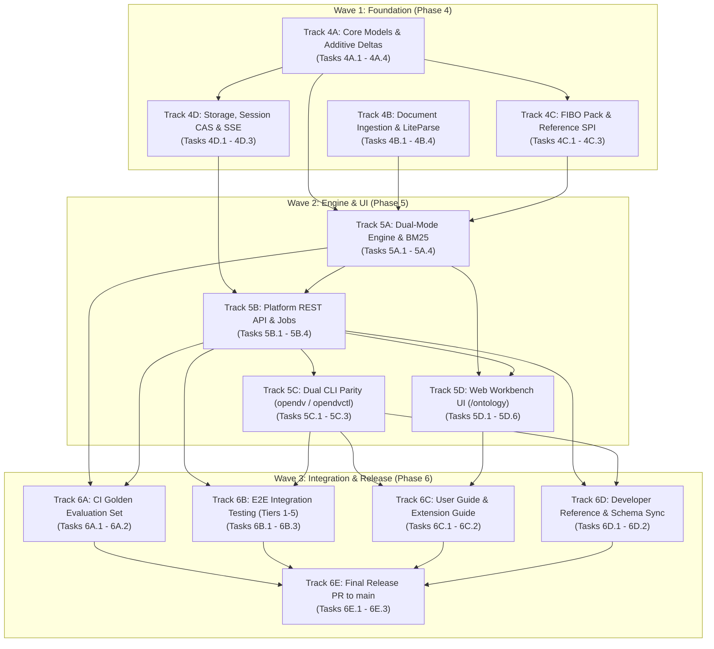

# 21 — Implementation Plan: Open-DV Ontology Construction Studio (Wave 1, Wave 2, Wave 3)

> **Module:** `docs/21-ontology-studio-implementation-plan.md` · **Revision:** v1.1 (2026-11-09)  
> **Status:** Execution Ready across Wave 1 (Phase 4), Wave 2 (Phase 5), and Wave 3 (Phase 6).  
> **Governing docs:** [`docs/00`](00-mission-vision-and-functional-requirements.md) (mission & FRs) · [`docs/18`](18-implementation-plan-platform-parity-and-architecture.md) (platform parity blueprint) · [`docs/19`](19-ontology-studio-architecture.md) (architecture) · [`docs/20`](20-ontology-studio-spec.md) (functional spec) · [`master-plan.md`](design/ontology-studio/master-plan.md) · [`ADR-001..016`](design/ontology-studio/)  
> **How to use this document:** Future agents and engineers pick up a **task issue** (`Task <Track>.<N>`), verify listed predecessors in §1, implement changes within the designated track boundaries, and deliver PRs passing full monorepo CI and the scoped Claude CLI Opus 5.5 critique loop (§1.1). Requirements, architecture decisions (`ADR-001..016`), binding contracts, error codes, and test commands are referenced normatively.

---

## 0. Revision History & Baseline Evolution

| # | Phase / Milestone | Baseline State | Target Delivery & Architectural Evolution | Why / Architectural Driver |
|---|---|---|---|---|
| 1 | **Phase 0 (M0 Baseline)** | Monorepo CI runs `pytest` and `bun test`; `dev/ontology-studio` branch created; critique loop script established. | Pinned baseline CI checks; verified Claude Code Opus 5.5 critique harness (`scripts/run_opus_critique.py`) with 0 CRITICAL / 0 MAJOR gate. | Establish immutable safety net and automated critique mechanism before design or code landing. |
| 2 | **Phase 1 (M1 Research & Design)** | Ad-hoc ontology modeling; manual Data Vault Graph A authoring; no reference alignment or versioning governance. | Produced `master-plan.md`, `research.md`, `ADR-001..016`, and `HANDOFF.md`. Established 4-tier architecture, dual-mode engine, and ONT-EVO governance rules. | Define normative technical bounds, ADRs, and structural invariants before writing implementation code. |
| 3 | **Phase 2 (M2 Spec & Architecture)** | Missing studio API routes; no formal error catalog; unanchored hash digests; partial CLI schemas. | Authored `docs/19` (Architecture) and `docs/20` (Spec). Anchored 111 closed error codes in `schemas/v1/error-codes.json`, 27 REST routes in `openapi.json`, and CLI subcommands in `cli-spec.json`. Pinned baseline digests. | Freeze wire contracts, error precedence pipeline, and cryptographic baselines before implementation planning. |
| 4 | **Phase 3 (M3 Implementation Plan)** | Conceptual delivery phases; unorganized execution catalog; no automated GitHub issue tracking. | Authored `docs/21` (this plan) and `create_issues.ps1`. Established live GitHub issue tracker on `nogoo9/open-dv`: Epic [#193](https://github.com/nogoo9/open-dv/issues/193), Phase trackers ([#194](https://github.com/nogoo9/open-dv/issues/194), [#195](https://github.com/nogoo9/open-dv/issues/195), [#196](https://github.com/nogoo9/open-dv/issues/196)), and 43 granular task issues (#197–#239). Resolved critique findings across serialization, 24-op delta catalog, and waiver governance. | Provide deterministic execution blueprint with exact file paths, dependencies, test commands, and critique gates. |
| 5 | **Wave 1 (Phase 4 Foundation)** | Unextended `GraphAOntology`; no document ingestion; unvendored FIBO; no studio session storage. | Deliver Tracks 4A–4D: extended models preserving SHA-256 (`1c1004...`), LiteParse 0.4.x adapter, vendored FIBO pack (`<4MB`), CAS persistence, and W3C SSE streaming. | Lay cryptographic, ingestion, and persistence foundations required by the construction engine and UI. |
| 6 | **Wave 2 (Phase 5 Engine & UI)** | No BM25 matcher; no clarification harness; missing studio REST/CLI routes; workbench lacks `/ontology`. | Deliver Tracks 5A–5D: Okapi BM25 matcher (`bm25_fibo_v1`), deterministic construction engine, 3-persona LLM harness, 27 REST routes with waiver authorization, dual CLI parity, and React Flow workbench. | Deliver operational core construction engine, public service interfaces, and visual modeling user experience. |
| 7 | **Wave 3 (Phase 6 Integration & Release)** | Unverified end-to-end flows; missing user documentation; separate feature branch. | Deliver Tracks 6A–6E: CI golden evaluation (precision >= 85%, recall >= 80%, CQ >= 90%), E2E Tiers 1–5, `docs/22` & `docs/23`, schema sync, and release PR to `main`. | Prove system correctness, adversarial robustness, and release production-ready Ontology Studio to `main`. |

---

## 1. Phased Delivery Plan: Waves, Tracks & Task Hierarchy

### 1.1 Delivery Rules & Parallel Execution Constraints
1. **One PR per Task Issue**: Every task in the catalog (§1.4) maps to an isolated GitHub task issue. PRs target `dev/ontology-studio` and merge strictly in topological dependency order.
2. **Maximum 4 Concurrent Tracks**: At any given time, at most 4 tracks may execute in parallel. Independent tracks execute concurrently; dependent tracks block on listed prerequisites.
3. **Continuous Monorepo CI Gate**: Every PR into `dev/ontology-studio` must pass all CI gates:
   - Python: `uv run pytest` across unit, contract, and architecture tests.
   - Linting: `uv run ruff check packages/*/src apps/*/src`.
   - TypeScript: `bun test` and `bun x tsc -b --pretty` across protocol and workbench packages.
   - AST Isolation: `tests/architecture/test_import_contracts.py` (unidirectional layers) and `tests/architecture/test_mock_guards.py` (zero mocks in production).
   - Invariant Hash: Bit-for-bit stability of Private Equity Graph A hash `1c100409cbbe12051f7211d2d6d6838670982b9164aaf18b52f566864da90b81`.
4. **Scoped Claude CLI Opus 5.5 Critique Gate**:
   Every PR must execute `scripts/run_opus_critique.py` against its modified paths using `--model opus`. Under the explicit user directive of **2026-11-09T17:11:51Z**, critique is scoped strictly to **real bugs** (logic errors, security vulnerabilities, invariant regressions) and **substantive design alignment against `master-plan.md` and core project objectives**. Pedantic prose nitpicking is prohibited. The gate requires strictly **0 CRITICAL** and **0 MAJOR** findings before merging.
5. **Issue Tracker Continuous Update**: Live GitHub issue tracker established at Epic [#193](https://github.com/nogoo9/open-dv/issues/193), Phase trackers ([#194](https://github.com/nogoo9/open-dv/issues/194), [#195](https://github.com/nogoo9/open-dv/issues/195), [#196](https://github.com/nogoo9/open-dv/issues/196)), and 43 task issues ([#197](https://github.com/nogoo9/open-dv/issues/197)–[#239](https://github.com/nogoo9/open-dv/issues/239)). As each task is picked up, executed, and merged, its corresponding GitHub issue is updated with PR references, test logs, and the Claude Opus critique summary.

---

### 1.2 Track Dependency Graph

---

### 1.3 Phase & Track Overview

| Phase | Tracker Issue | Wave | Track ID | Track Name | Depends On | Task Count | Primary Target Package |
|---|:---:|---|---|---|---|:---:|---|
| **Phase 4** | [#194](https://github.com/nogoo9/open-dv/issues/194) | **Wave 1** | **Track 4A** | Core Models, Extensions & Additive Deltas | Baseline M2 | 4 | `packages/opendv-core`, `packages/opendv-contracts` |
| **Phase 4** | [#194](https://github.com/nogoo9/open-dv/issues/194) | **Wave 1** | **Track 4B** | Document Ingestion & LiteParse Adapter | Baseline M2 | 4 | `packages/opendv-sources` |
| **Phase 4** | [#194](https://github.com/nogoo9/open-dv/issues/194) | **Wave 1** | **Track 4C** | FIBO Vendor Script & Core Pack | Baseline M2 | 3 | `scripts/`, `packages/opendv-sources` |
| **Phase 4** | [#194](https://github.com/nogoo9/open-dv/issues/194) | **Wave 1** | **Track 4D** | Storage, Session CAS & W3C SSE Streaming | 4A | 3 | `packages/opendv-service` |
| **Phase 5** | [#195](https://github.com/nogoo9/open-dv/issues/195) | **Wave 2** | **Track 5A** | Dual-Mode Engine & Clarification Harness | 4A, 4B, 4C | 4 | `packages/opendv-service`, `packages/opendv-agent-harness` |
| **Phase 5** | [#195](https://github.com/nogoo9/open-dv/issues/195) | **Wave 2** | **Track 5B** | Platform REST API & Job Supervisor | 4D, 5A | 4 | `apps/opendv-platform-api` |
| **Phase 5** | [#195](https://github.com/nogoo9/open-dv/issues/195) | **Wave 2** | **Track 5C** | CLI Integration & Bit-for-Bit Parity | 5B | 3 | `apps/opendv-cli`, `apps/opendvctl` |
| **Phase 5** | [#195](https://github.com/nogoo9/open-dv/issues/195) | **Wave 2** | **Track 5D** | Web Workbench UI (React Flow + elkjs) | 5A, 5B | 6 | `apps/opendv-web-workbench` |
| **Phase 6** | [#196](https://github.com/nogoo9/open-dv/issues/196) | **Wave 3** | **Track 6A** | CI Golden Evaluation Set & CQs | 5A, 5B | 2 | `tests/golden/ontology_studio/` |
| **Phase 6** | [#196](https://github.com/nogoo9/open-dv/issues/196) | **Wave 3** | **Track 6B** | E2E Integration Testing (Tiers 1–5) | 5B, 5C | 3 | `tests/e2e/ontology_studio/` |
| **Phase 6** | [#196](https://github.com/nogoo9/open-dv/issues/196) | **Wave 3** | **Track 6C** | User Guide & Extension Guide | 5C, 5D | 2 | `docs/` |
| **Phase 6** | [#196](https://github.com/nogoo9/open-dv/issues/196) | **Wave 3** | **Track 6D** | Developer Reference & Schema Sync | 5B, 5C | 2 | `docs/`, `schemas/v1/`, `packages/opendv-protocol-ts` |
| **Phase 6** | [#196](https://github.com/nogoo9/open-dv/issues/196) | **Wave 3** | **Track 6E** | Final Release PR to main | 6A, 6B, 6C, 6D | 3 | Repository-wide |

---

### 1.4 Master Task Catalog (43 Granular Tasks)

| Task ID | GitHub Issue | Phase | Track | Title & Scope Summary | Depends On | Parallelizable | Target Implementation Files | Target Test Files |
|---|:---:|:---:|:---:|---|---|:---:|---|---|
| **4A.1** | [#197](https://github.com/nogoo9/open-dv/issues/197) | P4 | 4A | GraphAOntology Model Extension & Optional Fields | Baseline | Yes | `opendv_core/models/graph_a.py` | `opendv_core/tests/test_graph_a_extension.py` |
| **4A.2** | [#198](https://github.com/nogoo9/open-dv/issues/198) | P4 | 4A | Canonical JCS Hash Stability & Zero-Drift Invariance | 4A.1 | After 4A.1 | `opendv_core/ontology_hashing.py` | `opendv_core/tests/test_canonical_hash_invariance.py` |
| **4A.3** | [#199](https://github.com/nogoo9/open-dv/issues/199) | P4 | 4A | Full 24-Op Delta Catalog, SPIs & OCC Envelope | Baseline | Yes | `opendv_contracts/` | `opendv_contracts/tests/test_ontology_delta_dtos.py` |
| **4A.4** | [#200](https://github.com/nogoo9/open-dv/issues/200) | P4 | 4A | Pure State Applier, SemVer Calculus & ONT-EVO Guards | 4A.1, 4A.3 | After deps | `opendv_service/ontology/` | `opendv_service/tests/test_ont_evo_validator.py` |
| **4B.1** | [#201](https://github.com/nogoo9/open-dv/issues/201) | P4 | 4B | DocumentAdapter SPI & Ingestion Service Framework | Baseline | Yes | `opendv_sources/ingestion/service.py` | `opendv_sources/tests/test_ingestion_service.py` |
| **4B.2** | [#202](https://github.com/nogoo9/open-dv/issues/202) | P4 | 4B | LiteParse 0.4.x Native PDF Adapter & Offset Mapping | 4B.1 | After 4B.1 | `opendv_sources/adapters/liteparse_adapter.py` | `opendv_sources/tests/test_liteparse_adapter.py` |
| **4B.3** | [#203](https://github.com/nogoo9/open-dv/issues/203) | P4 | 4B | Layout Complexity Evaluator & Tesseract OCR Routing | 4B.2 | After 4B.2 | `opendv_sources/ingestion/layout_evaluator.py` | `opendv_sources/tests/test_ocr_layout_routing.py` |
| **4B.4** | [#204](https://github.com/nogoo9/open-dv/issues/204) | P4 | 4B | Multi-Format Ingestion Adapters (MD, CSV, Parquet, JSON, Office) | 4B.1, 4B.2 | After deps | `opendv_sources/adapters/` | `opendv_sources/tests/test_multiformat_ingestion.py` |
| **4C.1** | [#205](https://github.com/nogoo9/open-dv/issues/205) | P4 | 4C | FIBO Compilation Script (`scripts/vendor_fibo.py`) | Baseline | Yes | `scripts/vendor_fibo.py`, `fibo-core-<sha256_8>.json` | `tests/scripts/test_vendor_fibo.py` |
| **4C.2** | [#206](https://github.com/nogoo9/open-dv/issues/206) | P4 | 4C | Reference Ontology Loader in opendv-sources | 4A.3, 4C.1 | After deps | `opendv_sources/fibo/loader.py` | `opendv_sources/tests/test_fibo_loader.py` |
| **4C.3** | [#207](https://github.com/nogoo9/open-dv/issues/207) | P4 | 4C | Transitive subClassOf Closure Resolver & Grounding Guard | 4C.2 | After 4C.2 | `opendv_sources/fibo/closure.py` | `opendv_sources/tests/test_fibo_closure.py` |
| **4D.1** | [#208](https://github.com/nogoo9/open-dv/issues/208) | P4 | 4D | CAS Session Directory, Workspace Secret & HKDF Keys | 4A.1 | After 4A.1 | `opendv_service/studio/session_manager.py` | `opendv_service/tests/test_studio_session_cas.py` |
| **4D.2** | [#209](https://github.com/nogoo9/open-dv/issues/209) | P4 | 4D | Global Total Lock Hierarchy & Deadlock Prevention | 4D.1 | After 4D.1 | `opendv_service/studio/locks.py` | `opendv_service/tests/test_lock_hierarchy.py` |
| **4D.3** | [#210](https://github.com/nogoo9/open-dv/issues/210) | P4 | 4D | Multi-File Atomic Commit Protocol, Crash Recovery & SSE | 4A.2, 4A.3, 4D.1, 4D.2 | After deps | `opendv_service/studio/atomic_commit.py` | `opendv_service/tests/test_atomic_commit_recovery.py` |
| **5A.1** | [#211](https://github.com/nogoo9/open-dv/issues/211) | P5 | 5A | Okapi BM25 Matcher & GroundingVerifier Binding | 4A.3, 4C.1, 4C.2 | After deps | `opendv_service/ontology/matching/` | `opendv_service/tests/test_bm25_matcher.py` |
| **5A.2** | [#212](https://github.com/nogoo9/open-dv/issues/212) | P5 | 5A | Deterministic Fallback Construction Engine | 4A.4, 4B.1, 4B.4, 4C.3, 5A.1 | After deps | `opendv_service/construction/` | `opendv_service/tests/test_deterministic_pipeline.py` |
| **5A.3** | [#213](https://github.com/nogoo9/open-dv/issues/213) | P5 | 5A | 3-Persona LLM Agent Reasoning Harness | 4A.3, 4B.1 | After deps | `opendv_agent_harness/` | `opendv_agent_harness/tests/test_studio_personas.py` |
| **5A.4** | [#214](https://github.com/nogoo9/open-dv/issues/214) | P5 | 5A | Clarification Question Generation & Answer Harness | 5A.2, 5A.3 | After deps | `opendv_service/construction/` | `opendv_service/tests/test_clarification_harness.py` |
| **5B.1** | [#215](https://github.com/nogoo9/open-dv/issues/215) | P5 | 5B | Studio Session & Source Management REST Endpoints (Routes 1–11) | 4D.1, 4D.3 | After deps | `opendv_platform_api/routers/` | `opendv_platform_api/tests/test_ontology_studio_routes.py` |
| **5B.2** | [#216](https://github.com/nogoo9/open-dv/issues/216) | P5 | 5B | Parse, Clarification, Construction & Job REST Endpoints (Routes 12–18) | 5A.4, 5B.1 | After deps | `opendv_platform_api/routers/` | `opendv_platform_api/tests/test_ontology_studio_routes.py` |
| **5B.3** | [#217](https://github.com/nogoo9/open-dv/issues/217) | P5 | 5B | Deltas, Proposals, Waiver Acceptance, Export & Promotion (Routes 19–27) | 4A.4, 5A.1, 5B.1 | After deps | `opendv_service/export/`, `apps/opendv-platform-api/` | `opendv_service/tests/test_rdf_export.py`, `opendv_platform_api/tests/` |
| **5B.4** | [#218](https://github.com/nogoo9/open-dv/issues/218) | P5 | 5B | Dual Server Modes, Security Guards & 11-Step Precedence | 5B.1 | After 5B.1 | `opendv_platform_api/security/` | `opendv_platform_api/tests/test_studio_auth_modes.py` |
| **5C.1** | [#219](https://github.com/nogoo9/open-dv/issues/219) | P5 | 5C | Standalone `opendv` Studio Subcommands with Waiver Flag | 4A.4, 4D.1, 4D.3, 5A.2, 5A.4 | After deps | `apps/opendv-cli/src/opendv_cli/commands/` | `apps/opendv-cli/tests/test_studio_local_executor.py` |
| **5C.2** | [#220](https://github.com/nogoo9/open-dv/issues/220) | P5 | 5C | Bun `opendvctl` Studio Subcommands with Waiver Flag | 5B.2, 5B.3, 5B.4 | After deps | `opendvctl/src/remote-executor.ts` | `opendvctl/tests/studio-cli.test.ts` |
| **5C.3** | [#221](https://github.com/nogoo9/open-dv/issues/221) | P5 | 5C | Dual-CLI Bit-for-Bit Parity Verification Harness | 5C.1, 5C.2 | After deps | `tests/parity/test_ontology_studio_cli_parity.py` | `tests/parity/test_ontology_studio_cli_parity.py` |
| **5D.1** | [#222](https://github.com/nogoo9/open-dv/issues/222) | P5 | 5D | Web Workbench SPA Shell & State Store (`/ontology`) | 5B.1 | After 5B.1 | `workbench/src/ontology/` | `workbench/tests/ontology-studio-store.test.ts` |
| **5D.2** | [#223](https://github.com/nogoo9/open-dv/issues/223) | P5 | 5D | Sources & Parse Management Panel | 5D.1, 5B.1, 5B.2 | After deps | `workbench/src/ontology/components/SourcesPanel.tsx` | `workbench/tests/ontology-panels.test.tsx` |
| **5D.3** | [#224](https://github.com/nogoo9/open-dv/issues/224) | P5 | 5D | Clarification Q&A Panel & Answer Submissions | 5D.1, 5B.2 | After deps | `workbench/src/ontology/components/ClarificationPanel.tsx` | `workbench/tests/ontology-panels.test.tsx` |
| **5D.4** | [#225](https://github.com/nogoo9/open-dv/issues/225) | P5 | 5D | React Flow + elkjs Graph Canvas & Multi-Tier LOD | 5D.1 | After 5D.1 | `workbench/src/ontology/components/GraphCanvas.tsx` | `workbench/tests/ontology-graph-canvas.test.tsx` |
| **5D.5** | [#226](https://github.com/nogoo9/open-dv/issues/226) | P5 | 5D | Visual Diff Overlay & Visual Editor Drawer | 5D.4 | After 5D.4 | `workbench/src/ontology/components/DiffOverlay.tsx` | `workbench/tests/ontology-panels.test.tsx` |
| **5D.6** | [#227](https://github.com/nogoo9/open-dv/issues/227) | P5 | 5D | Quality Scorecard, Feedback & Export/Promotion Modal | 5D.1, 5D.4, 5B.3 | After deps | `workbench/src/ontology/components/` | `workbench/tests/export-promotion-modal.test.tsx` |
| **6A.1** | [#228](https://github.com/nogoo9/open-dv/issues/228) | P6 | 6A | CI Golden Evaluation Harness & Benchmark Ground Truth | 5A.2, 5B.1 | After deps | `tests/golden/ontology_studio/` | `tests/golden/ontology_studio/test_golden_evaluation.py` |
| **6A.2** | [#229](https://github.com/nogoo9/open-dv/issues/229) | P6 | 6A | Dual-Mode Benchmark Validation (Deterministic vs Agent) | 6A.1, 5A.3 | After deps | `tests/golden/ontology_studio/test_golden_modes.py` | `tests/golden/ontology_studio/test_golden_modes.py` |
| **6B.1** | [#230](https://github.com/nogoo9/open-dv/issues/230) | P6 | 6B | Tier 1 & Tier 2 E2E Tests: Canonical Journeys & Boundaries | 5B.3, 5C.3 | After deps | `tests/e2e/ontology_studio/test_tier1_journeys.py` | `tests/e2e/ontology_studio/test_tier1_journeys.py` |
| **6B.2** | [#231](https://github.com/nogoo9/open-dv/issues/231) | P6 | 6B | Tier 3 & Tier 4 E2E Tests: Combinatorial & Workload Chaos | 6B.1 | After 6B.1 | `tests/e2e/ontology_studio/test_tier3_combinatorial.py` | `tests/e2e/ontology_studio/test_tier4_workload_chaos.py` |
| **6B.3** | [#232](https://github.com/nogoo9/open-dv/issues/232) | P6 | 6B | Tier 5 Adversarial Hardening (Waivers, Zip Security, Taint) | 5B.4, 6B.1 | After deps | `tests/e2e/ontology_studio/test_tier5_adversarial.py` | `tests/e2e/ontology_studio/test_tier5_adversarial.py` |
| **6C.1** | [#233](https://github.com/nogoo9/open-dv/issues/233) | P6 | 6C | Author `docs/22-ontology-studio-user-guide.md` | 5C.3, 5D.6 | After deps | `docs/22-ontology-studio-user-guide.md` | `tests/docs/test_doc_code_snippets.py` |
| **6C.2** | [#234](https://github.com/nogoo9/open-dv/issues/234) | P6 | 6C | Author `docs/23-ontology-studio-extension-guide.md` | 4B.1, 4C.2, 5A.1, 5A.3 | After deps | `docs/23-ontology-studio-extension-guide.md` | `tests/docs/test_doc_code_snippets.py` |
| **6D.1** | [#235](https://github.com/nogoo9/open-dv/issues/235) | P6 | 6D | Synchronize CLI Reference (`docs/16`) & `README.md` | 5B.3, 5C.3 | After deps | `docs/16-cli-reference.md`, `README.md` | `tests/architecture/test_schema_sync.py` |
| **6D.2** | [#236](https://github.com/nogoo9/open-dv/issues/236) | P6 | 6D | OpenAPI & CLI Spec Drift Verification & TS Re-generation | 5B.3, 5C.3 | After deps | `schemas/v1/openapi.json`, `packages/opendv-protocol-ts/` | `packages/opendv-protocol-ts/tests/openapi-dtos.test.ts` |
| **6E.1** | [#237](https://github.com/nogoo9/open-dv/issues/237) | P6 | 6E | Full Monorepo CI Suite Verification & Baseline Stability | 6A..6D | After deps | Repository-wide | Full Monorepo CI Suite |
| **6E.2** | [#238](https://github.com/nogoo9/open-dv/issues/238) | P6 | 6E | GitHub Issue Tracker Final Closeout Audit | 6E.1 | After 6E.1 | GitHub Issue Tracker | `scripts/audit_issue_tracker.py` |
| **6E.3** | [#239](https://github.com/nogoo9/open-dv/issues/239) | P6 | 6E | Final Release PR: `dev/ontology-studio` to `main` | 6E.2 | After 6E.2 | GitHub Pull Request | Claude Opus 5.5 Release Gate |

---

## 2. Architecture Decisions — Resolved (ADR-001 through ADR-016)

All 16 Architecture Decisions formulated in Phase 1 (`master-plan.md`, `ADR-001..016`) are binding for Waves 1–3:

| ADR | Title | Decision Summary & Normative Invariant | Breaking Changes & Constraints |
|---|---|---|---|
| **ADR-001** | Autonomous Multi-Phase Lifecycle | Autonomous execution across phases 0–6 using 4 tiers of subagents; final PR to `main` requires human review. | No direct pushes to `main`. All work merges through `dev/ontology-studio`. |
| **ADR-002** | Dual-Mode Construction Engine | Primary mode uses 3-persona LLM agent harness; zero-API-key fallback mode executes deterministic BM25 lookup. | Deterministic mode must run offline without external network or LLM tokens in `<2.5\text{s}`. |
| **ADR-003** | Curated FIBO Vendored Subset | Vendored 6 core FIBO modules (`FND`, `BE`, `FBC`, `SEC`, `LOAN`, `IND`) pinned to tag `master_2024Q4`. Runtime loads canonical JSON pack directly. | Pack must not exceed 4.0 MB disk or 18.0 MB RAM; transitive closure requires direct seed mapping $\ge 0.6500$. |
| **ADR-004** | Python rdflib for OWL 2 & JSON-LD | Multi-format serialization to Graph A YAML, RFC 8785 JSON, Turtle, and JSON-LD implemented in `opendv_service.export.rdf_exporter`. | `rdflib` isolated strictly to `scripts/vendor_fibo.py` and `opendv_service/export/rdf_exporter.py`; zero imports in core, matcher, or CLI. |
| **ADR-005** | Model Extensions & Hash Stability | Extended `CanonicalBusinessConcept` with optional fields defaulting strictly to `None`; pruned via `model_dump(mode="json", exclude_none=True)` and scoped `_norm_empty`. | Invariant SHA-256 for PE: `1c100409cbbe12051f7211d2d6d6838670982b9164aaf18b52f566864da90b81`. |
| **ADR-006** | Additive OntologyDelta Operations | Pure state transition engine `apply(base, delta) -> target` with full 24-op SemVer bump calculus (including Greenfield `AddConceptOp`). | Structural deletions and overwriting existing non-None values via `SetConceptElmArchetypeOp` or `SetParentConceptOp` force MAJOR bump (blocked on deployed tables); additive changes (`AddConceptOp`, `AddRelationshipOp`, `AddAttributeOp`, initial unset `Set*` assignments, `DeprecateConceptOp`) force MINOR bump; annotations and mapping edits (including `RemoveExternalMappingOp`) force PATCH. |
| **ADR-007** | ONT-EVO Governance Guard Rules | Two-phase validation: structural DAG (Tarjan SCC) + governance (`ONT-EVO-001..003`). Evaluation set covers all 10 concept modification ops (`AddConceptOp`, `UpdateConceptUrnOp`, `SetParentConceptOp`, `RefineDefinitionOp`, `ReviseDescriptionOp`, `AddSynonymOp`, and 4 mapping ops). | Destructive ops on physical tables raise exit 4 (`ONT_EVO_CONTRACT_VIOLATION`); ungrounded concepts without waiver raise exit 4 (`ONT_EVO_UNGROUNDED_CONCEPT`); base hash OCC mismatch raises exit 5 / HTTP 412 (`ONT_EVO_CONCURRENT_MODIFICATION`); lock contention raises exit 6 / HTTP 409 (`JOB_COMMIT_IN_PROGRESS`, `LOCK_TIMEOUT`). |
| **ADR-008** | In-Memory Okapi BM25 Matcher SPI | Pluggable `bm25_fibo_v1` with 7-step tokenization, Decimal(28) precision, and symmetric normalization. | Grounding threshold pinned to 0.6500; definition-only matches capped at 0.6400. |
| **ADR-009** | CAS Studio Session Storage | Content-Addressable Storage layout in `.opendv/ontology_studio/<session_id>/` with total lock order over `(level, session_id)`. | Multi-file atomic commit via `.staging-<u>/` and `os.replace`; Windows `WinError 32` handled with backoff. |
| **ADR-010** | Document Ingestion Pipeline | Zero external binary dependency PDF parsing via `liteparse` 0.4.x (embedded C++ PDFium wheel); optional fallback to `pypdf`. | Office conversion and `ocr_mode="force"` fail loudly with HTTP 501 / exit 1 (`OFFICE_CONVERSION_UNAVAILABLE`, `OCR_UNAVAILABLE`); `ocr_mode="auto"` degrades gracefully with `ocr_skipped=True`. |
| **ADR-011** | Web Workbench Studio UI | Decoupled React 19 SPA at `/ontology` using `@xyflow/react` and `elkjs` web worker layout ($<300\text{ms}$). | Visual diff overlay uses green (add), red (delete), amber (modify); 3-tier zoom level of detail (LOD). |
| **ADR-012** | Dual CLI Parity Architecture | Standalone `opendv` (`LocalExecutor`) and Bun `opendvctl` (`RemoteExecutor`) with identical JCS output. | 100% exit code parity across 0..7; command trees synchronized via `schemas/v1/cli-spec.json`. |
| **ADR-013** | W3C SSE Event Streaming Engine | `text/event-stream` with 15s keepalive comments and journal replay via monotonic `Last-Event-ID`. | Journal file compressed if $>50\text{ MB}$; malformed cursor raises HTTP 400 / exit 2. |
| **ADR-014** | Studio Session Bundle Portability | Portable `.odvstudio.zip` archives with decompression limits (250 MB, 500 entries, 100:1 ratio guard). Imported foreign audit ledger preserved as read-only segment; local workspace initializes new HMAC chain with `IMPORT_GENESIS`. | Path traversal (`..`), drive prefixes (`C:\`), UNC paths, NTFS ADS, or symlinks unconditionally rejected with exit 4. |
| **ADR-015** | Claude CLI Opus 5.5 Critique Gate | Automated PR critique loop enforcing 0 CRITICAL and 0 MAJOR findings; scoped to bugs and design alignment. | Pedantic prose nitpicking strictly prohibited; gate blocks merge until clean report produced. |
| **ADR-016** | Data Protection & Redaction | Taint tracking; HKDF derived keys (`K_pseudo`, `K_audit`, `K_waiver`) from `.odv_workspace_secret`; zero raw secrets on CLI argv; local workbench signs waivers via launch nonce (`X-OpenDV-Launch-Nonce`) CSRF check. | Loopback privilege disabled in remote platform mode; out-of-bounds workspace paths rejected (exit 2). |

---

## 3. Wave 1 Foundation Deep-Dives (Phase 4)

### 3.1 Track 4A: Core Models, Extensions & Additive Delta Operations
- **Scope**: Extend core models in `packages/opendv-core` while strictly preserving baseline cryptographic hashes; introduce the full 24-operation delta DTO catalog in `packages/opendv-contracts`; implement pure state transition applier and two-phase governance validator in `packages/opendv-service`.
- **Target Files**:
  - `packages/opendv-core/src/opendv_core/models/graph_a.py`
  - `packages/opendv-core/src/opendv_core/ontology_hashing.py`
  - `packages/opendv-core/src/opendv_core/ontology/structural_validator.py`
  - `packages/opendv-contracts/src/opendv_contracts/dtos/ontology.py`
  - `packages/opendv-contracts/src/opendv_contracts/spi/grounding.py`
  - `packages/opendv-contracts/src/opendv_contracts/spi/waiver.py`
  - `packages/opendv-contracts/src/opendv_contracts/spi/agent.py`
  - `packages/opendv-service/src/opendv_service/ontology/validator.py`
  - `packages/opendv-service/src/opendv_service/ontology/applier.py`
- **Key Invariants**:
  - Model extensions (all defaulting to `None`): CBC (`parent_concept_uri`, `attributes`, `synonyms`, `external_mappings`, `deprecated`, `metadata`, `source_hints`), ConceptAttribute (`deprecated`, `metadata`, `source_hints`), ExternalMapping (`pinned`, `provenance`), Relationship (`deprecated`, `metadata`), ReferenceEnumeration (`deprecated`, `metadata`), and GraphAOntology (`metadata`).
  - Hashing specification: `model_dump(mode="json", exclude_none=True)` followed by recursive `_norm_empty` scoped strictly to extension field sets (`_CBC_EXT`, `_ATTR_OPT`, `_REL_EXT`, `_ENUM_EXT`, `_ONT_EXT`), guaranteeing that empty legacy collections are not mutated.
  - `compute_ontology_sha256(validate_graph_a("examples/private_equity/pe_graph_a_ontology.yaml"))` evaluates to `1c100409cbbe12051f7211d2d6d6838670982b9164aaf18b52f566864da90b81`.
  - Greenfield Genesis draft `0.0.0` digest: `1916a5c6d501015984b887fd76609b225b72d5d393e5813d8df210b92ab3b4c9`.
  - Closed 24-Operation Delta Catalog & SemVer Bump Classes:
    - **MAJOR Bump (Breaking Changes)**: `RemoveConceptOp`, `RemoveRelationshipOp`, `RemoveAttributeOp`, `UpdateConceptUrnOp`, and overwrites of existing non-None values on `SetConceptElmArchetypeOp` or `SetParentConceptOp` (strictly prohibited on deployed physical Data Vault tables under `ONT-EVO-001`).
    - **MINOR Bump (Additive Structural & Deprecations)**: `AddConceptOp` (with explicit Genesis Rule: if `base_version == '0.0.0'`, promotes directly to `1.0.0` establishing initial certified baseline rather than `0.1.0`), `AddRelationshipOp`, `AddAttributeOp`, initial unset assignment on `SetParentConceptOp` and `SetConceptElmArchetypeOp` (when field is currently `None`), `AddReferenceEnumerationOp`, `AddKeyAuthorityPatternOp`, `AddGovernanceConstraintOp`, `DeprecateConceptOp`, `DeprecateRelationshipOp`.
    - **PATCH Bump (Metadata, Annotations & Non-breaking Enrichments)**: `AddSynonymOp`, `AddExternalMappingOp`, `ReviseDescriptionOp`, `RescoreExternalMappingOp`, `AddReferenceEnumCodeOp`, `RepinExternalMappingOp`, `RefineDefinitionOp`, `AddSourceHintOp`, `AnnotateConceptMetadataOp`, `RemoveExternalMappingOp` (mapping metadata removal; structural deletions force MAJOR).
  - `OntologyDelta` envelope: carries mandatory preconditions `base_version: str` and `base_sha256: str`.
  - Governance Validator:
    - `ONT-EVO-001`: Blocks destructive operations (structural deletions and archetype/parent overwrites) on deployed Data Vault physical tables (`ONT_EVO_CONTRACT_VIOLATION` exit 4 / HTTP 422). Deployed state is provided via `DeploymentStateProvider` SPI (`frozenset[str]` of deployed table/concept identifiers) defined in `opendv_contracts.spi.deployment` under Task 4A.3 and injected into the governance validator. Fails closed: if deployment state is unknown or provider raises error, all mapped physical tables are treated as deployed.
    - `ONT-EVO-002`: Requires positive reference grounding (BM25 >= 0.6500) OR an authorized `StewardWaiverRecord`. Evaluated on target ontology post-apply for every concept URI targeted by ANY op modifying concept identity, definition, synonyms, hierarchy, or mappings (`AddConceptOp`, `UpdateConceptUrnOp`, `SetParentConceptOp`, `RefineDefinitionOp`, `ReviseDescriptionOp`, `AddSynonymOp`, `AddExternalMappingOp`, `RescoreExternalMappingOp`, `RepinExternalMappingOp`, `RemoveExternalMappingOp`). Any concept in this touched set lacking positive reference grounding (score >= 0.6500) without an authorized waiver raises HTTP 422 / exit 4 (`ONT_EVO_UNGROUNDED_CONCEPT`). Server unconditionally recomputes scores against pinned matcher (`bm25_fibo_v1` v1.0.0) and certified pack SHA-256 (`schemas/v1/baseline-digests.json`); client-supplied scores are candidate hints. In Phase 4, `opendv_contracts` defines `GroundingVerifier`, `WaiverVerifier`, `ReferenceOntologyAdapter`, and `ConstructionAgent` SPIs.
    - Unified Administrative Waiver Model: `StewardWaiverRecord` (`waiver_id: UUID4`, `proposal_id: UUID4`, `proposal_delta_sha256: str`, `target_concept_uris: list[str]`, `base_sha256: str`, `rationale: str` >= 10 chars, `authorized_by: str`, `authorized_role: Literal["admin", "steward"]`, `signature_or_token: str`, `created_at: datetime`). Scope mismatch or rationale < 10 chars raises HTTP 422 / exit 4 (`INVALID_GROUNDING_WAIVER`).
      - In `remote_platform` mode: caller supplies bearer JWT in `Authorization` header. Server verifies `role:admin`/`role:steward` claims (raising HTTP 403 / exit 7 `FORBIDDEN_ADMIN_REQUIRED` on failure), overwrites `authorized_by` (from JWT `sub`) and `authorized_role` (from JWT `role`) preventing client spoofing, and immediately DISCARDS the bearer token. Server mints a local HMAC-SHA256 attestation under `K_waiver` over RFC 8785 canonical JSON object: `{"authorized_by": str, "authorized_role": str, "base_sha256": str, "created_at": str, "proposal_delta_sha256": str, "proposal_id": str, "rationale": str, "target_concept_uris": list[str], "waiver_id": str}` stored in `signature_or_token`. On proposal acceptance (`POST /proposals/{prop_id}/accept`), server asserts `waiver.proposal_id == prop_id`, `waiver.proposal_delta_sha256 == compute_delta_sha256(proposal.delta)`, and `waiver.base_sha256 == session.head_sha256`. Zero bearer tokens or Authorization headers are ever persisted to disk, audit ledgers, proposals, or exported bundles.
      - In `local_standalone` mode: workspace owner acts as steward; verified against `K_waiver` from `.odv_workspace_secret` (or `--waiver-key-file`/`OPENDV_WAIVER_KEY`, never CLI argv). Local Workbench signs waivers via launch nonce (`X-OpenDV-Launch-Nonce`) and CSRF origin validation.
      - Persistence: Waiver appended to `audit.jsonl` under `K_audit`.
    - `ONT-EVO-003`: Verifies OCC precondition (`session_head_sha256 == delta_base_sha256`). If `If-Match` header is present, it must equal `delta_base_sha256`; mismatch between `If-Match` and body or session head raises exit 5 (HTTP 412 `ONT_EVO_CONCURRENT_MODIFICATION`). Lock contention raises exit 6 (HTTP 409 `JOB_COMMIT_IN_PROGRESS` or `LOCK_TIMEOUT`).

---

### 3.2 Track 4B: Ingestion Engine & LiteParse Adapter
- **Scope**: Implement `DocumentAdapter` SPI, native PDF parsing via `liteparse` 0.4.x (self-contained Google PDFium C++ wheel with optional `pypdf` fallback), character-accurate `PageMapEntry` Unicode offset tracking, layout complexity evaluator with OCR routing, and multi-format document adapters.
- **Target Files**:
  - `packages/opendv-contracts/src/opendv_contracts/dtos/ingestion.py`
  - `packages/opendv-sources/src/opendv_sources/ingestion/service.py`
  - `packages/opendv-sources/src/opendv_sources/adapters/liteparse_adapter.py`
  - `packages/opendv-sources/src/opendv_sources/ingestion/layout_evaluator.py`
  - `packages/opendv-sources/src/opendv_sources/adapters/multiformat_adapter.py`
  - `packages/opendv-sources/src/opendv_sources/adapters/libreoffice_adapter.py`
- **Key Invariants**:
  - Architectural Layering & DTO Placement: Ingestion and evidence DTOs (`EvidenceChunk`, `PageMapEntry`, `TableStructure`, `IngestionResult`, `TaintClassification`) are defined in `packages/opendv-contracts/src/opendv_contracts/dtos/ingestion.py`. `opendv-sources` provides adapter implementations, enabling client packages like `opendv-agent-harness` to consume evidence DTOs without importing `opendv-sources`.
  - Unicode NFC normalization and LF line ending enforcement. Offsets tracked in Unicode code points with UTF-16 browser index.
  - Complexity routing: pages with raster area $>0.40$ or character density $<50$ route to Tesseract OCR:
    - `ocr_mode="auto"`: if Tesseract binary is missing, log a warning, set quality degradation flag `ocr_skipped=True` in `PageMapEntry`, and gracefully fall back to native PDFium parsing without aborting.
    - `ocr_mode="force"`: if Tesseract binary is missing, fail loudly by raising typed `OCR_UNAVAILABLE` (HTTP 501 / exit 1).
  - Headless LibreOffice conversion for `.docx`, `.pptx`, `.odt` with isolated user profile; missing `soffice` raises `OFFICE_CONVERSION_UNAVAILABLE` (HTTP 501 / exit 1).

---

### 3.3 Track 4C: FIBO Vendor Script & Core Pack
- **Scope**: Implement `scripts/vendor_fibo.py` compiling 6 core FIBO modules (`FND`, `BE`, `FBC`, `SEC`, `LOAN`, `IND`) from EDM Council release `master_2024Q4` into canonical RFC 8785 JSON pack `fibo-core-<sha256_8>.json`; build high-performance direct JSON pack loader (< 70 ms cold load) and transitive taxonomic closure resolver.
- **Target Files**:
  - `scripts/vendor_fibo.py`
  - `packages/opendv-sources/src/opendv_sources/fibo/fibo-core-<sha256_8>.json`
  - `packages/opendv-sources/src/opendv_sources/fibo/loader.py`
  - `packages/opendv-sources/src/opendv_sources/fibo/closure.py`
  - `packages/opendv-contracts/src/opendv_contracts/spi/reference_ontology.py`
- **Key Invariants**:
  - Canonical Pack Naming: `fibo-core-<sha256_8>.json` anchored in `schemas/v1/baseline-digests.json`.
  - Pack budgets strictly enforced: disk $< 4.0\text{ MB}$, memory $< 18.0\text{ MB}$, cold load $< 70\text{ ms}$.
  - Runtime loading reads the JSON pack directly without `rdflib` overhead. `rdflib` is used exclusively during offline vendoring and multi-format export.
  - Transitive closure resolver takes the verified seed score as an input parameter, computing superclasses strictly if direct seed mapping $\ge 0.6500$, categorizing as `skos:broadMatch`. `broadMatch` is excluded from satisfying Path A grounding.

---

### 3.4 Track 4D: Storage, Session CAS & W3C SSE Streaming
- **Scope**: Deliver CAS session directory structure in `.opendv/ontology_studio/<session_id>/`, total lock hierarchy over `(level, session_id)`, multi-file atomic commit protocol with crash recovery, forward-only SHA-256 HMAC audit chaining (`audit_chain_head_sha256`), CAS mark-and-sweep GC, W3C SSE event streaming with `Last-Event-ID` cursor replay, and `.odvstudio.zip` bundle portability.
- **Target Files**:
  - `packages/opendv-service/src/opendv_service/studio/session_manager.py`
  - `packages/opendv-service/src/opendv_service/studio/workspace_security.py`
  - `packages/opendv-service/src/opendv_service/studio/cas_storage.py`
  - `packages/opendv-service/src/opendv_service/studio/locks.py`
  - `packages/opendv-service/src/opendv_service/studio/atomic_commit.py`
  - `packages/opendv-service/src/opendv_service/studio/sse_journal.py`
  - `packages/opendv-service/src/opendv_service/studio/bundle.py`
- **Key Invariants**:
  - Directory permissions & Key Hierarchy: `0700` directories, `0600` files (on Windows, owner-only DACL). Task 4D.1 generates root 256-bit CSPRNG `.odv_workspace_secret` (0600 DACL) and derives purpose-isolated keys via HKDF-SHA256: `K_pseudo` for LLM prompt pseudonymization, `K_audit` for audit HMAC chaining, and `K_waiver` for steward waiver signing. The agent harness interface contract accepts only derived `K_pseudo` and is never passed root secret or `K_waiver` (in local mode, API-level isolation prevents passing `K_waiver` to harness; in remote mode, root secret and `K_waiver` reside exclusively on server).
  - Session ID Validation: Regex `^[a-z0-9][a-z0-9_-]{0,63}$` (strictly lowercase alphanumeric start, max 64 chars). Any ID containing uppercase characters, leading hyphens/underscores, or Windows reserved device names (`con`, `prn`, `aux`, `nul`, `com1..9`, `lpt1..9` with/without extensions) is strictly rejected with `INVALID_SESSION_IDENTIFIER` (HTTP 422 / exit 2) without silent normalization, preventing NTFS / APFS case-folding collisions.
  - Total Lock Order: Acquire by level $\mathbf{L}_1 \to \mathbf{L}_5$ (docs/19 §3.2), and within the same level across multiple sessions, sort lexicographically by lowercase `session_id` (`min(s1, s2) -> max(s1, s2)`). Timeout: 30s (`LOCK_TIMEOUT` exit 6 / 409).
  - 6-Step Atomic Commit Protocol & Proposal Reconciliation:
    - Step 1 (Staging): Stage version artifacts in `.staging-<u>/`.
    - Step 2 (Lock): Acquire session write lock following total lock order.
    - Step 3 (OCC Check): Under write lock, verify mandatory body `delta.base_sha256 == session.head_sha256`. If optional HTTP `If-Match` header is present, normalize by accepting only a single strong quoted ETag (`"<base_sha256>"`; weak `W/` or `*` raises HTTP 400 / exit 2 `SYNTAX_INVALID_ARGUMENT`), strip surrounding quotes, and assert `If-Match == delta.base_sha256` (mismatch raises exit 5 / HTTP 412 `ONT_EVO_CONCURRENT_MODIFICATION`).
    - Step 4 (Audit Intent Append): Append write-ahead audit entry (`PENDING_COMMIT`) to `audit.jsonl` signed via `K_audit` recording `proposal_id: UUID4 | None`, target version `vX.Y.Z`, `target_sha256`, and `waiver_ids: list[UUID4]`, then fsync.
    - Step 5 (Atomic Version Rename): Atomic directory rename `os.replace` to `versions/vX.Y.Z` with parent directory `fsync` (`FlushFileBuffers` on Windows opened with `FILE_FLAG_BACKUP_SEMANTICS` executed as best-effort, relying on NTFS journaling).
    - Step 6 (Atomic Metadata & Proposal Commit): Atomically replace `session.json` via `.session.json.<u>.tmp` (the single commit point) advancing `head_sha256` and recording `audit_chain_head_sha256` as of the write-ahead `PENDING_COMMIT` entry, transition proposal status in `proposals/<proposal_id>.json` to `ACCEPTED` with committed version metadata, and append terminal `COMMITTED` entry to `audit.jsonl` signed via `K_audit` (extending the audit chain). The startup crash recovery chain verifier treats a missing trailing `COMMITTED` entry as a crash during Step 6 metadata finalization (reconciling proposal and advancing ledger), NOT as tampering.
    - Startup Crash Recovery & Idempotency: Crash during Steps 1-3 garbage-collects `.staging-<u>/` without ledger modification. Crash after Step 4 but before Step 5 writes `COMMIT_ABORTED` compensating entry under `K_audit` chained from Step 4 intent, advancing `audit_chain_head_sha256` with proposal remaining `PENDING`. Crash after Step 5: recovery acquires session write lock; if `session.head_sha256 == target_sha256`, commit is complete (reconciles proposal `ACCEPTED` and writes `COMMITTED` entry if interrupted mid-Step 6); if `session.json` un-advanced, recovery recomputes `compute_ontology_sha256(vX.Y.Z)` asserting it equals `intent.target_sha256` and verifies `session.head_sha256 == intent.base_sha256` (on mismatch writes `COMMIT_ABORTED` and quarantines version directory), advances `session.json` (commit point), sets proposal `ACCEPTED`, and appends `RECOVERY_RECONCILED` advancing `audit_chain_head_sha256`. After Step 6 completes, `session.json` records final `COMMITTED` head hash, preventing tail truncation.
  - Cross-Workspace Bundle Trust Model: Export via Route 26 (`GET /export?format=bundle`) freezes audit ledger into `audit_exported_ledger.jsonl`. Target workspace imports via `POST /sessions` (`application/zip`), enforcing 9 streaming decompression checks before extraction, archiving foreign ledger as read-only segment `audit.imported.<bundle_sha256_8>.jsonl`, and initializing fresh local `audit.jsonl` HMAC chain with `IMPORT_GENESIS`. Import Security Re-verification: Target server recomputes `compute_ontology_sha256` for every imported version in `versions/vX.Y.Z`, asserting it matches recorded version hash; mismatch raises `ARCHIVE_SECURITY_VIOLATION` (HTTP 422 / exit 4) and rejects import. Server runs structural validation and full ONT-EVO-002 grounding over entire imported head ontology; unwaived ungrounded concepts require target steward waiver re-certification. Route 27 (`POST /sessions/{id}/promote`) re-runs full governance validator over the entire target ontology before release. Waiver Rebase & Import Invalidation: Rebasing a proposal (Route 25) strips attached waivers. Imported waivers in `audit.imported.*` are historical provenance only; target steward must re-sign waivers under target `K_waiver` before commit.
  - SSE streaming: `text/event-stream` with 15s keepalive comments and journal replay from `<job_id>.events.jsonl`.
  - Bundle security: max 250 MB, 500 entries, 100:1 ratio limit. Rejects relative traversal (`..`), absolute paths, drive prefixes (`C:\`), UNC paths, NTFS alternate data streams (`file:stream`), reserved device names, case-folding collisions under Unicode NFC, and symlinks (`0o120000`) with `ARCHIVE_SECURITY_VIOLATION` (exit 4).

---

## 4. Wave 2 Engine & UI Deep-Dives (Phase 5)

### 4.1 Track 5A: Dual-Mode Construction Engine & Clarification Question Harness
- **Scope**: Implement in-memory Okapi BM25 concept matcher (`bm25_fibo_v1` v1.0.0), deterministic fallback construction engine, 3-persona LLM agent reasoning harness, and clarification question generator.
- **Target Files**:
  - `packages/opendv-service/src/opendv_service/ontology/matching/bm25.py`
  - `packages/opendv-service/src/opendv_service/ontology/matching/tokenization.py`
  - `packages/opendv-service/src/opendv_service/construction/deterministic_pipeline.py`
  - `packages/opendv-service/src/opendv_service/construction/clarification_harness.py`
  - `packages/opendv-agent-harness/src/opendv_agent_harness/personas/term_scout.py`
  - `packages/opendv-agent-harness/src/opendv_agent_harness/personas/domain_clarifier.py`
  - `packages/opendv-agent-harness/src/opendv_agent_harness/personas/ontology_architect.py`
- **Key Invariants**:
  - Package Layering: `opendv-agent-harness` is a client package depending only on `opendv-core` and `opendv-contracts` (consuming ingestion DTOs from `opendv_contracts.dtos.ingestion`). It emits `OntologyDelta` DTOs and does NOT import `opendv-service`, `opendv-sources`, or `opendv-platform-api`, strictly honoring AST isolation.
  - BM25 pipeline: 7-step tokenization, Robertson formula ($k_1=1.5, b=0.75$, $w_{\text{name}}=2.5, w_{\text{syn}}=2.0, w_{\text{def}}=1.0$), symmetric normalization, `ROUND_HALF_EVEN` quantization, and name/synonym hit gate (def-only score capped at 0.6400).
  - Deterministic fallback: zero-API-key construction completing in $<2.5\text{s}$ with exit 0. Holds ungrounded concepts in `staged_candidates.json`.
  - 3-Persona Agent Harness: `@term-scout` (FAST model), `@domain-clarifier` (HIGH_REASONING), and `@ontology-architect` (HIGH_REASONING). Confidential inputs scrubbed via HMAC-SHA256 using purpose-isolated key `K_pseudo` derived via HKDF-SHA256 from `.odv_workspace_secret` (stored with owner-only DACL/0600 permissions, strictly excluded from bundle exports).
  - Clarification Q&A: structured `questions.json` and `answers.json` persisted in CAS.

---

### 4.2 Track 5B: Platform REST API & Job Supervisor
- **Scope**: Implement 27 REST endpoints under `/api/v1/ontology/studio/*` matching `schemas/v1/openapi.json`, background async job supervisor, server security modes (`local_standalone` vs `remote_platform`), administrative waiver proposal acceptance workflow, and 11-step canonical error precedence pipeline.
- **Target Files**:
  - `apps/opendv-platform-api/src/opendv_platform_api/routers/ontology_studio.py`
  - `apps/opendv-platform-api/src/opendv_platform_api/security/studio_auth.py`
  - `apps/opendv-platform-api/src/opendv_platform_api/security/csrf.py`
- **Key Invariants**:
  - Exact 27 REST routes across 3 granular tasks:
    - **Task 5B.1 (Routes 1–11: Sessions & Sources)**:
      1. `POST /init` (`initStudio`)
      2. `GET /sessions` (`listSessions`)
      3. `POST /sessions` (`createSession`)
      4. `GET /sessions/{id}` (`getSession`)
      5. `DELETE /sessions/{id}` (`deleteSession`: refused with exit 4 `ONT_EVO_CONTRACT_VIOLATION` if session has deployed/promoted versions; otherwise creates archived tombstone preserving audit provenance)
      6. `GET /sessions/{id}/status` (`getSessionStatus`)
      7. `GET /sessions/{id}/manifest` (`getManifest`)
      8. `GET /sessions/{id}/sources` (`listSources`)
      9. `POST /sessions/{id}/sources` (`uploadSource`)
      10. `GET /sessions/{id}/sources/{source_id}` (`getSource`)
      11. `DELETE /sessions/{id}/sources/{source_id}` (`deleteSource`: refused with exit 4 `SOURCE_REFERENCED_BY_COMMITTED_VERSION` if referenced by committed versions; requires admin/steward in remote mode)
    - **Task 5B.2 (Routes 12–18: Ingestion, Clarification, Construction & Jobs)**:
      12. `POST /sessions/{id}/parse` (`parseSources`)
      13. `GET /sessions/{id}/clarifications` (`getClarifications`)
      14. `POST /sessions/{id}/answers` (`submitAnswers`)
      15. `POST /sessions/{id}/construct` (`constructOntology`)
      16. `GET /jobs/{id}` (`getJobStatus`)
      17. `GET /jobs/{id}/events` (`streamJobEvents`, W3C SSE)
      18. `POST /jobs/{id}/cancel` (`cancelJob`)
    - **Task 5B.3 (Routes 19–27: Deltas, Proposals, Waiver Acceptance, Export & Promotion)**:
      19. `POST /sessions/{id}/deltas/validate` (`validateDelta`)
      20. `POST /sessions/{id}/deltas/apply` (`applyDelta`)
      21. `GET /sessions/{id}/proposals` (`listProposals`)
      22. `GET /sessions/{id}/proposals/{prop_id}` (`getProposal`)
      23. `POST /sessions/{id}/proposals/{prop_id}/accept` (`acceptProposal`, accepting `StewardWaiverRecord` with server-side grounding re-verification)
      24. `POST /sessions/{id}/proposals/{prop_id}/reject` (`rejectProposal`)
      25. `POST /sessions/{id}/proposals/{prop_id}/rebase` (`rebaseProposal`)
      26. `GET /sessions/{id}/export` (`exportOntology`)
      27. `POST /sessions/{id}/promote` (`promoteOntology`)
    *(Note: bundle export/import/clone route through session export, upload, and create endpoints; zero undeclared `/bundle/*` route drift)*.
  - Closed ProblemDetail errors mapping to 111 error codes in `schemas/v1/error-codes.json`.
  - 11-step error precedence order strictly enforced (Precedence: 0 Header -> 1 Auth -> 2 Loopback -> 3 Session Existence -> 4 Lock -> 5 Conflict -> 6 Ingestion -> 7 Structural -> 8 Grounding -> 9 Lineage -> 10 Execution).
  - Dual modes: `local_standalone` (loopback only, launch nonce) vs `remote_platform` (remote token, `/init` disabled with HTTP 403 `LOOPBACK_PRIVILEGE_DISABLED_IN_REMOTE_MODE` exit 7).

---

### 4.3 Track 5C: CLI Integration & Bit-for-Bit Parity Verification (`opendv` & `opendvctl`)
- **Scope**: Implement 14 ontology studio subcommands in standalone `opendv` (`LocalExecutor`) and Bun `opendvctl` (`RemoteExecutor`) with support for `--waiver-rationale` and `--waiver-key-file` (or env var) on proposal acceptance; build automated parity test harness asserting bit-for-bit canonical JCS stdout and exit code parity across 0..7.
- **Target Files**:
  - `apps/opendv-cli/src/opendv_cli/commands/ontology_studio.py`
  - `apps/opendvctl/src/remote-executor.ts`
  - `tests/parity/test_ontology_studio_cli_parity.py`
- **Key Invariants**:
  - 14 primary subcommand groups (mapping to 21 leaf commands in `schemas/v1/cli-spec.json`):
    `init`, `create`, `list`, `status`, `upload`, `parse`, `clarify`, `answer`, `construct`, `delta` (`validate`, `apply`), `proposal` (`list`, `show`, `accept`, `reject`, `rebase`), `export`, `promote`, `bundle` (`export`, `import`, `clone`).
  - Exit-code derivation & HTTP status mapping: `opendvctl`'s `RemoteExecutor` derives CLI exit codes directly from RFC 9457 `ProblemDetail.error_code` symbol via `schemas/v1/error-codes.json` (authoritative normative mapping to 0..7), never inferred from HTTP status codes. For reference, the mapped HTTP statuses are:
    - `0`: Success (HTTP 200, 201, 202)
    - `1`: System/Capability Failure (HTTP 500, 501, 503)
    - `2`: Syntax & Precondition Failure (HTTP 400, and HTTP 422 for `INVALID_SESSION_IDENTIFIER`)
    - `3`: Resource Not Found (HTTP 404)
    - `4`: Domain Integrity / ONT-EVO Governance (HTTP 422, including `INVALID_GROUNDING_WAIVER` for missing/short rationale)
    - `5`: Optimistic Concurrency Control (OCC) Base Hash Conflict (HTTP 412)
    - `6`: Lock Contention & Active Commit (HTTP 409)
    - `7`: Authentication & Authorization (RBAC) Violation (HTTP 401, 403)
  - Parity verification scope: Common shared commands assert bit-for-bit canonical JCS stdout and exit code parity: `construct` runs synchronously in both CLIs (`opendv` in-process, `opendvctl` following live SSE events until terminal completion, both outputting byte-identical JCS stdout). Route 26 (`GET /export?format=...`) handles YAML, JSON, Turtle, JSON-LD, and `.odvstudio.zip` bundle download under one route. Mode-specific commands (`init`) assert mode-specific policy enforcement.
  - AST isolation: `opendv-cli` never imports `opendv-platform-api` or web frameworks (`test_import_contracts.py`).

---

### 4.4 Track 5D: Web Workbench UI (React Flow + elkjs)
- **Scope**: Mount React 19 SPA at `/ontology` in `apps/opendv-web-workbench`, Zustand state store, Sources & Parse panel, Clarification Q&A panel, React Flow (`@xyflow/react`) + `elkjs` Graph Explorer with diff badges, Visual Editor drawer, Quality Scorecard with waiver inputs, and Export/Promotion modal.
- **Target Files**:
  - `apps/opendv-web-workbench/src/ontology/OntologyStudioApp.tsx`
  - `apps/opendv-web-workbench/src/ontology/store/studio-store.ts`
  - `apps/opendv-web-workbench/src/ontology/components/SourcesPanel.tsx`
  - `apps/opendv-web-workbench/src/ontology/components/ClarificationPanel.tsx`
  - `apps/opendv-web-workbench/src/ontology/components/GraphCanvas.tsx`
  - `apps/opendv-web-workbench/src/ontology/components/VisualEditorDrawer.tsx`
  - `apps/opendv-web-workbench/src/ontology/components/DiffOverlay.tsx`
  - `apps/opendv-web-workbench/src/ontology/components/QualityFeedbackPanel.tsx`
  - `apps/opendv-web-workbench/src/ontology/components/ExportPromoteModal.tsx`
- **Key Invariants**:
  - Graph layout: background web worker `elkjs` layout executing in $<300\text{ms}$ for 100 nodes.
  - Multi-tier zoom LOD: Tier 1 high-level cluster bubbles ($<0.4\times$), Tier 2 concept cards ($0.4\times–1.2\times$), Tier 3 full attribute tables and FIBO mapping pills ($>1.2\times$).
  - Visual Diff: green node borders for additions, red dashed borders for deletions, amber for modified attributes.
  - Quality Scorecard: live checks for deployed immutability, grounding score, and DAG acyclicity; 5-star rating recorded to `feedback.jsonl`.

---

## 5. Wave 3 Integration & Release Deep-Dives (Phase 6)

### 5.1 Track 6A: CI Golden Evaluation Set & Competency Questions
- **Scope**: Implement automated golden benchmark evaluator measuring semantic precision, recall, and Competency Question (CQ) answer coverage across private equity and global wealth benchmarks in both deterministic and agent modes.
- **Target Files**:
  - `tests/golden/ontology_studio/test_golden_evaluation.py`
  - `tests/golden/ontology_studio/test_golden_modes.py`
  - `tests/golden/ontology_studio/golden_cqs.json`
- **Key Invariants**:
  - Evaluation thresholds: Concept & relationship precision $\ge 85\%$, recall $\ge 80\%$, CQ coverage $\ge 90\%$.
  - Deterministic CI mode completes benchmark in $<2.5\text{s}$ with exit code 0.

---

### 5.2 Track 6B: E2E Integration Testing (Tiers 1–5)
- **Scope**: Implement comprehensive multi-tier integration test suite covering canonical user journeys (Tier 1: greenfield, FIBO-grounded, multi-version, promotion, administrative waivers), boundary conditions (Tier 2), combinatorial matrices (Tier 3), workload chaos and crash recovery (Tier 4), and adversarial security hardening (Tier 5: zip bombs, path traversal, forged waivers, PII prompt leaks).
- **Target Files**:
  - `tests/e2e/ontology_studio/test_tier1_journeys.py`
  - `tests/e2e/ontology_studio/test_tier2_boundaries.py`
  - `tests/e2e/ontology_studio/test_tier3_combinatorial.py`
  - `tests/e2e/ontology_studio/test_tier4_workload_chaos.py`
  - `tests/e2e/ontology_studio/test_tier5_adversarial.py`
- **Key Invariants**:
  - Tier 4: Crash recovery before Step 5 rolls back staging; crash after Step 5 auto-reconciles `session.json` and marks proposal ACCEPTED.
  - Tier 5: Adversarial testing asserts unconditional rejection of zip bombs ($>100:1$ ratio), path traversals (`..`, `C:\`, UNC), symlinks (`0o120000`), forged waivers, PII prompt leaks, and loopback privilege bypasses.

---

### 5.3 Track 6C: User Guide & Extension Guide
- **Scope**: Author comprehensive, publication-grade documentation: `docs/22-ontology-studio-user-guide.md` and `docs/23-ontology-studio-extension-guide.md`.
- **Target Files**:
  - `docs/22-ontology-studio-user-guide.md`
  - `docs/23-ontology-studio-extension-guide.md`
- **Key Invariants**:
  - All embedded CLI and API snippets validated via `tests/docs/test_doc_code_snippets.py`.
  - Complete walk-throughs for Web Workbench, CLI recipes, custom document adapters, custom reference packs, and custom agent personas.

---

### 5.4 Track 6D: Developer Reference & Schema Sync
- **Scope**: Update `docs/16-cli-reference.md`, `README.md`, and verify zero drift across `schemas/v1/openapi.json`, `schemas/v1/cli-spec.json`, `schemas/v1/error-codes.json`, and TypeScript protocol bindings in `packages/opendv-protocol-ts`.
- **Target Files**:
  - `docs/16-cli-reference.md`
  - `README.md`
  - `schemas/v1/openapi.json`
  - `schemas/v1/cli-spec.json`
  - `packages/opendv-protocol-ts/src/types/openapi.ts`
- **Key Invariants**:
  - `bun test` and `bun x tsc -b --pretty` pass with zero type errors.
  - `scripts/check_error_codes.py` validates 111 closed error codes across AST and documentation tokens.

---

### 5.5 Track 6E: Final Release PR from `dev/ontology-studio` to `main`
- **Scope**: Final release audit via `scripts/audit_issue_tracker.py`, full monorepo CI verification, and opening the release Pull Request from `dev/ontology-studio` to `main`.
- **Key Invariants**:
  - Pull Request opened without auto-merge (`autoMergeRequest=null`), ready for user review.
  - All 43 task issues and 3 phase issues linked and closed.
  - Final Claude Opus 5.5 critique report attached with strictly 0 CRITICAL and 0 MAJOR findings.

---

## 6. Complete GitHub Issue Tracker Catalog & Execution Protocol

The issue tracker hierarchy is managed and deployed via `open-dv/docs/design/ontology-studio/create_issues.ps1` (with `-DryRun` support). The catalog comprises 1 Epic Tracker, 3 Phase Trackers, and 43 Granular Task Issues across Tracks 4A through 6E.

### 6.1 Epic Master Tracker Issue Specification

- **Title**: `[Tracker] Open-DV Ontology Construction Studio: Autonomous Multi-Phase Delivery Plan (Phases 0-6)`
- **Labels**: `enhancement`, `tracker`, `area:ontology-studio`
- **Scope & Objectives**: Master umbrella tracker governing end-to-end delivery of the Ontology Construction Studio in `nogoo9/open-dv` across Waves 1, 2, and 3.
- **Roll-Up Tracking**: Tracks completion across Phase 4 (Foundation: #TBD), Phase 5 (Engine & UI: #TBD), and Phase 6 (Integration & Release: #TBD).
- **Invariants Enforced**:
  - PE Graph A canonical SHA-256 hash: `1c100409cbbe12051f7211d2d6d6838670982b9164aaf18b52f566864da90b81`.
  - Genesis Draft `0.0.0` hash: `1916a5c6d501015984b887fd76609b225b72d5d393e5813d8df210b92ab3b4c9`.
  - ONT-EVO-001 (deployed table immutability), ONT-EVO-002 (positive reference grounding >= 0.6500 or authorized waiver), ONT-EVO-003 (OCC & rebase).
  - Unidirectional AST layering (`test_import_contracts.py`) and zero production mocks (`test_mock_guards.py`).
  - Bit-for-bit CLI parity across `opendv` and `opendvctl`.
- **Exit Criteria**: All 3 phase issues and 43 task issues closed via merged PRs to `dev/ontology-studio`; final PR to `main` opened with 0 CRITICAL and 0 MAJOR Claude Opus findings.

---

### 6.2 Phase Tracker Issues Specification (Phases 4, 5, 6)

#### [Phase 4] Wave 1 Foundation: Core Models, Ingestion, FIBO Vendor Pack & CAS Session Storage
- **Labels**: `enhancement`, `phase`, `phase:4` · **Parent**: Epic Tracker
- **Scope**: Establish cryptographic baseline stability, document parsing with Unicode offset mapping, compiled FIBO core pack, and CAS persistence.
- **Child Tracks**: Track 4A (Tasks 4A.1..4A.4), Track 4B (Tasks 4B.1..4B.4), Track 4C (Tasks 4C.1..4C.3), Track 4D (Tasks 4D.1..4D.3).
- **Exit Criteria**: PE canonical hash verified; FIBO core pack compiled; all 14 task PRs merged with 0 CRITICAL and 0 MAJOR Claude Opus findings.

#### [Phase 5] Wave 2 Engine & UI: Dual-Mode Engine, Platform API, Dual CLI Parity & Web Workbench
- **Labels**: `enhancement`, `phase`, `phase:5` · **Parent**: Epic Tracker
- **Scope**: Operational core construction engine (BM25 + 3-persona agent harness), 27 REST routes with waiver authorization, bit-for-bit CLI parity, and React Flow Web Workbench.
- **Child Tracks**: Track 5A (Tasks 5A.1..5A.4), Track 5B (Tasks 5B.1..5B.4), Track 5C (Tasks 5C.1..5C.3), Track 5D (Tasks 5D.1..5D.6).
- **Exit Criteria**: Deterministic fallback runs in <2.5s with exit 0; dual CLI parity verified; Web Workbench renders graph canvas at `/ontology`; all 17 task PRs merged cleanly.

#### [Phase 6] Wave 3 Integration & Release: E2E Verification, CI Golden Evaluation, Docs & Release PR
- **Labels**: `enhancement`, `phase`, `phase:6` · **Parent**: Epic Tracker
- **Scope**: CI golden evaluation benchmark, Tiers 1–5 E2E testing, comprehensive documentation (`docs/22`, `docs/23`, `docs/16`), schema sync, and release PR.
- **Child Tracks**: Track 6A (Tasks 6A.1..6A.2), Track 6B (Tasks 6B.1..6B.3), Track 6C (Tasks 6C.1..6C.2), Track 6D (Tasks 6D.1..6D.2), Track 6E (Tasks 6E.1..6E.3).
- **Exit Criteria**: Golden precision >= 85%, recall >= 80%, CQ >= 90%; E2E Tiers 1–5 pass; non-auto-merging release PR to `main` opened with 0 CRITICAL / 0 MAJOR findings.

---

### 6.3 Granular Task Issues Specification (43 Tasks)

*Note on Execution Environment: All verification commands in this catalog are executed from the repository root `open-dv/` (`uv run pytest ...`, `bun test ...`).*

#### Wave 1: Foundation (Phase 4 Tasks)

##### [Task 4A.1] GraphAOntology Model Extension & Optional Fields
- **Track**: 4A
- **GitHub Issue**: [#197](https://github.com/nogoo9/open-dv/issues/197)
- **Scope**: Extend Graph A models in `packages/opendv-core/src/opendv_core/models/graph_a.py` with backward-compatible optional fields defaulting strictly to `None`: (1) `CanonicalBusinessConcept`: `parent_concept_uri: str | None = None`, `attributes: list[ConceptAttribute] | None = None`, `synonyms: list[str] | None = None` (max 50, 1..256 chars), `external_mappings: list[ExternalMapping] | None = None`, `deprecated: bool | None = None`, `metadata: dict[str, Any] | None = None`, `source_hints: list[str] | None = None`; (2) `ConceptAttribute`: `deprecated: bool | None = None`, `metadata: dict[str, Any] | None = None`, `source_hints: list[str] | None = None`; (3) `ExternalMapping`: `pinned: bool | None = None`, `provenance: str | None = None`; (4) `Relationship`: `deprecated: bool | None = None`, `metadata: dict[str, Any] | None = None`; (5) `ReferenceEnumeration`: `deprecated: bool | None = None`, `metadata: dict[str, Any] | None = None`; (6) `GraphAOntology` root: `metadata: dict[str, Any] | None = None`. Add attribute name uniqueness and synonym constraints.
- **Preconditions**: Baseline `packages/opendv-core` models compile cleanly.
- **Targets**: `packages/opendv-core/src/opendv_core/models/graph_a.py` · **Tests**: `packages/opendv-core/tests/test_graph_a_extension.py`
- **Deliverables**: Pydantic v2 model classes in `graph_a.py`.
- **Verification Command**: `uv run pytest packages/opendv-core/tests/test_graph_a_extension.py -q`
- **Opus Critique**: `python scripts/run_opus_critique.py --paths packages/opendv-core/src/opendv_core/models/graph_a.py`.

##### [Task 4A.2] Canonical JCS Hash Stability & Zero-Drift Invariance
- **Track**: 4A
- **GitHub Issue**: [#198](https://github.com/nogoo9/open-dv/issues/198)
- **Scope**: Update `packages/opendv-core/src/opendv_core/ontology_hashing.py` ensuring `compute_ontology_sha256` invokes `model_dump(mode="json", exclude_none=True)` and recursive empty collection pruning (`_norm_empty` scoped strictly to extension field sets `_CBC_EXT`, `_ATTR_OPT`, `_REL_EXT`, `_ENUM_EXT`, `_ONT_EXT`). Verify bit-for-bit SHA-256 stability across all certified baselines in `schemas/v1/baseline-digests.json`.
- **Preconditions**: Task 4A.1 complete.
- **Targets**: `packages/opendv-core/src/opendv_core/ontology_hashing.py` · **Tests**: `packages/opendv-core/tests/test_canonical_hash_invariance.py`
- **Deliverables**: Hashing module and hash stability test suite verifying exact PE digest `1c1004...`.
- **Verification Command**: `uv run pytest packages/opendv-core/tests/test_canonical_hash_invariance.py -q`
- **Opus Critique**: `python scripts/run_opus_critique.py --paths packages/opendv-core/src/opendv_core/ontology_hashing.py`.

##### [Task 4A.3] Full 24-Op OntologyDelta Catalog, SPI Definitions & OCC Envelope
- **Track**: 4A
- **GitHub Issue**: [#199](https://github.com/nogoo9/open-dv/issues/199)
- **Scope**: Implement the complete closed 24-operation delta DTO catalog in `packages/opendv-contracts/src/opendv_contracts/dtos/ontology.py`:
  - Base creation (7 ops): `AddConceptOp` (MINOR / initial `0.0.0`->`1.0.0`), `AddRelationshipOp` (MINOR), `AddReferenceEnumerationOp` (MINOR), `AddKeyAuthorityPatternOp` (MINOR), `AddGovernanceConstraintOp` (MINOR), `RefineDefinitionOp` (PATCH), `AddSourceHintOp` (PATCH).
  - Extension & enrichment (11 ops): `AddAttributeOp` (MINOR), `AddSynonymOp` (PATCH), `AddExternalMappingOp` (PATCH), `SetParentConceptOp` (initial unset assignment = MINOR; overwrite mutation = MAJOR), `ReviseDescriptionOp` (PATCH), `RescoreExternalMappingOp` (PATCH, requires engine matcher provenance), `AddReferenceEnumCodeOp` (PATCH), `SetConceptElmArchetypeOp` (initial unset assignment = MINOR; overwrite mutation = MAJOR), `RepinExternalMappingOp` (PATCH), `AnnotateConceptMetadataOp` (PATCH), `RemoveExternalMappingOp` (PATCH, mapping metadata removal).
  - Deprecations & breaking removals (6 ops): `DeprecateConceptOp` (MINOR), `DeprecateRelationshipOp` (MINOR), `RemoveConceptOp` (MAJOR - breaking, blocked on deployed Data Vault tables under ONT-EVO-001), `RemoveRelationshipOp` (MAJOR - breaking, blocked on deployed tables), `RemoveAttributeOp` (MAJOR - breaking, blocked on deployed tables), `UpdateConceptUrnOp` (MAJOR - breaking).
  Implement `OntologyDelta` envelope carrying mandatory precondition fields `base_version: str` and `base_sha256: str`. Define abstract `GroundingVerifier`, `WaiverVerifier`, `ReferenceOntologyAdapter`, and `ConstructionAgent` SPIs in `packages/opendv-contracts/src/opendv_contracts/spi/`.
- **Preconditions**: Baseline contracts compile.
- **Targets**: `packages/opendv-contracts/src/opendv_contracts/dtos/ontology.py`, `packages/opendv-contracts/src/opendv_contracts/spi/grounding.py`, `packages/opendv-contracts/src/opendv_contracts/spi/waiver.py`, `packages/opendv-contracts/src/opendv_contracts/spi/agent.py`, `packages/opendv-contracts/src/opendv_contracts/spi/reference_ontology.py`, `packages/opendv-contracts/src/opendv_contracts/spi/deployment.py` · **Tests**: `packages/opendv-contracts/tests/test_ontology_delta_dtos.py`
- **Deliverables**: Complete 24-op delta DTO hierarchy, SPI interfaces, envelope model, and serialization unit tests.
- **Verification Command**: `uv run pytest packages/opendv-contracts/tests/test_ontology_delta_dtos.py -q`
- **Opus Critique**: `python scripts/run_opus_critique.py --paths packages/opendv-contracts/src/opendv_contracts/`.

##### [Task 4A.4] Pure State Applier, SemVer Calculus & ONT-EVO Governance Guards
- **Track**: 4A
- **GitHub Issue**: [#200](https://github.com/nogoo9/open-dv/issues/200)
- **Scope**: Implement pure state transition engine `apply(base, delta) -> GraphAOntology` in `opendv_service/ontology/applier.py` with 24-op SemVer calculus (initial CBC `0.0.0` -> `1.0.0` on `AddConceptOp`, additive structural changes like `AddAttributeOp` and `AddRelationshipOp` forcing MINOR, initial unset `Set*` ops forcing MINOR, overwrites of existing non-None values on `SetConceptElmArchetypeOp` or `SetParentConceptOp` forcing MAJOR, structural deletions forcing MAJOR, and annotations forcing PATCH). Implement `structural_validator.py` (Tarjan SCC DAG acyclicity, URI grammar) and `governance_validator.py`:
  - `ONT-EVO-001`: Deployed table immutability (blocks structural deletions: `RemoveConceptOp`, `RemoveRelationshipOp`, `RemoveAttributeOp`, `UpdateConceptUrnOp`, and overwrites of existing archetype or parent concept on concepts with deployed physical Data Vault tables with `ONT_EVO_CONTRACT_VIOLATION` exit 4 / HTTP 422).
  - `ONT-EVO-002`: Positive reference grounding (BM25 >= 0.6500) OR authorized administrative waiver (`StewardWaiverRecord`). In Phase 4, validate against injected `GroundingVerifier` and `WaiverVerifier` SPIs. Evaluated on target ontology post-apply for every concept URI targeted by ANY op modifying identity, definition, synonyms, hierarchy, or mappings (`AddConceptOp`, `UpdateConceptUrnOp`, `SetParentConceptOp`, `RefineDefinitionOp`, `ReviseDescriptionOp`, `AddSynonymOp`, `AddExternalMappingOp`, `RescoreExternalMappingOp`, `RepinExternalMappingOp`, `RemoveExternalMappingOp`). If any concept in this touched set lacks positive reference grounding (< 0.6500) without waiver, raises HTTP 422 / exit 4 (`ONT_EVO_UNGROUNDED_CONCEPT`). Server recomputes scores against pinned matcher (`bm25_fibo_v1` v1.0.0) and certified pack SHA-256 (`schemas/v1/baseline-digests.json`); client-supplied scores are candidate hints. Touched grandfathered concepts void exemption without grounding/waiver.
  - `ONT-EVO-003`: Pure OCC precondition function (`session_head_sha256 == delta_base_sha256`). If `If-Match` is present, assert `If-Match == delta_base_sha256`; mismatch raises exit 5 (HTTP 412 `ONT_EVO_CONCURRENT_MODIFICATION`).
- **Preconditions**: Tasks 4A.1 and 4A.3 complete.
- **Targets**: `packages/opendv-service/src/opendv_service/ontology/applier.py`, `packages/opendv-service/src/opendv_service/ontology/validator.py` · **Tests**: `packages/opendv-service/tests/test_ont_evo_validator.py`
- **Deliverables**: Pure applier, SemVer engine, and two-phase governance validator with waiver validation.
- **Verification Command**: `uv run pytest packages/opendv-service/tests/test_ont_evo_validator.py -q`
- **Opus Critique**: `python scripts/run_opus_critique.py --paths packages/opendv-service/src/opendv_service/ontology/`.

##### [Task 4B.1] DocumentAdapter SPI & Ingestion Service Framework
- **Track**: 4B
- **GitHub Issue**: [#201](https://github.com/nogoo9/open-dv/issues/201)
- **Scope**: Define `IngestionResult`, `PageMapEntry`, `EvidenceChunk`, `TableStructure`, and `TaintClassification` DTOs in `packages/opendv-contracts/src/opendv_contracts/dtos/ingestion.py` (enabling client packages like `opendv-agent-harness` to consume evidence DTOs without importing `opendv-sources`). Implement `DocumentAdapter` Protocol and `DocumentIngestionService` in `packages/opendv-sources/src/opendv_sources/ingestion/service.py` with Unicode codepoint offset tracking.
- **Preconditions**: Baseline `opendv-sources` package.
- **Targets**: `packages/opendv-contracts/src/opendv_contracts/dtos/ingestion.py`, `packages/opendv-sources/src/opendv_sources/ingestion/service.py` · **Tests**: `packages/opendv-sources/tests/test_ingestion_service.py`
- **Deliverables**: Ingestion SPI interfaces, evidence DTOs, dispatcher service,.
- **Verification Command**: `uv run pytest packages/opendv-sources/tests/test_ingestion_service.py -q`
- **Opus Critique**: `python scripts/run_opus_critique.py --paths packages/opendv-sources/src/opendv_sources/ingestion/service.py`.

##### [Task 4B.2] LiteParse 0.4.x Native PDF Adapter & Unicode Offset Mapping
- **Track**: 4B
- **GitHub Issue**: [#202](https://github.com/nogoo9/open-dv/issues/202)
- **Scope**: Implement `LiteParseDocumentAdapter` embedding Google PDFium C++ for text, font size metrics, page boundaries, and pipe-delimited table structures. Enforce Unicode NFC, LF normalization, Unicode codepoint offset counting, and browser UTF-16 code unit translation index. LiteParse is self-contained with zero external system binaries; implement optional fallback to `pypdf` if the native wheel cannot load on unsupported architectures.
- **Preconditions**: Task 4B.1 complete.
- **Targets**: `packages/opendv-sources/src/opendv_sources/adapters/liteparse_adapter.py` · **Tests**: `packages/opendv-sources/tests/test_liteparse_adapter.py`
- **Deliverables**: Native PDF adapter with character-accurate offset mapping.
- **Verification Command**: `uv run pytest packages/opendv-sources/tests/test_liteparse_adapter.py -q`
- **Opus Critique**: `python scripts/run_opus_critique.py --paths packages/opendv-sources/src/opendv_sources/adapters/liteparse_adapter.py`.

##### [Task 4B.3] Layout Complexity Evaluator & Tesseract OCR Routing
- **Track**: 4B
- **GitHub Issue**: [#203](https://github.com/nogoo9/open-dv/issues/203)
- **Scope**: Implement `evaluate_page_complexity` in `layout_evaluator.py`: evaluate character density (< 50 chars), raster image area ratio (> 0.40), and unmapped glyphs. When complex:
  - If `ocr_mode="auto"`: if Tesseract binary is missing, log a warning, record `ocr_skipped=True` in `PageMapEntry`, and gracefully fall back to native PDFium parsing without aborting.
  - If `ocr_mode="force"`: if Tesseract binary is missing, fail loudly by raising typed `OCR_UNAVAILABLE` (HTTP 501 / exit code 1).
- **Preconditions**: Task 4B.2 complete.
- **Targets**: `packages/opendv-sources/src/opendv_sources/ingestion/layout_evaluator.py` · **Tests**: `packages/opendv-sources/tests/test_ocr_layout_routing.py`
- **Deliverables**: OCR complexity evaluation and routing pipeline.
- **Verification Command**: `uv run pytest packages/opendv-sources/tests/test_ocr_layout_routing.py -q`
- **Opus Critique**: `python scripts/run_opus_critique.py --paths packages/opendv-sources/src/opendv_sources/ingestion/layout_evaluator.py`.

##### [Task 4B.4] Multi-Format Ingestion Adapters (MD, CSV, Parquet, JSON, HTML, Office)
- **Track**: 4B
- **GitHub Issue**: [#204](https://github.com/nogoo9/open-dv/issues/204)
- **Scope**: Implement format-specific adapters: `MarkdownDocumentAdapter`, `PlainTextDocumentAdapter`, `DelimitedTabularAdapter` (CSV/TSV), `PyArrowTabularAdapter` (Parquet schema metadata), `StructuredDataDocumentAdapter` (JSON/YAML), `MarkupDocumentAdapter` (HTML/XML), and `LibreOfficeDocumentAdapter` converting `.docx`, `.pptx`, `.odt` to PDF via headless `soffice` with isolated user profile (raising `OFFICE_CONVERSION_UNAVAILABLE` HTTP 501 / exit 1 if missing).
- **Preconditions**: Tasks 4B.1 and 4B.2 complete.
- **Targets**: `packages/opendv-sources/src/opendv_sources/adapters/multiformat_adapter.py`, `packages/opendv-sources/src/opendv_sources/adapters/libreoffice_adapter.py` · **Tests**: `packages/opendv-sources/tests/test_multiformat_ingestion.py`
- **Deliverables**: Multi-format document adapters and integration test suite.
- **Verification Command**: `uv run pytest packages/opendv-sources/tests/test_multiformat_ingestion.py -q`
- **Opus Critique**: `python scripts/run_opus_critique.py --paths packages/opendv-sources/src/opendv_sources/adapters/`.

##### [Task 4C.1] FIBO Compilation Script (`scripts/vendor_fibo.py`)
- **Track**: 4C
- **GitHub Issue**: [#205](https://github.com/nogoo9/open-dv/issues/205)
- **Scope**: Author `scripts/vendor_fibo.py` targeting EDM Council FIBO repo, pinned release tag `master_2024Q4`. Extract 6 core modules: `FND`, `BE`, `FBC`, `SEC`, `LOAN`, `IND`. Compile classes, labels, synonyms, definitions, and relationships into canonical RFC 8785 JSON pack `fibo-core-<sha256_8>.json`. Assert resource budgets: disk < 4.0 MB, memory < 18.0 MB, cold load < 70 ms. Record SHA-256 in `schemas/v1/baseline-digests.json`.
- **Preconditions**: Base Python environment.
- **Targets**: `scripts/vendor_fibo.py`, `packages/opendv-sources/src/opendv_sources/fibo/fibo-core-<sha256_8>.json` · **Tests**: `tests/scripts/test_vendor_fibo.py`
- **Deliverables**: Working compilation script and committed canonical FIBO JSON pack.
- **Verification Command**: `uv run python scripts/vendor_fibo.py --verify-only && uv run pytest tests/scripts/test_vendor_fibo.py -q`
- **Opus Critique**: `python scripts/run_opus_critique.py --paths scripts/vendor_fibo.py`.

##### [Task 4C.2] Reference Ontology SPI & Direct JSON Pack Fast Loader
- **Track**: 4C
- **GitHub Issue**: [#206](https://github.com/nogoo9/open-dv/issues/206)
- **Scope**: Implement concrete `FiboPackReferenceAdapter` (implementing `ReferenceOntologyAdapter` SPI defined in contracts under Task 4A.3) in `packages/opendv-sources/src/opendv_sources/fibo/loader.py`. Implement direct JSON pack fast loader parsing compiled `fibo-core-<sha256_8>.json` in < 70 ms cold load time without rdflib overhead. Expose fast indexed lookup by URI, label, and synonym.
- **Preconditions**: Tasks 4A.3 and 4C.1 complete.
- **Targets**: `packages/opendv-sources/src/opendv_sources/fibo/loader.py` · **Tests**: `packages/opendv-sources/tests/test_fibo_loader.py`
- **Deliverables**: Reference ontology adapter and high-performance JSON loader.
- **Verification Command**: `uv run pytest packages/opendv-sources/tests/test_fibo_loader.py -q`
- **Opus Critique**: `python scripts/run_opus_critique.py --paths packages/opendv-sources/src/opendv_sources/fibo/loader.py`.

##### [Task 4C.3] Transitive subClassOf Closure Resolver & Grounding Guard
- **Track**: 4C
- **GitHub Issue**: [#207](https://github.com/nogoo9/open-dv/issues/207)
- **Scope**: Implement transitive superclass resolution over `rdfs:subClassOf` in `packages/opendv-sources/src/opendv_sources/fibo/closure.py`, taking verified seed score as an input parameter. Enforce grounding guards: compute transitive closure strictly if and only if direct seed mapping is grounded (>= 0.6500). Classify superclasses strictly as `skos:broadMatch`, inheriting direct mapping confidence. Strictly exclude `skos:broadMatch` from satisfying Path A grounding.
- **Preconditions**: Task 4C.2 complete.
- **Targets**: `packages/opendv-sources/src/opendv_sources/fibo/closure.py` · **Tests**: `packages/opendv-sources/tests/test_fibo_closure.py`
- **Deliverables**: Transitive closure engine with grounding guards.
- **Verification Command**: `uv run pytest packages/opendv-sources/tests/test_fibo_closure.py -q`
- **Opus Critique**: `python scripts/run_opus_critique.py --paths packages/opendv-sources/src/opendv_sources/fibo/closure.py`.

##### [Task 4D.1] CAS Session Directory Structure, Workspace Secret & HKDF Key Hierarchy
- **Track**: 4D
- **GitHub Issue**: [#208](https://github.com/nogoo9/open-dv/issues/208)
- **Scope**: Implement `workspace_security.py` and `StudioSessionManager` in `packages/opendv-service/src/opendv_service/studio/`: generate 256-bit CSPRNG `.odv_workspace_secret` (0600 DACL) and derive purpose-isolated keys via HKDF-SHA256 (`K_pseudo` for LLM prompt entity pseudonymization, `K_audit` for audit HMAC chaining, `K_waiver` for steward waiver signing). Manage `.opendv/ontology_studio/<session_id>/` with 0700/0600 permissions (owner-only DACL). Enforce strict session ID regex `^[a-z0-9][a-z0-9_-]{0,63}$` (strictly lowercase alphanumeric start, max 64 chars); any uppercase characters, leading hyphens/underscores, or Windows reserved device names (`con`, `prn`, `aux`, `nul`, `com1..9`, `lpt1..9`) are strictly rejected with `INVALID_SESSION_IDENTIFIER` (HTTP 422 / exit 2) without silent normalization. Initialize directory tree, `session.json`, `taint_index.json`, `audit.jsonl` (with forward-only SHA-256 HMAC chaining signed via `K_audit`), `feedback.jsonl`, `inputs/`, `evidence/`, `clarifications/`, `proposals/`, `versions/vX.Y.Z/`, and `jobs/`.
- **Preconditions**: Task 4A.1 complete.
- **Targets**: `packages/opendv-service/src/opendv_service/studio/session_manager.py`, `packages/opendv-service/src/opendv_service/studio/workspace_security.py`, `packages/opendv-service/src/opendv_service/studio/cas_storage.py` · **Tests**: `packages/opendv-service/tests/test_studio_session_cas.py`
- **Deliverables**: Workspace security module, session manager, audit hash chain initializer, and filesystem layout initializers.
- **Verification Command**: `uv run pytest packages/opendv-service/tests/test_studio_session_cas.py -q`
- **Opus Critique**: `python scripts/run_opus_critique.py --paths packages/opendv-service/src/opendv_service/studio/workspace_security.py packages/opendv-service/src/opendv_service/studio/session_manager.py`.

##### [Task 4D.2] Global Total Lock Hierarchy & Deadlock Prevention
- **Track**: 4D
- **GitHub Issue**: [#209](https://github.com/nogoo9/open-dv/issues/209)
- **Scope**: Implement file locking engine in `packages/opendv-service/src/opendv_service/studio/locks.py` enforcing total acquisition order over `(level, session_id)` pairs: acquire by level $\mathbf{L}_1 \to \mathbf{L}_5$, and within the same level across multiple sessions, sort lexicographically by lowercase `session_id` (`min(s1, s2) -> max(s1, s2)`). Implement 30s timeout raising `LOCK_TIMEOUT` (exit 6 / 409). Release locks in reverse order.
- **Preconditions**: Task 4D.1 complete.
- **Targets**: `packages/opendv-service/src/opendv_service/studio/locks.py` · **Tests**: `packages/opendv-service/tests/test_lock_hierarchy.py`
- **Deliverables**: Total lock hierarchy engine with deadlock prevention.
- **Verification Command**: `uv run pytest packages/opendv-service/tests/test_lock_hierarchy.py -q`
- **Opus Critique**: `python scripts/run_opus_critique.py --paths packages/opendv-service/src/opendv_service/studio/locks.py`.

##### [Task 4D.3] Multi-File Atomic Commit Protocol, Crash Recovery & SSE Engine
- **Track**: 4D
- **GitHub Issue**: [#210](https://github.com/nogoo9/open-dv/issues/210)
- **Scope**: Implement atomic commit protocol and startup reconciliation in `atomic_commit.py`: stage version artifacts in `.staging-<u>/`, verify OCC check (`session.head_sha256 == delta.base_sha256`, also accepted via `If-Match: "<base_sha256>"` header) while holding session write lock, atomic directory rename `os.replace` to `versions/vX.Y.Z` with parent directory `fsync` on directory handles (`FlushFileBuffers` on Windows opened with `FILE_FLAG_BACKUP_SEMANTICS` executed as best-effort, logging warning on non-fatal error and relying on NTFS journaling), atomic metadata commit on `session.json` via `.session.json.<u>.tmp` with exponential backoff on Windows `WinError 32`. Implement startup verification of forward-only SHA-256 HMAC audit chain signed via `K_audit` (raising `TAMPER_EVIDENT_CHAIN_CORRUPT` exit 4 on corruption), CAS mark-and-sweep GC, W3C SSE engine with monotonic `Last-Event-ID` cursor replay, and `.odvstudio.zip` bundle portability with Windows normalized extraction security (rejecting `..`, drive prefixes `C:\`, UNC paths `\\host\share`, NTFS ADS `file:stream`, reserved device names, and symlinks with `ARCHIVE_SECURITY_VIOLATION` exit 4).
- **Preconditions**: Tasks 4A.2, 4A.3, 4D.1, and 4D.2 complete.
- **Targets**: `packages/opendv-service/src/opendv_service/studio/atomic_commit.py`, `packages/opendv-service/src/opendv_service/studio/sse_journal.py`, `packages/opendv-service/src/opendv_service/studio/bundle.py` · **Tests**: `packages/opendv-service/tests/test_atomic_commit_recovery.py`, `packages/opendv-service/tests/test_sse_journal_replay.py`
- **Deliverables**: Atomic commit engine, audit chain recovery validator, SSE streamer, and bundle archive manager.
- **Verification Command**: `uv run pytest packages/opendv-service/tests/test_atomic_commit_recovery.py packages/opendv-service/tests/test_sse_journal_replay.py -q`
- **Opus Critique**: `python scripts/run_opus_critique.py --paths packages/opendv-service/src/opendv_service/studio/atomic_commit.py`.

---

#### Wave 2: Engine & UI (Phase 5 Tasks)

##### [Task 5A.1] Okapi BM25 Concept Matcher & GroundingVerifier Binding
- **Track**: 5A
- **GitHub Issue**: [#211](https://github.com/nogoo9/open-dv/issues/211)
- **Scope**: Implement `ConceptMatcher` SPI and `bm25_fibo_v1` v1.0.0 in `packages/opendv-service/src/opendv_service/ontology/matching/bm25.py`: pinned 7-step Unicode 14.0 tokenization pipeline, Robertson BM25 scoring with Decimal(28) precision ($k_1=1.5, b=0.75$, $w_{\text{name}}=2.5, w_{\text{syn}}=2.0, w_{\text{def}}=1.0$), symmetric normalization, `ROUND_HALF_EVEN` quantization to 4 decimals, grounding threshold >= 0.6500, and name/synonym hit gate (def-only score capped at 0.6400). Implement concrete `FiboPackGroundingVerifier` (binding `GroundingVerifier` SPI) in `packages/opendv-service/src/opendv_service/ontology/matching/verifier.py`, asserting loaded pack SHA-256 matches `schemas/v1/baseline-digests.json` bit-for-bit (raising `REFERENCE_ONTOLOGY_CORRUPT` exit 4 on mismatch).
- **Preconditions**: Tasks 4A.3, 4C.1, and 4C.2 complete.
- **Targets**: `packages/opendv-service/src/opendv_service/ontology/matching/bm25.py`, `packages/opendv-service/src/opendv_service/ontology/matching/verifier.py`, `packages/opendv-service/src/opendv_service/ontology/matching/tokenization.py` · **Tests**: `packages/opendv-service/tests/test_bm25_matcher.py`
- **Deliverables**: Okapi BM25 matcher engine matching test vectors in `vectors/bm25.json`.
- **Verification Command**: `uv run pytest packages/opendv-service/tests/test_bm25_matcher.py -q`
- **Opus Critique**: `python scripts/run_opus_critique.py --paths packages/opendv-service/src/opendv_service/ontology/matching/`.

##### [Task 5A.2] Deterministic Fallback Construction Engine
- **Track**: 5A
- **GitHub Issue**: [#212](https://github.com/nogoo9/open-dv/issues/212)
- **Scope**: Implement zero-API-key deterministic fallback construction pipeline in `opendv_service/construction/` using tabular schema heuristics, BM25 lookup, and staged candidates holding area. Process evidence chunks, match concepts, generate additive `OntologyDelta`, hold back ungrounded candidates in `evidence/staged_candidates.json`, and complete in < 2.5s with exit code 0.
- **Preconditions**: Tasks 4A.4, 4B.1, 4B.4, 4C.3, and 5A.1 complete.
- **Targets**: `packages/opendv-service/src/opendv_service/construction/deterministic_pipeline.py` · **Tests**: `packages/opendv-service/tests/test_deterministic_pipeline.py`
- **Deliverables**: Deterministic fallback pipeline with unit and benchmark tests.
- **Verification Command**: `uv run pytest packages/opendv-service/tests/test_deterministic_pipeline.py -q`
- **Opus Critique**: `python scripts/run_opus_critique.py --paths packages/opendv-service/src/opendv_service/construction/deterministic_pipeline.py`.

##### [Task 5A.3] 3-Persona LLM Agent Reasoning Harness
- **Track**: 5A
- **GitHub Issue**: [#213](https://github.com/nogoo9/open-dv/issues/213)
- **Scope**: Implement 3-persona agent harness in `packages/opendv-agent-harness`: `@term-scout` (FAST model: entity extraction, attribute discovery), `@domain-clarifier` (HIGH_REASONING: ambiguity detection, clarification question formulation), and `@ontology-architect` (HIGH_REASONING: Graph A assembly, delta creation). Enforce package layering: `opendv-agent-harness` depends only on `opendv-core` and `opendv-contracts` (consuming ingestion DTOs from `opendv_contracts.dtos.ingestion`). It emits `OntologyDelta` DTOs and does NOT import `opendv-service`, `opendv-sources`, or `opendv-platform-api`, strictly honoring AST isolation. Implement pre-LLM taint scanner tracking confidential sources, per-workspace HMAC-SHA256 pseudonymization of prompts using `K_pseudo` derived via HKDF from `.odv_workspace_secret` (owner-only ACL), and redaction placeholder leak scan (`REDACTED_PLACEHOLDER_LEAK` exit 4).
- **Preconditions**: Tasks 4A.3 and 4B.1 complete.
- **Targets**: `packages/opendv-agent-harness/src/opendv_agent_harness/personas/term_scout.py`, `packages/opendv-agent-harness/src/opendv_agent_harness/personas/domain_clarifier.py`, `packages/opendv-agent-harness/src/opendv_agent_harness/personas/ontology_architect.py` · **Tests**: `packages/opendv-agent-harness/tests/test_studio_personas.py`
- **Deliverables**: 3-persona agent reasoning modules and redaction filters.
- **Verification Command**: `uv run pytest packages/opendv-agent-harness/tests/test_studio_personas.py -q`
- **Opus Critique**: `python scripts/run_opus_critique.py --paths packages/opendv-agent-harness/src/opendv_agent_harness/personas/`.

##### [Task 5A.4] Clarification Question Generation & Answer Harness
- **Track**: 5A
- **GitHub Issue**: [#214](https://github.com/nogoo9/open-dv/issues/214)
- **Scope**: Implement clarification question generator creating structured `questions.json` with semantic rationale options, persistence of human answers in `answers.json` under CAS, and incorporating answer context into the subsequent construction iteration.
- **Preconditions**: Tasks 5A.2 and 5A.3 complete.
- **Targets**: `packages/opendv-service/src/opendv_service/construction/clarification_harness.py` · **Tests**: `packages/opendv-service/tests/test_clarification_harness.py`
- **Deliverables**: Clarification generator, answer persistence store, and grounding integration tests.
- **Verification Command**: `uv run pytest packages/opendv-service/tests/test_clarification_harness.py -q`
- **Opus Critique**: `python scripts/run_opus_critique.py --paths packages/opendv-service/src/opendv_service/construction/clarification_harness.py`.

##### [Task 5B.1] Studio Session & Source Management REST Endpoints (Routes 1–11)
- **Track**: 5B
- **GitHub Issue**: [#215](https://github.com/nogoo9/open-dv/issues/215)
- **Scope**: Implement REST endpoints 1–11 under `/api/v1/ontology/studio/` matching `schemas/v1/openapi.json`: `POST /init`, `GET /sessions`, `POST /sessions`, `GET /sessions/{id}`, `DELETE /sessions/{id}`, `GET /sessions/{id}/status`, `GET /sessions/{id}/manifest`, `GET /sessions/{id}/sources`, `POST /sessions/{id}/sources`, `GET /sessions/{id}/sources/{source_id}`, `DELETE /sessions/{id}/sources/{source_id}`. Enforce RFC 9457 ProblemDetail error responses and input validation.
- **Preconditions**: Tasks 4D.1 and 4D.3 complete.
- **Targets**: `apps/opendv-platform-api/src/opendv_platform_api/routers/ontology_studio.py` · **Tests**: `apps/opendv-platform-api/tests/test_ontology_studio_routes.py`
- **Deliverables**: FastAPI routers for studio sessions and source uploads.
- **Verification Command**: `uv run pytest apps/opendv-platform-api/tests/test_ontology_studio_routes.py -k "session or source" -q`
- **Opus Critique**: `python scripts/run_opus_critique.py --paths apps/opendv-platform-api/src/opendv_platform_api/routers/ontology_studio.py`.

##### [Task 5B.2] Parse, Clarification, Construction & Job REST Endpoints (Routes 12–18)
- **Track**: 5B
- **GitHub Issue**: [#216](https://github.com/nogoo9/open-dv/issues/216)
- **Scope**: Implement REST endpoints 12–18: `POST /sessions/{id}/parse`, `GET /sessions/{id}/clarifications`, `POST /sessions/{id}/answers`, `POST /sessions/{id}/construct`, `GET /jobs/{id}`, `GET /jobs/{id}/events` (W3C SSE), `POST /jobs/{id}/cancel`. Implement background job supervisor managing job threads, heartbeats, and event dispatch.
- **Preconditions**: Tasks 5A.4 and 5B.1 complete.
- **Targets**: `apps/opendv-platform-api/src/opendv_platform_api/routers/ontology_studio.py` · **Tests**: `apps/opendv-platform-api/tests/test_ontology_studio_routes.py`
- **Deliverables**: Ingestion, Q&A, construction endpoints, and SSE streaming route.
- **Verification Command**: `uv run pytest apps/opendv-platform-api/tests/test_ontology_studio_routes.py -k "parse or clarify or construct or job" -q`
- **Opus Critique**: `python scripts/run_opus_critique.py --paths apps/opendv-platform-api/src/opendv_platform_api/routers/ontology_studio.py`.

##### [Task 5B.3] Deltas, Proposals, Waiver Acceptance, Export & Promotion (Routes 19–27)
- **Track**: 5B
- **GitHub Issue**: [#217](https://github.com/nogoo9/open-dv/issues/217)
- **Scope**: Implement REST endpoints 19–27: `POST /sessions/{id}/deltas/validate`, `POST /sessions/{id}/deltas/apply`, `GET /sessions/{id}/proposals`, `GET /sessions/{id}/proposals/{prop_id}`, `POST /sessions/{id}/proposals/{prop_id}/accept`, `POST /sessions/{id}/proposals/{prop_id}/reject`, `POST /sessions/{id}/proposals/{prop_id}/rebase`, `GET /sessions/{id}/export`, `POST /sessions/{id}/promote`. (Bundle operations route cleanly through existing session export, upload, and create endpoints with zero separate `/bundle/*` route drift). Assert exact 27-route alignment against `schemas/v1/openapi.json`. Proposal acceptance endpoint `POST /proposals/{prop_id}/accept` verifies steward role/token (`role:admin` or `role:steward`), validates `StewardWaiverRecord` scope (`base_sha256` and concept URIs), executes server-side grounding recomputation via `bm25_fibo_v1`, appends to audit hash chain, and commits under session write lock.
- **Preconditions**: Tasks 4A.4, 5A.1, 5B.1, and 5B.4 complete.
- **Targets**: `apps/opendv-platform-api/src/opendv_platform_api/routers/ontology_studio.py` · **Tests**: `apps/opendv-platform-api/tests/test_ontology_studio_routes.py`
- **Deliverables**: Proposals, deltas, export, and promotion endpoints with waiver authorization.
- **Verification Command**: `uv run pytest apps/opendv-platform-api/tests/test_ontology_studio_routes.py packages/opendv-service/tests/test_rdf_export.py -q`
- **Opus Critique**: `python scripts/run_opus_critique.py --paths apps/opendv-platform-api/src/opendv_platform_api/routers/ontology_studio.py`.

##### [Task 5B.4] Dual Server Modes, Security Guards & 11-Step Precedence
- **Track**: 5B
- **GitHub Issue**: [#218](https://github.com/nogoo9/open-dv/issues/218)
- **Scope**: Implement `local_standalone` (loopback only, launch nonce) vs `remote_platform` modes, CSRF origin verification, workspace containment guard (`os.path.commonpath`), and 11-step canonical error precedence order pipeline. Enforce JWT validation in remote mode: RS256 algorithm allow-list (rejecting 'none' and HS/RS algorithm-confusion attacks), mandatory issuer and audience verification, configured JWKS endpoint, and max 60s clock skew tolerance.
- **Preconditions**: Task 5B.1 complete.
- **Targets**: `apps/opendv-platform-api/src/opendv_platform_api/security/studio_auth.py`, `apps/opendv-platform-api/src/opendv_platform_api/security/csrf.py` · **Tests**: `apps/opendv-platform-api/tests/test_studio_auth_modes.py`, `apps/opendv-platform-api/tests/test_error_precedence_11steps.py`
- **Deliverables**: Security middleware, CSRF validator, and error precedence handlers.
- **Verification Command**: `uv run pytest apps/opendv-platform-api/tests/test_studio_auth_modes.py apps/opendv-platform-api/tests/test_error_precedence_11steps.py -q`
- **Opus Critique**: `python scripts/run_opus_critique.py --paths apps/opendv-platform-api/src/opendv_platform_api/security/`.

##### [Task 5C.1] Standalone opendv Studio Subcommands with Waiver Flag
- **Track**: 5C
- **GitHub Issue**: [#219](https://github.com/nogoo9/open-dv/issues/219)
- **Scope**: Implement 14 ontology studio subcommand groups (21 leaf commands) in `apps/opendv-cli/src/opendv_cli/commands/ontology_studio.py` wiring directly into `opendv-service` via `LocalExecutor`. Support `--waiver-rationale` and `--waiver-key-file <path>` (or environment variable `OPENDV_WAIVER_KEY`, never accepting raw secrets on CLI argv) on `proposal accept` for authenticated steward approvals (raising exit 7 on unauthorized or missing credentials). Enforce strict AST isolation: zero imports from `opendv_platform_api` or web frameworks.
- **Preconditions**: Tasks 4A.4, 4D.1, 4D.3, 5A.2, and 5A.4 complete.
- **Targets**: `apps/opendv-cli/src/opendv_cli/commands/ontology_studio.py` · **Tests**: `apps/opendv-cli/tests/test_studio_local_executor.py`
- **Deliverables**: Python CLI commands with local executor.
- **Verification Command**: `uv run pytest apps/opendv-cli/tests/test_studio_local_executor.py -q`
- **Opus Critique**: `python scripts/run_opus_critique.py --paths apps/opendv-cli/src/opendv_cli/commands/ontology_studio.py`.

##### [Task 5C.2] Bun opendvctl Studio Subcommands with Waiver Flag
- **Track**: 5C
- **GitHub Issue**: [#220](https://github.com/nogoo9/open-dv/issues/220)
- **Scope**: Implement ontology studio subcommands in `apps/opendvctl/src/remote-executor.ts` connecting to REST/SSE endpoints, supporting `--waiver-rationale` and bearer token authentication on proposal acceptance. Enforce RFC 8785 canonical output rendering and canonical exit code mapping across 0..7.
- **Preconditions**: Tasks 5B.2, 5B.3, and 5B.4 complete.
- **Targets**: `apps/opendvctl/src/remote-executor.ts` · **Tests**: `apps/opendvctl/tests/studio-cli.test.ts`
- **Deliverables**: TypeScript platform client CLI with remote executor.
- **Verification Command**: `bun test apps/opendvctl/tests/studio-cli.test.ts`
- **Opus Critique**: `python scripts/run_opus_critique.py --paths apps/opendvctl/src/remote-executor.ts`.

##### [Task 5C.3] Dual-CLI Bit-for-Bit Parity Verification Harness
- **Track**: 5C
- **GitHub Issue**: [#221](https://github.com/nogoo9/open-dv/issues/221)
- **Scope**: Implement automated parity test harness executing identical studio command scenarios across `opendv` and `opendvctl`. For all shared subcommands supported by both executors, assert bit-for-bit canonical JCS stdout and identical exit codes across 0..7. Construct parity runs in deterministic fallback mode (`--mode deterministic`), normalizing/excluding volatile runtime fields (`job_id`, `created_at`, `updated_at`, `proposal_id`, `session_id`, `waiver_id`, `authorized_by`, `signature_or_token`) via deterministic test seeds or field masking. For mode-specific commands (such as `init`, which is disabled in remote mode with exit 7 `LOOPBACK_PRIVILEGE_DISABLED_IN_REMOTE_MODE`), assert mode-specific policy enforcement.
- **Preconditions**: Tasks 5C.1 and 5C.2 complete.
- **Targets**: `tests/parity/test_ontology_studio_cli_parity.py` · **Tests**: `tests/parity/test_ontology_studio_cli_parity.py`
- **Deliverables**: Automated parity verification suite.
- **Verification Command**: `uv run pytest tests/parity/test_ontology_studio_cli_parity.py -q`
- **Opus Critique**: `python scripts/run_opus_critique.py --paths tests/parity/test_ontology_studio_cli_parity.py`.

##### [Task 5D.1] Web Workbench SPA Shell & State Store (/ontology)
- **Track**: 5D
- **GitHub Issue**: [#222](https://github.com/nogoo9/open-dv/issues/222)
- **Scope**: Mount decoupled React 19 SPA at `/ontology` in `apps/opendv-web-workbench`, implementing Zustand studio store managing active session, sources, graph nodes/edges, and layout panels.
- **Preconditions**: Task 5B.1 complete.
- **Targets**: `apps/opendv-web-workbench/src/ontology/OntologyStudioApp.tsx`, `apps/opendv-web-workbench/src/ontology/store/studio-store.ts` · **Tests**: `apps/opendv-web-workbench/tests/ontology-studio-store.test.ts`
- **Deliverables**: SPA shell, router integration, and Zustand store.
- **Verification Command**: `bun test apps/opendv-web-workbench/tests/ontology-studio-store.test.ts`
- **Opus Critique**: `python scripts/run_opus_critique.py --paths apps/opendv-web-workbench/src/ontology/`.

##### [Task 5D.2] Sources & Parse Management Panel
- **Track**: 5D
- **GitHub Issue**: [#223](https://github.com/nogoo9/open-dv/issues/223)
- **Scope**: Implement `SourcesPanel` component: multi-file drag-and-drop upload, parsing progress indicator, evidence chunk preview, and layout complexity badges.
- **Preconditions**: Tasks 5D.1, 5B.1, and 5B.2 complete.
- **Targets**: `apps/opendv-web-workbench/src/ontology/components/SourcesPanel.tsx` · **Tests**: `apps/opendv-web-workbench/tests/ontology-panels.test.tsx`
- **Deliverables**: Sources panel component.
- **Verification Command**: `bun test apps/opendv-web-workbench/tests/ontology-panels.test.tsx -t SourcesPanel`
- **Opus Critique**: `python scripts/run_opus_critique.py --paths apps/opendv-web-workbench/src/ontology/components/SourcesPanel.tsx`.

##### [Task 5D.3] Clarification Q&A Panel & Answer Submissions
- **Track**: 5D
- **GitHub Issue**: [#224](https://github.com/nogoo9/open-dv/issues/224)
- **Scope**: Implement `ClarificationPanel` component: question cards with semantic rationale options, custom answer input, evidence citations, and instant answer persistence.
- **Preconditions**: Tasks 5D.1 and 5B.2 complete.
- **Targets**: `apps/opendv-web-workbench/src/ontology/components/ClarificationPanel.tsx` · **Tests**: `apps/opendv-web-workbench/tests/ontology-panels.test.tsx`
- **Deliverables**: Clarification panel component and interaction tests.
- **Verification Command**: `bun test apps/opendv-web-workbench/tests/ontology-panels.test.tsx -t ClarificationPanel`
- **Opus Critique**: `python scripts/run_opus_critique.py --paths apps/opendv-web-workbench/src/ontology/components/ClarificationPanel.tsx`.

##### [Task 5D.4] React Flow + elkjs Graph Canvas & Multi-Tier LOD
- **Track**: 5D
- **GitHub Issue**: [#225](https://github.com/nogoo9/open-dv/issues/225)
- **Scope**: Implement `GraphCanvas` integrating `@xyflow/react` and `elkjs` web worker layout (< 300 ms for 100 nodes), custom concept/relationship nodes, and 3-tier zoom LOD.
- **Preconditions**: Task 5D.1 complete.
- **Targets**: `apps/opendv-web-workbench/src/ontology/components/GraphCanvas.tsx` · **Tests**: `apps/opendv-web-workbench/tests/ontology-graph-canvas.test.tsx`
- **Deliverables**: Interactive React Flow graph canvas with web worker layout.
- **Verification Command**: `bun test apps/opendv-web-workbench/tests/ontology-graph-canvas.test.tsx`
- **Opus Critique**: `python scripts/run_opus_critique.py --paths apps/opendv-web-workbench/src/ontology/components/GraphCanvas.tsx`.

##### [Task 5D.5] Visual Diff Overlay & Visual Editor Drawer
- **Track**: 5D
- **GitHub Issue**: [#226](https://github.com/nogoo9/open-dv/issues/226)
- **Scope**: Implement `DiffOverlay` rendering green/red/amber node badges comparing base and target versions, and `VisualEditorDrawer` for editing attributes, synonyms, and mappings.
- **Preconditions**: Task 5D.4 complete.
- **Targets**: `apps/opendv-web-workbench/src/ontology/components/DiffOverlay.tsx`, `apps/opendv-web-workbench/src/ontology/components/VisualEditorDrawer.tsx` · **Tests**: `apps/opendv-web-workbench/tests/ontology-panels.test.tsx`
- **Deliverables**: Visual diff overlay and editor drawer components.
- **Verification Command**: `bun test apps/opendv-web-workbench/tests/ontology-panels.test.tsx -t DiffOverlay`
- **Opus Critique**: `python scripts/run_opus_critique.py --paths apps/opendv-web-workbench/src/ontology/components/DiffOverlay.tsx`.

##### [Task 5D.6] Quality Scorecard, Steward Feedback & Multi-Format Export/Promotion Modal
- **Track**: 5D
- **GitHub Issue**: [#227](https://github.com/nogoo9/open-dv/issues/227)
- **Scope**: Implement `QualityFeedbackPanel` (contract rule checks, administrative waiver inputs, 5-star rating to `feedback.jsonl`) and `ExportPromoteModal` (YAML, RFC 8785 JSON, Turtle, JSON-LD, and workspace promotion).
- **Preconditions**: Tasks 5D.1, 5D.4, and 5B.3 complete.
- **Targets**: `apps/opendv-web-workbench/src/ontology/components/QualityFeedbackPanel.tsx`, `apps/opendv-web-workbench/src/ontology/components/ExportPromoteModal.tsx` · **Tests**: `apps/opendv-web-workbench/tests/export-promotion-modal.test.tsx`
- **Deliverables**: Quality scorecard, feedback capture, and export/promotion modal.
- **Verification Command**: `bun test apps/opendv-web-workbench/tests/export-promotion-modal.test.tsx`
- **Opus Critique**: `python scripts/run_opus_critique.py --paths apps/opendv-web-workbench/src/ontology/components/ExportPromoteModal.tsx`.

---

#### Wave 3: Integration & Release (Phase 6 Tasks)

##### [Task 6A.1] CI Golden Evaluation Harness & Benchmark Ground Truth
- **Track**: 6A
- **GitHub Issue**: [#228](https://github.com/nogoo9/open-dv/issues/228)
- **Scope**: Implement automated golden benchmark evaluator in `tests/golden/ontology_studio/` measuring precision (>= 85%), recall (>= 80%), and CQ answer coverage (>= 90%) across private equity and wealth management ground truth ontologies.
- **Preconditions**: Tasks 5A.2 and 5B.1 complete.
- **Targets**: `tests/golden/ontology_studio/test_golden_evaluation.py`, `tests/golden/ontology_studio/golden_cqs.json` · **Tests**: `tests/golden/ontology_studio/test_golden_evaluation.py`
- **Deliverables**: CI golden evaluation test suite and ground truth datasets.
- **Verification Command**: `uv run pytest tests/golden/ontology_studio/test_golden_evaluation.py -q`
- **Opus Critique**: `python scripts/run_opus_critique.py --paths tests/golden/ontology_studio/`.

##### [Task 6A.2] Dual-Mode Benchmark Validation (Deterministic vs Agent)
- **Track**: 6A
- **GitHub Issue**: [#229](https://github.com/nogoo9/open-dv/issues/229)
- **Scope**: Validate golden competency questions across both deterministic fallback and 3-persona agent modes, ensuring deterministic mode runs in < 2.5s with exit 0.
- **Preconditions**: Tasks 6A.1 and 5A.3 complete.
- **Targets**: `tests/golden/ontology_studio/test_golden_modes.py` · **Tests**: `tests/golden/ontology_studio/test_golden_modes.py`
- **Deliverables**: Mode comparison benchmark suite.
- **Verification Command**: `uv run pytest tests/golden/ontology_studio/test_golden_modes.py -q`
- **Opus Critique**: `python scripts/run_opus_critique.py --paths tests/golden/ontology_studio/test_golden_modes.py`.

##### [Task 6B.1] Tier 1 & Tier 2 E2E Tests: Canonical Journeys & Boundaries
- **Track**: 6B
- **GitHub Issue**: [#230](https://github.com/nogoo9/open-dv/issues/230)
- **Scope**: Implement Tier 1 E2E user journeys (Greenfield, FIBO-grounded, Multi-version, Promotion, Administrative Waivers) and Tier 2 boundary tests (empty files, huge files, Unicode, max lengths).
- **Preconditions**: Tasks 5B.3 and 5C.3 complete.
- **Targets**: `tests/e2e/ontology_studio/test_tier1_journeys.py`, `tests/e2e/ontology_studio/test_tier2_boundaries.py` · **Tests**: `tests/e2e/ontology_studio/test_tier1_journeys.py`
- **Deliverables**: E2E user journey and boundary test suites.
- **Verification Command**: `uv run pytest tests/e2e/ontology_studio/test_tier1_journeys.py tests/e2e/ontology_studio/test_tier2_boundaries.py -q`
- **Opus Critique**: `python scripts/run_opus_critique.py --paths tests/e2e/ontology_studio/test_tier1_journeys.py`.

##### [Task 6B.2] Tier 3 & Tier 4 E2E Tests: Combinatorial & Workload Chaos
- **Track**: 6B
- **GitHub Issue**: [#231](https://github.com/nogoo9/open-dv/issues/231)
- **Scope**: Implement Tier 3 combinatorial matrix tests and Tier 4 chaos tests (simulated process crash before/after atomic commit step 5, concurrent lock contention, SSE disconnects).
- **Preconditions**: Task 6B.1 complete.
- **Targets**: `tests/e2e/ontology_studio/test_tier3_combinatorial.py`, `tests/e2e/ontology_studio/test_tier4_workload_chaos.py` · **Tests**: `tests/e2e/ontology_studio/test_tier4_workload_chaos.py`
- **Deliverables**: Combinatorial matrix and chaos crash recovery tests.
- **Verification Command**: `uv run pytest tests/e2e/ontology_studio/test_tier3_combinatorial.py tests/e2e/ontology_studio/test_tier4_workload_chaos.py -q`
- **Opus Critique**: `python scripts/run_opus_critique.py --paths tests/e2e/ontology_studio/test_tier4_workload_chaos.py`.

##### [Task 6B.3] Tier 5 Adversarial Hardening (Waivers, Zip Security, Taint)
- **Track**: 6B
- **GitHub Issue**: [#232](https://github.com/nogoo9/open-dv/issues/232)
- **Scope**: Implement Tier 5 white-box adversarial tests: zip bomb decompression (>100:1 ratio), symlink rejection (`0o120000`), path traversal (`..`, `C:\`, UNC, NTFS ADS, reserved device names), mixed-case session ID rejection and case-folding collision defense, raw secret absence from CLI argv/process lists, HKDF purpose-key isolation (`K_pseudo`, `K_audit`, `K_waiver`), forged/unauthorized administrative waivers (missing steward role, invalid signature, rationale < 10 chars, scope mismatch), client-supplied inflated mapping score bypass attempt (verified server-side and rejected with HTTP 422 / exit 4 `ONT_EVO_UNGROUNDED_CONCEPT`), PII leak scan in LLM prompts, and privilege escalation.
- **Preconditions**: Tasks 5B.4 and 6B.1 complete.
- **Targets**: `tests/e2e/ontology_studio/test_tier5_adversarial.py` · **Tests**: `tests/e2e/ontology_studio/test_tier5_adversarial.py`
- **Deliverables**: Adversarial security test suite.
- **Verification Command**: `uv run pytest tests/e2e/ontology_studio/test_tier5_adversarial.py -q`
- **Opus Critique**: `python scripts/run_opus_critique.py --paths tests/e2e/ontology_studio/test_tier5_adversarial.py`.

##### [Task 6C.1] Author docs/22-ontology-studio-user-guide.md
- **Track**: 6C
- **GitHub Issue**: [#233](https://github.com/nogoo9/open-dv/issues/233)
- **Scope**: Author comprehensive end-user guide covering Studio concepts, Web Workbench walk-through, CLI recipes, clarification Q&A, and export/promotion workflows.
- **Preconditions**: Tasks 5C.3 and 5D.6 complete.
- **Targets**: `docs/22-ontology-studio-user-guide.md` · **Tests**: `tests/docs/test_doc_code_snippets.py`
- **Deliverables**: User Guide documentation file.
- **Verification Command**: `uv run pytest tests/docs/test_doc_code_snippets.py -k docs_22 -q`
- **Opus Critique**: `python scripts/run_opus_critique.py --paths docs/22-ontology-studio-user-guide.md`.

##### [Task 6C.2] Author docs/23-ontology-studio-extension-guide.md
- **Track**: 6C
- **GitHub Issue**: [#234](https://github.com/nogoo9/open-dv/issues/234)
- **Scope**: Author developer extension guide: adding custom DocumentAdapters, custom ReferenceOntology packs, extending BM25 tokenizers, and custom agent personas.
- **Preconditions**: Tasks 4B.1, 4C.2, 5A.1, and 5A.3 complete.
- **Targets**: `docs/23-ontology-studio-extension-guide.md` · **Tests**: `tests/docs/test_doc_code_snippets.py`
- **Deliverables**: Extension Guide documentation file.
- **Verification Command**: `uv run pytest tests/docs/test_doc_code_snippets.py -k docs_23 -q`
- **Opus Critique**: `python scripts/run_opus_critique.py --paths docs/23-ontology-studio-extension-guide.md`.

##### [Task 6D.1] Synchronize CLI Reference (docs/16-cli-reference.md) & README.md
- **Track**: 6D
- **GitHub Issue**: [#235](https://github.com/nogoo9/open-dv/issues/235)
- **Scope**: Update `docs/16-cli-reference.md` with complete ontology studio subcommands, options, and examples; update main `README.md` introducing Ontology Construction Studio.
- **Preconditions**: Tasks 5B.3 and 5C.3 complete.
- **Targets**: `docs/16-cli-reference.md`, `README.md` · **Tests**: `tests/architecture/test_schema_sync.py`
- **Deliverables**: Synchronized CLI reference and repository README.
- **Verification Command**: `uv run pytest tests/architecture/test_schema_sync.py -q`
- **Opus Critique**: `python scripts/run_opus_critique.py --paths docs/16-cli-reference.md README.md`.

##### [Task 6D.2] OpenAPI & CLI Spec Drift Verification & TypeScript Re-generation
- **Track**: 6D
- **GitHub Issue**: [#236](https://github.com/nogoo9/open-dv/issues/236)
- **Scope**: Verify `schemas/v1/openapi.json` and `cli-spec.json` match live code; re-generate `packages/opendv-protocol-ts` bindings and assert `bun test` passes with 0 drift.
- **Preconditions**: Tasks 5B.3 and 5C.3 complete.
- **Targets**: `schemas/v1/openapi.json`, `schemas/v1/cli-spec.json`, `packages/opendv-protocol-ts/src/types/openapi.ts` · **Tests**: `packages/opendv-protocol-ts/tests/openapi-dtos.test.ts`
- **Deliverables**: Verified schemas and re-generated TypeScript protocol types.
- **Verification Command**: `bun test packages/opendv-protocol-ts/tests/openapi-dtos.test.ts && bun x tsc -b --pretty`
- **Opus Critique**: `python scripts/run_opus_critique.py --paths packages/opendv-protocol-ts/src/types/openapi.ts`.

##### [Task 6E.1] Full Monorepo CI Suite Verification & Baseline Stability
- **Track**: 6E
- **GitHub Issue**: [#237](https://github.com/nogoo9/open-dv/issues/237)
- **Scope**: Execute complete CI test suite across Python, TypeScript, and opendvctl: assert PE hash `1c1004...`, AST import contracts, mock guards, and ruff checks.
- **Preconditions**: Tasks 6A..6D complete.
- **Targets**: Repository-wide · **Tests**: Full CI suite
- **Deliverables**: Clean CI verification run across all languages and packages.
- **Verification Command**: `uv run pytest && bun test && bun x tsc -b --pretty && uv run ruff check packages/*/src apps/*/src`
- **Opus Critique**: `python scripts/run_opus_critique.py --phase Wave3 --task 6E.1`.

##### [Task 6E.2] GitHub Issue Tracker Final Closeout Audit
- **Track**: 6E
- **GitHub Issue**: [#238](https://github.com/nogoo9/open-dv/issues/238)
- **Scope**: Audit GitHub issue tracker via `scripts/audit_issue_tracker.py` using GitHub API: confirm all 43 task issues and 3 phase issues are linked to merged PRs and closed with recorded Claude Opus review summaries.
- **Preconditions**: Task 6E.1 complete.
- **Targets**: GitHub Issue Tracker · **Tests**: `scripts/audit_issue_tracker.py`
- **Deliverables**: Audited issue tracker with 100% closed sub-issues.
- **Verification Command**: `uv run python scripts/audit_issue_tracker.py --repo nogoo9/open-dv`
- **Opus Critique**: `python scripts/run_opus_critique.py --phase Wave3 --task 6E.2`.

##### [Task 6E.3] Final Release PR: dev/ontology-studio to main
- **Track**: 6E
- **GitHub Issue**: [#239](https://github.com/nogoo9/open-dv/issues/239)
- **Scope**: Open final non-auto-merging Pull Request from `dev/ontology-studio` to `main` with full release notes, architectural attestations, and Claude Opus critique report.
- **Preconditions**: Task 6E.2 complete.
- **Targets**: GitHub Pull Request · **Tests**: Claude Opus 5.5 Release Gate
- **Deliverables**: Pull Request opened to `main` ready for final user review.
- **Verification Command**: `gh pr view --repo nogoo9/open-dv --json baseRefName,headRefName,autoMergeRequest`
- **Opus Critique**: `python scripts/run_opus_critique.py --phase Release --task Final`.

---

## 7. Architecture & Governance Invariants

1. **Canonical PE Graph A SHA-256 Hash Invariant**:
   `compute_ontology_sha256` evaluated over `examples/private_equity/pe_graph_a_ontology.yaml` must yield exactly:
   $$\mathtt{1c100409cbbe12051f7211d2d6d6838670982b9164aaf18b52f566864da90b81}$$
   Enforced via `model_dump(mode="json", exclude_none=True)` followed by recursive empty collection pruning (`_norm_empty` scoped strictly to extension field sets `_CBC_EXT`, `_ATTR_OPT`, `_REL_EXT`, `_ENUM_EXT`, `_ONT_EXT`).
2. **Genesis Draft Hash Invariant**:
   `compute_ontology_sha256` evaluated over `GenesisDraft(0.0.0)` must yield exactly:
   $$\mathtt{1916a5c6d501015984b887fd76609b225b72d5d393e5813d8df210b92ab3b4c9}$$
3. **AST Import Isolation & Layering (`test_import_contracts.py`)**:
   - `apps/opendv-cli` is banned from importing `{"fastapi", "starlette", "opendv_platform_api", "httpx"}`.
   - `apps/opendv-platform-api` is banned from importing direct engine packages; all business logic routes through `opendv_service`.
   - `packages/opendv-service` is headless, possessing zero web framework or CLI dependencies.
   - `packages/opendv-agent-harness` is a client package depending only on `opendv-core` and `opendv-contracts` (consuming ingestion DTOs from `opendv_contracts.dtos.ingestion`). It emits `OntologyDelta` DTOs and does NOT import `opendv-service`, `opendv-sources`, or `opendv-platform-api`.
4. **Production Mock Exclusion (`test_mock_guards.py`)**:
   Zero test doubles or mock shims in production code (`packages/*/src`, `apps/*/src`). Deterministic construction must be implemented as a genuine heuristic algorithm using local BM25 without referencing mock shims.
5. **Closed 111 Error Codes Across Exit Codes 0..7 (`schemas/v1/error-codes.json`)**:
   All runtime errors must map to one of the 111 registered error codes and adhere to the 11-step canonical error precedence order.
6. **Modularity Budget (~5,000-Token Budget per Module)**:
   Source files and documentation adhere to modular design bounds, preventing unmaintainable monoliths.

---

## 8. Risk Registry & Mitigation Strategy

| # | Risk Description | Prob | Impact | Mitigation Strategy |
|---|---|:---:|:---:|---|
| **R1** | **Hash Drift on Graph A Baseline**: Adding model extensions alters canonical JCS SHA-256 for existing ontologies. | Low | Critical | Field extensions default strictly to `None`; `model_dump(mode="json", exclude_none=True)` and recursive `_norm_empty` prune empty extension collections. Automated CI check asserts exact `1c1004...` digest. |
| **R2** | **FIBO Pack Resource Exhaustion**: Pinned FIBO bundle exceeds memory or load latency budgets. | Med | High | Pre-compile 6 core modules into canonical JSON pack `fibo-core-<sha256_8>.json` ($<4\text{MB}$ disk, $<18\text{MB}$ RAM, $<70\text{ms}$ cold load). Runtime reads JSON pack directly without rdflib overhead. |
| **R3** | **Windows Concurrency File Violations**: `os.replace` or lock acquisition raises `WinError 32` sharing violation. | Med | High | Implement exponential backoff with jitter on atomic file renames; enforce total lock hierarchy over `(level, session_id)` with 30s timeout and lexicographical multi-session sorting. |
| **R4** | **Host System Binary Absence (OCR / LibreOffice)**: `tesseract` or `soffice` missing on host machine. | High | Med | In `auto` mode degrade gracefully to native PDFium parsing with `ocr_skipped=True`; in `force` mode fail loudly with typed HTTP 501 / exit 1 (`OCR_UNAVAILABLE`, `OFFICE_CONVERSION_UNAVAILABLE`). |
| **R5** | **LLM Agent Unavailability / API Timeout**: Cloud LLM API is offline, throttled, or unconfigured. | Med | Med | Dual-mode construction engine provides zero-API-key deterministic fallback pipeline completing in $<2.5\text{s}$ with exit 0 using BM25 and schema heuristics. |
| **R6** | **Decompression Bomb / Zip Security**: Uploaded `.odvstudio.zip` contains directory traversal or bomb. | Low | High | Decompression limits enforced: max 250 MB, 500 entries, 100:1 ratio limit. Symlinks (`0o120000`), drive prefixes (`C:\`), UNC paths, and relative traversals (`..`) unconditionally rejected with exit 4. |
| **R7** | **Deadlock in Multi-Session Locking**: Concurrent jobs across multiple sessions cause circular lock waits. | Low | High | Enforce global total lock order over `(level, session_id)` pairs: acquire by level $\mathbf{L}_1 \to \mathbf{L}_5$, and within same level sort `min(s1, s2) -> max(s1, s2)`. Locks released in reverse order. |
| **R8** | **Audit Ledger Tampering / Truncation**: Crash or concurrent write truncates `audit.jsonl` chain. | Low | High | Forward-only SHA-256 HMAC hash chaining on audit entries (allocated to Tasks 4D.1 & 4D.3) signed using `K_audit`; session header stores `audit_chain_head_sha256`. Corruption detected during recovery raises `TAMPER_EVIDENT_CHAIN_CORRUPT` (exit 4). |
| **R9** | **Dual CLI Parity Drift**: Standalone `opendv` and Bun `opendvctl` diverge in output or exit codes. | Med | High | Both CLIs generated and validated against `schemas/v1/cli-spec.json`; automated parity test suite executes identical scenarios asserting bit-for-bit canonical JCS stdout. |
| **R10** | **Golden Evaluation Regression**: Construction engine fails precision, recall, or CQ thresholds. | Low | High | Automated CI golden benchmark suite runs on PRs after Track 6A merges, blocking merge if precision $<85\%$, recall $<80\%$, or CQ coverage $<90\%$. |
| **R11** | **Confidential Entity Leaks in LLM Prompts**: Tainted enterprise data leaked to external model providers. | Med | Critical | Pre-LLM taint scanner tracks confidential sources; per-workspace 256-bit CSPRNG key in `.odv_workspace_secret` (owner-only ACL) derives `K_pseudo`, `K_audit`, and `K_waiver` via HKDF-SHA256 (RFC 5869); raw secrets are never passed on CLI argv or logged; output validator scans for placeholder leaks (`REDACTED_PLACEHOLDER_LEAK` exit 4). |
| **R12** | **GitHub API Secondary Rate Limits**: Automated issue generation or critique comments exceed rate limits. | Med | Low | Issue generation script (`create_issues.ps1`) includes configurable sleep delays (1.5–2s) between requests and full `-DryRun` simulation mode. |

---

## 9. Definition of Done (Release Checklist)

The Open-DV Ontology Construction Studio is complete and ready for release when:

1. **All 43 Task Issues and 3 Phase Issues Merged**: Every task in §1.4 is implemented via an independent PR merged into `dev/ontology-studio`.
2. **0 CRITICAL and 0 MAJOR Claude Opus Findings**: Every merged PR has a verified critique report from `scripts/run_opus_critique.py` adhering to the user directive of 2026-11-09T17:11:51Z.
3. **Bit-for-Bit Hash Invariance Verified**: `pe_graph_a_ontology.yaml` evaluates to `1c100409cbbe12051f7211d2d6d6838670982b9164aaf18b52f566864da90b81`; Genesis draft evaluates to `1916a5c6d501015984b887fd76609b225b72d5d393e5813d8df210b92ab3b4c9`.
4. **Monorepo CI Clean**:
   - Python: 100% passing `uv run pytest` across unit, contract, architecture, and parity tests.
   - TypeScript: 100% passing `bun test` (184+ tests) and `bun x tsc -b --pretty` (0 errors).
   - Linting: `uv run ruff check packages/*/src apps/*/src` passes.
   - AST Isolation: Zero violations of package import contracts and zero mocks in production code.
5. **CI Golden Evaluation Passed**: Golden evaluation suite achieves $\ge 85\%$ precision, $\ge 80\%$ recall, and $\ge 90\%$ CQ coverage: deterministic CI mode runs on every PR in $<2.5\text{s}$ without external credentials; agent-mode benchmark runs on scheduled/nightly CI workflows with repository secret credentials.
6. **E2E Tiers 1–5 Passed**: Canonical user journeys (including greenfield and administrative waivers), boundary conditions, combinatorial suites, chaos crash recovery, and adversarial security tests pass cleanly.
7. **Dual-CLI Parity Verified**: All shared studio commands demonstrate bit-for-bit canonical JCS output and identical exit codes 0..7 across `opendv` and `opendvctl`; mode-specific commands (`init`) assert mode policy (`LOOPBACK_PRIVILEGE_DISABLED_IN_REMOTE_MODE` exit 7).
8. **Web Workbench Verified**: SPA mounted at `/ontology` in `apps/opendv-web-workbench` renders sources, clarification Q&A, React Flow + elkjs canvas, visual diff overlay, and export modal.
9. **Documentation Suite Synchronized**: `docs/22-ontology-studio-user-guide.md`, `docs/23-ontology-studio-extension-guide.md`, `docs/16-cli-reference.md`, `README.md`, and all `schemas/v1/*` files are verified and up to date.
10. **Final Release PR Opened**: A clean, non-auto-merging Pull Request from `dev/ontology-studio` to `main` is opened and ready for user review.
