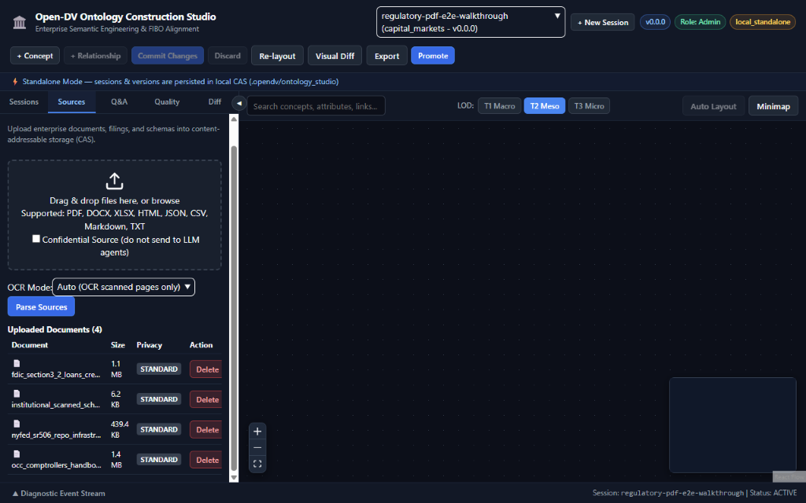
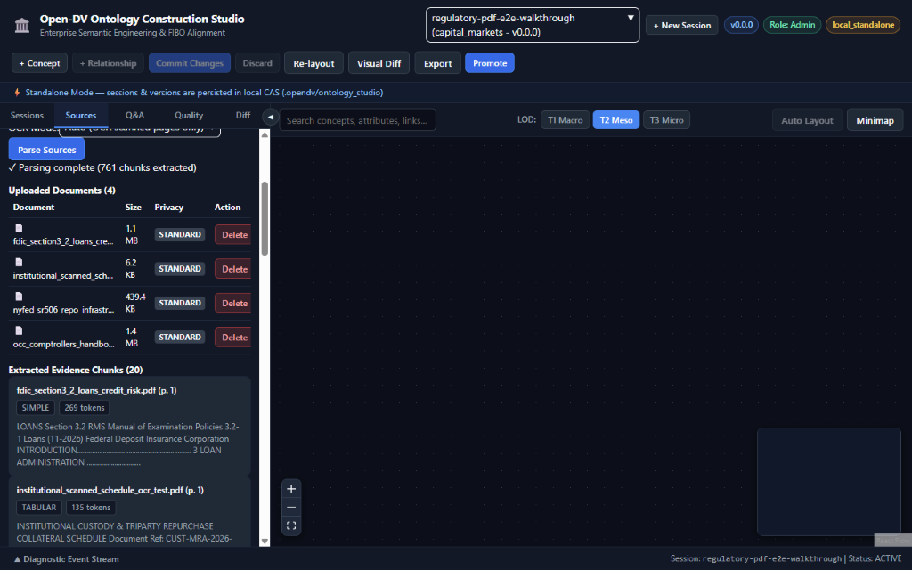
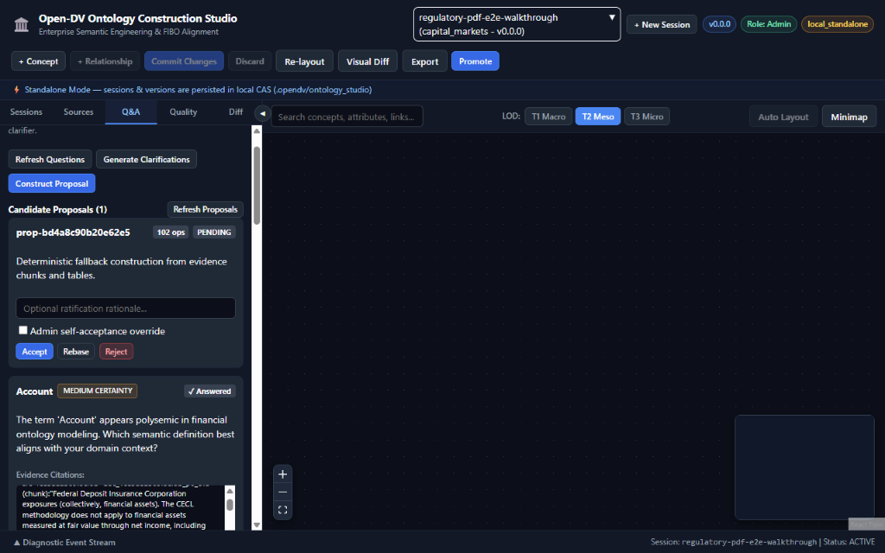
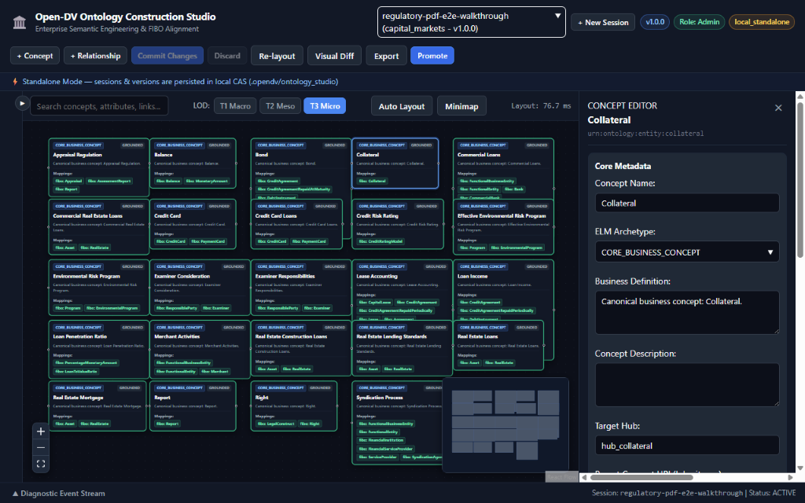
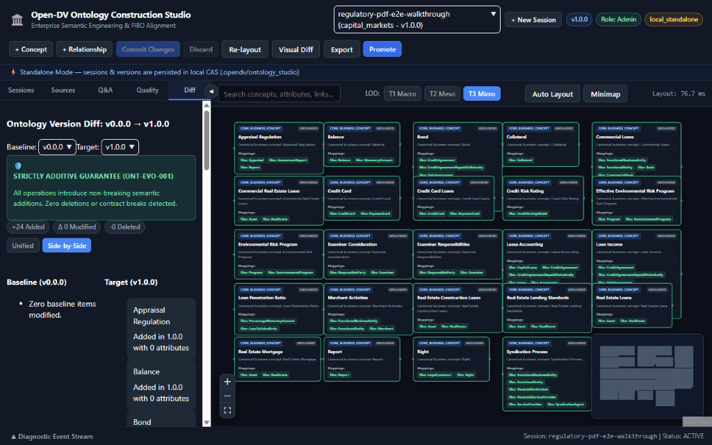
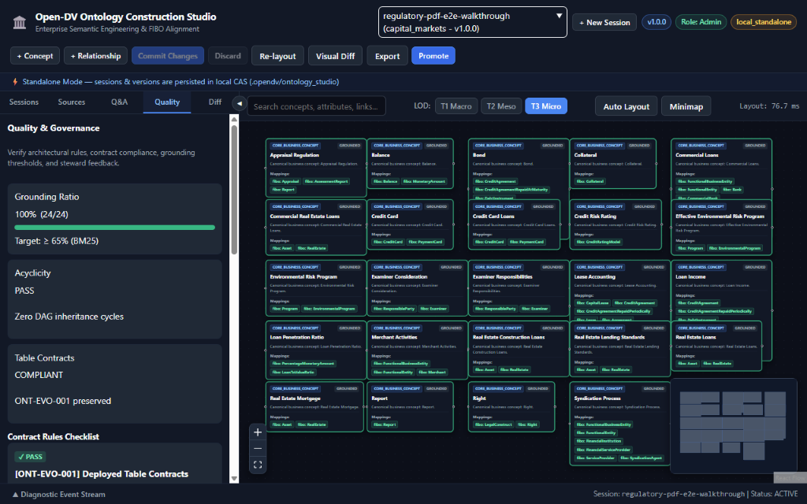
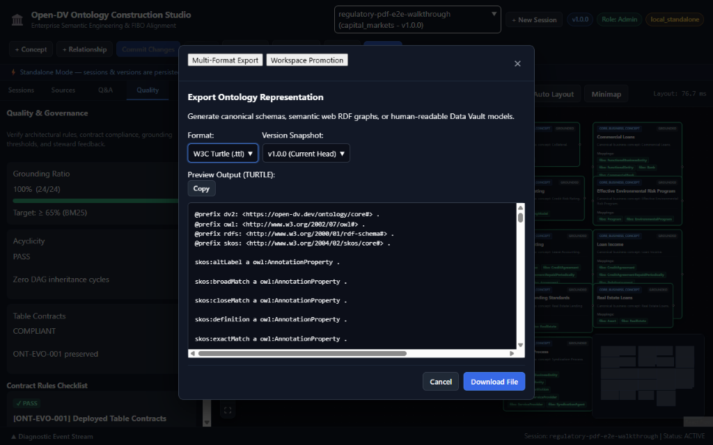

# 22 — Open-DV Ontology Construction Studio: Comprehensive End-User Guide

**Document Status:** Normative User & Operational Guide  
**Milestone:** Phase 6 Wave 3 Integration & Release (Task 6C.1 / Issue #233)  
**Governing Documents:** `docs/19-ontology-studio-architecture.md`, `docs/20-ontology-studio-spec.md`, `docs/21-ontology-studio-implementation-plan.md`  
**Interface Dialects:** CLI Specification v1 (`schemas/v1/cli-spec.json`), OpenAPI 3.1.0 (`schemas/v1/openapi.json`), RFC 8785 JCS, RFC 9457 Problem Details  

---

## 1. Introduction & Architecture Overview

The **Open-DV Ontology Construction Studio** is an interactive, neuro-symbolic enterprise modeling environment designed to bridge raw unstructured organizational evidence (regulatory filings, contracts, schemata, policy documents) and formal Data Vault 2.0 conceptual ontologies (`GraphAOntology`).

Whether deployed as an embedded local developer tool or a multi-tenant platform service, the Studio enforces strict mathematical governance, cryptographic immutability, and deterministic reproducibility across the entire conceptual modeling lifecycle.

```
+----------------------------------------------------------------------------------------------------+
|                                 Open-DV Ontology Construction Studio                               |
+----------------------------------------------------------------------------------------------------+
|                                                                                                    |
|  [ Sources & Evidence ]                                      [ Dual-Mode Engine ]                  |
|  - PDF / MD / CSV / XSD       CAS Storage                    - Agent-First (3 Personas)            |
|  - LiteParse layout engine    .opendv/ontology_studio/       - Deterministic Fallback (< 2.5s)     |
|  - Character offset tracking   └── <session_id>/             - Curated FIBO Core Alignment         |
|                                                                                                    |
|                                       │                                      │                     |
|                                       ▼                                      ▼                     |
|  [ Clarification & Feedback ] ─────────────────────────────► [ Interactive Web Workbench ]         |
|  - Ambiguity Q&A cards                                       - Route: /ontology                    |
|  - Business rationale                                        - React Flow + elkjs (<300ms SLA)     |
|  - CAS immutable responses                                   - 3-tier Level-of-Detail (LOD)        |
|                                                              - Color-coded Diff Overlay            |
|                                                                                                    |
|                                       │                                      │                     |
|                                       ▼                                      ▼                     |
|  [ Additive Evolution ] ───────────────────────────────────► [ Multi-Format Export & Promotion ]   |
|  - 24-Op Delta Calculus                                      - YAML, JCS JSON, Turtle, JSON-LD, NT |
|  - ONT-EVO Governance                                        - Atomic Workspace Promotion          |
|  - Concurrency Control (OCC)                                 - Two-Phase Lock (L4/L5)              |
+----------------------------------------------------------------------------------------------------+
```

### 1.1 Dual-Mode Engine

The Studio features a dual-mode construction architecture that gracefully balances generative AI reasoning with zero-credential deterministic guarantees:

1. **Agent-First Mode (3-Persona LLM)**:
   - Orchestrates three specialized cognitive personas:
     - `@term-scout`: Fast extraction of candidate business concepts, attributes, and domain terminology from parsed evidence chunks.
     - `@domain-clarifier`: Detects ambiguous conceptual alignments against standard taxonomies and synthesizes targeted clarification questions.
     - `@ontology-architect`: Reasoning-intensive synthesis of Canonical Business Concepts (CBCs), Links, Satellites, and formal OWL 2 axioms.
   - Operates with strict data isolation: PII and sensitive fields are masked using keyed HMAC-SHA256 pseudonymization (`K_pseudo`).

2. **Deterministic Fallback Mode (Zero-Credential CI)**:
   - Runs in fully air-gapped environments without external LLM API keys or network dependencies.
   - Utilizes Okapi BM25 candidate retrieval (`bm25_fibo_v1`) against bundled FIBO reference packs (`fibo-core-pack.json`) paired with strict Path A `ONT-EVO-002` verification (`skos:exactMatch` or `skos:closeMatch` with confidence $\ge 0.6500$; `skos:broadMatch` closure excluded).
   - Guarantees complete execution in $< 2.5$ seconds with deterministic, byte-for-byte reproducible outputs.
   - Candidates lacking a verified Path A FIBO `skos:exactMatch` / `skos:closeMatch` mapping at confidence $\ge 0.6500$ (and touched grandfathered concepts whose exemption was revoked by mutation) are automatically routed to `evidence/staged_candidates.json`, preventing ungrounded pollution.

### 1.2 Content-Addressable Storage (CAS) Lifecycle

Every Studio session resides in an isolated directory structure under `.opendv/ontology_studio/<session_id>/`:

```
.opendv/ontology_studio/<session_id>/
├── session.json                      # Authoritative session state & active version pointer
├── evidence/
│   ├── manifest.json                 # Ingested sources index and SHA-256 digests
│   ├── chunks.jsonl                  # Normalized text chunks and character offset spans
│   └── staged_candidates.json        # Low-confidence concepts pending clarification
├── clarifications/
│   ├── questions.json                # Generated ambiguity questions
│   └── answers.json                  # Steward responses and business rationales
├── proposals/
│   └── <proposal_id>.json            # Pending candidate proposals with delta operations
└── versions/
    ├── v0.0.0/                       # Genesis baseline draft
    │   └── ontology.json             # Default general namespace hash: 1916a5c6d501015984b8...
    └── v1.0.0/                       # First committed release
        ├── ontology.json             # Certified PE baseline hash: 1c100409cbbe12051f7211d2...
        └── delta.json                # Additive operations applied from genesis
```

> **Genesis `0.0.0` SHA-256 & Custom Namespaces:** `1916a5c6d501015984b887fd76609b225b72d5d393e5813d8df210b92ab3b4c9` is the canonical RFC 8785 JCS SHA-256 digest of the default `0.0.0` `GenesisDraft` (`domain_namespace: "general"`, `enterprise_owner: "Enterprise Architecture"`). Custom greenfield namespaces (such as `--domain-namespace wealth_mgmt --enterprise-owner "Global Wealth Advisory"`, which deterministically evaluates to `9897c2a95f2987821979eeec92a96a14eb64af37b06222b993adbc717aff1142`) serialize their own namespace headers into `versions/v0.0.0/ontology.json`—always capture the authoritative `head_sha256` returned by `opendv ontology studio create` or `opendv ontology studio status` rather than hardcoding the default namespace digest.

### 1.3 Additive Deltas & ONT-EVO Contract Protection

Ontology versioning is governed by the closed 24-operation delta calculus and the three normative `ONT-EVO` invariants (`docs/20-ontology-studio-spec.md` §7.3):
- **ONT-EVO-001 (Immutability & Additive Delta Evolution / Deployed Table Guard)**: Committed ontology snapshots (`versions/vX.Y.Z/`) and their canonical RFC 8785 JCS SHA-256 digests are cryptographically immutable. Standard modeling evolves strictly via additive `OntologyDelta` operations (`MINOR`/`PATCH` SemVer bumps); destructive structural revisions (`remove_concept`, `remove_relationship`, `remove_attribute`, `update_concept_urn`, or overwriting an existing `elm_archetype` / `parent_concept_uri`) require `admin` privileges, trigger a `MAJOR` SemVer bump, and are unconditionally blocked (`ONT_EVO_CONTRACT_VIOLATION`, exit code `4`) whenever targeting deployed Data Vault physical tables.
- **ONT-EVO-002 (Path A FIBO Grounding & Waiver Integrity)**: Every newly added or mutated concept must either (a) carry at least one server-verified `FIBO` external mapping with predicate `skos:exactMatch` or `skos:closeMatch` (`skos:broadMatch` closure is strictly excluded) and numeric confidence $\ge 0.6500$, or (b) be covered by an explicit per-concept administrative waiver (`OPENDV_WAIVER_KEY`) with a $\ge 10$-character business rationale. Workspace-seeded concepts recorded in `grandfathered_concept_uris` are exempt while untouched, and immediately lose their grandfather exemption if touched by any of the 17 existing-concept-mutating operations (`18` total in `CONCEPT_MUTATING_OP_TYPES`, comprising `add_concept` plus `17` existing-concept-mutating ops including `update_relationship_endpoint`).
- **ONT-EVO-003 (Optimistic Concurrency Control, 24-Op Rebase & Lock Hierarchy)**: Every state-mutating request enforces cryptographic OCC preconditions (`If-Match` / `base_sha256`), supports deterministic proposal rebasing across the 24-operation conflict matrix, and acquires filesystem locks strictly in canonical order (`L1 .local_token.lock -> L2 .job_<id>.lock -> L3 .journal_<id>.lock -> L4 graph_a.lock -> L5 .session.lock`).

---

## 2. Getting Started

### 2.1 Deployment Modes

The Studio operates in two primary modes configured via `OPENDV_SERVER_MODE`:

| Mode (`OPENDV_SERVER_MODE`) | Target User | Authentication | Network Binding | Storage |
|---|---|---|---|---|
| **Local Standalone** (`local_standalone`) | Individual modeler / data architect | `OPENDV_TOKEN` or auto-generated `.local_token` (DACL 0600) | Loopback only (`127.0.0.1`) | Local filesystem |
| **Remote Platform** (`remote_platform`) | Enterprise teams / centralized CI/CD | RS256 JWT / Bearer Token (`OPENDV_TOKEN`) / mTLS | External interface (`0.0.0.0`) | Managed server volume |

### 2.2 Launching the Web Workbench

To launch the integrated local Web Workbench:

```bash
# Start local Open-DV API and Web Workbench server
opendv serve --port 8420
```

Once running, open your modern browser (Chrome, Edge, Firefox, Safari) and navigate to:
```
http://127.0.0.1:8420/ontology
```

### 2.3 Dual CLI Configuration

Open-DV provides operational parity between the standalone Python CLI (`opendv`) and the Bun-compiled remote platform client (`opendvctl`):

```bash
# In-process Python CLI execution
opendv ontology studio list

# Loopback client execution (resolves OPENDV_STUDIO_TOKEN -> OPENDV_TOKEN -> .local_token)
export OPENDV_TOKEN="<your-loopback-or-platform-token>"
opendvctl ontology studio list --api-url http://127.0.0.1:8420

# Remote platform execution (non-loopback URLs ONLY read OPENDV_TOKEN to prevent leaking local tokens)
export OPENDV_TOKEN="<your-platform-jwt-or-bearer-token>"
opendvctl ontology studio list --api-url https://studio.enterprise.example
```

### 2.4 Representative Regulatory Sample PDFs & OCR Modes (`examples/sample_pdfs/`)

The repository ships a representative multi-document financial & regulatory corpus in [`examples/sample_pdfs/`](../examples/sample_pdfs/README.md) so you can immediately exercise PDF parsing, layout complexity detection, OCR mode routing (`auto`, `off`, `force`), and deterministic ontology construction without hunting for external filings:

| Document | Source | Pages | Size (Bytes) | Extracted Chunks | Detected Tables | Layout & OCR Profile |
|---|---|---:|---:|---:|---:|---|
| `nyfed_sr506_repo_infrastructure.pdf` | Federal Reserve Bank of New York — Staff Report No. 506 (*Tri-Party Repo Infrastructure*) | 55 | 449,963 | 67 | 0 | Clean multi-page vector prose (`Repo`, `Dealer`, `Collateral`, `ClearingBank`) |
| `fdic_section3_2_loans_credit_risk.pdf` | FDIC Risk Management Manual of Examination Policies — Section 3.2 (*Loans*) | 88 | 1,115,319 | 153 | 0 | Examination policies, underwriting standards, commercial loans & credit controls |
| `occ_comptrollers_handbook_rating_credit_risk.pdf` | OCC Comptroller's Handbook — *Rating Credit Risk* | 69 | 1,467,311 | 539 | 0 | Supervisory credit-rating guidance, facility collateral & allowance governance |
| `institutional_scanned_schedule_ocr_test.pdf` | Hybrid custody & repo schedule fixture | 2 | 6,352 | 2 | 1 | **Page 1:** clean vector + 3-row Markdown pipe collateral table (`is_complex=False`). **Page 2:** simulated scanned exhibit (`raster_ratio=0.6189 > 0.40`, `char_count=36 < 50`, `unmapped_glyphs=1` -> `is_complex=True`) |

All four files together yield **761 evidence chunks** and **1 structured Markdown table**, verified via `LiteParseDocumentAdapter` (`pypdf` fallback when optional `liteparse` CLI is absent) and `TesseractOCRRouter` (`packages/opendv-sources/src/opendv_sources/ingestion/layout_evaluator.py`):

- **`auto` (Recommended Default):** Scores every PDF page using character density (`char_count < 50`), embedded image area ratio (`raster_ratio > 0.40`), and unmapped glyph count (`unmapped_glyphs > 0`). Vector pages parse natively; complex pages (such as Page 2 of `institutional_scanned_schedule_ocr_test.pdf`) route to Tesseract OCR if installed on `PATH`, or gracefully fall back (`ocr_skipped=True`) when Tesseract is absent.
- **`off`:** Skips OCR invocation deterministically (`ocr_skipped=True` on complex pages) and extracts embedded PDF text and Markdown tables only.
- **`force`:** Fails closed with `OCRUnavailableError("OCR_UNAVAILABLE")` (`HTTP 501` in the Web Workbench / exit code `1` in the CLI) whenever the `tesseract` binary is unavailable on `PATH`, guaranteeing no silent partial extraction in strict OCR pipelines.

You can validate the entire four-PDF corpus from the CLI before or alongside a Web Workbench session:

```bash
# 1. Create a capital-markets session
opendv ontology studio create \
  --session regulatory-pdf-e2e-walkthrough \
  --domain-namespace capital_markets \
  --enterprise-owner "Institutional Risk Architecture"

# 2. Upload each regulatory PDF and hybrid scanned fixture
opendv ontology studio upload --session regulatory-pdf-e2e-walkthrough --file examples/sample_pdfs/nyfed_sr506_repo_infrastructure.pdf
opendv ontology studio upload --session regulatory-pdf-e2e-walkthrough --file examples/sample_pdfs/fdic_section3_2_loans_credit_risk.pdf
opendv ontology studio upload --session regulatory-pdf-e2e-walkthrough --file examples/sample_pdfs/occ_comptrollers_handbook_rating_credit_risk.pdf
opendv ontology studio upload --session regulatory-pdf-e2e-walkthrough --file examples/sample_pdfs/institutional_scanned_schedule_ocr_test.pdf

# 3. Parse with smart OCR auto-detection (761 chunks, 1 table)
opendv ontology studio parse --session regulatory-pdf-e2e-walkthrough --ocr-mode auto --wait

# 4. Optionally verify fail-closed OCR enforcement (requires tesseract on PATH)
opendv ontology studio parse --session regulatory-pdf-e2e-walkthrough --ocr-mode force --wait
```

See [`examples/sample_pdfs/README.md`](../examples/sample_pdfs/README.md) for SHA-256 digests and original source URLs.

---

## 3. End-to-End User Journeys

### 3.1 Journey 1: Greenfield Enterprise Modeling from Regulatory Filings

In this journey, a Financial Data Steward creates a brand-new Wealth Management Data Vault model directly from an SEC Form 10-K regulatory filing.

```
+───────────────────────────────────────────────────────────────────────────────────────────+
| Journey 1 Workflow: Regulatory Ingestion -> Clarification -> v1.0.0 Commit                 |
+───────────────────────────────────────────────────────────────────────────────────────────+
| 1. Create Session (wealth_mgmt v0.0.0 -> capture HEAD_SHA = 9897c2a9...)                  |
| 2. Upload Document (annual_report_2024.pdf) -> CAS Evidence Store                         |
| 3. Parse Layout -> Codepoint offset extraction & table detection                          |
| 4. Ambiguity Detection -> "Investment Advisor" vs "Fund Manager"                          |
| 5. Human Clarification -> Steward selects FIBO InvestmentAdvisor                          |
| 6. Neuro-Symbolic Construction -> 6 CBCs, 8 Links, 24 Satellites                          |
| 7. Proposal Acceptance -> Atomic Genesis bump v0.0.0 -> v1.0.0                            |
+───────────────────────────────────────────────────────────────────────────────────────────+
```

#### Step 1: Initialize Session & Capture Genesis `head_sha256`
Create a greenfield studio session initialized at `v0.0.0` and capture its deterministic RFC 8785 JCS `head_sha256` (for `wealth_mgmt` / `"Global Wealth Advisory"`, `head_sha256` evaluates to `9897c2a95f2987821979eeec92a96a14eb64af37b06222b993adbc717aff1142`; for default `general` / `"Enterprise Architecture"`, it evaluates to `1916a5c6d501015984b887fd76609b225b72d5d393e5813d8df210b92ab3b4c9`):

```bash
opendv ontology studio create \
  --session wealth-sec-2024 \
  --domain-namespace wealth_mgmt \
  --enterprise-owner "Global Wealth Advisory" \
  --description "SEC 10-K wealth management baseline model"

HEAD_SHA=$(opendv ontology studio status --session wealth-sec-2024 --json | jq -r .head_sha256)
```

#### Step 2: Upload Source Document
Upload the annual report PDF into the session's Content-Addressable Storage (CAS):

```bash
opendv ontology studio upload \
  --session wealth-sec-2024 \
  --file annual_report_2024.pdf \
  --description "FY2024 SEC Form 10-K Filing"
```

#### Step 3: Trigger Ingestion & Parsing
Execute asynchronous layout analysis and text normalization:

```bash
opendv ontology studio parse \
  --session wealth-sec-2024 \
  --ocr-mode auto \
  --wait
```

#### Step 4: Resolve Clarifications
The `@domain-clarifier` detects that *"Fund Advisor"* could align to either `fibo-fbc-fct-fse:InvestmentAdvisor` or `fibo-be-oac-cctl:FundManager`. In the Web Workbench or CLI, answer the question using `ClarificationAnswerRequest` (`selected_options`, `user_text`, and `expected_answers_sha256` OCC precondition):

```json
{
  "answers": [
    {
      "question_id": "q-advisor-align-01",
      "selected_options": ["opt-investment-advisor"],
      "user_text": "Acts as registered investment advisor under SEC regulations."
    }
  ],
  "expected_answers_sha256": "4f53cda18c2baa0c0354bb5f9a3ecbe5ed12ab4d8e11ba873c2f11161202b945"
}
```

Submit the answer file:

```bash
opendv ontology studio answer \
  --session wealth-sec-2024 \
  --file advisor_answer.json
```

#### Step 5: Construct Ontology Proposal
Invoke the construction engine against the session's `HEAD_SHA` (`9897c2a95f2987821979eeec92a96a14eb64af37b06222b993adbc717aff1142`, transmitted as `If-Match: "$HEAD_SHA"` and `"base_sha256": "$HEAD_SHA"` over REST):

```bash
opendv ontology studio construct \
  --session wealth-sec-2024 \
  --base-version 0.0.0 \
  --base-sha256 "$HEAD_SHA" \
  --mode agent \
  --wait
```

#### Step 6: Accept Proposal & Commit v1.0.0
Review the generated proposal (`prop-8821`) and accept it against `HEAD_SHA` (`If-Match: "$HEAD_SHA"` / `"parent_sha256": "$HEAD_SHA"`) to perform the genesis commit:

```bash
opendv ontology studio proposal accept \
  --session wealth-sec-2024 \
  --proposal-id prop-8821 \
  --base-sha256 "$HEAD_SHA"
```

The session transitions from `v0.0.0` to `v1.0.0`.

---

### 3.2 Journey 2: Evolutionary Workspace Modeling & Promotion

In this journey, an Enterprise Architect seeds a session from an existing Private Equity Data Vault project (`examples/private_equity`), adds Limited Partner commitment semantics, and promotes the updated model back to the workspace pipeline.

#### Step 1: Seed Session from Workspace
Seed a new studio session from the existing workspace project:

```bash
opendv ontology studio create \
  --session pe-evolution \
  --domain-namespace private_equity \
  --from-workspace examples/private_equity \
  --session-label "PE Limited Partner Additions"
```

The session automatically loads `v1.0.0` with baseline canonical hash `1c100409cbbe12051f7211d2d6d6838670982b9164aaf18b52f566864da90b81`. Existing URIs are registered in `grandfathered_concept_uris` and remain exempt from `ONT-EVO-002` re-grounding unless mutated by one of the 17 existing-concept-mutating delta operations (`18` total in `CONCEPT_MUTATING_OP_TYPES`).

#### Step 2: Upload Contract Addendum & Apply Delta
Upload the partnership agreement addendum and apply an additive `lp_delta.json` linking the new concept to the existing `urn:ontology:entity:fund` concept:

```json
{
  "operations": [
    {
      "op_id": "op-lp-add-concept-01",
      "op_type": "add_concept",
      "concept_uri": "urn:ontology:entity:limited_partner_commitment",
      "concept_name": "Limited Partner Commitment",
      "definition": "Capital commitment pledged by a limited partner to a private equity fund.",
      "target_hub": "hub_lp_commitment",
      "elm_archetype": "CORE_BUSINESS_CONCEPT"
    },
    {
      "op_id": "op-lp-add-attr-02",
      "op_type": "add_attribute",
      "concept_uri": "urn:ontology:entity:limited_partner_commitment",
      "attribute_name": "commitment_amount",
      "data_type": "decimal"
    },
    {
      "op_id": "op-lp-add-rel-03",
      "op_type": "add_relationship",
      "relationship_uri": "urn:ontology:relationship:fund_has_lp_commitment",
      "relationship_name": "Fund Has LP Commitment",
      "target_link": "lnk_fund_lp_commitment",
      "endpoints": [
        "urn:ontology:entity:fund",
        "urn:ontology:entity:limited_partner_commitment"
      ],
      "grain_semantics": "One commitment record per Limited Partner subscription in a Fund."
    },
    {
      "op_id": "op-lp-add-map-04",
      "op_type": "add_external_mapping",
      "concept_uri": "urn:ontology:entity:limited_partner_commitment",
      "scheme": "FIBO",
      "target_uri": "https://spec.edmcouncil.org/fibo/ontology/FND/Agreements/Contracts/ContractualCommitment",
      "predicate": "skos:exactMatch",
      "mapping_confidence": 0.8200
    }
  ]
}
```

Apply the delta operations to the session:

```bash
opendv ontology studio delta apply \
  --session pe-evolution \
  --file lp_delta.json \
  --base-version 1.0.0 \
  --base-sha256 1c100409cbbe12051f7211d2d6d6838670982b9164aaf18b52f566864da90b81 \
  --rationale "Add Limited Partner capital commitment conceptual modeling"
```

This atomically creates committed snapshot `v1.1.0`.

#### Step 3: Promote to Workspace Pipeline
Promote the updated ontology directly into the workspace Data Vault pipeline:

```bash
opendv ontology studio promote \
  --session pe-evolution \
  --workspace examples/private_equity \
  --workspace-sha256 1c100409cbbe12051f7211d2d6d6838670982b9164aaf18b52f566864da90b81 \
  --head-sha256 5e89a12c4b3f890123456789abcdef0123456789abcdef0123456789abcdef01 \
  --rationale "Promote v1.1.0 LP commitment concepts to production pipeline"
```

The two-phase promotion protocol acquires workspace lock `graph_a.lock`, validates containment, updates the workspace YAML, and records the audit trail.

---

### 3.3 Journey 3: Air-Gapped Zero-Credential CI Pipeline

In automated continuous integration environments where no internet access or LLM credentials exist, the Studio executes deterministically in $< 2.5$ seconds:

```bash
# Seed session from workspace in CI runner
opendv ontology studio create \
  --session ci-verify-run \
  --domain-namespace private_equity \
  --from-workspace examples/private_equity

# Run deterministic construction with auto-commit
opendv ontology studio construct \
  --session ci-verify-run \
  --base-version 1.0.0 \
  --base-sha256 1c100409cbbe12051f7211d2d6d6838670982b9164aaf18b52f566864da90b81 \
  --mode deterministic \
  --auto-commit
```

- If no new inputs exist, the job emits `NOOP_CONSTRUCT` in the audit log and exits cleanly with code `0`.
- All grounding rules and OCC invariants are mathematically verified.

---

### 3.4 Journey 4: Human-in-the-Loop Clarification & Administrative Waivers

When a domain concept cannot satisfy `ONT-EVO-002` Path A FIBO grounding (`skos:exactMatch` or `skos:closeMatch` with confidence $\ge 0.6500$; `skos:broadMatch` is excluded—for example, proprietary internal instruments), an Enterprise Architect can sign a per-concept administrative grounding waiver using `OPENDV_WAIVER_KEY`:

```bash
export OPENDV_WAIVER_KEY="<admin-waiver-secret>"
HEAD_SHA=$(opendv ontology studio status --session wealth-sec-2024 --json | jq -r .head_sha256)
opendv ontology studio proposal accept \
  --session wealth-sec-2024 \
  --proposal-id prop-9902 \
  --base-sha256 "$HEAD_SHA" \
  --low-confidence-waiver \
  --grounding-rationale "Proprietary bespoke investment vehicle authorized under Board Resolution 2026-B" \
  --ungrounded-concept "urn:ontology:entity:bespoke_mezzanine_fund"
```

Administrative waivers require:
1. `low_confidence_waiver=True`
2. `grounding_rationale` of at least 10 characters detailing the governance reason.
3. Explicit per-concept list of `ungrounded-concept` URIs covered by the waiver (subsequent mutations to any waived or grandfathered concept revoke its exemption).
4. Authenticated `OPENDV_WAIVER_KEY` credential and `admin` role authorization (missing/invalid credentials or non-admin callers are denied with exit code `7` `FORBIDDEN_ADMIN_REQUIRED`).

---

## 4. Interactive Web Workbench Walkthrough (`/ontology`)

The Open-DV Web Workbench provides a visual, reactive single-page application at `/ontology`. The screenshots below walk step-by-step through a real live `1440x900` session (`regulatory-pdf-e2e-walkthrough`, domain `capital_markets`) built from all four PDFs in [`examples/sample_pdfs/`](../examples/sample_pdfs/README.md):

```
+───────────────────────────────────────────────────────────────────────────────────────────────────+
| Open-DV Workbench  [Session: pe-evolution ▼]  [State: COMMITTED]  [Active: v1.1.0] [Token: Valid] |
+───────────────────────┬─────────────────────────────────────────────────┬─────────────────────────+
| SOURCES & PARSE       | REACT FLOW + ELKJS GRAPH EXPLORER               | VISUAL EDITOR & DIFF    |
|                       |                                                 |                         |
| [Upload Files (+)]    |  ┌──────────────────┐     ┌──────────────────┐  | Selected: Hub LP Commit |
| 📄 10k_sec_2024.pdf   |  |   hub_fund       |────►| hub_lp_commitment|  |                         |
|   12 chunks | CONFID  |  └──────────────────┘     └──────────────────┘  | Archetype: State        |
|                       |            │                 ▲ (Green: Added)   | Target Hub: hub_lp_com  |
| 📄 lp_addendum.md     |            ▼                 │                  |                         |
|   4 chunks | INTERNAL |  ┌──────────────────┐        │                  | Attributes:             |
|                       |  | hub_investor     |────────┘                  | - commitment_amount     |
| [Parse Status: OK]    |  └──────────────────┘                           | - pledge_date           |
|                       |                                                 |                         |
+───────────────────────┼─────────────────────────────────────────────────┼─────────────────────────+
| CLARIFICATION Q&A     | LEVEL OF DETAIL (LOD): [ LOD-1 | LOD-2 | LOD-3 ] | QUALITY & EXPORT        |
|                       |                                                 |                         |
| Q: Align "Advisor"?   | Layout SLA: 142ms (< 300ms)                     | Score: 100% Validated   |
| (•) InvestmentAdvisor | Zoom: 85% | Nodes: 6 | Edges: 8                 | Grounding: 0.8200 (OK)  |
| ( ) FundManager       |                                                 | [Export OWL/TTL]        |
| [Submit Response]     |                                                 | [Promote to Workspace]  |
+───────────────────────┴─────────────────────────────────────────────────┴─────────────────────────+
```

### 4.1 Local Launch, Authentication & RBAC Hydration
- **Recommended Launch (`opendv serve --open`)**: Starts the local loopback server (`127.0.0.1`) and opens `/ontology#token=<nonce>`. The Web Workbench automatically exchanges the launch nonce via `POST /api/v1/ontology/studio/auth/token`, sets an `HttpOnly` cookie, scrubs the URL fragment from browser history, and hydrates your exact RBAC role (`admin`, `editor`, `viewer`, or `automated`) from `TokenExchangeResponse.role` and `X-OpenDV-Role` response headers.
- **Manual Launch & HTTP `409` (`STUDIO_ALREADY_INITIALIZED`) Guidance**: If an instance previously initialized `.opendv/ontology_studio/.local_token`, clicking automatic loopback bootstrap returns HTTP `409`. The Workbench focuses the token input and displays inline instructions telling you either to paste the token stored in `.opendv/ontology_studio/.local_token` or relaunch with `opendv serve --open`.
- **RBAC Role Badge**: Displays the active authenticated role (`admin`, `editor`, `viewer`, or `automated`; unauthenticated local store state initializes to `editor` until `/init`, `/auth/token`, or `X-OpenDV-Role` hydrates your server role). Read-only `viewer` and `automated` roles disable manual edit controls, while waivers, destructive deletions, and promotion require `admin`.

### 4.2 Session Switcher & Recency Ordering
- **Session Switcher**: Switch instantly between active sessions or create a new session with a workspace path (`--workspace`) or greenfield namespace.
- **Most-Recent-First Ordering**: Backend `list_sessions()` sorts sessions by `(updated_at or created_at, session_id)` descending, ensuring newly created and recently edited sessions always appear at the top of the drawer even when more than 50 historical sessions exist.
- **State Badges**: Color-coded lifecycle indicators (`EMPTY`, `INGESTED`, `CLARIFYING`, `CONSTRUCTED`, `COMMITTED`, `PROMOTED`):
  - `EMPTY`: Initialized without committed versions (`v0.0.0`).
  - `INGESTED` / `CLARIFYING` / `CONSTRUCTED`: Active ingestion, ambiguity Q&A, or candidate proposal synthesis in progress.
  - `COMMITTED`: Version committed in session CAS (including sessions initialized from an existing workspace baseline).
  - `PROMOTED`: Head version promoted to workspace Data Vault.

### 4.3 Sources Panel, OCR Modes & Chunk Inspector (Stages 1–2)
- **Drag-and-Drop Uploader**: Supports `.pdf`, `.docx`, `.xlsx`, `.html`/`.htm`, `.json`, `.csv`, `.md`/`.markdown` (including browsers that send `application/octet-stream` for Markdown), and `.txt` up to the `100 MiB` (`STUDIO_MAX_UPLOAD_BYTES`) per-file upload cap.
- **OCR Mode Toggle**: `Auto`, `Force OCR`, and `Off`. Selecting `Force OCR` without Tesseract installed fails closed with `HTTP 501 OCR_UNAVAILABLE`, whereas `Auto` and `Off` extract vector pages and flag scanned/complex pages (`COMPLEX`, `ocr_skipped=True`) cleanly.
- **Confidentiality Taint (`do_not_send_to_agent`)**: Mark sensitive documents via per-document **Privacy** classification (`public`, `internal`, `confidential`, `restricted`) to enforce redaction and taint tracking across CAS chunks.
- **Chunk Inspector Drawer**: After parsing completes, inspect extracted evidence snippets with page/source headers, layout complexity badges (`SIMPLE`, `TABULAR`, `COMPLEX`), UTF-8 character offsets, Markdown tables, and token counts. For multi-document corpora, the workbench reports the full CAS total (for example, `761 chunks extracted`) while displaying a balanced preview sample (`Extracted Evidence Chunks (20)`) across all uploaded files so long multi-hundred-page filings stay responsive.


*Stage 1: All four sample regulatory PDFs uploaded into `regulatory-pdf-e2e-walkthrough` inside the `380px` Sources drawer alongside the `Privacy` taint selector and `OCR Mode` (`Auto` / `Force OCR` / `Off`) control prior to parsing.*


*Stage 2: Completion status (`Parsing complete (761 chunks extracted)`) and the balanced `Extracted Evidence Chunks (20)` preview featuring layout complexity badges (`COMPLEX` on Page 2 of the scanned exhibit fixture), token counts, and preserved Markdown table syntax.*

### 4.4 Clarification Q&A & Proposal Ratification (Stage 3)
- **Ambiguity Questions**: Presents domain questions generated by the clarification step with certainty badges (e.g., `~79%`), candidate options, rationale notes, and scrollable source citations (`Citations (N)` inside a compact overflow-safe container), persisting answers via CAS (`clarifications/answers.json` + `If-Match`).
- **Construct & Proposal List**: Triggers construction over extracted tables and regulatory prose chunks, showing each candidate proposal's operation count (`102 ops` badge for the 4-PDF corpus) and status (`PENDING`, `ACCEPTED`, `REJECTED`).
- **Zero-Op Proposal Guard (`0 ops`)**: When a proposal contains `0` operations (for example, constructed before source documents were uploaded and parsed), the **Accept** button is automatically disabled with an inline reminder (`"0 operations — upload and parse source documents first"`), while **Reject** remains enabled so you can clean up empty proposals.


*Stage 3: Resolved Domain Ambiguity Questions with compact scrollable citations and pending candidate proposal `prop-bd4a8c90b20e62e5` (`102 ops`, `PENDING`) ready for ratification via `Accept` or `Reject`.*

### 4.5 React Flow + elkjs Graph Canvas & Visual Editor Drawer (Stage 4)
- **Dark-Mode Graph Canvas**: Powered by `@xyflow/react` and `elkjs` (`< 300 ms` layout SLA — observed `76.7 ms` for 24 regulatory concepts) featuring high-contrast dark zoom/fit/lock controls and minimap.
- **3-Tier Level-of-Detail (LOD)**:
  - **LOD-1 (`T1 Macro`)**: Compact concept chips and primary Link edges.
  - **LOD-2 (`T2 Meso`)**: Archetype badge, target hub, and attribute/mapping counts.
  - **LOD-3 (`T3 Micro`)**: Full definitions, attribute types, and clipped external mapping pills (`scheme:TerminalFragment`, e.g., `fibo:Collateral`, `fibo:CreditRatingModel`, `fibo:Asset`, `fibo:RealEstate`, `fibo:CreditAgreement`) with full-IRI hover tooltips (`title`).
- **Visual Editor Drawer (`CONCEPT EDITOR`) & `ONT-EVO-002` Grounding Paths**: Click any node (e.g., `Collateral` / `urn:ontology:entity:collateral`) to edit concept metadata, ELM archetype, target hub (`hub_collateral`), attributes, synonyms, parent taxonomy (`ONT-DAG-001`), and external mappings. Under **FIBO / External Mappings**, inline guidance explains the two ways to pass `ONT-EVO-002`:
  - **Path A (Auto-Verified)**: Supply a server-verified `FIBO` mapping using `skos:exactMatch` or `skos:closeMatch` (`skos:broadMatch` is excluded) with confidence $\ge 0.65$.
  - **Path B (Admin Steward Waiver)**: For bespoke domain concepts or manually asserted mappings, authorize an Admin Steward Waiver in the **Quality** tab (`>= 10`-character rationale + `OPENDV_WAIVER_KEY`).


*Stage 4: Accepted `v1.0.0` graph displaying 24 grounded regulatory concepts (`T3 Micro` LOD, `Layout: 76.7 ms`, Minimap enabled) with the slide-over `CONCEPT EDITOR` open on `Collateral` (`hub_collateral`).*

### 4.6 Visual Diff Overlay (Committed Versions & Uncommitted Working Draft) (Stage 5)
- Compare any two committed versions (`v0.0.0`, `v1.0.0`, `v1.1.0`, ...) **or** inspect your uncommitted canvas edits live against the active committed baseline (`vX.Y.Z` vs `Working Draft (Uncommitted)`), toggling between **`Unified`** and **`Side-by-Side`** columns.
- Displays the real-time contract verification banner (`STRICTLY ADDITIVE GUARANTEE (ONT-EVO-001)`) and delta summary (`+24 Added`, `Δ 0 Modified`, `-0 Deleted`).
- When unsaved canvas modifications exist, clicking **Visual Diff** defaults immediately to `active_version -> draft` using in-memory graph state without making a failing server export request for `"draft"`:
  - **Green (+)**: Newly added Conceptual Hubs, Links, or Attributes.
  - **Amber (~)**: Modified descriptions, synonyms, or external mappings.
  - **Red (-)**: Deprecated or removed elements (Admin Steward only under `ONT-EVO-001`).


*Stage 5: Visual Diff comparing greenfield baseline `v0.0.0` against committed `v1.0.0` in `Side-by-Side` mode, verifying `+24 Added / Δ 0 Modified / -0 Deleted` and `ONT-EVO-001` compliance.*

### 4.7 Quality Scorecard, Multi-Format Exports & Atomic Promotion (Stages 6–7)
- **Quality & Governance Scorecard**: Validates 100% of contract rules in real time, displaying **Grounding Ratio** (`100% (24/24)` vs `Target: >= 65% (BM25)`, or `N/A (No nodes)` when empty), **Acyclicity** (`PASS — Zero DAG inheritance cycles`), **Table Contracts** (`COMPLIANT — ONT-EVO-001 preserved`), the itemized **Contract Rules Checklist** (`ONT-EVO-001`, `ONT-EVO-002`, `ONT-DAG-001`, informational `YAGNI-001` attribute check), **Administrative Steward Waiver** controls, and **Steward Feedback** persistence.
- **Multi-Format Export Modal**: Click **Export** in the top toolbar to preview, copy (`Copy`), and download (`Download File`) any committed snapshot (`v1.0.0 (Current Head)`) across five formats: **Graph A YAML (`.yaml`)**, **Canonical JSON / RFC 8785 JCS (`.json`)**, **W3C Turtle (`.ttl`)**, **JSON-LD (`.jsonld`)**, and **N-Triples (`.nt`)**.
- **Atomic Workspace Promotion**: Switch to the **Workspace Promotion** tab (or click **Promote** in the top toolbar). Enforces dual OCC preconditions—session `head_sha256` (`If-Match`) and `Expected Workspace SHA-256` (`X-OpenDV-Workspace-If-Match`, with a one-click `Greenfield (64 zeros)` helper for new workspaces)—plus a minimum `10`-character `Promotion Rationale` and contract acknowledgment checkbox before enabling `Promote to Workspace`.


*Stage 6: Quality & Governance tab confirming `100% (24/24)` FIBO grounding, `PASS` DAG acyclicity, `COMPLIANT` `ONT-EVO-001` status, and Contract Rules Checklist.*


*Stage 7: Tabbed Export & Promotion dialog displaying `W3C Turtle (.ttl)` serialization for `v1.0.0 (Current Head)` with `Copy` and `Download File` actions alongside the `Workspace Promotion` tab.*

---

## 5. Dual-CLI Command Recipes

Open-DV provides 15 studio subcommands (21 shared dual-CLI leaf commands + standalone-only `init`, 22 total in `schemas/v1/cli-spec.json`) across `opendv` and `opendvctl` under the `ontology studio` namespace. Below are working invocations for every command:

### 5.1 Session Lifecycle Commands

#### `init` (standalone-only)
Initialize the local studio loopback token and permissions:

```bash
opendv ontology studio init
```

Force rotation of existing local token:

```bash
opendv ontology studio init --force
```

#### `create`
Create a greenfield session:

```bash
opendv ontology studio create \
  --session session-alpha \
  --domain-namespace risk_analytics \
  --enterprise-owner "Enterprise Risk Office" \
  --description "Risk analytics baseline"
```

Create a session seeded from an existing workspace:

```bash
opendv ontology studio create \
  --session session-pe \
  --from-workspace examples/private_equity \
  --session-label "PE Evolution"
```

#### `delete`
Delete a studio session and sweep unreferenced CAS blobs:

```bash
opendv ontology studio delete --session session-alpha --force
```

#### `list`
List active studio sessions:

```bash
opendv ontology studio list --limit 25 --offset 0
```

Filter sessions by status:

```bash
opendv ontology studio list --status COMMITTED
```

#### `status`
Display detailed session status, active version, sources, and job history:

```bash
opendv ontology studio status --session session-pe
```

---

### 5.2 Ingestion & Construction Commands

#### `upload`
Upload a document into session CAS:

```bash
opendv ontology studio upload \
  --session session-pe \
  --file partnership_agreement.md \
  --description "Limited Partnership Agreement 2024"
```

Upload a document marked confidential (not sent to third-party LLMs):

```bash
opendv ontology studio upload \
  --session session-pe \
  --file proprietary_formula.pdf \
  --do-not-send-to-agent \
  --description "Proprietary internal pricing formula"
```

#### `parse`
Trigger asynchronous layout and table parsing:

```bash
opendv ontology studio parse \
  --session session-pe \
  --ocr-mode auto \
  --wait
```

#### `clarify`
Generate clarification questions for ambiguous concepts:

```bash
opendv ontology studio clarify \
  --session session-pe \
  --focus-concept "urn:ontology:entity:advisor" \
  --max-questions 5 \
  --wait
```

#### `answer`
Submit answers to clarification questions:

```bash
opendv ontology studio answer \
  --session session-pe \
  --file answers.json
```

#### `construct`
Synthesize ontology proposals using the generative agent:

```bash
opendv ontology studio construct \
  --session session-pe \
  --base-version 1.0.0 \
  --base-sha256 1c100409cbbe12051f7211d2d6d6838670982b9164aaf18b52f566864da90b81 \
  --mode agent \
  --wait
```

Synthesize ontology deterministically in headless CI:

```bash
opendv ontology studio construct \
  --session session-pe \
  --base-version 1.0.0 \
  --base-sha256 1c100409cbbe12051f7211d2d6d6838670982b9164aaf18b52f566864da90b81 \
  --mode deterministic \
  --auto-commit
```

---

### 5.3 Deltas & Proposals Commands

#### `delta validate`
Dry-run validate delta operations and `ONT-EVO` governance rules without mutating session state:

```bash
opendv ontology studio delta validate \
  --session session-pe \
  --file additions.json \
  --base-version 1.0.0 \
  --base-sha256 1c100409cbbe12051f7211d2d6d6838670982b9164aaf18b52f566864da90b81 \
  --verify-grounding
```

#### `delta apply`
Apply explicit additive delta operations from file:

```bash
opendv ontology studio delta apply \
  --session session-pe \
  --file additions.json \
  --base-version 1.0.0 \
  --base-sha256 1c100409cbbe12051f7211d2d6d6838670982b9164aaf18b52f566864da90b81 \
  --rationale "Add capital commitment concept"
```

#### `proposal list`
List all pending proposals for a session:

```bash
opendv ontology studio proposal list --session session-pe
```

#### `proposal show`
Display proposal diff and generated delta operations:

```bash
opendv ontology studio proposal show \
  --session session-pe \
  --proposal-id prop-8821
```

#### `proposal accept`
Accept and commit a proposal to create a new version:

```bash
opendv ontology studio proposal accept \
  --session session-pe \
  --proposal-id prop-8821 \
  --base-sha256 1c100409cbbe12051f7211d2d6d6838670982b9164aaf18b52f566864da90b81
```

#### `proposal reject`
Reject a candidate proposal with rationale:

```bash
opendv ontology studio proposal reject \
  --session session-pe \
  --proposal-id prop-8821 \
  --reason "Concepts duplicate existing core enterprise terminology"
```

#### `proposal rebase`
Rebase a proposal onto a newer head commit:

```bash
opendv ontology studio proposal rebase \
  --session session-pe \
  --proposal-id prop-8821 \
  --base-sha256 1c100409cbbe12051f7211d2d6d6838670982b9164aaf18b52f566864da90b81
```

---

### 5.4 Export, Promotion & Bundles Commands

#### `export`
Export the committed ontology to W3C Turtle:

```bash
opendv ontology studio export \
  --session session-pe \
  --export-format turtle \
  --out pe_ontology.ttl
```

Export to canonical RFC 8785 JSON:

```bash
opendv ontology studio export \
  --session session-pe \
  --export-format json \
  --out pe_ontology.json
```

Export to JSON-LD (`.jsonld`):

```bash
opendv ontology studio export \
  --session session-pe \
  --export-format jsonld \
  --out pe_ontology.jsonld
```

#### `promote`
Promote session head ontology to workspace Data Vault project:

```bash
opendv ontology studio promote \
  --session session-pe \
  --workspace examples/private_equity \
  --workspace-sha256 1c100409cbbe12051f7211d2d6d6838670982b9164aaf18b52f566864da90b81 \
  --head-sha256 1c100409cbbe12051f7211d2d6d6838670982b9164aaf18b52f566864da90b81 \
  --rationale "Promote verified private equity model to workspace pipeline"
```

#### `bundle export`
Export entire session CAS to portable `.odvstudio.zip` bundle:

```bash
opendv ontology studio bundle export \
  --session session-pe \
  --out session_pe_backup.zip
```

#### `bundle import`
Import session bundle into local studio CAS:

```bash
opendv ontology studio bundle import \
  --file session_pe_backup.zip
```

#### `bundle clone`
Clone an existing session into a new isolated working branch:

```bash
opendv ontology studio bundle clone \
  --session session-pe \
  --new-session-id session-pe-experiment \
  --session-label "Experimental LP Modeling"
```

---

## 6. Troubleshooting & Error Recovery Catalog

### 6.1 Canonical 11-Step Error Precedence Order

When validating any incoming operation or request, the Studio engine evaluates errors through a strict, authoritative **11-step precedence order** defined in `schemas/v1/error-codes.json`. Lower-numbered steps take absolute precedence over higher-numbered steps:

```
[ Step 0: CLI-Local Syntax / Flags ] ────────► Exit 2 (SYNTAX_INVALID_ARGUMENT)
                   │
                   ▼
[ Step 1: AuthN Token Resolution ] ──────────► Exit 7 (UNAUTHENTICATED / HTTP 401)
                   │
                   ▼
[ Step 2: Precondition Syntax ] ─────────────► Exit 2 (SYNTAX_INVALID_ARGUMENT / HTTP 400)
                   │
                   ▼
[ Step 3: RBAC & Actor Privileges ] ─────────► Exit 7 (FORBIDDEN_ADMIN_REQUIRED / HTTP 403)
                   │
                   ▼
[ Step 4: Body Parse & Field Uniqueness ] ───► Exit 2 (Syntax) / Exit 4 (Duplicate Uniqueness)
                   │
                   ▼
[ Step 5: Envelope Segregation ] ────────────► Exit 4 (ONT_EVO_ENVELOPE_VIOLATION)
                   │
                   ▼
[ Step 6: Lifecycle & Lock State ] ──────────► Exit 6 (LOCK_TIMEOUT / HTTP 409)
                   │
                   ▼
[ Step 7: Field Authorization ] ─────────────► Exit 7 (Admin required before waiver check)
                   │
                   ▼
[ Step 8: Semantic Waiver Validation ] ──────► Exit 4 (INVALID_GROUNDING_WAIVER / HTTP 422)
                   │
                   ▼
[ Step 9: Concurrency Control (OCC) ] ───────► Exit 5 (OCC_CONFLICT / HTTP 412)
                   │
                   ▼
[ Step 10: Referential & ONT-EVO Rules ] ────► Exit 4 (ONT_EVO_UNGROUNDED_CONCEPT / HTTP 422)
```

### 6.2 Exit Codes Reference Table

| Exit Code | Classification | HTTP Equivalent | Description & Typical Causes |
|---|---|---|---|
| **0** | Success | `200`, `201`, `202` | Operation completed successfully. |
| **1** | Operational Failure | `400`, `500`, `503` | OCR binary unavailable, external LLM failure, or missing required rationale. |
| **2** | Syntax / Precondition | `400` | Unrecognized CLI flag, missing mandatory path, or invalid JSON syntax. |
| **3** | Not Found | `404` | Session ID, source document ID, proposal ID, or question ID not found. |
| **4** | Semantic / Contract | `422` | ONT-EVO grounding violation, envelope violation, corrupt source blob, or waiver error. |
| **5** | OCC Concurrency Conflict | `412` | Head SHA-256 mismatch (`If-Match` conflict); concurrent edit committed. |
| **6** | Lock State Conflict | `409` | Active background job lock timeout or concurrent promotion lock in progress. |
| **7** | Authorization Denied | `401`, `403` | Missing token, non-admin attempting waiver or promotion, or CSRF origin denied. |

### 6.3 RFC 9457 Problem Details Format

All Studio REST API errors return standard RFC 9457 `application/problem+json` payloads:

```json
{
  "type": "urn:opendv:error:ont-evo-ungrounded-concept",
  "title": "Ont Evo Ungrounded Concept",
  "status": 422,
  "detail": "Concept 'urn:ontology:entity:bespoke_asset' lacks a verified FIBO skos:exactMatch or skos:closeMatch mapping with confidence >= 0.6500 (observed 0.4800; skos:broadMatch excluded).",
  "error_code": "ONT_EVO_UNGROUNDED_CONCEPT",
  "instance": "/api/v1/ontology/studio/sessions/wealth-sec-2024/proposals/prop-8821/accept",
  "extensions": {
    "concept_uri": "urn:ontology:entity:bespoke_asset",
    "confidence": 0.4800,
    "grounding_threshold": 0.6500
  }
}
```

### 6.4 Common Issues & Solutions

1. **`PRECONDITION_BASE_SHA_MISMATCH` (Exit Code 2 / 5)**:
   - *Cause*: The session head has advanced since you retrieved the base SHA-256 hash (`ONT-EVO-003` OCC guard).
   - *Fix*: Run `opendv ontology studio status --session <session_id>` to view the latest `head_sha256`, or rebase your proposal via `proposal rebase`.

2. **`ONT_EVO_UNGROUNDED_CONCEPT` (Exit Code 4)**:
   - *Cause*: A newly added concept (or a workspace-seeded grandfathered concept whose exemption was revoked by one of the 17 existing-concept-mutating operations—`18` total in `CONCEPT_MUTATING_OP_TYPES`) lacks a server-verified `FIBO` `skos:exactMatch` or `skos:closeMatch` mapping with confidence $\ge 0.6500$ (`skos:broadMatch` does not satisfy Path A).
   - *Fix*: Select a verified `skos:exactMatch` / `skos:closeMatch` FIBO alignment via clarification Q&A, or authorize a per-concept administrative waiver (`OPENDV_WAIVER_KEY`) with `--low-confidence-waiver`, `--ungrounded-concept <uri>`, and `--grounding-rationale`.

3. **`LOCK_TIMEOUT` (Exit Code 6)**:
   - *Cause*: A background parsing or construction job is currently running on the session.
   - *Fix*: Check job status via `status --session <session_id>` or wait for the active worker to release the lock.

4. **`FORBIDDEN_ADMIN_REQUIRED` (Exit Code 7)**:
   - *Cause*: Operation requires Enterprise Architect / Admin privilege (e.g. waiver signing, promotion, concept deletion).
   - *Fix*: Supply valid admin credentials or execute with an authorized local admin token.

5. **`STUDIO_ALREADY_INITIALIZED` (`HTTP 409`) / `UNAUTHENTICATED` (`HTTP 401`) in Web Workbench**:
   - *Cause*: Clicking automatic loopback auth when `.opendv/ontology_studio/.local_token` was already created by an earlier session or server run, or opening `/ontology` without an exchanged cookie/bearer token.
   - *Fix*: Paste the token stored in `.opendv/ontology_studio/.local_token` into the focused token prompt, or relaunch via `uv run opendv serve --open` so the launch nonce exchanges automatically and hydrates your RBAC role (`X-OpenDV-Role`).

6. **Zero-Operation Candidate Proposal (`0 ops`) in Web Workbench**:
   - *Cause*: Running ontology construction before source documents are uploaded and parsed (or after resolving no extractable entities) emits an empty candidate proposal; the **Accept** button stays disabled.
   - *Fix*: Upload and parse your domain sources in the **Sources** tab first, re-run construction, and click **Reject** on the `0 ops` proposal to archive/clean it up.
