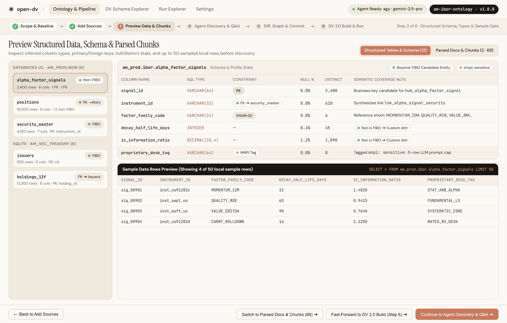
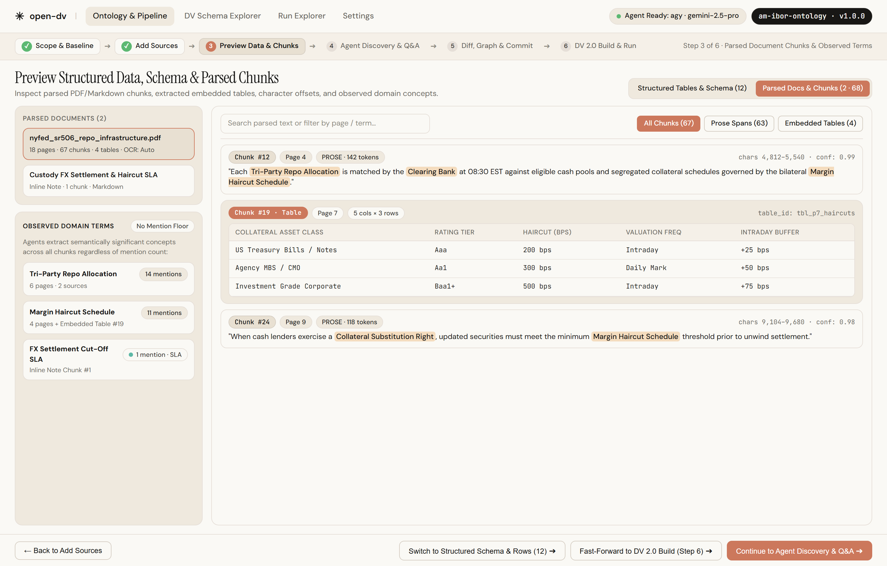
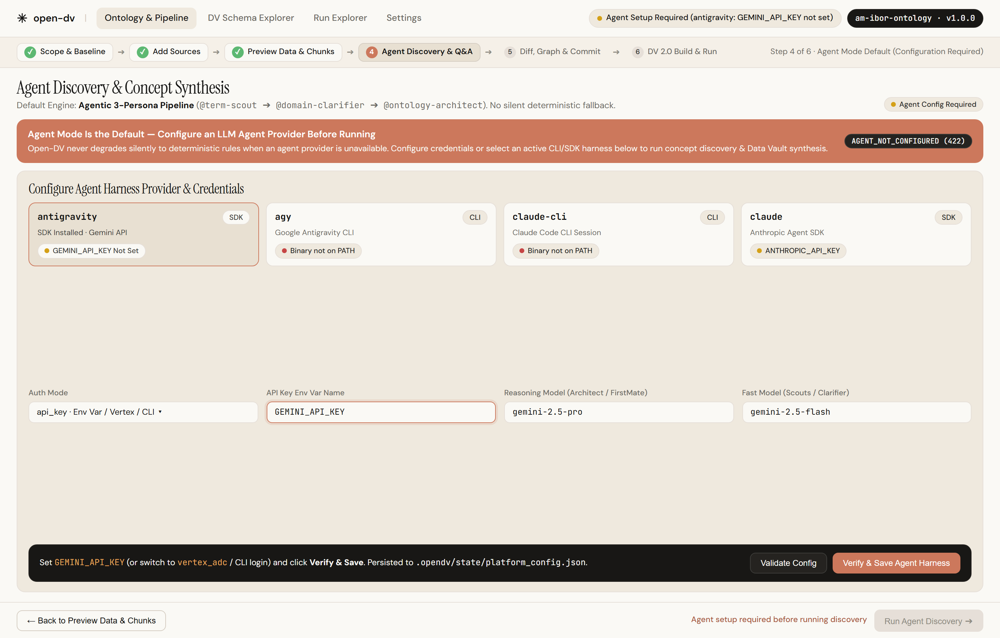
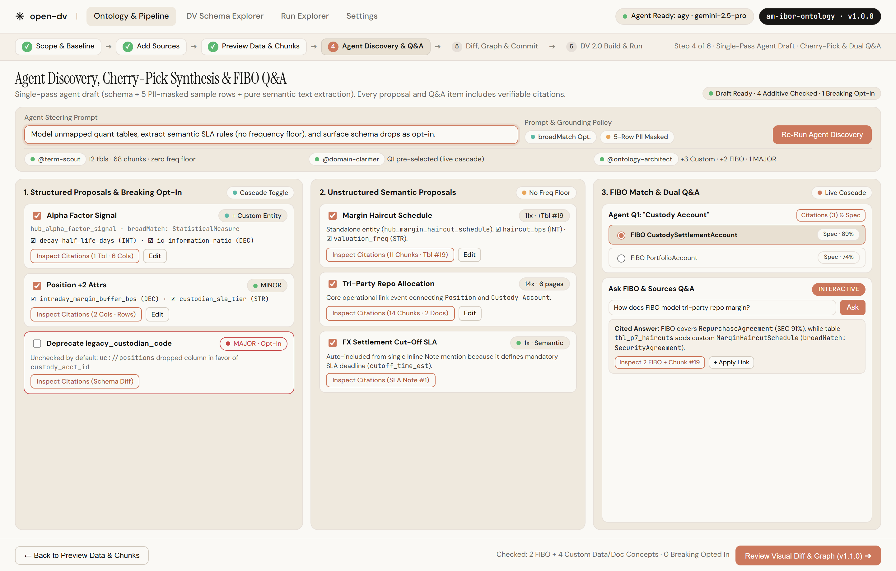
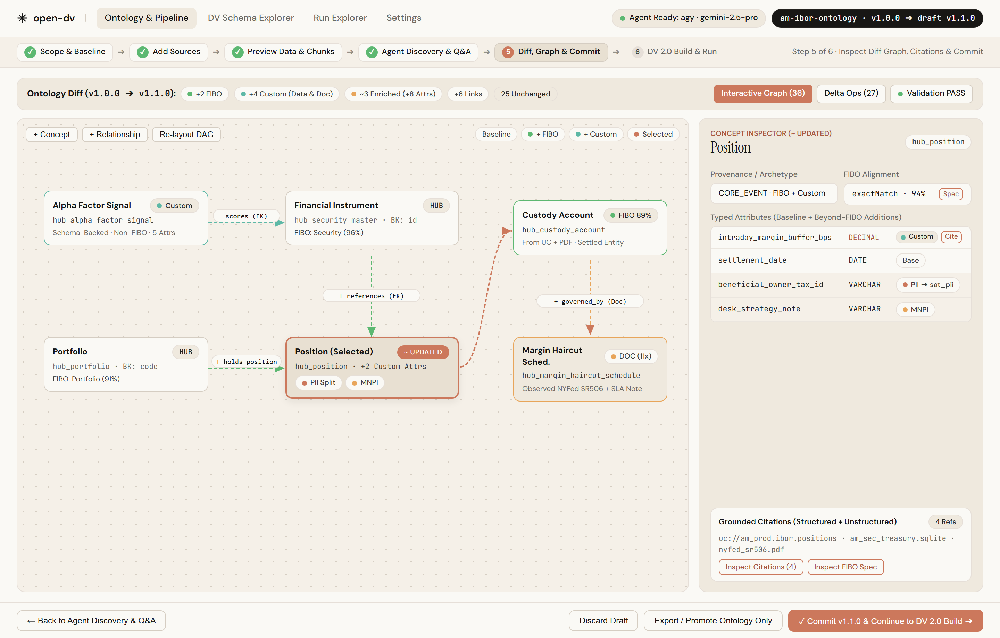
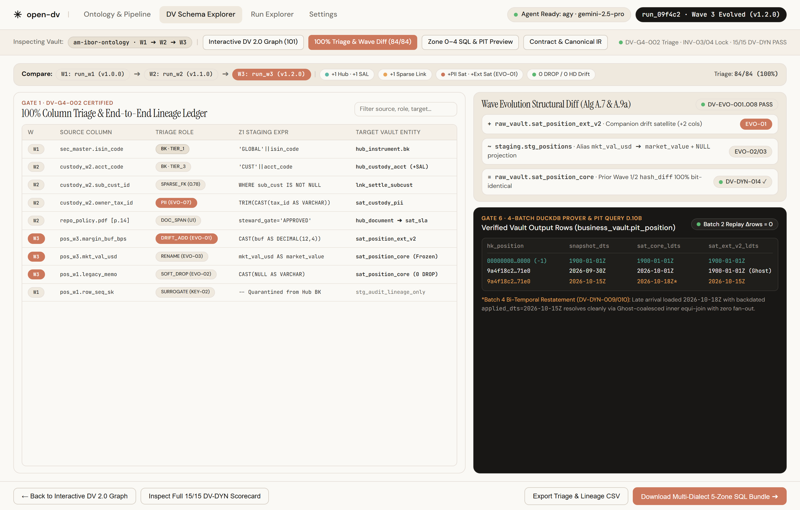
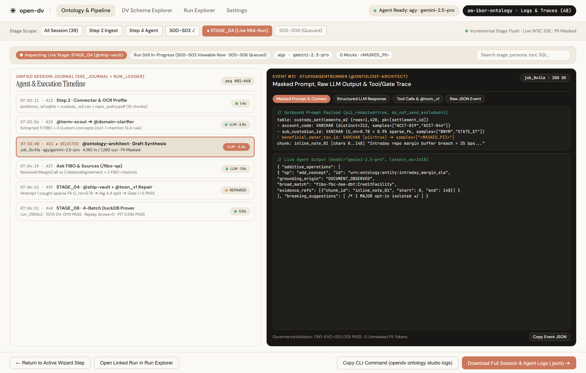

# 22 — Open-DV Ontology Construction Studio: Comprehensive End-User Guide

**Document Status:** Normative User & Operational Guide (Updated for Phases 1–4 Unified Workbench)  
**Design System & Active Specs:** [`DESIGN.md`](../DESIGN.md), [`docs/27-unified-ontology-pipeline-requirements-and-uat.md`](27-unified-ontology-pipeline-requirements-and-uat.md), [`docs/28-unified-ontology-pipeline-design-and-plan.md`](28-unified-ontology-pipeline-design-and-plan.md)  
**Governing Documents:** [`docs/19-ontology-studio-architecture.md`](19-ontology-studio-architecture.md), [`docs/20-ontology-studio-spec.md`](20-ontology-studio-spec.md)  
**Interface Dialects:** CLI Specification v1 (`schemas/v1/cli-spec.json`), OpenAPI 3.1.0 (`schemas/v1/openapi.json`), RFC 8785 JCS, RFC 9457 Problem Details  

---

## 1. Introduction & Architecture Overview

The **Open-DV Ontology Construction Studio** is an interactive, neuro-symbolic enterprise modeling environment designed to bridge raw unstructured organizational evidence (regulatory filings, contracts, schemata, policy documents) and formal Data Vault 2.0 conceptual ontologies (`GraphAOntology`).

Whether deployed as an embedded local developer tool or a multi-tenant platform service, the Studio enforces strict mathematical governance, cryptographic immutability, and deterministic reproducibility across the entire conceptual modeling lifecycle.

```
+----------------------------------------------------------------------------------------------------+
|                      Open-DV Unified Ontology & Data Vault 2.0 Studio (DESIGN.md)                  |
+----------------------------------------------------------------------------------------------------+
|                                                                                                    |
|  [ Sources, Connectors & Notes ]                             [ Dual-Mode Engine (Agent UI / CLI) ] |
|  - SQLite / DuckDB / UC / CSV   CAS Storage                  - Web UI: Agent-Only (422 if unset)   |
|  - PDF / DOCX / MD / Notes      .opendv/ontology_studio/     - StudioAgentRunner (3 Personas)      |
|  - LiteParse + OCR (auto/force) └── <session_id>/            - CLI CI: --mode deterministic (<2.5s)|
|                                                                                                    |
|                                       │                                      │                     |
|                                       ▼                                      ▼                     |
|  [ Clarification & Ask FIBO ] ─────────────────────────────► [ 4-Tab Web Workbench (:8420) ]       |
|  - Single-pass Q&A cascade                                   - Ontology & Pipeline (6-Step Wizard) |
|  - Ask FIBO & Citation Drawer                                - DV Schema Explorer (/dv-schema)     |
|  - Empirical Path B Citations                                - Run Explorer & Settings             |
|                                                                                                    |
|                                       │                                      │                     |
|                                       ▼                                      ▼                     |
|  [ Additive Evolution & Locks ] ───────────────────────────► [ 5-Zone (Z0–Z4) Vault & Logs ]       |
|  - 24-Op Delta Calculus                                      - 7-Pill Console (00..06 -> STAGE_00..07)|
|  - ONT-EVO Governance + OCC                                  - Safe Read-Only SQL & DuckDB Rows    |
|  - 409 Single-Job Session Lock                               - Live EventSource SessionLogsInspector|
+----------------------------------------------------------------------------------------------------+
```

### 1.1 Dual-Mode Engine

The Studio features a **Dual-Mode Engine** separating the interactive **Agent-only UI (`D28`)** from headless CLI CI regression runs:

1. **Agent-First Mode (3-Persona LLM via `StudioAgentRunner` — Default & UI-Exclusive)**:
   - In the Web Workbench, construction is strictly Agent-only (`D28`): there is no deterministic mode toggle in the Wizard or `Settings`. If no real LLM provider is configured, construction **fails closed with HTTP `422 AGENT_NOT_CONFIGURED`** (`<AgentHarnessConfigCard />` inline setup in Step 4a).
   - Orchestrates three specialized cognitive personas in a coordinated single pass (`D1`) via `StudioAgentRunner` (`packages/opendv-service/src/opendv_service/studio/agent_runner.py`) and `VaultAgentHarness.run_task`:
     - `@term-scout`: Extracts domain entities, typed attributes, and semantic rules (`1x · Semantic` with zero mention-count floor `D4`) from parsed chunks (`<= 5` PII-masked sample rows per column, excluding `do_not_send_to_agent` sources).
     - `@domain-clarifier`: Evaluates ambiguities against the normative Polysemy Catalog (`packages/opendv-contracts/src/opendv_contracts/catalogs/polysemy.py`, covering 18 financial terms across multiple meanings) and emits `Q1..Qn` whose answers cascade live across dependent proposals.
     - `@ontology-architect`: Synthesizes Canonical Business Concepts (CBCs) — including Beyond-FIBO domain concepts with optional `skos:broadMatch` (`D3`) — Links, Satellites, and `OntologyDelta` proposals (`MAJOR` breaking changes isolated in an unchecked `MAJOR · Opt-In` bucket `D7`).
   - Enforces `HarnessBudget` token/USD limits with live cost meter telemetry and fail-closed `BudgetHold` (`D21`).

2. **Deterministic Fallback Mode (CLI/API-Only Zero-Credential CI)**:
   - Available exclusively via explicit CLI/API `--mode deterministic` (`FR-CLI-07`, `D28`; tagged `mode=deterministic` in logs and rejected as UAT evidence) for air-gapped CI regression suites.
   - Executes Okapi BM25 candidate retrieval (`bm25_fibo_v1`) against bundled FIBO reference packs paired with Path A `ONT-EVO-002` verification ($\ge 0.6500$) in $< 2.5$ seconds, placing ungrounded candidates in `evidence/staged_candidates.json` (`staged` / held-back area).

### 1.2 Content-Addressable Storage (CAS) Lifecycle

Every Studio session resides in an isolated directory structure under `.opendv/ontology_studio/<session_id>/`:

```
.opendv/ontology_studio/<session_id>/
├── session.json                      # Authoritative session state & active version pointer
├── evidence/
│   ├── manifest.json                 # Ingested sources index (binary PDFs, Markdown, free-form CAS text notes) and SHA-256 digests
│   ├── chunks.jsonl                  # Normalized text chunks and character offset spans
│   └── staged_candidates.json        # Low-confidence concepts (< 0.65 BM25 match) held back for Path A/B promotion
├── clarifications/
│   ├── questions.json                # Generated ambiguity questions
│   └── answers.json                  # Steward responses and business rationales
├── proposals/
│   └── <proposal_id>.json            # Pending candidate proposals with delta operations and steering_history
└── versions/
    ├── v0.0.0/                       # Genesis baseline draft
    │   └── ontology.json             # Default general namespace hash: 1916a5c6d501015984b8...
    └── v1.0.0/                       # First committed release
        ├── ontology.json             # Certified PE baseline hash: 1c100409cbbe12051f7211d2...
        └── delta.json                # Additive operations applied from genesis
```

> **Genesis `0.0.0` SHA-256 & Custom Namespaces:** `1916a5c6d501015984b887fd76609b225b72d5d393e5813d8df210b92ab3b4c9` is the canonical RFC 8785 JCS SHA-256 digest of the default `0.0.0` `GenesisDraft` (`domain_namespace: "general"`, `enterprise_owner: "Enterprise Architecture"`). Custom greenfield namespaces (such as `--domain-namespace wealth_mgmt --enterprise-owner "Global Wealth Advisory"`, which deterministically evaluates to `9897c2a95f2987821979eeec92a96a14eb64af37b06222b993adbc717aff1142`) serialize their own namespace headers into `versions/v0.0.0/ontology.json`—always capture the authoritative `head_sha256` returned by `opendv ontology studio create` or `opendv ontology studio status` rather than hardcoding the default namespace digest.

### 1.3 Additive Deltas & ONT-EVO Contract Protection

Ontology versioning is governed by the closed 24-operation delta calculus and the three normative `ONT-EVO` invariants (`docs/20-ontology-studio-spec.md` §7.3):
- **ONT-EVO-001 (Immutability & Additive Delta Evolution / Deployed Table Guard)**: Committed ontology snapshots (`versions/vX.Y.Z/`) and their canonical RFC 8785 JCS SHA-256 digests are cryptographically immutable. Standard modeling evolves strictly via additive `OntologyDelta` operations (`MINOR`/`PATCH` SemVer bumps); destructive structural revisions (`remove_concept`, `remove_relationship`, `remove_attribute`, `update_concept_urn`, or overwriting an existing `elm_archetype` / `parent_concept_uri`) require `admin` privileges, trigger a `MAJOR` SemVer bump, and are unconditionally blocked (`ONT_EVO_CONTRACT_VIOLATION`, exit code `4`) whenever targeting deployed Data Vault physical tables.
- **ONT-EVO-002 (Dual Path A/B Grounding, `FR-AGT-07`, `D3`, `D4`)**: Every newly added or mutated concept must either (a) satisfy **Path A** via a server-verified `FIBO` external mapping with predicate `skos:exactMatch` or `skos:closeMatch` (`skos:broadMatch` is optional and excluded from Path A) and numeric confidence $\ge 0.6500$, or (b) satisfy **Path B** via empirical `EvidenceRef` citations (`grounding_origin="STRUCTURED_SCHEMA"` or `"DOCUMENT_OBSERVED"` with verifiable `source_label`/`chunk_id`/`table_id`, including zero-floor `1x · Semantic` rules) or an explicit CLI `--grounding-rationale` ($\ge 10$ characters; legacy HMAC waiver keys were retired in Phase 1 `D18`). Workspace-seeded concepts in `grandfathered_concept_uris` are exempt while untouched, and lose their exemption if mutated by `CONCEPT_MUTATING_OP_TYPES`.
- **ONT-EVO-003 (Optimistic Concurrency Control, 24-Op Rebase & Lock Hierarchy)**: Every state-mutating request enforces cryptographic OCC preconditions (`If-Match` / `base_sha256`), enforces one active job per session (`409 SESSION_JOB_ACTIVE`, `D27`), supports deterministic proposal rebasing across the 24-operation conflict matrix, and acquires filesystem locks strictly in canonical order (`L2 .job_<id>.lock -> L3 .journal_<id>.lock -> L4 graph_a.lock -> L5 .session.lock`).

### 1.4 Asset Management Core Spine & Vertical Packs

The Asset Management ontology architecture provides a modular, composable taxonomy structured around a **Unified Core Enterprise Spine** and **6 Vertical Packs**, selectable individually or collectively via a 1-click **"All Domains"** composite preset:

1. **Unified Core Enterprise Spine (`core_spine`)**:
   - Establishes the 6 foundational Core Business Concepts (CBCs): `Investor`, `Fund`, `Portfolio`, `Security`, `Transaction`, and `LegalEntity`.
   - Defines primary ownership, custody, and holding relationship links common across all asset management lines of business.

2. **6 Composable Vertical Packs**:
   - **Public Equities & OMS (`public_equities_oms`)**: Models trade orders, market executions, broker routing, allocations, and settlement instructions.
   - **Fixed Income & Rates (`fixed_income_rates`)**: Encompasses yield curves, Macaulay duration, coupon schedules, benchmark rate spreads, and debt collateral.
   - **Multi-Asset IBOR (`multi_asset_ibor`)**: Covers Investment Book of Record positions, multi-asset valuations, cash flows, corporate actions, and accruals.
   - **Private Equity & Buyout (`private_equity_buyout`)**: Spans Limited Partner (LP) commitments, General Partner (GP) carried interest, capital call notices, distributions, and portfolio company buyout structures.
   - **Private Credit & Direct Lending (`private_credit_direct_lending`)**: Captures bespoke bilateral loan facilities, debt covenants, borrower compliance certificates, and variable interest margins.
   - **Custody & Clearing (`custody_clearing`)**: Tracks safekeeping custody accounts, depository clearinghouse netting, omnibus accounts, and segregation controls.

3. **1-Click "All Domains" Composite Preset (`all_domains`)**:
   - Combines the Core Spine and all 6 vertical packs into an integrated, enterprise-scale ontology with:
     - **31 Canonical Business Concepts (CBCs)**
     - **29 Canonical Relationships**
     - **7 Reference Enumerations**
   - Evaluates to canonical RFC 8785 JCS SHA-256 digest: `6cdd5c7c084cecfc0de6b7b82599b3bc50a1767aa4e9910866116d276638ead2`.

```python
from opendv_contracts.dtos.starter_packs import AssetManagementPackId
from opendv_core.ontology_hashing import compute_ontology_sha256
from opendv_sources.asset_management.loader import AssetManagementStarterPackRegistry
from opendv_sources.asset_management.presets import get_all_domains_pack

# Inspect registered metadata
registry_packs = AssetManagementStarterPackRegistry.list_packs()
all_domains_meta = AssetManagementStarterPackRegistry.get_metadata(
    AssetManagementPackId.ALL_DOMAINS
)
assert all_domains_meta.concept_count == 31
assert all_domains_meta.relationship_count == 29

# Instantiate the full composite ontology directly
ontology = get_all_domains_pack()
assert len(ontology.canonical_business_concepts) == 31
assert len(ontology.canonical_relationships) == 29
assert len(ontology.reference_enumerations) == 7

# Canonical JCS SHA-256 digest verification
digest = compute_ontology_sha256(ontology)
assert len(digest) == 64
```

### 1.5 Wave 0 Unstructured-Only Architecture

Enterprise data architectures frequently ingest unstructured market research, analyst commentary, and SEC regulatory filings in an initial exploratory or cold-start phase prior to connecting relational trading platforms or enterprise data warehouses.

In standard Data Vault 2.0 pipelines, specifications lacking relational source tables trigger validation error `UNSTRUCTURED_WITHOUT_RELATIONAL_SOURCE`. To enable pure document ingestion without artificial dummy relational tables, Open-DV provides **Wave 0 Unstructured-Only Mode**:

- Enabled by setting `unstructured_only: true` in the pipeline YAML specification or passing `--unstructured-only` to `opendv pipeline run` and `opendv pipeline validate`.
- Relaxes the relational prerequisite (`seen_relational_sources == 0` allowed).
- Automatically synthesizes the central document anchor:
  - `hub_document`: Captures document business keys (SHA-256 digest, URI, filepath).
  - `sat_document_metadata`: Stores filename, byte size, MIME type, author, and ingestion timestamp.
  - `sat_document_extraction`: Houses full-text extracted paragraphs, token offsets, and AI extraction provenance.
  - `lnk_document_extraction`: Connects document chunks to downstream conceptual entity hubs.
- Ensures immediate compatibility with subsequent Wave 1 (OMS / IBOR) and Wave 2 (Private Credit / Custody) schema evolutions with zero breaking changes to existing tables.

---

## 2. Getting Started

### 2.1 Loopback Open Access & Remote Guard (`D18`, `FR-AUTH-01..04`)

Open-DV operates with **loopback-only zero-auth open access** by default and guards non-loopback network bindings fail-closed:

| Binding Mode | Command | Authentication & Guards | Network Binding |
|---|---|---|---|
| **Loopback Open Access (Default)** | `opendv serve --port 8420 --open` | Zero login tokens, cookies, or CSRF headers on loopback (`human:local_user` / `admin`); `Host`/`Origin` anti-rebinding checks remain active | `127.0.0.1:8420` |
| **Non-Loopback Refusal (Guard)** | `opendv serve --host 0.0.0.0` | **Refused with exit code `40`** unless `--allow-remote-unauthenticated` is explicitly supplied (`D18`) | Blocked at startup |
| **Explicit Unauthenticated Remote** | `opendv serve --host 0.0.0.0 --allow-remote-unauthenticated` | Emits loud startup warning + persistent coral `RemoteUnauthenticatedBanner` in the Web Workbench | Explicit `--host` |

### 2.2 Launching the Web Workbench

To launch the integrated local 4-tab Web Workbench (`DESIGN.md` shell):

```bash
# Start local Open-DV API and open clean Web Workbench URL (no token fragments)
opendv serve --host 127.0.0.1 --port 8420 --open
```

Once running, navigate to any unified route (desktop-first at `1440×920` / `1024×768`; stacked view-only mode below `768px` `D26`):
```text
http://127.0.0.1:8420/            (Ontology & Pipeline — 6-Step Unified Wizard; /ontology & /builder alias here)
http://127.0.0.1:8420/dv-schema   (DV Schema Explorer — 4-View Bipartite Graph, Triage, Safe SQL & 5-Zone Z0–Z4)
http://127.0.0.1:8420/explorer    (Run Explorer — Stage 00..07 execution artifacts)
http://127.0.0.1:8420/settings    (Settings — Shared <AgentHarnessConfigCard /> & budgets)
```

### 2.3 Dual CLI Configuration (`opendv` & `opendvctl`)

Open-DV provides operational parity between the standalone Python CLI (`opendv`) and the Bun-compiled remote platform client (`opendvctl`), operating zero-token against loopback `http://127.0.0.1:8420`:

```bash
# In-process Python CLI execution
opendv ontology studio list

# Loopback remote client execution (zero-token open access)
opendvctl ontology studio list --api-url http://127.0.0.1:8420

# Inspect available Asset Management starter packs via opendv
opendv ontology studio starter-pack list --session am-walkthrough

# Inspect available Asset Management starter packs via opendvctl
opendvctl ontology studio starter-pack list --session am-walkthrough --api-url http://127.0.0.1:8420
```

### 2.4 Representative Regulatory Sample PDFs & OCR Modes (`examples/sample_pdfs/`)

The repository ships a representative multi-document financial & regulatory corpus in [`examples/sample_pdfs/`](../examples/sample_pdfs/README.md) so you can immediately exercise PDF parsing, layout complexity detection, OCR mode routing (`auto`, `off`, `force`), and deterministic ontology construction without hunting for external filings:

| Document | Source | Pages | Size (Bytes) | Extracted Chunks | Detected Tables | Layout & OCR Profile |
|---|---|---:|---:|---:|---:|---|
| `nyfed_sr506_repo_infrastructure.pdf` | Federal Reserve Bank of New York — Staff Report No. 506 (*Tri-Party Repo Infrastructure*) | 55 | 449,963 | 67 | 0 | Clean multi-page vector prose (`Repo`, `Dealer`, `Collateral`, `ClearingBank`) |
| `fdic_section3_2_loans_credit_risk.pdf` | FDIC Risk Management Manual of Examination Policies — Section 3.2 (*Loans*) | 88 | 1,115,319 | 153 | 0 | Examination policies, underwriting standards, commercial loans & credit controls |
| `occ_comptrollers_handbook_rating_credit_risk.pdf` | OCC Comptroller's Handbook — *Rating Credit Risk* | 69 | 1,467,311 | 539 | 0 | Supervisory credit-rating guidance, facility collateral & allowance governance |
| `institutional_scanned_schedule_ocr_test.pdf` | Hybrid custody & repo schedule fixture | 2 | 6,352 | 2 | 1 | **Page 1:** clean vector + 3-row Markdown pipe collateral table (`is_complex=False`). **Page 2:** simulated scanned exhibit (`raster_ratio=0.6189 > 0.40`, `char_count=36 < 50`, `unmapped_glyphs=1` -> `is_complex=True`) |

All four files together yield **761 evidence chunks** and **1 structured Markdown table**, verified via `LiteParseDocumentAdapter` (`pypdf` fallback when optional `liteparse` CLI is absent) and `TesseractOCRRouter` (`packages/opendv-sources/src/opendv_sources/ingestion/layout_evaluator.py`):

- **`auto` (Recommended Default):** Scores every PDF page using character density (`char_count < 50`), embedded image area ratio (`raster_ratio > 0.40`), and unmapped glyph count (`unmapped_glyphs > 0`). Vector pages parse natively; complex pages (such as Page 2 of `institutional_scanned_schedule_ocr_test.pdf`) route to Tesseract OCR if installed on `PATH`, or gracefully fall back (`ocr_skipped=True`) when Tesseract is absent.
- **`off`:** Skips OCR invocation deterministically (`ocr_skipped=True` on complex pages) and extracts embedded PDF text and Markdown tables only.
- **`force`:** Fails closed with `OCRUnavailableError("OCR_UNAVAILABLE")` (`HTTP 501` in the Web Workbench / exit code `1` in the CLI) whenever the `tesseract` binary is unavailable on `PATH`, guaranteeing no silent partial extraction in strict OCR pipelines.

You can validate the entire four-PDF corpus from the CLI before or alongside a Web Workbench session:

```bash
# 1. Create a capital-markets session
opendv ontology studio create \
  --session regulatory-pdf-e2e-walkthrough \
  --domain-namespace capital_markets \
  --enterprise-owner "Institutional Risk Architecture"

# 2. Upload each regulatory PDF and hybrid scanned fixture
opendv ontology studio upload --session regulatory-pdf-e2e-walkthrough --file examples/sample_pdfs/nyfed_sr506_repo_infrastructure.pdf
opendv ontology studio upload --session regulatory-pdf-e2e-walkthrough --file examples/sample_pdfs/fdic_section3_2_loans_credit_risk.pdf
opendv ontology studio upload --session regulatory-pdf-e2e-walkthrough --file examples/sample_pdfs/occ_comptrollers_handbook_rating_credit_risk.pdf
opendv ontology studio upload --session regulatory-pdf-e2e-walkthrough --file examples/sample_pdfs/institutional_scanned_schedule_ocr_test.pdf

# 3. Parse with smart OCR auto-detection (761 chunks, 1 table)
opendv ontology studio parse --session regulatory-pdf-e2e-walkthrough --ocr-mode auto --wait

# 4. Optionally verify fail-closed OCR enforcement (requires tesseract on PATH)
opendv ontology studio parse --session regulatory-pdf-e2e-walkthrough --ocr-mode force --wait
```

See [`examples/sample_pdfs/README.md`](../examples/sample_pdfs/README.md) for SHA-256 digests and original source URLs.

---

## 3. End-to-End User Journeys

### 3.1 Journey 1: Greenfield Enterprise Modeling from Regulatory Filings

In this journey, a Financial Data Steward creates a brand-new Wealth Management Data Vault model directly from an SEC Form 10-K regulatory filing.

```
+───────────────────────────────────────────────────────────────────────────────────────────+
| Journey 1 Workflow: Regulatory Ingestion -> Clarification -> v1.0.0 Commit                 |
+───────────────────────────────────────────────────────────────────────────────────────────+
| 1. Create Session (wealth_mgmt v0.0.0 -> capture HEAD_SHA = 9897c2a9...)                  |
| 2. Upload Document (annual_report_2024.pdf) -> CAS Evidence Store                         |
| 3. Parse Layout -> Codepoint offset extraction & table detection                          |
| 4. Ambiguity Detection -> "Investment Advisor" vs "Fund Manager"                          |
| 5. Human Clarification -> Steward selects FIBO InvestmentAdvisor                          |
| 6. Neuro-Symbolic Construction -> 6 CBCs, 8 Links, 24 Satellites                          |
| 7. Proposal Acceptance -> Atomic Genesis bump v0.0.0 -> v1.0.0                            |
+───────────────────────────────────────────────────────────────────────────────────────────+
```

#### Step 1: Initialize Session & Capture Genesis `head_sha256`
Create a greenfield studio session initialized at `v0.0.0` and capture its deterministic RFC 8785 JCS `head_sha256` (for `wealth_mgmt` / `"Global Wealth Advisory"`, `head_sha256` evaluates to `9897c2a95f2987821979eeec92a96a14eb64af37b06222b993adbc717aff1142`; for default `general` / `"Enterprise Architecture"`, it evaluates to `1916a5c6d501015984b887fd76609b225b72d5d393e5813d8df210b92ab3b4c9`):

```bash
opendv ontology studio create \
  --session wealth-sec-2024 \
  --domain-namespace wealth_mgmt \
  --enterprise-owner "Global Wealth Advisory" \
  --description "SEC 10-K wealth management baseline model"

HEAD_SHA=$(opendv ontology studio status --session wealth-sec-2024 --json | jq -r .head_sha256)
```

#### Step 2: Upload Source Document
Upload the annual report PDF into the session's Content-Addressable Storage (CAS):

```bash
opendv ontology studio upload \
  --session wealth-sec-2024 \
  --file annual_report_2024.pdf \
  --description "FY2024 SEC Form 10-K Filing"
```

#### Step 3: Trigger Ingestion & Parsing
Execute asynchronous layout analysis and text normalization:

```bash
opendv ontology studio parse \
  --session wealth-sec-2024 \
  --ocr-mode auto \
  --wait
```

#### Step 4: Resolve Clarifications
The `@domain-clarifier` detects that *"Fund Advisor"* could align to either `fibo-fbc-fct-fse:InvestmentAdvisor` or `fibo-be-oac-cctl:FundManager`. In the Web Workbench or CLI, answer the question using `ClarificationAnswerRequest` (`selected_options`, `user_text`, and `expected_answers_sha256` OCC precondition):

```json
{
  "answers": [
    {
      "question_id": "q-advisor-align-01",
      "selected_options": ["opt-investment-advisor"],
      "user_text": "Acts as registered investment advisor under SEC regulations."
    }
  ],
  "expected_answers_sha256": "4f53cda18c2baa0c0354bb5f9a3ecbe5ed12ab4d8e11ba873c2f11161202b945"
}
```

Submit the answer file:

```bash
opendv ontology studio answer \
  --session wealth-sec-2024 \
  --file advisor_answer.json
```

#### Step 5: Construct Ontology Proposal
Invoke the construction engine against the session's `HEAD_SHA` (`9897c2a95f2987821979eeec92a96a14eb64af37b06222b993adbc717aff1142`, transmitted as `If-Match: "$HEAD_SHA"` and `"base_sha256": "$HEAD_SHA"` over REST):

```bash
opendv ontology studio construct \
  --session wealth-sec-2024 \
  --base-version 0.0.0 \
  --base-sha256 "$HEAD_SHA" \
  --mode agent \
  --wait
```

#### Step 6: Accept Proposal & Commit v1.0.0
Review the generated proposal (`prop-8821`) and accept it against `HEAD_SHA` (`If-Match: "$HEAD_SHA"` / `"parent_sha256": "$HEAD_SHA"`) to perform the genesis commit:

```bash
opendv ontology studio proposal accept \
  --session wealth-sec-2024 \
  --proposal-id prop-8821 \
  --base-sha256 "$HEAD_SHA"
```

The session transitions from `v0.0.0` to `v1.0.0`.

---

### 3.2 Journey 2: Evolutionary Workspace Modeling & Promotion

In this journey, an Enterprise Architect seeds a session from an existing Private Equity Data Vault project (`examples/private_equity`), adds Limited Partner commitment semantics, and promotes the updated model back to the workspace pipeline.

#### Step 1: Seed Session from Workspace
Seed a new studio session from the existing workspace project:

```bash
opendv ontology studio create \
  --session pe-evolution \
  --domain-namespace private_equity \
  --from-workspace examples/private_equity \
  --session-label "PE Limited Partner Additions"
```

The session automatically loads `v1.0.0` with baseline canonical hash `1c100409cbbe12051f7211d2d6d6838670982b9164aaf18b52f566864da90b81`. Existing URIs are registered in `grandfathered_concept_uris` and remain exempt from `ONT-EVO-002` re-grounding unless mutated by one of the 17 existing-concept-mutating delta operations (`18` total in `CONCEPT_MUTATING_OP_TYPES`).

#### Step 2: Upload Contract Addendum & Apply Delta
Upload the partnership agreement addendum and apply an additive `lp_delta.json` linking the new concept to the existing `urn:ontology:entity:fund` concept:

```json
{
  "operations": [
    {
      "op_id": "op-lp-add-concept-01",
      "op_type": "add_concept",
      "concept_uri": "urn:ontology:entity:limited_partner_commitment",
      "concept_name": "Limited Partner Commitment",
      "definition": "Capital commitment pledged by a limited partner to a private equity fund.",
      "target_hub": "hub_lp_commitment",
      "elm_archetype": "CORE_BUSINESS_CONCEPT"
    },
    {
      "op_id": "op-lp-add-attr-02",
      "op_type": "add_attribute",
      "concept_uri": "urn:ontology:entity:limited_partner_commitment",
      "attribute_name": "commitment_amount",
      "data_type": "decimal"
    },
    {
      "op_id": "op-lp-add-rel-03",
      "op_type": "add_relationship",
      "relationship_uri": "urn:ontology:relationship:fund_has_lp_commitment",
      "relationship_name": "Fund Has LP Commitment",
      "target_link": "lnk_fund_lp_commitment",
      "endpoints": [
        "urn:ontology:entity:fund",
        "urn:ontology:entity:limited_partner_commitment"
      ],
      "grain_semantics": "One commitment record per Limited Partner subscription in a Fund."
    },
    {
      "op_id": "op-lp-add-map-04",
      "op_type": "add_external_mapping",
      "concept_uri": "urn:ontology:entity:limited_partner_commitment",
      "scheme": "FIBO",
      "target_uri": "https://spec.edmcouncil.org/fibo/ontology/FND/Agreements/Contracts/ContractualCommitment",
      "predicate": "skos:exactMatch",
      "mapping_confidence": 0.8200
    }
  ]
}
```

Apply the delta operations to the session:

```bash
opendv ontology studio delta apply \
  --session pe-evolution \
  --file lp_delta.json \
  --base-version 1.0.0 \
  --base-sha256 1c100409cbbe12051f7211d2d6d6838670982b9164aaf18b52f566864da90b81 \
  --rationale "Add Limited Partner capital commitment conceptual modeling"
```

This atomically creates committed snapshot `v1.1.0`.

#### Step 3: Promote to Workspace Pipeline
Promote the updated ontology directly into the workspace Data Vault pipeline:

```bash
opendv ontology studio promote \
  --session pe-evolution \
  --workspace examples/private_equity \
  --workspace-sha256 1c100409cbbe12051f7211d2d6d6838670982b9164aaf18b52f566864da90b81 \
  --head-sha256 5e89a12c4b3f890123456789abcdef0123456789abcdef0123456789abcdef01 \
  --rationale "Promote v1.1.0 LP commitment concepts to production pipeline"
```

The two-phase promotion protocol acquires workspace lock `graph_a.lock`, validates containment, updates the workspace YAML, and records the audit trail.

---

### 3.3 Journey 3: Air-Gapped Zero-Credential CI Pipeline

In automated continuous integration environments where no internet access or LLM credentials exist, the Studio executes deterministically in $< 2.5$ seconds:

```bash
# Seed session from workspace in CI runner
opendv ontology studio create \
  --session ci-verify-run \
  --domain-namespace private_equity \
  --from-workspace examples/private_equity

# Run deterministic construction with auto-commit
opendv ontology studio construct \
  --session ci-verify-run \
  --base-version 1.0.0 \
  --base-sha256 1c100409cbbe12051f7211d2d6d6838670982b9164aaf18b52f566864da90b81 \
  --mode deterministic \
  --auto-commit
```

- If no new inputs exist, the job emits `NOOP_CONSTRUCT` in the audit log and exits cleanly with code `0`.
- All grounding rules and OCC invariants are mathematically verified.

---

### 3.4 Journey 4: Human-in-the-Loop Clarification & Path B Empirical Grounding

When a domain concept cannot satisfy `ONT-EVO-002` Path A FIBO grounding (`skos:exactMatch` or `skos:closeMatch` with confidence $\ge 0.6500$; `skos:broadMatch` is optional and excluded from Path A—for example, proprietary internal instruments or non-financial domain schemas `D3`), the Studio supports **Path B Empirical Citation Grounding (`FR-AGT-07`)** backed by verifiable `EvidenceRef` citations (`source_label`, `chunk_id`, `page_number`, `table_id`), or an explicit CLI governance rationale (`>= 10` characters; legacy HMAC waiver keys were retired in Phase 1 `D18`):

```bash
HEAD_SHA=$(opendv ontology studio status --session wealth-sec-2024 --json | jq -r .head_sha256)
opendv ontology studio proposal accept \
  --session wealth-sec-2024 \
  --proposal-id prop-9902 \
  --base-sha256 "$HEAD_SHA" \
  --evidence-grounding-file evidence_refs.json \
  --grounding-rationale "Proprietary bespoke investment vehicle grounded in Board Resolution 2026-B"
```

Path B empirical grounding requires:
1. Non-empty `EvidenceRef` citations (`source_label`, `chunk_id`, `page_number`, or `table_id`) resolving to ingested session evidence (or `>= 10`-character `--grounding-rationale`).
2. Explicit concept scope (subsequent mutations to any grandfathered concept re-evaluate Path A/B grounding).
3. Zero `do_not_send_to_agent` payload leaks across agent prompts or logs (`FR-AGT-04`).

---

### 3.5 Journey 5: End-to-End Asset Management Lifecycle (Unified 6-Step Wizard to 5-Zone Vault & DV Schema Explorer)

In this journey, an Asset Management Data Architect establishes an institutional Data Vault 2.0 architecture spanning public equities, fixed income rates, private credit lending covenants, and unstructured SEC filings—flowing seamlessly through the **Unified 6-Step Wizard**, **5-Zone (`Z0–Z4`)** SQL compiler (`information_mart`), and **DV Schema Explorer (`/dv-schema`)**:

```
+───────────────────────────────────────────────────────────────────────────────────────────+
| Journey 5: Starter Pack -> Connectors & Notes -> Agent Q&A -> 5-Zone Pipeline -> Explorer |
+───────────────────────────────────────────────────────────────────────────────────────────+
| 1. Apply Starter Pack (Step 1): 1-Click 'all_domains' Preset (31 CBCs, 29 Rels, 7 Enums)  |
| 2. Attach Connectors & Notes (Step 2): SQLite/DuckDB/UC + Analyst Notes & Regulatory PDFs |
| 3. Preview Evidence (Step 3): <=50 Sample Rows (3a) & Parsed Chunks (3b) or Fast-Forward  |
| 4. Agent Discovery & Ask FIBO (Step 4): Single-pass StudioAgentRunner + Citation Drawer   |
| 5. Diff, DAG & Export/Commit (Step 5): Visual Diff, elkjs DAG, Optional VisualEditorDrawer|
| 6. DV 2.0 Build & Run (Step 6): Auto-bound deployed_contract, 00..06 Console, 5-Zone SQL  |
| 7. Interactive DV Schema Explorer (/dv-schema): Bipartite Graph, Triage, Safe SQL (D11)   |
| 8. SessionLogsInspector (07): Live EventSource Stream & 50 MB/.jsonl Bundle Retention     |
| 9. Parity Verification: Verify identical JCS outputs across opendv, opendvctl & REST      |
+───────────────────────────────────────────────────────────────────────────────────────────+
```

#### Step 1: Initialize Session & Apply 1-Click "All Domains" Starter Pack
Create an asset management session (recorded with `wizard_schema_version` per `D25`) and apply the composite `all_domains` preset, bootstrapping 31 CBCs, 29 relationships, and 7 enums:

```bash
# Initialize Asset Management studio session
opendv ontology studio create \
  --session am-fund \
  --domain-namespace asset_management \
  --enterprise-owner "Global Asset Management Architecture" \
  --description "Comprehensive Asset Management enterprise model"

# Apply 1-Click "All Domains" starter pack via opendv
opendv ontology studio starter-pack apply --session am-fund --pack all_domains

# Equivalent execution via opendvctl (loopback zero-token)
opendvctl ontology studio starter-pack apply --session am-fund --pack all_domains --api-url http://127.0.0.1:8420
```

The session instantly stages an initial delta resulting in canonical SHA-256 digest `6cdd5c7c084cecfc0de6b7b82599b3bc50a1767aa4e9910866116d276638ead2`.

Over REST (zero-token loopback), this corresponds to:
```bash
curl -s -X POST "http://127.0.0.1:8420/api/v1/ontology/studio/sessions/am-fund/starter-packs/apply" \
  -H "Content-Type: application/json" \
  -d '{
    "pack_id": "all_domains"
  }'
```

#### Step 2: Ingest Connectors, Regulatory PDFs & Free-Form Analyst Notes into CAS
Attach structured connectors (`attach-source` `D13`) and ingest unstructured analyst commentary and debt covenant notes directly into Content-Addressable Storage (CAS):

```bash
# Attach structured SQLite source via D13 attach-source (opendv & opendvctl)
opendv ontology studio attach-source --session am-fund --adapter sqlite --uri data/public_am/am_sec_treasury_ibor.sqlite
opendvctl ontology studio attach-source --session am-fund --adapter sqlite --uri data/public_am/am_sec_treasury_ibor.sqlite --api-url http://127.0.0.1:8420

# Ingest inline analyst note (opendv)
opendv ontology studio text add --session am-fund --text "Private Credit Direct Lending facility agreement with borrower covenant monitoring and variable SOFR spread." --source-name direct_lending_notes.txt

# Ingest inline analyst note (opendvctl)
opendvctl ontology studio text add --session am-fund --text "Private Credit Direct Lending facility agreement with borrower covenant monitoring and variable SOFR spread." --source-name direct_lending_notes.txt --api-url http://127.0.0.1:8420

# Ingest multi-page research memo from file (opendv)
opendv ontology studio text add --session am-fund --file examples/asset_management/docs/sec_filing_sample.md --source-name sec_filing.md

# Ingest multi-page research memo from file (opendvctl)
opendvctl ontology studio text add --session am-fund --file examples/asset_management/docs/sec_filing_sample.md --source-name sec_filing.md --api-url http://127.0.0.1:8420
```

CAS hashes the ingested payloads, generates cryptographic SHA-256 provenance identifiers (`cas:text`), and records source metadata in `.opendv/ontology_studio/am-fund/evidence/manifest.json`.

#### Step 3: 3-Persona Agent Runtime, Polysemy Disambiguation & Ask FIBO
Invoke `StudioAgentRunner` to orchestrate `@term-scout` $\to$ `@domain-clarifier` $\to$ `@ontology-architect` in a single pass (`D1`; fails closed with `422 AGENT_NOT_CONFIGURED` / exit `10` if unconfigured):

```bash
# Execute 3-persona construction with steering guidance (opendv)
opendv ontology studio construct --session am-fund --mode agent --steering-prompt "Ground all securities against FIBO SEC and link to CustodianAccount"

# Equivalent execution via opendvctl
opendvctl ontology studio construct --session am-fund --mode agent --steering-prompt "Ground all securities against FIBO SEC and link to CustodianAccount" --api-url http://127.0.0.1:8420

# Ask live cited FIBO & evidence questions (D2 / D13)
opendv ontology studio fibo-qa --session am-fund --question "Should Sovereign Repo map to fibo-sec-dbt or a custom entity?"
```

During execution, `@domain-clarifier` consults `KNOWN_POLYSEMIC_DEFINITIONS` to disambiguate overloaded industry terms:
- `portfolio`: Disambiguates between *Securities Portfolio* (`fibo-fbc-pas-fpas:Portfolio`), *Fund Portfolio Account*, and *Structured Credit Collateral Pool*.
- `security`: Disambiguates *Negotiable Financial Security* (`fibo-fnd-oac-cctl:Security`) from *Collateral Pledge* and *Information Security*.
- `benchmark`: Disambiguates *Performance Index* from *Interest Rate Benchmark*.

Clarification answers are submitted via `opendv ontology studio answer`, cascading live across dependent proposals (`prop-am-01`).

#### Step 4: Iterative Natural-Language Steering Prompt Refinement
Refine the pending proposal iteratively using natural language instructions without crafting raw delta JSON by hand:

```bash
# Refine proposal with steering prompt (opendv)
opendv ontology studio proposal refine --session am-fund --proposal-id prop-am-01 --steering-prompt "Include ISIN and CUSIP attributes on Security and add link to CustodianAccount" --mode deterministic

# Refine proposal with steering prompt (opendvctl)
opendvctl ontology studio proposal refine --session am-fund --proposal-id prop-am-01 --steering-prompt "Include ISIN and CUSIP attributes on Security and add link to CustodianAccount" --mode deterministic --api-url http://127.0.0.1:8420
```

The refinement endpoint marks `prop-am-01` as `SUPERSEDED`, generates a fresh proposal `prop-refine-02`, and preserves the instruction in `steering_history`.

#### Step 5: Held-Back Candidate Promotion (Path A & Path B)
In CLI deterministic mode, candidate concepts whose initial FIBO BM25 similarity score is $< 0.6500$ are segregated into `evidence/staged_candidates.json` (staged / held-back). Stewards promote them via synonym re-scoring or CLI governance rationale:

```bash
# List staged candidate concepts held back due to low confidence (opendv)
opendv ontology studio staged list --session am-fund

# List staged candidate concepts (opendvctl)
opendvctl ontology studio staged list --session am-fund --api-url http://127.0.0.1:8420

# Path A: Promote via Synonym Re-Scoring (score must reach >= 0.6500)
opendv ontology studio staged promote --session am-fund --candidate-id cand-holding-debt-001 --synonyms "NegotiableDebtSecurity, CorporateDebtBond"

# Path A via opendvctl
opendvctl ontology studio staged promote --session am-fund --candidate-id cand-holding-debt-001 --synonyms "NegotiableDebtSecurity, CorporateDebtBond" --api-url http://127.0.0.1:8420

# Path B: Promote via explicit governance rationale (>=10 char rationale)
opendv ontology studio staged promote --session am-fund --candidate-id cand-bespoke-002 --waiver --rationale "Authorized proprietary credit facility per board charter"

# Path B via opendvctl
opendvctl ontology studio staged promote --session am-fund --candidate-id cand-bespoke-002 --waiver --rationale "Authorized proprietary credit facility per board charter" --api-url http://127.0.0.1:8420
```

#### Step 6: Unified Step 6 DV 2.0 Build, 5-Zone SQL (`Z0–Z4`) & `VaultBlueprint` Export
Step 6 of the Unified 6-Step Wizard replaces the legacy standalone `DV 2.0 Blueprint` drawer tab and `/builder` `Pipeline Builder` hand-off (`D19`):
1. Step 6 automatically binds the committed `VaultBlueprint` / `deployed_contract` (`D12`, with an inline Baseline Picker to pick prior runs, upload `contract.yaml`, or start a Fresh Cold-Start Vault).
2. You can still export the portable `VaultBlueprint` v1.0 YAML envelope via REST for CLI runs:
   ```bash
   curl -s -X GET "http://127.0.0.1:8420/api/v1/ontology/studio/sessions/am-fund/export-blueprint" \
     -o artifacts/vault_blueprint.yaml
   ```
3. Running the pipeline inside Step 6 displays the live **7-pill (`00..06`) console** (projected over internal `STAGE_00..07`), compiles **5-Zone (`Z0–Z4`)** SQL across `bronze`, `staging`, `raw_vault`, `business_vault`, and `information_mart`, handles any `PAUSED_HOLD` inline via `StewardHoldModal` (`D14`) or `BudgetHold` (`D21`), and links straight to **`Explore Generated DV 2.0 Schema ➔`** (`/dv-schema`).

#### Step 7: Single-Run CLI Pipeline Execution & DV Schema Inspection (`D13`)
Execute the end-to-end data-driven pipeline and inspect the generated Data Vault schema, populated rows, and session logs from the CLI:

```bash
# Validate single-run pipeline with VaultBlueprint envelope (opendv)
opendv pipeline validate --blueprint artifacts/vault_blueprint.yaml --source "data/public_am/am_sec_treasury_ibor.sqlite" --dialect duckdb

# Validate single-run pipeline with VaultBlueprint envelope (opendvctl)
opendvctl pipeline validate --blueprint artifacts/vault_blueprint.yaml --source "data/public_am/am_sec_treasury_ibor.sqlite" --dialect duckdb --api-url http://127.0.0.1:8420

# Execute single-run data-driven pipeline targeting DuckDB (opendv)
opendv pipeline run --blueprint artifacts/vault_blueprint.yaml --source "data/public_am/am_sec_treasury_ibor.sqlite" --dialect duckdb

# Execute single-run data-driven pipeline targeting Databricks Delta (opendv)
opendv pipeline run --blueprint artifacts/vault_blueprint.yaml --source "uc://am_prod/ibor" --dialect databricks

# Execute single-run data-driven pipeline (opendvctl)
opendvctl pipeline run --blueprint artifacts/vault_blueprint.yaml --source "data/public_am/am_sec_treasury_ibor.sqlite" --dialect duckdb --api-url http://127.0.0.1:8420

# Inspect DV 2.0 schema & run bounded read-only DuckDB SQL (D11 / D13)
opendv run dv-schema --run-id run_am_w1 --sql "SELECT * FROM information_mart.vw_security_current LIMIT 10"

# Stream session & stage logs live (D13 / FR-LOG-04)
opendv ontology studio logs --session am-fund --stage 03 --follow
```

#### Step 8: Verifying Dual-CLI Parity
Verify identical execution and output parity across `opendv`, `opendvctl`, and REST:
- Identical RFC 8785 JCS JSON schemas and exit codes (`0`, `1..7`, `10`, `20`, `30`, `40`).
- Shared canonical validation against `schemas/v1/cli-spec.json`.

### 3.6 Multi-Connector Catalog Sources (SQLite CAS Upload & Databricks Unity Catalog)

Open-DV provides pluggable connector support via the `CatalogSourceAdapter` SPI (`opendv-sources`), enabling single-run data-driven execution across diverse tabular backends:

#### Multi-Table SQLite with Client CAS Upload
Local SQLite database files (`*.sqlite`, `*.db`) support automatic schema discovery via `PRAGMA table_info` and foreign key analysis via `PRAGMA foreign_key_list`. When executing against a remote platform instance, SQLite sources declare `client_uploadable=True`, uploading the binary database directly into CAS:

```bash
# Inspect SQLite catalog structure (opendv)
opendv source inspect --uri "data/public_am/am_sec_treasury_ibor.sqlite" --adapter sqlite

# Inspect SQLite catalog structure (opendvctl)
opendvctl source inspect --uri "data/public_am/am_sec_treasury_ibor.sqlite" --adapter sqlite --api-url http://127.0.0.1:8420
```

#### Databricks Unity Catalog
Databricks Unity Catalog connects via `databricks://` or `uc://` 3-level naming (`catalog.schema.table`), alongside local real connectors (`SQLite`, `DuckDB`, `CSV`, `Parquet`, `XLSX`, `D17`):
1. **Introspection**: Queries `information_schema.tables`, `columns`, `table_constraints`, `key_column_usage`, and `column_tags` against a live Databricks UC workspace when `DATABRICKS_HOST` is configured.
2. **Pushdown Profiler**: Executes remote aggregate profiling inside Databricks SQL warehouse to extract min/max/null counts without moving raw data.
3. **Dual-Dialect SQL Parity**: Compiles and AST-verifies both `DuckDB` and `Databricks Delta` (`USING DELTA`, 3-part names, `CLUSTER BY`, `Algorithm A.5` `OCTET_LENGTH` SHA-256) from the exact same `CanonicalIR`.

```bash
# Inspect Databricks Unity Catalog table (opendv)
opendv source inspect --uri "uc://am_prod/ibor" --adapter databricks --table security_master

# Inspect Databricks Unity Catalog table (opendvctl)
opendvctl source inspect --uri "uc://am_prod/ibor" --adapter databricks --table security_master --api-url http://127.0.0.1:8420
```

---

---

## 4. Interactive Web Workbench Walkthrough (`DESIGN.md` 4-Tab Shell)

The Open-DV Web Workbench implements the warm-canvas editorial [`DESIGN.md`](../DESIGN.md) design system (`#faf9f5` cream canvas, `#efe9de` cream cards, `#cc785c` coral CTAs, `#181715` dark obsidian chrome, weight-`400` `Instrument Serif` + `DM Sans` + `JetBrains Mono`) and unifies the legacy `/ontology` and `/builder` (`Pipeline Builder` and standalone `DV 2.0 Blueprint` drawer) workflows (`D19`) into a `54px` 4-tab shell:

- **Top-Bar Tabs**: **`Ontology & Pipeline`** (`/`, `/ontology`, `/builder` $\to$ 6-Step Unified Wizard) · **`DV Schema Explorer`** (`/dv-schema`) · **`Run Explorer`** (`/explorer`, `/stages/00..07`) · **`Settings`** (`/settings` with shared `<AgentHarnessConfigCard />`).
- **Top-Bar Live Status**: `● Agent Ready` indicator, live **`cost meter`** pill (cumulative session tokens & USD, `D21`), **`Logs & Traces (<count>)`** button opening `SessionLogsInspector`, and dark session digest pill.
- **Agent-Only UI (`D28`)**: Neither the Wizard nor `Settings` exposes a deterministic mode toggle; construction and DV modeling are 100% Agent-first (`422 AGENT_NOT_CONFIGURED` if unconfigured).
- **Desktop-First Responsive (`D26`)**: Full editing density at `1440×920` and `1024×768`; below `768px` (verified at `390×844`), layout stacks cleanly with zero horizontal overflow (`scrollWidth <= clientWidth`), collapsible nav/stepper, and **view-only** graph and SQL runner modes.

### 4.1 Step 1 — Scope & Baseline (`wizard_schema_version`, `D25`)
Launch with `opendv serve --port 8420 --open` (clean loopback URL `http://127.0.0.1:8420/`, zero login tokens; non-loopback `--host` is refused with **exit code `40`** unless `--allow-remote-unauthenticated` is passed `D18`, surfacing a coral warning banner).
- Choose **Construct New** (`Blank v0.0.0`, `Workspace Seed`, or any of the 6 Asset-Management Starter Packs / `all_domains`) or **Evolve Existing** (new-schema `wizard_schema_version` sessions or `.yaml`/`.json`/`.ttl` ontology import via `POST /sessions/import-ontology`).
- Older pre-wizard sessions are omitted from the wizard picker and summarized in a one-line CLI export notice (`legacy_session_count`, `D25`).


*Step 1: Scope & Baseline selector with Starter Packs, `.yaml`/`.json`/`.ttl` import, dark session digest card, and `wizard_schema_version` session filtering.*

### 4.2 Step 2 — Sources, Connectors & Notes (`Sources`, `P1`)
- **Structured Connectors**: Attach `SQLite`, `DuckDB`, `Databricks UC`, `CSV`, `Parquet`, `XLSX`, or `JSONL` via `POST .../sources/connectors` (`sources_inspect` + `GraphBProfiler`).
- **Multimodal Upload & Inline Notes**: Drag-and-drop `PDF` / `DOCX` / `MD` / `TXT` / `HTML` with `OCR Mode` (`auto` / `force` / `off`), toggle **`do_not_send_to_agent`** (`🔒 Local Only` taint protection), or enter **Inline Domain Notes** (`/sources/text`).


*Step 2: Structured connectors, multipart PDF/document upload with OCR mode & `do_not_send_to_agent` privacy flags, and Inline Domain Notes.*

### 4.3 Step 3 — Preview Evidence & Fast-Forward (`3a`, `3b`, `D8`)
- **Step 3a (Structured Schema & Rows)**: Inspect inferred SQL types, PK/FK constraints, surrogate quarantine hints, null%/distinctness/entropy stats, FIBO gap hints, and `<= 50` local sample rows (`/evidence/tables`, `D6`).
- **Step 3b (Parsed Chunks & Embedded Tables)**: Inspect normalized document chunks with page numbers, `[start_char, end_char)` spans, embedded `table_data`, OCR confidence, and informational term counts (zero mention-count floor `D4`).
- **`Fast-Forward to Step 6` (`D8`)**: Jump directly from Step 3 to Step 6 when starting from an already-finalized ontology baseline without creating empty versions.


*Step 3a: Structured schema profiles, PK/FK/surrogate hints, `<= 50` row preview, and `Fast-Forward to Step 6` (`D8`).*


*Step 3b: Parsed PDF & Inline Note chunks with exact character spans, embedded tables, and zero mention-floor term inspection.*

### 4.4 Step 4 — Agent Setup Gate (`4a`), Discovery & Clarification (`4b`), Citation Drawer (`4c`)
- **Step 4a (`422 AGENT_NOT_CONFIGURED`)**: If no real LLM provider is configured, construction fails closed with `422 AGENT_NOT_CONFIGURED` and renders the inline shared **`<AgentHarnessConfigCard />`** (`P2`). Clicking `Verify & Save` flips the header pill to green `● Agent Ready` live.
- **Step 4b (`StudioAgentRunner`, `D1`–`D5`, `D7`, `D21`, `D27`)**:
  - Single-pass `@term-scout` $\to$ `@domain-clarifier` $\to$ `@ontology-architect` synthesis (`<= 5` PII-masked samples/column, zero `do_not_send_to_agent` bytes). While active, concurrent starts are blocked with **`409 SESSION_JOB_ACTIVE`** (`Run in progress — view live logs`, `D27`); hitting token/cost limits opens a fail-closed **`BudgetHold`** card (`D21`).
  - Synthesizes FIBO alignments, Beyond-FIBO custom concepts (`skos:broadMatch` optional `D3`), and single-mention `1x · Semantic` document rules (`D4`).
  - Isolates breaking/drop proposals inside an unchecked-by-default red **`MAJOR · Opt-In`** bucket (`D7`); unchecking a parent cascades cleanly (`D5`), inline edits update proposal chips live, and **`Clarification`** answers (`Q1..Qn`) cascade live (`D1`).
  - **`Ask FIBO`** (`AskFiboPanel`, `POST .../fibo-qa`, `D2`): Ask free-form domain/FIBO questions and apply cited 1-click `SuggestedDeltaAction`s.
- **Step 4c (`CitationInspectorDrawer`)**: Click any citation chip (`btn-cite`) to open the `716×920` slide-over drawer displaying `<mark>` highlighted PDF/Note spans, table stats/samples, Jump-to-Step-3 links, and side-by-side `fibo-core` definitions.


*Step 4a: Fail-closed `422 AGENT_NOT_CONFIGURED` coral setup callout with inline `<AgentHarnessConfigCard />`.*


*Step 4b: Single-pass Agent Discovery, Beyond-FIBO concepts, `1x · Semantic` rules, unchecked `MAJOR · Opt-In`, Clarification cascade, and `Ask FIBO`.*


*Step 4c: `CitationInspectorDrawer` showing `<mark>` document spans, column stats, and side-by-side `fibo-core` definitions.*

### 4.5 Step 5 — Diff Overlay, React Flow + `elkjs` Graph & Export (`D9`, `D15`)
- **Visual `Diff Overlay` & `Level-of-Detail` (`LOD`)**: Inspect `+FIBO`, `+Custom`, and `~Enriched` changes alongside a warm dot-grid **React Flow** + **`elkjs`** DAG (`< 300 ms` layout SLA) with 3-tier `LOD` (`Macro` / `Meso` / `Micro`).
- **Optional `VisualEditorDrawer` (`D15`)**: Click **`+ Add / Edit Concept`** to open `VisualEditorDrawer` for manual attribute/relationship refinements validated by `ONT-EVO-001..005`.
- **`Export Ontology Only` (`D9`) & CAS Commit**: Download `.yaml` / `.json` / `.ttl` directly without running DV compilation, or atomically commit `vX.Y.Z` into CAS to unlock Step 6.


*Step 5: Visual Diff Overlay, `elkjs` + React Flow DAG, optional `VisualEditorDrawer` (`D15`), `Export Ontology Only` (`D9`), and CAS commit.*

### 4.6 Step 6 — DV 2.0 Build, 7-Pill Console (`00..06`), 5-Zone SQL (`Z0–Z4`) & Holds (`D10`, `D12`, `D14`)
Step 6 unifies the retired standalone `Pipeline Builder` (`/builder`) and `DV 2.0 Blueprint` drawer (`D19`) into one integrated execution workbench:
- **Auto-Bound `deployed_contract` (`D12`)**: Defaults to the session's latest certified DV 2.0 run (enforcing `INV-03/04` and `EVO-01..08` across waves), with an inline Baseline Picker to select prior runs, upload `contract.yaml`, or start a Fresh Cold-Start Vault.
- **7-Pill Console (`00..06`) & 5-Zone (`Z0–Z4`) SQL**: Switch `DuckDB` / `Databricks Delta`, stream live stage telemetry across the 7 clickable pills `00..06` (projected over internal `STAGE_00..07`), and inspect compiled **5-Zone (`Z0–Z4`)** SQL (`bronze`, `staging`, `raw_vault`, `business_vault`, `information_mart`).
- **Inline `StewardHoldModal` (`D14`), `BudgetHold` (`D21`) & `Sync Drift` (`D10`)**: Resolve `PAUSED_HOLD` (`Tier-U2` span review, `S3` Firewall, or `BudgetHold`) right inside Step 6 (`Approve / Reject & Resume` or `Raise budget & resume`), click **`↺ Sync Drift`** to loop Stage 02 unmodeled drift back to Step 4, or click **`Explore Generated DV 2.0 Schema ➔`** to open `/dv-schema`.


*Step 6: Auto-bound `deployed_contract`, `00..06` clickable console pills, 5-Zone (`Z0–Z4`) + `information_mart` SQL preview, inline `StewardHoldModal`, and `↺ Sync Drift`.*

### 4.7 4-View DV Schema Explorer (`/dv-schema`, `06b`, `06c`, `D11`)
Navigate via the top bar **`DV Schema Explorer`** tab (`/dv-schema?run=<id>&compare=<base_run_id>`) or Step 6's `Explore Generated DV 2.0 Schema ➔` CTA:
1. **Interactive DV 2.0 Graph (`06b`)**: Filterable `elkjs` + `@xyflow/react` bipartite graph (`All Zones`, `Z0 Refs`, `Z1 Staging`, `Z2 Hubs`, `Z2 Links & SAL`, `Z2 Satellites`, `Z3 PIT & Bridges`, `PII Split Only`, `+ Wave Delta`) and table inspector (`BKCC`, `Algorithm A.5` SQL, Gate `0–6` badges, DDL/DML `<dialog>`).
2. **100% Triage & Wave Diff (`06c`)**: Filterable `100%` column triage ledger (`DV-G4-002`) with CSV export and `W1 -> W2 -> W3` diff (`EVO-01/02/03/07`).
3. **Vault Rows & Safe SQL (`D11`)**: Browse live populated DuckDB rows (`/dv-schema/tables/{table}/rows`) and run custom read-only SQL (`/dv-schema/query`) enforced via `validate_safe_sql()` (`SELECT`/`UNION` allowlist, zero file/metadata scans). View-only below `768px` (`D26`).
4. **5-Zone SQL (`Z0–Z4`) & IR**: Inspect and download per-zone (`Z0–Z4`, `information_mart`) `DuckDB` & `Databricks Delta` SQL alongside `final_contract.yaml` & `final_canonical_ir.json`.


*DV Schema Explorer View 1 (`06b`): Bipartite Hub–Link–Satellite–PIT–Bridge graph, Zone/PII/Delta filters, and physical `Algorithm A.5` / `BKCC` / Gate inspector.*


*DV Schema Explorer View 2 (`06c`): `100%` column triage ledger, `W1 -> W2 -> W3` schema diff, populated Vault row preview, and Safe SQL Runner (`validate_safe_sql()`).*

### 4.8 Live Session & Per-Stage Logs Inspector (`SessionLogsInspector`, `07`, `D24`)
Click **`Logs & Traces (<count>)`** in the header or **`View Stage Logs ↗`** / any Step 6 console pill (`00..06`):
- **`EventSource` Live Tail**: Streams `/api/v1/ontology/studio/sessions/{id}/logs/stream` (`text/event-stream`, `Last-Event-ID` gapless replay, `● Follow Live Tail` / `⏸ Pause Auto-Scroll`), filtered by `wizard_step`, `stage_id`, `persona`, and `category`.
- **4 Deep Tabs & Retention (`D24`)**: Inspect `Masked Prompt & Context`, `Streaming / Structured LLM Response`, `Tool Calls & @toon_v1 Traces`, and `Raw JSON Event`. Full PII-masked prompts and LLM responses are retained for the session lifetime with `50 MB` `.gz` rotation, `.jsonl` export, and `.odvstudio.zip` bundle inclusion.


*`SessionLogsInspector` (`07`): Live `EventSource` stream, step/stage/persona filters, live token/cost meter, 4 deep inspection tabs, and `.jsonl` download.*

---

## 5. Dual-CLI Command Recipes

Open-DV provides full operational parity across `opendv` and `opendvctl` under `ontology studio` (21 subcommand groups incl. `attach-source`, `fibo-qa`, and `logs`, plus `run dv-schema` and `serve`). Below are working invocations:

### 5.1 Session Lifecycle Commands

#### `init` (standalone compatibility shim)
Benign loopback compatibility shim preserved for legacy automation (`D18` loopback zero-auth requires no tokens):

```bash
opendv ontology studio init
```

#### `create`
Create a greenfield session:

```bash
opendv ontology studio create \
  --session session-alpha \
  --domain-namespace risk_analytics \
  --enterprise-owner "Enterprise Risk Office" \
  --description "Risk analytics baseline"
```

Create a session seeded from an existing workspace:

```bash
opendv ontology studio create \
  --session session-pe \
  --from-workspace examples/private_equity \
  --session-label "PE Evolution"
```

#### `delete`
Delete a studio session and sweep unreferenced CAS blobs:

```bash
opendv ontology studio delete --session session-alpha --force
```

#### `list`
List active studio sessions:

```bash
opendv ontology studio list --limit 25 --offset 0
```

Filter sessions by status:

```bash
opendv ontology studio list --status COMMITTED
```

#### `status`
Display detailed session status, active version, sources, and job history:

```bash
opendv ontology studio status --session session-pe
```

---

### 5.2 Ingestion & Construction Commands

#### `upload`
Upload a document into session CAS:

```bash
opendv ontology studio upload \
  --session session-pe \
  --file partnership_agreement.md \
  --description "Limited Partnership Agreement 2024"
```

Upload a document marked confidential (not sent to third-party LLMs):

```bash
opendv ontology studio upload \
  --session session-pe \
  --file proprietary_formula.pdf \
  --do-not-send-to-agent \
  --description "Proprietary internal pricing formula"
```

#### `parse`
Trigger asynchronous layout and table parsing:

```bash
opendv ontology studio parse \
  --session session-pe \
  --ocr-mode auto \
  --wait
```

#### `clarify`
Generate clarification questions for ambiguous concepts:

```bash
opendv ontology studio clarify \
  --session session-pe \
  --focus-concept "urn:ontology:entity:advisor" \
  --max-questions 5 \
  --wait
```

#### `answer`
Submit answers to clarification questions:

```bash
opendv ontology studio answer \
  --session session-pe \
  --file answers.json
```

#### `construct`
Synthesize ontology proposals using the generative agent:

```bash
opendv ontology studio construct \
  --session session-pe \
  --base-version 1.0.0 \
  --base-sha256 1c100409cbbe12051f7211d2d6d6838670982b9164aaf18b52f566864da90b81 \
  --mode agent \
  --wait
```

Synthesize ontology deterministically in headless CI:

```bash
opendv ontology studio construct \
  --session session-pe \
  --base-version 1.0.0 \
  --base-sha256 1c100409cbbe12051f7211d2d6d6838670982b9164aaf18b52f566864da90b81 \
  --mode deterministic \
  --auto-commit
```

---

### 5.3 Deltas & Proposals Commands

#### `delta validate`
Dry-run validate delta operations and `ONT-EVO` governance rules without mutating session state:

```bash
opendv ontology studio delta validate \
  --session session-pe \
  --file additions.json \
  --base-version 1.0.0 \
  --base-sha256 1c100409cbbe12051f7211d2d6d6838670982b9164aaf18b52f566864da90b81 \
  --verify-grounding
```

#### `delta apply`
Apply explicit additive delta operations from file:

```bash
opendv ontology studio delta apply \
  --session session-pe \
  --file additions.json \
  --base-version 1.0.0 \
  --base-sha256 1c100409cbbe12051f7211d2d6d6838670982b9164aaf18b52f566864da90b81 \
  --rationale "Add capital commitment concept"
```

#### `proposal list`
List all pending proposals for a session:

```bash
opendv ontology studio proposal list --session session-pe
```

#### `proposal show`
Display proposal diff and generated delta operations:

```bash
opendv ontology studio proposal show \
  --session session-pe \
  --proposal-id prop-8821
```

#### `proposal accept`
Accept and commit a proposal to create a new version:

```bash
opendv ontology studio proposal accept \
  --session session-pe \
  --proposal-id prop-8821 \
  --base-sha256 1c100409cbbe12051f7211d2d6d6838670982b9164aaf18b52f566864da90b81
```

#### `proposal reject`
Reject a candidate proposal with rationale:

```bash
opendv ontology studio proposal reject \
  --session session-pe \
  --proposal-id prop-8821 \
  --reason "Concepts duplicate existing core enterprise terminology"
```

#### `proposal rebase`
Rebase a proposal onto a newer head commit:

```bash
opendv ontology studio proposal rebase \
  --session session-pe \
  --proposal-id prop-8821 \
  --base-sha256 1c100409cbbe12051f7211d2d6d6838670982b9164aaf18b52f566864da90b81
```

---

### 5.4 Export, Promotion & Bundles Commands

#### `export`
Export the committed ontology to W3C Turtle:

```bash
opendv ontology studio export \
  --session session-pe \
  --export-format turtle \
  --out pe_ontology.ttl
```

Export to canonical RFC 8785 JSON:

```bash
opendv ontology studio export \
  --session session-pe \
  --export-format json \
  --out pe_ontology.json
```

Export to JSON-LD (`.jsonld`):

```bash
opendv ontology studio export \
  --session session-pe \
  --export-format jsonld \
  --out pe_ontology.jsonld
```

#### `promote`
Promote session head ontology to workspace Data Vault project:

```bash
opendv ontology studio promote \
  --session session-pe \
  --workspace examples/private_equity \
  --workspace-sha256 1c100409cbbe12051f7211d2d6d6838670982b9164aaf18b52f566864da90b81 \
  --head-sha256 1c100409cbbe12051f7211d2d6d6838670982b9164aaf18b52f566864da90b81 \
  --rationale "Promote verified private equity model to workspace pipeline"
```

#### `bundle export`
Export entire session CAS to portable `.odvstudio.zip` bundle:

```bash
opendv ontology studio bundle export \
  --session session-pe \
  --out session_pe_backup.zip
```

#### `bundle import`
Import session bundle into local studio CAS:

```bash
opendv ontology studio bundle import \
  --file session_pe_backup.zip
```

#### `bundle clone`
Clone an existing session into a new isolated working branch:

```bash
opendv ontology studio bundle clone \
  --session session-pe \
  --new-session-id session-pe-experiment \
  --session-label "Experimental LP Modeling"
```

---

### 5.5 Starter Pack Commands

#### `starter-pack list`
List available starter packs for a session:

```bash
# List starter packs via opendv
opendv ontology studio starter-pack list --session am-session-01

# List starter packs via opendvctl
opendvctl ontology studio starter-pack list --session am-session-01 --api-url http://127.0.0.1:8420
```

#### `starter-pack apply`
Apply an individual or composite starter pack to an active session:

```bash
# Apply "all_domains" composite preset (opendv)
opendv ontology studio starter-pack apply --session am-session-01 --pack all_domains

# Apply "all_domains" composite preset (opendvctl)
opendvctl ontology studio starter-pack apply --session am-session-01 --pack all_domains --api-url http://127.0.0.1:8420

# Apply vertical pack: Public Equities OMS (opendv)
opendv ontology studio starter-pack apply --session am-session-01 --pack public_equities_oms

# Apply vertical pack: Fixed Income Rates (opendv)
opendv ontology studio starter-pack apply --session am-session-01 --pack fixed_income_rates
```

---

### 5.6 Free-Form Text Ingestion Commands

#### `text add`
Ingest raw text or markdown commentary into session Content-Addressable Storage (CAS):

```bash
# Ingest raw inline text string (opendv)
opendv ontology studio text add --session am-session-01 --text "Private Credit Direct Lending facility agreement with borrower covenant monitoring." --source-name direct_lending_notes.txt

# Ingest raw inline text string (opendvctl)
opendvctl ontology studio text add --session am-session-01 --text "Private Credit Direct Lending facility agreement with borrower covenant monitoring." --source-name direct_lending_notes.txt --api-url http://127.0.0.1:8420

# Ingest text file (opendv)
opendv ontology studio text add --session am-session-01 --file examples/asset_management/docs/sec_filing_sample.md --source-name sec_filing.md

# Ingest text file (opendvctl)
opendvctl ontology studio text add --session am-session-01 --file examples/asset_management/docs/sec_filing_sample.md --source-name sec_filing.md --api-url http://127.0.0.1:8420
```

---

### 5.7 Steering Refinement Commands

#### `construct` with `--steering-prompt`
Synthesize ontology proposals with natural-language steering instructions:

```bash
# Synthesize proposal with steering guidance (opendv)
opendv ontology studio construct --session am-session-01 --mode agent --steering-prompt "Ground all securities against FIBO SEC and link to CustodianAccount"

# Synthesize proposal with steering guidance (opendvctl)
opendvctl ontology studio construct --session am-session-01 --mode agent --steering-prompt "Ground all securities against FIBO SEC and link to CustodianAccount" --api-url http://127.0.0.1:8420
```

#### `proposal refine`
Iteratively refine an existing PENDING candidate proposal using natural-language feedback:

```bash
# Refine candidate proposal (opendv)
opendv ontology studio proposal refine --session am-session-01 --proposal-id prop-genesis-01 --steering-prompt "Include ISIN and CUSIP attributes on Security and add link to CustodianAccount" --mode deterministic

# Refine candidate proposal (opendvctl)
opendvctl ontology studio proposal refine --session am-session-01 --proposal-id prop-genesis-01 --steering-prompt "Include ISIN and CUSIP attributes on Security and add link to CustodianAccount" --mode deterministic --api-url http://127.0.0.1:8420
```

---

### 5.8 Staged Candidate Commands

#### `staged list`
List held-back candidate concepts scoring below the $0.6500$ FIBO BM25 grounding threshold:

```bash
# List staged low-confidence candidates (opendv)
opendv ontology studio staged list --session am-session-01

# List staged low-confidence candidates (opendvctl)
opendvctl ontology studio staged list --session am-session-01 --api-url http://127.0.0.1:8420
```

#### `staged promote`
Promote a staged candidate concept to an active ontology Hub:

```bash
# Path A: Promote via Synonym Re-Scoring (score must reach >= 0.6500)
opendv ontology studio staged promote --session am-session-01 --candidate-id cand-holding-debt-001 --synonyms "NegotiableDebtSecurity, CorporateDebtBond"

# Path A via opendvctl
opendvctl ontology studio staged promote --session am-session-01 --candidate-id cand-holding-debt-001 --synonyms "NegotiableDebtSecurity, CorporateDebtBond" --api-url http://127.0.0.1:8420

# Path B: Promote via explicit governance rationale (>=10 char rationale)
opendv ontology studio staged promote --session am-session-01 --candidate-id cand-bespoke-002 --waiver --rationale "Authorized proprietary credit facility per board charter"

# Path B via opendvctl
opendvctl ontology studio staged promote --session am-session-01 --candidate-id cand-bespoke-002 --waiver --rationale "Authorized proprietary credit facility per board charter" --api-url http://127.0.0.1:8420
```

---

### 5.9 Pipeline Execution Commands

#### `pipeline validate`
Validate Data Vault pipeline specifications and `VaultBlueprint` envelopes:

```bash
# Validate pipeline with VaultBlueprint envelope (opendv)
opendv pipeline validate --blueprint artifacts/vault_blueprint.yaml --dialect duckdb

# Validate pipeline with VaultBlueprint envelope (opendvctl)
opendvctl pipeline validate --blueprint artifacts/vault_blueprint.yaml --dialect duckdb --api-url http://127.0.0.1:8420

# Validate pipeline with input spec file (opendv)
opendv pipeline validate --input examples/asset_management/pipeline_spec.yaml

# Validate pipeline with input spec file (opendvctl)
opendvctl pipeline validate --input examples/asset_management/pipeline_spec.yaml --api-url http://127.0.0.1:8420
```

#### `pipeline run`
Execute single-run data-driven Data Vault pipeline runs:

```bash
# Execute single-run data-driven pipeline targeting DuckDB (opendv)
opendv pipeline run --blueprint artifacts/vault_blueprint.yaml --source "data/public_am/am_sec_treasury_ibor.sqlite" --dialect duckdb

# Execute single-run data-driven pipeline targeting Databricks Delta (opendv)
opendv pipeline run --blueprint artifacts/vault_blueprint.yaml --source "uc://am_prod/ibor" --dialect databricks

# Execute single-run data-driven pipeline (opendvctl)
opendvctl pipeline run --blueprint artifacts/vault_blueprint.yaml --source "data/public_am/am_sec_treasury_ibor.sqlite" --dialect duckdb --api-url http://127.0.0.1:8420
```

---

### 5.10 Phase 2 Unified Wizard, DV Schema & Logs Commands (`D13`, `D18`)

#### `ontology studio attach-source`
Attach and profile a tabular connector source (`sqlite`, `duckdb`, `databricks`, `csv`, `parquet`, `xlsx`, `jsonl`, `filesystem`) with secret-reference enforcement (`env:` / `secret:`):

```bash
opendv ontology studio attach-source --session am-session-01 --adapter sqlite --uri data/public_am/am_sec_treasury_ibor.sqlite
opendvctl ontology studio attach-source --session am-session-01 --adapter csv --uri data/custody_feed.csv --do-not-send-to-agent --api-url http://127.0.0.1:8420
```

#### `ontology studio fibo-qa`
Ask cited FIBO & evidence alignment questions (`D2`) via the live agent harness:

```bash
opendv ontology studio fibo-qa --session am-session-01 --question "Does Sovereign Repo map to fibo-sec-dbt or require a custom entity?"
opendvctl ontology studio fibo-qa --session am-session-01 --question "What is the canonical key for CustodianAccount?" --api-url http://127.0.0.1:8420
```

#### `ontology studio logs`
Inspect or live-stream (`--follow`) merged session & stage execution logs (`STAGE_00..07` or Step 6 pill aliases `00..06`):

```bash
opendv ontology studio logs --session am-session-01 --stage 03 --step 6 --category agent --json
opendvctl ontology studio logs --session am-session-01 --stage STAGE_04_SHIP_VAULT_PASS2 --follow --api-url http://127.0.0.1:8420
```

#### `run dv-schema`
Inspect the Data Vault 2.0 schema graph projection, multi-wave diffs (`--compare`), populated DuckDB table rows (`--table`), or execute bounded read-only SQL (`--sql`, guarded by `validate_safe_sql()`):

```bash
opendv run dv-schema --run-id run_am_w1
opendv run dv-schema --run-id run_am_w2 --compare run_am_w1
opendv run dv-schema --run-id run_am_w1 --table hub_security --limit 25 --offset 0
opendvctl run dv-schema --run-id run_am_w1 --sql "SELECT * FROM information_mart.vw_security_current LIMIT 10" --api-url http://127.0.0.1:8420
```

#### `serve` (Loopback Open Access & Remote Refusal Guard `D18`)
Start the platform server safely on loopback, or explicitly opt into unauthenticated remote binding (`exit code 40` if omitted on non-loopback `--host`):

```bash
opendv serve --host 127.0.0.1 --port 8420 --open
opendv serve --host 0.0.0.0 --port 8420 --allow-remote-unauthenticated
```

---

## 6. Troubleshooting & Error Recovery Catalog

### 6.1 Canonical 11-Step Error Precedence Order

When validating any incoming operation or request, the Studio engine evaluates errors through a strict, authoritative **11-step precedence order** defined in `schemas/v1/error-codes.json`. Lower-numbered steps take absolute precedence over higher-numbered steps:

```
[ Step 0: CLI-Local Syntax / Flags ] ────────► Exit 2 (SYNTAX_INVALID_ARGUMENT)
                   │
                   ▼
[ Step 1: Loopback Principal & Origin ] ─────► Exit 7 (CSRF_ORIGIN_DENIED / HTTP 403)
                   │
                   ▼
[ Step 2: Precondition Syntax ] ─────────────► Exit 2 (SYNTAX_INVALID_ARGUMENT / HTTP 400)
                   │
                   ▼
[ Step 3: RBAC & Actor Privileges ] ─────────► Exit 7 (FORBIDDEN_ADMIN_REQUIRED / HTTP 403)
                   │
                   ▼
[ Step 4: Body Parse & Field Uniqueness ] ───► Exit 2 (Syntax) / Exit 4 (Duplicate Uniqueness)
                   │
                   ▼
[ Step 5: Envelope Segregation ] ────────────► Exit 4 (ONT_EVO_ENVELOPE_VIOLATION)
                   │
                   ▼
[ Step 6: Lifecycle & Lock State ] ──────────► Exit 6 / 20 (LOCK_TIMEOUT / 409 SESSION_JOB_ACTIVE)
                   │
                   ▼
[ Step 7: Field Authorization ] ─────────────► Exit 7 (Actor field permissions)
                   │
                   ▼
[ Step 8: Grounding & Rationale Checks ] ────► Exit 4 (INVALID_GROUNDING_WAIVER / HTTP 422)
                   │
                   ▼
[ Step 9: Concurrency Control (OCC) ] ───────► Exit 5 (OCC_CONFLICT / HTTP 412)
                   │
                   ▼
[ Step 10: Referential & ONT-EVO Rules ] ────► Exit 4 (ONT_EVO_UNGROUNDED_CONCEPT / HTTP 422)
```

### 6.2 Exit Codes Reference Table

| Exit Code | Classification | HTTP Equivalent | Description & Typical Causes |
|---|---|---|---|
| **0** | Success | `200`, `201`, `202` | Operation completed successfully. |
| **1** | Operational Failure | `400`, `500`, `503` | OCR binary unavailable, external LLM failure, or missing required rationale. |
| **2** | Syntax / Precondition | `400` | Unrecognized CLI flag, missing mandatory path, or invalid JSON syntax. |
| **3** | Not Found | `404` | Session ID, run ID, source document ID, proposal ID, or question ID not found. |
| **4** | Semantic / Contract | `422` | ONT-EVO grounding violation, envelope violation, or corrupt blob. |
| **5** | OCC Concurrency Conflict | `412` | Head SHA-256 mismatch (`If-Match` conflict); concurrent edit committed. |
| **6** | Lock State Conflict | `409` | Active background lock timeout or resolved proposal conflict. |
| **7** | Origin / RBAC Denied | `403` | Cross-site DNS-rebinding `Origin` denied or restricted actor mutation. |
| **10** | Agent Not Configured | `422` | `mode="agent"` invoked without a ready LLM provider (`AGENT_NOT_CONFIGURED`). |
| **20** | Session Job Active | `409` | Concurrent job started in a busy session (`SESSION_JOB_ACTIVE`, `D27`). |
| **30** | Steward / Budget Hold | `202` | Pipeline paused in `PAUSED_HOLD` awaiting inline Step 6 resolution (`D14`, `D21`). |
| **40** | Remote Guard / Validation | Startup Abort / `400` | Non-loopback `--host` passed to `opendv serve` without `--allow-remote-unauthenticated` (`D18`), or `INVALID_REQUEST` (incl. blocked unsafe SQL) in `D13` wizard/`dv-schema` commands. |

### 6.3 RFC 9457 Problem Details Format

All Studio REST API errors return standard RFC 9457 `application/problem+json` payloads:

```json
{
  "type": "urn:opendv:error:ont-evo-ungrounded-concept",
  "title": "Ont Evo Ungrounded Concept",
  "status": 422,
  "detail": "Concept 'urn:ontology:entity:bespoke_asset' lacks a verified FIBO skos:exactMatch or skos:closeMatch mapping with confidence >= 0.6500 (observed 0.4800; skos:broadMatch excluded).",
  "error_code": "ONT_EVO_UNGROUNDED_CONCEPT",
  "instance": "/api/v1/ontology/studio/sessions/wealth-sec-2024/proposals/prop-8821/accept",
  "extensions": {
    "concept_uri": "urn:ontology:entity:bespoke_asset",
    "confidence": 0.4800,
    "grounding_threshold": 0.6500
  }
}
```

### 6.4 Common Issues & Solutions

1. **`PRECONDITION_BASE_SHA_MISMATCH` (Exit Code 2 / 5)**:
   - *Cause*: The session head has advanced since you retrieved the base SHA-256 hash (`ONT-EVO-003` OCC guard).
   - *Fix*: Run `opendv ontology studio status --session <session_id>` to view the latest `head_sha256`, or rebase your proposal via `proposal rebase`.

2. **`ONT_EVO_UNGROUNDED_CONCEPT` (Exit Code 4)**:
   - *Cause*: A newly added concept (or mutated grandfathered concept) lacks both Path A (`skos:exactMatch` / `skos:closeMatch >= 0.6500`) and Path B empirical `EvidenceRef` citations (`FR-AGT-07`, `D3`, `D4`).
   - *Fix*: Select a verified `skos:exactMatch` / `skos:closeMatch` FIBO alignment via Clarification Q&A, attach verifiable `EvidenceRef` citations (`--evidence-grounding-file`), or supply `--grounding-rationale` ($\ge 10$ chars).

3. **`LOCK_TIMEOUT` (Exit Code 6) & `SESSION_JOB_ACTIVE` (`HTTP 409` / Exit Code 20, `D27`)**:
   - *Cause*: Another parsing, construction, or pipeline job is already active in the same session (`D27`). In the Web Workbench, start actions disable with `Run in progress — view live logs`.
   - *Fix*: Wait for the active job to complete in `SessionLogsInspector` (or `opendv ontology studio logs --session <id> --follow`), or cancel it before starting a new run.

4. **`422 AGENT_NOT_CONFIGURED` (Exit Code 10, `FR-AGT-01`)**:
   - *Cause*: Construction or pipeline execution ran in default `mode="agent"` + `stage_output_policy="strict"` without a configured/ready LLM provider (zero silent deterministic fallback in UI `D28`).
   - *Fix*: Configure a valid provider inside Step 4a (`<AgentHarnessConfigCard />`) or `Settings` and click `Verify & Save` until the header pill turns green `● Agent Ready` (or pass `--mode deterministic` in CLI CI pipelines).

5. **Non-Loopback `opendv serve` Startup Aborted (`exit code 40`, `D18`)**:
   - *Cause*: Passing a non-loopback `--host` (`0.0.0.0`, `::`, LAN IP) to `opendv serve` without `--allow-remote-unauthenticated`.
   - *Fix*: Bind to loopback (`opendv serve --host 127.0.0.1 --port 8420 --open`), or pass `--allow-remote-unauthenticated` explicitly if exposing an unauthenticated remote preview (triggers coral `RemoteUnauthenticatedBanner`).

6. **Zero-Operation Candidate Proposal (`0 ops`) in Web Workbench**:
   - *Cause*: Running ontology construction before source documents are uploaded and parsed (or after resolving no extractable entities) emits an empty candidate proposal; the **Accept** button stays disabled.
   - *Fix*: Upload and parse your domain sources in Step 2 (**Sources**) first, re-run construction, and click **Reject** on the `0 ops` proposal to archive/clean it up.

7. **`PROPOSAL_ALREADY_RESOLVED` (`HTTP 409` / Exit Code 6)**:
   - *Cause*: Attempting to refine or accept a candidate proposal that has already reached a terminal state (`ACCEPTED`, `REJECTED`) or was `SUPERSEDED` by an iterative steering prompt refinement.
   - *Fix*: Run `opendv ontology studio proposal list --session <session_id>` to find the active `PENDING` proposal (such as `prop-refine-...`), or run `construct` to generate a fresh proposal.

8. **`UNSTRUCTURED_WITHOUT_RELATIONAL_SOURCE` (Exit Code 4)**:
   - *Cause*: Running or validating a Data Vault pipeline containing document sources but zero relational tables without enabling Wave 0 cold-start mode.
   - *Fix*: Supply `--unstructured-only` on the CLI (`opendv pipeline run --input <spec.yaml> --unstructured-only`) or set `unstructured_only: true` in your pipeline specification YAML.

9. **`INVALID_REQUEST` for Unsafe SQL in DV Schema Explorer (`HTTP 400` / Exit Code 40, `D11`)**:
   - *Cause*: Submitting mutating SQL (`DROP`, `DELETE`, `INSERT`, `UPDATE`) or file/metadata scans to `/dv-schema/query` or `opendv run dv-schema --sql`.
   - *Fix*: Restrict queries to read-only `SELECT` / `WITH` / `UNION` statements permitted by `validate_safe_sql()`.

10. **`ONT_EVO_CONTRACT_VIOLATION` in Path A Promotion (Exit Code 4 / `HTTP 422`)**:
    - *Cause*: Attempting Path A candidate promotion with synonyms that fail to raise the FIBO BM25 similarity score to $\ge 0.6500$.
    - *Fix*: Supply recognized financial synonyms (e.g. `"NegotiableDebtSecurity"`) to boost match confidence, or promote via Path B using verifiable citations / governance rationale.
