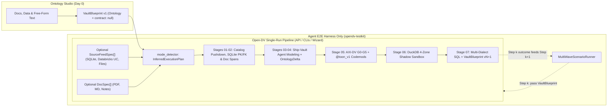
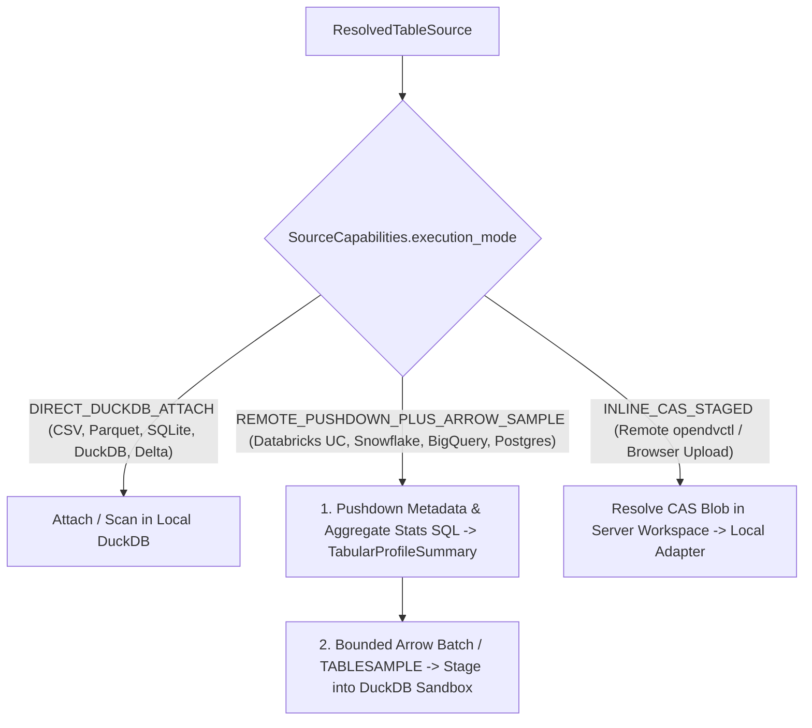
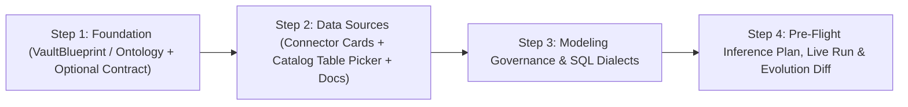

# 25 — Data-Driven Single-Run Pipeline, VaultBlueprint & Universal Multi-Connector Architecture Design

**Status:** Normative Architecture & Technical Design Specification  
**Target Repository:** `open-dv` (`packages/opendv-core`, `packages/opendv-contracts`, `packages/opendv-sources`, `packages/opendv-axi-verifier`, `packages/opendv-duckdb-sandbox`, `packages/opendv-agent-harness`, `packages/opendv-service`, `packages/opendv-testkit`, `apps/opendv-platform-api`, `apps/opendv-cli`, `apps/opendvctl`, `apps/opendv-web-workbench`)  
**Specification Dialect:** OpenDV Architecture v2 / Data Vault 2.0 Modeling Standard / `VaultBlueprint` v1.0  
**Governing Cross-References:** [`docs/00`](00-mission-vision-and-functional-requirements.md) · [`docs/01`](01-core-modelling-spec.md) · [`docs/02`](02-schema-stability-and-evolution.md) · [`docs/03`](03-verification-and-agentic-architecture.md) · [`docs/05`](05-elm-calculus-and-reference-algorithms.md) · [`docs/19`](19-ontology-studio-architecture.md) · [`docs/20`](20-ontology-studio-spec.md) · [`docs/22`](22-ontology-studio-user-guide.md) · [`docs/26`](26-data-driven-pipeline-team-implementation-plan.md) · [`docs/27`](27-unified-ontology-pipeline-requirements-and-uat.md) · [`docs/28`](28-unified-ontology-pipeline-design-and-plan.md)

> [!NOTE]
> **Superseded UI & 5-Zone Standard (`D19`):** The 4-Step `/builder` `WizardShell.tsx` UI described in `§4` and `§5.4` below has been superseded and replaced by the **Unified 6-Step Wizard + 4-View DV Schema Explorer** in [`docs/27-unified-ontology-pipeline-requirements-and-uat.md`](27-unified-ontology-pipeline-requirements-and-uat.md) and [`docs/28-unified-ontology-pipeline-design-and-plan.md`](28-unified-ontology-pipeline-design-and-plan.md). User-facing UI and SQL explorer surfaces standardize on **5-Zone (`Z0–Z4`)** (`bronze`, `staging`, `raw_vault`, `business_vault`, `information_mart`), while internal `four_zone_sql` / `compiler_4zone` symbols, `VaultBlueprint`, `CatalogSourceAdapter`, `mode_detector.py`, and the `< 5,000`-token pipeline split remain active.

---

## 0. Executive Summary & Architecture Decision Records (`ADR-017` – `ADR-021`)

Previously, executing the Open-DV agentic modeling pipeline required authoring multi-wave YAML specifications (`waves[]`) and manually labeling each wave with an imperative `wave_type` (`COLD_START`, `INCREMENTAL_SOURCE`, `SCHEMA_DRIFT`, `UNSTRUCTURED_ONBOARDING`), plus supplying historical `baseline_data_path` files for drift checks and treating tabular sources largely as flat local files.

This design transforms Open-DV into a **stateless, 100% data-driven, single-run modeling and evolution engine** while preserving every invariant of the 8-stage neuro-symbolic modeling loop (`STAGE_00`–`STAGE_07`), the `AXI-DV` 6-gate (`G0`–`G5`) deterministic verifier, `@toon_v1` codemods (`Alg A.1`–`Alg A.9b`), Steward Holds, and DuckDB 4-zone (`raw_staging`, `raw_vault`, `business_vault`, `info_mart`) shadow execution.

### Locked Architecture Decisions (`ADR-017` through `ADR-021`)

| ADR | Decision Title | Normative Choice | Constraints & Rationale |
| :--- | :--- | :--- | :--- |
| **ADR-017** | **Ontology + Contract Unification (`VaultBlueprint`)** | **Envelope Composition (`VaultBlueprint` v1.0)** | Package `ontology: GraphAOntology` and `contract: NoMistakeDataVault2ContractV5 \| null` plus cryptographic `lineage` in one cohesive `vault_blueprint.yaml` bundle (`schemas/vault-blueprint-v1.schema.json`). Keeps `GraphAOntology` and `NoMistakeDataVault2ContractV5` as distinct typed sub-models so `AXI-DV` Gates `G0`–`G5` (`DV-ONT-001`) continue verifying the physical contract against an independent semantic oracle. CLI/API also accept `--ontology` + optional `--contract` and normalize into `VaultBlueprint` at ingress. |
| **ADR-018** | **Zero-Data Behavior** | **Greenfield Seed vs. Existing-Contract Verify** | **When `blueprint.contract is None`** and both structured sources and unstructured documents are empty: synthesize a future-proof **Ontology-Only Seed DV 2.0 Contract** (`COLD_START_N1`) directly from `GraphAOntology` concepts, `key_authority_tiers`, relationships, and PII/MNPI split rules. **When `blueprint.contract is not None`** and zero new data/docs are provided: execute a **Deterministic Verification Pass (`VERIFIED_NO_OP`)** (`AXI-DV` `G0`–`G5` + 4-zone DDL compilation) without mutating deployed Hubs/Links/Satellites. Evolving an existing contract requires at least one structured feed or unstructured document. |
| **ADR-019** | **Single-Run Platform Purity** | **Remove `waves[]` / `wave_type` from Platform** | Remove `waves[]`, `wave_type`, `PipelineWaveInput`, and Explorer `wave_id` filters from `PipelineInputSpec`, REST APIs, Dual CLIs (`opendv` / `opendvctl`), and Web Workbench. Multi-wave sequential chaining lives exclusively in `opendv-testkit` (`MultiWaveScenarioRunner`) to exercise the real single-run pipeline step by step in automated and agentic E2E tests. |
| **ADR-020** | **`< 5,000` Tokens/Module & Zero Hardcoded Values** | **Scoped Refactor & AST CI Gates** | Decompose `opendv_agent_harness/pipeline.py` (currently ~100.8k tokens / 8,476 lines) and cap every newly created or modified `.py`, `.ts`, and `.tsx` module across pipeline, sources, contracts, service, API, CLIs, testkit, and `explorer/builder/` strictly under **5,000 tokens** (enforced by CI via `tiktoken` `cl100k_base` + byte limit). Centralize all thresholds, URIs, system-table filters, and dataset URLs into typed `Settings` / YAML manifests (`test_no_hardcoded_literals.py`). Untouched Ontology Studio modules and auto-generated OpenAPI artifacts (`openapi.ts`, `.json` schemas) remain outside refactor scope. |
| **ADR-021** | **Universal Multi-Connector `SourceFeedSpec`** | **Two-Layer SPI + Catalog Introspection** | Generalize `SourceFeedSpec` beyond local files via `TabularSourceAdapter` + `CatalogSourceAdapter` SPI supporting local files (`CSV`, `Parquet`, `JSON`), multi-table **SQLite** (`.sqlite`/`.db`), DuckDB/Delta/Iceberg stores, PostgreSQL, Snowflake, BigQuery, and first-class **Databricks Unity Catalog** (`catalog.schema.table`, `information_schema` PK/FK/`column_tags`, SQL Warehouse pushdown profiling, bounded Arrow sandbox staging, and Databricks SQL dialect transpilation). |

---

## 1. Single-Run Data-Driven Pipeline Architecture & Inference Engine

### 1.1 Functional Signature of a Single Run
Every invocation of Open-DV is a pure, repeatable transformation over a `VaultBlueprint` and optional data inputs:

```text
run_agentic_vault_pipeline(
    blueprint: VaultBlueprint,                   # GraphAOntology (required) + Existing Contract (optional)
    sources: list[SourceFeedSpec] = [],          # Optional: Files, SQLite DBs, Databricks UC, Cloud Tables
    unstructured_documents: list[DocSpec] = [],  # Optional: PDF, Markdown, TXT, inline free-form notes
    governance: ModelingGovernanceConfig,        # Ontology delta policy, hold policy, dialect, model routing
) -> SingleRunPipelineResult(
    blueprint: VaultBlueprint,                   # Updated Ontology (if deltas accepted) + Verified DV 2.0 Contract
    canonical_ir: CanonicalIR,                   # Deterministic Data Vault 2.0 Intermediate Representation
    four_zone_sql: dict[str, ZoneSQLBundle],     # Canonical DuckDB + requested target dialect (e.g. databricks)
    diff_summary: BlueprintEvolutionDiff,        # Added/widened Hubs, Links, Companion Sats, Ontology Deltas
    inference_plan: InferredExecutionPlan,       # Per-table & per-doc plan derived without user wave_type
    verification_report: AXIVerificationReport,  # Gate G0-G5 & DuckDB 4-zone shadow sandbox proofs
)
```



### 1.2 Eliminating `wave_type`: The 7-Row Data-Driven Inference Matrix
User-facing `wave_type` selection is eliminated everywhere. Inside `opendv_agent_harness/pipeline/mode_detector.py`, the engine inspects `(blueprint.contract, expanded_tables, unstructured_documents)` **per resolved table and per document** and derives an `InferredExecutionPlan`:

| # | `blueprint.contract` | Resolved Tables (`SourceFeedSpec[]`) | Unstructured Docs | Inferred Execution Action (`mode_detector.py`) | Algorithms & Gates Enforced |
|---|---|---|---|---|---|
| **1** | `None` | Empty | Empty | **Ontology-Only Seed Synthesis (`COLD_START_N1`)**: Projects `GraphAOntology` concepts, `key_authority_tiers` (`TIER_1`–`TIER_3`), relationships (`Alg A.4`), and PII/MNPI rules (`Alg A.1`) into a verified seed `NoMistakeDataVault2ContractV5` with `ontology_studio.<concept_slug>` ledger rows. | `Alg A.1`, `Alg A.2`, `Alg A.4`, Gates `G0`–`G5` |
| **2** | `None` | Present (`N >= 1` tables) | Empty or Present | **Greenfield Future-Proof Design (`COLD_START_N1`)**: Profiles tables via `CatalogSourceAdapter` / DuckDB, extracts PK/FK/tag priors, grounds terms against `GraphAOntology` (proposing `OntologyDelta` candidates if `ontology_policy` permits), synthesizes 3-Tier `BKCC` Hubs, Links, and 3-axis split Satellites. | `Alg A.1`–`A.6`, `Alg A.9b` (if docs present), Gates `G0`–`G5`, 4-Zone Sandbox |
| **3** | `None` | Empty | Present (`M >= 1` docs) | **Unstructured-First Design (`COLD_START_N1`)**: Auto-creates `hub_document`, span-grounded `UNSTRUCTURED_EXTRACTION_LINK`s, and `AI_PROVENANCE_SATELLITE`s anchored to `GraphAOntology` concepts without requiring any CLI flag. | `Alg A.9b`, `DV-UNS-001..004`, Gates `G0`–`G5` |
| **4** | **Present (`vN`)** | Empty | Empty | **Deterministic Verification Pass (`VERIFIED_NO_OP`, `ADR-018`)**: Re-verifies `blueprint.contract` against `blueprint.ontology` (`G0`–`G5`) and compiles deterministic 4-zone DDL with zero schema mutation. | Gates `G0`–`G5`, Stage `07` Compiler |
| **5** | **Present (`vN`)** | Table `T` **NOT** in `contract.column_triage_ledger` | Optional | **Incremental Source Onboarding (`MULTI_SOURCE_EXPANSION`)**: Preserves 100% of existing Hubs/Links/Satellites (`Alg A.7` `DV-EVO-001..008`), applies `BKCC` collision isolation, emits `SAME_AS_LINK` (`sal_*`) bridges where keys unify, attaches source-isolated Satellites. | `Alg A.7` (`DV-EVO-001..008`), `Alg A.1`, `ONT-EVO-001..003` |
| **6** | **Present (`vN`)** | Table `T` **IS** in `contract.column_triage_ledger` | Optional | **Contract-Diff Intra-Source Schema Drift**: Diffs incoming `T` columns and physical SQL types directly against `contract.column_triage_ledger` and deployed `satellites` (`ADDITIVE` -> companion `sat_*_ext`, `SOFT_DEPRECATED` -> `CAST(NULL AS <type>)`, `RENAMED` -> staging alias if similarity `>= threshold`, `TYPE_WIDENED` -> canonical cast, `KEY_DRIFT` -> Steward Hold). **No `baseline_data_path` CSV needed.** | `Alg A.9a`, `Alg A.7` (`DV-EVO-001..008`), Gates `G0`–`G5` |
| **7** | **Present (`vN`)** | Mixed (`T_new` + `T_drifted` across connectors) | Present (`D_new`) | **Hybrid Per-Source Execution Plan**: Classifies each table and document independently in a single run—simultaneously onboarding `T_new` (e.g., Databricks Unity Catalog table), applying `Alg A.9a` drift repair to `T_drifted` (e.g., SQLite table), and extracting spans from `D_new`. | `Alg A.7` + `Alg A.9a` + `Alg A.9b` simultaneously |

### 1.3 Contract-Only Schema Drift (`ColumnTriageEntry.source_sql_type`)
To eliminate legacy `baseline_data_path` inputs completely, `ColumnTriageEntry` in [`packages/opendv-core/src/opendv_core/models/contract_v5.py`](../packages/opendv-core/src/opendv_core/models/contract_v5.py) adds one optional, backward-compatible field:

```python
source_sql_type: str | None = Field(
    default=None,
    description="Canonical physical SQL type recorded when the column was triaged (used by Alg A.9a contract-diff drift).",
)
```

When incoming table `T` (`bronze_table` match in `column_triage_ledger`) arrives, `mode_detector.py` reconstructs `deployed_columns`, `key_columns`, and `old_types` purely from `blueprint.contract` and feeds them directly into [`detect_intra_source_schema_drift`](../packages/opendv-axi-verifier/src/opendv_axi_verifier/codemods/alg_a9a_schema_drift.py).

### 1.4 `VaultBlueprint` Envelope Schema (`ADR-017`)
Persisted as `vault_blueprint.yaml` (validated by `schemas/vault-blueprint-v1.schema.json` and `opendv_core/models/vault_blueprint.py`):

```yaml
blueprint_version: "1.0"
domain_namespace: "asset_management"
lineage:
  blueprint_revision: 2
  ontology_sha256: "e3b0c442..."         # RFC 8785 JCS SHA-256 of GraphAOntology
  contract_sha256: "9f86d081..."         # RFC 8785 JCS SHA-256 of contract (null on Day-0 Studio export)
  parent_blueprint_sha256: "4b227777..." # Null on genesis, cryptographic chain across runs
ontology:
  # Full GraphAOntology v1.0 model (concepts, attributes, key_authority_tiers, pii/mnpi rules, relationships)
contract:
  # Full NoMistakeDataVault2ContractV5 | null
```

- **Oracle Independence Preserved**: `AXI-DV` continues evaluating `contract` against `ontology` without circular self-reference (`DV-ONT-001` through `DV-ONT-004`).
- **Ontology Studio Integration**: Exporting a committed Studio session emits a valid `VaultBlueprint` (`contract: null`, or pre-seeded if promoted from a contract session). Running the pipeline emits an updated `VaultBlueprint` alongside standalone `ontology.yaml` and `dv_contract.yaml` artifacts for downstream GitOps workflows.

---

## 2. Universal Multi-Connector `SourceFeed` Architecture

`SourceFeedSpec` must adapt seamlessly across local files, embedded relational files (SQLite, DuckDB), cloud lakehouse storage (Delta/Parquet/Iceberg on S3/ADLS/GCS), traditional RDBMS (PostgreSQL), and cloud data warehouses—specifically including **Databricks Unity Catalog tables**.

### 2.1 Generalized `SourceFeedSpec` Contract
Instead of assuming one file per feed, a single `SourceFeedSpec` can represent either a single dataset or a multi-table catalog/database/schema namespace:

```yaml
feed_id: "databricks_ibor_positions"
source_system: "ibor_databricks"
adapter: "databricks"                   # Optional when inferred from uri scheme (e.g. sqlite://, databricks://, uc://)
uri: "databricks://dbc-abc123.cloud.databricks.com/am_prod/ibor"
namespace:
  catalog: "am_prod"                    # 3-level catalog (Databricks UC / Snowflake / BigQuery project)
  schema_name: "ibor"                   # 2-level schema / database
table_selection:
  mode: "EXPLICIT"                      # ALL_USER_TABLES | EXPLICIT | PATTERN
  tables: ["positions", "trades", "security_master"]
  include_pattern: null
  exclude_pattern: null
credentials_ref: "env:DATABRICKS_TOKEN" # Strictly 'env:NAME' or 'secret:NAME' (never literal secrets)
sampling_policy:
  max_sandbox_rows: 10000
  strategy: "DETERMINISTIC_LIMIT"       # DETERMINISTIC_LIMIT | TABLESAMPLE_BERNOULLI
target_dialect: "databricks"            # Optional target SQL output dialect alongside canonical DuckDB
options:
  http_path: "/sql/1.0/warehouses/9f8e7d6c5b4a3210"
  version_as_of: null                   # Optional Delta time-travel version / timestamp for reproducibility
```

### 2.2 Two-Layer `opendv-sources` SPI (`TabularSourceAdapter` + `CatalogSourceAdapter`)
Building on the existing [`TabularSourceAdapter`](../packages/opendv-sources/src/opendv_sources/spi/tabular.py) in `opendv-sources`, we introduce an additive protocol extension `CatalogSourceAdapter` (`packages/opendv-sources/src/opendv_sources/spi/catalog.py`) and enriched schema metadata models:

1. **`CatalogSourceAdapter` Extension Protocol**:
   - `list_namespaces(spec: SourceSpec) -> list[NamespaceDescriptor]`: Discovers catalogs/schemas/databases.
   - `list_tables(spec: SourceSpec, namespace: NamespaceRef | None) -> list[TableSummary]`: Lists user tables, row estimates, and table types (`MANAGED`, `EXTERNAL`, `VIEW`, `BASE_TABLE`), skipping configured internal prefixes (e.g., `sqlite_stat*`, `information_schema`).
   - `inspect_table(spec: SourceSpec, table_ref: TableRef) -> TableSchemaDescriptor`: Returns full column metadata, Primary Keys, Foreign Key constraints, column comments, governance tags, and deterministic snapshot version/fingerprint.
   - `expand_feed(feed: SourceFeedSpec) -> list[ResolvedTableSource]`: Expands a multi-table catalog/SQLite feed into concrete table-level `ResolvedTableSource` descriptors normalized as `<source_system>.<table_name>` for `column_triage_ledger`.
   - `profile_pushdown(spec: SourceSpec, table_ref: TableRef, policy: SamplingPolicy) -> TabularProfileSummary | None`: Executes remote SQL aggregate profiling directly inside the source warehouse when supported, avoiding full-table data egress.
   - `config_schema() -> ConnectorUIManifest`: Declares connector fields, secret-ref fields, sample URI format, and capabilities dynamically so the UI Wizard never hardcodes connector-specific branches.
2. **Enriched Metadata Descriptors (`opendv_sources/models/descriptors.py`)**:
   - `ColumnDescriptor`: adds `is_primary_key: bool`, `primary_key_ordinal: int | None`, `foreign_key_ref: ForeignKeyHint | None`, `description: str | None` (table/column comment for semantic grounding), and `governance_tags: dict[str, str]` (e.g., `{"classification": "pii"}` or `{"mnpi": "true"}`).
   - `SourceCapabilities`: adds `supports_multi_table: bool`, `supports_catalog_hierarchy: bool`, `supports_foreign_keys: bool`, `supports_governance_tags: bool`, `supports_time_travel: bool`, and `execution_mode: Literal["DIRECT_DUCKDB_ATTACH", "REMOTE_PUSHDOWN_PLUS_ARROW_SAMPLE", "INLINE_CAS_STAGED"]`.
3. **Zero-Hardcoding Discovery (`SourceAdapterRegistry` + `SourceSchemeRegistry`)**:
   - Adapters register via `opendv.source_adapters` Python entry points plus a declarative scheme/extension mapping (`file`, `.sqlite`/`.sqlite3`/`.db`/`sqlite://`, `duckdb://`, `databricks://`/`uc://`, `delta://`, `iceberg://`, `postgres://`, `snowflake://`, `bq://`). Neither `opendv-agent-harness` nor `opendv-web-workbench` branches on adapter names with `if/else`.

### 2.3 Three Connector Execution & Profiling Modes



1. **`DIRECT_DUCKDB_ATTACH`**: Zero-copy read-only DuckDB attach/scan for local files (`csv`, `parquet`, `json`, `jsonl`), **SQLite**, local DuckDB, and local/object-store Delta or Iceberg tables.
2. **`REMOTE_PUSHDOWN_PLUS_ARROW_SAMPLE`**: Designed for cloud lakehouses and warehouses (Databricks Unity Catalog, Snowflake, BigQuery, PostgreSQL) so multi-terabyte tables are profiled cleanly without full data download:
   - **Step A**: Inspect `information_schema` (columns, comments, PK/FK constraints, governance tags, Delta version).
   - **Step B**: Run a single batched pushdown profiling SQL query in the remote engine to obtain exact `COUNT(*)`, `COUNT(DISTINCT col)` / `APPROX_COUNT_DISTINCT(col)`, null counts, `MIN`/`MAX` lengths, and candidate `BKCC` regex match ratios (`TIER_1` ISIN/LEI/CUSIP/CIK patterns).
   - **Step C**: Stream a bounded Arrow sample (`max_sandbox_rows`, e.g., 10,000 rows via `TABLESAMPLE` / `LIMIT`) into the local DuckDB 4-zone shadow sandbox (`STAGE_06`) to execute end-to-end vault loading, grain uniqueness, and `hash_diff` idempotency tests.
3. **`INLINE_CAS_STAGED`**: Enables remote clients (`opendvctl` and Browser Wizard) to upload `.sqlite`, `.csv`, `.parquet`, or `.json` files via CAS binary blobs and treat them identically to local workspace files (`client_uploadable=True`).

### 2.4 First-Class Connector Deep-Dive A: SQLite (`SqliteCatalogInspector`)
Upgrades existing [`duckdb_attach.py`](../packages/opendv-sources/src/opendv_sources/adapters/duckdb_attach.py) with `sqlite_inspector.py`:
- Opens `.sqlite` / `.sqlite3` / `.db` in strict read-only URI mode (`mode=ro`), supporting multi-table feeds via `table_selection`.
- Extracts every user table (excluding configurable SQLite internal tables like `sqlite_sequence` and `sqlite_stat*`), exact row counts, `PRAGMA table_info` Primary Keys (including composite PK ordinal), and `PRAGMA foreign_key_list` Foreign Key edges (`from_col -> to_table.to_col`).
- Surfaces PK/FK declarations as high-confidence structural priors to `STAGE_01` (`discovery_tabular.py`), while still testing empirical nullability/uniqueness in DuckDB so legacy un-enforced SQLite schemas still receive `Alg A.4` nullable-FK split protection.
- Marks `.sqlite` / `.db` binary sources `client_uploadable=True` using base64/multipart CAS staging so users can upload SQLite databases directly in the Browser Wizard or `opendvctl`.

### 2.5 First-Class Connector Deep-Dive B: Databricks Unity Catalog (`DatabricksUnityCatalogAdapter`)
Implemented under optional dependency extra `opendv-sources[databricks]` (and cleanly injectable with custom SDK/connection factories) as `adapters/databricks_uc.py` + `adapters/databricks_profiler.py`:
- **Connection & Security (`REQ-CFG-01`)**: Authenticates via `credentials_ref` (`env:DATABRICKS_TOKEN` or OAuth M2M `env:DATABRICKS_CLIENT_SECRET` / `secret:...`) and `options.host` + `options.http_path`. Literal tokens in YAML/JSON `options` are rejected by Pydantic validation.
- **3-Level Unity Catalog Introspection (`<catalog>.<schema>.<table>`)**:
  - Reads `<catalog>.information_schema.tables`, `.columns` (including `comment` and `data_type`), `.table_constraints`, and `.key_column_usage` to extract Unity Catalog `PRIMARY KEY` and informational `FOREIGN KEY` constraints (`RELY` / `NORELY` metadata).
  - Reads `information_schema.column_tags` and `.table_tags` so Databricks Unity Catalog governance tags (`pii`, `mnpi`, `sensitivity`, `retention`) flow straight into `discovery_tabular.py` and drive `Alg A.1` 3-axis Satellite splits automatically!
- **Deterministic Provenance (`fingerprint`)**: Executes `DESCRIBE DETAIL <fq_table>` (with fallback to `DESCRIBE HISTORY <fq_table> LIMIT 1`) to pin the Delta commit `version` (or `timestamp`) + canonical column digest into the CAS provenance hash, respecting optional `version_as_of` / `timestamp_as_of` time-travel pinning.
- **Warehouse Pushdown Profiling (`STAGE_01`)**: Generates ANSI/Databricks Spark SQL (`APPROX_COUNT_DISTINCT`, `COUNT_IF(col IS NULL)`, `REGEXP_LIKE` for Ontology `key_authority_tiers` patterns) via parameterized queries and identifier quoting (`` `catalog`.`schema`.`table` `` validated against strict safe-identifier rules).
- **Bounded Arrow Sample -> DuckDB 4-Zone Sandbox (`STAGE_06`)**: Uses `fetchmany_arrow` over `SELECT ... FROM ... [VERSION AS OF v] TABLESAMPLE ... LIMIT :max_sandbox_rows` to register zero-copy Arrow relations into DuckDB for full `AXI-DV` 4-zone shadow execution.
- **Databricks Delta 4-Zone DDL/DML Compilation (`STAGE_07`)**: Alongside canonical DuckDB SQL, `sqlglot` transpiles the verified `CanonicalIR` / 4-zone SQL into **Databricks SQL (`write="databricks"`)**:
  - Delta Lake DDL (`CREATE TABLE IF NOT EXISTS ... USING DELTA`),
  - Canonical `SHA2(CONCAT_WS(...), 256)` length-prefixed hash keys & `hash_diff` matching Open-DV hashing invariants, and
  - Idempotent Delta `MERGE INTO` loading patterns for Hubs, Links, and Satellites.

### 2.6 Supported Connector Matrix & Declarative Multi-Connector Feeds

| Adapter ID | Schemes / Extensions | Execution Mode | Multi-Table Catalog | PK / FK Hints | Gov Tags | Time Travel / Versioning | Uploadable (`opendvctl`/UI) |
|---|---|---|---|---|---|---|---|
| `file` | `.csv`, `.tsv`, `.parquet`, `.json`, `.jsonl` | `DIRECT_DUCKDB_ATTACH` | Single table/file | Via sidecar hints | No | File SHA-256 | Yes (CAS) |
| `sqlite` (`duckdb_attach`) | `.sqlite`, `.sqlite3`, `.db`, `sqlite://` | `DIRECT_DUCKDB_ATTACH` | **Yes (`ALL` / `EXPLICIT`)** | **Yes (`PRAGMA`)** | No | DB bytes + per-table schema/count digest | **Yes (CAS)** |
| `duckdb_attach` | `.duckdb`, `duckdb://` | `DIRECT_DUCKDB_ATTACH` | Yes (multi-schema) | Yes (`duckdb_constraints`) | No | DB/Snapshot digest | Yes |
| `databricks` | `databricks://`, `uc://` | `REMOTE_PUSHDOWN_PLUS_ARROW_SAMPLE` | **Yes (`catalog.schema.table`)** | **Yes (`information_schema`)** | **Yes (`column_tags`)** | **Yes (Delta `VERSION AS OF`)** | Server/Warehouse resolved |
| `delta_store` / `iceberg` | `s3://`, `abfss://`, `gs://`, `delta://`, `iceberg://` | `DIRECT_DUCKDB_ATTACH` / Pushdown | Catalog/Prefix scan | Metadata if cataloged | Optional | Snapshot / Delta log version | Server resolved |
| `postgres` / `snowflake` / `bigquery` | `postgresql://`, `snowflake://`, `bq://` | `REMOTE_PUSHDOWN_PLUS_ARROW_SAMPLE` | Yes (`db.schema.table`) | Yes (`information_schema`) | Catalog-dependent | Snapshot / Time travel | Server resolved |

> [!TIP]
> Because `mode_detector.py` operates strictly on normalized `(source_system, table_name, columns)` descriptors returned by `CatalogSourceAdapter.expand_feed()`, a **single** pipeline run can mix a local `am_sec_treasury_ibor.sqlite` feed, a `databricks://.../am_prod/ibor` table feed, a Parquet snapshot, and a PDF offering memorandum seamlessly.

---

## 3. Curated Realistic Public Internet Datasets & Conformance Harnesses

All remote sample URLs, headers, expected schemas, and SHA-256 checksums live declaratively in `tests/fixtures/public_am/dataset_manifest.yaml` managed by [`fetch_public_datasets.py`](../tests/fixtures/public_am/fetch_public_datasets.py) (zero inline URLs or hardcoded filenames in test logic):

| Dataset Suite | Public Internet Source (100% Keyless) | Local Artifact Staged | E2E Scenario Exercised |
|---|---|---|---|
| **Suite 1: Asset Management IBOR & Regulatory SQLite** | **SEC EDGAR** (`company_tickers.json` + Form 13F institutional holdings), **U.S. Treasury Fiscal Data API** (`/v2/accounting/od/avg_interest_rates`), **FRED** (`DGS2`, `DGS10`, `SOFR`) | `data/public_am/am_sec_treasury_ibor.sqlite` (`issuers`, `securities`, `institutional_filers`, `holdings_13f`, `treasury_rates`, `yield_curves` with `PRIMARY KEY` & `FOREIGN KEY` DDL) + SEC filing excerpts | **Sequential Evolution**: Run 1 Greenfield builds `TIER_1` (`CIK`, `CUSIP`, `ISIN`) + `TIER_2` Hubs, Links, PII/MNPI Sats; Run 2 mixes a new custodial CSV + drifted `holdings_13f` SQLite table (`esg_controversy_score`, `liquidity_bucket` added) in one run! |
| **Suite 2: Enterprise ERP Multi-Table SQLite** | **Northwind SQLite** (`jpwhite3/northwind-SQLite3` `dist/northwind.db`) & **Chinook SQLite** (`lerocha/chinook-database` `Chinook_Sqlite.sqlite`) | `data/public_sqlite/northwind.sqlite`, `chinook.sqlite` (SHA-256 verified + deterministic offline fixture fallback) | Domain-agnostic multi-table SQLite introspection, composite Link keys (`Order Details`), self-referential `HIERARCHICAL_LINK` (`Employees.ReportsTo`), and Browser Wizard table picker. |
| **Suite 3: Databricks Unity Catalog Emulator & Live Conformance** | Local **DuckDB Unity Catalog Emulator** (`opendv_testkit.uc_emulator`) backed by Parquet/Delta-shaped Asset Management IBOR tables + optional `@pytest.mark.live_databricks` | `uc_emulator` exposes 3-level `am_prod.ibor.*` catalog, `information_schema` PK/FK/`column_tags`, SQL pushdown, and Arrow batches | Offline CI tests 100% of `DatabricksUnityCatalogAdapter`, pushdown profiling, `column_tags` -> PII/MNPI satellite splits, and Databricks SQL transpilation with zero cloud credentials; opt-in live tests validate against a real SQL Warehouse when configured. |

---

## 4. 4-Step Wizard Pipeline Builder UX (`/builder`) *(Superseded by Unified 6-Step Wizard — `D19`)*

> **Superseded UI Note:** Under Decision `D19` ([`docs/27`](27-unified-ontology-pipeline-requirements-and-uat.md) & [`docs/28`](28-unified-ontology-pipeline-design-and-plan.md)), `/builder` routes directly into the Unified 6-Step Wizard (`OntologyWizardShell.tsx`) + 4-View `DV Schema Explorer` (`/dv-schema`) using the **5-Zone (`Z0–Z4`)** + `information_mart` standard, replacing the earlier 4-Step `WizardShell.tsx` / `PipelineWizardView.tsx` screens.

The flat, multi-wave historical `apps/opendv-web-workbench/src/explorer/builder/InteractiveSpecForm.tsx` was first replaced by a guided **4-Step Wizard** (`PipelineWizardView.tsx`) synced bi-directionally with an optional **YAML Run Spec Drawer**:



- **Step 1 — Foundation (Ontology & Optional Existing Schema)**:
  - Load from an active **Ontology Studio Session**, upload a **`VaultBlueprint` (`vault_blueprint.yaml`)**, or upload standalone `Ontology` + optional `Existing DV 2.0 Contract`.
  - Displays a read-only **Inferred Mode Banner**: **"Greenfield Future-Proof Design"** (when `contract == null`) vs. **"Existing Schema Update & Evolution"** (showing current Hub, Link, Satellite, and triaged `bronze_table` counts). Zero `Wave Type` dropdowns exist.
- **Step 2 — Data Sources (Dynamic Multi-Connector & Unstructured Materials)**:
  - Connectors render dynamically from `GET /api/v1/sources/adapters` (`ConnectorUIManifest` — **File Upload**, **SQLite Database**, **Databricks Unity Catalog**, **DuckDB / Delta / Lakehouse**, plus any plugin adapter discovered via entry points).
  - Selecting **SQLite** (upload or workspace path) or entering **Databricks Unity Catalog** credentials/warehouse details invokes `POST /api/v1/sources/inspect` and opens a unified **Catalog & Table Picker**, displaying namespaces (`catalog.schema`), table row estimates, PK/FK key badges, and Databricks `column_tags` (`pii`, `mnpi`) with `Select All User Tables` or checkbox multi-select.
  - Adding **Unstructured Documents** (PDF, Markdown, TXT, free-form domain notes) is optional; leaving both structured and unstructured empty cleanly surfaces the **ADR-018** indicator (*Greenfield: Ontology-Only Seed Synthesis*; *Existing Contract: Deterministic Verification Pass*).
  - **Target Hub** and **Business Keys** are omitted from primary inputs (available under a collapsed expert override drawer) because `STAGE_01` + `GraphAOntology` discover them automatically.
- **Step 3 — Modeling Governance & Target Dialects**:
  - Choose Agent Harness/Model (`agy`, `claude`, or deterministic offline), **Ontology Delta Policy** (`recommend` | `auto_accept` | `strict_lock`), **Steward Hold Policy** (`pause_for_review` | `fail_closed`), **Sampling Policy** (`max_sandbox_rows`, `DETERMINISTIC_LIMIT` / `TABLESAMPLE`), and output SQL dialects (`duckdb` + optional `databricks` Delta SQL).
- **Step 4 — Pre-Flight Validation, Execution & Evolution Diff**:
  - Calls `/api/v1/runs/validate` to preview the **Data-Driven Per-Table Action Plan** (e.g., *"3 SQLite tables -> Greenfield synthesis"* or *"am_prod.ibor.positions (Databricks) -> Incremental Alg A.7; sqlite.holdings_13f -> Additive Drift Alg A.9a"*), executes the single-run SSE stream, resolves any Steward Holds interactively, and presents the **Updated `VaultBlueprint` download + Schema/Ontology Diff + Multi-Dialect 4-Zone SQL**.

---

## 5. `< 5,000` Tokens Modularization, `MultiWaveRunner` Relocation & Zero Hardcoding (`ADR-019` & `ADR-020`)

### 5.1 Decomposing `opendv_agent_harness/pipeline.py` (100.8k Tokens -> 14 Focused Modules)

| Target Module (`packages/opendv-agent-harness/src/opendv_agent_harness/pipeline/`) | Single Responsibility | Target Budget |
|---|---|---|
| `config.py` | Typed `PipelineSettings` loaded from config/env (all thresholds, limits, timeouts) | ~1,200 tokens |
| `spec.py` | Single-run `PipelineInputSpec`, `SourceFeedInput`, `UnstructuredDocInput`, `VaultBlueprint` normalization | ~2,800 tokens |
| `mode_detector.py` | Data-driven `InferredExecutionPlan` builder (`ADR-018` + `Alg A.7` / `Alg A.9a` / `Alg A.9b` / Hybrid) | ~2,600 tokens |
| `validation_preflight.py` | Pre-run source reachability, `VaultBlueprint` hash checks, SQLite/Catalog feed expansion | ~3,200 tokens |
| `discovery_tabular.py` | Stage 01 DuckDB & `CatalogSourceAdapter` pushdown profiler, PK/FK/tag prior ingestion | ~3,500 tokens |
| `discovery_unstructured.py` | Stage 02 document span chunking, entity extraction & `hub_document` grounding | ~2,900 tokens |
| `ontology_evolution.py` | `OntologyDelta` proposal generation, `ONT-EVO-001..003` safety validation, `GraphAOntology` vN+1 | ~3,000 tokens |
| `contract_synthesizer.py` | Greenfield, Ontology-Only Seed & Unstructured-First `NoMistakeDataVault2ContractV5` synthesis | ~3,800 tokens |
| `contract_evolver.py` | Incremental source onboarding (`Alg A.7`) & contract-diff intra-source drift (`Alg A.9a`) | ~3,800 tokens |
| `axi_repair_loop.py` | Stage 05 `AXI-DV` 6-gate (`G0`–`G5`) verification + `@toon_v1` deterministic codemod loop | ~3,400 tokens |
| `sandbox_compiler.py` | Stages 06–07 `CanonicalIR` lowering, DuckDB 4-zone shadow execution & multi-dialect SQL emission | ~3,400 tokens |
| `stages_agentic.py` | Persona prompt dispatch & tool-bridge orchestration across `STAGE_00`..`STAGE_04` + Steward Holds | ~3,600 tokens |
| `validation_postflight.py` | 100% column triage accountability, `DV-EVO` additive invariance & blueprint SHA-256 lineage audit | ~2,800 tokens |
| `runner.py` & `__init__.py` | Public `run_agentic_vault_pipeline()` orchestrator + clean exports | ~2,200 tokens |

Companion decompositions apply the same `< 5,000` token ceiling to:
- `opendv-sources`: `spi/catalog.py`, `registry/scheme_registry.py`, `adapters/sqlite_inspector.py`, `adapters/databricks_uc.py`, `adapters/databricks_profiler.py`.
- `apps/opendv-web-workbench/src/explorer/builder/`: `WizardShell.tsx`, `Step1Foundation.tsx`, `Step2ConnectorSources.tsx`, `CatalogTablePickerModal.tsx`, `Step3GovernanceAndDialect.tsx`, `Step4ValidateAndRun.tsx`, `wizardSpecMapper.ts`.

### 5.2 Relocating Multi-Wave Testing to `opendv-testkit` (`ADR-019`)
- New module `packages/opendv-testkit/src/opendv_testkit/multi_wave_runner.py` (~2,400 tokens):
  - Defines test-only `ScenarioStepSpec` and `MultiWaveScenarioSpec`.
  - Runs Step 1 -> takes `res_1.blueprint` -> passes it as `blueprint` input to Step 2 -> chains `res_2.blueprint` into Step 3 inside a shared persistent DuckDB shadow database, asserting `DV-EVO-001..008` additive lock, `hash_diff` continuity, and `VaultBlueprint.lineage` SHA-256 chain integrity across runs.

### 5.3 Zero Hardcoded Values Policy & Automated CI Guards (`ADR-020`)
- All numeric thresholds (e.g., BK uniqueness ratios, Levenshtein rename similarity `0.85`, Jaccard overlap `0.90`, `max_sandbox_rows`, HTTP timeouts), system-table exclusion prefixes (`sqlite_stat*`), adapter URI scheme tables, and dataset URLs reside in declarative config/manifests (`opendv_core/config.py`, `opendv_sources/config/`, `tests/fixtures/public_am/dataset_manifest.yaml`).
- Two dedicated architectural tests enforce compliance automatically on every PR:
  1. `tests/architecture/test_module_token_budget.py`: Uses `tiktoken` (`cl100k_base`) across all pipeline/sources/contracts/service/API/CLI/testkit/builder `.py`/`.ts`/`.tsx` files in `ADR-020` scope and fails on any file `>= 5,000` tokens.
  2. `tests/architecture/test_no_hardcoded_literals.py`: AST check rejecting hardcoded HTTP URLs, hardcoded SQLite/Databricks hosts, and magic threshold literals inside production packages/apps outside dedicated config modules.

### 5.4 Locked Architectural Refinements & CI Gates Completion Status

| Workstream | Subsystem / Capability | Key Architectural Artifacts | Verification Status |
|---|---|---|---|
| **WS-1** | Universal Multi-Connector Sources (`CatalogSourceAdapter` SPI) | `opendv-sources`: `spi/catalog.py`, `adapters/sqlite_inspector.py`, `adapters/databricks_uc.py`, `adapters/databricks_profiler.py`, `registry/scheme_registry.py` | Verified (`test_catalog_spi.py`, `test_sqlite_inspector.py`, `test_databricks_uc_adapter.py`) |
| **WS-2A** | `VaultBlueprint` v1.0 & JCS Lineage Tracking | `opendv-core`: `models/vault_blueprint.py`, `opendv-contracts`: `dtos/blueprint.py`, `schemas/vault-blueprint-v1.schema.json` | Verified (`test_vault_blueprint.py`, `test_single_run_dtos.py`) |
| **WS-2B** | Zero-Data Execution & Contract-Only Drift | `opendv-agent-harness/pipeline`: `mode_detector.py` (7-row matrix), `COLD_START_N1`, `VERIFIED_NO_OP`, `Alg A.9a` contract-diff | Verified (`test_mode_detector.py`, `test_alg_a9a_contract_diff.py`) |
| **WS-3** | Pipeline Harness Decomposition & Single-Run Purity | `opendv-agent-harness/pipeline/` (15 modules strictly `< 5,000` tokens `cl100k_base`), `pipeline.py` backward-compat facade (965 tokens) | Verified (`test_pipeline_modules.py`, `test_single_run_invariants.py`, `test_module_token_budget.py`) |
| **WS-4** | REST APIs, Dual-CLI Parity & 4-Step Wizard UI *(Superseded by `D19`)* | `/api/v1/sources/inspect`, `/api/v1/ontology/studio/sessions/{id}/export-blueprint`, `opendv source inspect`, `apps/opendv-web-workbench/src/ontology/wizard/` (superseding `explorer/builder/` per [`docs/28`](28-unified-ontology-pipeline-design-and-plan.md)) | Verified (`test_sources_inspect_api.py`, `test_single_run_api.py`, `UnifiedWizard.test.tsx`, `catalog-table-picker.test.tsx`) |
| **WS-5** | Multi-Wave Scenario Migration & Testkit | `opendv-testkit`: `multi_wave_runner.py`, `uc_emulator.py` (<5,000 tokens) | Verified (`test_multi_wave_runner.py`, `test_databricks_conformance.py`) |
| **WS-6.3** | Architecture CI Gates & Schema Sync | `tests/architecture/test_module_token_budget.py`, `tests/architecture/test_no_hardcoded_literals.py`, `tests/architecture/test_schema_sync.py`, `tests/docs/test_doc_code_snippets.py` | Verified (`uv run pytest tests/architecture/ -v`, `uv run pytest tests/docs/ -v`) |
| **WS-6.5** | Documentation Sync | `docs/16-cli-reference.md`, `docs/22-ontology-studio-user-guide.md`, `docs/23-ontology-studio-extension-guide.md`, `docs/25`, `docs/26` | Verified |
