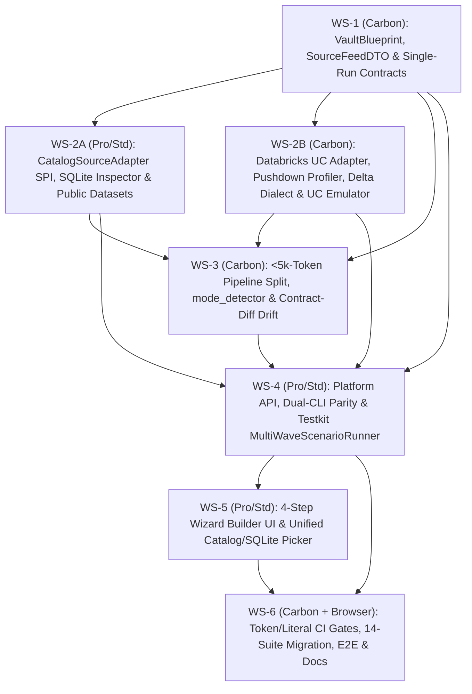

# 26 — Team Implementation Plan: Data-Driven Single-Run Pipeline & Multi-Connector Catalog

> **Module:** `docs/26-data-driven-pipeline-team-implementation-plan.md` · **Revision:** v1.0 (2026-11-15)  
> **Status:** Execution Ready across 7 Modular Workstreams (`WS-1` through `WS-6`)  
> **Governing Docs:** [`docs/25`](25-data-driven-single-run-pipeline-design.md) (`ADR-017`–`ADR-021`) · [`docs/19`](19-ontology-studio-architecture.md) · [`docs/20`](20-ontology-studio-spec.md) · [`docs/21`](21-ontology-studio-implementation-plan.md) · [`docs/22`](22-ontology-studio-user-guide.md)  
> **How to Use This Plan:** Assign each Workstream (`WS-*`) to an autonomous engineer/swarm worker respecting the dependency DAG (§1.2), strict exclusive file ownership (§1.3), and model routing (**Carbon / Pro** for complex architectural workstreams). Every file added or modified under this plan must stay strictly **below 5,000 tokens** (`ADR-020`).

---

## 1. Team Delivery Rules, Model Routing & Topology

### 1.1 Engineering Guardrails & Continuous CI Gates
Every commit and PR produced under this plan must satisfy all 7 continuous verification gates:
1. **Strict `< 5,000` Tokens Per Module (`ADR-020`)**: Every `.py`, `.ts`, and `.tsx` file under `opendv_agent_harness/pipeline/` and every newly created or modified module across `opendv-core`, `opendv-contracts`, `opendv-sources`, `opendv-axi-verifier`, `opendv-duckdb-sandbox`, `opendv-service`, `opendv-testkit`, `opendv-platform-api`, `opendv-cli`, `opendvctl`, and `explorer/builder/` must measure `< 5,000` tokens (`tiktoken` `cl100k_base`) via `tests/architecture/test_module_token_budget.py`.
2. **Zero Hardcoded Magic Values (`ADR-020`)**: All dataset URLs, thresholds, system-table prefix exclusions, adapter URI scheme maps, and timeouts reside in typed settings/manifests and pass `tests/architecture/test_no_hardcoded_literals.py`.
3. **Zero Production Mocks & Unidirectional Layering**: Passes `tests/architecture/test_mock_guards.py` and `tests/architecture/test_import_contracts.py` (`opendv-core` -> `opendv-contracts` -> `opendv-sources` / `opendv-agent-harness` -> `opendv-service` -> Apps).
4. **No Literal Secrets in Configs (`REQ-CFG-01`)**: Cloud/Databricks/RDBMS credentials use strictly `env:NAME` or `secret:NAME` in `credentials_ref`; literal tokens in YAML/DTO `options` fail closed at Pydantic validation.
5. **100% Dual-CLI Parity**: Standalone `opendv` (`LocalExecutor`) and remote `opendvctl` (`RemoteExecutor`) expose identical subcommands, flags, exit codes, and JCS JSON outputs synced via `schemas/v1/cli-spec.json`.
6. **Zero Legacy Workbench Strings**: Passes `tests/architecture/test_legacy_removal_guards.py`.
7. **Commit Message Convention**: All commits match `^(feat|fix|docs|style|refactor|perf|test|build|ci|chore|revert|Merge|no-mistakes)(\([^)]+\))?:? .+$` (use `no-mistakes(<scope>): ...` or Conventional Commits).

### 1.2 Workstream Dependency DAG



### 1.3 Parallel Scheduling & Exclusive File Ownership Matrix

| Workstream | Model Tier | Exclusive Owned Paths (No Cross-Worker Edits Allowed) | Unlocks When Complete |
|---|---|---|---|
| **WS-1** | **Carbon** | `packages/opendv-core/src/opendv_core/models/vault_blueprint.py`, `packages/opendv-core/src/opendv_core/models/contract_v5.py`, `packages/opendv-core/src/opendv_core/config.py`, `schemas/vault-blueprint-v1.schema.json`, `packages/opendv-contracts/src/opendv_contracts/dtos/{pipeline,runs,sources,blueprint}.py`, `packages/opendv-protocol-ts/` | `WS-2A`, `WS-2B`, `WS-3`, `WS-4` |
| **WS-2A** | Pro / Standard | `packages/opendv-sources/src/opendv_sources/spi/catalog.py`, `models/{descriptors,specs}.py`, `registry/scheme_registry.py`, `adapters/sqlite_inspector.py`, `adapters/duckdb_attach.py`, `config/defaults.py`, `tests/fixtures/public_am/{dataset_manifest.yaml,fetch_public_datasets.py}` | `WS-3`, `WS-4` |
| **WS-2B** | **Carbon** | `packages/opendv-sources/src/opendv_sources/adapters/{databricks_uc,databricks_profiler}.py`, `packages/opendv-sources/pyproject.toml`, `packages/opendv-duckdb-sandbox/src/opendv_duckdb_sandbox/dialects/databricks_transpiler.py`, `packages/opendv-testkit/src/opendv_testkit/uc_emulator.py` | `WS-3`, `WS-4`, `WS-6` |
| **WS-3** | **Carbon** | `packages/opendv-agent-harness/src/opendv_agent_harness/pipeline/` (14 decomposed `<5k`-token modules retiring `pipeline.py`), `packages/opendv-axi-verifier/src/opendv_axi_verifier/codemods/alg_a9a_schema_drift.py` | `WS-4`, `WS-6` |
| **WS-4** | Pro / Standard | `packages/opendv-service/src/opendv_service/{use_cases/pipeline,use_cases/sources_inspect,cli_spec/definitions,studio/blueprint_export}.py`, `apps/opendv-platform-api/src/opendv_platform_api/routers/{runs,sources,ontology_studio_blueprint}.py`, `apps/opendv-cli/`, `apps/opendvctl/`, `packages/opendv-testkit/src/opendv_testkit/multi_wave_runner.py`, `schemas/v1/{openapi,cli-spec}.json` | `WS-5`, `WS-6` |
| **WS-5** | Pro / Standard | `apps/opendv-web-workbench/src/explorer/builder/{WizardShell,Step1Foundation,Step2ConnectorSources,CatalogTablePickerModal,Step3GovernanceAndDialect,Step4ValidateAndRun}.tsx`, `apps/opendv-web-workbench/src/explorer/builder/wizardSpecMapper.ts`, `apps/opendv-web-workbench/src/explorer/{OpenDVWorkbenchExplorer.tsx,types.ts,explorer-store.ts}`, `apps/opendv-web-workbench/tests/` | `WS-6` |
| **WS-6** | **Carbon** + Browser Subagent | `tests/architecture/{test_module_token_budget,test_no_hardcoded_literals}.py`, migrated test suites listed in §3.2, `examples/pipeline_samples/`, `docs/{16,22,23}*.md`, `apps/opendv-web-workbench/e2e/` | PR Ready Gate |

---

## 2. Granular Workstream & Task Breakdown (`WS1.1` – `WS6.5`)

### Workstream 1 — Core `VaultBlueprint`, Universal `SourceFeedDTO` & Single-Run Contracts (**Carbon**)

| Task ID | Deliverable & Acceptance Criteria | Target Files | Unit Tests |
|---|---|---|---|
| **WS1.1** | Implement `VaultBlueprint` v1.0 (`ontology`, `contract \| None`, `lineage` with RFC 8785 JCS SHA-256 chain computation) + JSON Schema `schemas/vault-blueprint-v1.schema.json`. Keep `GraphAOntology` benchmark SHA-256 unchanged (`1c1004...`). | `opendv_core/models/vault_blueprint.py`, `schemas/vault-blueprint-v1.schema.json` | `packages/opendv-core/tests/test_vault_blueprint.py` |
| **WS1.2** | Extend `ColumnTriageEntry` in `contract_v5.py` with optional `source_sql_type: str \| None = None` so `Alg A.9a` diffs column types purely from `existing_contract` without requiring `baseline_data_path`. Sync JSON Schema if exported. | `opendv_core/models/contract_v5.py` | `packages/opendv-core/tests/test_contract_v5.py` |
| **WS1.3** | Centralize core pipeline & drift constants/thresholds in `opendv_core/config.py` (Pydantic `CoreModelingConfig` defaults loaded cleanly with env overrides — zero magic literals). | `opendv_core/config.py` | `packages/opendv-core/tests/test_config_defaults.py` |
| **WS1.4** | Replace `PipelineWaveInput` / `wave_type` DTOs with single-run `PipelineInputDTO`, `SourceFeedDTO` (supporting `namespace`, `table_selection`, `sampling_policy`, `target_dialect`), `ConnectorUIManifestDTO`, `SourceInspectRequestDTO`/`ResponseDTO`, and `InferredExecutionPlanDTO`. Regenerate `opendv-protocol-ts`. | `opendv_contracts/dtos/{pipeline,runs,sources,blueprint}.py`, `packages/opendv-protocol-ts/` | `packages/opendv-contracts/tests/test_single_run_dtos.py`, `bun test --cwd packages/opendv-protocol-ts` |

---

### Workstream 2A — `CatalogSourceAdapter` SPI, SQLite Inspector & Public Datasets (**Pro / Standard**)

| Task ID | Deliverable & Acceptance Criteria | Target Files | Unit Tests |
|---|---|---|---|
| **WS2A.1** | Define `CatalogSourceAdapter` protocol in `spi/catalog.py`, enriched `ColumnDescriptor` (`is_primary_key`, `primary_key_ordinal`, `foreign_key_ref`, `description`, `governance_tags`) & `SourceCapabilities` (`execution_mode`, `supports_multi_table`, `supports_catalog_hierarchy`, `supports_foreign_keys`, `supports_governance_tags`), plus `NamespaceRef` / `TableSelectionSpec` in `specs.py`. | `opendv_sources/spi/catalog.py`, `opendv_sources/models/{descriptors,specs}.py` | `packages/opendv-sources/tests/test_catalog_spi.py` |
| **WS2A.2** | Implement `SourceSchemeRegistry` (`registry/scheme_registry.py`) mapping URI schemes & file suffixes declaratively via config (no hardcoded adapter branches in callers). Ensure `.sqlite`, `.sqlite3`, `.db`, `sqlite://` resolve automatically to SQLite-capable `duckdb_attach` / `sqlite`. | `opendv_sources/registry/scheme_registry.py`, `opendv_sources/config/defaults.py` | `packages/opendv-sources/tests/test_scheme_registry.py` |
| **WS2A.3** | Implement `SqliteCatalogInspector` (`adapters/sqlite_inspector.py`) & upgrade `duckdb_attach.py`: read-only multi-table enumeration skipping configured SQLite internal tables (`sqlite_sequence`, `sqlite_stat*`), row counts, `PRAGMA table_info` PKs, `PRAGMA foreign_key_list` FKs, multi-table feed expansion, and `client_uploadable=True` CAS binary staging. | `opendv_sources/adapters/sqlite_inspector.py`, `opendv_sources/adapters/duckdb_attach.py` | `packages/opendv-sources/tests/test_sqlite_inspector.py` |
| **WS2A.4** | Create `tests/fixtures/public_am/dataset_manifest.yaml` and refactor `fetch_public_datasets.py`: fetch keyless SEC EDGAR + U.S. Treasury Fiscal Data + FRED into normalized `data/public_am/am_sec_treasury_ibor.sqlite` (with PK/FK DDL) and fetch SHA-256-verified Northwind/Chinook `.sqlite` benchmarks with deterministic offline fallbacks. | `tests/fixtures/public_am/dataset_manifest.yaml`, `tests/fixtures/public_am/fetch_public_datasets.py` | `tests/parity/test_public_datasets_manifest.py` |

---

### Workstream 2B — Databricks Unity Catalog Connector, Pushdown Profiler & Delta Dialect (**Carbon**)

| Task ID | Deliverable & Acceptance Criteria | Target Files | Unit & Conformance Tests |
|---|---|---|---|
| **WS2B.1** | Implement `DatabricksUnityCatalogAdapter` (`adapters/databricks_uc.py`) registered via `[project.entry-points."opendv.source_adapters"]` (`databricks`). Supports 3-level `<catalog>.<schema>.<table>` browsing via `information_schema.tables`, `.columns`, `.table_constraints`, `.key_column_usage`, `.column_tags`/`.table_tags`, `DESCRIBE DETAIL` Delta version fingerprinting, `credentials_ref` auth (`env:` / `secret:`), optional `version_as_of` time travel, safe identifier validation, and dynamic `ConnectorUIManifest`. | `opendv_sources/adapters/databricks_uc.py`, `packages/opendv-sources/pyproject.toml` | `packages/opendv-sources/tests/test_databricks_uc_adapter.py` |
| **WS2B.2** | Implement `DatabricksPushdownProfiler` (`adapters/databricks_profiler.py`) executing a single batched remote aggregate query (`COUNT(*)`, `APPROX_COUNT_DISTINCT`, null counts, string min/max lengths, `BKCC` `REGEXP_LIKE` match ratios) and streaming a bounded Arrow sample (`SamplingPolicy.max_sandbox_rows`, `TABLESAMPLE` / `LIMIT`) for DuckDB 4-zone shadow verification. | `opendv_sources/adapters/databricks_profiler.py` | `packages/opendv-sources/tests/test_databricks_profiler.py` |
| **WS2B.3** | Add `databricks_transpiler.py` in `opendv-duckdb-sandbox/dialects/`: uses `sqlglot` (`read="duckdb", write="databricks"`) to compile verified `CanonicalIR` & 4-zone SQL into Databricks SQL (`CREATE TABLE IF NOT EXISTS ... USING DELTA`, canonical `SHA2(CONCAT_WS(...), 256)` hash keys/diffs, idempotent Delta `MERGE INTO`), keeping canonical DuckDB SQL unchanged. | `opendv_duckdb_sandbox/dialects/databricks_transpiler.py` | `packages/opendv-duckdb-sandbox/tests/test_databricks_transpiler.py` |
| **WS2B.4** | Build `DuckDBUnityCatalogEmulator` in `opendv_testkit/uc_emulator.py` exposing local 3-level DuckDB catalogs + synthetic `information_schema` tables/PK/FK/`column_tags` + SQL execution interface compatible with `DatabricksUnityCatalogAdapter` for air-gapped CI conformance, plus optional `@pytest.mark.live_databricks` test module. | `packages/opendv-testkit/src/opendv_testkit/uc_emulator.py`, `packages/opendv-sources/tests/test_databricks_conformance.py` | `uv run pytest -k databricks_conformance` |

---

### Workstream 3 — `< 5k`-Token Pipeline Split & 100% Data-Driven Engine (**Carbon**)

| Task ID | Deliverable & Acceptance Criteria | Target Files | Unit & Harness Tests |
|---|---|---|---|
| **WS3.1** | Decompose the 8,476-line `pipeline.py` into the 14 focused modules specified in [`docs/25`](25-data-driven-single-run-pipeline-design.md#L168) (`config.py`, `spec.py`, `mode_detector.py`, `validation_preflight.py`, `discovery_tabular.py`, `discovery_unstructured.py`, `ontology_evolution.py`, `contract_synthesizer.py`, `contract_evolver.py`, `axi_repair_loop.py`, `sandbox_compiler.py`, `stages_agentic.py`, `validation_postflight.py`, `runner.py`), keeping every module strictly `< 4,500` tokens. | `packages/opendv-agent-harness/src/opendv_agent_harness/pipeline/*` | `tests/architecture/test_module_token_budget.py`, `opendv-agent-harness/tests/test_pipeline_modules.py` |
| **WS3.2** | Implement `mode_detector.py` realizing the full 7-row inference matrix (zero `wave_type`): Greenfield (`COLD_START_N1`), Ontology-Only Seed (`contract == None`, zero data), Unstructured-First (`Alg A.9b`), Deterministic Verification Pass (`VERIFIED_NO_OP` when `contract != None` and zero data, per `ADR-018`), Incremental (`Alg A.7`), Contract-Diff Drift (`Alg A.9a`), and **Hybrid Per-Source Plans** combining multiple tables/connectors/docs in one run. | `pipeline/mode_detector.py` | `opendv-agent-harness/tests/test_mode_detector.py` |
| **WS3.3** | Update `discovery_tabular.py` (`STAGE_01`), `contract_synthesizer.py`, and `contract_evolver.py` to consume `CatalogSourceAdapter.expand_feed()`, SQLite/UC PK & FK priors, remote pushdown profiles, Databricks `column_tags` (`pii`, `mnpi` -> `Alg A.1` split axis), and record `ColumnTriageEntry.source_sql_type`. Upgrade `alg_a9a_schema_drift.py` helper to reconstruct baseline metadata directly from `contract`. | `pipeline/{discovery_tabular,contract_synthesizer,contract_evolver}.py`, `opendv_axi_verifier/codemods/alg_a9a_schema_drift.py` | `opendv-agent-harness/tests/test_catalog_ingestion_e2e.py`, `opendv-axi-verifier/tests/test_alg_a9a_contract_diff.py` |
| **WS3.4** | Ensure `runner.py` & `sandbox_compiler.py` emit updated `VaultBlueprint` vN+1 (with SHA-256 parent chain), `BlueprintEvolutionDiff`, `InferredExecutionPlan`, and `four_zone_sql` across requested dialects (`duckdb` + optional `databricks`), preserving 100% of existing `AXI-DV` `G0`–`G5` & `@toon_v1` invariants. | `pipeline/{runner,sandbox_compiler,axi_repair_loop,validation_postflight}.py` | `opendv-agent-harness/tests/test_single_run_invariants.py` |

---

### Workstream 4 — Service Layer, Platform REST API, Dual-CLI Parity & Testkit `MultiWaveRunner` (**Pro / Standard**)

| Task ID | Deliverable & Acceptance Criteria | Target Files | Unit & Parity Tests |
|---|---|---|---|
| **WS4.1** | Refactor `opendv_service/use_cases/pipeline.py` to execute single-run `PipelineInputDTO` (`VaultBlueprint` or `--ontology` + optional `--contract`). Add `use_cases/sources_inspect.py` exposing dynamic connector metadata (`list_adapters`) and source catalog/table introspection (`inspect_source`). Add Ontology Studio `export_vault_blueprint()` helper. | `opendv_service/use_cases/{pipeline,sources_inspect}.py`, `opendv_service/studio/blueprint_export.py` | `opendv-service/tests/test_single_run_service.py` |
| **WS4.2** | Add REST routes `GET /api/v1/sources/adapters` (`ConnectorUIManifest[]`) and `POST /api/v1/sources/inspect` (supporting CAS-uploaded SQLite files and Databricks/catalog credentials_ref), update `/api/v1/runs` and `/api/v1/runs/validate` to single-run contracts (no `waves[]`), and add `/api/v1/ontology/studio/sessions/{id}/export-blueprint`. Update `schemas/v1/openapi.json`. | `opendv_platform_api/routers/{runs,sources,ontology_studio_blueprint}.py`, `schemas/v1/openapi.json` | `apps/opendv-platform-api/tests/test_sources_inspect_api.py`, `test_single_run_api.py` |
| **WS4.3** | Update `cli_spec/definitions.py`, `schemas/v1/cli-spec.json`, `apps/opendv-cli/` (`LocalExecutor`), and `apps/opendvctl/` (`RemoteExecutor`) for single-run `opendv pipeline run --blueprint ... --source ... --dialect ...` and `opendv source inspect ...`, including `.sqlite`/`.db` CAS binary upload staging in `RemoteExecutor`. Maintain 100% Dual-CLI parity. | `opendv_service/cli_spec/definitions.py`, `schemas/v1/cli-spec.json`, `apps/opendv-cli/`, `apps/opendvctl/` | `tests/parity/test_asset_management_dual_cli_parity.py`, `apps/opendvctl/tests/` |
| **WS4.4** | Create test-only `MultiWaveScenarioRunner` in `packages/opendv-testkit/src/opendv_testkit/multi_wave_runner.py` (< 3,000 tokens): chains sequential `run_agentic_vault_pipeline()` calls (`out_k.blueprint -> in_{k+1}.blueprint`) against a shared persistent DuckDB 4-zone shadow warehouse and asserts `DV-EVO-001..008` + `hash_diff` continuity. | `packages/opendv-testkit/src/opendv_testkit/multi_wave_runner.py` | `packages/opendv-testkit/tests/test_multi_wave_runner.py` |

---

### Workstream 5 — 4-Step Wizard Pipeline Builder UI & Unified Catalog/SQLite Picker (**Pro / Standard**)

| Task ID | Deliverable & Acceptance Criteria | Target Files | Frontend Tests |
|---|---|---|---|
| **WS5.1** | Build `WizardShell.tsx` & `wizardSpecMapper.ts` replacing the flat multi-wave `InteractiveSpecForm.tsx`. Maintain bi-directional state sync between the 4 steps and a toggleable YAML Spec Drawer. Delete `Wave Type` selector and Explorer `wave_id` filter (`explorer-store.ts`, `types.ts`, `OpenDVWorkbenchExplorer.tsx`). | `explorer/builder/{WizardShell.tsx,wizardSpecMapper.ts}`, `explorer/{OpenDVWorkbenchExplorer.tsx,explorer-store.ts,types.ts}` | `apps/opendv-web-workbench/tests/wizard-shell.test.tsx` |
| **WS5.2** | Implement `Step1Foundation.tsx` (Studio session picker, `VaultBlueprint` upload, or Ontology + optional existing Contract) displaying read-only **Inferred Mode Banner** (*Greenfield* vs *Schema Update*), and `Step2ConnectorSources.tsx` + `CatalogTablePickerModal.tsx` rendering connector cards dynamically from `/api/v1/sources/adapters` and inspecting SQLite uploads or Databricks Unity Catalog namespaces via `/api/v1/sources/inspect`. | `explorer/builder/{Step1Foundation,Step2ConnectorSources,CatalogTablePickerModal}.tsx` | `apps/opendv-web-workbench/tests/wizard-step1-step2.test.tsx` |
| **WS5.3** | Implement `Step3GovernanceAndDialect.tsx` (Agent Harness, Ontology Evolution Policy, Steward Hold Policy, `SamplingPolicy`, SQL dialects including Databricks Delta) and `Step4ValidateAndRun.tsx` (Pre-Flight Per-Table Plan preview, SSE live progress, Steward Hold modal, `VaultBlueprint` download, Evolution Diff & Multi-Dialect SQL viewer). | `explorer/builder/{Step3GovernanceAndDialect,Step4ValidateAndRun}.tsx` | `apps/opendv-web-workbench/tests/wizard-step3-step4.test.tsx` |

---

### Workstream 6 — Architecture Gates, 14-Suite Test Migration, Docs & Browser Walkthrough (**Carbon** + Browser Subagent)

| Task ID | Deliverable & Acceptance Criteria | Target Files | Verification Suites |
|---|---|---|---|
| **WS6.1** | Implement CI enforcement tests: `test_module_token_budget.py` (enforcing `< 5,000` tokens across all `ADR-020` in-scope `.py`/`.ts`/`.tsx` files) and `test_no_hardcoded_literals.py` (AST check barring hardcoded dataset URLs, Databricks hostnames, and magic thresholds outside config modules). | `tests/architecture/{test_module_token_budget,test_no_hardcoded_literals}.py` | `uv run pytest tests/architecture/ -q` |
| **WS6.2** | Migrate all legacy multi-wave test suites & sample YAML fixtures listed in §3.2 to single-run inputs and `opendv-testkit`'s `MultiWaveScenarioRunner` (re-verifying Global Commerce W0–W3 and Asset Management 3-Run evolution + `am_sec_treasury_ibor.sqlite` + `DuckDBUnityCatalogEmulator` scenarios). | §3.2 Test Inventory + `examples/pipeline_samples/` | `uv run pytest tests/e2e/ tests/parity/ tests/sandbox/ -q` |
| **WS6.3** | Update [`docs/16-cli-reference.md`](16-cli-reference.md), [`docs/22-ontology-studio-user-guide.md`](22-ontology-studio-user-guide.md) (4-step Wizard, `VaultBlueprint`, SQLite & Databricks UC setup), and [`docs/23-ontology-studio-extension-guide.md`](23-ontology-studio-extension-guide.md) (executed SPI example for custom `CatalogSourceAdapter`). Sync `test_doc_code_snippets.py` & `test_schema_sync.py`. | `docs/{16,22,23}*.md`, `tests/docs/test_doc_code_snippets.py` | `uv run pytest tests/docs/ tests/architecture/test_schema_sync.py -q` |
| **WS6.4** | Update Playwright E2E spec (`browser_e2e_walkthrough.spec.ts`) & run **live Browser Subagent walkthrough** end-to-end: Ontology Studio -> export `VaultBlueprint` -> Wizard Step 1–4 uploading live-fetched `am_sec_treasury_ibor.sqlite` + Databricks UC Emulator inspection -> Run 1 Greenfield -> Run 2 Hybrid Incremental+Drift -> verify Evolution Diff & 4-zone DuckDB / Databricks SQL export. | `apps/opendv-web-workbench/tests/e2e/browser_e2e_walkthrough.spec.ts`, `tests/e2e/test_browser_pipeline_builder.py` | Playwright + Browser Subagent host-verified screenshots |
| **WS6.5** | Final PR readiness audit: verify zero `ruff` issues, full `pytest` & `bun test` green, 0 CRITICAL/MAJOR critique findings, and create PR (`no-mistakes(...)`). | Repository-wide | Full Verification Gate (§4) |

---

## 3. Existing Test & Sample Migration Inventory (Multi-Wave -> Single-Run + `MultiWaveScenarioRunner`)

Audit of existing repository files referencing `waves`, `wave_type`, or `PipelineWaveInput` to be migrated in **WS-6.2**:

### 3.1 Sample Fixtures (`examples/pipeline_samples/`)
- `examples/pipeline_samples/global_commerce_vault/pipeline_input.yaml` -> split/convert to `step_0_cold_start.yaml` .. `step_3_unstructured.yaml` single-run specs executed chained by `MultiWaveScenarioRunner` (plus remove `wave_type` and `baseline_data_path`).
- `examples/pipeline_samples/global_commerce_vault/wave0_cold_start.yaml` .. `wave3_unstructured.yaml` -> convert to single-run inputs consumed sequentially by tests.

### 3.2 Test Files Referencing Legacy Wave Inputs
1. `tests/architecture/test_hardening_t14.py` (update schema/DTO invariance checks from `PipelineWaveInput` to single-run `PipelineInputSpec` & `VaultBlueprint`).
2. `tests/e2e/test_am_e2e_tier1_features.py` (migrate multi-wave test cases to sequential single-run invocations via `MultiWaveScenarioRunner`).
3. `tests/e2e/test_am_e2e_tier3_pairwise.py` (replace `wave_type` combinatorial axis with data-driven `existing_contract x connector_type x zero_data` pairs).
4. `tests/e2e/test_am_e2e_tier4_scenarios.py` (migrate 3-wave Asset Management stability scenario to `MultiWaveScenarioRunner` + multi-table SQLite & UC Emulator).
5. `tests/parity/golden_fixtures.py` (replace multi-wave fixture builders with single-run `VaultBlueprint` + `MultiWaveScenarioSpec`).
6. `tests/parity/test_asset_management_dual_cli_parity.py` (update CLI subcommand checks to `--blueprint` / `--source` without `--wave`).
7. `tests/parity/test_challenger_m4_2_dual_cli_stress.py` (update stress parity against single-run `/api/v1/runs` + SQLite binary upload).
8. `tests/parity/test_p7_adversarial_t17.py` (retain all adversarial invariants under single-run schema & `ADR-018` zero-data guards).
9. `tests/parity/test_source_adapters_t16.py` (extend with `CatalogSourceAdapter`, `SqliteCatalogInspector`, and `DatabricksUnityCatalogAdapter` parity).
10. `tests/parity/transports.py` (remove `wave_type` payload shims; support single-run DTOs and `/api/v1/sources/inspect`).
11. `apps/opendv-web-workbench/tests/fixtures/commerce-explorer-fixtures.ts` (remove `wave_id` Explorer fixture properties).

---

## 4. Verification Gate Checklist (Required Before Final PR)

```bash
# 1. Token-budget (<5,000 tokens/module) & zero-hardcoded-literal architecture gates
uv run pytest tests/architecture/ -q

# 2. Core models, Universal Source Adapters (SQLite + Databricks UC Emulator) & Public Datasets
uv run pytest packages/opendv-core/tests packages/opendv-sources/tests packages/opendv-duckdb-sandbox/tests -q

# 3. Single-Run Data-Driven Harness, AXI-DV Codemods & MultiWaveScenarioRunner
uv run pytest packages/opendv-agent-harness/tests packages/opendv-axi-verifier/tests packages/opendv-testkit/tests -q

# 4. E2E, Dual-CLI Parity & Documentation Snippet Verification
uv run pytest tests/e2e/ tests/parity/ tests/docs/ -q

# 5. Linting & Format Hygiene
uv run ruff check packages/*/src apps/*/src tests/

# 6. Frontend Typecheck, Unit Tests & Playwright E2E
bun run --cwd apps/opendv-web-workbench typecheck
bun test --cwd apps/opendv-web-workbench
bun run --cwd apps/opendv-web-workbench test:e2e
```
