# 28 — Unified Ontology & Data Vault 2.0 Pipeline Wizard + DV Schema Explorer: Architecture Design & Phased Plan

> [!WARNING]
> **OPEN-DV V2 CLEAN-SHEET — SUPERSEDED / HISTORICAL (2026-11-21):** PR `#245` V1 6-step Wizard architecture plan (`00..06` pill projection, Step 6 SQL lowering) is superseded by Open-DV V2 7-step architecture (`UniversalVaultSchemaIR v2.0`, native `00..07` + `06b`, Step 7 `v7`). See [`docs/designs/SITEMAP.md`](designs/SITEMAP.md).

> **Module:** `docs/28-unified-ontology-pipeline-design-and-plan.md` · **Revision:** v1.0 (2026-11-19)  
> **Status:** Execution-Ready Architecture & Phased Plan (Phase 0 Deliverable)  
> **Target Repository:** `open-dv` (`packages/*`, `apps/*`, `schemas/*`, `tests/*`, `docs/*`)  
> **Governing Cross-References:** [`DESIGN.md`](../DESIGN.md) · [`docs/27-unified-ontology-pipeline-requirements-and-uat.md`](27-unified-ontology-pipeline-requirements-and-uat.md) · [`.agents/rules/ponytail.md`](../.agents/rules/ponytail.md) · [`AGENTS.md`](../AGENTS.md) · [`CLAUDE.md`](../CLAUDE.md)

---

## §0. Executive Architecture Overview & End-to-End Flow

`open-dv` unifies Ontology Studio (`/ontology`), the Data-Driven Pipeline Builder (`/builder`), Data Vault Schema exploration (`/dv-schema`), and static GitHub Pages (`apps/opendv-website`) into a **single auth-free (loopback-only), Agent-first, 6-step Wizard + Multi-View Interactive DV 2.0 Schema Explorer** backed by `packages/opendv-service` and synchronized across three transports (`opendv` standalone CLI, `opendvctl` remote binary, and FastAPI REST + W3C SSE).

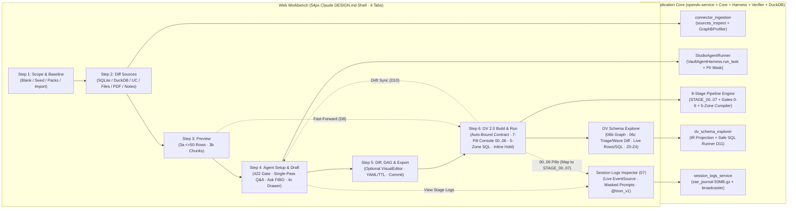

---

## §1. Claude `DESIGN.md` UI Architecture & 12 Approved Screen Specifications

### §1.1 Design System Token Alignment

All Web Workbench (`apps/opendv-web-workbench`) and GitHub Pages (`apps/opendv-website`) surfaces implement [`DESIGN.md`](../DESIGN.md):
- **Palette**: Cream floor (`#faf9f5`), soft band/table header (`#f5f0e8`), cream card (`#efe9de`), active cream (`#e8e0d2`), warm coral primary (`#cc785c`) / active (`#a9583e`), dark obsidian product chrome (`#181715` / `#1f1e1b` / `#252320`), warm ink (`#141413` / `#252523` / `#3d3d3a` / `#6c6a64` / `#8e8b82`), hairlines (`#e6dfd8` / `#ebe6df` / `#d5cdc2`), and semantic status dots (`#5db872`, `#5db8a6`, `#e8a55a`, `#d4a017`, `#c64545`).
- **Typography**: Bundled `.woff2` families (`apps/opendv-website/public/fonts/`): **`Instrument Serif`** (weight `400` normal & italic, negative tracking), **`DM Sans`** (`400..700`), and **`JetBrains Mono`** (`400..700`).
- **Density Split**: Web Workbench uses a **`54px`** 4-tab topbar (`Ontology & Pipeline | DV Schema Explorer | Run Explorer | Settings`), `44px` wizard stepper / `46px` explorer sub-bar, `52px` footer, and `716×920` slide-over drawers; `apps/opendv-website` uses the **`64px`** editorial top-nav and `96px` section rhythm.
- **SQL & Schema Standard**: All UI/website/spec surfaces standardize on **5-Zone (`Z0–Z4`)** (`bronze`, `staging`, `raw_vault`, `business_vault`, `information_mart`). Internal package `compiler_4zone` and CLI parity report header `"Open-DV 4-Zone SQL Compilation Report"` stay unchanged for `tests/parity/` compatibility.
- **Responsive Breakpoints (`D26`)**: Full desktop editing at `1440×920` and `1024×768`; below `768px` (verified at `390×844`) layout stacks single-column with zero horizontal overflow (`scrollWidth <= clientWidth`), collapsible nav/stepper, and view-only graph & SQL runner.

### §1.2 Approved 12-Screen Gallery (`docs/assets/unified-wizard/`)

| # | Mockup File | Screen Role & Key Interactive Elements |
| :---: | :--- | :--- |
| 1 | [`studio_mockup_01_step1_baseline.png`](assets/unified-wizard/studio_mockup_01_step1_baseline.png) | **Step 1 — Scope & Baseline**: Construct New (Blank `v0.0.0`, Workspace Seed, 6 Asset-Management Starter Packs) or Evolve Existing (new-schema sessions or `.yaml`/`.json`/`.ttl` import), dark session digest card, legacy notice (`D25`). |
| 2 | [`studio_mockup_02_step2_sources.png`](assets/unified-wizard/studio_mockup_02_step2_sources.png) | **Step 2 — Add Diff Data Sources**: Structured Connectors (`SQLite`, `DuckDB`, `Databricks UC`, `CSV`/`Parquet`/`XLSX`), Unstructured Upload (`PDF`/`DOCX`/`MD`, `ocr=auto|force|off`, `do_not_send_to_agent`), and Inline Domain Notes. |
| 3 | [`studio_mockup_03a_structured_preview.png`](assets/unified-wizard/studio_mockup_03a_structured_preview.png) | **Step 3a — Structured Schema & Sample Rows**: Inferred SQL types, PK/FK keys, surrogate quarantine hints, null%/distinctness/entropy stats, FIBO gap hints, `<= 50` row preview, and `Fast-Forward to Step 6` (`D8`). |
| 4 | [`studio_mockup_03b_parsed_chunks_preview.png`](assets/unified-wizard/studio_mockup_03b_parsed_chunks_preview.png) | **Step 3b — Parsed Chunks & Observed Terms**: Document chunks with page numbers, `[start_char, end_char)` spans, embedded `table_data`, OCR confidence, and informational term frequencies (zero mention floor `D4`). |
| 5 | [`studio_mockup_04a_agent_setup_gate.png`](assets/unified-wizard/studio_mockup_04a_agent_setup_gate.png) | **Step 4a — Mandatory Agent Setup Gate (`422`)**: Coral setup callout when unconfigured + inline shared `<AgentHarnessConfigCard />` (`P2`), flipping header `● Agent Ready` live upon `Verify & Save`. |
| 6 | [`studio_mockup_04b_agent_discovery_custom_concepts.png`](assets/unified-wizard/studio_mockup_04b_agent_discovery_custom_concepts.png) | **Step 4b — Cherry-Pick Discovery & Dual FIBO Q&A**: Single-pass `@term-scout -> @domain-clarifier -> @ontology-architect`, Beyond-FIBO + `broadMatch`, `1x · Semantic` doc rules, unchecked `MAJOR · Opt-In`, cascading checkboxes, inline edits, and `Ask FIBO & Sources`. |
| 7 | [`studio_mockup_04c_citation_and_fibo_inspector.png`](assets/unified-wizard/studio_mockup_04c_citation_and_fibo_inspector.png) | **Step 4c — Citation & FIBO Reference Drawer**: `716×920` slide-over displaying `<mark>` highlighted PDF/note spans, structured table stats/samples, Jump-to-Step-3 links, and side-by-side `fibo-core` definitions. |
| 8 | [`studio_mockup_05_diff_and_graph.png`](assets/unified-wizard/studio_mockup_05_diff_and_graph.png) | **Step 5 — Visual Diff, Warm-Paper DAG & Export/Commit**: `+FIBO`/`+Custom`/`~Enriched` diff table, warm dot-grid `elkjs` DAG, optional **`+ Add / Edit Concept`** (`VisualEditorDrawer`, `D15`), `Export Ontology Only` (`.yaml`/`.ttl`, `D9`), and atomic CAS commit. |
| 9 | [`studio_mockup_06_blueprint_handoff.png`](assets/unified-wizard/studio_mockup_06_blueprint_handoff.png) | **Step 6 — DV 2.0 Topology, 7-Pill Console & 5-Zone SQL**: Auto-bound `deployed_contract` + Baseline Picker (`D12`), DuckDB/Databricks dialect switch, live `00..06` clickable stage pills (projected over internal `STAGE_00..07`, `§4.4`), inline Steward/Budget Hold card (`D14`/`D21`), `↺ Sync Drift to Step 4`, and **`Explore Generated DV 2.0 Schema ➔`**. |
| 10 | [`studio_mockup_06b_dv_schema_explorer.png`](assets/unified-wizard/studio_mockup_06b_dv_schema_explorer.png) | **DV Schema Explorer View 1 (`06b`)**: Interactive `elkjs` + `@xyflow/react` Bipartite Graph, Zone/PII/Delta filter pills, live search, Physical Table/`BKCC`/`Alg A.5`/Gate inspector, and DDL/DML `<dialog>`. |
| 11 | [`studio_mockup_06c_dv_lineage_and_wave_diff.png`](assets/unified-wizard/studio_mockup_06c_dv_lineage_and_wave_diff.png) | **DV Schema Explorer View 2 (`06c`)**: `100% Column Triage Ledger` (`DV-G4-002`) + CSV export, `W1 ➔ W2 ➔ W3` schema diff (`EVO-01/02/03/07`), plus Views 3–4 (Populated Row Preview & Safe SQL Runner `D11`, Zone `0–4` SQL & Contract/IR downloads). |
| 12 | [`studio_mockup_07_session_agent_logs.png`](assets/unified-wizard/studio_mockup_07_session_agent_logs.png) | **Session Agent & Execution Logs Inspector (`07`)**: Live `EventSource` stream (`● Follow Live Tail`), filters by `wizard_step`/`stage_id`/`persona`, live token/cost meter (`D21`), and 4 deep tabs (`Masked Prompt`, `LLM Response`, `Tool Calls & @toon_v1`, `Raw JSON`). |

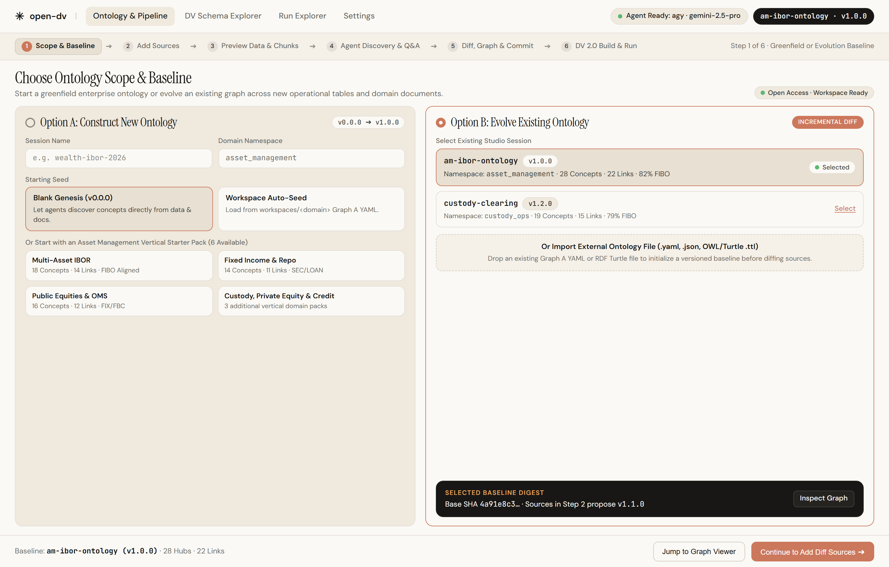
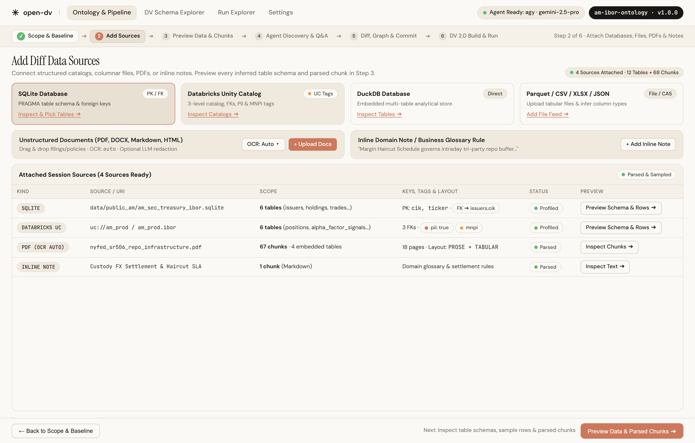
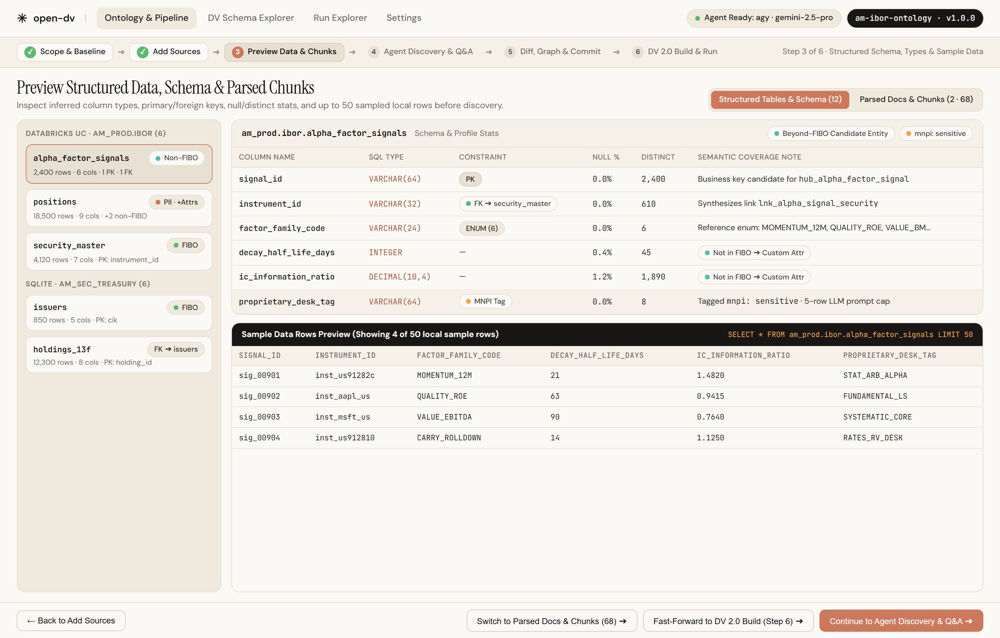
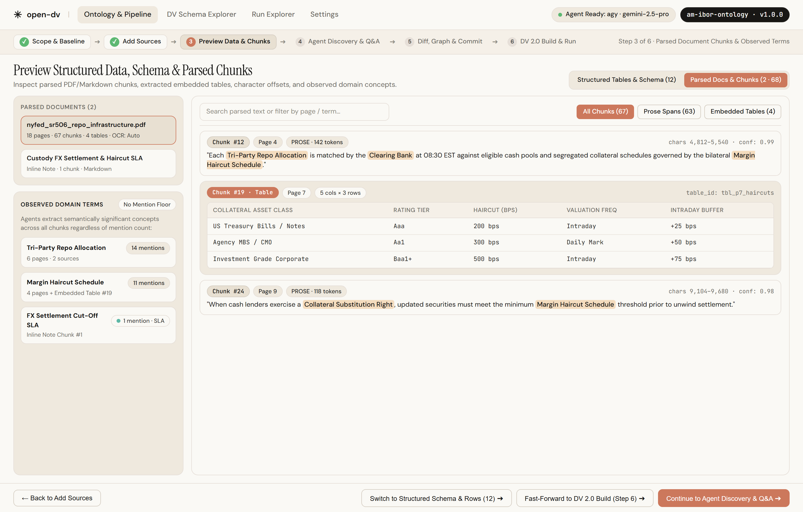
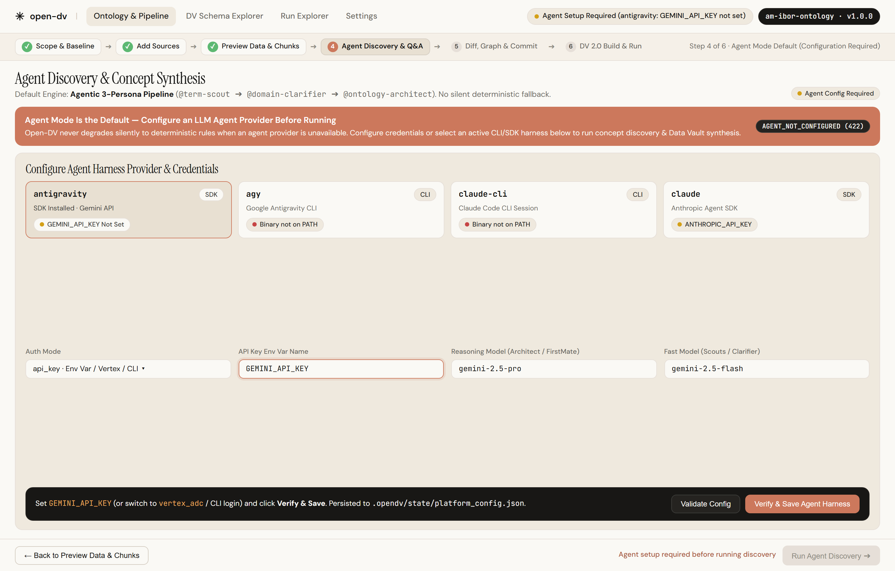
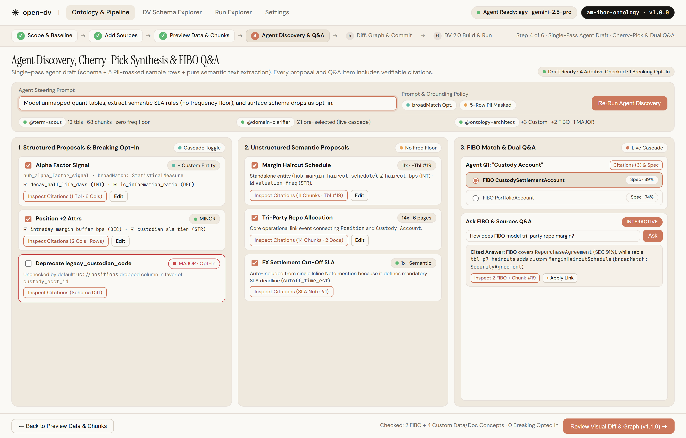
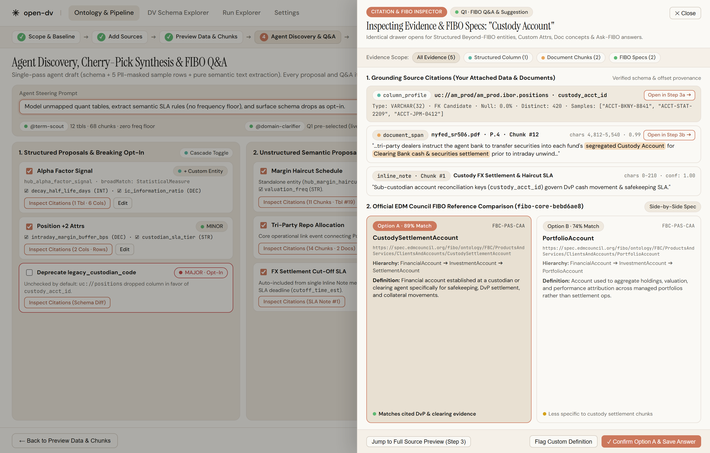
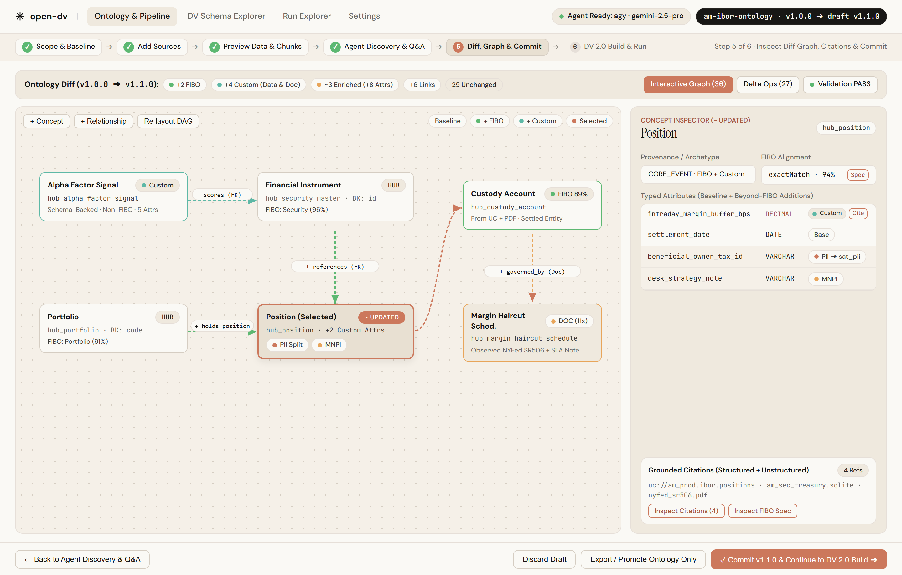
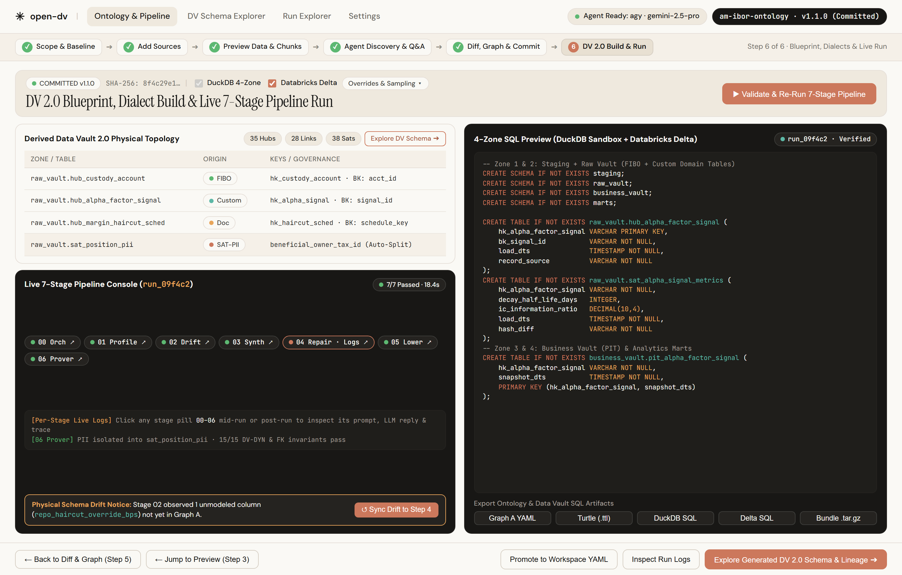
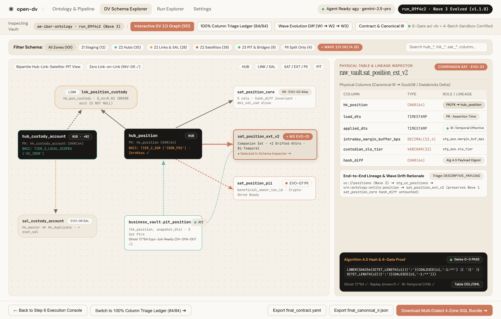
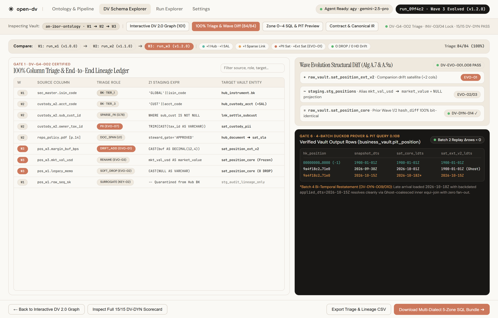
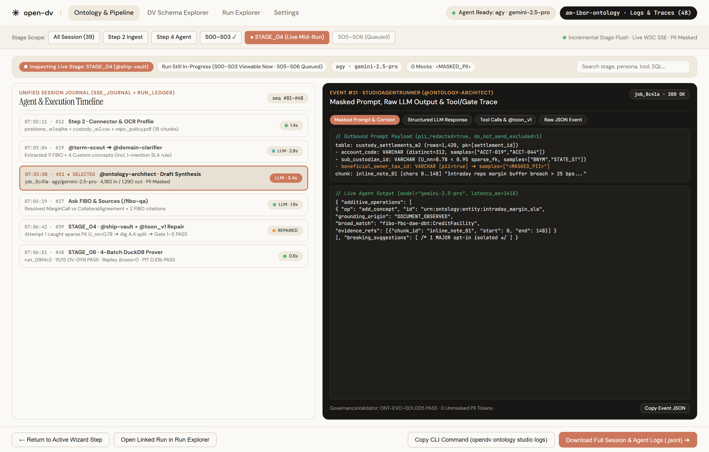

---

## §2. Ponytail Integration, Plan Improvements (`P1`–`P5`) & Baseline `/ponytail-audit`

### §2.1 Vendored Ponytail Rules, Skills & Attribution
Ponytail (`@dietrichgebert/ponytail` v`5.3.3`, MIT License, author Dietrich Gebert, `https://github.com/DietrichGebert/ponytail`) is vendored directly into the repository so every agent IDE/CLI discovers it without external network installs:
- [`.agents/rules/ponytail.md`](../.agents/rules/ponytail.md) (plus MIT attribution header)
- `.agents/skills/{ponytail,ponytail-review,ponytail-audit,ponytail-debt,ponytail-gain,ponytail-help}/SKILL.md`
- Appended as `§8` in [`AGENTS.md`](../AGENTS.md) and items `4–5` + reminder `4` in [`CLAUDE.md`](../CLAUDE.md), preserving 100% of existing `AGENTS.md §§1–7` and `.agents/rules/ontology-studio-learnings.md`.

### §2.2 Five Ponytail Plan Audit Improvements (`P1`–`P5`)

| ID | Reuse / Safety Improvement | Target Surfaces |
| :---: | :--- | :--- |
| **P1** | **Reuse Connector Engine**: Compose `sources_inspect.py` (`list_adapters`, `inspect_source` with `_FORBIDDEN_SECRET_KEYS` & path sandboxing) + `GraphBProfiler` + `CatalogTablePickerModal.tsx` instead of building a duplicate connector registry. | Phase 2 & 4 |
| **P2** | **Merge Duplicate Settings Forms**: Extract one shared `<AgentHarnessConfigCard />` from `HarnessModelSettingsSection.tsx` + `usePlatformConfigActions.ts` and mount it in both Step 4a (`AgentSetupGate`) and `Settings` (`-350` duplicate lines; keeps `test_clone_detection.py` green). | Phase 3 & 4 |
| **P3** | **Zero Duplicate Storage for DV Schema Explorer**: Project all 4 DV Schema Explorer views purely from existing `final_canonical_ir.json` + `final_contract.yaml` + sandbox telemetry, reusing `GraphCanvas.tsx` (`elkjs` + `@xyflow/react`) and native `<dialog>`/`
`. | Phase 2 & 4 |
| **P4** | **Respect Architecture Gates & Decompose Monoliths (`D16`)**: Split all active `>= 5,000`-token modules across Phases 1–4 (`studio/atomic_commit.py`, `routers/ontology_studio.py`, `ontology/validator.py`, `commands/ontology_studio.py`, `studio-store.ts`, `BlueprintView.tsx`, `ProposalDetailsView.tsx`, `VisualEditorDrawer.tsx`, `OntologyStudioApp.tsx`, and `state/platform_config.py` if modified) into `< 5,000`-token slices or retire superseded legacy screens, narrowing/removing `test_module_token_budget.py` exemptions cleanly while leaving low-level engines (`locks.py`, `bundle.py`) untouched; keep constants in `CoreModelingConfig` and URLs in `dataset_manifest.yaml` (`test_no_hardcoded_literals.py`). | Phase 1, 2 & 4 |
| **P5** | **Caller & Compiled Binary Blast Radius**: Scope Phase 1 updates to legacy auth/waiver assertions in `test_challenger_5b/5c` while keeping path-traversal, magic-byte/BIFF8/symlink, SSRF, and PII/MNPI tests intact; rebuild `opendvctl-windows-x64.exe` and `@opendv/protocol-ts` whenever `cli-spec.json` or `openapi.json` changes. | Phase 1, 2 & 5 |

### §2.3 Baseline `/ponytail-audit` Summary (`main` @ `7024f04`)

A full baseline `/ponytail-audit` against `open-dv` (`main` @ `7024f04`) surfaced **18 concrete findings** (`10 Must fix`, `7 Should fix`, `1 Nice to have`) and **`0` shortcut debt markers** (`/ponytail-debt` clean):

| Group | # | Key Baseline Findings & Planned Phase Resolution |
| :--- | :---: | :--- |
| **Must fix (1–10)** | 1–3 | **Real-Agent Harness Wiring & `stdin` Overflow**: `StudioAgentRunner` never calls `harness.run_task(...)` and silently falls back; `stages_agentic.py` appends context behind `__OPENDV_STAGE_CONTEXT_JSON__:` stripped by CLI adapters; both CLI adapters pass up to 24 KB prompts + schemas on Windows `argv` (`cmd.exe` 8,191-char limit). **Resolved in Phase 2** (live `run_task`, inline prompt context, `stdin` piping). |
| **Must fix (1–10)** | 4–6 | **Open-Access / Remote Auth & Async Run Guards**: `routers/platform_config.py` skips auth & defaults to `INTERNAL_MODELER`; `cli.py` / `platform.py` bind non-loopback `--host` without refusing unauthenticated remote access; `execute_run_async` hardcodes `PUBLIC`, leaves `abort_run` unguarded, and defaults to `"antigravity"`. **Resolved in Phase 1–2** (`D18` exit `40`, `Depends(get_rbac_role)`, active `platform_config` default). |
| **Must fix (1–10)** | 7–10 | **Hold Resume, Concurrency/Persistence, SQL Allowlist & Cred Ref Parity**: `resolve_captain_hold` marks `RUNNING` without resuming internal Stages `03–07` (`STAGE_03_SHIP_VAULT_PASS1`..`STAGE_07_DETERMINISTIC_COMPILER`); Studio jobs lack `409 SESSION_JOB_ACTIVE` lock and `PlatformStateContainer` lacks locking/disk persistence; `validate_safe_sql()` uses a partial blocklist missing DuckDB file/metadata functions and string-literal `exp.Table`; `sources_inspect.py` vs `sandbox_compiler.py` disagree on lowercase `env:` refs. **Resolved in Phase 2** (`D11`, `D14`, `D27`, centralized regex in `opendv-core`, `§4.4`). |
| **Should fix (11–17)** | 11–17 | Missing unit tests for `validate_safe_sql` & `StudioAgentRunner`; shallow `test_schema_sync.py` body checks; `upload_cas_blob` 100 MiB RAM buffering; `SSEJournalWriter` full-log reload per open; oversized/exempted monoliths (`atomic_commit.py`, `ontology_studio.py`, `ontology/validator.py`, `commands/ontology_studio.py`, `studio-store.ts`, `BlueprintView.tsx`, `ProposalDetailsView.tsx`); duplicated CLI adapter NDJSON/subprocess plumbing; duplicate `_validate_path_containment` in `sandbox_compiler.py`. **Resolved across Phases 1, 2 & 4**. |
| **Nice to have (18)** | 18 | Pre-existing `359` Biome lint errors + `<html data-theme="obsidian">` dark flash in `build-static.ts`. **Resolved across Phases 3–5**. |

---

## §3. Target Module Decomposition & `< 5,000`-Token Architecture (`D16`, `NFR-MOD-01..02`)

### §3.1 Backend Decomposition Map

1. **`packages/opendv-core` & `packages/opendv-duckdb-sandbox`**:
   - Centralize modeling thresholds and unified `_CREDENTIALS_REF_RE` in `opendv_core/config.py` (`CoreModelingConfig`).
   - Harden `sandbox_engine.py` (`4,536` tokens — near ceiling) `validate_safe_sql()` to a strict safe-function allowlist + reject string-literal `exp.Table` targets, and persist/rehydrate per-run DuckDB databases under `.opendv/state/sandboxes/`; place new SQL-allowlist/rehydration helpers in dedicated `< 5,000`-token submodules so `sandbox_engine.py` stays `< 5,000`.
2. **`packages/opendv-agent-harness`**:
   - Extract shared CLI subprocess/`stdin`/NDJSON streaming helper for `agy_cli_adapter.py` and `claude_cli_adapter.py`, pipe prompts over `stdin`, and place new prompt-context/streaming helpers for `stages_agentic.py` (`4,891` tokens — near ceiling) in dedicated `< 5,000`-token modules so `stages_agentic.py` stays `< 5,000`.
   - Ensure `VaultAgentHarness.run_task(..., on_event=...)` emits `HarnessStreamEvent` (`TURN_START`, `TEXT_DELTA`, `TOOL_CALL`, `TOOL_RESULT`, `TURN_END`) and respects `HarnessBudget` (`D21`).
3. **`packages/opendv-service`**:
   - **Phase 1 Split (`D16`)**: Split `studio/atomic_commit.py` (`26,527` tokens, NOT exempted in `tests/architecture/test_module_token_budget.py`) into `< 5,000`-token domain submodules BEFORE or during Phase 1 waiver cleanup so `test_dynamic_git_diff_token_budget()` passes; `studio/promoter.py` (`3,327` tokens) stays `< 5,000`.
   - **Phase 2 Split (`D16`)**: Split `ontology/validator.py` (`14,890` tokens, in `dd8691a` diff and extended for Path A/B `GovernanceValidator`) into `< 5,000`-token submodules (`validator_models.py`, `validator_path_a.py`, `validator_path_b.py`, `validator.py` facade).
   - Add lean `< 5,000`-token services: `studio/connector_ingestion.py`, `studio/citation_resolver.py`, `studio/fibo_qa_service.py`, `studio/cherry_pick_commit.py`, `studio/session_logs_service.py`, `use_cases/dv_schema_explorer.py`.
   - Upgrade `studio/agent_runner.py` (invoke real `harness.run_task`, PII-mask `<= 5` samples/col, fail closed on `422 AGENT_NOT_CONFIGURED`), `state/holds.py` (`2,664` tokens — resume internal Stages `03–07` on approval), and `cli_spec/definitions.py` (`D13` 4 subcommands). For near-/over-budget state files (`state/pipeline_execution.py` at `4,783` tokens and `state/platform_config.py` at `5,107` tokens), place new locking, disk-persistence, incremental-flush, and config helpers in dedicated `< 5,000`-token modules (and split `platform_config.py` `< 5,000` if modified in Phases 1–2).
4. **`apps/opendv-platform-api` & `apps/opendv-cli` (`D16`)**:
   - **Phase 2 Router Split**: Decompose `routers/ontology_studio.py` (`5,311` lines / `45,791` tokens) into 6 `< 5,000`-token thin sub-routers (`ontology_studio_sessions.py`, `ontology_studio_evidence.py`, `ontology_studio_proposals.py`, `ontology_studio_citations.py`, `ontology_studio_logs.py`, `ontology_studio_exports.py`) + `routers/dv_schema_explorer.py`. Per `tests/architecture/test_adapter_thinness.py:L50-56`, **every new `routers/*.py` module MUST directly reference `OpenDVService`, `get_opendv_service`, or `StudioSessionManager`**.
   - **Near-Budget API Modules**: Keep `main.py` (`4,978` tokens) and `security/studio_auth.py` (`4,828` tokens) strictly `< 5,000` tokens by placing new router registrations, remote-host banner metadata, and auth/config helpers in dedicated `< 5,000`-token modules; harden `routers/platform_config.py` & `cli.py` (`D18` exit `40`).
   - **Phase 2 CLI Split**: Decompose `apps/opendv-cli/src/opendv_cli/commands/ontology_studio.py` (`33,484` tokens, extended in Phase 2 for `D13`) into `< 5,000`-token command submodules (`ontology_studio_sessions.py`, `ontology_studio_sources.py`, `ontology_studio_agent.py`, `ontology_studio_proposals.py`, `ontology_studio_logs.py`, `ontology_studio.py` root group).
   - **Staged Exemption Narrowing (`test_module_token_budget.py:L215` & `test_clone_detection.py:L31`)**: In Phase 2, narrow `test_module_token_budget.py:L215` to remove `"ontology_studio" in p.name` and remove `ontology/validator.py` from exemption (enforcing `< 5,000` tokens on decomposed `routers/ontology_studio*.py`, `commands/ontology_studio*.py`, and `ontology/validator*.py`) while retaining the frontend `src/ontology/` exemption (and keeping untouched `ontology/applier.py` / `ontology/rebase.py` undisturbed) until Phase 4; simultaneously remove `ontology_studio.py` from `--ignore-patterns` in `tests/architecture/test_clone_detection.py:L31`.

### §3.2 Frontend Decomposition Map

1. **Shell & Settings (`apps/opendv-web-workbench/src/explorer/`)**:
   - Update `design-tokens.ts`, `index.css`, `build-static.ts` (light `#faf9f5` default), `ExplorerTopBar.tsx` (`54px` 4-tab nav + Agent Ready pill + live Cost Meter + `Logs & Traces` + session digest), `url-router.ts` (`/`, `/ontology`, `/builder`, `/dv-schema`, `/explorer`, `/settings`), and `OpenDVWorkbenchExplorer.tsx`.
   - Extract `<AgentHarnessConfigCard />` (`P2`) shared between `settings/` and Step 4a `AgentSetupGate`.
2. **Unified 6-Step Wizard & Logs (`src/ontology/wizard/`)**:
   - `< 5,000`-token modules: `OntologyWizardShell.tsx`, `Step1ScopeAndBaseline.tsx`, `Step2SourcesAndNotes.tsx`, `Step3PreviewEvidence.tsx`, `Step4AgentDiscovery.tsx` (4a Gate + 4b Cherry-Pick + `AskFiboPanel` + `CitationInspectorDrawer`), `Step5DiffGraphExport.tsx` (reusing `GraphCanvas` + `VisualEditorDrawer` `D15` + `YamlDrawer`), `Step6PipelineBuildAndRun.tsx` (Baseline Picker `D12`, 7-Pill Console `00..06`, 5-Zone SQL, inline `StewardHoldModal` `D14` & Budget Hold `D21`, `↺ Sync Drift`), and `SessionLogsInspector.tsx` (`07`).
3. **4-View DV Schema Explorer (`src/explorer/dv-schema/`)**:
   - `< 5,000`-token modules: `DvSchemaExplorerView.tsx`, `DvBipartiteGraphTab.tsx` + `DvTableLineageInspector.tsx` (`06b`), `DvTriageAndWaveDiffTab.tsx` (`06c`), `DvVaultRowsAndSqlQueryTab.tsx` (`D11`), `DvContractIrTab.tsx`.
4. **Store Slice Decomposition, Oversized Legacy Cleanup & Exemption Removal (`D16`, `D19`)**:
   - Decompose `src/ontology/store/studio-store.ts` (`8,224` lines / `64,867` tokens, in `dd8691a` diff) into `< 5,000`-token domain slices (`session-slice.ts`, `sources-preview-slice.ts`, `agent-discovery-slice.ts`, `graph-editor-slice.ts`, `pipeline-execution-slice.ts`, `session-logs-slice.ts`, `studio-fetch.ts`).
   - Account for every other `>= 5,000`-token file in `src/ontology/`: delete/retire `components/BlueprintView.tsx` (`10,587` tokens, in `dd8691a` diff), `components/ProposalDetailsView.tsx` (`10,898` tokens), and `OntologyStudioApp.tsx` (`9,273` tokens) alongside `PipelineBuilderView.tsx` and legacy `WizardShell.tsx` (`FR-UI-LEG-01`) — or split `< 5,000` tokens if any subcomponent is retained; split `components/VisualEditorDrawer.tsx` (`9,205` tokens) into `< 5,000`-token modules when adapting for Step 5 (`D15`); keep `GraphCanvas.tsx` (`4,701` tokens) and `CatalogTablePickerModal.tsx` (`4,938` tokens) `< 5,000` (and retire or split `ExportPromoteModal.tsx` `5,089` / `QualityFeedbackPanel.tsx` `5,036` if retained/modified).
   - Remove the remaining `src/ontology/` frontend exemption in `tests/architecture/test_module_token_budget.py:L215` once all retained/modified files in `src/ontology/` are `< 5,000` tokens, and enforce zero leftover imports via `test_legacy_removal_guards.py`.

---

## §4. Wire Contracts, REST, SSE & Dual-CLI Parity (`D13`, `D18`, `D21`, `D24`, `D25`, `D27`)

### §4.1 Loopback Open-Access & Security Contract (`D18`)
- Loopback requests succeed with zero `Authorization`, `.local_token`, `#token=`, `X-OpenDV-Workbench`, or waiver barriers, mapping to `StudioPrincipal(subject="human:local_user", role="admin")` and `RbacRole.PRIVILEGED_CUSTODIAN`.
- Non-loopback `--host` (`0.0.0.0`, `::`, LAN IPs) without `--allow-remote-unauthenticated` aborts startup with exit code `40`.
- `/api/v1/ontology/studio/init` and `/auth/*` stay `200 OK` shims; DNS-rebinding `Host`/`Origin` validation, path containment, magic-byte/BIFF8/symlink, SSRF, and PII/MNPI/taint guards remain enforced.

### §4.2 New & Updated REST / SSE Endpoints

| Endpoint | Method | Purpose & Error Contract |
| :--- | :---: | :--- |
| `/api/v1/ontology/studio/sessions` | `GET` | Filters to `wizard_schema_version` sessions for UI (`?wizard_only=true`) + returns `legacy_session_count` (`D25`). |
| `/api/v1/ontology/studio/sessions/import-ontology` | `POST` | Imports `.yaml`/`.json`/`.ttl` baseline with RFC 8785 JCS SHA-256 verification. |
| `/api/v1/ontology/studio/sessions/{id}/sources/connectors` | `POST` | Attaches SQLite/DuckDB/Databricks UC/tabular connectors via `inspect_source()` + `GraphBProfiler` (`P1`). |
| `/api/v1/ontology/studio/sessions/{id}/sources/upload` & `/text` | `POST` | Multipart document upload (`ocr`, `do_not_send_to_agent`) & Inline Domain Notes. |
| `/api/v1/ontology/studio/sessions/{id}/evidence/tables` | `GET` | Step 3a schema profiles, PK/FK, surrogate hints, and `<= 50` sample rows (`D6`). |
| `/api/v1/ontology/studio/sessions/{id}/evidence/chunks` | `GET` | Step 3b parsed chunks, `[start_char, end_char)`, `table_data`, confidence, and term counts. |
| `/api/v1/ontology/studio/sessions/{id}/citations/resolve` | `POST` | Batch-resolves exact document spans, table profiles, and `fibo-core` definitions (`4c`). |
| `/api/v1/ontology/studio/fibo/lookup` & `.../sessions/{id}/fibo-qa` | `GET` / `POST` | Side-by-side FIBO spec lookup + live-agent cited `Ask FIBO & Sources` (`D2`). |
| `/api/v1/ontology/studio/sessions/{id}/construct` | `POST` | Fails closed with `422 AGENT_NOT_CONFIGURED` if unconfigured or `409 SESSION_JOB_ACTIVE` if busy (`D27`). |
| `/api/v1/ontology/studio/sessions/{id}/logs` & `/logs/stream` & `/logs/export` | `GET` | Unified monotonic log query (`wizard_step`, `stage_id`, `persona`, `source_id`), W3C SSE `EventSource` (`Last-Event-ID`, subscribe-before-replay, `15s` heartbeats), and `.jsonl` export (`D24`). |
| `/api/v1/runs/{run_id}/dv-schema` | `GET` | Projects `CanonicalIR` + `NoMistakeDataVault2ContractV5` + scorecard + optional `?compare=<base_run_id>` multi-wave diff (`P3`). |
| `/api/v1/runs/{run_id}/dv-schema/tables/{table}/rows` | `GET` | Returns paginated populated rows from the persisted/rehydrated DuckDB sandbox (`D11`). |
| `/api/v1/runs/{run_id}/dv-schema/query` | `POST` | Executes read-only SQL guarded by `validate_safe_sql()` allowlist + `enable_external_access=False` (`D11`). |

### §4.3 Protocol Sync & 4 Lean 3-Transport CLI Subcommands (`D13`, `FR-CLI-08..09`)
- Both `schemas/v1/openapi.json` and `schemas/openapi-v1.json` stay byte-synchronized (`packages/opendv-protocol-ts/scripts/codegen.ts` reads `schemas/openapi-v1.json`; run `uv run python -m opendv_platform_api.export_openapi` after router edits).
- **Phase 2 CLI Schema & Reference Sync (mandatory before Phase 2 architecture gate)**:
  1. Register all **4** new subcommands in `opendv_service.cli_spec` (`opendv`, `opendvctl`, and `DIRECT_REST` with identical RFC 8785 JCS outputs):
     - `run dv-schema`
     - `ontology studio attach-source`
     - `ontology studio fibo-qa`
     - `ontology studio logs` (`--session-id`, `--stage`, `--step`, `--category`, `--follow`, `--format text|json|toon`)
  2. Run `uv run python -m opendv_service.export_cli_spec` to synchronize **both** `schemas/v1/cli-spec.json` and `packages/opendv-contracts/schemas/cli-spec.json` (`.github/workflows/ci.yml:L250-251`).
  3. Run `uv run python scripts/generate_cli_reference.py` in Phase 2 to synchronize `docs/16-cli-reference.md` (`test_schema_sync.py:L118-127` & `.github/workflows/ci.yml:L254-256`).
  4. Update `expected_studio_groups` in `tests/architecture/test_schema_sync.py:L91-110` to add `"attach-source"`, `"fibo-qa"`, and `"logs"` (`21` total studio subcommand groups).
  5. Regenerate `@opendv/protocol-ts` (`bun run --cwd packages/opendv-protocol-ts codegen && bun run build`) and rebuild `apps/opendvctl/dist/release/opendvctl-windows-x64.exe` (`apps/opendvctl/build.ts`) whenever `cli-spec.json` or OpenAPI changes.

### §4.4 Stage-ID Mapping & Backward-Compatibility Contract (Step 6 `00..06` Console vs. 8-Stage `STAGE_00..07` Engine)

The internal execution engine (`opendv_core/models/observability.py`, `opendv_agent_harness/models.py:PipelineStageId`, `pipeline/runner.py:L244-378`) and `Run Explorer` contract (`opendv_contracts/dtos/explorer.py:StageDTO`) **preserve all 8 canonical `STAGE_00..STAGE_07` identifiers untouched** so `Run Explorer`, `tests/parity/`, `tests/golden/`, and `schemas/vault-observability-event.schema.json` remain 100% backward-compatible. The Step 6 Wizard Console (`06`) projects those 8 internal stages onto **7 clickable UI stage pills (`00..06`)** with bidirectional filter resolution in `GET /sessions/{id}/logs?stage_id=...` and `ontology studio logs --stage`:

| Step 6 Console Pill | Console Label & Purpose | Mapped Internal `PipelineStageId` / `StageDTO` (`STAGE_00..07`) | Log Filter Resolution (`?stage_id=` / `--stage`) |
| :---: | :--- | :--- | :--- |
| **`00`** | `00 Orch` — Preflight, Readiness, Lock & Baseline | `STAGE_00_ORCHESTRATION` (`@vault-first-mate`) | `00` ➔ `STAGE_00_ORCHESTRATION` |
| **`01`** | `01 Profile` — `GraphBProfiler`, Surrogates, `Alg A.9a` | `STAGE_01_SCOUT_SOURCE` (`@scout-source`) | `01` ➔ `STAGE_01_SCOUT_SOURCE` |
| **`02`** | `02 Drift` — Unstructured `Alg A.9b` & Drift Check `UF-1..5` | `STAGE_02_SCOUT_UNSTRUCTURED` (`@scout-unstructured`) | `02` ➔ `STAGE_02_SCOUT_UNSTRUCTURED` |
| **`03`** | `03 Synth` — Pass 1 Triage (`100%`) + Pass 2 Contract Synth | `STAGE_03_SHIP_VAULT_PASS1` + `STAGE_04_SHIP_VAULT_PASS2` (`execute_stages_03_and_04`, `@ship-vault`) | `03` ➔ `STAGE_03_SHIP_VAULT_PASS1,STAGE_04_SHIP_VAULT_PASS2` |
| **`04`** | `04 Repair` — Gates `0–4` Static Checks + `@toon_v1` Loop | `STAGE_05_AXI_DV_STATIC_GATES` (`@axi-dv`) | `04` ➔ `STAGE_05_AXI_DV_STATIC_GATES` |
| **`05`** | `05 Lower` — `CanonicalIR`, 5-Zone `Z0..Z4` SQL, Transpile & Seal | `STAGE_07_DETERMINISTIC_COMPILER` (`@deterministic-compiler`) | `05` ➔ `STAGE_07_DETERMINISTIC_COMPILER` |
| **`06`** | `06 Prover` — 4-Batch `:memory:` DuckDB Prover (`DV-DYN-001..015`) | `STAGE_06_AXI_DV_DYNAMIC_SANDBOX` (`@axi-dv` / `STAGE_06_DUCKDB_SANDBOX` in `explorer_canonical_stages_part2.py`) | `06` ➔ `STAGE_06_AXI_DV_DYNAMIC_SANDBOX` |

- **Compatibility Rule**: `GET /sessions/{id}/logs` and `ontology studio logs` MUST accept **both** exact canonical enum strings (`STAGE_00_ORCHESTRATION`..`STAGE_07_DETERMINISTIC_COMPILER`, matching raw `events.jsonl` / `sse_journal`) and Step 6 pill aliases (`00`..`06`), and `state/holds.py` continues resuming internal Stages `03–07` (`next_stage_id="STAGE_03_SHIP_VAULT_PASS1"`).

---

## §5. Phased Execution Plan (Phases 0–6, Strict TDD-First & Parallel Workers `D23`)

| Phase | Scope & Exclusive Ownership (`D23`) | Failing-First TDD & Verification Gates | Independent Review Gate |
| :---: | :--- | :--- | :--- |
| **Phase 0** | Branch `feat/unified-ontology-pipeline-wizard`; vendor `.agents/rules/ponytail.md` & `.agents/skills/ponytail*`; merge `AGENTS.md` & `CLAUDE.md`; root `DESIGN.md`; 12 mockups in `docs/assets/unified-wizard/`; `docs/27-*`, `docs/28-*`; `nogoo9/open-dv` GitHub Issue. | `pytest tests/architecture/ tests/docs/ tests/parity/test_docs17_registry.py`; `ci.yml` Python-block `compile()` check; markdown link & 12-PNG check. | `claude-opus-5-5-high` / `gemini-4-carbon-high` `/ponytail-review` + Dual Challengers + Auditor |
| **Phase 1** | Loopback open access (`FR-AUTH-01..04`, `D18`): split `studio/atomic_commit.py` (`26,527` tokens) into `<5k` submodules before/during waiver cleanup; `studio_auth.py` (`4,828` — helpers in dedicated module), `csrf.py`, `deps.py`, `platform_config.py` (`5,107` — extract/split `<5k` if touched), `cli.py` non-loopback exit `40`, `promoter.py` (`3,327`) waiver cleanup; `opendvctl` zero-token + binary rebuild. | Failing-first: `test_open_access_studio_and_api.py`, `test_cli_open_serve.py`; scoped `test_challenger_5b/5c`; full `tests/architecture/` (incl. `test_dynamic_git_diff_token_budget`), `pytest -m parity`. | `/ponytail-review` (`0` Must/Should fix) + GitHub Issue update |
| **Phase 2** | **Parallel Worker Split (`D23`)**: **W1 (Core/Pipeline/Explorer)**: `opendv_core/config.py`, `sandbox_engine.py` (`4,536` + `<5k` helpers), `stages_agentic.py` (`4,891` + `<5k` helpers), CLI adapters `stdin`/shared helper, `holds.py` (resume `03–07`), `use_cases/dv_schema_explorer.py`, `routers/dv_schema_explorer.py`. **W2 (Studio Ingestion/Agent/Logs)**: split `ontology/validator.py` (`14,890`) `<5k`, `connector_ingestion.py`, `citation_resolver.py`, `fibo_qa_service.py`, `cherry_pick_commit.py`, `session_logs_service.py` (canonical `STAGE_00..07` + pill `00..06` alias filter), `agent_runner.py`, `pipeline_execution.py` (`4,783` + `<5k` locking/persistence helpers). **W3 (Router/CLI Split & Schema Sync)**: split `routers/ontology_studio.py` (`45,791`) into 6 `<5k` sub-routers (each referencing `OpenDVService`/`get_opendv_service`/`StudioSessionManager` per `test_adapter_thinness.py:L50-56`), split `commands/ontology_studio.py` (`33,484`) into `<5k` submodules, narrow `test_module_token_budget.py:L215` & `test_clone_detection.py:L31` to remove backend `ontology_studio` + `validator.py` exemptions, update `expected_studio_groups` in `test_schema_sync.py:L91-110`, run `export_cli_spec` (both `cli-spec.json` copies) + `generate_cli_reference.py` (`docs/16-cli-reference.md`) + `export_openapi`, regenerate `@opendv/protocol-ts` & `opendvctl-windows-x64.exe`. | Failing-first: `test_session_import_and_packs.py`, `test_connector_ingestion_and_preview.py`, `test_agent_first_gate_strict.py`, `test_agent_prompt_pii_masking.py`, `test_beyond_fibo_agent_synthesis.py`, `test_cherry_pick_and_breaking_opt_in.py`, `test_citation_and_fibo_qa.py`, `test_agent_budget_hold.py`, `test_session_job_concurrency.py`, `test_dv_schema_explorer_api.py`, `test_session_agent_and_execution_logs.py`, plus `FR-DVM-01..17`/`FR-DVV-01..15` suites; `ruff`, `tests/architecture/` (incl. `test_schema_sync.py` & `test_adapter_thinness.py`), `pytest -m golden`, `pytest -m parity`. | `/ponytail-review` (`0` Must/Should fix) + GitHub Issue update |
| **Phase 3** | Claude `DESIGN.md` tokens, bundled fonts, light `build-static.ts`, `54px` 4-tab `ExplorerTopBar.tsx` + Cost Meter + Agent Ready pill, `url-router.ts`, shared `<AgentHarnessConfigCard />` (`P2`). | Failing-first: `ExplorerShell.test.tsx`, `AgentHarnessConfigCard.test.tsx`; `bun test`, `bun x tsc -b`, `biome`, `test_module_token_budget.py`. | `/ponytail-review` (`0` Must/Should fix) + GitHub Issue update |
| **Phase 4** | **Parallel Worker Split (`D23`)**: **W1 (Store Slices, Oversized Legacy Retirement & Exemption Removal)**: decompose `studio-store.ts` (`64,867`) into 7 `<5k` slices, split `VisualEditorDrawer.tsx` (`9,205`) `<5k`, retire/delete `BlueprintView.tsx` (`10,587`), `ProposalDetailsView.tsx` (`10,898`), `OntologyStudioApp.tsx` (`9,273`), `PipelineBuilderView.tsx`, legacy `WizardShell.tsx` (and check/retire or split `ExportPromoteModal.tsx` `5,089` / `QualityFeedbackPanel.tsx` `5,036` if modified), remove `src/ontology/` exemption in `test_module_token_budget.py:L215`, update `test_legacy_removal_guards.py`. **W2 (6-Step Wizard & Logs UI)**: `src/ontology/wizard/` (`Step1..Step6` w/ 7-pill `00..06` console mapped to `STAGE_00..07`, `AskFiboPanel`, `CitationInspectorDrawer`, `SessionLogsInspector.tsx`, Budget/Steward Hold, `D26` mobile view-only). **W3 (DV Schema Explorer UI)**: `src/explorer/dv-schema/` (4 views matching `06b`/`06c`/`D11`). | Failing-first: `UnifiedWizard.test.tsx`, `SessionLogsInspector.test.tsx`, `DvSchemaExplorerView.test.tsx`, extended `test_legacy_removal_guards.py`; `bun run build`, `bun test`, `bun x tsc -b`, `pytest tests/architecture/ tests/parity/`. | `/ponytail-review` (`0` Must/Should fix) + GitHub Issue update |
| **Phase 5** | Docs prose & guides (`README.md`, `AGENTS.md`, `CLAUDE.md`, `docs/12,16,17,19–24` — re-verifying `docs/16` CLI ref sync) + `apps/opendv-website` Claude `DESIGN.md` redesign + `/ponytail-debt` ledger check. | `pytest tests/docs/`, `test_docs17_registry.py`, `pytest -m parity`, website `lint`/`build`/`bun test`/Playwright E2E, `/ponytail-debt` (`0` untriggered). | `/ponytail-review` (`0` Must/Should fix) + GitHub Issue update |
| **Phase 6** | Restart/isolate `opendv serve` (no mocks), run `probe_providers_readiness()` + live 1-turn canary (**STOP & notify user immediately if none usable**), download `DS-01..06` to `scratch/uat_data/`, execute `SCN-01..13` & `UAT-01..30` (live Chromium + `opendv` + `opendvctl` + programmatic DuckDB/`sqlglot`/`rdflib`/JCS checks), capture real UAT screenshots for `apps/opendv-website` (`D22`), run whole-repo `/ponytail-audit` + `/ponytail-debt`, tick 100% `[x]` on `docs/27-*` & GitHub Issue, and deliver via `kunchenguid/no-mistakes` (`D20`). | Live canary pass; `13/13 SCN` + `30/30 UAT` pass; website E2E pass; `no-mistakes doctor && no-mistakes init && git push no-mistakes feat/unified-ontology-pipeline-wizard` with open PR & green GitHub CI. | Final `claude-opus-5-5-high` / `gemini-4-carbon-high` `/ponytail-review` + `/ponytail-audit` (`Verdict: Ship.`) |
