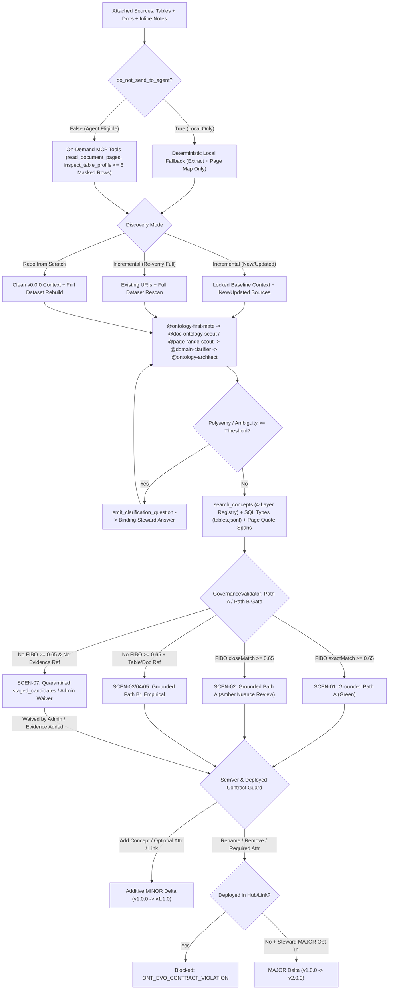

# Open-DV Discovery, Grounding & Multi-Wave Evolution Scenario Matrix

> **Module:** `docs/29-discovery-grounding-and-evolution-scenarios.md` · **Revision:** v2.0 (2026-11-21)

> **Purpose:** Single canonical reference for how Open-DV detects, infers, types, grounds, governs, and evolves business concepts across **Structured Databases**, **Unstructured Policy Documents / Notes**, **FIBO Reference Standards**, and **Multi-Wave Releases**.  
> **Intended Consumers:** Repository documentation (`docs/`), product website (`apps/opendv-website`), walkthrough video & WebVTT captions ([`tour-data.ts`](../apps/opendv-website/src/data/tour-data.ts)), automated tests (`pytest` + `Playwright`), and final UAT sign-off.

---

## 1. End-to-End Decision & Grounding Architecture

Every source element entering Step 4 passes through five deterministic + agentic decision gates before reaching a Data Vault 2.0 Hub, Link, or Satellite:

---

## 2. Canonical 9-Scenario Matrix (`SCEN-01` .. `SCEN-09`)

| ID | Scenario Name | Trigger / Input Data | Detection & Typing Mechanism | Governance Path & SemVer | Step 4 Visual UX & Examples | Required Automated Tests & UAT Check |
| :--- | :--- | :--- | :--- | :--- | :--- | :--- |
| **`SCEN-01`** | **Standard Equivalent Match (`Exact FIBO`)** | Table/entity aligns 1:1 with a canonical EDM Council FIBO class (`score >= 0.65`) | MCP `search_concepts` + BM25 lookup verified against pinned `CANONICAL_FIBO_CORE_SHA256` ([`verifier.py`](../packages/opendv-service/src/opendv_service/ontology/matching/verifier.py#L51-L78)); attributes typed from `tables.jsonl` (`BIGINT ➔ integer`, `DOUBLE ➔ decimal`) | **Path A1 · `skos:exactMatch`** New concept = `MINOR` | **Sage Green** banner & badge (`✓ skos:exactMatch · 95%`) + full FIBO class URI (`fibo-sec-sec-sch:SecuritiesHolding`) + `hub_holding_13f` + typed table columns (`Holding13F`, `Issuer`, `YieldCurve`, `Security`) | Unit: `verifier.py` Path A threshold (`0.65`); E2E + **`UAT-SCEN-01`** |
| **`SCEN-02`** | **Domain-Specialized Close Match (`Close FIBO`)** | Entity is narrower, broader, or differently grained than a FIBO class (`score >= 0.65`, `skos:closeMatch`) | Same Path A BM25 verifier; predicate recorded as `skos:closeMatch` to preserve semantic nuance | **Path A2 · `skos:closeMatch`** Valid for commit, flagged for Steward review | **Warm Amber** border & callout (`≈ skos:closeMatch · Review Nuance`) + side-by-side Concept vs. FIBO definition comparator + 1-click `[Keep Close Match]`, `[Swap FIBO]`, or `[Switch to Path B]` (`TreasuryRate ≈ ReferenceInterestRate`, `ComplianceBreachAlert ≈ Compliance`) | UI Filter + Comparator tests; E2E + **`UAT-SCEN-02`** |
| **`SCEN-03`** | **Novel / Proprietary Structured Concept (`Beyond-FIBO` Table)** | Table/entity represents firm-specific workflows absent from FIBO (or only loose `skos:broadMatch`) | MCP `inspect_table_profile` + `search_concepts` confirms open-vocab novelty; promotes `add_concept` (`STRUCTURED_SCHEMA`) with SQL-inferred types and registers in `DynamicConceptRegistry` (`in_run`) | **Path B1 · Empirical Structured** Valid with `column_profile` `evidence_refs`; **never** marked `UNGROUNDED` in UI (`OBS-21` fix) | **Slate/Teal** **`Grounded · Path B (Empirical)`** badge + explicit `table.column (SQL TYPE)` provenance chips (no forced false FIBO match) | Governance: Path B1 accepted cleanly; UI store status check; **`UAT-SCEN-03`** |
| **`SCEN-04`** | **Document-Only / `1x` Semantic Rule Concept (`Zero Physical Table`)** | Concept appears even **once** inside intact PDF pages or Inline Domain Notes before any ETL table exists | `@doc-ontology-scout` / `@page-range-scout` navigate `get_document_map`, `read_document_pages`, `search_document` (plus selective `view_page_image` on scanned pages); Python resolves `verbatim_quote` + `page_number` into exact `(char_start, char_end)` spans (*backward-compatible with legacy `chunk_id`s*) and infers types (`*_date ➔ date`, `*_flag ➔ boolean`, `*_bps ➔ integer`) | **Path B1 · Empirical Document** (`DOCUMENT_OBSERVED` + `document_span` ref); additive `MINOR` | Listed under **Document-Observed** with **`1x · Semantic`** + **`Grounded · Path B (Document)`** pill + clickable page-span citation drawer (`StewardshipEngagementCase`, `MacroRegimeSignal`, `IntradayMarginHaircutSchedule`) | Quote-anchor + selective VLM + citation drawer test; E2E + **`UAT-SCEN-04`** |
| **`SCEN-05`** | **Cross-Modal Hybrid Concept & Key Authority Upgrade** | Entity spans **both** structured table columns and unstructured governance policy rules | Agent merges `column_profile` refs + page-anchored `document_span` rules onto one unified `CanonicalBusinessConcept` and sets 3-Tier `key_authority_tiers` | **Path A** or **Path B1**; supports `Tier-1 Global` (LEI/ISIN) > `Tier-2 Regulatory` (CIK/CUSIP) > `Tier-3 Local` | Attribute table shows SQL-backed rows (`BIGINT`/`BOOLEAN`/`VARCHAR`) **alongside** `Doc p.#quote` attributes (`Issuer` `cik` + Doc Tier-1 `lei_code`; `ComplianceBreachAlert` + Doc `waiver_expiry_date`) | Cross-modal merge & tier priority test; E2E + **`UAT-SCEN-05`** |
| **`SCEN-06`** | **Polysemic / Overloaded Term Disambiguation (`Q&A`)** | Term has conflicting meanings across sources (e.g., `Collateral Haircut` column bps vs. policy entity; `Account`; `Fund`) | `@domain-clarifier` checks `DynamicConceptRegistry` (`vX.Y.Z` alias vs. new Hub?) and calls `emit_clarification_question` ([`ClarificationHarness`](../packages/opendv-service/src/opendv_service/studio/job_runners_clarify.py#L55-L63)) | Binding `ClarificationAnswer` stored in `answers/` and injected into `@ontology-architect` synthesis | Inline interactive Clarification card in Step 4 (radio choices + custom rationale); re-run respects bound choice deterministically | Clarification MCP emission + prompt binding test; E2E + **`UAT-SCEN-06`** |
| **`SCEN-07`** | **Ungrounded / Future Placeholder Concept (`Quarantine + Waiver`)** | Candidate concept lacks both FIBO ≥ `0.65` **and** concrete `table.column` / verified page-quote citations | [`GovernanceValidator.validate_grounding`](../packages/opendv-service/src/opendv_service/ontology/validator_governance.py#L455-L498) rejects ungrounded silent commits (`UngroundedConceptError`) and accumulates ungrounded candidates in `staged_candidates.json` + `concept_memory.json` across waves | **Path B2 · Fail-Closed Quarantine** unless linked to evidence OR signed by Admin `StewardWaiverRecord` (`rationale >= 10 chars`, `role == admin`) | Explicit **`Ungrounded · Evidence or Admin Waiver Required`** warning badge; blocks promotion/commit until citation attached or Admin executes signed Waiver flow | Security fail-closed non-admin waiver rejection + cross-wave promotion test; **`UAT-SCEN-07`** |
| **`SCEN-08`** | **`Local Only` Restricted Source & PII / MNPI Isolation** | Source flagged `do_not_send_to_agent: true` OR columns match PII/MNPI patterns (`email`, `ssn`, `tax_id`, `phone`, `dob`, `secret`) | Both prompt layers and `opendv-mcp` document/table tools block `do_not_send_to_agent` sources; upgraded deterministic `Local Only` extractor runs locally (tables + prose headings); non-restricted PII masks (`<MASKED_PII>`, ≤ 5 rows/col) & splits into `sat_*_pii` | Local deterministic pipeline processes `Local Only` locally; Agent telemetry logs store `<MASKED_PII>` only | Local-Only pill (`Blocked from MCP & LLM`) + terminal `PII Mask: ON` indicator + Governance split metadata (`sat_proxy_ballot_pii` for `stewardship_officer_email`) | MCP + prompt leakage negative test + PII sat split verifier test; **`UAT-SCEN-08`** |
| **`SCEN-09`** | **Multi-Wave Ontology Evolution (`v1.0.0 ➔ v1.1.0` / `v2.0.0` / `Rebuild`)** | Continuing project receives Wave-2 tables/docs, edited notes (`↻ Updated`), or schema drops/renames | Per-version `processed_sources` lineage diff; Discovery Modes (`incremental_new`, `incremental_reverify`, `full_rebuild`); `DynamicConceptRegistry` searches committed custom Hubs (`v1.0.0`), cumulative `staged_candidates`, and `concept_memory.json` (`rejected_noise` stays muted); [`validate_deployed_contracts`](../packages/opendv-service/src/opendv_service/ontology/validator_governance.py#L180-L330) blocks deployed Hub/Link drops | Additive extensions (`+concept`, `+optional attr`, `+link`, `+mapping`) = **`MINOR` (`v1.1.0`)**; Unchecked breaking ops = Opt-In **`MAJOR` (`v2.0.0`)** or Blocked if deployed | Steps 2–3: **`✦ NEW`**, **`↻ UPDATED`**, **`✓ Modeled in v1.0.0`**; Step 4: Baseline drawer + Mode selector + **`✦ NEW`** / **`⊕ EXTENDS v1.0.0`** / **`⚠ MAJOR Opt-In`** cards | Adapter `⊕ EXTENDS` test + `DynamicConceptRegistry` continuity + `MAJOR` contract block + `full_rebuild` history test; **`UAT-SCEN-09`** |

---

## 3. Website, Walkthrough Video & Docs Integration Map

> *(Tracked under `REQ-32` for when the consolidated fix & documentation wave runs.)*

| Target Surface | File(s) in `open-dv` | Planned Explanation & Visual Update |
| :--- | :--- | :--- |
| **Interactive Architecture Diagram** | [`InferenceMatrixDiagram.tsx`](../apps/opendv-website/src/illustrations/InferenceMatrixDiagram.tsx) & `site-data.ts` | Extend `INFERENCE_SCENARIOS` and interactive lanes so visitors can toggle through all 9 grounding/evolution outcomes (Exact FIBO, Close Match Nuance, Beyond-FIBO Empirical Structured, `1x` Doc-Only, Cross-Modal Hybrid, Polysemy Q&A, Fail-Closed Quarantine/Waiver, `Local Only`/PII, and Multi-Wave `Incremental` vs. `Redo from Scratch`). |
| **How It Works & Verifier Deep Dive** | [`HowItWorksSection.tsx`](../apps/opendv-website/src/sections/HowItWorksSection.tsx) & [`VerifierDeepDiveSection.tsx`](../apps/opendv-website/src/sections/VerifierDeepDiveSection.tsx) | Add plain-English explainer cards showing the difference between **Canonical Business Concepts (`hub_*`)** vs. **Matched FIBO Classes**, why **Beyond-FIBO (`Path B1`)** entities pass without fake mappings, and why **`skos:closeMatch`** is highlighted for human steward nuance review. |
| **Walkthrough Video & Chapters** | [`tour-data.ts`](../apps/opendv-website/src/data/tour-data.ts#L27-L61), [`VideoTourSection.tsx`](../apps/opendv-website/src/sections/VideoTourSection.tsx), [`TourPage.tsx`](../apps/opendv-website/src/pages/TourPage.tsx), MP4 & `opendv-tour-en.vtt` | Update Chapters 2–3 transcript, script callouts, WebVTT captions, and video recording scenes to narrate live Flow B Step 4 streaming (`@ontology-first-mate` → `@doc-ontology-scout` / `@page-range-scout` → `@domain-clarifier` → `@ontology-architect` via `opendv-mcp`), full `Concept ↔ FIBO ← Table.Column (SQL Type)` / `Doc p.#quote` cards, `closeMatch` nuance review, `1x` Doc-only Beyond-FIBO entities, and Wave-2 `Incremental` vs. `Rebuild`. |
| **Engineering & Governance Docs** | `open-dv/docs/` (Studio & Governance specs) | Add a canonical `Discovery & Grounding Scenario Matrix` doc page linking directly to [`validator_governance.py`](../packages/opendv-service/src/opendv_service/ontology/validator_governance.py), [`verifier.py`](../packages/opendv-service/src/opendv_service/ontology/matching/verifier.py), and [`agent_runner_helpers.py`](../packages/opendv-service/src/opendv_service/studio/agent_runner_helpers.py). |

---

## 4. Test & UAT Sign-Off Traceability Contract

> *(Tracked under `REQ-07` & `REQ-33`: Every scenario in the matrix above must pass across all three automated test layers AND manual UAT sign-off.)*

1. **Layer 1 — Unit & Governance Tests (`pytest`):**
   - `SCEN-01` & `SCEN-02`: Exact vs. `closeMatch` threshold boundaries (`0.649` fail vs. `0.650` pass) + `skos:broadMatch` rejection without Path B evidence.
   - `SCEN-03` & `SCEN-04`: `STRUCTURED_SCHEMA` & `DOCUMENT_OBSERVED` Path B1 validation with non-empty `evidence_refs`; type mapping (`BIGINT->integer`, `DOUBLE->decimal`, `BOOLEAN->boolean`, `DATE->date`, `*_date->date`).
   - `SCEN-05`: Cross-modal concept merge + 3-Tier `key_authority_tiers` ordering (`ISO 17442 LEI` > `SEC CIK`).
   - `SCEN-07`: Ungrounded commit failure (`UngroundedConceptError`), non-admin waiver rejection (`InvalidGroundingWaiverError`), and signed Admin waiver acceptance.
   - `SCEN-04` (`verbatim_quote` + fuzzy OCR span matching) & `SCEN-09` (4-layer `DynamicConceptRegistry` continuity + cross-wave corroboration): verified deterministic page spans + sticky merges/rejections.
   - `SCEN-08`: Prompt builder & `opendv-mcp` tool negative assertions (`get_document_map`, `read_document_pages`, `view_page_image`, `search_document`, `inspect_table_profile`) proving zero `do_not_send_to_agent` sources or unmasked SSN/email tokens leak to agent prompts or MCP responses.
   - `SCEN-09`: Deployed Hub/Link `RemoveConceptOp` / `RemoveAttributeOp` fail-closed block (`ONT_EVO_CONTRACT_VIOLATION`).
2. **Layer 2 — Studio API Integration Tests (`pytest` + FastAPI TestClient):**
   - `SCEN-01..09`: Full `/construct` + SSE event stream verification (live persona stages, `pages_inspected` / `tables_inspected` ledger, `DiscoveryMode` payload filtering for `incremental_new` vs. `full_rebuild`, processed source watermark persistence in `versions/vX.Y.Z/meta.json`, and CLI `opendv mcp serve` vs. SDK `bridge.py` tool parity + zero Windows `L5` lock deadlock).
3. **Layer 3 — Playwright End-to-End & UI Matrix Tests (`bunx playwright test`):**
   - `SCEN-01..09`: Live Step 4 UI verification covering exact vs. amber `closeMatch` highlight + filter, Path B empirical badge (`OBS-21` fix — never mislabeled `UNGROUNDED`), full `table.column (SQL) -> Type` rows (`OBS-20` fix), Clarification Q&A submission, `⊕ EXTENDS v1.0.0` cards (`OBS-18` fix), and Step 4 live stream terminal.
4. **Layer 4 — Manual UAT Sign-Off Checklist:**
   - Mapped 1:1 to **`UAT-SCEN-01` .. `UAT-SCEN-09`**, **`UAT-WEB-01`..`02`**, and **`UAT-FIX-01`** in [uat-v2-feedback-and-triage-log.md](design/ontology-studio/uat-v2-feedback-and-triage-log.md).

### Canonical Golden Fixture Mapping (`data/public_am/`, `REQ-42`)
| Fixture File in `open-dv/data/public_am/` | Role & Schema Highlights | Scenarios Exercised |
| :--- | :--- | :--- |
| `am_sec_treasury_ibor.sqlite` + CSVs (`fred_treasury_rates.csv`, `sec_13f_holdings.csv`, `sec_security_master.csv`) | Wave-1 baseline (`issuers`, `securities`, `institutional_filers`, `holdings_13f`, `yield_curves`) | `SCEN-01`, `SCEN-02` (`TreasuryRate`), `SCEN-09` (Wave-1 `v1.0.0`) |
| `am_esg_stewardship_proxy.parquet` *(built by `generate_esg_parquet.py`)* | `30 × 31` ZSTD Parquet joining SQLite (`ticker`, `cusip`, `filer_cik="0001067983"`), adding 4 novel concepts (`EsgRating`, `CarbonEmissionsDisclosure`, `ProxyBallot`/`ShareholderResolution`, `InvestmentMandateRule`/`ComplianceBreachAlert`) across Wave 0 (`MSCI_ESG` / `SFDR_ARTICLE_8` 2024) & Wave 1 (`SUSTAINALYTICS` / `PARIS_ALIGNED_BENCHMARK` 2025) | `SCEN-02` (`ComplianceBreachAlert`), `SCEN-03` (novel structured Path B1 + SQL typing), `SCEN-09` (Wave-2 incremental) |
| `am_stewardship_domain_notes.md` | Domain rules introducing 3 `1x` doc-only concepts (`StewardshipEngagementCase`, `MacroRegimeSignal`, `IntradayMarginHaircutSchedule`), cross-modal attributes (`waiver_expiry_date`, `vote_rationale_summary`, `public_disclosure_cutoff_days`), PII split (`stewardship_officer_email` ➔ `sat_proxy_ballot_pii`), and ISO 17442 `lei_code` / ISO 6166 `isin` Tier-1 BK rules | `SCEN-04` (`1x` doc-only), `SCEN-05` (hybrid + BK tiers), `SCEN-08` (PII sat split) |
| `am_restricted_client_override_local_only.md` | Confidential restriction canary (`CLIENT_OVERRIDE_99`, `compliance.desk@internal-example.invalid`, \$50M `OXY`/`CVX` threshold) for `Do not send to agent (Local Only)` | `SCEN-08` (`Local Only` prompt & MCP taint block) |

---

## 5. VCS Check-In & Project Agent Configuration Blueprint (`REQ-34`)

> **Goal:** Check this scenario matrix into Git and wire it directly into `open-dv`'s native workspace agent configuration so **every future agent task** (testing, UAT, docs, website copy, diagrams, or walkthrough video generation) automatically discovers and enforces `SCEN-01..09+` without relying on tribal memory.

| Checked-In Path in `open-dv` | Discovery Mechanism (Antigravity / Claude Code / Swarm) | Purpose & Mandatory Behavior |
| :--- | :--- | :--- |
| `docs/29-discovery-grounding-and-evolution-scenarios.md` | Referenced `P0` spec (continuing [`docs/27`](27-unified-ontology-pipeline-requirements-and-uat.md) & [`docs/28`](28-unified-ontology-pipeline-design-and-plan.md)) | Authoritative, version-controlled single source of truth for `SCEN-01..09+`, semantic tiers (`exactMatch`, amber `closeMatch`, `Path B1`, `Path B2`), SQL type inference, privacy isolation, and multi-wave modes. **Living rule:** adding a new edge case (`SCEN-10+`) updates `docs/29` first. |
| `.agents/rules/discovery-and-grounding-scenarios.md` | Auto-loaded workspace rule under `.agents/rules/` (`< 24 KB`, matching `ontology-studio-learnings.md` pattern) | Requires any agent task writing/updating **tests/UAT**, **docs**, **`apps/opendv-website`**, or **walkthrough video scripts/captions (`tour-data.ts`, `.mp4`, `.vtt`)** to read `docs/29` first, cover all active scenarios (`SCEN-01..09+`), keep `Concept/Hub` vs. `FIBO` vs. `Path B1` terminology exact, and update matching tests + docs together. |
| [`AGENTS.md`](../AGENTS.md) & [`CLAUDE.md`](../CLAUDE.md) | Root directory-based constitution auto-loaded by Antigravity, Claude Code, and CLI subagents | Register `docs/29-discovery-grounding-and-evolution-scenarios.md` (`P0`) in `AGENTS.md` §4 Navigation Table and add `.agents/rules/discovery-and-grounding-scenarios.md` + `docs/29` to `CLAUDE.md`'s mandatory reading order. |
| `apps/opendv-website/AGENTS.md` | Hierarchical directory rule loaded whenever an agent enters `apps/opendv-website/` | Reminds website/video agents to keep `INFERENCE_SCENARIOS`, [`InferenceMatrixDiagram.tsx`](../apps/opendv-website/src/illustrations/InferenceMatrixDiagram.tsx), [`HowItWorksSection.tsx`](../apps/opendv-website/src/sections/HowItWorksSection.tsx), [`tour-data.ts`](../apps/opendv-website/src/data/tour-data.ts), MP4 scenes, and `.vtt` captions aligned 1:1 with `docs/29`. |
| `.agents/skills/open-dv-workflow/SKILL.md` | Project skill loaded when running E2E verification, demos, or Q&A | Reference `docs/29` in `Workflow` step 3/6 & `search-docs` so E2E workflow runs verify `SCEN-01..09` and Q&A answers stay grounded. |
| `tests/architecture/test_scenario_matrix_sync.py` | Enforced in `uv run pytest tests/architecture/ -v` | Fails CI if `docs/29`, `.agents/rules/discovery-and-grounding-scenarios.md`, `CLAUDE.md`/`AGENTS.md`, or `apps/opendv-website` `SCEN-01..09` coverage drifts or goes unreferenced. |
