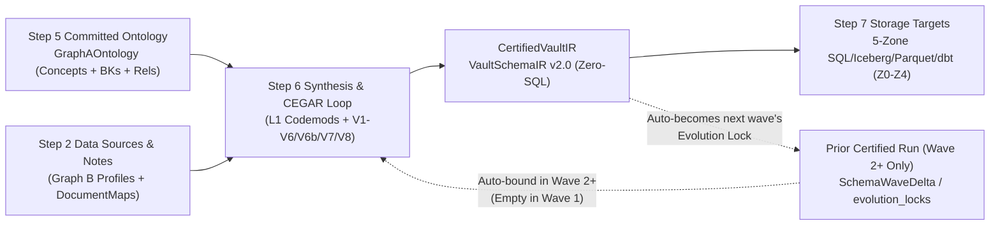
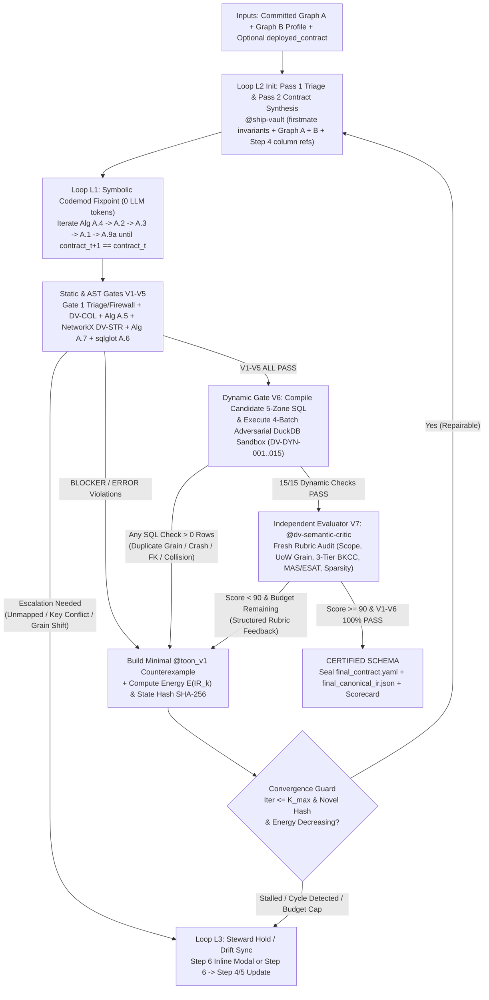
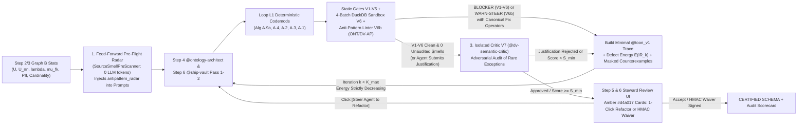
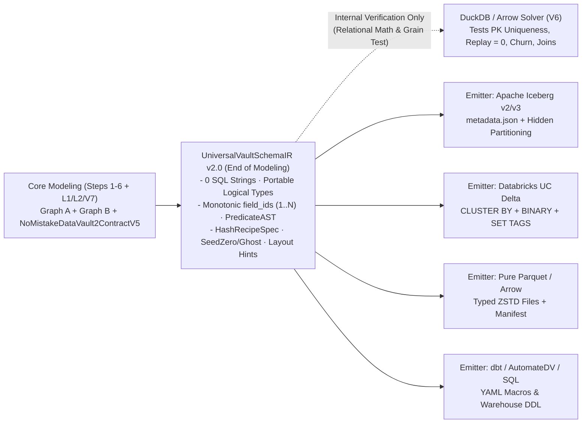
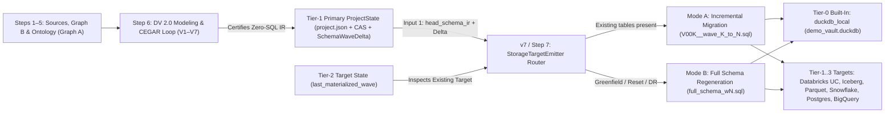
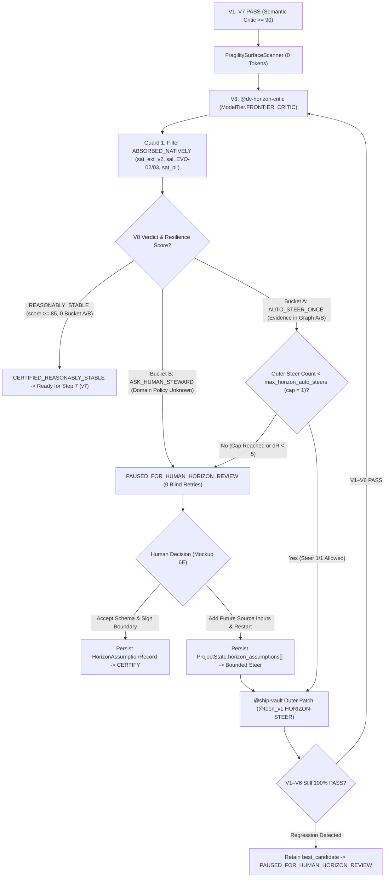
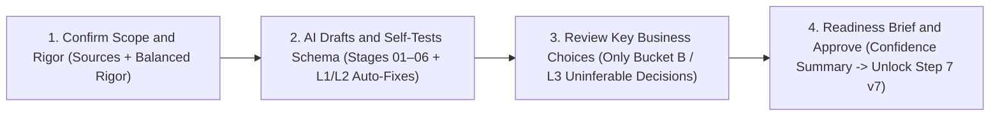
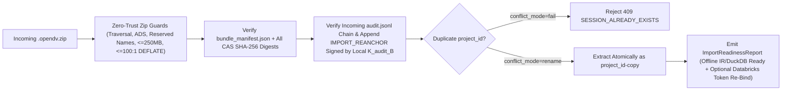

# Enterprise Data Vault 2.0, Semantic Grounding & Loop Engineering Strategy Blueprint

> [!NOTE]
> **OPEN-DV V2 CLEAN-SHEET — ALIGNMENT NOTICE (2026-11-25):** The core strategy here (Enterprise DV 2.0, 3-Tier `BKCC` + `sal_*`, 3-Loop CEGAR, `V8` Horizon Critic, zero-SQL `VaultSchemaIR v2.0`, Step 7 (`v7`) storage emitters, `Guided ⇄ Observatory` UX, `Budget Meter`, `Run Explorer`, and `.opendv.zip` `core_project_state` default) is active in Open-DV V2. Clean-sheet implementation paths (`src/opendv/`, `web/`, `schemas/v2/`), unified `opendv` CLI, SQLite WAL `project.sqlite` persistence, `KeyringSecretStore`, and retired V1 shims (`packages/*`, `apps/opendv-*`, `opendvctl`, `/sessions`, `--mode deterministic`, `CanonicalIR` v1, `LOCAL_ONLY`) are governed authoritatively by [`docs/designs/v2-clean-sheet-architecture.md`](designs/v2-clean-sheet-architecture.md) and [`docs/designs/v2-workbench-ui-design.md`](designs/v2-workbench-ui-design.md).

> **Module:** `docs/30-enterprise-dv2-modeling-and-loop-engineering.md` · **Revision:** v2.0 (2026-11-25)

> **Artifact:** `docs/30-enterprise-dv2-modeling-and-loop-engineering.md` · **Date:** 2026-11-21  
> **Scope:** (1) Step 5 ➔ Step 6 Transition Diagnosis & Contract Demystification (`OBS-32`–`OBS-35`), (2) Enterprise DV 2.0 Long-Horizon Methodology & Anti-Pattern Research, (3) Coupled Semantic Grounding + 3-Tier `BKCC` + `sal_*` Global Key Integration Strategy, (4) Step-by-Step Modeling Playbook (`M1`–`M9`), (5) Step-by-Step Multi-Layer Validation (`V0`–`V8`), (6) 3-Nested-Loop CEGAR + Configurable Policy (`OBS-36`, `REQ-48`–`REQ-52`, `REQ-58`), (7) End-to-End Anti-Pattern Detection, User Warnings & Closed-Loop Agent Steering (`OBS-42`, `REQ-60`), (8) Loop UI Observatory & Real-Time Intermediate Result Streaming (`REQ-61`), (9) Architectural Value of the DuckDB Shadow Sandbox & 12-Trap Multi-Wave Benchmark Suite (`OBS-43`, `REQ-62`), (10) Storage-Agnostic Universal Vault Schema IR (`UniversalVaultSchemaIR v2.0`) & Pluggable Storage Medium Emitters (`OBS-44`, `REQ-63`), (11) Decoupled `v7` Storage & DDL Generation (`Incremental` vs. `Full Regeneration`), Canonical `ProjectState`, Local DuckDB Demo & Popular Database Roadmap (`OBS-45`, `REQ-64`, `REQ-65`, `Q-30`), (12) Step 6 Future-Wave Breaking-Scenario Stress Analysis (`V8` · `@dv-horizon-critic`), Frontier Model Routing & Bounded Human-Steered Outer Loop (`OBS-46`, `REQ-66`, `Q-31`), (13) Human-Centered Guided Step 6 Modeling UX (`Guided ⇄ Architect` Disclosure, Plain-English Narrator, Visual Primer, Decision Coach & Readiness Brief · `OBS-47`, `REQ-67`, `Q-32`), and (14) Portable Project Archive Export & Zero-Trust Cross-Workspace Import (`.opendv.zip` / `ProjectBundle v2.0` · `OBS-48`, `REQ-68`, `Q-33`).  
> **Master Triage Tracker:** [uat-v2-feedback-and-triage-log.md](design/ontology-studio/uat-v2-feedback-and-triage-log.md) · **Consolidated E2E Spec & UAT:** [31-v2-e2e-requirements-gaps-and-uat-spec.md](31-v2-e2e-requirements-gaps-and-uat-spec.md) · **UX & Scenario Guide:** [32-v2-user-experience-and-scenario-guide.md](32-v2-user-experience-and-scenario-guide.md)

---

## §1. Demystifying Step 6's "Contract" & Diagnosing Step 5 ➔ Step 6 Issues

### 1.1 The Four Layered Specifications (Why "Contract" in Step 6 Felt Confusing)

`open-dv` actually separates **business meaning** from **physical table design**, and **historical baseline locks** from **compiled SQL**. Confusing those three YAML/JSON artifacts in the UI (`"Deployed Contract Baseline (D12)"` + raw `.yaml` file upload) is a UX clarity gap (`OBS-35`), not something you are supposed to hand-author on Day 1:

| Artifact & Name | Owner Step | File / Model Schema | What It Actually Is | Do You Supply It Manually? |
| :--- | :---: | :--- | :--- | :--- |
| **1. Domain Ontology (`Graph A`)** | Steps 1–5 | `ontology.yaml` (`GraphAOntology`) | **Conceptual & Semantic Contract.** Defines business concepts (`Issuer`, `Security`, `Holding13F`), FIBO Path A / Empirical Path B groundings, canonical relationships, 3-Tier key authority patterns (`lei_code`, `isin`, `cik`), reference enumerations, and PII/governance rules. | **Built & committed in Steps 1–5** (auto-exported by `exportBlueprint`). |
| **2. DV 2.0 Model & Schema IR (`VaultSchemaIR v2.0`)** | Step 6 *(Output)* | `CertifiedVaultIR` (`VaultSchemaIR v2.0` inside `project.sqlite`, [`vault-schema-ir-v2.schema.json`](../schemas/v2/vault-schema-ir-v2.schema.json)) | **Storage-Agnostic Physical Vault & Triage IR.** Binds every Bronze column cleanly into: `column_triage_ledger` (`100%` of source columns mapped to a DV role or `SYSTEM_SURROGATE_DROPPED`), `hubs` (with `business_key_sources`, `key_authority_tier`, `bkcc_prefix`), `links` (`STANDARD`, `t_lnk_*`, `sal_*`, `hal_*`, `UNSTRUCTURED_EXTRACTION_LINK`), `satellites` (`STANDARD`, `mas_*`, `esat_*`, `sts_*`, `_pii`, `_static/_core/_high_freq`, `_ext_<epoch>`), `reference_tables` (`ref_*`), and `unmapped_escalations`. | **No — Step 6 synthesizes & certifies it automatically** from `(Step 5 Ontology + Step 2 Sources)`. |
| **3. Evolution Locks Baseline** | Step 6 *(Input Lock on Wave 2+)* | `SchemaWaveDelta` & `evolution_locks` (persisted in `project.sqlite`) | **Additive Evolution Lock (`INV-03/04`, `Alg A.7`).** The immutable physical production state already deployed to your warehouse from previous waves. Ensures new waves can **only add** sources, companion Satellites, Links, or `sal_*` crosswalks without breaking historical hashes (`_hk`), `hash_diff`s, or downstream BI views. | **Wave 1 (First Build):** None (`Fresh Cold-Start Vault`).<br>**Wave 2+:** **Auto-bound** from the latest certified Step 6 run in `project.sqlite`. |
| **4. Target DDL & Format Bundles** | Step 7 *(Emitter Output)* | `targets/<target_id>/` (`V001..V00N.sql`, `full_schema_wN.sql`, Iceberg/Parquet/dbt) | **Deterministic Physical DDL & Format Emission.** Compiled deterministically from the certified `VaultSchemaIR v2.0` into 5-Zone SQL/bundles (`Z0`–`Z4`) across all `11` Step-7 targets. | **No — auto-compiled** in Step 7 after Step 6 static & dynamic gates pass. |



---

### 1.2 Four Verified Step 5 ➔ Step 6 Transition Bugs Found in the Codebase (`OBS-32`–`OBS-35`)

Even when you successfully commit `v1.0.0` in Step 5, four code-level bugs disrupt the handoff to Step 6:

1. **`OBS-32` — Step 5 `"Commit Ontology"` Deadlocks After Committing (`apps/opendv-web-workbench/src/ontology/wizard/Step5DiffGraphExport.tsx#L258-L265`, `apps/opendv-web-workbench/src/ontology/wizard/OntologyWizardShell.tsx#L465-L468`, `apps/opendv-web-workbench/src/ontology/store/graph-editor-slice.ts#L515-L524`):**
   - The primary CTA calls `store.commitChanges()` unconditionally (`if (ok) goToStep(6)`). Once `hasUnsavedChanges === false` (e.g., already committed `v1.0.0`), `commitChanges()` hits `if (operations.length === 0)` ➔ emits toast `"No Changes to Commit"` ➔ returns **`false`** ➔ **refuses to advance to Step 6**, leaving zero button on Step 5 to proceed except clicking the top stepper.
2. **`OBS-33` — Top Stepper Bypasses Uncommitted Changes & Shows Misleading `Committed 0.0.0` (`apps/opendv-web-workbench/src/ontology/wizard/OntologyWizardShell.tsx#L138-L148`, `apps/opendv-web-workbench/src/ontology/wizard/OntologyWizardShell.tsx#L476`, `apps/opendv-web-workbench/src/ontology/wizard/Step6PipelineBuildAndRun.tsx#L165`, `apps/opendv-web-workbench/src/ontology/store/pipeline-execution-slice.ts#L246-L248`):**
   - Clicking `Step 6` in the top stepper advances without checking `hasUnsavedChanges` or uncommitted `v0.0.0`. Step 6 then displays a bright green **`Committed 0.0.0`** badge (`committedVersion`), while `startPipelineRun` sees `hasCommittedOntology === false` (`#L246`) and silently sends **`blueprint: undefined`** (running Step 6 without the Step 4/5 ontology!).
3. **`OBS-34` — Step 4 ➔ Step 5 Commit Silently Drops Key Authority Patterns, Enumerations & Governance Constraints (`apps/opendv-web-workbench/src/ontology/wizard/wizard-step4-sync.ts#L82-L224`, `apps/opendv-web-workbench/src/ontology/store/graph-commit-ops.ts#L109-L152`, `ontology.yaml#L544`):**
   - Your Step 4 proposal (`prop-wealth-mgmt-001.json`) emitted **`5` `add_key_authority_pattern`**, **`5` `add_reference_enumeration`**, and **`1` `add_governance_constraint`** ops alongside `69` typed `add_attribute` ops.
   - `syncStep4DecisionsToStore` and `buildDeltaOperationsAndVersion` sync only concepts, attributes, external mappings, and links. Result on disk in your committed `v1.0.0/ontology.yaml#L544`: every attribute degraded to `data_type: string`, and `reference_enumerations: []` (with key authority patterns and governance constraints completely stripped) before Step 6 ever sees it!
4. **`OBS-35` — Step 6 Never Pre-Loads Blueprint Topology & Uses Cryptic `"Deployed Contract Baseline (D12)"` Copy (`apps/opendv-web-workbench/src/ontology/wizard/OntologyWizardShell.tsx#L126-L135`, `apps/opendv-web-workbench/src/ontology/store/export-promote-slice.ts#L265-L300`, `apps/opendv-web-workbench/src/ontology/wizard/Step6PipelineBuildAndRun.tsx#L267-L302`) *(Fixes: `REQ-48`, `REQ-49`)*:**
   - Entering Step 6 runs `loadPipelineBaselines` and `hydrateSessionLatestRun`, but **never calls `store.exportBlueprint()`**, so `Derived Data Vault 2.0 Topology` stays hidden until after clicking Run.
   - Meanwhile, the Baseline panel exposes a raw `"Deployed Contract Baseline (D12)"` dropdown + `.yaml` file upload input with zero plain-English explanation that **"Contract = your physical DV 2.0 table/column evolution lock"**, nor that Wave 1 needs zero file upload.

### 1.3 Project-Scoped Vault Lifecycle & Step 5 ➔ Step 6 Handoff Invariant (`OBS-39`, `REQ-55`)

A **Data Vault 2.0 `deployed_contract.yaml` belongs strictly to one Project (`project_id`)** — never shared implicitly across unrelated projects:
- **Verified Bug Today (`OBS-39`):** `fetchPipelineBaselines` (`apps/opendv-web-workbench/src/ontology/wizard/step6-run-hydration.ts#L315-L344`) fetches `/api/v1/runs` globally and sorts `activeSid` first without filtering out other projects, causing a brand-new Project B (`0` runs) to inherit Project A's certified run (`idx === 0`, `is_latest_certified: true`) in `apps/opendv-web-workbench/src/ontology/store/pipeline-execution-slice.ts#L108-L110`, while `startDvPipelineRun` (`#L280-L292`) omits `project_id` (`"default_project"` fallback at `packages/opendv-agent-harness/src/opendv_agent_harness/pipeline/axi_repair_loop.py#L491`).
- **Target Project-Scoped Architecture (`REQ-55`):**
  1. **Unified Project Boundary:** Every Ontology version (`v1.0.0`, `v1.1.0`), Data Source manifest, `deployed_contract.yaml` Evolution Lock, CEGAR attempt history, and DuckDB sandbox is strictly scoped to a named **Project** (`project_id` / slugged `session_id`, `project_name`, `domain_namespace`).
  2. **Project-Based Step 6 Entry (Two Clean Paths):**
     - **From Step 5 (Forward Handoff · Mockup `5C`):** Step 5 renders an explicit **Project Handoff Bar** (`Target Project` ➔ `Ontology Commit vX.Y.Z` ➔ `Wave 1 Cold Start` or `🔒 Wave N Locked to Project Wave N-1`) before advancing cleanly into Step 6.
     - **Direct to Step 6 by Project (Mockup `6A`):** Step 6 exposes a **Project Selector & Wave Timeline Strip** so users can pick any Project directly, see its bound 3-Pillar State (Committed Ontology + Sources + Strict Per-Project Evolution Lock), and execute or compare waves with **zero cross-project leakage**.

---

## §2. Research Synthesis: Enterprise Data Vault 2.0 Long-Horizon Methodology & Anti-Patterns

Synthesizing **Dan Linstedt & Michael Olschimke** (*Building a Scalable Data Warehouse with Data Vault 2.0*), **Hans Hultgren** (*Ensemble Logical Modeling / ELM*), **Lawrence Corr** (*BEAM\* Event Modeling*), **Patrick Cuba**, **Roelant Vos**, **Scalefree** standards, and `open-dv`'s own mathematical specs ([01-core-modelling-spec.md](01-core-modelling-spec.md), [02-schema-stability-and-evolution.md](02-schema-stability-and-evolution.md), [05-elm-calculus-and-reference-algorithms.md](05-elm-calculus-and-reference-algorithms.md)), enterprise longevity over 3–10+ years rests on **4 non-negotiable architectural pillars**:

1. **Conceptual-Before-Physical Ensemble Decomposition (`ELM + BEAM*`):** Never derive Hubs directly from operational tables. First identify **Core Business Concepts (CBCs)** (independent business things identified by natural business keys) and **Natural Business Relationships (NBRs)** via **Who / What / Where / When / How** event analysis, then map every physical source column into the conceptual ensemble.
2. **Orthogonal 3-Way Raw Vault Separation (`INV-05`):**
   - **Hubs (`hub_*`):** Timeless business key identities (`hk`, `bkcc`, natural `VARCHAR` BKs, `load_dts`, `rec_src`) — zero FKs, zero attributes, zero end-dates.
   - **Links (`lnk_*`, `t_lnk_*`):** Universal many-to-many ($M:N$) business intersections & transactions — zero Hub-to-Hub FKs and zero Link-to-Link FKs so cardinality shifts (`1:1` ➔ `1:N` ➔ `M:N`) cause zero Raw Vault refactoring.
   - **Satellites (`sat_*`, `mas_*`, `esat_*`, `sts_*`, `rts_*`):** Strictly single-parent (`Hub` or `Link`), single-source, append-only (`INSERT`) context history with virtual end-dating via half-open intervals `[from, to)` using `LEAD(load_dts)` (`INV-02`).
3. **Strict Hard vs. Soft Business Rule Firewall (`Z1 -> Z2 -> Z3 -> Z4`):**
   - **Zone 1 Staging (`stg_*`):** Hard technical alignment ONLY (type casting, `TRIM`/`UPPER` hashing rules, length-prefixed SHA-256, `bkcc`, `-1`/`-2` Zero Key substitution) — never cross-table business joins, KPI filtering, or status remapping.
   - **Zone 2 Raw Vault (`rdv`):** 100% unaltered source audit fidelity (`"bad data in = bad data preserved with provenance"`).
   - **Zone 3 Sparse Business Vault (`bdv`):** Sparse overlay ONLY for reusable **Soft Business Rules** (`sal_*` entity resolution, `esat_*` driving-key timelines, `bsat_*` derived metrics, `pit_*` snapshot spines, `brg_*` multi-hop bridges) — never duplicate Raw Vault tables 1:1.
   - **Zone 4 Information Marts (`dim_*`, `fct_*`, `obt_*`):** Disposable/rebuildable star-schema views backed by **Zero Keys + Ghost Records** so analytical queries execute fast inner equi-joins.
4. **Long-Term Schema Drift Playbook (`EVO-01`–`EVO-08`):** Raw Vault tables are **never** mutated via `DROP COLUMN`, `UPDATE`, `DELETE`, `TRUNCATE`, or Hub/Link key reordering. Column renames resolve cleanly in Zone 1 (`EVO-03`); dropped source columns project `CAST(NULL AS ...)` in Zone 1 (`EVO-02`); added columns isolate into companion Satellites (`sat_<entity>_ext_<epoch>`, `EVO-01a`) so historical `hash_diff`s remain 100% immutable.

### 2.1 Ten Enterprise Anti-Patterns That Kill Multi-Year Vaults & `open-dv` Countermeasures

| # | Enterprise Anti-Pattern | What Breaks Over 3–10 Years | Authoritative DV 2.0 Practice | `open-dv` Enforcer / Gap to Close |
| :-: | :--- | :--- | :--- | :--- |
| **1** | **Source-System Vault Silos** (`hub_sfdc_acct`, `hub_sap_acct`) | Rebuilds source silos inside EDW; cross-system joins become manual ETL hacks (`AP-11`). | Map Hub to canonical **Business Concept**; attach per-source Satellites + `sal_*` if BKs differ. | `ANTI_SILO_VIOLATION` (`Gate 1`, `Alg A.4`) + **`REQ-45`** (split wide tables via Step 4 decomposition). |
| **2** | **Surrogate Key & Integer BK Poisoning** | Sequence IDs don't converge across systems; `INT` strips leading zeros (`'00421' -> 421`) (`KEY-01..03`). | Reject `MONOTONIC_INT` / `RANDOM_UUID_V4` when natural key exists; cast all Hub BKs to trimmed `VARCHAR`. | `Graph B` $S_{\text{surr}}(c)$, `QUARANTINED_SURROGATE`, `DV-COL-002`, `Alg A.5`. |
| **3** | **Unscoped Local IDs Colliding or Over-Scoped Global IDs** | Local ID `1001` collides across ERPs (`SysA` Acme = `SysB` Globex), or global `ISIN` fails passive integration (`KEY-04`). | Apply **3-Tier `BKCC`**: `'GLOBAL'` for Tier-1 standards (`LEI`, `ISIN`); system literal / `tenant_id` for Tier-3 local keys. | `DV-COL-012`, `DV-COL-013`, `Alg A.4` (`TIER_1` / `TIER_2` / `TIER_3`). |
| **4** | **Multi-Source Satellites & In-Place `hash_diff` Mutation** | Out-of-sync sources "flip-flop" rows (`DV-STR-012`); in-place `ADD COLUMN` invalidates every row's `hash_diff` (`EVO-01a`). | **Strictly 1 source per Raw Satellite**; isolate new columns into `sat_<entity>_ext_<epoch>`. | `DV-STR-012`, `DV-EVO-006`, `Alg A.9a` + **`REQ-44`** (monotonic `v2 ➔ v3`). |
| **5** | **Physical `load_end_dts` `UPDATE`s & Wide Satellites** | Rewriting Parquet/Delta partitions on `UPDATE` stalls loads; 1 volatile column re-snapshots 80 static columns. | Strictly insert-only (`INV-01`); virtual `LEAD(load_dts)` (`INV-02`); split by **Source × PII × Rate of Change**. | `Alg A.6` (`DV-AST-*`), `Alg A.1` ($W_{\text{amp}} \ge 50\text{ MB/day}$). |
| **6** | **Over-Linking (Mega 6-Way Links) vs. Over-Splitting (Binary Links)** | Mega-links break when an optional FK is absent or sparse; splitting an atomic 4-way order into 2-way links creates Cartesian fan-traps (`DV-STR-011`). | Bind mandatory 5-W participants ($U_{nn} \ge 0.95$) into kernel N-ary Link; split sparse FKs ($U_{nn} < 0.95$) into `WHERE col IS NOT NULL` binary Links. | `Alg A.4` (`sparse_fk_null_threshold = 0.95`), `DV-STR-002/010/011`. |
| **7** | **Multi-Active Grain Crashes & Unclosed `1:N` Timelines** | Customer with 2 active phones in 1 batch crashes PK `(hk, load_dts)`; changing an Account Manager leaves prior assignment open (`DV-STR-007/008`). | Model concurrent multi-valued sets as **`mas_*`** with non-null **Child Dependent Key (CDK)**; track timeline ownership via **`esat_*` + Driving Key**. | `DV-STR-007`, `DV-STR-008`, `Alg A.3` + **`REQ-50`** (full Step 6 LLM inference + UI display). |
| **8** | **Enumeration / Lookup Hubs** (`hub_currency`, `hub_status`) | Pollutes Vault graph with tiny static code tables and wastes joins (`AP-12`). | Demote low-cardinality static enumerations to **`ref_*` + `sat_ref_*`** joined by code. | `Alg A.2` + **`REQ-48`** (preserve `reference_enumerations` across Step 4 ➔ 5!). |
| **9** | **Outer-Join Storms & Late-Arriving Fact Drops** | Missing dimension rows drop facts; multi-Satellite `LEFT JOIN`s crawl at BI query time. | Seed Dual Zero Keys (`-1 = '0'*64`, `-2 = 'f'*64`), `1900-01-01` Satellite **Ghost Records**, **Early-Arriving Hub Stubs**, plus **PIT (`pit_*`)** & **Bridge (`brg_*`)**. | `DV-DYN-007`, `DV-DYN-008`, `DV-DYN-010`, `DV-DYN-015`, `Queries D.10 / D.10b`. |
| **10** | **Unverified AI/Document Extractions Polluting Raw Vault** | Hallucinated LLM entities or unreviewed spans permanently poison `hub_*` / `sat_*` lineage (`Rules U1–U4`). | Isolate document mentions via `hub_document` (`bk = doc_sha256`) + `UNSTRUCTURED_EXTRACTION_LINK` + `WHERE steward_gate_status = 'APPROVED'`. | `Alg A.9b` (`SPAN_HALLUCINATION`), `DV-AST-007`, `DV-DYN-012/013` + **`REQ-47`**. |

---

## §3. Coupled Semantic Grounding, 3-Tier `BKCC` & `sal_*` Global Key Integration Strategy

By coupling **Enterprise Semantics (`Graph A` / FIBO + Path B)** with **3-Tier Global Business Key Integration (`BKCC` + `sal_*`)**, identity convergence works across decades without destructive re-keying:

1. **Semantic Canon First (`Graph A` · ELM + FIBO):**
   - Every Vault entity corresponds 1:1 to a vetted `urn:ontology:entity:<concept>` backed either by **Path A (FIBO `exactMatch` / `closeMatch` $\ge 0.65$)** or **Path B (Empirical `STRUCTURED_SCHEMA` / `DOCUMENT_OBSERVED` + verifiable `EvidenceRef`)**.
   - Relationships use semantic domain-neutral names (`issuer_has_esg_rating` ➔ `lnk_issuer_has_esg_rating`), preventing table-name leakage into the enterprise model.
2. **Global Identification Hierarchy (3-Tier `BKCC`):**
   - **`TIER_1_GLOBAL_STANDARD`** (`lei_code`, `isin`, `cusip`, `figi`, `iban`, Tax ID/UEN): Always receives `bkcc_prefix = 'GLOBAL'` and `require_src_qualifier = false`. Any two systems — today or 5 years from now — emitting the same standardized code hash deterministically to the **identical `hk_<entity>`** via **Passive Integration**.
   - **`TIER_2_ENTERPRISE_SOR`** (governed MDM Golden ID or authoritative internal registry): Scoped to a shared enterprise authority literal (e.g., `bkcc_prefix = 'SEC_EDGAR_CIK'`).
   - **`TIER_3_LOCAL_SCOPED`** (ERP sequences, multi-tenant IDs, regional CRM keys): Scoped defensively (`require_src_qualifier = true`, `bkcc_prefix = '<RECORD_SOURCE>'` or dynamic column `'tenant_id'`) so local keys from new acquisitions **never silently collide** with existing entities.
3. **Non-Destructive Active Integration & Key Evolution (`sal_*`):**
   - Suppose Wave 1 onboards `hub_issuer` keyed on `cik` (`TIER_2`), and Wave 2 adds European regulatory feeds keyed on `lei_code` (`TIER_1`), plus a crosswalk mapping `cik <-> lei_code`:
     - Under **Global Key Integration + `DV-EVO-003`**, Wave 1's `hub_issuer` BK signature and hashes are **never modified in place**.
     - Instead, Wave 2 **appends** a second `business_key_sources` entry (`lei_code`, `TIER_1_GLOBAL_STANDARD`, `bkcc_prefix = 'GLOBAL'`) to `hub_issuer`, and synthesizes a directional Business Vault **Same-As Link** (`sal_issuer`: `hk_issuer_master` ordered by higher Tier-1 authority ➔ `hk_issuer_duplicate`, enforcing `DV-STR-015` + `esat_sal_issuer`) (`REQ-46`).
4. **Empirical Verification Against `Graph B` Statistics:**
   - Every proposed business key and relationship is checked against measured uniqueness $U(c)$, non-null ratio $U_{nn}(c)$, MinHash/HLL cross-table containment $C(c_1, c_2)$, surrogate entropy $S_{\text{surr}}(c)$, FK swap rate $\mu_{FK}(c)$, and CDC volatility $\lambda(c)$ ([05-elm-calculus-and-reference-algorithms.md](05-elm-calculus-and-reference-algorithms.md)) before committing DDL.

---

## §4. Step-by-Step Enterprise Modeling Playbook (`M1`–`M9`)

Each wave — from initial Cold Start ($N=1$) through Multi-Source ($N+1$) and Intra-Source Drift ($S_k(t) \to S_k(t+1)$) — follows this 9-step deterministic workflow:

| Step | Stage / Owner | Inputs | Modeling Action & Decision Rules | Output Artifact |
| :---: | :--- | :--- | :--- | :--- |
| **`M1`** | **Scope, Mode & Vault Lock** (`Step 1` · Human + `@ontology-first-mate`) | Namespace, baseline mode (`New` / `Existing`), latest certified `deployed_contract` | Bind project namespace (`urn:ontology:entity:<ns>:*`); if certified Step 6 Vault exists, auto-lock deployed Hubs/Links/BKs (`🔒 Deployed in Vault`) so breaking ontology edits fail closed early (`REQ-44`). | Session baseline + optional `deployed_contract` guard |
| **`M2`** | **Multi-Modal Profiling (`Graph B`)** (`Steps 2–3` · `GraphBProfiler`) | Structured connectors (SQLite, DuckDB, Databricks UC, Parquet/CSV/XLSX) + PDF/Markdown notes + UC/local privacy tags (`Local Only`, `'pii'='true'`) | Compute $U(c)$, $U_{nn}(c)$, $C(c_1, c_2)$, $S_{\text{surr}}(c)$, $\lambda(c)$, $\mu_{FK}(c)$, table grain hints, and lightweight document TOC/page maps (zero 800-char slicing; `Local Only` files excluded from all LLM prompts). | `evidence/tables.jsonl` + `document_map.json` + masked summary (`<= 5` rows) |
| **`M3`** | **ELM Concept & Key Discovery** (`Step 4` · Flow B Agents) | `Graph B`, `DynamicConceptRegistry`, FIBO MCP (`search_fibo`), doc page MCP (`read_document_pages`) | Execute single-pass `@ontology-first-mate` ➔ `@doc-ontology-scout` ➔ `@domain-clarifier` ➔ `@ontology-architect`: separate polysemic terms, decompose wide tables (e.g., 1 Parquet ➔ 4 concepts), extract `1x · Semantic` doc concepts, infer typed attributes from `Graph B` + `add_attribute`, emit `key_authority_patterns`, `reference_enumerations`, and `governance_constraints`. | `OntologyProposal` (typed attributes, `evidence_refs`, Path A/B badges, `MAJOR` opt-in) |
| **`M4`** | **Semantic Diff & Lossless Commit** (`Step 5` · Human + `GovernanceValidator`) | Cherry-picked draft + existing committed graph | Verify `ONT-EVO-001..005` + `deployed_contract` lock; commit **losslessly** (preserving attributes, SQL types, `evidence_refs`, `key_authority_patterns`, `reference_enumerations`, `governance_constraints` — `REQ-48`); advance cleanly via `Commit & Continue` / `Continue to Step 6 ➔`. | Immutable CAS `ontology.yaml` + `Graph A` SHA-256 |
| **`M5`** | **Exhaustive `100%` Column Triage** (`Stage 03` · `@ship-vault` Pass 1) | `Graph A` + `Graph B` + Step 4 column `evidence_refs` (`REQ-45`) | Assign every physical column in `column_triage_ledger` to exactly one role (`BUSINESS_KEY`, `FOREIGN_KEY`, `DESCRIPTIVE_PAYLOAD`, `PII_SENSITIVE`, `DEGENERATE_TRANSACTION_ATTR`, `QUARANTINED_SURROGATE`, or `SYSTEM_METADATA`); quarantine `MONOTONIC_INT` / `RANDOM_UUID_V4` surrogates; flag truly unmapped feeds (`escalations`). | `column_triage_ledger` (`unaccounted_columns == 0`) |
| **`M6`** | **Wide-Table Split, Anti-Silo Hubs & 3-Tier `BKCC`** (`Stage 04` · `@ship-vault` Pass 2) | Column ledger + `Graph A` concepts/key patterns + `deployed_contract` | Decompose wide tables into their respective canonical Hubs rather than 1 Hub/table (`REQ-45`); consolidate multi-source feeds targeting the same `concept_uri` under 1 canonical Hub; attach Tier-1/2/3 `BKCC` per `(table, column, target_hub)`; route pure doc-only future entities to `Planned Ontology Concepts` and extracted doc entities to `hub_document` + `UNSTRUCTURED_EXTRACTION_LINK` (`REQ-47`). | Candidate Hubs + `business_key_sources` |
| **`M7`** | **Link Specialization, `mas_*`/`esat_*` & 3-Axis Satellite Split** (`Alg A.1–A.4`) | Candidate Hubs + `Graph B` ($U_{nn}$, $\mu_{FK}$, $\lambda$, PII tags) | Assemble 5-W mandatory kernel N-ary Links ($U_{nn} \ge 0.95$) vs. sparse binary Links ($U_{nn} < 0.95$, `Alg A.4`); classify immutable event logs (`t_lnk_*`), driving-key timeline Links (`esat_*`, `Alg A.3`), Multi-Active child grain (`mas_*` + CDK), and lookups (`ref_*`, `Alg A.2`); split Satellites along **Source × PII (`sat_*_pii`) × Volatility ($W_{\text{amp}} \ge 50\text{ MB/day}$, `Alg A.1`)**. | Full `NoMistakeDataVault2ContractV5` candidate |
| **`M8`** | **Multi-Wave Non-Breaking Evolution** (`Alg A.7 & A.9a`, Wave $2 \dots N$) | `deployed_contract` ($V_{k-1}$) + new wave sources/drift | Lock all deployed Hubs/Links/Satellites (`DV-EVO-001..008`); isolate new attributes into companion Satellites (`sat_<hub>_ext_<epoch>` with monotonic `v2 ➔ v3 ➔ v4`, `REQ-44`); attach new sources as `sat_<hub>_<new_src>`; alias renamed columns in `Z1` Staging (`EVO-03`); project dropped columns as `CAST(NULL AS ...)` in `Z1` (`EVO-02`); synthesize `sal_*` crosswalks for new key tiers (`REQ-46`). | Non-breaking evolved contract $V_k$ |
| **`M9`** | **Seal `UniversalVaultSchemaIR v2.0` & Commit Tier-1 `ProjectState`** (`End of Step 6` · Zero SQL) | Certified `final_contract.yaml` + `V1–V7` proofs | Seal core modeling at the zero-SQL **`UniversalVaultSchemaIR v2.0`** (`head_schema_ir`, portable logical types, monotonic `field_id`s, `PredicateAST`, `HashRecipeSpec`, Zero/Ghost seeds, layout hints) + non-breaking **`SchemaWaveDelta` (`Wave K -> Wave N`)**, locking `evolution_locks` inside canonical **Tier-1 `ProjectState` (`project.json` + CAS)**. Downstream **`v7` / Step 7 (`§11`)** then consumes `ProjectState` as a decoupled concern to emit **Incremental Migration** or **Full Regeneration** SQL/metadata for `duckdb_local` or any enterprise database. | Tier-1 `ProjectState` (`head_schema_ir` + `SchemaWaveDelta`) ➔ Hand off to **`v7` / Step 7** |

---

## §5. Step-by-Step Multi-Layer Validation Strategy (`V0`–`V8`)

**Validation is completely separated from generation** (an immutable symbolic & critic trust boundary):

| Gate | Validator Engine | Exact Assertions Enforced | Action on Failure |
| :---: | :--- | :--- | :--- |
| **`V0`** | Pre-Synthesis Guard (`Graph B` + `Alg A.9a`) | Validates source readability, computes exact $U_{\text{nn}}$ / $U$ / $\lambda$ / $\mu_{FK}$, and builds the wave-drift diff (`ADDED`, `DROPPED`, `RENAMED`, `WIDENED`, `NARROWED`, `COMPETING_NATURAL_KEYS`) against `deployed_contract`. | Surfaces Drift Alert Banner (`↺ Sync Drift to Step 4`) or Key-Drift Hold before synthesis. |
| **`V1`** | **Gate 1 — Schema, Triage & Ontology Firewall** (`packages/opendv-axi-verifier/src/opendv_axi_verifier/verifiers/gate1_contract_grain.py`) | Strict Pydantic `extra="forbid"` (`DV-G0`); non-empty Hub/Link grains; `100%` `column_triage_ledger` coverage (`DV-G4-002`); `ANTI_SILO_VIOLATION` check; `DV-G4-001` unknown-URI firewall; enumeration exclusion. | Rejects with `@toon_v1` diagnostics or triggers `PAUSED_HOLD` for unmapped business entities. |
| **`V2`** | **Gate 2a — Column & Hash Bijection (`Alg A.5`)** (`packages/opendv-axi-verifier/src/opendv_axi_verifier/verifiers/gate3_networkx_dag.py`) | `DV-COL-001..013`: Non-null `CHAR(64)`/`BINARY(32)` hashes; `VARCHAR` Hub BKs; alphabetical case-preserving `hash_diff` excluding `load_dts`/`rec_src`/`hk`; disjoint delimiter tokens; Tier-1 `'GLOBAL'` prefix parity; DuckDB == Databricks SHA-256 byte parity (`OCTET_LENGTH`). | Auto-fixed by codemod or returned as `@toon_v1` counterexample to `@ship-vault`. |
| **`V3`** | **Gate 3 — `networkx` Bipartite DAG & Evolution Lock (`Alg A.7`)** (`packages/opendv-axi-verifier/src/opendv_axi_verifier/verifiers/alg_a7_evolution_lock.py`) | `DV-STR-001..015`: `0` Hub→Hub edges, `0` Link→Link edges, Link arity $\ge 2$, strict single-parent Satellites, `MAS` non-null CDKs, `ESAT` driving key subset, `SAL` master/duplicate tier ordering, cycle-safe `HAL`. Plus `DV-EVO-001..008`: zero deletions, zero BK/Link grain mutations, zero in-place Satellite `hash_diff` invalidation. | Hard-blocks (`BLOCKER`) and routes structural `@toon_v1` error or Steward Hold (`DV-EVO-003`). |
| **`V4`** | **Gates 4 & 5 — Cost Guard & Unstructured Span Prover (`Alg A.1, A.9b`)** | Enforces join-depth ceiling & $W_{\text{amp}} \ge 50\text{ MB/day}$ before splitting Satellites; proves exact span `raw_doc[char_start:char_end] == quote` (zero `SPAN_HALLUCINATION`) + `Tier-U1..U3` ER confidence routing. | Auto-merges over-split Satellites (`Alg A.1`); quarantines/holds `Tier-U2/U3` extractions. |
| **`V5`** | **Gate 6a — `sqlglot` AST Immutability Linter (`Alg A.6`)** | Parses **every** generated SQL statement across all zones/dialects; forbids `UPDATE`/`DELETE`/`TRUNCATE`/`DROP` on Raw Vault, forbids `SELECT *`, forbids stored `load_end_dts`, forbids Raw Vault aggregations, and requires `WHERE steward_gate_status = 'APPROVED'` on unstructured inserts. | Blocks uncertified SQL compilation (`BLOCKER`). |
| **`V6`** | **Gate 6b — 4-Batch Adversarial DuckDB Shadow Sandbox (`DV-DYN-001..015`)** | Executes compiled SQL across **4 adversarial micro-batches** in `:memory:` DuckDB: **Batch 1** (initial load: Hub/Link/Sat PK uniqueness `DV-DYN-001/003/004/005`, zero orphan FKs `DV-DYN-006/007`, Zero Keys `-1`/`-2` & Ghost Record `'0'*64 @ 1900-01-01` `DV-DYN-009`, 100% staging reconciliation `DV-DYN-010/011`, zero hash collisions `DV-DYN-002`); **Batch 2** (exact replay: **$\Delta$ rows == 0** everywhere `DV-DYN-012`); **Batch 3** (attribute updates + late/early-arriving fact stubbing + delimiter/UTF-8 collisions `DV-DYN-008`); **Batch 4** (bi-temporal `applied_dts < load_dts` restatement + `PIT` inner equi-join parity `DV-DYN-015` + single-active `esat_*` driving key check `DV-DYN-013` + 0 prior-wave `hash_diff` mutation `DV-DYN-014`). | Extracts offending counterexample rows (`SELECT` returning $> 0$ rows, PII-masked per `D6`) and feeds into CEGAR Repair Loop **L2** (`OBS-36` / `REQ-51`). |
| **`V6b`** | **Gate 6c — Heuristic & Empirical Anti-Pattern Linter (`ONT-AP-001..005` + `DV-AP-001..012`)** *(New · `REQ-60`)* | Graded static + DuckDB Batch 1–4 empirical smell detectors (`WARN-STEER` & `ADVISORY`): source-prefix/wide-table clone silos (`ONT-AP-001`/`DV-AP-001`), disguised lookup/super-hubs (`ONT-AP-002`/`DV-AP-004`), mutable/float/kitchen-sink BKs (`ONT-AP-003`/`DV-AP-003`), Mega-Links ($\ge 5$ Hubs) vs over-split binary fan traps (`DV-AP-002`), God Satellites ($\ge 25$ cols) vs micro-satellite sprawl (`DV-AP-005`/`006`), `t_lnk_*` vs historized mismatch (`DV-AP-007`), missing `esat_*` on $1:N$ / $1:1$ ownership (`DV-AP-008`), unisolated PII (`ONT-AP-005`/`DV-AP-009`), Zone 1 soft-rule leak / Zone 3 1:1 mirror (`DV-AP-010`), DuckDB Batch-3 technical audit column `100%` delta churn (`DV-AP-011`), and $\ge 3$ `_ext_v*` companion Satellites without `pit_*` (`DV-AP-012`). | Emits `@toon_v1` `WARN-STEER` prescription directives into CEGAR **L2** (`5 * |V_warn|` energy term in $E(IR_k)$) AND renders `#d4a017` Amber warning badges + 1-click refactor / Steward HMAC-waiver cards in Step 5 & Step 6 (`§7`). |
| **`V7`** | **Independent Semantic Architect Critic (`@dv-semantic-critic`)** *(New · `REQ-51`)* | Runs *after* `V0–V6` are 100% green, in an isolated fresh agent turn with a strict rubric: checks (1) wide-table multi-concept decomposition vs `Graph A`, (2) atomic UoW Link grain vs Hub promotion, (3) 3-Tier `BKCC` appropriateness, (4) `MAS`/`ESAT`/`t_lnk`/`ref` semantic choices, (5) Business Vault sparsity & long-term wave resilience, plus (6) adversarial audit of any agent-submitted `AntiPatternJustification` (`REQ-60`). Scores `0–100` (`semantic_confidence`). | If score `< 90` or an `AntiPatternJustification` fails adversarial audit, feeds structured rubric critique into **L2** iteration $k+1$ (without violating `DV-EVO` locks). |
| **`V8`** | **Counterfactual Horizon & Breaking-Scenario Stress Critic (`@dv-horizon-critic`)** *(New · `REQ-66`, `§12`)* | Runs *after* `V1–V7` pass using **`ModelTier.FRONTIER_CRITIC`** in an isolated read-only context seeded by deterministic `FragilitySurfaceScanner`. Analyzes counterfactual future data sources/schemas/fields (`BRK-01..08`), filters out patterns already absorbed natively by DV 2.0 (`ABSORBED_NATIVELY`), and triages into `Bucket A` (`AUTO_STEER_ONCE`), `Bucket B` (`ASK_HUMAN_STEWARD`), or `Bucket C` (`ADVISORY_WATCHLIST`). | Reports **`REASONABLY_STABLE`** when resilience $\ge 85$ & 0 Bucket A/B findings; runs at most **`1`** bounded outer steer for Bucket A; pauses cleanly for Human Review (`Steer & Restart` vs `Accept`) on Bucket B (`0` blind retries / `0` infinite loops). |

---

## §6. Loop Engineering Architecture: Iterative Convergence to a High-Confidence Schema (`OBS-36`, `REQ-50`–`REQ-52`)

### 6.1 Critical Gap Found in Today's Repair Code (`OBS-36`)

Inspection of `packages/opendv-agent-harness/src/opendv_agent_harness/pipeline/axi_repair_loop.py#L63-L101` and `packages/opendv-agent-harness/src/opendv_agent_harness/pipeline/stages_agentic.py#L135-L431` shows that **today's "repair loop" is not an iterative LLM loop at all**:
- `execute_axi_repair_loop` accepts `max_repair_retries: int = 3`, passes `max_attempts` down, and executes **`run_axi_dv_verification_pipeline(...)` once** — there is zero `for`/`while` LLM re-generation cycle.
- Stage 04 (`stages_agentic.py#L135-L137`) runs a single 1-line `system_instructions` call; if it fails `verify_additive_evolution_invariants`, it silently falls back to `contract_dict` (`#L427-L429`), and **`STAGE_06` dynamic DuckDB counterexamples never loop back** into contract refinement.

---

### 6.2 Target Architecture: 3-Nested-Loop CEGAR + Independent Critic (`REQ-51`)

To guarantee that `open-dv` iterates autonomously until it converges on a schema engineers can trust for years, Step 6 upgrades to a **3-Nested-Loop Counterexample-Guided Abstraction Refinement (CEGAR)** architecture:



### 6.3 Mechanics of Each Loop

1. **Loop L1 — Inner Deterministic Symbolic Fixpoint (`0` LLM Tokens):**
   - Runs codemods **`A.9a` (drift) ➔ `A.4` (Tier-1/2/3 `BKCC` + sparse FKs $U_{nn} < 0.95$) ➔ `A.2` (enum-to-`ref_*`) ➔ `A.3` (FK-swap `esat_*`) ➔ `A.1` (PII + volatility satellite split)** in a bounded fixpoint loop (max `3` micro-passes) until **`contract_{t+1} == contract_t`**, ensuring deterministic mechanical transformations never fight each other or burn LLM tokens.
2. **Loop L2 — Middle Neuro-Symbolic CEGAR Synthesis-Verification-Critique Loop (`k = 1..K_max`, default `K_max = 4`):**
   - **Iteration `k` Static + Dynamic Repair:** Any residual failure in `V1–V5` OR any counterexample row emitted by `V6` (`DV-DYN-001..015`) is serialized into a compact `@toon_v1` payload (rule ID, failed predicate, offending entity/columns, masked sample offending rows per `D6`, and allowed non-destructive fix operators). Examples:
     - *`DV-DYN-004` fails in DuckDB with duplicate `(hk_customer, load_dts)` within 1 batch* ➔ counterexample shows multi-valued attribute (e.g. `phone_type`) ➔ `@ship-vault` promotes `sat_customer_phone` to **`mas_customer_phone` (`MULTI_ACTIVE` + `cdk: phone_type`)** in iteration `k+1`!
     - *`DV-DYN-001` fails uniqueness on `hub_instrument` keyed on `ticker` alone across two exchanges* ➔ counterexample shows `'AAPL'` on `NASDAQ` vs `'AAPL'` on `MEX` ➔ `@ship-vault` repairs BK signature (`(ticker, exchange)` or `isin` Tier-1).
     - *`DV-DYN-013` detects 2 active account managers for 1 driving customer* ➔ adds/fixes `esat_*` driving key declaration.
   - **Independent Evaluator Step (`V7` · `@dv-semantic-critic`):** Runs ONLY after `V1–V6` are `100%` green. Uses a **clean context window separate from `@ship-vault`** (preventing sycophancy / self-confirmation bias) and scores 5 weighted enterprise dimensions (`0–20` each = `100` pts):
     1. *Concept & Wide-Table Fidelity* (`Graph A` match without `1 table = 1 hub` collapse)
     2. *Link UoW Grain & Anti-Over/Under-Linking* (`t_lnk_*`, N-ary kernel, sparse splits, zero chasm traps)
     3. *Semantic Grounding, 3-Tier `BKCC` & Cross-Wave Extensibility* (`sal_*`, Tier-1 `'GLOBAL'` vs Tier-3 isolation)
     4. *Satellite Cohesion & Specialization* (`_pii`, `_static/_high_freq`, `mas_*`, `esat_*`, `ref_*`)
     5. *Business Vault Sparsity & Query Readiness* (`pit_*`, `brg_*`, Ghost/Zero-Key cleanliness)
3. **Loop L3 — Outer Human-in-the-Loop & Ontology Loop (`Step 6 ↺ Step 4/5`):**
   - **Anti-Reward-Hacking Invariant:** Verifier code, rule weights, `Graph B` profiles, and `deployed_contract` live outside the agent's writable tools. `@ship-vault` **cannot** drop a failing column, relax a gate, or fabricate an ontology URI to raise its score.
   - Whenever an ambiguity is fundamentally a business decision (`UNMAPPED_ONTOLOGY_CONCEPT`, `COMPETING_NATURAL_KEYS`, `DV-EVO-003` breaking grain shift, `Tier-U2/U3` extraction uncertainty), L2 halts cleanly into **L3 (`StewardHoldRecord`)** with inline resolution or **`↺ Sync Drift to Step 4`**.

---

### 6.4 Formal Convergence, Cycle Prevention & "Schema We Are Confident Of" Exit Criteria

To guarantee L2 **terminates cleanly, never oscillates, and never degrades a better prior candidate**:

1. **Monotonic Defect Energy Function $E(IR_k)$:**
   $$E(IR_k) = 100 \cdot |V_{\text{blocker}}(IR_k)| + 25 \cdot |V_{\text{error}}(IR_k)| + 5 \cdot |V_{\text{warn}}(IR_k)| + \max(0,\, 90 - S_{\text{critic}}(IR_k))$$
   *(where hard blockers dominate errors, errors dominate warnings, and semantic rubric shortfall only nudges once hard gates are green).*
2. **State Hashing & Cycle Detection:** Compute `sig_k = SHA-256(JCS(IR_k))` at the end of L1.
   - If `sig_k` was already seen in `{sig_1, ..., sig_{k-1}}` (**2-cycle detected**), abort auto-retry immediately and escalate to L3.
   - Track **`best_candidate`** (minimum $E(IR_k)$ achieved so far). If two consecutive attempts fail to strictly reduce $E(IR_k)$ (plateau), return `best_candidate` or raise a Steward Hold with exact remaining delta diagnostics.
3. **Budget & Audit Checkpointing (`D21`, `D24`):**
   - Persist `waves/wave_{w}/wave_{w}_contract_attempt_{k}.yaml`, `@toon_v1` violation trace, DuckDB counterexample rows, and critic scorecards for every iteration so users can inspect every repair step live inside Step 6 and `SessionLogsInspector` (`REQ-52`).
   - Stop cleanly into a recoverable **Budget Hold** if `HarnessBudget` thresholds (`max_cost_usd`, `max_turns`, `timeout_seconds`) are reached.
4. **Formal Certification Condition ("Schema We Are Confident Of"):**
   A schema is automatically **CERTIFIED** if and only if **all four** hold:
   - `|V_blocker| == 0` AND `|V_error| == 0` across Static Gates `V1–V5` (and `deployed_contract` lock `Alg A.7` passes `100%`)
   - **15 / 15** Dynamic Adversarial Sandbox checks (`DV-DYN-001`–`DV-DYN-015`) return **0 failing rows** in DuckDB
   - **100%** Column Triage coverage (`unaccounted_columns == 0`) with verified DuckDB == Databricks `Algorithm A.5` hash parity
   - Independent Semantic Architect Critic score **`S_critic >= 90 / 100`** (or `75 <= S_critic < 90` with explicit human Steward Sign-Off).

---

### 6.5 Live Multi-Agent Streaming & Progressive Interactive Schema Construction (`OBS-40`, `OBS-41`, `REQ-56`, `REQ-57`)

To eliminate black-box waits during multi-agent CEGAR convergence in Step 6, every stage and repair iteration streams real-time progress, persona telemetry, and structural schema deltas directly into the UI:

1. **Animated Multi-Stage & Agent Progress Strip (True Order `00..07`):**
   - Replaces static status pills and fixes the `05/06` stage ordering inversion (`wizard-types.ts#L130-L143` vs. `runner.py#L349-L365`) across all 8 steps: **`00 Preflight & Lock [@vault-first-mate]`** ➔ **`01 Tabular Scout [@scout-source]`** ➔ **`02 Doc Scout [@scout-unstructured]`** ➔ **`03 Pass 1 Triage & Pass 2 Synth [@ship-vault]`** ➔ **`04 Static Gates & L1/L2 CEGAR [@axi-dv ⇄ @ship-vault]`** ➔ **`05 4-Batch DuckDB Prover [@axi-dv Sandbox]`** ➔ **`06 Semantic Rubric Critic [@dv-semantic-critic]`** ➔ **`07 5-Zone SQL Compiler [@compiler]`**.
   - Header progress bar animates continuously with live `Stage X of 07`, `Loop L2 Attempt k/K_max`, elapsed clock, cumulative tokens/cost (`D21`), and monotonic energy $E(IR_k)$ reduction badges.
2. **Multiplexed Multi-Agent SSE Stream & Docked Terminal (`#181715`):**
   - `persistence.py#_wrapped_stream` preserves real `agent_persona` attribution, `THOUGHT_DELTA` / `TOKEN_DELTA` (up to `2,000` chars per event, PII-redacted via `redact_event_pii`), `TOOL_CALL` / `TOOL_RESULT`, `@toon_v1` diagnostics, and `CEGAR_ITERATION` updates; frontend `EventSource` subscribes to all stream events (and re-attaches with `Last-Event-ID` on Hold resume) into Step 6's docked collapsible terminal (`< 5,000` token component).
3. **Interactive Self-Constructing DV 2.0 Schema Canvas & Attempt Scrubber:**
   - Every checkpoint (`Pre-run Blueprint`, `Stage 01/02 Source Bindings`, `Stage 03 Initial Vault`, **each `Stage 04` L1/L2 attempt**, `Stage 05` DuckDB row/check badges, `Stage 06` Critic scorecard, and `Stage 07` `pit_*`/`brg_*` SQL) emits a lightweight `SCHEMA_SNAPSHOT` / `TOPOLOGY_DELTA` event.
   - Step 6 renders an embedded **4-Mode Interactive Schema Workspace** (`1. Live Bipartite Schema Graph` with `🔒 Wave 1 Locked`, `✦ Wave 2 Added`, `⚡ Mutating Now`, `🛡 PII Isolated` & `⏸ Pause Camera` inspection lock; `2. Interactive Topology & 100% Triage`; `3. Attempt-by-Attempt Visual/YAML Diff Scrubber`; `4. 5-Zone SQL Z0–Z4`) paired with a **Live Mutation Feed** and **Click-to-Inspect Entity Drawer**.

---

### 6.6 Configurable CEGAR Loop Policy, Profiles & Non-Bypassable Hard-Gate Floor (`REQ-58`)

The 3-Loop CEGAR thresholds in `§6.3`–`§6.4` (`K_max = 4`, `S_critic >= 90`) serve strictly as **default policy values**, configured through a typed **`CegarPolicyDTO`** (`packages/opendv-contracts/src/opendv_contracts/dtos/pipeline.py` under `PipelineInputDTO.governance_policy["cegar_policy"]` or top-level `cegar_policy`, plus `CoreModelingConfig` in `packages/opendv-core/src/opendv_core/config.py` with `OPENDV_CEGAR_*` environment overrides):

1. **4 Built-In Execution Profiles (`profile: Literal["fast", "balanced", "strict", "symbolic_only"] = "balanced"`):**
   - **`fast` (`Fast Dev`):** `max_l1_codemod_passes = 3`, `max_l2_repair_attempts = 2`, `enable_duckdb_sandbox_feedback = True`, `enable_semantic_critic = False`, `steer_on_antipattern_warnings = True`, `block_certification_on_unwaived_warnings = False`, `escalation_mode = "steward_hold"` (fast iteration while retaining full DuckDB counterexample checks).
   - **`balanced` (`Balanced Enterprise` — Default):** `max_l1_codemod_passes = 3`, `max_l2_repair_attempts = 4`, `enable_duckdb_sandbox_feedback = True`, `enable_semantic_critic = True`, `semantic_critic_min_score = 90`, `semantic_critic_signoff_floor = 75`, `steer_on_antipattern_warnings = True`, `block_certification_on_unwaived_warnings = False`, `plateau_patience = 2`, `escalation_mode = "steward_hold"`.
   - **`strict` (`Strict Regulated`):** `max_l1_codemod_passes = 5`, `max_l2_repair_attempts = 6`, `enable_duckdb_sandbox_feedback = True`, `enable_semantic_critic = True`, `semantic_critic_min_score = 95`, `semantic_critic_signoff_floor = 85`, `steer_on_antipattern_warnings = True`, `block_certification_on_unwaived_warnings = True`, `plateau_patience = 2`, `require_human_signoff_always = True`.
   - **`symbolic_only` (`Zero-LLM Repair`):** `max_l1_codemod_passes = 3`, `max_l2_repair_attempts = 0`, `enable_duckdb_sandbox_feedback = True`, `enable_semantic_critic = False`, `steer_on_antipattern_warnings = False`, `block_certification_on_unwaived_warnings = False` (`0` LLM repair tokens; deterministic L1 codemods, static/DuckDB smell surfacing, and DuckDB verification only, escalating straight to `L3` Steward Hold on any residual violation).
2. **Individual Tunable Parameters & 4-Tier Override Precedence (`Step 6 Per-Run / CLI --cegar-*` > `Project Saved Policy` > `Workspace Settings UI` > `.env OPENDV_CEGAR_*`):**
   - `max_l1_codemod_passes` (`int`, `1..10`, default `3`), `max_l2_repair_attempts` (`int`, `0..10`, default `4`), `enable_duckdb_sandbox_feedback` (`bool`, default `True`), `enable_semantic_critic` (`bool`, default `True`), `semantic_critic_min_score` (`int`, `50..100`, default `90`), `semantic_critic_signoff_floor` (`int`, `0..100`, default `75`), `steer_on_antipattern_warnings` (`bool`, default `True`), `block_certification_on_unwaived_warnings` (`bool`, `False` in `fast`/`balanced`, `True` in `strict`), `enable_horizon_stress_critic` (`bool`, default `True` in `balanced`/`strict`), `horizon_critic_model_tier` (`Literal["frontier_critic", "reasoning"]`, default `"frontier_critic"`), `max_horizon_auto_steers` (`int`, `0..2`, default `1`), `horizon_resilience_min_score` (`int`, `60..100`, default `85`), `rubric_weights` (5 dimensions summing to `100`, default `20` each), `plateau_patience` (`int`, `1..5`, default `2`), `max_cegar_cost_usd` (`float > 0`, default `\$2.50` capped inside `HarnessBudget`), `max_cegar_timeout_seconds` (`float > 1`, default `300.0`), and `escalation_mode` (`"steward_hold" | "fail_fast" | "return_best_draft"`).
3. **Non-Bypassable Safety Floor (Hard Invariant):**
   - Lowering `max_l2_repair_attempts`, disabling `@dv-semantic-critic`, or selecting `"return_best_draft"` **never** allows auto-certifying (`CERTIFIED` / `deployed_contract.yaml`) any candidate that violates **Hard Static Gates `V1–V5`** (`|V_blocker| > 0` or `|V_error| > 0`, including `Alg A.7` evolution lock & `D6` PII isolation) or **Dynamic DuckDB Checks `V6` (`DV-DYN-001..015`)**.
   - Any unverified output stops cleanly as **`UNCERTIFIED_DRAFT`** (blocked from promoting to `deployed_contract.yaml`), and every `AgenticPipelineReport` persists the exact **`effective_cegar_policy`** snapshot used for full reproducibility.

---

## §7. End-to-End Anti-Pattern Detection, User Warnings & Closed-Loop Agent Steering (`OBS-42`, `REQ-60`)

While `§5` (`V1–V6`) already enforces **hard structural & SQL invariants** (`0` Hub-to-Hub edges, no unescaped delimiters, `100%` ledger coverage, `15/15` DuckDB invariants), multi-year Data Vault degradation most often stems from **modeling smells and heuristic anti-patterns** that are syntactically valid SQL yet silently create source silos, bloated Satellites, false delta churn, or brittle Mart joins.

### 7.1 Three Blind Spots in Binary-Only Verification Today (`OBS-42`)

1. **Binary Diagnostic Actions Only (`packages/opendv-axi-verifier/src/opendv_axi_verifier/toon_codec.py#L220-L226`):** `diagnostic_string_to_toon_violation` only maps issues to `PASS`, `AUTO-FIX`, `ASK-USER`, or `REJECT`. There is no graded **`WARN-STEER`** or **`ADVISORY`** tier for heuristic smells where a valid domain exception might exist after confirmation.
2. **Upstream Step 4 & Step 5 Ontology Smells Slip Through Unchecked (`packages/opendv-axi-verifier/src/opendv_axi_verifier/verifiers/gate1_contract_grain.py#L165-L175`, `packages/opendv-service/src/opendv_service/ontology/validator_structural.py#L121-L210`):** `StructuralValidator` checks cyclic taxonomy DAGs, provisional URNs, and 1:1 `target_hub` collisions, while Gate 1's `ANTI_SILO_VIOLATION` only catches two Hubs sharing the **exact same** `ontology_concept_uri`. If an agent creates separate concepts `SfdcCustomer` (`hub_sfdc_customer`) and `SapCustomer` (`hub_sap_customer`), promotes a 4-value status lookup to a Hub, or clones a 30-column table 1:1 into one Concept, it passes both Step 5 and Gate 1 cleanly.
3. **No Pre-Generation Trap Radar or Adversarial Smell Audit:** Without deterministic source smell scanning *before* generation (`Graph B` pre-scan) and an independent critic audit of agent exceptions, agents either repeat preventable mistakes on Attempt 1 or leave subtle performance/evolution debt invisible to the Data Steward.

### 7.2 Graded 4-Tier Anti-Pattern Action Taxonomy

| Action Tier | Trigger Gate | Auto-Repair / Loop Behavior | User UI Treatment | Can It Be Waived? |
| :--- | :--- | :--- | :--- | :--- |
| **`REJECT` (`BLOCKER`)** | `V1–V6` (`DV-STR-*`, `DV-COL-*`, `DV-AST-*`, `DV-EVO-*`, `DV-DYN-*`, `Alg A.9b`) | Must reach `0` violations inside Loop **L2** (`100` / `25` pts per violation in $E(IR_k)$) or halt in **L3 Steward Hold**. | `#c64545` Error banner; blocks certification (`UNCERTIFIED_DRAFT`). | **Never** (non-bypassable mathematical/audit safety floor). |
| **`AUTO-FIX`** | `L1` Deterministic Codemods (`Alg A.9a, A.4, A.2, A.3, A.1`) | Applied deterministically in Loop **L1** (`0` LLM tokens) before gates evaluate. | Telemetry pill showing codemod applied (`+ Isolated sat_*_pii`). | N/A (safe canonical rewrite). |
| **`WARN-STEER`** | **`V6b` Anti-Pattern Linter (`ONT-AP-*`, `DV-AP-*`)** *(New · `REQ-60`)* | Emits `@toon_v1` prescription (`5` pts in $E(IR_k)$) steering `@ontology-architect` / `@ship-vault` to refactor in iteration $k+1$ (or submit typed `AntiPatternJustification` for `@dv-semantic-critic`). | `#d4a017` Amber warning badge on node/YAML line + plain-English impact explanation + **`[↻ Refactor]`** / **`[✓ Sign Steward Waiver]`**. | **Yes — Audited Only:** Only `@dv-semantic-critic` (`V7`) or Human Steward HMAC Waiver (`K_waiver`). |
| **`ADVISORY`** | Query & Performance Accelerators (e.g., `DV-AP-012` PIT hint, documentation hygiene) | Surfaced to user and logged in scorecard; does **not** burn retry budget on its own. | Subtle neutral tip badge inside Inspector / Scorecard. | No waiver needed. |

### 7.3 Upstream Ontology Anti-Patterns (`Step 4 & Step 5 · ONT-AP-001..005`)

Checked deterministically on `(Draft/Committed Graph A, Graph B Profile)` in Step 4 proposals, Step 5 Explorer (`Tab 1–3`), and Step 5 Commit:

| Rule ID | Anti-Pattern Name | Deterministic Signal / Trigger | Multi-Year Vault Harm | Closed-Loop Feedback & User UI Action |
| :--- | :--- | :--- | :--- | :--- |
| **`ONT-AP-001`** | **Source-System Silo / Wide-Table Clone Concept** | Concept slug or `target_hub` contains source/format tokens (`sfdc_`, `sap_`, `erp_`, `crm_`, `csv_`, `parquet_`, `tbl_`), or $\ge 2$ Concepts overlap $\ge 70\%$ of attributes/BK patterns (`Cosine/Jaccard`), or 1 Concept absorbs $\ge 15$ heterogeneous attributes traced to 1 wide table containing $\ge 2$ distinct identifier groups. | Rebuilds operational silos inside the enterprise model (`AP-11`) and skips conceptual Ensemble decomposition. | Warns user in Step 4/5 with `#d4a017` **`Concept Silo / Wide-Table Clone`** badge; steers `@ontology-architect` to merge into 1 canonical Concept or decompose into distinct CBCs + `CanonicalRelationship`s. |
| **`ONT-AP-002`** | **Disguised Lookup, Metric, or Line-Item Promoted to Hub** | Concept `target_hub` backs an entity where `Graph B` shows $\le 50$ distinct values & high textual repetition, or mapped column role is monotonic line/seq (`1, 2, 3`), boolean flag, or numeric measure (`_amt`, `_pct`, `_qty`, `_rate`). | Creates "super-hub" hot-spots (`AP-15`) and pollutes `raw_vault` with meaningless static lookups (`ref_*`). | Warns Steward **`Demote to Reference Enumeration (ref_*) / Attribute / CDK`** with 1-click **`[Convert Concept ➔ ReferenceEnum]`** action in Step 5 Inspector. |
| **`ONT-AP-003`** | **Fragile / Mutable / Kitchen-Sink Business Key Candidate** | `key_authority_pattern` selects a column classified in `Graph B` as `MONOTONIC_INT`, `RANDOM_UUID_V4`, float/decimal numeric, verbose free-text (`avg_len > 64`), nullable ($U_{nn} < 0.99$), high CDC churn ($\lambda > 0$), or $\ge 4$ key columns on one Concept. | Corrupted `hk_*` joins across waves, missed passive integration, and broken historical grain (`KEY-01..03`). | Highlights BK pill in Step 5 Inspector (`Key Tiers` tab) with `#d4a017`/`#c64545`; recommends higher-tier immutable alternative from `Graph B` (`lei_code`, `isin`, `cusip`, `natural_code`). |
| **`ONT-AP-004`** | **Orphan Concept Island or Radial God-Concept Starburst** | Concept has `degree == 0` in `canonical_relationships` while sharing joinable FK/MinHash containment ($C(c_1, c_2) \ge 0.80$) in `Graph B`, **or** 1 central Concept connects via binary Links straight to $\ge 8$ Hubs on the same transaction table without an atomic Unit-of-Work event Link. | Fragmented enterprise graph (`degree == 0`) or Cartesian chasm traps when reconstructing events. | Feeds `Graph B` cross-table containment edges back to `@ontology-architect` (`Propose Relationship` / `Consolidate N-ary Event`). |
| **`ONT-AP-005`** | **Unclassified Sensitive / PII Attribute Without Governance Rule** | Column names matching PII/MNPI/restricted patterns (`email`, `ssn`, `tax_id`, `phone`, `iban`, `address`, `dob`, `salary`, `passport`) or UC `'pii'='true'` tag lack a matching `GovernanceConstraint` (`PII_ISOLATION`). | Leaks regulated attributes into shared `sat_*_core` tables, blocking compliant GDPR selective retention. | Auto-flags attribute in Step 5 `Governance` tab (`+ Attach PII Isolation Constraint` 1-click button). |

### 7.4 Downstream Vault Contract & DuckDB Empirical Anti-Patterns (`Step 6 V6b · DV-AP-001..012`)

Run inside Stage `04` (Static Contract + AST checks alongside `V1–V5`) and Stage `05` (DuckDB Batch 1–4 empirical queries alongside `DV-DYN-001..015`):

| Rule ID | Anti-Pattern Name | Static AST / Contract / DuckDB Empirical Trigger | Default Severity | Canonical `@toon_v1` Steering Operator |
| :--- | :--- | :--- | :---: | :--- |
| **`DV-AP-001`** | **Siloed Hubs / 1-Table-1-Hub Collapse** | Any `hub_*` prefix matching a known source name, or $\ge 2$ `hub_*` entities sharing $\ge 0.80$ attribute/key Jaccard similarity with distinct URIs, or a `parquet`/`wide` source table with $\ge 15$ cols mapped to only `1` Hub when Step 4 discovered $\ge 2$ Concepts (`AP-11`, `REQ-45`). | `WARN-STEER` | `MERGE_SILO_HUBS` or `SPLIT_WIDE_TABLE` |
| **`DV-AP-002`** | **Mega-Link ($\ge 5$ Hubs) or Over-Split Binary Chasm** | A single Link has $\ge 5$ Hubs where any FK has $U_{nn} < 0.95$ or distinct grain, **or** the same `source_bronze_table` spawns $\ge 3$ binary Links at the exact same transaction timestamp/key where an atomic N-ary kernel Link belongs (`DV-STR-011`). | `WARN-STEER` | `SPLIT_SPARSE_LINK` or `CONSOLIDATE_KERNEL_NARY_LINK` |
| **`DV-AP-003`** | **Surrogate / Float / Case-Unsafe / Mixed-Tier BK** | BK column has `MONOTONIC_INT` / `RANDOM_UUID_V4` *even with weak justification*, float/double physical type, composite key lacking explicit normalization, or multi-source Hub mixing Tier-1 `'GLOBAL'` and Tier-3 source-scoped BKs without a `sal_*` / `bkcc` strategy. | `WARN-STEER` | `SWAP_NATURAL_BK` or `CAST_BK_TEXT_AND_SCOPE_BKCC` |
| **`DV-AP-004`** | **Lookup Code / Child Sequence Modeled as Hub** | Any `hub_*` backed by a table column with measured distinct cardinality $\le 50$ and non-volatile values (without an audited exception) or sequential line counter pattern (`line_no`, `seq_no`, `item_idx`) (`AP-15`). | `WARN-STEER` | `DEMOTE_HUB_TO_REF` or `DEMOTE_TO_MAS_CDK` |
| **`DV-AP-005`** | **God Satellite (Wide / Mixed-Velocity Blob)** | Any `sat_*` holding $\ge 25$ descriptive columns *or* mixing high-churn ($\lambda_{\text{max}} \ge 0.50$/day) and static ($\lambda_{\text{min}} \le 0.01$/day) columns in the same `hash_diff` when $W_{\text{amp}}$ warrants split (`Alg A.1`). | `WARN-STEER` | `SPLIT_SAT_BY_RATE_OF_CHANGE` |
| **`DV-AP-006`** | **Micro-Satellite Over-Sprawl (`1–2` Cols YAGNI)** | Same `(parent_entity, source_system)` has $\ge 3$ Satellites each holding $\le 2$ non-PII attributes in Wave 1 with $W_{\text{amp}} < 50\text{ MB/day}$ (`Alg A.1` over-fragmentation). | `WARN-STEER` | `MERGE_MICRO_SATELLITES` |
| **`DV-AP-007`** | **Immutable Event in Historized Link (or Vice Versa)** | Link backed by an append-only event stream (`event_dts` present, zero attribute updates in `Graph B`) modeled as mutable `lnk_*` instead of `t_lnk_*`, **or** slow master relationship modeled as `t_lnk_*` (`DV-STR-009`). | `WARN-STEER` | `CONVERT_TO_T_LNK` or `CONVERT_TO_STANDARD_LINK_WITH_ESAT` |
| **`DV-AP-008`** | **Missing `esat_*` / Ambiguous Driving Key on Timeline Link** | Link exhibits empirical FK swap rate $\mu_{FK} > 0$ (or `applied_dts`/effective range columns) without an attached `esat_*` partitioned strictly by a subset `driving_hk_*`, **or** single-active `esat_*` where DuckDB Batch 3 shows $1:N$ concurrent active links (`AP-06`, `AP-07`). | `WARN-STEER` | `ADD_ESAT_WITH_DRIVING_KEY` |
| **`DV-AP-009`** | **PII / Restricted Columns Unisolated in `sat_*_core`** | Column tagged `'pii'='true'` in Step 2/UC or matching PII regex resides inside general `sat_*` alongside public business attributes (`D6`). | `BLOCKER` / `WARN-STEER` | `ISOLATE_INTO_SAT_PII` |
| **`DV-AP-010`** | **Zone Layer Boundary Leakage (`Hard` vs `Soft` Firewall)** | Zone 1 (`stg_*`) SQL contains cross-table `JOIN`s, `GROUP BY`, `CASE WHEN status` remapping, or `WHERE` business filters (`AP-01/Hard-Soft Violation`), **or** Zone 3 (`business_vault`) mirrors $\ge 1$ Raw Vault Satellite 1:1 with zero derivation/join. | `WARN-STEER` | `MOVE_SOFT_RULE_TO_Z3_OR_Z4` |
| **`DV-AP-011`** | **DuckDB Batch 3 Technical Audit Column `100%` Delta Churn** | *(Empirical DuckDB Sandbox Check)* In Batch 3 update simulation (where business attributes stay unchanged or non-audit cols change), a `sat_*` inserts new rows purely because a technical ingestion column (`updated_at`, `etl_batch_id`, `ingest_ts`, `row_hash`) was included in `hash_diff` payloads (`> 95%` row insert rate on unchanged business payloads). | `WARN-STEER` | `EXCLUDE_TECH_COL_FROM_HASHDIFF` (`RECLASSIFY_TO_SYSTEM_META`) |
| **`DV-AP-012`** | **Missing `pit_*` / `brg_*` Query Accelerator** | Any Hub accumulates $\ge 3$ active `sat_*` / `sat_*_ext_v*` Satellites (multi-wave growth) or Mart joins $\ge 4$ Hubs without a sparse `pit_*` or `brg_*` structure (`D.10` / Outer-Join Storm risk). | `ADVISORY` (`WARN-STEER` in `strict`) | `ADD_PIT_OR_BRIDGE_ACCELERATOR` |

### 7.5 Closed-Loop Agent Steering Mechanics (3-Point Feedback Loop)

Anti-patterns steer agents automatically across **three concrete checkpoints** inside Steps 4–6 rather than waiting for post-run failure:



1. **Point 1 — Feed-Forward Pre-Flight Trap Radar (`SourceSmellPreScanner`, `0` LLM Tokens):**
   - Runs automatically on `Graph B` immediately before Step 4 `@ontology-architect` and Step 6 Stage `03` `@ship-vault`.
   - Emits a compact `<antipattern_radar>` block highlighting measured hazards before Attempt 1 begins (e.g., *"Table `raw_esg_proxy` has 31 cols span across 4 entity key clusters -> split per `ONT-AP-001`; column `etl_loaded_at` exhibits per-batch monotonic drift -> classify as `SYSTEM_METADATA` to avoid `DV-AP-011`; `cust_seq_id` is `MONOTONIC_INT` -> prefer `lei_code` or scope via `bkcc`"*).
   - Cuts preventable Attempt 1 mistakes dramatically without wasting repair turns.
2. **Point 2 — Mid-Loop `@toon_v1` `WARN-STEER` Directives Inside Loop L2:**
   - Extend `@toon_v1` (`toon_codec.py`) to support `action="WARN-STEER"` alongside `REJECT`, `AUTO-FIX`, and `ASK-USER`. Each row supplies `(gate, rule_id, WARN-STEER, target_entity, prescription_operator + empirical_evidence)`:
     ```text
     @toon_v1
     run_id: run-am-esg-w2
     attempt: 2/4
     status: STEER-REPAIR
     violations[2]{gate,rule,action,target,fix}:
      G6c,DV-AP-011,WARN-STEER,sat_issuer_esg,"RECLASSIFY_TO_SYSTEM_META: col 'snapshot_batch_ts' caused 100% false delta churn in DuckDB Batch 3; exclude from hash_diff"
      G6c,DV-AP-004,WARN-STEER,hub_rating_scale,"DEMOTE_HUB_TO_REF: distinct_count=7 static codes; replace with ref_rating_scale + FK lookup"
     ```
   - `Loop L2` runs the defect energy ratchet $E(IR_k) = 100|V_{\text{blocker}}| + 25|V_{\text{error}}| + 5|V_{\text{warn}}| + \max(0,\, S_{\min} - S_{\text{critic}})$ so reducing anti-pattern warnings strictly lowers energy, while preserving `best_candidate` so refactoring a smell can **never** introduce a hard `V1–V6` regression.
3. **Point 3 — Zero-Self-Dealing Justification & Anti-Oscillation Protocol (`V7` Adversarial Audit):**
   - Because heuristic rules (`DV-AP-*`, `ONT-AP-*`) can occasionally have legitimate enterprise exceptions (e.g., a 26-column core compliance record with uniform $\lambda = 0.01$/day volatility where splitting adds pointless joins), `@ship-vault` / `@ontology-architect` may emit a structured **`AntiPatternJustification(rule_id, target_entity, empirical_rationale, evidence_refs)`** instead of applying a blind rewrite.
   - **Anti-Reward-Hacking Invariant:** An agent **cannot** waive its own smell. Only `@dv-semantic-critic` (`V7`, running in an isolated fresh context) OR an explicit **Human Steward HMAC Waiver** (`StewardWaiverRecord` signed via `K_waiver` in `packages/opendv-service/src/opendv_service/studio/waiver_workflows.py`) can mark a `WARN-STEER` as `WAIVED_AUDITED`. Unsubstantiated excuses fail `@dv-semantic-critic`'s rubric and steer the agent back to apply the canonical refactor (bounded by `max_l2_repair_attempts` and state-hash cycle detection so agents never ping-pong).

### 7.6 User Warning & One-Click Governance UX Across Steps 5 & 6 (`DESIGN.md` Aligned)

Following [DESIGN.md](../DESIGN.md) (`#d4a017` `{colors.warning}`, `#faf9f5` / `#efe9de` parchment surfaces, `#181715` dark Hub/terminal chrome):

- **In Step 5 (`Ontology Explorer`, `Editable YAML` & `Project Handoff`):**
  - Filter chip **`⚠ Smell Warnings (N)`** isolates flagged Concepts, Keys, or Links cleanly (`#d4a017` Amber node badge on Tab 1 Graph, inline row highlight on Tab 2 Catalog, and Amber gutter line marker on Tab 3 YAML).
  - Selecting a flagged node opens the Inspector's **Multi-Year Risk & Remediation** card showing concrete evidence (e.g., *"Distinct values = 5 · 100% static -> Modeling as a Hub creates a super-hub join hotspot"*), paired with two direct buttons: **`[↻ Apply Recommended Refactor]`** (updates store cleanly) or **`[✓ Acknowledge & Sign Waiver]`** (persists `StewardWaiverRecord` with rationale).
- **In Step 6 (`Pre-Run Radar`, `Live CEGAR Scrubber` & `Interactive Schema Drawer`):**
  - Pre-run **Source Trap Radar** badge summarizes `SourceSmellPreScanner` risks detected in the active Project's feeds before clicking `Build & Verify`.
  - During/after Loop **L2**, the **Attempt Scrubber** (`Attempt 1 ➔ Attempt 2`) shows resolved anti-patterns (`Warnings: 3 ➔ 0` + DuckDB `DV-AP-011` churn eliminated) alongside any surviving `#d4a017` Amber node warnings on the `§545` bipartite graph.
  - Clicking any Amber node lets the user trigger **`[↻ Steer Agent to Refactor]`** (with an optional 1-line Steward hint directly re-entering Loop L2) or **`[✓ Sign Steward Waiver]`** (required to certify when `block_certification_on_unwaived_warnings = True` under the `Strict Regulated` preset).

---

## §8. Loop UI Observatory & Real-Time Intermediate Result Streaming (`REQ-61`, `Q-27`)

An autonomous CEGAR loop is fundamentally **non-linear** (`Synthesize ➔ Verify ➔ Extract Counterexample ➔ Patch ➔ Re-verify`). Showing only a flat progress bar makes the loop feel either stuck (when stages appear frozen for 20+ seconds) or broken (if a linear indicator jumps backward from `06` to `03`). The Step 6 UI makes the loop **legible in real time** by pairing a **Cyclic Loop Strip**, a **Causal Attempt Storyboard**, and **Typed Intermediate Result Streaming** (`Mockup 6D`).

### 8.1 Why Linear Progress Bars Obscure Autonomous Loops

1. **Backward Jump Confusion:** In a flat `00..07` bar, cycling from `05 DuckDB Prover` or `06 Critic` back to `@ship-vault` reads like a regression instead of healthy self-healing.
2. **Missing "Why" Causality:** Even when raw tokens stream into a terminal, stewards cannot quickly tell *which* intermediate contract was tested, *which* offending DuckDB row or `@dv-semantic-critic` rubric gap failed it, or *whether* Defect Energy $E(IR_k)$ is actually converging toward `0`.
3. **Post-Hoc Blindness:** Waiting until `run_complete` to render entities or counterexamples leaves users with zero ability to inspect in-flight attempts, queue a hint, or accept a passing candidate early.

### 8.2 Four-Zone Loop Observatory UI in Step 6 (`Mockup 6D`)

> **Reference Mockup:** [`studio_mockup_06d_cegar_loop_observatory_v2.png`](assets/unified-wizard/studio_mockup_06d_cegar_loop_observatory_v2.png)

1. **Zone 1 — Two-Tier Pipeline Envelope + Cyclic Loop Capsule (No Backward Bar Jumps):**
   - Outer linear envelope fixes `00 Preflight & Radar` ➔ `01–02 Scouts` on the left and `07 5-Zone SQL Compiler` on the right.
   - Between them sits a highlighted Terracotta **Cyclic CEGAR Capsule (`↻ Attempt k of K_max`)** housing the 5 inner loop micro-phases: **`① Synth & Patch (@ship-vault)` › `② L1 Codemods (0 tok)` › `③ V1–V5 Static` › `④ V6 DuckDB + V6b Smells` › `⑤ V7 Critic Stream`**, with an explicit loop-back caption (`↺ Loop back if E > 0 · SHA cycle guard ON`).
   - Top-right telemetry surfaces the **Monotonic Energy Step-Down Pill** (`Energy E: 130 ➔ 5 ➔ 0 ↓`) alongside **`★ Best Candidate: Att 3`** so convergence is unmistakable at a glance.
2. **Zone 2 & 3 — `0. Loop Storyboard & Stream (Live)` & Causal Iteration Storyboard:**
   - Dedicated first subtab alongside `1. Live Bipartite Graph`, `2. 100% Column Triage`, `3. Attempt Diff`, and `4. 5-Zone SQL (Z0–Z4)`.
   - Renders one chronological card per milestone (`Pre-Flight Radar` ➔ `Attempt 1` ➔ `Attempt 2` ➔ `Attempt 3 Live`), explicitly chaining **Streamed Intermediate Output (`wave_{w}_contract_attempt_{k}.yaml` + L1 codemods) ➔ Counterexample / Smell Diagnosis ➔ `@toon_v1` Steering Sent ➔ Surgical Patch & Verification Proof**.
3. **Zone 4 — Synchronized Dark (`#181715`) Intermediate Payload & Counterexample Inspector:**
   - Clicking any attempt card (or watching live) updates the right inspector to show: (a) **PII-Masked DuckDB Counterexample Rows** (`D6`-redacted `<= 3` sample failing tuples alongside resolved `Att 3 PASS` status), (b) **`@toon_v1` Directive History** (`REJECT` / `WARN-STEER` / `CRITIC` fixes), and (c) **Live 5-Dimension `@dv-semantic-critic` Rubric Bars (`0–100`)**.
4. **Human-on-the-Loop Mid-Run Controls:**
   - Stewards never have to abort blindly or wait passively: Step 6 exposes **`[⏸ Pause After Att k]`** (finishes clean checkpoint `k` before pausing), **`[💬 Queue Hint]`** (injects a 1-line Steward constraint directly into `@ship-vault`'s next iteration `k+1` context), and **`[✓ Accept Best (Att k)]`** (unlocks once `V1–V6` are `100%` green when users want to accept a passing draft early without spending extra critic turns).

### 8.3 Typed Intermediate SSE Event Protocol & Replay Hydration

Extending `persistence.py#_wrapped_stream` (`packages/opendv-service/src/opendv_service/state/persistence.py#L347-L382`) and `VaultObservabilityEvent`, every loop milestone emits a typed structured SSE payload (also persisted in `.jsonl` for `Last-Event-ID` resume and post-run Run Explorer replay):

| Typed SSE Event (`event_type`) | Emitted When | Streamed Intermediate Payload Fields | UI Target Surface |
| :--- | :--- | :--- | :--- |
| **`PREFLIGHT_RADAR_READY`** | Stage `00` (`SourceSmellPreScanner` finishes `0`-token scan) | `traps[]` (`rule_id`, `table`, `cols`, `severity`), injected `<antipattern_radar>` digest | Pre-Flight Storyboard Card + Pre-Run Radar Pill |
| **`CANDIDATE_CONTRACT_DELTA`** | End of Pass 2 Synth + Loop `L1` Codemods (each attempt `k`) | `attempt_k`, `attempt_contract_sha256`, `l1_applied_codemods[]`, `hubs/links/sats` delta diff, live node/edge patches | Micro-phase `①`/`②`, Storyboard output cell, Live `§545` Bipartite Canvas (`1. Live Bipartite Graph`) |
| **`GATE_CHECK_STREAM`** | As each Gate (`V1–V5`, DuckDB Batch `1..4`, `V6b`) completes | `gate_id`, `batch_id`, `passed_count/total`, `toon_violations[]`, up to `3` `D6` PII-masked failing sample rows | Micro-phase `③`/`④`, Storyboard failure cell, Dark Counterexample Table & 4-Batch Badges |
| **`AGENT_THOUGHT_AND_PATCH_STREAM`** | Continuous token & tool stream inside `@ship-vault` / `@dv-semantic-critic` | Real `agent_persona`, redacted `THOUGHT_DELTA` / `TOKEN_DELTA` (up to `2,000` chars), structured `patch_ops` | Multiplexed `#181715` Terminal (`persona` + stream tabs) |
| **`CRITIC_SCORECARD_STREAM`** | End of `V7` (`@dv-semantic-critic` isolated evaluation) | `semantic_confidence` (`0–100`), 5 rubric dimension scores (`0–20` each), actionable critiques, `AntiPatternJustification` audit verdict | Micro-phase `⑤`, Dark 5-Dimension Rubric Bars & Final Scorecard |
| **`LOOP_CONVERGENCE_DECISION`** | End of Iteration `k` Energy & Cycle Guard | `energy_before`, `energy_after`, `state_sha256`, `best_attempt`, `decision` (`RETRY_STEER` \| `CERTIFY` \| `L3_HOLD` \| `PAUSED_AFTER_ATTEMPT`) | Cyclic Capsule Header, Energy Step-Down Pill, `★ Best Candidate` badge |

---

## §9. Architectural Value of the DuckDB Shadow Sandbox & 12-Trap Benchmark Suite (`OBS-43`, `REQ-62`, `Q-28`)

### 9.1 Why Static AST Linting & LLM Critique Cannot Replace DuckDB Execution (`8` Empirical Proofs)

Static graph verifiers (`V1–V5`) check declared YAML/AST shapes in memory, and LLM critics (`V7`) judge semantic coherence — **neither executes generated SQL against messy rows**. Running compiled 5-Zone SQL inside `DuckDbShadowSandbox` (`packages/opendv-duckdb-sandbox/src/opendv_duckdb_sandbox/sandbox_engine.py#L99-L122`) (`:memory:`, `enable_external_access=False`, `max_memory="512MB"`, `threads="2"`, `30.0s` watchdog, `\$0` cloud warehouse spend) catches **eight failure classes** invisible without real SQL execution:

| # | What Only DuckDB Execution Catches | Why Static YAML / SQLGlot / LLM Review Misses It | Direct CEGAR & Production Payoff |
| :-: | :--- | :--- | :--- |
| **1** | **Multi-Active PK Grain Crashes (`DV-DYN-004`)** | Static DDL `(hk_parent, load_dts)` looks textbook-valid until Batch 1 ingests `2+` child rows (e.g., 3 concurrent AGM proxy proposals) in one batch. | Captures exact colliding tuple `(hk, load_dts, proposal_seq)` ➔ steers **L2** `PROMOTE_TO_MAS` immediately. |
| **2** | **Non-Idempotent Replay & Duplicate Generation (`Batch 2`)** | Subtle `WHERE NOT EXISTS` join bugs or mismatched `hash_diff` casts compile cleanly yet double-insert rows on identical replay. | Enforces exact $\Delta\text{rows} = 0$ across all Hubs, Links & Satellites (`DV-DYN-012`). |
| **3** | **Technical Audit Column `100%` False Delta Churn (`DV-AP-011`)** | `etl_snapshot_ts` or `source_row_etag` passes DDL/AST checks cleanly while silently causing `100%` re-inserts across unchanged business snapshots (`Batch 3`). | Exposes exact churn ratio (`12/12` spurious rows) ➔ steers **L2** `RECLASSIFY_TO_SYSTEM_META`. |
| **4** | **Orphan FKs & NULL Inner-Join Fact Drops (`DV-DYN-006/009/015`)** | Missing `'-1'` / `'-2'` Zero Keys or `1900-01-01` Satellite Ghost Records leave `LEFT JOIN` logic looking right on paper while silently dropping facts in BI star views (`D.10/D.10b`). | Proves `0` orphan keys, `0` dropped early-arriving facts, and `100%` staging-to-vault completeness before deployment. |
| **5** | **Homonym Collision vs. Passive Convergence** | Only row-level execution reveals when local `account_id='1001'` merges CRM Apex + IBOR Norges (`MISSING TIER_3 BKCC`) or leading-zero `INT` truncation corrupts CIK `'0000320193'`. | Proves `TIER_3` `'CRM'` vs `'IBOR'` separation and lossless `VARCHAR` key preservation. |
| **6** | **Boomerang `A -> B -> A` Effectivity Window Leaks (`DV-DYN-013`)** | Static `LEAD(load_dts) OVER (PARTITION BY hk_lnk ...)` parses as valid SQLGlot AST, yet leaves `PM-02` permanently open (`2` active PMs!) when `ACCT-1001` returns to `PM-01`. | Proves `PARTITION BY driving_hk_*` yields strictly `1` active row per timeline instant. |
| **7** | **SQL Dialect, Delimiter & Multi-Byte UTF-8 Hash Parity (`Alg A.5`)** | Real DuckDB execution catches SQL engine nuances that look fine in strings (e.g., DuckDB 2.0 rejects `CAST(col AS BLOB)` on `'Nordisk Suverän Fond'` and requires `OCTET_LENGTH(ENCODE(col))` at `compiler_4zone/hashing.py#L66` (`packages/opendv-duckdb-sandbox/src/opendv_duckdb_sandbox/compiler_4zone/hashing.py#L66`), while proving Python SHA-256 == DuckDB == Databricks parity). | Eliminates delimiter-shift (`'ANNE||O'+'BRIEN'`), `CONCAT_WS` NULL-shift, and UTF-8 byte-length divergence before Databricks cutover. |
| **8** | **Ground-Truth Counterexamples for Deterministic CEGAR Repair** | Verbal guesses (`"check the grain"`) waste LLM turns and risk hallucinations; concrete PII-masked failing rows pin the exact offending entity, column, and batch. | Converts CEGAR Loop **L2** from blind retry into surgical single-turn repair (`1–2` attempts). |

### 9.2 Codebase Gap Found in `adversarial_batches.py` (`OBS-43`)

Inspection of `packages/opendv-duckdb-sandbox/src/opendv_duckdb_sandbox/adversarial_batches.py#L14-L18` and `packages/opendv-duckdb-sandbox/src/opendv_duckdb_sandbox/sandbox_engine.py#L135-L140` alongside `generate_esg_parquet.py#L93` identified two testing gaps (`OBS-43` / `REQ-62`):
1. Batch 4 defaults in `adversarial_batches.py` still reference the Private Equity demo (`2026-09-30` / `12.80x -> 14.50x` EV) and `sandbox_engine.py` falls back to `pe_canonical_ir.json` when no source IR is passed, rather than synthesizing adversarial Batch 1–4 perturbations dynamically from *any* user project's `(CanonicalIR, Graph B)` schema.
2. Meanwhile, `data/public_am/am_esg_stewardship_proxy.parquet` had clean `1`-row-per-ballot rows (`PRX_{ticker}_{year}_{1..3}`) — intentionally green for clean baseline UAT, but lacking adversarial collisions, false churn, boomerang assignments, and competing keys to stress-test `V6`, `V6b`, `L2`, and `L3`.

### 9.3 Relevant Public Benchmarks & Newly Built 12-Trap Suite (`TRAP-01..12`, `12/12` DuckDB Verified)

- **Industry / Public Benchmark Lineage Combined:**
  - **TPC-DI (*Transaction Processing Performance Council — Data Integration*):** Multi-source heterogeneous ingestion (`Finwire` + `CRM` + `CSV` trades), dirty natural keys, leading-zero string IDs, early-arriving facts, and Wave-2 schema evolution.
  - **SEC EDGAR Form 13F + GLEIF ISO 17442 LEI Crosswalks + EU SFDR PAI Stewardship:** Real institutional capital-markets key hierarchy (`LEI > CIK`, `ISIN > CUSIP > Ticker`) and sustainability reporting drift.
- **Empirically Verified 12-Trap Benchmark Generator & Dataset Suite:** Built in `generate_and_verify_cegar_suite.py` and verified **`12/12 PASS`** against DuckDB (`2.0.0`) + SQLite into `manifest_12_traps.json`:

| Trap ID | Benchmark File & Injected Data Hazard | Target Rule(s) | Expected Detector & Steering Loop Behavior |
| :---: | :--- | :--- | :--- |
| **`TRAP-01`** | `wave1_core_ibor_and_crm.sqlite` (`crm_client_accounts` + `ibor_custody_accounts`): source-prefixed silos + `MONOTONIC_INT` seq + colliding local `account_id='1001'` | `ONT-AP-001`, `DV-AP-001`, `DV-COL-012` | Consolidates into canonical `hub_account` with mandatory `TIER_3` `bkcc` (`'CRM'` vs `'IBOR'`, producing distinct hashes) |
| **`TRAP-02`** | `sec_issuers_cik` + `wave2_eu_custody_lei_and_drift.parquet`: leading-zero `'0000909100'`, 21-byte UTF-8 `'Nordisk Suverän Fond'`, Wave-2 `lei_code <-> crosswalk_cik` | `KEY-01`, `DV-COL-013`, `REQ-46`, `DV-STR-015` | Enforces `VARCHAR` BK preservation, `ENCODE` byte-length hash parity, and Business Vault `sal_issuer` (`LEI master -> CIK dup`) |
| **`TRAP-03`** | `wave1_wide_positions_and_ballots.parquet` (`31` ZSTD cols): single wide file mixing `PositionLot`, `EsgRating`, `ProxyBallot`, `MandateBreach` | `ONT-AP-001`, `DV-AP-001`, `REQ-45` | `SourceSmellPreScanner` flags wide cluster ➔ splits into `4` canonical Hubs + Links instead of 1-table-1-Hub collapse |
| **`TRAP-04`** | `wave1_wide_positions_and_ballots.parquet`: `4` ballots × **`3` concurrent `proposal_seq` rows at identical `load_dts`** | `DV-DYN-004`, `DV-STR-008` | Standard Sat fails DuckDB Batch 1 PK uniqueness (`4` collisions) ➔ **`L2` `WARN-STEER` / `REJECT` promotes `mas_proxy_ballot (CDK: proposal_seq)`** (`0` collisions) |
| **`TRAP-05`** | `wave1_wide_positions_and_ballots.parquet` (`BATCH_1` vs `BATCH_3`): `etl_snapshot_ts` & `source_row_etag` advance while business columns are unchanged | `DV-AP-011`, `M5 SYSTEM_METADATA` | DuckDB Batch 3 proves `12/12 (100%)` spurious inserts if left in `hash_diff` vs `0/12 (0%)` after **`L2` `RECLASSIFY_TO_SYSTEM_META`** |
| **`TRAP-06`** | `wave1_wide_positions_and_ballots.parquet`: static `iso_currency_code` (`5` values) & `vote_cast_code` (`3` values) | `ONT-AP-002`, `DV-AP-004`, `ALG-A2` | Step 5 `#d4a017` warning + `L1` `Alg A.2` / `L2` **`DEMOTE_HUB_TO_REF`** (`bronze.ref_*`) |
| **`TRAP-07`** | `wave1_wide_positions_and_ballots.parquet`: sparse `executing_broker_lei` ($U_{nn}=0.50$) & `prime_custodian_bic` ($U_{nn}=0.25$) | `DV-G2-001`, `DV-AP-002`, `ALG-A4` | `Alg A.4` / `Gate 2` splits sparse optional FKs into filtered binary Links + verifies `'0'*64` Zero-Key Mart joins |
| **`TRAP-08`** | `account_manager_assignments`: Boomerang `ACCT-1001` (`PM-01` ➔ `PM-02` ➔ back to `PM-01`) | `AP-06`, `DV-AP-008`, `DV-DYN-013`, `DV-AST-005` | `PARTITION BY hk_lnk` leaks `2` concurrent active PMs; `esat_*` `PARTITION BY driving_hk_account` proves `1` active PM |
| **`TRAP-09`** | `wave1_wide_positions_and_ballots.parquet`: `31` mixed static/daily-pricing cols + `beneficial_owner_tax_id`, `stewardship_officer_email`, `client_phone` | `DV-AP-005`, `ONT-AP-005`, `DV-AP-009`, `ALG-A1` | Splits static vs high-velocity Satellites and strictly isolates `3` PII columns into `sat_*_pii` (`D6`) |
| **`TRAP-10`** | `sec_issuers_cik`: `('ANNE||O','BRIEN')` vs `('ANNE','O||BRIEN')` + `('TIER_A',NULL,'USD')` vs `('TIER_A','USD',NULL)` | `KEY-02`, `KEY-03`, `AP-08`, `DV-AST-002`, `DV-AST-003` | Proves naive `\|\|` and `CONCAT_WS` collide (`True`) while `Alg A.5` length-prefixed `ENCODE` distinguishes both cleanly |
| **`TRAP-11`** | `wave2_bitemporal_nav_restatements.csv`: early bond `isin='US912810TM09'` absent in Wave 1 + Nov 15 Q3 restatement (`216.28 -> 245.00`) | `TMP-02/03/04`, `DV-DYN-006`, `DV-DYN-015` | Triggers Early-Arriving Hub Stub + proves dual-timeline `Query D.10b` (`216.28` as of Oct 20 vs `245.00` as of Nov 20) |
| **`TRAP-12`** | `wave2_eu_custody_lei_and_drift.parquet` + `wave2_ambiguous_otc_collateral.csv` + `wave1_stewardship_and_trading_policy.md` | `ALG-A9A`, `DV-AP-012`, `L3 COMPETING_NATURAL_KEYS`, `1x Doc` | Wave-2 rename/drop drift + `3+` Sats triggers `pit_issuer` (`DV-AP-012`), `1x` policy concepts route cleanly, and dual `U=1.0` (`uti_trade_ref` vs `isda_confirmation_code`) fires deterministic **Loop L3 Steward Hold** |

---

## §10. Storage-Agnostic Universal Vault Schema Representation (`UniversalVaultSchemaIR v2.0`) & Pluggable Storage Medium Emitters (`OBS-44`, `REQ-63`, `Q-29`)

You are architecturally right: **SQL is an execution/storage concern outside conceptual & logical Data Vault 2.0 modeling.** Modeling should terminate in one **zero-SQL, storage-agnostic physical/logical Vault IR** capable of deterministically generating **Apache Iceberg**, **Databricks Delta Lake**, **Pure Parquet / Arrow**, **dbt / AutomateDV**, or **Warehouse SQL** downstream without rewriting the model.

### 10.1 Four SQL-Coupling Leaks Found in Today's `CanonicalIR` (`OBS-44`)

Inspection of `packages/opendv-core/src/opendv_core/models/canonical_ir.py`, `packages/opendv-core/src/opendv_core/models/contract_v5.py`, `packages/opendv-duckdb-sandbox/src/opendv_duckdb_sandbox/ir_lowerer.py`, and `packages/opendv-duckdb-sandbox/src/opendv_duckdb_sandbox/dialects/databricks_ddl.py` reveals four SQL-coupling leaks today:

1. **`ir_lowerer.py` Lives Inside `opendv-duckdb-sandbox`:** The lowering engine (`NoMistakeDataVault2ContractV5 ➔ CanonicalIR`) sits inside the DuckDB sandbox package rather than `opendv-core`, making storage-agnostic generation feel coupled to DuckDB.
2. **SQL Dialect Type Strings Inside `CanonicalIR` & Lossy Coercions (`packages/opendv-core/src/opendv_core/models/canonical_ir.py#L42-L50`, `packages/opendv-duckdb-sandbox/src/opendv_duckdb_sandbox/dialects/databricks_ddl.py#L28`):** `IRSystemColumns` embeds Snowflake/DuckDB SQL types (`TIMESTAMP_NTZ(9)`, `VARCHAR(255)`), while `normalize_databricks_type` collapses `BINARY(32)` down to `STRING` instead of native Databricks `BINARY` (`32` bytes).
3. **Raw SQL `WHERE` Clauses Embedded in Modeling Artifacts (`packages/opendv-core/src/opendv_core/models/contract_v5.py#L144`, `packages/opendv-core/src/opendv_core/models/canonical_ir.py#L209`):** `where_filter_condition` and `steward_filter_predicate` (`"steward_gate_status = 'APPROVED'"`) carry raw SQL strings inside the modeling contract and IR instead of a neutral predicate tree.
4. **Missing Immutable `field_id`s & Neutral Layout Metadata:** Modern open table formats (**Apache Iceberg**, **Delta Lake Column Mapping**, **Parquet Schema**) rely on monotonic integer **`field_id`s** (`1..N`) and declarative partitioning/clustering/tag metadata (`DAY(load_dts)`, `BUCKET(16, hk)`, `pii=true`), which current `IRColumnDef` (`name`, `data_type`, `nullable`) omits.

### 10.2 Clean Architectural Boundary: Core Modeling vs. Downstream Emitters



### 10.3 Core Specification of `UniversalVaultSchemaIR v2.0` (`Zero SQL`)

1. **Portable Logical Type System (`0` SQL Strings):** Standardizes `FIXED_BINARY(32)`, `UTF8_STRING`, `INT32`, `INT64`, `DECIMAL(p,s)`, `DATE32`, `TIMESTAMP_UTC_US`, `BOOLEAN`, plus complex nested types (`ARRAY<T>`, `MAP<K,V>`) for Iceberg/Parquet/Delta compatibility.
2. **Immutable Monotonic Integer `field_id` Registry (`Wave 1..N`):** Every column in every Hub, Link, Satellite, Reference, PIT, and Bridge table carries a globally monotonic `field_id` (`1, 2, 3, ...`) within that table so Apache Iceberg Schema Evolution, Delta Column Mapping (`'delta.columnMapping.mode' = 'name'`), and Parquet column projection handle renames cleanly across years.
3. **Structured `PredicateAST` & `HashRecipeSpec`:** Replaces SQL strings with declarative AST nodes (`{"op": "AND", "children": [{"op": "IS_NOT_NULL", "field": "issuer_cik"}]}`) and engine-neutral hash recipes (`algorithm="SHA256"`, `encoding="LENGTH_PREFIXED_UTF8_V1"`, `null_sentinel="-1:^^"`, `normalization`, `input_field_refs`).
4. **Declarative `LoadSemanticsSpec` + `SeedRecordsSpec` + `PhysicalLayoutHints`:** Captures idempotent insert modes (`INSERT_IF_UNSEEN_KEY` vs `INSERT_ON_HASH_DIFF_CHANGE`), primary key column refs, `0x00*32` / `0xff*32` Zero Keys, `1900-01-01T00:00:00Z` Ghost Records, `append_only`, `compression="ZSTD"`, `cluster_fields`, logical `partition_specs` (`DAY(load_dts)`, `BUCKET(16, hk)`), and `governance_tags` (`{"pii": "true", "retention_class": "GDPR_CRYPTO_SHRED"}`).

### 10.4 Verified Cross-Medium Translation Matrix (`4/4` Emitters Verified)

Empirically verified from ONE single zero-SQL `vault_schema_ir_v2.json` via `verify_universal_schema_emitters.py`:

| `UniversalVaultSchemaIR v2.0` Concept | **Apache Iceberg v2/v3** (`iceberg_*.metadata.json`) | **Databricks UC Delta** (`USING DELTA`) | **Pure Parquet / Arrow** (`.parquet` + manifest) | **dbt / AutomateDV** (`models.yml`) |
| :--- | :--- | :--- | :--- | :--- |
| **`FIXED_BINARY(32)`** (`hk_*` / `hash_diff`) | `fixed[32]` (`required: true`) | `BINARY NOT NULL` *(fixes `STRING` coercion)* | Physical `FIXED_LEN_BYTE_ARRAY(32)` / `BLOB` (`32B` Ghost verified) | `src_pk` / `src_hashdiff` |
| **Monotonic `field_id` (`1..N`)** | Native Iceberg `schemas[].fields[].id` + `identifier-field-ids` | `delta.columnMapping.mode = 'name'` + `COMMENT 'field_id=...'` | Parquet schema `field_id` metadata (`pyarrow` / manifest) | Column catalog order |
| **Logical Partitioning & Clustering** | **Hidden Partitioning** (`day`, `bucket[16]`) + `sort-orders` | Liquid Clustering `CLUSTER BY (hk, load_dts)` | Row-group sort order + Hive directory layout | Model config `cluster_by` / `partition_by` |
| **Append-Only + PII Governance Tags** | Table property `write.parquet.compression-codec=zstd` + PII property | `TBLPROPERTIES ('delta.appendOnly' = 'true')` + `ALTER COLUMN ... SET TAGS ('pii'='true')` | ZSTD codec + sidecar `parquet_table_manifest.json` | Model meta + masking policy tags |
| **Zero Keys (`0x00*32`/`0xff*32`) & Ghost (`1900-01-01`)** | Initial Iceberg snapshot commit | Idempotent `MERGE INTO ... WHEN NOT MATCHED` | Pre-seeded row inside `.parquet` file (`32B` Ghost row verified) | Post-hook zero/ghost seed macro |
| **`PredicateAST` & `HashRecipeSpec`** | Spark / Trino / Flink Iceberg ingest translator | Photon SQL staging view / DLT expectation | PyArrow / Polars / Rust compute pipeline (`0` SQL engine!) | `stage` macro hashed columns |

### 10.5 Reframing DuckDB's Role Cleanly

Moving to `UniversalVaultSchemaIR v2.0` makes DuckDB's exact role crystal clear:
- **DuckDB / Arrow is an *internal test solver*, not the modeling definition:** During `V6`, `open-dv` runs an ephemeral `:memory:` solver derived from `UniversalVaultSchemaIR` solely to test relational data assumptions (multi-active PKs, replay `= 0`, `DV-AP-011` churn, Null/Ghost join safety).
- **Target storage artifacts are generated strictly *after* modeling converges**, via pluggable **`StorageTargetEmitter`** adapters (`opendv.storage_emitters` entry points for `iceberg`, `databricks`, `parquet`, `dbt`, `sql`), keeping core modeling 100% pure and vendor-neutral.

---

## §11. Decoupled `v7` Storage & DDL Materialization (`Incremental` vs. `Full`), Canonical `ProjectState`, Local Demo DB & Database Support Roadmap (`OBS-45`, `REQ-64`, `REQ-65`, `Q-30`)

### 11.1 Architectural Separation: Step 6 (Core Modeling) vs. `v7` / Step 7 (Storage & SQL Materialization)

Today (`OBS-45`), SQL emission sits inside Step 6's terminal stage alongside monolithic persistence (`PlatformStateContainer` in `packages/opendv-service/src/opendv_service/state/persistence.py#L38-L120`) separate from Steps 1–5 (`StudioSessionManager` in `packages/opendv-service/src/opendv_service/studio/session_manager.py#L1-L67`). Separately, users must be able to add new data sources in Wave 2, Wave 3, … and generate either an **incremental migration** against existing deployed tables OR a **full schema regeneration**, without ever polluting the core DV 2.0 model with dialect quirks or losing prior project state.

We therefore draw a strict architectural boundary between **Core Modeling (`Steps 1–6`)** and **`v7` / Step 7 (`Storage & SQL Materialization`)**:



- **Where Core Modeling Stops (`Step 6`):** Step 6 finishes as soon as CEGAR certifies `UniversalVaultSchemaIR v2.0` (`§10`) and commits a non-breaking `SchemaWaveDelta` (`Wave K ➔ Wave N`) into **Tier-1 `ProjectState`**. Zero dialect DDL needs to be stored inside the modeling brain.
- **Where `v7` / Step 7 Begins (`Step 7`, [Mockup 07](assets/unified-wizard/studio_mockup_07_step7_storage_and_local_demo_v2.png)):** Consumes `(ProjectState.modeling_head, ProjectState.wave_history)` and a target's **`TargetMaterializationState`**. SQL scripts, Iceberg metadata files, Databricks DDLs, and `.duckdb` files live strictly in **Tier-2 Target State** — secondary, cached, and 100% regenerable at any time from Tier-1 `ProjectState`.

---

### 11.2 Canonical `ProjectState` Specification: Tier-1 Authoritative vs. Tier-2 Secondary State

To eliminate the current split-brain between `<studio_root>/<session_id>/` (`StudioSessionManager`) and `<state_dir>/platform_state.json` (`PlatformStateContainer`), every Open-DV project (`<project_id>`) owns one self-contained directory under `.opendv/projects/<project_id>/` split cleanly into two durability tiers:

```text
.opendv/projects/<project_id>/
├── project.json                          # [TIER 1 · PRIMARY] Canonical ProjectState manifest (locked by .project.lock)
├── cas/                                  # [TIER 1 · PRIMARY] Content-addressed immutable specs (SHA-256)
│   ├── <sha256>.json                     #   Graph B profiles, Ontology snapshots, Contracts, UniversalVaultSchemaIR, SchemaWaveDelta
│   └── ...
├── waves/                                # [TIER 1 · PRIMARY] Audit trail & CEGAR iteration forensics
│   ├── wave_1/ (contract + scorecard + @toon_v1 trace)
│   └── wave_2/ ...
├── audit.jsonl                           # [TIER 1 · PRIMARY] JCS + HMAC-chained governance & Steward waiver ledger
│
└── targets/                              # [TIER 2 · SECONDARY / DERIVED] Wipe-safe; 100% regenerable from Tier 1!
    ├── duckdb_local/                     #   Built-in Zero-Infra Local Testing & Demo Database
    │   ├── target_manifest.json          #     last_materialized_wave, applied_migrations[], checksums
    │   ├── demo_vault.duckdb             #     Persistent live local database file (Z0–Z4 + sample rows)
    │   ├── migrations/
    │   │   ├── V001__wave_1_bootstrap.sql
    │   │   └── V002__wave_2_incremental.sql
    │   └── full_regeneration/
    │       └── full_schema_w2.sql
    ├── databricks_uc/                    #   Enterprise Target Cache (Unity Catalog Delta)
    │   ├── target_manifest.json
    │   ├── migrations/V001..V002.sql
    │   └── full_regeneration/full_schema_w2.sql
    ├── apache_iceberg/                   #   Open Table Format (metadata.json snapshots)
    └── snowflake_prod/                   #   Future/Configured Warehouse Target Cache
```

| Tier | Object Model | Exact Persisted Fields & Artifacts | Durability Contract |
| :---: | :--- | :--- | :--- |
| **Tier 1 (Primary)** | **`ProjectState`** (`project.json` + `cas/`) | • **`project_meta`**: `project_id`, `display_name`, `domain_namespace`, `state_schema_version="1.0.0"`, `audit_chain_head_hmac`<br>• **`source_registry[]`**: `RegisteredSourceState` (`source_id`, `adapter_kind`, `fingerprint_sha256`, `first_onboarded_wave`, `last_updated_wave`, `graph_b_profile_cas_sha256`, `privacy_tier`, `schema_column_digests`)<br>• **`ontology_lineage`**: `head_ontology_version` (`v1.0.0` ➔ `v1.1.0`), historical CAS ontology refs<br>• **`modeling_head`**: `current_wave`, `head_contract_cas_sha256`, `head_schema_ir_cas_sha256` (`UniversalVaultSchemaIR v2.0`), `certification_status`<br>• **`evolution_locks`** (`EvolutionLockLedger`): `deployed_table_fqns`, `immutable_hub_bk_signatures`, `immutable_sat_hashdiff_columns`, **`field_id_high_water_marks`** (per-table monotonic Iceberg/Delta `field_id`s), **`companion_sat_epoch_counters`** (`v2`, `v3`, …)<br>• **`wave_history[]`**: ordered `WaveCommitRecord`s referencing immutable **`SchemaWaveDelta`** (`Wave K ➔ Wave N`) patches in CAS | **Authoritative Source of Truth.** Never overwritten destructively; every new source onboarding reads `project.json` to evolve monotonically without losing locks or `field_id`s. |
| **Tier 2 (Secondary)** | **`TargetMaterializationState`** (`targets/<target_id>/`) | • `target_id`, `dialect`, `is_local_demo`, optional `db_file`<br>• **`last_materialized_wave`** (`0`, `1`, `2`, …) + `last_schema_ir_sha256`<br>• **`applied_migrations[]`**: `{migration_id, from_wave, to_wave, filename, script_sha256, applied_at_utc, mode}`<br>• Cached **`full_regeneration/full_schema_wN.sql`** & ordered **`migrations/V00K__*.sql`** | **Disposable Derived Cache.** Useful to keep stored for review/CI/CD diffs, yet deleting `targets/` loses **zero** design knowledge — `v7` deterministically regenerates identical SQL/metadata from Tier-1 `ProjectState`. |

---

### 11.3 Dual Generation Modes in `v7`: Incremental Migration (`Wave K ➔ Wave N`) vs. Full Schema Regeneration (`Waves 1..N`)

Because DV 2.0 evolves monotonically via additive Raw/Business Vault constructs (`M8`, `Alg A.7`), every certified schema transition emits a deterministic, dialect-neutral **`SchemaWaveDelta(Wave K ➔ Wave N)`**. In `v7`, the user selects one of two explicit modes:

| Aspect | Mode A: **Incremental Migration** (`Wave K ➔ Wave N` Delta) | Mode B: **Full Schema Regeneration** (`Waves 1..N` Cumulative) |
| :--- | :--- | :--- |
| **When Used** | Target database **already has tables materialized** at `last_materialized_wave = K` (e.g., onboarding a new Wave-2/3 source onto production Databricks/Snowflake or local `demo_vault.duckdb`). | Setting up a **brand-new / greenfield target database**, spinning up CI/QA ephemeral environments, recovering from scratch (DR), or exporting to a newly adopted engine. |
| **Inputs Consumed** | `SchemaWaveDelta` patches `(K+1 .. N)` + live target introspection / `target_manifest.last_materialized_wave`. | Single cumulative `ProjectState.modeling_head.head_schema_ir_cas_sha256` (`Waves 1..N`). |
| **Raw Vault Tables (`hub_*`, `lnk_*`, `sat_*`, `mas_*`)** | **Zero `DROP`, zero destructive `ALTER` on existing tables.** Emits `CREATE TABLE IF NOT EXISTS` **strictly** for newly introduced Hubs, Links, companion Satellites (`sat_<hub>_ext_v2`), PII splits (`sat_*_pii`), and Bronze staging tables. | Emits complete `CREATE SCHEMA` + `CREATE TABLE IF NOT EXISTS` for **every** Bronze, Raw Vault, and Business Vault table across Waves `1..N`. |
| **Business Vault (`sal_*`, `pit_*`, `brg_*`)** | Emits additive `CREATE TABLE` for new `sal_*` / `pit_*` / `brg_*`; refreshes derived helper views safely without touching Raw Vault history. | Emits full suite of Hubs ➔ Links ➔ Satellites ➔ `sal_*` ➔ `pit_*` / `brg_*` in dependency order. |
| **Staging & Information Marts (`Z1`, `Z4` Views)** | Emits non-destructive **`CREATE OR REPLACE VIEW`** for affected views (e.g., `EVO-02` `CAST(NULL AS ...)` dropped-column projections on `staging.stg_*` and updated `Z4` marts joining `sal_*` / `sat_*_ext_v2`). | Emits all `Z1` Staging views and `Z4` Information Mart views cleanly on top of the tables. |
| **Zero Keys (`-1`/`-2`) & Ghost (`1900-01-01`)** | Idempotent seed inserts (`ON CONFLICT DO NOTHING` / `MERGE WHEN NOT MATCHED`) **only for newly added Wave-N tables** so existing tables receive zero duplicate-key churn. | Full idempotent Zero/Ghost seeding across all Hubs and Satellites. |
| **Open Table Metadata (Iceberg / Delta)** | Executes additive Iceberg metadata actions (`CREATE_ICEBERG_TABLE`, metadata-only column addition with high-water `field_id` if explicitly opted in by Steward). | Emits complete Iceberg `metadata.json` (`format-version: 2`, `partition-specs`, `sort-orders`) or Delta `USING DELTA` scripts. |

#### Empirical Proof (`4/4` Checks Passing in DuckDB `2.0.0`)

Verified via `verify_project_state_and_v7_incremental.py` producing `project.json`, `V002__wave_2_incremental.sql`, and `demo_vault.duckdb`:
1. **Wave-1 Row & Digest Preservation (`Check 1`):** Applying `V002__wave_2_incremental.sql` onto an already-populated `demo_vault.duckdb` added `bronze.raw_eu_custody_lei`, `raw_vault.sat_issuer_ext_v2`, `business_vault.sal_issuer`, `business_vault.pit_issuer`, and evolved views (`staging.stg_issuer` with `EVO-02` `CAST(NULL AS VARCHAR) AS legacy_sic_desc`, plus `information_mart.vw_issuer_stewardship_360`) with **exact bit-for-bit preservation** of existing Wave-1 table row counts & SHA-256 digests (`hub_issuer`: `4` rows, `sat_issuer_core`: `3` rows, `mas_proxy_ballot`: `2` rows).
2. **Cross-Wave End-to-End Queryability (`Check 2`):** Querying `information_mart.vw_issuer_stewardship_360` seamlessly returned unified Wave-1 CIK + Wave-2 GLEIF LEI (`sal_issuer`) + `sfdr_pai_score` (`0.1420` / `0.1180`, `Article 8`) rows.
3. **`Incremental == Full Regeneration` Schema Equivalence (`Check 3`):** Running `full_regeneration/full_schema_w2.sql` on a fresh `fresh_regen_w2.duckdb` yielded **identical `64 / 64` `information_schema.columns`** (`table_schema`, `table_name`, `column_name`, `data_type`, `is_nullable`) against the incrementally migrated `demo_vault.duckdb`.
4. **Tier-2 Disposability (`Check 4`):** Deleting the entire `targets/databricks_uc/` directory and re-emitting purely from Tier-1 `project.json` + `cas/` reproduced byte-identical `V002__wave_2_incremental.sql` and `full_schema_w2.sql` SHA-256 digests.

---

### 11.4 Tier-0 Built-In Local Testing & Demo Database (`duckdb_local`) + Popular Database Roadmap (`REQ-65`)

#### Built-In Local Testing & Demo Engine (`duckdb_local`)
Unlike Step 6's ephemeral `:memory:` DuckDB test solver (`§10.5`, which runs adversarial data probes during validation and discards immediately), **`v7` ships 1 built-in persistent local database target (`duckdb_local` ➔ `targets/duckdb_local/demo_vault.duckdb`)**:
- **Zero Cloud Setup for Demos & Local Iteration:** Runs natively in Python with \$0 infrastructure, letting users bootstrap a full 5-Zone Data Vault locally in milliseconds, ingest sample rows from their Step 2 Bronze files, onboard Wave 2/Wave 3 incrementally against existing local tables, reset/test **Full Schema Regeneration**, and execute live demo analytics (`SELECT ... FROM information_mart.vw_*`) directly in Step 7 ([Mockup 07](assets/unified-wizard/studio_mockup_07_step7_storage_and_local_demo_v2.png)) or via CLI (`opendv storage migrate --target duckdb_local`, `opendv storage demo --query`).
- **Pre-Flight Dress Rehearsal Before Enterprise Deploy:** Any `Wave K ➔ Wave N` migration can be rehearsal-tested first on `duckdb_local` (verifying zero broken views, `PIT`/`SAL` equi-join parity, and `Incremental == Full` catalog equivalence) before promoting `V00K__*.sql` to Snowflake, Databricks, or BigQuery.

#### Phased Popular Database & Storage Adapter Roadmap (`opendv.storage_emitters`)

| Priority Tier | Storage Engine / Format | Binary Hash Mapping (`FIXED_BINARY(32)`) | Timestamp Mapping (`TIMESTAMP_UTC_US`) | Clustering / Partitioning & Incremental DDL Strategy |
| :---: | :--- | :--- | :--- | :--- |
| **Tier 0 (Built-In Local)** | **Local DuckDB (`duckdb_local`)** *(Default Demo & Test)* | `BLOB` + `FROM_HEX(...)` | `TIMESTAMP` (64-bit us) | `PRIMARY KEY` constraints + `CREATE TABLE IF NOT EXISTS` + `CREATE OR REPLACE VIEW` (`EVO-02/03`) |
| **Tier 1 (Lakehouse & Open Formats · Verified)** | **Databricks Unity Catalog (Delta)** | `BINARY` (`UNHEX(...)`) | `TIMESTAMP` / `TIMESTAMP_NTZ` | `USING DELTA CLUSTER BY (...)`, `delta.columnMapping.mode='name'`, `delta.appendOnly='true'`, UC `SET TAGS ('pii'='true')`, `MERGE` Zero/Ghost |
| **Tier 1 (Lakehouse & Open Formats · Verified)** | **Apache Iceberg (`v2` / `v3`)** | `fixed[32]` (`field_id` native) | `timestamptz` | JSON `metadata.json` + hidden `day`/`bucket[16]` partitioning + `sort-orders` (`identifier-field-ids`) |
| **Tier 1 (Direct Files · Verified)** | **Pure Parquet / Arrow + dbt (`AutomateDV`)** | `FIXED_LEN_BYTE_ARRAY(32)` / `src_pk` | `INT64` / `TIMESTAMP(MICROS)` | ZSTD Row-Group sort + pre-seeded `32B` Ghost row (`0` SQL engine needed) / `automate_dv_models.yml` |
| **Tier 2 (Cloud & Relational Warehouses · Planned)** | **Snowflake** | `BINARY(32)` (`HEX_DECODE_BINARY(...)`) | `TIMESTAMP_LTZ(6)` / `NTZ` | `CLUSTER BY (hk_*, load_dts)` + Dynamic Tables / Streams & Tasks + `CREATE VIEW` Evolution |
| **Tier 2 (Cloud & Relational Warehouses · Planned)** | **PostgreSQL (`15+`)** | `BYTEA` (`DECODE(..., 'hex')`) | `TIMESTAMPTZ` | Declarative `PARTITION BY RANGE (load_dts)` + `BRIN` indexes + `INSERT ... ON CONFLICT DO NOTHING` + Policy RLS PII masking |
| **Tier 2 (Cloud & Relational Warehouses · Planned)** | **Google BigQuery** | `BYTES` (`FROM_HEX(...)`) | `TIMESTAMP` | `PARTITION BY TIMESTAMP_TRUNC(load_dts, DAY) CLUSTER BY hk_*` + BigQuery Policy Tags for PII |
| **Tier 2 (Enterprise Warehouses · Planned)** | **SQL Server / Azure Synapse / Fabric (`T-SQL`)** | `BINARY(32)` (`0x...`) | `DATETIME2(6)` / `DATETIMEOFFSET` | `CLUSTERED COLUMNSTORE INDEX` + schema-qualified `MERGE` Zero/Ghost + Dynamic Data Masking on PII |
| **Tier 2 (Cloud & OLAP · Planned)** | **Amazon Redshift** & **ClickHouse** | `VARBYTE(32)` / `FixedString(32)` | `TIMESTAMPTZ` / `DateTime64(6, 'UTC')` | Redshift `SORTKEY` / `DISTKEY(hk_*)` · ClickHouse `ReplacingMergeTree` / `ORDER BY (hk_*, load_dts)` |

---

## §12. Future-Wave Breaking-Scenario Stress Analysis (`V8` · `@dv-horizon-critic`), Frontier Model Routing & Bounded Human-Steered Outer Loop (`OBS-46`, `REQ-66`, `Q-31`)

### 12.1 Why `V1–V7` Need a Future-Horizon Counterfactual Stress Step (`OBS-46`) & `ModelTier.FRONTIER_CRITIC`

Passing `V1–V7` proves that a proposed DV 2.0 schema works cleanly on **today's** attached data sources and adheres to canonical style. However, the hardest failures in long-horizon DV 2.0 warehousing only surface **months later when Wave 2 or Wave 3 sources arrive** — when `DV-EVO-001..005` evolution locks prevent changing an already-deployed Hub Business Key, Link Unit-of-Work arity, or `STANDARD_SATELLITE` `1:1` key grain (`OBS-46`).

Equally important, inspection of `packages/opendv-agent-harness/src/opendv_agent_harness/models.py#L73-L78` and `packages/opendv-agent-harness/src/opendv_agent_harness/routing.py#L22-L40` shows only two routing tiers today (`FAST_TIER` and `HIGH_REASONING`), forcing critics and builders onto the same ceiling. Therefore we introduce:

1. **`ModelTier.FRONTIER_CRITIC = "frontier_critic"`:** A dedicated highest-capability reasoning tier in `models.py` / `routing.py` (`OPENDV_CLAUDE_CRITIC_MODEL` = `"claude-opus-5-5-high"` with max extended thinking, `OPENDV_AGY_CRITIC_MODEL` = `"gemini-4-argon-high"` with max reasoning effort) reserved strictly for **`V7`** (`@dv-semantic-critic`) and **`V8`** (`@dv-horizon-critic`).
2. **Stage `06b` / Gate `V8` (`@dv-horizon-critic`):** Runs *once* after `V1–V7` pass, in a **clean read-only isolated context** (zero shared CoT history with `@ship-vault`) seeded by a `0`-token deterministic **`FragilitySurfaceScanner`** that extracts every immutable commitment in the candidate (`hub_*` BKs & `bkcc`, `lnk_*` arity & CDKs, single-active `sat_*` grain, `INT32`/`FLOAT` widths, `applied_dts` coverage, and `Graph B` unused alternate BKs).

---

### 12.2 The 8-Class DV 2.0 Future Breaking-Scenario Taxonomy (`BRK-01`–`BRK-08`) & Native Absorbability Filter

To avoid noisy or alarmist criticism (**Guard 1 — Anti-Paranoia Filter**), `@dv-horizon-critic` first verifies which normal future changes DV 2.0 *already absorbs natively with zero rework* (`ABSORBED_NATIVELY`: new vendor attributes ➔ `sat_*_ext_v2`, upstream drops/renames ➔ `Z1 EVO-02/03` view, new ISO keys ➔ `sal_*` crosswalk, new GDPR PII ➔ `sat_*_pii`). It only raises `BreakingScenarioFinding`s on the **8 true wave-breaking traps**:

| Code | Breaking Scenario Class | Concrete Future Data Source / Field That Breaks It | Immutable Lock Threatened (`DV-EVO`) | Action Triage Bucket |
| :---: | :--- | :--- | :--- | :--- |
| **`BRK-01`** | **Local/Vendor Hub BK Namespace Trap** (`TIER_2`/`3` BK without scoping) | New EU/APAC source with overlapping numeric `cust_id = 1042` from a second ERP (`erp_eu_customers.csv: cust_id, legal_name`) | `DV-EVO-003` — silent collision merges distinct legal entities into one `hk_*` | **`Bucket A` (`AUTO_STEER_ONCE`)** if `bkcc` missing; else **`Bucket B`** |
| **`BRK-02`** | **Rigid Binary/N-ary Link Arity Lock** (`lnk_*` missing CDK or intermediate Hub) | `prime_allocations_w2.csv: trade_id, portfolio_id, custodian_lei, allocation_leg_seq, settled_amt, settlement_ccy` (one trade split across multiple custodians) | `DV-EVO-002` — Link grain immutable once deployed; split legs collide into 1 Link row | **`Bucket B` (`ASK_HUMAN_STEWARD`)** unless roadmapped in `horizon_assumptions[]` |
| **`BRK-03`** | **Hidden `1:1` Single-Active Satellite** (should be `mas_*` + CDK) | `fund_share_class_fees.parquet: share_class_id, fee_schedule_tier, mgmt_fee_bps` arriving multiple active tiers in the same load batch | PK `(parent_hk, load_dts)` fails (`DV-DYN-004`) when multi-valued feed arrives | **`Bucket B`** or **`Bucket A`** if multi-row hints in `Graph B` |
| **`BRK-04`** | **Un-Hubbed Foreign Identifier Trapped in Payload** | `custody_counterparty.parquet` joining `broker_lei` or `fund_manager_id` directly as a Hub rather than text attribute | Forces costly late backfill or unjoinable mart queries | **`Bucket A`** if FK pattern seen in `Graph B`; else **`Bucket B`** |
| **`BRK-05`** | **Mutable / Reused Natural Key as Hub BK** (`ticker`, `email`, `name`) | `reuters_corp_actions_w2.parquet: isin, old_ticker, new_ticker, exchange_mic` where `isin` was already available in Wave-1 `Graph B` | `DV-EVO-003` — entity splits when ticker is renamed or reused across exchanges | **`Bucket A` (`AUTO_STEER_ONCE`)** when immutable ISO key exists in `Graph B` |
| **`BRK-06`** | **Bi-Temporal Restatement Blindness** (missing `applied_dts` / effective date spine) | `fund_admin_audited_nav_restatements_w3.csv: nav_effective_dt, restatement_reason_code` arriving T+30 out of chronological order | Upstream point-in-time valuation marts misjoin or fail audit replay | **`Bucket C` (`ADVISORY_WATCHLIST`)** or **`Bucket B`** on regulated NAV feeds |
| **`BRK-07`** | **Mixed-Grain / Volatile / PII `hash_diff` Coupling** | High-frequency market price mixed with yearly static address inside one `sat_*_core` (`last_login_ts`, PII email) | `DV-EVO-005` — Wave-1 `hash_diff` cannot remove noisy column without breaking delta detection | **`Bucket A`** (reinforces `Alg A.1` / `V6b` split before Wave 1 freeze) |
| **`BRK-08`** | **Type / Precision / Missing Currency Code Lock** | `fractional_etf_rebalance_w2.parquet: position_qty = 12500.3750, settlement_ccy = 'JPY'` against Wave-1 `INT32` or unlabeled `DECIMAL` | `DV-EVO-004` — type truncation or cross-currency summation corruption | **`Bucket A` (`AUTO_STEER_ONCE`)** for `INT32 -> DECIMAL(28,10)`; **`Bucket B`** for ambiguous currency semantics |

---

### 12.3 Bounded Outer-Loop Integration & 4-Guard Anti-Infinite-Loop Protocol

Because unconstrained critic feedback can easily trap an agent pipeline in endless refinement cycles, `@dv-horizon-critic` is governed by **four strict termination & human-handoff guards**:



1. **Guard 1 — Native DV 2.0 Absorbability Filter:** Standard extensions already covered by additive DV 2.0 (`ABSORBED_NATIVELY`) are surfaced as confidence evidence (`0` energy penalty, `0` retries).
2. **Guard 2 — Immediate Human Stop on Policy Ambiguity (`Bucket B`):** Whenever resilience depends on **unobserved business roadmap questions** (e.g., *"Will trades split across multiple prime custodians in Wave 2?"*), the controller performs **`0` blind auto-retries** and pauses into `StewardHoldRecord` (`PAUSED_FOR_HUMAN_HORIZON_REVIEW`).
3. **Guard 3 — Hard Outer-Loop Cap (`max_horizon_auto_steers = 1` default, `0..2` in `CegarPolicyDTO`) + `best_candidate` Ratchet:** Automatic `HORIZON-STEER` runs **at most once** per build. If Pass 2 still reports Bucket-A issues, yields marginal improvement ($\Delta R < 5$), or introduces *any* regression in `V1–V6`, the loop terminates deterministically, retains `best_candidate`, and hands cleanly to human review.
4. **Guard 4 — Persistent `ProjectState.horizon_assumptions[]` Memory:** Decisions made by the human reviewer (whether accepting a known boundary like 1-custodian-per-trade, or providing future source guidance) are persisted into Tier-1 `ProjectState` (`project.json#horizon_assumptions[]`) so restarted loops and future waves never re-ask the same question.

---

### 12.4 Human Review UX (`Mockup 6E`) & Empirical Prototype Verification (`4/4 PASS`)

In the Step 6 UI ([Mockup 6E](assets/unified-wizard/studio_mockup_06e_horizon_breaking_scenarios_review_v2.png)), users see every `V8` check classified clearly across **`ABSORBED_NATIVELY` (Sage)**, **`Bucket A` Hardened Once (Neutral/Sage)**, **`Bucket B` Concrete Breaking Source & Fields (Amber)**, and **`Bucket C` Watchlist + `REASONABLY STABLE` Verdict**, paired with explicit toggles/guidance boxes and two clear buttons:
- **`[↻ Steer & Restart Outer Loop with Inputs (Bounded 1 Pass)]`** — locks human future-source assumptions into `ProjectState.horizon_assumptions[]` and re-runs one bounded pass through `@ship-vault` + `V1–V8`.
- **`[✓ Accept Current Schema as Reasonably Stable & Proceed ➔ Step 7]`** — signs the acknowledged boundary cleanly and unlocks `v7` Materialization without wasting another turn.

#### Empirical Verification Summary (`verify_v6_horizon_critic_and_loop_guard.py` — `4/4 PASS`)

Executed via `verify_v6_horizon_critic_and_loop_guard.py` writing `horizon_stress_verification_summary.json`:

| Verification Case | Outer Steers Used | Critic Calls | Resilience Score | Outcome & Proof |
| :--- | :---: | :---: | :---: | :--- |
| **`CASE 1`: Bucket A (`BRK-05` mutable `ticker`, `BRK-08` `INT32`)** | `1` | `2` | `96 / 100` | Auto-hardened via `Graph B` `isin` + `DECIMAL(28,10)` ➔ **`CERTIFIED_REASONABLY_STABLE`** |
| **`CASE 2`: Bucket B (`BRK-02` `prime_allocations_w2.csv`)** | **`0`** | `1` | `84 / 100` | **`PAUSED_FOR_HUMAN_HORIZON_REVIEW`** with **0** blind auto-retries |
| **`CASE 3`: Human Steers (`allocation_leg_seq` + `settlement_ccy`) & Restarts** | `1` | `2` | `96 / 100` | Saved into `horizon_assumptions[]` ➔ **`CERTIFIED_REASONABLY_STABLE`** |
| **`CASE 4A` & `4B`: Stubborn Critic Cap + `V1–V6` Regression Ratchet** | `1` (Cap) | `<= 2` | `90` / Best retained | Infinite loop **strictly blocked** at `max_horizon_auto_steers = 1`; `V1–V6` regression (`regression_blocked=True`) retained `cand-c1-v1` cleanly |

---

## §13. Human-Centered Guided Modeling UX: Plain-English Narration, Visual Primer & Consequence-Driven Decision Coaching (`OBS-47`, `REQ-67`, `Q-32`)

### 13.1 Cognitive Overload Diagnosis (`OBS-47`) & Dual-Layer Progressive Disclosure (`Guided ⇄ Architect`)

As Step 6 (`v6`) grew to encompass 8 execution stages (`00..07`), 9 validation layers (`V0..V8`), CEGAR inner/outer repair loops, anti-pattern steering, and future-wave breakage stress analysis, inspection of today's Step 6 UI (`OBS-47`) exposes why users struggle to understand what is happening or make confident decisions:
- **System-Internal Jargon Exposed Directly:** `apps/opendv-web-workbench/src/ontology/wizard/Step6GateBadges.tsx#L27-L33` displays bare technical labels (`Gate 0..6`, `15/15 DV-DYN`), `apps/opendv-web-workbench/src/ontology/wizard/Step6PipelineBuildAndRun.tsx#L267` exposes `Deployed Contract Baseline (D12)`, and `apps/opendv-web-workbench/src/explorer/modals/StewardDecisionFields.tsx#L55` forces humans to pick `APPROVE | REJECT | ANSWER` over opaque candidate IDs with no sample rows or impact preview.
- **Solution — Dual-Layer Progressive Disclosure:** Add a persistent header mode switch **`View Mode: ● Guided (Plain-English) | ○ Architect Details`**.
  - In **`Guided` mode (Default)** ([Mockup 6F](assets/unified-wizard/studio_mockup_06f_guided_modeling_narrator_and_primer_v2.png) & [Mockup 6G](assets/unified-wizard/studio_mockup_06g_guided_decision_coach_and_readiness_v2.png)), primary headlines, progress cards, table explanations, and human decisions are rendered with **zero unexplained engine codes** (`DV-DYN`, `DV-AP`, `BRK-`, `@toon_v1`, `BKCC`, `CDK`).
  - Full forensic telemetry (`Observatory 6D`, `@toon_v1` diffs, raw SQL counterexamples, `BRK-02` rules, IR hashes) always stays **one click away** via inline **`[Show Technical Rule ▾]`** drawers or switching to **`Architect Details`**.

---

### 13.2 Mapping 8 Engine Stages (`00..07` + `V0..V8`) to 4 Human Milestones & Live Plain-English Narrator

Rather than making users decode 8 compiler stages and 3 nested loops, the Step 6 UI collapses execution into **4 intuitive human milestones** paired with a **Live Plain-English Progress Narrator** (`GuidedNarratorEventDTO`):



| Engine Event / Code | What **`Architect Details`** Sees | What **`Guided Mode`** Tells the User (`GuidedNarratorEventDTO`) |
| :--- | :--- | :--- |
| **`DV-DYN-004`** *(DuckDB Batch 1 PK crash)* | `sat_proxy_ballot -> mas_proxy_ballot (MULTI_ACTIVE + CDK resolution_seq)` | *"Automatically upgraded **Proxy Ballot Votes** to hold multiple answers per ballot — testing showed 1 ballot can carry several resolutions at once."* |
| **`DV-AP-011`** *(100% false delta churn)* | `Excluded etl_snapshot_ts from hash_diff -> SYSTEM_METADATA` | *"Excluded technical export timestamp so unchanged records are not duplicated on nightly loads."* |
| **`DV-EVO-003` / `BRK-05`** *(Mutable `ticker` BK)* | `Upgraded hub_security BK from ticker -> isin + GLOBAL_ISO6166 BKCC` | *"Switched **Security ID** to permanent ISO **ISIN** so future stock-ticker changes never split one company's history."* |
| **`BRK-02` (`Bucket B`)** *(Future prime allocations)* | `raw_vault.lnk_trade_settlement lacks leg CDK` | *"One business question needs your confirmation before locking trade settlement — AI paused instead of guessing your prime-brokerage workflow."* |
| **`TIER_U3_AMBIGUOUS_ENTITY`** *(Hold)* | `StewardHoldRecord ALG-A9B matching entities` | *"Confirm whether two similarly named columns refer to the exact same business organization."* |

---

### 13.3 30-Second Visual Vault Primer, `"Why Does This Table Exist?"` Inspector & Consequence-Driven Decision Coach

1. **30-Second Visual Vault Primer + `"Why Does This Table Exist?"` Drawer (`Mockup 6F`):**
   - A compact top legend translates every Data Vault 2.0 shape into everyday concepts: **`Core Entity` (`hub_*`)**, **`Relationship / Event` (`lnk_*`)**, **`Change History` (`sat_*`)**, **`Multi-Row History` (`mas_*`)**, **`Privacy-Protected` (`sat_*_pii`)**, and **`ID Crosswalk` (`sal_*`)**.
   - Clicking any table card opens **4 plain answers first**: *(1) Plain Business Purpose*, *(2) Source Files & Columns Mapped*, *(3) What AI Fixed Automatically & Why (Before ➔ After)*, and *(4) Can This Change in Wave 2+? (`🔒 Permanent after Wave 1` vs `🟢 Flexible in Wave 2+`)* — with raw DV 2.0 table FQN & PK details tucked cleanly below (`Expand ▾`).
2. **Consequence-Driven Decision Coach (`GuidedDecisionCardDTO`, `Mockup 6G`):**
   - Replaces `APPROVE / REJECT / ANSWER` with a structured coaching card containing:
     - **Reversibility Badge:** **`🔒 Lock-In Choice (Hard to change after Wave 1)`** vs **`🟢 Flexible Structural Choice (Improves long-term query speed)`**
     - **Why AI Is Asking You:** Exact 1-sentence reason sample files alone could not decide
     - **Concrete 2-Row Data Example:** Domain-specific example rows (`TRD-2026-09` · `State Street \$6,000,000 USD` vs `BNY Mellon \$4,000,000 EUR`) illustrating *exact* future failure vs success
     - **Side-by-Side Choice Cards (`Option A — Recommended` vs `Option B`)** comparing *Plain Business Meaning*, *Schema / Table Impact*, and *Future Wave Safety*, saving chosen assumptions directly into `ProjectState`.

---

### 13.4 Pre-Sign-Off Plain-English Readiness Brief & Prototype Verification (`5/5 PASS`)

Before transitioning to **Step 7 (`v7` Storage, Incremental/Full SQL & Local Demo)**, Milestone 4 presents a concise **`ModelReadinessBriefDTO`** (`Mockup 6G` right pane): exact mapped columns (`48 / 48`), automated stress tests passed (`15 / 15`), plain-English summary of everything AI fixed automatically (`3` items), human business choices persisted into `ProjectState`, and future Wave-2+ scenarios guaranteed safe with zero rework.

Verified empirically (`5/5 PASS_ALL_5_CHECKS`) via `verify_step6_guided_ux_translator.py` writing `guided_ux_bundle.json`:
1. **`0` Jargon Leaks (`Check 1`):** All `5` translated `GuidedNarratorEventDTO` headlines & bodies contain **0** forbidden internal compiler codes (`DV-DYN`, `DV-AP`, `DV-EVO`, `BRK-`, `@toon_v1`, `BKCC`, `CDK`, `Alg A.`, `hash_diff`, `CEGAR`), while retaining `100%` of raw rule codes inside `technical_drawer`.
2. **Stage-to-Milestone Bijection (`Check 2`):** All `12` `(stage, status)` tuples map deterministically onto Milestones `1..4`.
3. **Complete Consequence Cards (`Check 3`):** All `3` decision scenarios (`V8 BRK-02`, `V6b God Sat`, `L3 Key Conflict`) include `reversibility`, `>= 2` concrete `sample_rows`, and `>= 2` side-by-side `GuidedOptionComparison` cards.
4. **All `7` Vault Archetypes Explained (`Check 4`):** `HUB`, `STANDARD_LINK`, `STANDARD_SATELLITE`, `MULTI_ACTIVE_SATELLITE`, `PII_SATELLITE`, `SAME_AS_LINK`, and `POINT_IN_TIME` produce jargon-free `TablePlainExplanationDTO`s.
5. **Readiness Brief Integrity (`Check 5`):** Confirms `48/48` columns, `15/15` stress tests, `3` auto-repairs, `2` persisted human choices, and `3` future-safe guarantees.

---

## §14. Portable Project Export & Import (`.opendv.zip` / `ProjectBundle v2.0`): Git-Safe Core vs. Self-Contained Demo, Secret/Privacy Stripping & Cross-Workspace Re-Anchoring (`OBS-48`, `REQ-68`, `Q-33`)

### 14.1 Current State Audit (`OBS-48`): Strong `.odvstudio.zip` Backend vs. Missing Full-Project & UI Coverage

Inspection of `open-dv` shows an asymmetric state today:
- **What Already Works:**
  1. Single-file Ontology import/export in the Web UI (`apps/opendv-web-workbench/src/ontology/wizard/Step1ScopeAndBaseline.tsx#L383-L407`, `apps/opendv-web-workbench/src/ontology/wizard/Step5DiffGraphExport.tsx#L50-L52`) for bare `.yaml`, `.json`, or `.ttl` files.
  2. A mature CLI/service Zero-Trust `.odvstudio.zip` session bundler in `packages/opendv-service/src/opendv_service/studio/bundle.py#L1-L260` and `packages/opendv-service/src/opendv_service/studio/session_export_workflows.py#L404-L457`, enforcing Windows-normalized Zip-Slip/UNC/ADS/reserved-device guards (`<= 250 MB`, `<= 500` entries, `<= 100:1` ratio), ontology delta replay digest checks (`IMPORT_DELTA_REPLAY_HASH_MISMATCH`), cross-workspace HMAC ledger verification (`K_audit`), and confidential-source acknowledgements (`CONFIDENTIAL_SOURCE_EXPORT_UNACKNOWLEDGED`).
- **Three Gaps Blocking True Project Portability (`OBS-48`):**
  1. **No Full-Project Scope:** `.odvstudio.zip` packages Steps 1–5 (`session.json`, `versions/`, `inputs/`) only; it omits Step 6 & Step 7 **`ProjectState`** (`UniversalVaultSchemaIR v2.0`, `SchemaWaveDelta`s, `evolution_locks` `field_id` high-water marks & epoch counters, `horizon_assumptions[]`, and optional Tier-2 `targets/`).
  2. **Zero Web UI Export/Import Controls:** Step 1 line 421 literally instructs users to shell out to `opendv ontology studio bundle export` instead of offering one-click Export / Import in the Global Header Project Switcher, Step 1, or Step 7.
  3. **No Git-Safe vs. Self-Contained Demo Profile + Binary Storage Handling:** No distinction between a lightweight Git-shareable archive (`KB`s) vs a demo-ready bundle (`+ demo_vault.duckdb`), and naive DEFLATE compression on sparse `.duckdb` database blocks can falsely trip `> 100:1` zip-bomb checks unless stored uncompressed (`ZIP_STORED`).

---

### 14.2 `.opendv.zip` (`ProjectBundle v2.0`) Archive Profiles & Surface Matrix (`REQ-68`)

Unify Steps 1–7 into one signed `.opendv.zip` bundle extending `bundle.py` with **two selectable profiles**:

| Export Profile | Included Files | Excluded / Stripped (Automatic) | Typical Size & Best Use |
| :--- | :--- | :--- | :--- |
| **`Core Project State` (`core_project_state` · Confirmed Default across UI & CLI)** | `bundle_manifest.json`, Tier-1 `project.json`, `cas/` (`Graph B` profiles, Ontology snapshots, `UniversalVaultSchemaIR v2.0`, `SchemaWaveDelta`s), `horizon_assumptions.json`, signed `audit.jsonl` | Plaintext tokens/cookies (`credentials_ref` names kept only), `Local Only` raw files (redacted tombstone + taint kept), Tier-2 `targets/` caches | **`~12.6 KB`** (`14` files) — Git versioning, team handoff, CI/CD, cross-laptop continuity |
| **`Full Self-Contained Demo` (`full_demo`)** | Everything in `Core` **plus** `targets/duckdb_local/demo_vault.duckdb` (`ZIP_STORED`), `migrations/V001..V00N.sql`, and `full_regeneration/full_schema_wN.sql` | Plaintext secrets & `Local Only` raw files (unless explicitly overridden via `acknowledge_confidential=True` + rationale `>= 10` chars) | **`~4.49 MB`** (`19` files) — Instant local demo playback (`0` rebuild steps needed by recipient) |

Exposed cleanly across **4 surfaces** ([Mockup 1C](assets/unified-wizard/studio_mockup_01c_project_export_import_modal_v2.png)): **Global Header Project Switcher** (`Export / Import`), **Step 1 Option B** (`Import Portable Project .opendv.zip`), **Step 7 (`v7`) Footer**, and **CLI/REST** (`opendv project export|import`, `GET /api/v1/projects/{id}/bundle`, `POST /api/v1/projects/import`).

---

### 14.3 Zero-Trust Import Pipeline: Zip Hardening, `K_audit` Re-Anchoring & Offline Connector Readiness



- **Offline-First Design:** Importing a `Core` bundle immediately enables Steps 1–7 (including browsing `Graph B` profiles, editing Ontology, evolving Wave 2+, and running `v7` SQL generation / `duckdb_local`), flagging cloud connectors (e.g. `prod_databricks_ibor`: `DATABRICKS_TOKEN`) as **`NEEDS_LOCAL_SECRET_BINDING`** in Settings *only* when live warehouse profiling is needed next.

---

### 14.4 Empirical Round-Trip Verification (`verify_project_export_import_bundle.py` — `5/5 PASS`)

Verified via `verify_project_export_import_bundle.py` producing `bundle_roundtrip_summary.json`:
1. **Zero Secret / `Local Only` Leak (`Check 1`):** Both `am-ibor-2026.core.opendv.zip` (`12,623` bytes, `14` files) and `am-ibor-2026.full_demo.opendv.zip` (`4,487,244` bytes, `19` files) contained `0` bytes matching `dapi_SECRET_CANARY_999` or `CLIENT_OVERRIDE_99`, and unacknowledged confidential export cleanly raised `CONFIDENTIAL_SOURCE_EXPORT_UNACKNOWLEDGED`.
2. **Zip Traversal & 1-Byte Tamper Defense (`Check 2`):** `../evil.json` rejected (`ARCHIVE_SECURITY_VIOLATION`) and 1-byte mutated CAS entry rejected (`BUNDLE_HASH_MISMATCH`); storing sparse `.duckdb` blocks with `ZIP_STORED` kept `MAX_RATIO = 100.0` strictly enforced on DEFLATE entries.
3. **Cross-Workspace Audit Re-Anchoring & Conflict Copy (`Check 3`):** Imported into Workspace B (`K_audit_B != K_audit_A`), verified `2` incoming HMAC entries + appended `IMPORT_REANCHOR` (`3` entries), enforced `409` on `conflict_mode="fail"`, and imported `am-ibor-2026-copy` on `conflict_mode="rename"`.
4. **Offline Continuity + Readiness Report (`Check 4`):** Imported Workspace B preserved identical `head_schema_ir_cas_sha256` (`281d96a9…bb0bd`) & `horizon_assumptions.json`, marking local CAS sources `READY_OFFLINE` and Databricks `DATABRICKS_TOKEN` `NEEDS_LOCAL_SECRET_BINDING`.
5. **Instant Full-Demo DuckDB Query (`Check 5`):** Importing `am-ibor-2026.full_demo.opendv.zip` into Workspace C enabled immediate read-only querying of `information_mart.vw_issuer_stewardship_360` returning `2` rows (`Apple Inc.`, `Microsoft Corp.`) with `0` rebuild steps.
