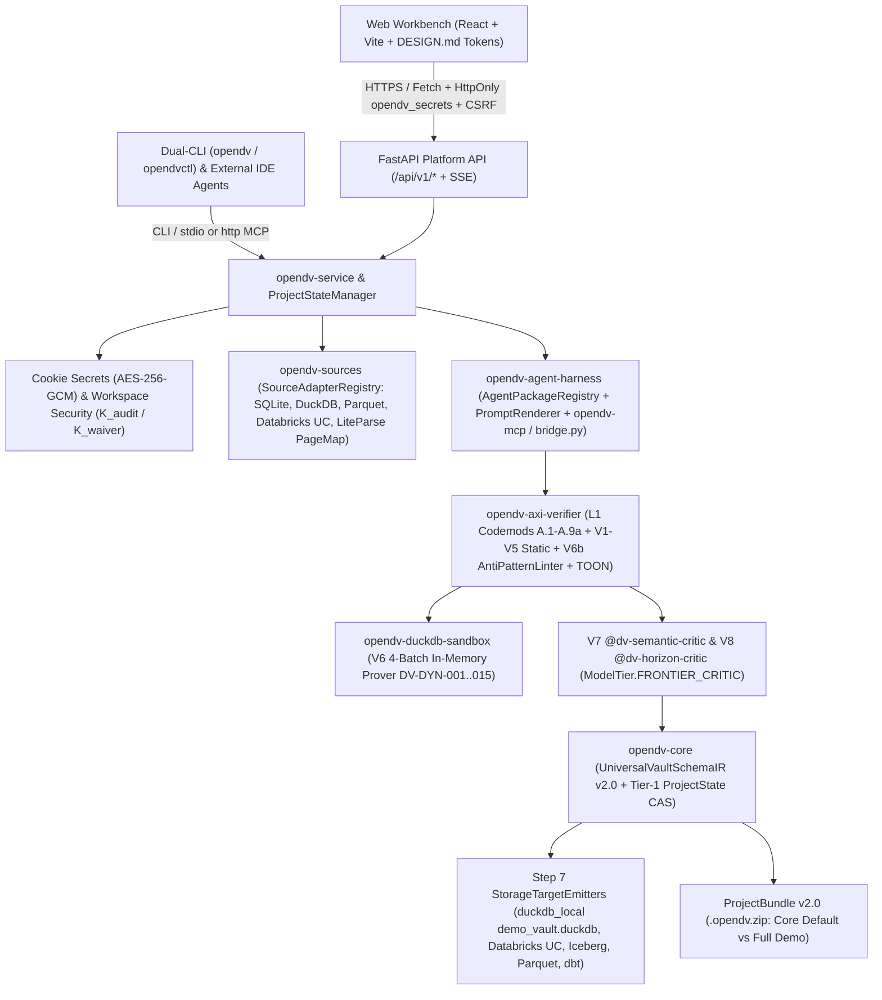

# Open-DV Consolidated End-to-End Architecture, Organized Gaps & Requirements, and UAT Verification Specification

> **Module:** `docs/31-v2-e2e-requirements-gaps-and-uat-spec.md` · **Revision:** v2.0 (2026-11-21)

> **Document Role:** Master Engineering & QA Specification consolidating all `48` UI/backend audit observations (`OBS-01..OBS-48`), `68` requirements (`REQ-01..REQ-68` — `65` active + `3` superseded by Flow B), `33` resolved design decisions (`Q-01..Q-33`), `9` Discovery/Grounding scenarios (`SCEN-01..09`), and `89` UAT acceptance cases (`UAT-*`).  
> **Companion User Guide:** [32-v2-user-experience-and-scenario-guide.md](32-v2-user-experience-and-scenario-guide.md)  
> **Source Triage & Technical Blueprints:** [uat-v2-feedback-and-triage-log.md](design/ontology-studio/uat-v2-feedback-and-triage-log.md) · [30-enterprise-dv2-modeling-and-loop-engineering.md](30-enterprise-dv2-modeling-and-loop-engineering.md) · [29-discovery-grounding-and-evolution-scenarios.md](29-discovery-grounding-and-evolution-scenarios.md)

---

## §1. Objectives, Confirmed End-State Decisions & Reconciliation Ledger

### 1.1 End-State Objectives
Open-DV's unified end state transforms ontology authoring and Enterprise Data Vault 2.0 generation from disconnected, CLI-heavy, single-shot scripts into a **Project-scoped, transparent, storage-agnostic, offline-portable, human-guided platform** with **100% parity** across:
1. **Web Workbench (`apps/opendv-web-workbench`)** — Styled strictly with canonical [DESIGN.md](../DESIGN.md) (`CLAUDE_TOKENS`: `#faf9f5` / `#f5f0e8` / `#efe9de` / `#181715` / `#cc785c` + `#5db872` / `#d4a017` / `#c64545`), `Instrument Serif` (`400`) + `DM Sans` + `JetBrains Mono`, `54px / 44px / 52px` chrome, and `§545` bipartite graph + **5-Zone (`Z0–Z4`)** grammar.
2. **Backend API & Service Runtime (`apps/opendv-platform-api` + `packages/opendv-*`)** — Decoupled two-tier `ProjectState`, zero-chunk Flow B MCP tools, neuro-symbolic 3-Loop CEGAR, in-memory DuckDB dynamic verification (`V6`), anti-pattern steering (`V6b`), frontier future-wave stress testing (`V8`), zero-SQL `UniversalVaultSchemaIR v2.0`, decoupled `v7` target materializers, and zero-trust `.opendv.zip` portability.
3. **Dual-CLI & Standalone Agents (`opendv` / `opendvctl` / `opendv mcp serve`)** — Exact functional parity with UI workflows and installable inside Claude Code / Antigravity without starting the API server.

### 1.2 The 10 Settled Architectural Decisions (`Q-01` .. `Q-33`)

| Decision Area | Confirmed End-State Rule | Primary References |
| :--- | :--- | :--- |
| **1. Project Container & Two-Tier State** | Adopt **"Project"** (`project_id` + `domain_namespace`, retaining CLI `--session` / REST compat). Consolidate `StudioSessionManager` + `PlatformStateContainer` into Tier-1 Authoritative `.opendv/projects/{project_id}/` (`project.json`, `cas/`, `waves/`, `horizon_assumptions.json`, signed `audit.jsonl`) vs. Tier-2 Disposable `targets/{target_id}/` (`target_manifest.json`, cached DDL, `demo_vault.duckdb`). Enforce strict per-project Step 6 baseline isolation (`0` cross-project leaks). | `Q-01`, `Q-23`, `Q-30`, `REQ-06`, `REQ-08`, `REQ-55`, `REQ-64` |
| **2. Project Export/Import Default Profile (`CONFIRMED`)** | **`Core Project State` (`core_project_state`) is the mandatory default** across Global Header Switcher, Step 1 Option B, Step 7 (`v7`), and `opendv project export` (`~12.6 KB`, Git-safe, `0` secrets, `LOCAL_ONLY` raw payloads stripped to tombstones). **`Full Self-Contained Demo` (`full_demo`, `~4.49 MB`)** is an explicit opt-in adding `targets/duckdb_local/demo_vault.duckdb` (`ZIP_STORED` so `>100:1` DEFLATE zip-bomb checks stay strict) & generated `V001..V00N` / full SQL. Import verifies `SHA-256` + Zip-Slip/ADS + `K_audit` re-anchoring (`IMPORT_REANCHOR`) and reports offline connector readiness. | `Q-33`, `REQ-68`, `OBS-48` |
| **3. Flow B Ingestion & MCP Discovery** | Retire fixed 800-char chunking (`REQ-17/18/24` superseded). Step 2 attaches files/notes instantaneously into CAS + lightweight `document_map.json` (`0s` LLM wait). Step 3 uses lazy master-detail navigation (`3a` tables + Schema Term Cloud + `★ Pin` / `✕ Mute` curation; `3b` Page & Outline Viewer). Step 4 explores full intact pages & tables via **9 `opendv-mcp` tools** (`view_page_image` selective on scanned pages, blocked if `LOCAL_ONLY`), with deterministic Python `verbatim_quote` offset resolution. | `Q-05..08`, `Q-10..11`, `Q-16`, `Q-18`, `REQ-16`, `REQ-25..26`, `REQ-35`, `REQ-38` |
| **4. Portable Agents & CLI/SDK Parity** | Package all Step 4 & Step 6 agents as `<agent-id>/{agent.yaml, SKILL.md, references/, subagents/}` using `firstmate` `Hard Rule 1` (`Read-Only Coordinator`, `Scout` vs. `Ship`, `NO GUESSING`), 3-tier `skills.sh` disclosure, dual-vendor `PromptRenderer` (Claude XML + batching + calm triggers vs. Gemini unmixed `TemplatedSystemInstructions` + `skills_paths` + `<plan>`), and `opendv mcp serve` for CLI parity without holding Windows `L5` `.session.lock`. | `Q-17`, `Q-19`, `REQ-36..37`, `REQ-40..41` |
| **5. 9-Scenario Grounding & Multi-Wave Modes** | Path A `skos:exactMatch` (`>= 0.65` Sage Green), Path A `skos:closeMatch` (`>= 0.65` Warm Amber Nuance Review), Path B1 Empirical Structured/Document (`1x` doc-only allowed, never `UNGROUNDED`), Path B2 Quarantine/Admin HMAC Waiver, `Local Only`/PII taint perimeter (`sat_*_pii`). `DynamicConceptRegistry` (4 layers) + `DiscoveryMode` (`incremental_new`, `incremental_reverify`, `full_rebuild`) + Steps 2–3 `✦ NEW` / `↻ UPDATED` / `✓ Modeled` badges. | `Q-13..15`, `REQ-28..34`, `REQ-39`, `OBS-18`, `OBS-21` |
| **6. Step 5 Explorer, Bidirectional YAML & Lossless Handoff** | 4-Mode Explorer (Graph + auto-open Node/Edge/Rule Inspector, Catalog Dictionary, Editable `ontology.yaml`, Version Diff + `ONT-EVO`). Tab 3 syncs on `Ctrl/Cmd+S` **or** valid `onBlur` with 3-state borders/micro-alerts (`#5db872` / `#d4a017` / `#c64545`, retaining last valid graph if invalid). Commit preserves typed attributes, `evidence_refs`, `key_authority_patterns`, `reference_enumerations`, and `governance_constraints`, ending cleanly with smart CTA & Project Handoff Bar. | `Q-22`, `Q-25`, `REQ-48`, `REQ-53..55` |
| **7. Step 6 (`v6`) Modeling, Anti-Pattern Steering, Configurable CEGAR & `V8` Horizon Critic** | Wide-table decomposition, `DOCUMENT_OBSERVED` routing (`UNSTRUCTURED_EXTRACTION_LINK` + `Planned`), `3-Tier BKCC + sal_*` integration, monotonic `epoch_tag` (`v2`, `v3`), configurable **3-Loop CEGAR** (`L1` codemods, `L2` static `V1–V5` + DuckDB `V6` + `V6b` `ONT/DV-AP` `@toon_v1 WARN-STEER` + `V7` `@dv-semantic-critic >= 90` + Zero-Self-Dealing `AntiPatternJustification`, `L3` Steward Hold) + non-bypassable `V1–V6` floor. Followed by Stage `06b` **`V8` `@dv-horizon-critic`** (`ModelTier.FRONTIER_CRITIC`) analyzing counterfactual `BRK-01..08` breaks with 4 anti-infinite-loop guards (`max_horizon_auto_steers=1`, `0` retries on business questions, `best_candidate` ratchet, `REASONABLY_STABLE` fast path) and persisting choices into `horizon_assumptions[]`. | `Q-21..22`, `Q-24`, `Q-26`, `Q-28`, `Q-31`, `REQ-44..47`, `REQ-50..52`, `REQ-58`, `REQ-60`, `REQ-62`, `REQ-66` |
| **8. Human-Centered `Guided ⇄ Architect` Step 6 UX & Loop Observatory** | Default **`Guided (Plain-English)`** hides raw rule IDs in primary headlines, collapses 8 engine stages onto a **4-Milestone Journey Bar** + Live Narrator + 30-Sec Visual Primer + `"Why Does This Table Exist?"` drawer, upgrades Holds/Smells/Horizon reviews into `GuidedDecisionCardDTO` (2-row concrete sample, `🔒 Lock-In` vs. `🟢 Flexible`, Option A vs. B trade-offs), and finishes with `ModelReadinessBriefDTO`. **`Architect Details`** (`1` click) opens the 4-Zone **CEGAR Loop Observatory** (`Cyclic Loop Capsule` + `Energy E` step-down + `0. Loop Storyboard` + 6 typed SSE streams + `Pause` / `Queue Hint` / `Accept Best`) and Horizon `6E` forensics. | `Q-27`, `Q-32`, `REQ-56..57`, `REQ-61`, `REQ-67` |
| **9. Storage-Agnostic `UniversalVaultSchemaIR v2.0` & Decoupled Step 7 (`v7`)** | Step 6 stops cleanly at certifying zero-SQL `UniversalVaultSchemaIR v2.0` (`FIXED_BINARY(32)`, monotonic `field_id`s, `PredicateAST`, `HashRecipeSpec`, Zero/Ghost seeds, `PhysicalLayoutHints`) + `SchemaWaveDelta`. Step 7 (`v7`) consumes Tier-1 state to generate **Incremental Migration (`Wave K -> Wave N`)** vs. **Full Schema Regeneration (`Waves 1..N`)** across `opendv.storage_emitters` (`duckdb_local` built-in demo DB `demo_vault.duckdb` + `Databricks UC`, `Apache Iceberg`, `Parquet`, `dbt` + Tier-2 warehouses). | `Q-29..30`, `REQ-63..65` |
| **10. Secrets, Cookies & Unified 3-Tab Settings** | Encrypted `HttpOnly` `AES-256-GCM` cookie (`opendv_secrets`, HKDF from `.odv_workspace_secret`) overrides `.env` on-demand per request with `0` plaintext persistence, paired with 3-Tab Settings (`AI Agent Harness & CEGAR Policy`, `Data Connections & Secrets` + Databricks UC Setup Guide, `Plugins, Agents & Extensions`) + missing-credentials inline recovery gate. | `Q-09`, `Q-20`, `REQ-19..23`, `REQ-43` |

### 1.3 Supersession & Item Count Reconciliation

| Category | Total Logged | Active Count | Superseded / Retired Items & Rationale |
| :--- | :---: | :---: | :--- |
| **Observations (`OBS-##`)** | `48` | `48` | All `OBS-01..OBS-48` remain tracked root causes driving active fixes *(earlier pre-Flow-B chunking symptoms in `OBS-11`, `OBS-14`, `OBS-16`, `OBS-22` resolved cleanly via Flow B `REQ-35`)*. |
| **Requirements (`REQ-##`)** | `68` | `65` | **`REQ-17`** *(Step 2 VLM toggle)*, **`REQ-18`** *(800-char chunker tuning / `opendv.chunkers`)*, and **`REQ-24`** *(Step 2 chunk queue & sticky toggle)* are explicitly **superseded by Confirmed Flow B (`REQ-35` + `REQ-38`)**. `REQ-16`, `REQ-25`, `REQ-26` remain active and aligned to Flow B. |
| **Questions (`Q-##`)** | `33` | `30` active + `3` historical | `Q-07`, `Q-08`, `Q-10` resolved & superseded by `Q-16` / `REQ-35`; `"giis"` typo retired under `Q-24`. |
| **UAT Cases (`UAT-*`)** | `89` | `87` active + `2` superseded notes | **`UAT-S2-09`** *(retained as Flow B VLM `Local Only` block redirect to `UAT-S4-09`)* and **`UAT-S2-14`** *(updated to verify `UAT-S4-08` instant attach)* remain listed in sequence so `89/89` IDs trace 1:1. |

---

## §2. End-to-End Full-Stack Flow Walkthrough (Frontend ⇄ REST/SSE/MCP ⇄ Backend & Storage)

Below is the **complete 10-phase end-to-end execution walkthrough** mapping UI components, Zustand state, REST/SSE/MCP transport, backend Python services, and disk persistence — highlighting both **what currently executes** and the **target fix** where gaps exist.

### Phase 0: Platform Startup, Authentication, Encrypted Cookie Secrets & Settings Hub
1. **Service & Auth Bootstrap ([`main.py`](../apps/opendv-platform-api/src/opendv_platform_api/main.py)):**
   - FastAPI mounts `24` routers under `/api/v1` (plus `web_ui.router` serving the SPA at `/`, `/ontology`, `/dv-schema`, `/explorer`, `/settings`) via [`routers/__init__.py`](../apps/opendv-platform-api/src/opendv_platform_api/routers/__init__.py#L37-L72).
   - Loopback launcher authenticates browser sessions via `POST /api/v1/ontology/studio/auth/launch-nonce` and `/auth/token`; mutating routes pass `verify_csrf` ([`csrf.py`](../apps/opendv-platform-api/src/opendv_platform_api/security/csrf.py#L92-L120)).
2. **Global Navigation Chrome ([`ExplorerTopBar.tsx`](../apps/opendv-web-workbench/src/explorer/ExplorerTopBar.tsx) / [`TopBarStatusPills.tsx`](../apps/opendv-web-workbench/src/explorer/TopBarStatusPills.tsx)):**
   - **Current Gap (`OBS-05`, `OBS-48`):** Shows a non-interactive bare `session_id` pill with no switcher and no UI export/import button.
   - **Target State (`REQ-08`, `REQ-59`, `REQ-68`):** `54px` header renders `SPIKE_MARK_SVG` + 4 tabs (`Ontology & Pipeline`, `DV Schema Explorer`, `Run Explorer`, `Settings`) + interactive **Active Project Switcher (`Project Name · Version · Namespace`)** with instant switching, `+ New Project`, and **one-click `Export / Import (.opendv.zip)`** (`Core Project State` default).
3. **Unified 3-Tab Settings Hub (`PlatformSettingsView.tsx` `/settings` + `GET|PUT /api/v1/platform/config`):**
   - **Current Gap (`OBS-12`, `OBS-13`, `OBS-46`):** Configures only AI harness providers and 2 tiers (`HIGH_REASONING`, `FAST_TIER`); lacks Data Connections UI, cookie secret vault, Databricks UC guide, plugin manager UI, and `CEGAR` / `FRONTIER_CRITIC` defaults.
   - **Target State (`REQ-20..23`, `REQ-36`, `REQ-43`, `REQ-58`, `REQ-66`):**
     - **Tab 1 (`AI Agent Harness & CEGAR Policy`):** Configures provider (`agy`, `claude-cli`, `claude`, `gemini`, `deterministic`), `ModelTier.FRONTIER_CRITIC` (`OPENDV_CLAUDE_CRITIC_MODEL` / `OPENDV_AGY_CRITIC_MODEL`), `HarnessBudget`, and workspace default `CegarPolicyDTO` + `enable_horizon_stress_critic` / `max_horizon_auto_steers`.
     - **Tab 2 (`Data Connections & Secrets`):** Stores named non-sensitive adapter profiles (`host`, `http_path`, `default_catalog`, `default_schema`, `credentials_ref`) alongside `Test Connection`, the collapsible **Databricks Unity Catalog Setup Guide**, and the **Encrypted `HttpOnly` Secret Vault** (`POST|GET|DELETE /api/v1/secrets/cookie`: `AES-256-GCM` sealed via RFC 5869 HKDF subkey from `.odv_workspace_secret`, overriding `os.environ` per request with `0` plaintext stored on disk or in SSE logs).
     - **Tab 3 (`Plugins, Agents & Extensions`):** Lists `opendv.source_adapters`, `opendv.document_parsers`, offline `opendv.term_extractors`, `opendv.storage_emitters`, and `AgentPackageRegistry` (`opendv.agents` + `.opendv/agents/*`) with driver health checks (e.g. `databricks-sql-connector`) and **`Reload All Plugins`**.

---

### Phase 1: Step 1 — Project Creation, Baseline Mode & Project Resume
- **UI & Store:** [`Step1ScopeAndBaseline.tsx`](../apps/opendv-web-workbench/src/ontology/wizard/Step1ScopeAndBaseline.tsx) (`Mockups 1A, 1B, 1C`).
- **API & Backend:** `GET /api/v1/ontology/studio/sessions` (plus planned `GET /workspace-seeds`, `GET /starter-packs/{id}/preview`, `POST /api/v1/projects/import`), `POST /api/v1/ontology/studio/init`, `POST /sessions`, `GET /starter-packs`, `POST /starter-packs/apply`, [`starter_packs.py`](../packages/opendv-service/src/opendv_service/studio/starter_packs.py).
- **Flow:**
  1. User picks **Option A (New Project)** — supplies `Project Name (Session ID)` (`^[a-z0-9][a-z0-9_-]{0,63}$`, optional auto-slug), validated `Domain Namespace` (`^[a-z][a-z0-9_]{0,63}$` scoping `urn:ontology:entity:{ns}:*`), and one of 3 clear modes:
     - **`Blank · v0.0.0`:** Starter Packs hidden (`OBS-01` fix), renders `Blank Genesis Ready` card.
     - **`Workspace Seed`:** Lists discovered repo `*_graph_a_ontology.yaml` contracts (`pe_asset_management`, `global_commerce`, `wealth_mgmt`, `am_walkthrough_seed`) and auto-fills namespace while marking concepts as `grandfathered_concept_uris`.
     - **`Starter Packs`:** Offers pre-init **Ontology Preview** (`core_spine` `6` CBCs + vertical `hub_*` + `lnk_*` + standards) and seeds `v1.0.0`.
  2. Or **Option B (Resume / Import)** — opens an existing Project (displaying labeled `Namespace:` badges instead of bare parentheses) or imports either a full portable **`.opendv.zip`** project archive (`REQ-68`) or a single `.yaml`/`.json`/`.ttl` ontology file ([`ttl_importer.py`](../packages/opendv-service/src/opendv_service/studio/ttl_importer.py)).
- **Backend Artifact Created:** Initializes `.opendv/projects/{project_id}/project.json` (plus `audit.jsonl` HMAC chain, `versions/v0.0.0` or `v1.0.0` JCS SHA-256 baseline).

---

### Phase 2: Step 2 — Source Attachment, Plugin Connectors & Flow B Instant Document Map
- **UI & Modal:** [`Step2SourcesAndNotes.tsx`](../apps/opendv-web-workbench/src/ontology/wizard/Step2SourcesAndNotes.tsx), [`CatalogTablePickerModal.tsx`](../apps/opendv-web-workbench/src/explorer/builder/CatalogTablePickerModal.tsx) (`Mockups 2A, 2B`).
- **API & Backend:** `GET /api/v1/sources/adapters`, `POST /api/v1/sources/inspect`, `POST /sessions/{id}/sources`, `POST /sessions/{id}/sources/connectors`, `POST /sessions/{id}/sources/text`, `DELETE /sources/{id}`, [`source_registry.py`](../packages/opendv-sources/src/opendv_sources/registry/source_registry.py), [`connector_ingestion.py`](../packages/opendv-service/src/opendv_service/studio/connector_ingestion.py), [`sqlite_inspector.py`](../packages/opendv-sources/src/opendv_sources/adapters/sqlite_inspector.py), [`duckdb_attach.py`](../packages/opendv-sources/src/opendv_sources/adapters/duckdb_attach.py), [`databricks_uc.py`](../packages/opendv-sources/src/opendv_sources/adapters/databricks_uc.py).
- **Flow:**
  1. Purpose-separated zones explain downstream contributions (`1. Structured Databases & Files` ➔ Hubs/Links/Types; `2. Policy Docs & Inline Domain Notes` ➔ Rules, Keys, Doc-only Concepts; `3. Attached Sources Manager`).
  2. Badge explicitly states **`Deterministic Local Profiling · No AI Agent Used`**.
  3. Opening any connector loads `ConnectorUIManifestDTO.connection_fields` dynamically (`enabled`, `disabled_reason`, `hint`, `options_source`), hiding/disabling `Catalog` & `Credentials Ref` on SQLite/DuckDB while rendering `host`, `http_path`, `catalog`, `schema_name`, SSRF checks, and inline **Missing Credentials Recovery** (`REQ-22`) on Databricks UC.
  4. `client_uploadable` file DBs (`.sqlite`, `.db`, `.sqlite3`, `.duckdb`, `.ddb`, `.parquet`, `.csv`, `.xlsx`) offer **both** local file upload and URI input; expanded previews render `<thead>` (`Column`, `Type`, `Keys & Links`, `Governance`) with hover hints explaining `PK (#1)` and `FK ➔ table.col`.
  5. **Flow B Instant Attachment (`REQ-35`):** Uploading PDFs/MD/Office docs or clicking **`Attach Inline Note`** (custom title, optional **`Do not send to agent (Local Only)`** taint checkbox) stores bytes immediately into CAS and runs deterministic `LiteParse` / `pypdf` / `Markdown` page & TOC extraction into **`document_map.json`** (`0s` LLM wait, zero 800-char chunk queue). `inputs/manifest.json` persists non-sensitive `connector_config` (`selected_tables`, `host`, `http_path`, `credentials_ref`) so every attached row supports **`Preview`**, **`Edit`**, and **`Detach`**.

---

### Phase 3: Step 3 — Scalable Lazy Evidence Navigator (`3a` Tables & Schema Cloud · `3b` Page Map)
- **UI & API:** [`Step3PreviewEvidence.tsx`](../apps/opendv-web-workbench/src/ontology/wizard/Step3PreviewEvidence.tsx), `/evidence/tables/index` (lazy tree) + `/evidence/tables/{table_id}?rows_limit=20&rows_offset=0`, `/evidence/documents/map` + `/documents/{doc_id}/pages`.
- **Flow (`Mockup 3A` + Flow B `3b`):**
  1. **`3a · Structured Tables`:** Master-Detail Navigator handles 100s of tables cleanly (`Source ➔ Schema ➔ Table`), lazily fetching column profiles, PK/FK/PII tags, and paged rows (`<= 20`) only on click. Interactive **Structured Schema Term Cloud** (stopword-filtered via `tokenize_concept_text` in [`tokenization.py`](../packages/opendv-service/src/opendv_service/ontology/matching/tokenization.py)) lets stewards filter tables and **`★ Pin as Concept Seed`** / **`✕ Mute Noise`** into `evidence/concept_memory.json`.
  2. **`3b · Document Outlines & Pages` (Flow B):** Displays lightweight `document_map.json` per doc (total pages, TOC/headings, `Table Page` badges, `Scanned/Raster` flags, lazy page preview, or `Local Only` offline lexical summary).
  3. Both rails display Wave provenance pills (**`✦ NEW · Unprocessed`**, **`↻ UPDATED SINCE v1.0.0`**, **`✓ Modeled in v1.0.0`**) computed by diffing `versions/vX.Y.Z/meta.json` `processed_sources` against `inputs/manifest.json`.

---

### Phase 4: Step 4 — Flow B Multi-Agent MCP Discovery, Clarification Q&A & 9-Scenario Grounding
- **UI & Store:** [`Step4AgentDiscovery.tsx`](../apps/opendv-web-workbench/src/ontology/wizard/Step4AgentDiscovery.tsx), [`AskFiboPanel.tsx`](../apps/opendv-web-workbench/src/ontology/wizard/AskFiboPanel.tsx), [`CitationInspectorDrawer.tsx`](../apps/opendv-web-workbench/src/ontology/wizard/CitationInspectorDrawer.tsx), `wizard-step4-adapter.ts`, `wizard-step4-sync.ts` (`Mockups 4A, 4B, 4C`).
- **API & Backend:** `POST /construct`, `POST /clarify`, `POST /answers`, `POST /citations/resolve`, `GET /fibo/lookup`, `POST /fibo-qa`, `POST /waiver`, [`agent_runner.py`](../packages/opendv-service/src/opendv_service/studio/agent_runner.py), [`job_runners_construct.py`](../packages/opendv-service/src/opendv_service/studio/job_runners_construct.py), [`opendv-mcp`](../packages/opendv-agent-harness/src/opendv_agent_harness/tools/bridge.py), [`verifier.py`](../packages/opendv-service/src/opendv_service/ontology/matching/verifier.py), [`validator_governance.py`](../packages/opendv-service/src/opendv_service/ontology/validator_governance.py).
- **Flow:**
  1. **Pre-Run Baseline & Mode Selection:** If `> v0.0.0`, renders collapsible `Existing Baseline: v1.0.0` + `🔒 Deployed in Vault` badges (auto-bound from Step 6's certified contract). User chooses `DiscoveryMode` (`incremental_new` [default], `incremental_reverify`, `full_rebuild`), plus optional zero-token `SourceSmellPreScanner` alerts (`<antipattern_radar>`).
  2. **Staged Tool-Backed Execution:** `@ontology-first-mate` (`Hard Rule 1` coordinator) spawns `@doc-ontology-scout` / `@page-range-scout` / `@table-cluster-scout` using the **9 Step 4 MCP tools** (`get_document_map`, `read_document_pages`, selective `view_page_image`, `search_document`, `inspect_table_profile` <=5 masked rows, `search_concepts` across 4 layers, `get_baseline_concept`, `record_concept_finding`, `emit_clarification_question`) with `Local Only` blocking enforced inside both prompts and MCP handlers, and **zero** silent `32,000`-char eviction.
  3. **Deterministic Grounding & Typing Split:** LLMs propose normalized names + `verbatim_quote` + `page_number`; Python resolves exact `(doc_id, page_number, char_start, char_end)` spans (backward-compatible with legacy `chunk_id`), resolves SQL types from `tables.jsonl` (`OBS-27` merge fix stops bare `"string"` stubs from overwriting `69` typed `add_attribute` ops), and validates grounding across [`SCEN-01..09`](29-discovery-grounding-and-evolution-scenarios.md):
     - **Path A1 (`>= 0.65` Sage Green `exactMatch`)**, **Path A2 (`>= 0.65` Warm Amber `closeMatch` Nuance Comparator)**, **Path B1 (`STRUCTURED_SCHEMA` / `DOCUMENT_OBSERVED` `1x` empirical)**, **Path B2 (Fail-Closed Quarantine `staged_candidates.json` unless Admin HMAC Waiver)**, **Clarification Q&A**, and **`⊕ EXTENDS v1.0.0`** multi-wave cards.
  4. **Live Workbench UI:** Streams stage progress, `tables_inspected / total_tables` & `pages_inspected / content_pages` ledger, progressive cards showing `Concept (hub_*) <-> Matched FIBO Class <- table.column (SQL) -> Type Dropdown`, docked collapsible terminal + **`View Agent I/O (stdin / stdout)`**.

---

### Phase 5: Step 5 — 4-Mode Ontology Explorer, Bidirectional Editable YAML, Smells & Lossless Commit
- **UI & Store:** [`Step5DiffGraphExport.tsx`](../apps/opendv-web-workbench/src/ontology/wizard/Step5DiffGraphExport.tsx), [`GraphCanvas.tsx`](../apps/opendv-web-workbench/src/ontology/components/GraphCanvas.tsx), [`VisualEditorDrawer.tsx`](../apps/opendv-web-workbench/src/ontology/components/VisualEditorDrawer.tsx), `wizard-step4-sync.ts`, `graph-commit-ops.ts` (`Mockups 5A, 5B, 5C`).
- **API & Backend:** `POST /validate`, `POST /deltas/validate`, `POST /delta`, `POST /deltas/apply`, `GET /export`, `GET /export-blueprint`, [`validator_structural.py`](../packages/opendv-service/src/opendv_service/ontology/validator_structural.py), [`validator_governance.py`](../packages/opendv-service/src/opendv_service/ontology/validator_governance.py).
- **Flow:**
  1. **4-Mode Explorer (`< 5,000` tokens/submodule):**
     - **Tab 1 (`Interactive Graph & Inspector`):** `>= 560px` dot-grid `elkjs` canvas with filter pills (`All`, `✦ New`, `Exact FIBO`, `≈ Close Match`, `Path B`, `Doc-Observed`, `🔒 Deployed in Vault`, `⚠ Smell Warnings`). Clicking any node **or** relationship edge automatically opens the synchronized Inspector (`Concept | Links | Key Tiers | Governance`).
     - **Tab 2 (`Catalog & Mapping Dictionary`):** Filterable tables for Concepts, Links, `3-Tier Key Authority Patterns`, `Reference Enumerations`, and `Governance / PII Constraints`.
     - **Tab 3 (`Editable Ontology YAML`):** True Visual Store ⇄ `ontology.yaml` editor (`"yaml"` `^2.9.1` CST line/column diagnostics + `GraphAOntology` + `ONT-EVO` checks), saving on `Ctrl/Cmd+S` **or** valid `onBlur` with 3-state `DESIGN.md` chrome (`#5db872` Saved / `#d4a017` Unsaved Valid / `#c64545` Invalid at `Line X: Col Y` preserving last valid graph) and compact micro-alert.
     - **Tab 4 (`Version Diff & Governance Scorecard`):** `vBase -> Draft` diff ledger + `ONT-AP-001..005` smell warnings with 1-click `[↻ Apply Recommended Refactor]` vs. `[✓ Sign Steward Waiver]` (`waiver_workflows.py`).
  2. **Lossless Commit & Frictionless Handoff:** Commits all attribute types, `evidence_refs`, `key_authority_patterns`, `reference_enumerations`, and `governance_constraints` into `versions/vX.Y.Z/ontology.yaml`. Bottom **Project Handoff Bar** switches smartly between **`Commit Draft & Open Step 6 (<Project>) ➔`** and **`Continue to Step 6 (<Project>) ➔`** (`OBS-32` fix), while top-stepper navigation guards uncommitted changes (`OBS-33` fix).

---

### Phase 6: Step 6 (`v6`) — Enterprise DV 2.0 Synthesis, 3-Loop CEGAR, DuckDB V6, Anti-Pattern Steering (`V6b`), Horizon Stress (`V8`) & `Guided ⇄ Architect` UX
- **UI & Store:** [`Step6PipelineBuildAndRun.tsx`](../apps/opendv-web-workbench/src/ontology/wizard/Step6PipelineBuildAndRun.tsx), [`Step6GateBadges.tsx`](../apps/opendv-web-workbench/src/ontology/wizard/Step6GateBadges.tsx), [`StewardHoldModal.tsx`](../apps/opendv-web-workbench/src/explorer/modals/StewardHoldModal.tsx), `pipeline-execution-slice.ts`, `step6-run-hydration.ts` (`Mockups 6F, 6G` Guided Default; `6A, 6B, 6C, 6D, 6E` Architect).
- **API & Backend:** `POST /api/v1/pipelines/runs`, `GET /runs/{id}/events` (SSE + `Last-Event-ID`), `POST /runs/{id}/decisions`, [`runner.py`](../packages/opendv-agent-harness/src/opendv_agent_harness/pipeline/runner.py), [`axi_repair_loop.py`](../packages/opendv-agent-harness/src/opendv_agent_harness/pipeline/axi_repair_loop.py), [`contract_synthesizer.py`](../packages/opendv-agent-harness/src/opendv_agent_harness/pipeline/contract_synthesizer.py), [`contract_evolver.py`](../packages/opendv-agent-harness/src/opendv_agent_harness/pipeline/contract_evolver.py), [`opendv_axi_verifier`](../packages/opendv-axi-verifier/src/opendv_axi_verifier/alg_a8_orchestrator.py), [`sandbox_engine.py`](../packages/opendv-duckdb-sandbox/src/opendv_duckdb_sandbox/sandbox_engine.py), [`ir_lowerer.py`](../packages/opendv-duckdb-sandbox/src/opendv_duckdb_sandbox/ir_lowerer.py) *(moving to `opendv-core`)*.
- **Flow:**
  1. **Entry & Strict Project Isolation (`OBS-35`, `OBS-39`):** Step 6 entry auto-calls `exportBlueprint()`, filters baselines strictly to `activeProjectId`, renders **Wave Timeline + 3-Pillar Bound Project Card** (`Wave 1 Cold Start` vs `Wave N Auto-Locked`), and selects a `CegarPolicyDTO` preset (`Fast Dev` | `Balanced Enterprise` | `Strict Regulated` | `Symbolic-Only`).
  2. **Multi-Stage Execution & 3-Loop CEGAR (`00..07` + `06b`):**
     - **Stages `00–02`:** `@vault-first-mate` preflight (`<antipattern_radar>` + `ProjectState.horizon_assumptions[]`), `@scout-source` (`Graph B` `selected_tables` + column `evidence_refs`), `@scout-unstructured` (`DOCUMENT_OBSERVED` ➔ `UNSTRUCTURED_EXTRACTION_LINK` + `Planned Concepts`).
     - **Stage `03` (`@ship-vault`):** Multi-concept wide-table decomposition (`OBS-28` fix), `3-Tier BKCC` (`GLOBAL` vs `TIER_3`), `sal_*` cross-wave key evolution, `mas_*`/`esat_*`/`t_lnk_*`/`ref_*`/`sat_*_pii`, monotonic `epoch_tag` (`v2`, `v3`), and Zero/Ghost/sparse PITs.
     - **Loop `L1` (`Stage 04` Codemod Fixpoint · 0 LLM tokens):** Iterates `Alg A.9a ➔ A.4 ➔ A.2 ➔ A.3 ➔ A.1`.
     - **Loops `L2` + `V1–V5` + `V6` DuckDB + `V6b` Anti-Patterns + `V7` Semantic Critic:**
       - `V6` runs 4 schema-driven adversarial batches (`Batch 1–4`, `50–250ms` in `:memory:` DuckDB `enable_external_access=False`) proving `DV-DYN-001..015` & `DV-AP-011` (`updated_at` delta churn).
       - `V6b` emits `@toon_v1 WARN-STEER` directives (`DV-AP-001..012`); energy $E(IR_k)$ tracks hard errors + warnings; `best_candidate` ratchet & `SHA-256(JCS)` cycle guard prevent regressions.
       - Isolated **`@dv-semantic-critic` (`V7`)** scores `0–100` (`>= 90`) and audits any agent `AntiPatternJustification` (`0` self-dealing). Irreducible conflicts pause cleanly to **Loop `L3` (`StewardHoldModal` / `GuidedDecisionCardDTO`)** and resume SSE via `Last-Event-ID`.
     - **Stage `06b` / `V8` Frontier Horizon Stress Critic (`@dv-horizon-critic` on `ModelTier.FRONTIER_CRITIC`):** Deterministic `FragilitySurfaceScanner` + `BRK-01..08` stress analysis with `ABSORBED_NATIVELY` filter. `Bucket A` runs at most `1` outer auto-steer; `Bucket B` business roadmap questions pause immediately (`0` retries); stable models emit **`REASONABLY_STABLE` (`>= 85`)**. Human either **`Accept Current Schema as Reasonably Stable`** OR checks/enters future assumptions and clicks **`Steer & Restart Outer Loop`**, persisting into `ProjectState.horizon_assumptions[]`.
  3. **Dual UX Streaming Layer:**
     - **Default `Guided` Mode (`Mockups 6F, 6G`):** 4-Milestone Journey Bar, plain-English `GuidedNarratorEventDTO` stream (`0` jargon), 30-Sec Visual Primer, `"Why Does This Table Exist?"` inspector, consequence-driven `GuidedDecisionCardDTO`s, and `ModelReadinessBriefDTO`.
     - **1-Click `Architect Details` (`Mockups 6B–6E`):** 4-Zone **CEGAR Loop Observatory** (`Cyclic Loop Capsule` + `Energy E`, `0. Loop Storyboard`, dark Counterexample/Critic Inspector, `Pause`/`Queue Hint`/`Accept Best`, `§545` live bipartite canvas with `⏸ Pause Camera`, `#181715` persona terminal).
  4. **Stage `07` Certification (Zero SQL):** Certifies **`UniversalVaultSchemaIR v2.0`** (`FIXED_BINARY(32)`, monotonic `field_id`s, `PredicateAST`, `HashRecipeSpec`, `SeedRecordsSpec`, `PhysicalLayoutHints`) + **`SchemaWaveDelta`** (`evolution_locks`) inside **Tier-1 `ProjectState`**.

---

### Phase 7: Step 7 (`v7`) — Decoupled Target Storage Emitters, Incremental vs. Full DDL & Built-In `duckdb_local` Demo
- **UI & CLI:** New Step 7 tab/view (`Mockup 07`: `Step7StorageAndSql.tsx`) + `opendv export-storage --ir <path> --target <target>` + `opendv storage migrate|regenerate|demo --project <id> --target <target>`.
- **Backend Emitters:** Pluggable `StorageTargetEmitter` (`opendv.storage_emitters` SPI) reading **Tier-1 `head_schema_ir`** & **`wave_history`** and managing **Tier-2 `targets/{target_id}/` (`TargetMaterializationState`)**:
  - **Mode A — `Incremental Migration (Wave K -> Wave N)` *(when target tables already exist)*:** Compares `TargetMaterializationState.last_materialized_wave` vs `head_wave`, keeps 100% of Wave `1..K` Raw Vault tables and `hash_diff` digests untouched (`0` `DROP`/`ALTER`), creates only additive new Hubs/Links/companion `sat_*_ext_vN`/`sal_*`/`pit_*`, seeds Zero/Ghost records only on new tables, and issues non-destructive `CREATE OR REPLACE VIEW` (`stg_*`, `vw_*`) (`V002__wave_2_incremental.sql`).
  - **Mode B — `Full Schema Regeneration (Waves 1..N)`:** Deterministically compiles the full cumulative schema from `head_schema_ir` (`full_schema_wN.sql` or full Iceberg/Parquet manifest), guaranteed catalog-identical to incremental waves (`64/64` column parity verified).
  - **Targets Supported:** Built-in **`duckdb_local`** (`targets/duckdb_local/demo_vault.duckdb` — `$0` local demo DB with sample load + live SQL query runner), **Databricks UC Delta** (`BINARY`, `CLUSTER BY`, `delta.columnMapping.mode='name'`, `SET TAGS`), **Apache Iceberg v2/v3** (`field_id`, `fixed[32]`, hidden `day`/`bucket[16]`), **Pure Parquet/Arrow** (direct ZSTD + Ghost row), **dbt/AutomateDV YAML**, plus Tier-2 roadmap adapters (**Snowflake**, **PostgreSQL 15+**, **BigQuery**, **SQL Server / Fabric**, **Redshift**, **ClickHouse**).

---

### Phase 8: Portable `.opendv.zip` Export & Zero-Trust Cross-Workspace Import
- **Surfaces (`Mockup 1C`):** Global Header Project Switcher (`Export / Import`), Step 1 Option B (`Import Portable Project .opendv.zip`), Step 7 Footer, and CLI/REST (`opendv project export|import --profile core|full_demo`, `GET /api/v1/projects/{id}/bundle`, `POST /api/v1/projects/import`).
- **Default Behavior (`Confirmed`):** Defaults strictly to **`Core Project State`** (`core_project_state`: `~12.6 KB`, Git-ready Tier-1 CAS + `project.json` + `horizon_assumptions.json` + `audit.jsonl`). Selecting **`Full Self-Contained Demo`** (`full_demo`: `~4.49 MB`) adds `targets/duckdb_local/demo_vault.duckdb` (`ZIP_STORED`) + cached SQL.
- **Zero-Trust Security & Readiness:** Auto-strips plaintext secrets (`credentials_ref` kept only) and `LOCAL_ONLY` raw payloads (replaced with redacted tombstone + taint; raw confidential override blocked unless `acknowledge_confidential=True` + rationale >= `10` chars); validates Windows paths & SHA-256 digests; verifies & re-anchors `audit.jsonl` with local `K_audit_B`; handles duplicate IDs (`fail` `409` vs `rename` `<id>-copy`); emits offline-first `ImportReadinessReport` (`READY_OFFLINE` vs optional `NEEDS_LOCAL_SECRET_BINDING`).

---

### Phase 9: Auxiliary Views — Standalone DV Schema Explorer, Run Explorer & Dual-CLI
- **`/dv-schema` ([`DvSchemaExplorerView.tsx`](../apps/opendv-web-workbench/src/explorer/dv-schema/DvSchemaExplorerView.tsx) & [`dv_schema_explorer.py`](../apps/opendv-platform-api/src/opendv_platform_api/routers/dv_schema_explorer.py)):** Shares `<DvBipartiteGraphTab />`, `"Why Does This Table Exist?"`, 4-mode inspector, and `UniversalVaultSchemaIR v2.0` view directly with Step 6.
- **`/explorer` (`Run Explorer` & `SessionLogsInspector.tsx`):** Replays historical CEGAR Causal Storyboards, `Last-Event-ID` SSE streams, `View Agent I/O (stdin/stdout)`, Horizon Stress reports, and Readiness Briefs.
- **Dual-CLI & Standalone Agents (`opendv` / `opendvctl` / `open-dv-workflow` skill):** Shares exact backend service specs across `--discovery-mode`, `--cegar-profile`, `--cegar-max-attempts`, `--cegar-critic-min-score`, `--horizon-max-steers`, `opendv agents list|install|inspect`, `opendv export-storage`, `opendv storage migrate|regenerate|demo`, and `opendv project export|import`.

---

## §3. Complete Organized Gaps (`OBS-01..48`) & Requirements (`REQ-01..68`) by Workstream

### Workstream `WS-01` — Canonical `ProjectState`, Global Project Switcher & Per-Project Isolation
- **Root Gaps Addressed:**
  - `OBS-04`: Option B rows render opaque `s-<hex> (general)` / `(asset_management)` without human `Project Name` or labeled `Namespace:` badges ([Step1ScopeAndBaseline.tsx#L352](../apps/opendv-web-workbench/src/ontology/wizard/Step1ScopeAndBaseline.tsx#L352)).
  - `OBS-05`: Global header renders only a static `sessionDigest` pill without version/namespace or switcher; Step 2 still displays `Session <id>` ([TopBarStatusPills.tsx#L145-L162](../apps/opendv-web-workbench/src/explorer/TopBarStatusPills.tsx#L145-L162)).
  - `OBS-39`: `fetchPipelineBaselines` ([step6-run-hydration.ts#L315-L344](../apps/opendv-web-workbench/src/ontology/wizard/step6-run-hydration.ts#L315-L344)) fetches `/api/v1/runs` globally without project filtering, leaking Project A's certified `deployed_contract` onto brand-new Project B; `startDvPipelineRun` falls back to `"default_project"` (`axi_repair_loop.py#L491`).
  - `OBS-45`: `StudioSessionManager` (`<studio_root>/<session_id>/`) and monolithic `platform_state.json` split project state with zero unified Tier-1 `ProjectState`, monotonic `SchemaWaveDelta`, or `field_id` / epoch locks ([session_manager.py#L1-L67](../packages/opendv-service/src/opendv_service/studio/session_manager.py#L1-L67), [persistence.py#L38-L120](../packages/opendv-service/src/opendv_service/state/persistence.py#L38-L120)).
- **Consolidated Requirements:**
  - `REQ-06`: Adopt **"Project"** across UI labels and expose editable `Project Name (Session ID)` (`^[a-z0-9][a-z0-9_-]{0,63}$`, reserved-route guard, optional slug fallback) wired to `session_id` while retaining `--session <id>` & `/sessions` CLI/REST backward compatibility.
  - `REQ-08`: Always-visible **Active Project Switcher** in global header showing `Project Name · Version · Namespace`, instant switching, `+ New Project`, and clean `Project <id>` labels across views.
  - `REQ-55`: Make Step 6 strictly **Project-Based**: filter baselines to `activeProjectId`, propagate `project_id` on every run, add Step 5 **Project Handoff Bar** (`Mockup 5C`), and add Step 6 **Project Selector + Wave Timeline + 3-Pillar Bound Project Card** (`Mockup 6A`).
  - `REQ-64` *(Canonical State Schema)*: Unify `.opendv/projects/<project_id>/` into **Tier-1 Authoritative State** (`project.json` + `cas/` + `waves/` + `audit.jsonl`: `project_meta`, `source_registry[]`, `ontology_lineage`, `modeling_head`, `evolution_locks` with `field_id_high_water_marks` & `companion_sat_epoch_counters`, `wave_history[]` `SchemaWaveDelta`, `horizon_assumptions[]`) separated cleanly from **Tier-2 Secondary / Regenerable `targets/<target_id>/`**.
- **Mapped UAT:** `UAT-S1-06`, `UAT-S1-07`, `UAT-NAV-01`, `UAT-NAV-02`, `UAT-S6-10`, `UAT-S7-01`.

### Workstream `WS-02` — Portable `.opendv.zip` (`ProjectBundle v2.0`) Export & Zero-Trust Import (`Core` Default)
- **Root Gap Addressed:**
  - `OBS-48`: `bundle.py` + `session_export_workflows.py` support CLI `.odvstudio.zip` for Steps 1–5 only (`session.json`, `versions/`, `inputs/`, `audit.jsonl`), dropping Steps 6–7 `ProjectState`; Step 1 (`#L383-L422`) and Step 5 only support bare `.yaml`/`.json`/`.ttl` files; zero Web UI buttons exist; naive DEFLATE on sparse `.duckdb` blocks falsely trips `> 100:1` zip-bomb checks ([bundle.py#L1-L260](../packages/opendv-service/src/opendv_service/studio/bundle.py#L1-L260)).
- **Consolidated Requirement:**
  - `REQ-68`: Upgrade `bundle.py` to `.opendv.zip` (`ProjectBundle v2.0`) packaging Steps 1–7 across **2 profiles with `Core Project State` (`core_project_state`, `~12.6 KB`) LOCKED AS DEFAULT** and **`Full Self-Contained Demo` (`full_demo`, `~4.49 MB`, adding `demo_vault.duckdb` via `ZIP_STORED` + `V001..V00N`/full SQL)** optional. Auto-strip plaintext secrets (`credentials_ref` kept) and `LOCAL_ONLY` raw files (redacted tombstone + taint kept; raw override blocked unless `acknowledge_confidential=True` + rationale `>= 10` chars); enforce traversal/ADS/tamper guards (`ARCHIVE_SECURITY_VIOLATION`, `BUNDLE_HASH_MISMATCH`), cross-workspace HMAC verification + `IMPORT_REANCHOR` signing (`K_audit_B`), conflict modes (`fail` `409` vs `rename` `-copy`), offline-first `ImportReadinessReport` (`READY_OFFLINE` vs `NEEDS_LOCAL_SECRET_BINDING`), and 4-surface UX (`Header`, `Step 1`, `Step 7`, `opendv project export|import` + REST, `Mockup 1C`).
- **Mapped UAT:** `UAT-NAV-03` *(+ prototype `verify_project_export_import_bundle.py`)*.

### Workstream `WS-03` — Step 1 Scope, Seed Modes, Validation & Starter Pack Previews
- **Root Gaps Addressed:**
  - `OBS-01`: Starter Packs stay visible & selectable in `Blank · v0.0.0` and `Workspace Seed` modes and get silently ignored on submit ([Step1ScopeAndBaseline.tsx#L208-L273](../apps/opendv-web-workbench/src/ontology/wizard/Step1ScopeAndBaseline.tsx#L208-L273)).
  - `OBS-02`: `Domain Namespace` input lacks guidance/regex check (`^[a-z][a-z0-9_]{0,63}$`), causing `HTTP 400` on submit.
  - `OBS-03`: `Workspace Seed` sends blind `fromWorkspace: true` without listing repo contracts (`pe_graph_a_ontology.yaml`, `commerce_graph_a_ontology.yaml`, `wm_graph_a_ontology.yaml`, `am_walkthrough_seed/versions/v1.0.0/ontology.json`).
- **Consolidated Requirements (`Mockups 1A, 1B`):**
  - `REQ-01`: Crisp mode hints clarifying Option A vs. Option B (`Workspace Seed` loads repo `workspace/` `grandfathered_concept_uris` vs. Option B uploads arbitrary files or `.opendv.zip`).
  - `REQ-02`: URN explanation (`urn:ontology:entity:<ns>:*`), live `^[a-z][a-z0-9_]{0,63}$` browser validation, auto-`snake_case` fix suggestion, and disabled submit while invalid.
  - `REQ-03`: Hide Starter Packs completely when `Blank` / `Workspace Seed` active; display `Blank Genesis (v0.0.0) Ready` card in Blank mode.
  - `REQ-04`: `GET /api/v1/ontology/studio/workspace-seeds` (ignoring `worktrees/`, `.git/`, `node_modules/`, `.venv/`) populating selectable radio list + auto-namespace.
  - `REQ-05`: `GET /api/v1/ontology/studio/starter-packs/{pack_id}/preview` + UI drawer showing vertical CBCs (`hub_*`), auto-included `core_spine` (`6` CBCs), links (`lnk_*`), and standards alignment before init.
- **Mapped UAT:** `UAT-S1-01`, `UAT-S1-02`, `UAT-S1-03`, `UAT-S1-04`, `UAT-S1-05`.

### Workstream `WS-04` — Step 2 Plugin Connectors, Contract Modals, Flow B Attach, Secret Vault & Settings Hub
- **Root Gaps Addressed:**
  - `OBS-06`: `CatalogTablePickerModal` lacks local file picker for `client_uploadable` SQLite/DuckDB files; `EXTENSION_TO_MIMES` omits `.sqlite`, `.db`, `.sqlite3`, `.duckdb`, `.ddb`.
  - `OBS-07`: `Catalog`, `Schema`, `Credentials Ref` inputs render unconditionally for SQLite without hints or inspected dropdowns.
  - `OBS-08`: Expanded column preview lacks `<thead>` headers (`Column`, `Type`, `Keys & Links`, `Tags`) and `PK (#1)` / `FK ➔ ...` plain-English tooltips.
  - `OBS-09`: Attached source rows lack `Preview`, `Edit`, and `Detach` controls; `inputs/manifest.json` omits `connector_config`.
  - `OBS-10`: `SourceAdapterRegistry` plugin dispatch is bypassed by hardcoded `sqlite`/`duckdb`/`file`/`databricks` switches in `list_adapters()`, `connector_ingestion.py`, and Step 2 tiles.
  - `OBS-11`: Inline Domain Notes hardcode `domain-note.md` and stay unparsed until clicking `Parse Attached Documents`.
  - `OBS-12`: Modal omits non-sensitive Databricks `host` / `http_path` from `get_ui_manifest()`; `.env.example` documents ~11 vars instead of `60+`.
  - `OBS-13`: `/settings` lacks Data Connections & Secrets UI; Databricks `connector_config` isn't saved with attached tables; Step 2 lacks missing-credentials prompt.
  - `OBS-14`: Single-job `POST /parse` lock throws `HTTP 409`, lacks sticky Auto/Manual toggle & per-doc progress *(resolved cleanly by retiring Step 2 chunk parsing under Flow B `REQ-35`)*.
  - `OBS-22` *(part 1 — ingestion chunking)*: Static 800-char chunking fragments tables & rules across boundaries.
- **Consolidated Requirements (`Mockups 2A, 2B, 8A, 8B`):**
  - `REQ-09`: Offer both **Upload / Pick Local File** (to CAS) and **Local Path / URI** for all `client_uploadable` file DBs & files.
  - `REQ-10`: Add `enabled`, `disabled_reason`, `hint`, and `options_source` on `ConnectorFieldSpecDTO` so irrelevant fields (`Catalog`/`Credentials Ref` on SQLite) disable dynamically and `Schema`/`Catalog` become dropdowns from `/sources/inspect`.
  - `REQ-11`: Compact `<thead>` + hover tooltips on headers and `PK` / `FK` badges.
  - `REQ-13`: Persist non-sensitive `connector_config` in `inputs/manifest.json` and wire **`Preview`**, **`Edit`**, and **`Detach`** (`DELETE /sources/{id}`).
  - `REQ-14`: Full dynamic `SourceAdapterRegistry` plugin dispatch across backend + Step 2 cards + **Import / Manage Adapters** modal.
  - `REQ-15`: Purpose-driven Step 2 layout zones (`1. Structured Databases & Files`, `2. Policy Docs & Inline Domain Notes`, `3. Attached Sources Manager`).
  - `REQ-16`: Custom inline note names + instant CAS & `document_map.json` readiness (`0s` LLM wait, zero manual `Parse` click).
  - *Superseded by Flow B (`REQ-35`):* `REQ-17` *(Step 2 VLM toggle)*, `REQ-18` *(800-char chunker settings / `opendv.chunkers`)*, `REQ-24` *(Step 2 chunk queue & sticky toggle)*. *(Note: `opendv.document_parsers` stays pluggable.)*
  - `REQ-19`: Render all non-sensitive `connection_fields` (`host`, `http_path`, SSRF allowlist checks) + clear `uv sync --extra databricks` remediation when driver missing.
  - `REQ-20`: Encrypted `HttpOnly` cookie secret vault (`POST|GET|DELETE /api/v1/secrets/cookie`, `AES-256-GCM` + `.odv_workspace_secret` HKDF, overrides `.env` on-demand, `0` plaintext persisted).
  - `REQ-21`: Complete grouped `open-dv/.env.example` template (`Workspace`, `Server/Auth/SSRF`, `Databricks UC`, `AI Harness`, `OCR/FIBO`).
  - `REQ-22`: Persist non-sensitive remote connector params with attached tables + inline **Missing Credentials Recovery Prompt** when cookies clear/server restarts.
  - `REQ-23`: Unified **3-Tab Settings Hub (`/settings`)** + Step 2 **`Configure in Settings ➔`** / **`Browse Tables ➔`** readiness gate.
  - `REQ-43`: Interactive **`"How to Configure Databricks Unity Catalog"`** drawer in Settings, Databricks modal, and `docs/` (`CAN USE`, `GRANT USE CATALOG/SCHEMA/SELECT`, `'pii'='true'` tag propagation).
  - `REQ-35` *(Part 1 — Flow B Step 2/3 & Local-Only)*: Pluggable `opendv.document_parsers` building `document_map.json`; remove `deterministic_pipeline.py#L557-L569` prose-skip bug; upgrade offline `Local Only` extraction via `tokenize_concept_text` + optional `opendv.term_extractors`.
- **Mapped UAT:** `UAT-S2-01..15` (`09` & `14` Flow-B updated), `UAT-SET-01..05`.

### Workstream `WS-05` — Step 3 Scalable Lazy Previews, Schema Cloud & Multi-Wave Provenance
- **Root Gaps Addressed:**
  - `OBS-15`: `/evidence/tables` and `/evidence/chunks` eagerly return all tables/rows/chunks unpaginated (`Step3PreviewEvidence` DOM bottleneck at 100s of tables).
  - `OBS-16`: `_TERM_RE` includes stopwords, drops 2-letter acronyms, renders non-interactive Step 3b pills, and Step 3a lacks a schema term cloud.
  - `OBS-18` *(part 1 — Steps 2–3 lineage)*: Committed `versions/vX.Y.Z/` lacks `processed_sources`, so Steps 2–3 cannot flag `✦ NEW` or `↻ UPDATED` wave additions.
  - `OBS-22` *(part 2 — term tokenization)*: `_TERM_RE` ignores `tokenization.py`'s `tokenize_concept_text()`.
- **Consolidated Requirements (`Mockup 3A` + Flow B `3b`):**
  - `REQ-25`: Lazy `/evidence/tables/index` + `/evidence/tables/{table_id}?rows_limit=20&rows_offset=0` Master-Detail navigator; Flow B `GET /evidence/documents/map` + `/documents/{doc_id}/pages` Outline & Page Viewer (`3b`). Both stamped **`Deterministic Evidence View · No AI Agent Used`**.
  - `REQ-26`: Interactive **Step 3a Structured Schema Term Cloud** (stopword-filtered, click-to-filter table tree + **`★ Pin as Concept Seed`** / **`✕ Mute Noise`** saved to `evidence/concept_memory.json`).
  - `REQ-28`: Record `processed_sources` in `versions/vX.Y.Z/meta.json` and display **`✦ NEW · Unprocessed`**, **`↻ UPDATED SINCE vX.Y.Z`**, and **`✓ Modeled in vX.Y.Z`** badges + filter across Steps 2 & 3.
- **Mapped UAT:** `UAT-S3-01..04`.

### Workstream `WS-06` — Portable Agent Packages, CLI/SDK `opendv-mcp` Parity & Vendor `PromptRenderer`
- **Root Gaps Addressed:**
  - `OBS-23` *(part 1 — prompt & tools)*: Monolithic single `ONTOLOGY_ARCHITECT` call with `tools=()` and `subagents=()`, silently popping chunks past `32,000` chars.
  - `OBS-24`: `ClaudeCliHarnessAdapter` passes `--tools ""` (`claude_cli_adapter.py#L6`) and `AgyCliHarnessAdapter` mounts no MCP server; personas are 1-line strings (`term_scout.py#L32-L35`).
  - `OBS-26`: Step 4 personas lack `firstmate` invariants, 3-tier `SKILL.md` disclosure, and Gemini vs. Claude compilation; `DEFAULT_CLAUDE_MODEL_MAP` uses `agy` proxy aliases outside CLI adapter (`routing.py#L28-L29`).
- **Consolidated Requirements:**
  - `REQ-12`: Deterministic vs. AI-Agent clarity badges + **`View Agent I/O (stdin / stdout)`** deep link everywhere agents run.
  - `REQ-36`: Package all Step 4 & Step 6 agents as `<agent-id>/{agent.yaml, SKILL.md, references/, subagents/}` runnable standalone (`Claude Code`, `Antigravity`, `opendv agent run`) AND dynamically registered via `AgentPackageRegistry` + `Settings -> Agents, Skills & MCP`.
  - `REQ-37`: Ship **`opendv mcp serve --transport stdio|http --session <id>`** exposing all Step 4 Flow B + Step 6 DV2/AXI tools for CLI `--mcp-config` parity with `bridge.py`; ensure orchestrators release Windows `L5` `.session.lock` before awaiting CLI subprocesses.
  - `REQ-40`: Unify Step 4 & Step 6 prompts around `firstmate` `Hard Rule 1` (`Read-Only Coordinator`, `Scout` vs. `Ship`, `NO GUESSING` Captain-Hold) + `skills.sh` 3-tier `SKILL.md` (`~80-120` tok frontmatter, `~150-250` line body, on-demand `references/*.md`).
  - `REQ-41`: Runtime **`PromptRenderer`** compiling canonical `SKILL.md` into Claude XML (`<evidence_payload>`, parallel batching, calm triggers) vs. Gemini unmixed `TemplatedSystemInstructions` (`skills_paths`, `<plan>`, end-of-context anchoring), and separate native Anthropic IDs from `agy` aliases in `routing.py`.
- **Mapped UAT:** `UAT-S2-08`, `UAT-S4-10`, `UAT-S4-11`, `UAT-S4-13`, `UAT-AGT-02`.

### Workstream `WS-07` — Step 4 Live Agent Discovery, 4-Layer Registry, Typed Cards, `closeMatch` & 9 Scenarios
- **Root Gaps Addressed:**
  - `OBS-17`: Static persona pills, disabled `"Run in progress"` UI, zero per-table/page coverage or intermediate card streaming.
  - `OBS-18` *(part 2 — Step 4 adaptation)*: Blank pre-run baseline on `v1.0.0`, bare URI prompts, no `DiscoveryMode`, and `wizard-step4-adapter.ts#L250-L305` silently dropping `add_relationship` / `add_external_mapping` on existing concepts.
  - `OBS-19`: `renderConceptCard` hides matched FIBO class name/URI, `target_hub`, definition, and links.
  - `OBS-20` & `OBS-27`: `wizard-step4-adapter.ts#L247` drops all `69` typed `add_attribute` ops whenever bare `"string"` stubs from `AddConceptOp.attributes` already exist, rendering `"string"` everywhere with zero `table.column` provenance.
  - `OBS-21`: `wizard-step4-sync.ts#L69-L72` hardcodes `UNGROUNDED` whenever `fibo_match.score < 0.7`, ignoring the `0.65` Path A threshold and valid Path B1 empirical evidence.
  - `OBS-25`: Static-only FIBO index; `staged_candidates.json` overwrites across waves; no `concept_memory.json` or live intra-run symbol table.
- **Consolidated Requirements (`Mockups 4A, 4B, 4C`):**
  - `REQ-27`: Staged Flow B runner emitting `source_scan_started/completed`, `persona_stage_changed`, `agent_observation`, `candidate_concept_streamed`, `clarification_raised`, redacted `agent_stream`, live coverage monitor, and collapsible bottom terminal.
  - `REQ-29`: Pre-run Existing Baseline Context banner, **`DiscoveryMode`** (`incremental_new`, `incremental_reverify`, `full_rebuild`, `--discovery-mode`), rich prompt context, and fixed **`⊕ EXTENDS vX.Y.Z`** diff cards.
  - `REQ-30`: Fix `#L247` typed `add_attribute` merge + `evidence/tables.jsonl` SQL type lookup (`BIGINT->integer`, `DOUBLE->decimal`, `BOOLEAN->boolean`, `DATE->date`); render full **`Concept (hub_*) <-> Matched FIBO Class <- table.column (SQL) -> Logical Type`** cards.
  - `REQ-31`: Highlight `skos:closeMatch` in **Warm Amber** (`≈ Close FIBO Match · Review Nuance`), filter chips, and side-by-side FIBO vs. Concept comparator (`Keep Close Match` / `Swap FIBO` / `Switch to Path B`).
  - `REQ-35` *(Part 2 — MCP & Citations)*: Wire all **9 Step 4 MCP tools** (`view_page_image` selective on scanned pages, blocked if `LOCAL_ONLY`), Python deterministic `verbatim_quote` -> `(doc_id, page_number, char_start, char_end)` spans, and `/citations/resolve` compatibility with legacy `chunk_id`.
  - `REQ-38`: `@page-range-scout` & `@table-cluster-scout` fan-out with live `pages_inspected / content_pages` & `tables_inspected / total_tables` ledger.
  - `REQ-39`: **4-Layer `DynamicConceptRegistry`** (`versions/vX.Y.Z`, live `in_run` symbol table, `concept_memory.json` + incremental `staged_candidates`, optional workspace catalog) via `search_concepts`.
  - `OBS-21` Fix *(under `REQ-32`)*: Align Step 4–5 UI grounding badges (`Path A Exact`, `Path A Close`, `Path B Empirical`, `Ungrounded`) to `0.65` + empirical evidence rules.
- **Mapped UAT:** `UAT-S4-01..13`, `UAT-SCEN-01..09`.

### Workstream `WS-08` — Step 5 4-Mode Ontology Explorer, Editable YAML, Upstream Smells & Lossless Handoff
- **Root Gaps Addressed:**
  - `OBS-31` *(part 1 — Step 4/5 Vault locks)*: Certified `deployed_contract` isn't auto-bound into Step 4/5 UI/guards (`🔒 Deployed in Vault`).
  - `OBS-32`: Clicking `"Commit Ontology"` after already committing fails with `"No Changes to Commit"` and blocks `goToStep(6)`.
  - `OBS-33`: Top stepper allows entering Step 6 uncommitted (`v0.0.0` shows green `Committed 0.0.0` while `startPipelineRun` drops `blueprint`).
  - `OBS-34`: Step 4 ➔ 5 sync/commit drops `5` `key_authority_patterns`, `5` `reference_enumerations`, `1` `governance_constraint`, and typed attributes (`v1.0.0/ontology.yaml#L544` has `reference_enumerations: []`).
  - `OBS-37`: Node/edge clicks on `GraphCanvas` toggle an unmounted drawer (`visualEditorOpen` stays false); zero link/key-tier/enum/governance inspector; cramped `340px` height & `--dv-*` vars.
  - `OBS-38`: Blind YAML download only (`"yaml": "^2.9.1"` & `serializeGraphAYaml` unwired in Step 5).
  - `OBS-42` *(part 1 — upstream smells)*: Source-clone Concepts (`ONT-AP-001`), static lookup Hubs (`ONT-AP-002`), fragile BKs (`ONT-AP-003`), islands/starbursts (`ONT-AP-004`), and unclassified PII (`ONT-AP-005`) pass unchecked.
- **Consolidated Requirements (`Mockups 5A, 5B, 5C`):**
  - `REQ-44` *(Step 4/5 part)*: Auto-bind latest certified `deployed_contract` into Step 4/5 guards + `🔒 Deployed in Vault` badges.
  - `REQ-48`: Lossless sync & commit of all typed attributes, `evidence_refs`, `key_authority_patterns`, `reference_enumerations`, `governance_constraints`; split CTA (`Commit Draft & Continue ➔` vs `Continue to Step 6 ➔`); uncommitted stepper guard & Amber `Draft Only (0.0.0)` badge.
  - `REQ-53`: 4-Mode Ontology Explorer (`1. Interactive Graph & auto-open Node/Edge/Key/Governance Inspector`, `2. Catalog & Mapping Dictionary`, `3. Editable Ontology YAML`, `4. Version Diff & Governance Scorecard`).
  - `REQ-54`: `<OntologyYamlEditorTab />` bidirectional round-trip (`Ctrl/Cmd+S` **or** valid `onBlur` sync with `relatedTarget` guard), 3-state `DESIGN.md` chrome (`#5db872` / `#d4a017` / `#c64545` exact `Line X: Col Y`, preserving last valid graph if invalid), compact micro-alert, Jump Outline, and `vBase <-> Draft` YAML diff.
  - `REQ-60` *(Upstream part)*: `ONT-AP-001..005` Amber badges across Tabs 1–3 with **`[↻ Apply Recommended Refactor]`** & **`[✓ Sign Steward Waiver]`**.
- **Mapped UAT:** `UAT-S5-01..05`.

### Workstream `WS-09` — Step 6 (`v6`) Modeling, Configurable 3-Loop CEGAR, DuckDB `V6`, `V6b` Smells, `V7` Critic & `V8` Horizon Critic
- **Root Gaps Addressed:**
  - `OBS-28`: `_synthesize_cumulative_contract` assigns 1 Primary Hub per table, collapsing wide 4-concept Parquet feeds.
  - `OBS-29`: `Gate 1` rejects doc-only Hubs as `PHANTOM_HUB_REJECTED`; `wizard-step6-adapter.ts` drops `DOCUMENT_OBSERVED` candidates.
  - `OBS-30`: `wizard-step6-adapter.ts#L126-L141` forwards filename stems instead of Step 2 `selected_tables` & drops column `evidence_refs`.
  - `OBS-31` *(part 2 — Step 6 cold-start guard & epoch)*: Allows accidental `__cold_start__` overwrite on Wave 2+; `stages_agentic.py#L245` hardcodes `epoch_tag = "v2"`.
  - `OBS-35`: Never calls `exportBlueprint()` on Step 6 entry; shows cryptic `"Deployed Contract Baseline (D12)"` upload UX.
  - `OBS-36`: `execute_axi_repair_loop` is single-shot with 1-line Stage 04 prompt, silent invalid fallback, zero DuckDB counterexample feedback, and no independent semantic critic.
  - `OBS-42` *(part 2 — downstream anti-patterns)*: Binary `PASS`/`REJECT`/`ASK-USER` `@toon_v1` misses graded smells (`DV-AP-001..012`), pre-flight `<antipattern_radar>`, and self-dealing exception audits.
  - `OBS-43`: `adversarial_batches.py` couples Batch 4 defaults to Private Equity fixtures; clean `public_am` Parquet lacked multi-active/churn/boomerang/collision traps.
  - `OBS-46`: Validates Wave-W only without counterfactual future-source breakage testing (`BRK-01..08`); `ModelTier` lacks dedicated `FRONTIER_CRITIC`.
- **Consolidated Requirements (`Mockup 6E` + Core CEGAR Engine):**
  - `REQ-44` *(Step 6 part)*: Guard `__cold_start__` on certified projects and compute monotonic `epoch_tag` (`v2`, `v3`, ...).
  - `REQ-45`: Forward `selected_tables` + column `evidence_refs`; split wide tables cleanly; add source companion Satellites without duplicating Hubs.
  - `REQ-46`: Preserve Wave-1 Hub signatures (`DV-EVO-003`) while appending Wave-2 `business_key_sources` (`lei_code`) + Business Vault `sal_*` crosswalks.
  - `REQ-47`: Route extracted doc concepts via `UNSTRUCTURED_EXTRACTION_LINK` + provenance Satellites and isolate unbacked policy entities as `Planned Ontology Concepts`.
  - `REQ-49`: Auto-call `exportBlueprint()` on Step 6 entry, replace `D12` copy with plain-English **Step 6 Evolution Lock Card** (`Wave 1 Cold Start` vs `Wave N Auto-Lock`), plus **`Inspect final_contract.yaml & Wave Diff`**.
  - `REQ-50`: Enforce full Enterprise DV 2.0 + `Semantic Grounding + 3-Tier BKCC + sal_*` rules (`mas_*`, `esat_*`, `t_lnk_*`, `ref_*`, Hard/Soft `Z1..Z4` firewall, Zero/Ghost/PIT/Bridge).
  - `REQ-51`: 3-Loop CEGAR (`L1` 0-token codemod fixpoint, `L2` static `V1–V5` + DuckDB `V6` `@toon_v1` repair + isolated `V7` `@dv-semantic-critic >= 90`, `L3` Steward Hold) guarded by energy $E(IR_k)$ & `SHA-256(JCS)` cycle detection.
  - `REQ-58`: Configurable `CegarPolicyDTO` (`fast`, `balanced` [default], `strict`, `symbolic_only`) + `Settings`/`Step 6`/CLI overrides + non-bypassable `V1–V6` certification floor (`UNCERTIFIED_DRAFT`).
  - `REQ-60` *(Downstream part)*: `SourceSmellPreScanner` `<antipattern_radar>`, `V6b` (`DV-AP-001..012` incl. Batch-3 `DV-AP-011` delta churn) `@toon_v1 WARN-STEER` loop feedback, Zero-Self-Dealing `AntiPatternJustification` audited by `V7`, and Steward refactor/waiver buttons.
  - `REQ-62`: Schema-driven DuckDB Batch 1–4 perturbation synthesis + checked-in **12-Trap Benchmark Suite** (`tests/fixtures/cegar_antipattern_suite/`, `12/12` DuckDB verified).
  - `REQ-66`: Stage `06b` / **`V8` `@dv-horizon-critic`** on `ModelTier.FRONTIER_CRITIC` (`OPENDV_*_CRITIC_MODEL`), `FragilitySurfaceScanner`, `BRK-01..08` + `ABSORBED_NATIVELY` filter, `Bucket A` `1`-steer / `Bucket B` immediate human pause / `REASONABLY_STABLE` (`>= 85`) fast path, `best_candidate` ratchet, and `ProjectState.horizon_assumptions[]` memory (`Mockup 6E`).
- **Mapped UAT:** `UAT-S6-01..08`, `UAT-S6-10`, `UAT-S6-13`, `UAT-S6-15`, `UAT-S6-18`, `UAT-FIX-02`.

### Workstream `WS-10` — Step 6 Live Observatory Streaming, `§545` Canvas & `Guided ⇄ Architect` UX
- **Root Gaps Addressed:**
  - `OBS-40`: Step 6 lacks animated progress, hides agent personas, inverts `05`/`06` pills, hardcodes `vault-first-mate` & drops `TOKEN_DELTA`/`THOUGHT_DELTA` in SSE, and drops SSE reconnect on Hold resume.
  - `OBS-41`: Emits zero intermediate schema snapshots and renders only a tiny `190px` 4-column static HTML table post-run.
  - `OBS-47`: Step 6 & `StewardDecisionFields.tsx` expose raw engine jargon (`Gate 0..6`, `15/15 DV-DYN`, `APPROVE/REJECT/ANSWER`) without plain-English narration, visual primer, sample data, or lock-in guidance.
- **Consolidated Requirements (`Mockups 6B, 6C, 6D, 6F, 6G`):**
  - `REQ-52`: Stream live L1/L2/L3 iteration, energy delta, DuckDB counterexample, and Critic scores into Step 6 & `SessionLogsInspector` (+ check in `docs/30`).
  - `REQ-56`: Animated `00..07` true-order stage & persona progress header + docked `#181715` streaming terminal with real `agent_persona`, `TOOL_CALL`/`@toon_v1`, and Hold-resume `Last-Event-ID` SSE reconnect (`Mockup 6B`).
  - `REQ-57`: Emit incremental `SCHEMA_SNAPSHOT`/`TOPOLOGY_DELTA` events driving an interactive 4-mode DV 2.0 Schema Workspace (`<DvBipartiteGraphTab />`, `⏸ Pause Camera`, Stage/Attempt Time-Travel Scrubber, Mutation Feed, Entity Inspector, `Mockups 6B/6C`).
  - `REQ-59`: Enforce `DESIGN.md` tokens (`#faf9f5`..`#181715`..`#cc785c`), bundled `Instrument Serif` (`400`) + `DM Sans` + `JetBrains Mono`, `54px/44px/52px` chrome + `SPIKE_MARK_SVG`, `§545` bipartite grammar, and **5-Zone (`Z0–Z4`)** terminology across all Steps 5–7 & `/dv-schema` views.
  - `REQ-61`: 4-Zone **CEGAR Loop Observatory** (`Cyclic Loop Capsule ①..⑤` + `Energy E` step-down, `0. Loop Storyboard`, Dark Intermediate Counterexample/Critic Inspector, mid-loop `Pause` / `Queue Hint` / `Accept Best` controls, and `6` typed SSE events, `Mockup 6D`).
  - `REQ-67`: Default Step 6 to **`Guided (Plain-English)`** (`Architect Details` 1 click away) with `0` compiler jargon in headlines, **4-Milestone Journey Bar**, `GuidedNarratorEventDTO`, 30-Sec Visual Primer + `"Why Does This Table Exist?"` drawer, **`GuidedDecisionCardDTO`** (2-row data example, `🔒 Lock-In` vs. `🟢 Flexible` pill, Option A vs. B cards), and `ModelReadinessBriefDTO` (`Mockups 6F, 6G`).
- **Mapped UAT:** `UAT-S6-09`, `UAT-S6-11`, `UAT-S6-12`, `UAT-S6-14`, `UAT-S6-16`, `UAT-S6-19`.

### Workstream `WS-11` — Zero-SQL `UniversalVaultSchemaIR v2.0`, Decoupled Step 7 (`v7`), `duckdb_local` & Governance Docs/CLI
- **Root Gaps Addressed:**
  - `OBS-44`: `ir_lowerer.py` sits inside `opendv-duckdb-sandbox`; `IRSystemColumns` embeds dialect types (`TIMESTAMP_NTZ(9)`/`VARCHAR`); `databricks_ddl.py#L28` coerces `BINARY` to `STRING`; raw SQL `WHERE` strings leak into IR; `field_id`s & layout hints are absent.
  - `OBS-45` *(Step 7 storage part)*: SQL emission & DB materialization run inside Step 6 without a decoupled `v7` target layer or `Incremental` vs `Full Regeneration` state tracking.
- **Consolidated Requirements (`Mockup 07`):**
  - `REQ-63`: Move lowering into `opendv-core`, certify zero-SQL **`UniversalVaultSchemaIR v2.0`** (`FIXED_BINARY(32)`, monotonic `field_id`s, `PredicateAST`, `HashRecipeSpec`, Zero/Ghost `SeedRecordsSpec`, `PhysicalLayoutHints`), and emit storage formats via pluggable `opendv.storage_emitters` (`Iceberg v2`, `Databricks UC Delta` keeping native `BINARY`, `Pure Parquet`, `dbt/AutomateDV`, `DuckDB`/SQL) + `opendv export-storage`.
  - `REQ-64` *(v7 part)*: Separate Step 7 (`v7`) completely from Step 6 modeling, supporting **Incremental Migration (`Wave K -> Wave N`)** when target tables exist (zero `DROP`/destructive `ALTER` on historical Raw Vault) vs. **Full Schema Regeneration (`Waves 1..N`)** deterministically (`100%` column parity).
  - `REQ-65`: Ship built-in zero-infra **`duckdb_local`** (`targets/duckdb_local/demo_vault.duckdb` + `opendv storage migrate|regenerate|demo` live mart queries) and standardized `opendv.storage_emitters` roadmap (`Snowflake`, `PostgreSQL`, `BigQuery`, `SQL Server / Fabric`, `Redshift`, `ClickHouse`).
  - `REQ-07`: Complete manual UAT checklist covering all active `OBS`/`REQ`/`SCEN` items.
  - `REQ-32`, `REQ-33`, `REQ-34`: Publish `SCEN-01..09` across `open-dv/docs/29`, `docs/30`, `apps/opendv-website` (`InferenceMatrixDiagram`, `HowItWorksSection`, `VerifierDeepDiveSection`, `tour-data.ts`, MP4 + `.vtt`), `.agents/rules/discovery-and-grounding-scenarios.md`, `AGENTS.md`, `CLAUDE.md`, `apps/opendv-website/AGENTS.md`, `.agents/skills/open-dv-workflow/SKILL.md`, and `tests/architecture/test_scenario_matrix_sync.py`.
  - `REQ-42`: Check in `data/public_am/` multi-modal fixture suite + `scripts/generate_esg_parquet.py` alongside `tests/fixtures/cegar_antipattern_suite/`.
- **Mapped UAT:** `UAT-S6-17`, `UAT-S7-01..03`, `UAT-FIX-01..02`, `UAT-SCEN-01..09`, `UAT-WEB-01..02`, `UAT-AGT-01..02`.

---

## §4. Master End-to-End UAT Testing Checklist & Expected Outputs (`89` Items)

> **Execution Convention:** All tests assume loopback server (`http://127.0.0.1:8420`) or matching Dual-CLI (`opendv` / `opendvctl`). Both **Expected UI Output** and **Expected Backend / Disk / DB Output** must pass simultaneously before signing off `[x]`.

### 4.1 Step 1 — Scope & Baseline (`UAT-S1-01` .. `UAT-S1-07`)

| ID & Trace | Test Setup & Exact Action | Expected UI Output | Expected Backend / API / Disk Output |
| :--- | :--- | :--- | :--- |
| **`UAT-S1-01`** `REQ-01` | Open Step 1 (`Option A` & `Option B`); toggle across `Blank · v0.0.0`, `Workspace Seed`, `Starter Packs`. | Crisp 1–2 line hints explain `Option A` vs `Option B`, `Workspace Seed` (`workspace/` repo contracts) vs Option B arbitrary upload/bundle import, plus `Project Name` & `Domain Namespace` helpers. | Read-only render; no `POST /init` until explicitly submitted. |
| **`UAT-S1-02`** `OBS-02`, `REQ-02` | Type `My-Domain 2026`, `123_abc`, `""` in `Domain Namespace`; then enter `asset_management`. | Invalid inputs disable submit CTA, show red border + inline `^[a-z][a-z0-9_]{0,63}$` helper + auto-`snake_case` fix (`my_domain_2026`); valid `asset_management` shows green state & unlocks submit. | Zero invalid `HTTP 400 SYNTAX_INVALID_ARGUMENT` calls sent to `/ontology/studio/init` from blocked CTA; direct invalid API call still returns `400`. |
| **`UAT-S1-03`** `OBS-01`, `REQ-03` | Select a Starter Pack card, switch to **`Blank · v0.0.0`**, verify UI, and click `Initialize Project`. | Starter Pack cards hide completely, replaced by `Blank Genesis (v0.0.0) Ready` confirmation card; initializes cleanly to `0` concepts even though a pack was clicked earlier. | `POST /ontology/studio/init` (`source_kind="blank"`, `pack_ids=[]`) returns `201`; `.opendv/projects/<id>/versions/v0.0.0/ontology.yaml` contains `concepts: []`. |
| **`UAT-S1-04`** `OBS-03`, `REQ-04` | Select **`Workspace Seed`**; inspect selectable contract list; choose `pe_asset_management` & initialize. | Starter Packs stay hidden; repo contracts (`pe_asset_management`, `global_commerce`, `wealth_mgmt`, `am_walkthrough_seed`) appear as radio options and auto-fill `domain_namespace`. | `GET /ontology/studio/workspace-seeds` returns HTTP `200` excluding `worktrees/`, `.git/`, `node_modules/`, `.venv/`; `POST /init` marks seeded URIs in `grandfathered_concept_uris`. |
| **`UAT-S1-05`** `REQ-05` | Select **`Starter Packs`**; click **`Preview`** on `Multi-Asset / IBOR` and test `1-Click All Domains`. | Preview drawer lists vertical CBC concepts + target `hub_*` names, auto-included `core_spine` (`6` CBCs), canonical relationships (`lnk_*`), standards alignment, and `v1.0.0` outcome prior to init. | `GET /starter-packs/{id}/preview` returns `200`; `POST /starter-packs/apply` seeds `v1.0.0/ontology.yaml` + RFC 8785 JCS `base_sha256`. |
| **`UAT-S1-06`** `OBS-04`, `REQ-06`, `Q-01` | Enter `am-ibor-2026` in `Project Name (Session ID)`, test negative inputs (`admin`, `Bad Space`), and test blank auto-slug. | Reserved/invalid inputs show inline `^[a-z0-9][a-z0-9_-]{0,63}$` errors; valid `am-ibor-2026` creates project under chosen ID (blank generates clean `proj-<slug>`). | Created under `.opendv/projects/am-ibor-2026/` (`project.json` has `session_id: "am-ibor-2026"`); `opendv ontology studio ... --session am-ibor-2026` resolves identically. |
| **`UAT-S1-07`** `OBS-04`, `Q-02` | View saved projects list under **Option B**. | Each row shows human `Project Name` (`am-ibor-2026`) alongside explicit **`Namespace: asset_management`** / **`Namespace: general (default)`** pills (zero bare parentheses). | `GET /ontology/studio/sessions` returns `project_name`, `session_id`, `domain_namespace`, `active_version`. |

### 4.2 Global Navigation, Project Switcher & Portable `.opendv.zip` (`UAT-NAV-01` .. `UAT-NAV-03`)

| ID & Trace | Test Setup & Exact Action | Expected UI Output | Expected Backend / API / Disk Output |
| :--- | :--- | :--- | :--- |
| **`UAT-NAV-01`** `OBS-05`, `REQ-08` | Navigate across Steps 1–7, `DV Schema Explorer`, `Run Explorer`, and `Settings`. | Top `54px` header continuously renders **Active Project (`am-ibor-2026 · v1.0.0 · asset_management`)** pill; Step 2 header shows `Project am-ibor-2026` (never `Session s-...`). | Zustand active project context stays synchronized across router transitions without losing active state. |
| **`UAT-NAV-02`** `REQ-08` | Open header Project Switcher dropdown ➔ click another Project (`global-commerce`) ➔ test `+ New Project`. | Sources, ontology versions, Stage 6 Wave timeline, and logs hydrate immediately for `global-commerce` without navigating back to Step 1. | Scoped API fetches (`?project_id=global-commerce` / `/sessions/{id}/*`) return only `global-commerce` state; `0` cross-project bleed. |
| **`UAT-NAV-03`** `OBS-48`, `REQ-68`, `Q-33` | On Wave-2 certified project with `DATABRICKS_TOKEN` in cookie vault + `am_restricted_client_override_local_only.md` (`LOCAL_ONLY`): **(a)** open Export modal (`Header` / `Step 1` / `Step 7`) & verify **`Core Project State` is pre-selected as default**, export `Core` and also `Full Self-Contained Demo`; **(b)** upload `../evil.json` and 1-byte tampered CAS zip; **(c)** import `Core` into fresh Workspace B (twice: `fail` vs `rename`); **(d)** import `Full Demo` into Workspace C & query DuckDB. | Export modal defaults cleanly to **`Core Project State (~12.6 KB)`** (`Full Demo` opt-in); shields confirm `0` plaintext secrets & excluded `LOCAL_ONLY` raw file; tamper/traversal shows fail-closed error alert; post-import displays offline `READY_OFFLINE` sources + optional `prod_databricks_ibor (NEEDS_LOCAL_SECRET_BINDING)` hint; imported `Full Demo` shows ready local mart query results immediately. | `Core` zip (`12.6 KB`, `14` files) & `Full Demo` zip (`4.49 MB`, `19` files, `.duckdb` stored via `ZIP_STORED` so `>100:1` DEFLATE guard stays strict) contain **`0` bytes** matching secret or `LOCAL_ONLY` canary; unacknowledged confidential raw export returns `422 CONFIDENTIAL_SOURCE_EXPORT_UNACKNOWLEDGED`; malicious zips raise `ARCHIVE_SECURITY_VIOLATION` / `BUNDLE_HASH_MISMATCH`; Workspace B verifies HMAC chain & appends `IMPORT_REANCHOR` signed by `K_audit_B` (`3` entries), returns `409` on `fail` and `am-ibor-2026-copy` on `rename`, with identical `tier1_head_schema_ir_sha256`; Workspace C executes `SELECT * FROM information_mart.vw_issuer_stewardship_360` immediately returning `2` rows (`Apple Inc.`, `Microsoft Corp.`). |

### 4.3 Step 2 — Sources, Connectors, Cookie Secrets & Notes (`UAT-S2-01` .. `UAT-S2-15`)

| ID & Trace | Test Setup & Exact Action | Expected UI Output | Expected Backend / API / Disk Output |
| :--- | :--- | :--- | :--- |
| **`UAT-S2-01`** `REQ-15` | Inspect Step 2 layout before attaching data. | Clear purpose-separated cards (`1. Structured Databases & Files` ➔ Hubs/Links/Types; `2. Policy Docs & Inline Domain Notes` ➔ Rules/Keys/Doc Entities; `3. Attached Sources Manager`). | Static layout rendered from contract metadata. |
| **`UAT-S2-02`** `OBS-06`, `REQ-09` | Open `SQLite` / `DuckDB` / `Parquet` modal; test **Pick Local File** AND typed **Local Path / URI**. | File browser accepts `.sqlite`, `.db`, `.sqlite3`, `.duckdb`, `.ddb`, `.parquet`, `.csv`, `.xlsx` (`EXTENSION_TO_MIMES` fixed) and auto-inspects tables on select. | `POST /sessions/{id}/sources` stages binary into CAS `sha256`; `POST /sources/inspect` profiles schema deterministically. |
| **`UAT-S2-03`** `OBS-07`, `REQ-10`, `Q-03` | Inspect `SQLite` modal vs `Databricks UC` modal fields. | On SQLite, `Catalog` and `Credentials Ref` render disabled with plain-English `disabled_reason` hover hints, while `Schema` is a dropdown populated with `main`; on Databricks UC, all fields are enabled with Catalog/Schema dropdowns. | `GET /api/v1/sources/adapters` returns `ConnectorFieldSpecDTO` entries carrying `enabled`, `disabled_reason`, `hint`, `options_source`. |
| **`UAT-S2-04`** `OBS-08`, `REQ-11`, `Q-04` | Expand `holdings_13f` in SQLite preview modal and hover column headers & badges. | Compact `<thead>` row (`Column`, `Type`, `Keys & Links`, `Governance`) renders above rows; hovering `PK (#1)` or `FK ➔ securities.ticker` explains Hub vs Link role in plain English. | Exact SQL types, `primary_key_ordinal`, and `PRAGMA foreign_key_list` metadata preserved cleanly in UI DTOs. |
| **`UAT-S2-05`** `OBS-09`, `REQ-13` | On attached SQLite, PDF, and inline note rows, click **`Preview`**, **`Edit`**, and **`Detach`** (also test detaching a `v1.0.0`-modeled source). | `Preview` shows schema/`document_map`/note text; `Edit` re-opens modal with previously selected tables pre-checked; `Detach` removes unreferenced source and shows protective lock error if referenced by committed `v1.0.0`. | `inputs/manifest.json` persists non-sensitive `connector_config`; `DELETE /sources/{id}` returns `200` on unreferenced and `409` on version-referenced source. |
| **`UAT-S2-06`** `OBS-10`, `REQ-14` | Open **`Import / Manage Source Adapters`** drawer; inspect registered adapters and load sample custom adapter. | Dynamic connector cards match `GET /sources/adapters`; custom plugin adapter tile + modal form appear without hardcoded UI code. | `SourceAdapterRegistry` resolves entry points `[project.entry-points."opendv.source_adapters"]` (`list_adapters()` & `connector_ingestion.py` zero switch hardcoding). |
| **`UAT-S2-07`** `OBS-11`, `REQ-16`, `REQ-35` | Enter title `Stewardship Notes` + Markdown body and click **`Attach Inline Note`**. | Row immediately transitions to `Ready (Note · P pages)` with zero extra `Parse Attached Documents` click needed; outline renders in Step 3b right away. | `POST /sessions/{id}/sources/text` stores titled CAS blob and writes deterministic `document_map.json` entry synchronously (`0s` LLM wait). |
| **`UAT-S2-08`** `REQ-12`, `Q-05` | Check Step 2 profiling badge and test **`View Agent I/O (stdin / stdout)`** on an agent step (Step 4 / 6). | Step 2 badge reads **`Deterministic Local Profiling · No AI Agent Used`**; Step 4/6 `View Agent I/O` opens `SessionLogsInspector` filtered directly to that stage's `stdin` prompt & raw `stdout`. | Zero LLM harness invocations logged during Step 2 profiling; `GET /sessions/{id}/logs` serves stage-filtered `stdin`/`stdout` payloads. |
| **`UAT-S2-09`** *(Flow B)* `REQ-17` ➔ `REQ-35` | *Superseded whole-doc VLM toggle:* Mark a scanned PDF `Local Only` (`do_not_send_to_agent=True`) and run Step 4 (`UAT-S4-09`). | Step 2 shows no global VLM toggle; `Local Only` badge displays `Blocked from Agent & VLM`. | Backend MCP `view_page_image` rejects `do_not_send_to_agent=True` sources fail-closed (`0` bytes sent to VLM). |
| **`UAT-S2-10`** `REQ-35` | Inspect Document Page Readers under Settings/Step 2 and attach a complex multi-table PDF + `Local Only` MD file. | Zero 800-char chunker knobs appear; both attach instantaneously via configured `opendv.document_parsers`. | `document_map.json` indexes intact pages/tables; `Local Only` doc routes via local `tokenize_concept_text` extractor removing `if not discovered_table_keys` prose skip. |
| **`UAT-S2-11`** `OBS-12`, `REQ-19` | Open **Databricks UC** modal (with and without `databricks-sql-connector` installed). | Modal renders `Workspace Hostname (host)`, `Warehouse HTTP Path (http_path)`, `Catalog`, `Schema`, and `Credentials Ref`; missing driver shows `uv sync --extra databricks` remediation instead of traceback. | `POST /sources/inspect` enforces SSRF `_validate_host` (`OPENDV_ALLOWED_HOSTS`) and returns structured `DRIVER_MISSING` problem details cleanly. |
| **`UAT-S2-12`** `REQ-20`, `Q-09` | Save `DATABRICKS_TOKEN` into encrypted cookie vault when an env var of the same name holds a different value; then clear cookie. | Cookie vault UI lists key metadata (`DATABRICKS_TOKEN · Overrides env`) without ever displaying plaintext value; clearing cookie switches pill to env fallback. | `GET /api/v1/secrets/cookie` returns key metadata only; `document.cookie` cannot read `HttpOnly` `opendv_secrets`; `AES-256-GCM` HKDF decrypt overrides `os.environ` per request with `0` secret bytes in `manifest.json`/CAS/SSE logs. |
| **`UAT-S2-13`** `REQ-21` | Audit `open-dv/.env.example` against config/adapter readers. | Complete 5-section `.env.example` documents `Workspace`, `Server/Auth/SSRF`, `Databricks UC`, `AI Harness`, and `OCR/FIBO` vars accurately. | Every documented env var resolves identically in `OpenDVSettings`, `routing.py`, and adapters. |
| **`UAT-S2-14`** *(Flow B)* `REQ-24` ➔ `REQ-35` | *Superseded parse queue:* Attach multiple multi-page PDFs + inline notes in Step 2 rapidly. | Instant `Ready · document_map.json` state with `0s` LLM wait (`0` HTTP 409 queue lock errors); verify Step 3b page map (`UAT-S4-08`). | Concurrent uploads write CAS blobs & deterministic page indexes without `ensure_no_active_session_job` HTTP `409` blocking. |
| **`UAT-S2-15`** `OBS-18`, `REQ-28` | Commit `v1.0.0`, attach new Parquet + edit an existing note in Step 2, and toggle **`New / Unprocessed Only`**. | Initial sources show **`✓ Modeled in v1.0.0`**, new files show **`✦ NEW · Unprocessed`**, and edited note shows **`↻ UPDATED SINCE v1.0.0`**. | `versions/v1.0.0/meta.json` `processed_sources` checksums (`source_id`, `sha256`, `table_ids`) compute clean diff vs `inputs/manifest.json`. |

### 4.4 Step 3 — Scalable Lazy Evidence Previews (`UAT-S3-01` .. `UAT-S3-04`)

| ID & Trace | Test Setup & Exact Action | Expected UI Output | Expected Backend / API / Disk Output |
| :--- | :--- | :--- | :--- |
| **`UAT-S3-01`** `OBS-15`, `REQ-25`, `Q-11` | Open Step 3a on a project with `50–200+` attached tables; search/filter tree and click one table. | Displays **`Deterministic Evidence View · No AI Agent Used`** badge; tree loads fast without DOM lag; clicking a table expands profile & paginated `20`-row table cleanly. | `GET /evidence/tables/index` returns summary metadata only (`0` sample rows); `GET /evidence/tables/{table_id}?rows_limit=20&rows_offset=0` fetches one table on demand. |
| **`UAT-S3-02`** `REQ-25`, `REQ-35` | Switch to Step 3b (**Document Outlines & Pages**) on multi-page PDF + `Local Only` MD file. | Displays page counts, extracted headings/TOC, `Table Page` & `Scanned/Raster` page badges, and lazy page preview (plus deterministic summary fallback for `Local Only`). | `GET /evidence/documents/map` + `GET /evidence/documents/{doc_id}/pages?offset=0&limit=5` serve `document_map.json` lazily without 800-char chunk dumps. |
| **`UAT-S3-03`** `OBS-16`, `REQ-26` | Inspect Step 3a **Interactive Schema Term Cloud**; click a term; click `★ Pin as Concept Seed` & `✕ Mute Noise`. | Stopword-free schema terms render cleanly; clicking filters matching tables & highlights columns; Pin/Mute icons update state persistently across reloads. | `tokenize_concept_text` excludes stopwords & keeps 2-letter financial acronyms; curation choices persist into `evidence/concept_memory.json`. |
| **`UAT-S3-04`** `OBS-18`, `REQ-28` | Inspect Step 3a & 3b on Wave-2 project (`v1.0.0` + new/updated sources) and filter **`New / Unprocessed`**. | Both Step 3a tree and Step 3b outline rail isolate only `✦ NEW` / `↻ UPDATED` items (`✓ Modeled in v1.0.0` hidden until filter cleared). | Provenance filter matches `versions/v1.0.0/meta.json` `processed_sources` diff deterministically. |

### 4.5 Step 4 — Flow B Multi-Agent Discovery, Citations & Multi-Wave Modes (`UAT-S4-01` .. `UAT-S4-13`)

| ID & Trace | Test Setup & Exact Action | Expected UI Output | Expected Backend / API / Disk Output |
| :--- | :--- | :--- | :--- |
| **`UAT-S4-01`** `OBS-17`, `REQ-27`, `REQ-38`, `Q-12` | Start **`Run Agent Discovery`** in Step 4. | Persona strip animates across `@ontology-first-mate` (`@doc-ontology-scout` / `@page-range-scout` / `@table-cluster-scout`) ➔ `@domain-clarifier` ➔ `@ontology-architect` ➔ `Governance`; live panel counts `tables_inspected / total_tables` & `pages_inspected / content_pages`. | SSE emits `persona_stage_changed`, `source_scan_started`, `source_scan_completed` in real time (`0` chunks silently dropped). |
| **`UAT-S4-02`** `OBS-17`, `REQ-27` | Watch Step 4 workspace mid-run before completion. | Observations feed (FKs, SLAs, FIBO hits) and progressive concept cards (`● CONSTRUCTING…` ➔ `✦ NEW` / `⊕ EXTENDS`) populate incrementally before run completion. | SSE buffers `agent_observation`, `candidate_concept_streamed`, `candidate_extension_streamed`, `clarification_raised` prior to `run_complete`. |
| **`UAT-S4-03`** `REQ-27` | Expand/collapse bottom terminal mid-run and switch persona tabs. | Compact `#181715` terminal switches cleanly across `All Streams`, `@ontology-first-mate`, `@doc-ontology-scout`, `@domain-clarifier`, `@ontology-architect`, `Raw stdin / stdout` and deep-links to `SessionLogsInspector`. | Redacted persona-attributed `agent_stream` events stream into terminal & persist in `.jsonl` logs. |
| **`UAT-S4-04`** `OBS-18`, `REQ-29`, `Q-13` | Open Step 4 on `v1.0.0` project with Wave-2 data; inspect pre-run state and run discovery adding attrs/links to `Portfolio` / `Security`. | Pre-run displays **`Existing Baseline: v1.0.0`** summary; post-run renders **`⊕ EXTENDS v1.0.0`** cards preserving locked baseline attributes + highlighted new attrs/links/mappings alongside `✦ NEW` cards. | `deriveStep4State` (`wizard-step4-adapter.ts`) merges baseline concepts + `add_attribute` / `add_relationship` / `add_external_mapping` ops (zero silent `conceptMap.get` drops); `build_safe_agent_prompt` sends full baseline schemas. |
| **`UAT-S4-05`** `OBS-18`, `REQ-29` | Test **`Incremental · New Sources`**, **`Incremental · Re-verify Full`**, and **`Redo from Scratch`** (plus CLI `--discovery-mode`). | Mode cards explain scope clearly; `incremental_new` produces `v1.0.0 -> v1.1.0`; `full_rebuild` re-models all attached sources while keeping `v1.0.0` intact in version history. | `ConstructRequest.discovery_mode` filters evidence accurately and passes matching prompt context; CLI `--discovery-mode` behaves identically. |
| **`UAT-S4-06`** `OBS-19`, `OBS-20`, `OBS-27`, `REQ-30`, `Q-14` | Inspect Step 4 concept cards (`Holding13F`, `TreasuryRate`, `ComplianceBreachAlert`). | Cards show Concept Name (`hub_*`), full Matched FIBO Class label + URI (`fibo-sec-sec-sch:SecuritiesHolding`), per-attribute `table.column` / `Doc p.#quote`, and inferred logical types (`integer`, `decimal`, `boolean`, `date` — NOT `"string"`). | `wizard-step4-adapter.ts#L247` merges `add_attribute` typed ops over `add_concept` stubs and cross-references `evidence/tables.jsonl` SQL column types. |
| **`UAT-S4-07`** `REQ-31`, `Q-14` | Click **`≈ Close Matches Only`** filter chip in Step 4 and inspect `TreasuryRate` / `ComplianceBreachAlert`. | Close matches render with Warm Amber borders/badges distinct from Sage Green `exactMatch` cards; side-by-side comparator compares Domain vs FIBO definitions with `[Keep Close Match]`, `[Swap FIBO Class]`, `[Switch to Path B Empirical]`. | Updating choice updates candidate external mapping/grounding path cleanly (`skos:exactMatch` vs `skos:closeMatch` vs Path B1). |
| **`UAT-S4-08`** `OBS-22`, `REQ-35` *(Flow B)* | Attach multi-page PDF (tables + scanned diagram page) + SQLite DB in Step 2; inspect Step 3b. | Instant attach (`0` chunker UI); Step 3b displays Document Outline, page counts, table-page & raster badges, and `✦ New · Unprocessed` pills. | `document_map.json` generated deterministically on attach (`0` chunks created in Flow B path). |
| **`UAT-S4-09`** `OBS-23`, `REQ-35`, `REQ-38` | Attach `45+` tables + `30+`-page PDF (`1` scanned page) and run Step 4 AI Discovery. | Coverage matrix hits `100%` inspected (`0` silent eviction); clicking doc citation opens exact highlighted quote/page drawer. | `SessionLogsInspector` proves `@doc-ontology-scout` / `@page-range-scout` called `get_document_map`, `read_document_pages`, `inspect_table_profile`, `search_concepts`, and `view_page_image` **only** on scanned page (blocked on `LOCAL_ONLY`); `/citations/resolve` resolves `(doc_id, page_number, char_start, char_end)` spans. |
| **`UAT-S4-10`** `OBS-24`, `REQ-37` | Run `@doc-ontology-scout` on same PDF under **(1) CLI (`claude-cli`/`agy` + `opendv mcp serve`)** and **(2) SDK (`bridge.py`)** on Windows. | Both produce equivalent Path A + Path B coverage metrics cleanly in Step 4 / CLI output. | CLI mounts `--mcp-config` (`0` `--tools ""` flags), invokes write tools (`record_concept_finding`, `emit_clarification_question`) with **0** Windows `L5` `.session.lock` deadlocks. |
| **`UAT-S4-11`** `REQ-36` | Export an agent package to `.claude/` or `agy`, run `opendv agent run`, and register `.opendv/agents/custom_scout/agent.yaml`. | Custom agent appears in `Settings ➔ Plugins & Agents` and executes cleanly when assigned to Step 4/6. | `AgentPackageRegistry` discovers `.opendv/agents/*/agent.yaml`; standalone execution succeeds without starting HTTP server. |
| **`UAT-S4-12`** `OBS-25`, `REQ-39` | Commit `IntradayHaircutSchedule`, quarantine `RepoFacility`, mute `DraftWatermark` in Wave 1; onboard Wave-2 sources mentioning all three + `CollateralSubstitution`. | Wave 2 shows `IntradayHaircutSchedule` as `⊕ EXTENDS v1.0.0`, promotes `RepoFacility`, keeps `DraftWatermark` muted, and surfaces `CollateralSubstitution` as `✦ NEW`. | `DynamicConceptRegistry` `search_concepts` hits all 4 layers (`project_baseline`, `in_run`, `concept_memory.json` + incremental `staged_candidates.json`, `workspace_ontology`). |
| **`UAT-S4-13`** `OBS-26`, `REQ-40`, `REQ-41`, `Q-19` | Inspect **`View Agent I/O (stdin)`** under Claude vs Gemini (`agy`). | Formatted prompt inspection clearly reflects active provider conventions (`XML` vs `Markdown` `TemplatedSystemInstructions`). | Claude compiles `<hard_invariants>`, `<evidence_payload>`, parallel batching, calm triggers & native Anthropic model IDs (`routing.py`); Gemini compiles unmixed format, `<plan>`-before-act, completeness check, `skills_paths`, lazy `references/*.md`. |

### 4.6 Step 5 — Ontology Explorer, Editable YAML, Upstream Smells & Handoff (`UAT-S5-01` .. `UAT-S5-05`)

| ID & Trace | Test Setup & Exact Action | Expected UI Output | Expected Backend / API / Disk Output |
| :--- | :--- | :--- | :--- |
| **`UAT-S5-01`** `OBS-32`, `OBS-33`, `REQ-48` | Commit `v1.0.0` then verify primary CTA; also modify draft on `v0.0.0` and click `6` in top stepper. | Committed clean state shows **`Continue to Step 6 ➔`** and advances directly (`0` `"No Changes to Commit"` errors); uncommitted top-stepper click prompts `Commit & Proceed` vs `Continue without Ontology`; Step 6 shows Amber `Draft Only (0.0.0)` if skipped. | `exportBlueprint()` executes automatically on entry to Step 6; `startPipelineRun` never drops valid committed blueprint. |
| **`UAT-S5-02`** `OBS-34`, `REQ-48` | Commit Step 4 proposal containing typed attrs, `evidence_refs`, `key_authority_patterns`, `reference_enumerations`, and `governance_constraints`. | All attributes, links, key tiers, enums, and PII governance badges display intact in Step 5 & forward to Step 6 blueprint preview. | Committed `versions/v1.0.0/ontology.yaml` stores non-empty `reference_enumerations`, `key_authority_patterns`, `governance_constraints`, and typed `data_type`s. |
| **`UAT-S5-03`** `OBS-37`, `REQ-53` | On Step 5 (`Mockup 5A`), click concept node (`ProxyBallot`) AND a relationship edge directly without pressing `+ Add / Edit`; switch filter pills & Tab 2 / Tab 4. | Clicking node or edge immediately opens synchronized Right Inspector (`Concept | Links | Key Tiers | Governance`); filter pills isolate matching nodes; Tab 2 (`Catalog`) focuses graph on row click; Tab 4 shows `vBase ➔ Draft` diff + `ONT-EVO`. | Inspector edits update Zustand `studio-store` cleanly; `export-blueprint` reflects relationship cardinality & grain semantics. |
| **`UAT-S5-04`** `OBS-38`, `REQ-54`, `Q-25` | Switch to **Tab 3 (`Editable Ontology YAML`, `Mockup 5B`)**: **(a)** edit valid attr without blurring; **(b)** press `Ctrl+S` AND separately blur (`onBlur`) to Tab 1; **(c)** introduce bad indent / dangling URI and blur + try clicking Commit. | **(a)** Micro-alert turns Warm Amber (`● Unsaved Edits · Valid`, `0` mid-typing thrash); **(b)** `Ctrl+S` & valid `onBlur` turn green (`✓ Saved to Draft Store`) and update Tab 1 Graph/Tab 2 Catalog/Tab 4 Diff; **(c)** Crimson (`✕ Invalid YAML · Line X: Col Y`) highlights gutter + red dot `●` on Tab 3, Graph retains last valid state, invalid YAML buffer stays intact for editing, Commit prompts `Fix Invalid YAML` vs `Discard`. | `"yaml"` CST parser maps exact line/column; `POST /deltas/validate` checks `ONT-EVO-001..005`; committed delta matches synced YAML AST losslessly. |
| **`UAT-S5-05`** `OBS-42`, `REQ-60` | Seed draft concepts triggering `ONT-AP-001` (`sfdc_issuer`), `ONT-AP-002` (static lookup Hub), `ONT-AP-003` (`MONOTONIC_INT`), `ONT-AP-005` (unclassified `email` PII). | **`⚠ Smell Warnings`** filter isolates Amber `#d4a017` badges across Tabs 1–3; Inspector shows multi-year DV2 impact + **`[↻ Apply Recommended Refactor]`** & **`[✓ Acknowledge & Sign Waiver]`**. | Refactor converts enum Hub ➔ `ReferenceEnumeration` / attaches `PII_ISOLATION`; waiver calls `POST /waiver` generating signed `StewardWaiverRecord`. |

### 4.7 Step 6 (`v6`) — CEGAR Loop, Anti-Patterns, Horizon Stress, `UniversalVaultSchemaIR` & Guided UX (`UAT-S6-01` .. `UAT-S6-19`)

| ID & Trace | Test Setup & Exact Action | Expected UI Output | Expected Backend / API / Disk Output |
| :--- | :--- | :--- | :--- |
| **`UAT-S6-01`** `OBS-28`, `OBS-30`, `REQ-45` | Commit `v1.0.0` from SQLite (`5` tables) + `am_esg_stewardship_proxy.parquet` (`4` concepts) and run Step 6. | Live graph/topology shows all `5` SQLite tables AND splits wide Parquet cleanly into `hub_esg_rating`, `hub_carbon_disclosure`, `hub_proxy_ballot`, `hub_compliance_breach_alert` + intra-table links. | `partitionPipelineSources` forwards Step 2 `selected_tables` + column `evidence_refs`; `_synthesize_cumulative_contract` decomposes wide table (`0` 1-Hub collapse). |
| **`UAT-S6-02`** `OBS-29`, `REQ-47` | Include `am_stewardship_domain_notes.md` defining extracted doc entities + pure future policy concepts (`StewardshipEngagementCase`, `MacroRegimeSignal`, `IntradayMarginHaircutSchedule`). | Extracted entities connect via `UNSTRUCTURED_EXTRACTION_LINK`; pure policy entities render in **`Planned Ontology Concepts (Awaiting Physical Feed)`** cleanly. | `Gate 1` passes without raising `PHANTOM_HUB_REJECTED`; provenance satellites validate via `Gate 5` (`Alg A.9b`). |
| **`UAT-S6-03`** `OBS-31`, `REQ-44` | Certify Run 1, return to Steps 4–5 and attempt dropping a deployed Hub/Link; return to Step 6, inspect `__cold_start__`, then run Wave 2 & Wave 3. | Steps 4–5 display `🔒 Deployed in Vault` badges & fail-closed block breaking deletes; Step 6 warns before `__cold_start__` branch reset; Wave 2–3 show monotonic companion satellites. | `deployed_contract` auto-binds in Steps 4–5 (`ONT_EVO_CONTRACT_VIOLATION` on delete); `stages_agentic.py` advances `epoch_tag` dynamically (`v2` ➔ `v3`). |
| **`UAT-S6-04`** `OBS-28..31`, `REQ-45` | Execute Wave 2 (`SUSTAINALYTICS` / `PARIS_ALIGNED_BENCHMARK` + `waiver_expiry_date` + `stewardship_officer_email`). | Schema adds companion Satellites (`sat_*_ext_v2`, `sat_*_<feed>`) and dashed Terracotta `sat_*_pii`; Wave-1 Hubs/Satellites retain green `🔒 Wave 1 Locked` state. | `Algorithm A.7` & `A.9a` verify zero mutation to Wave-1 Hub/Link/Satellite `hash_diff` columns (`DV-EVO-001..007`). |
| **`UAT-S6-05`** `REQ-46` | Execute Wave 2 feeding `eu_custody` (`lei_code` + `cik <-> lei_code` crosswalk) after Wave-1 `hub_issuer` used `cik`. | `sal_issuer` (`Same-As Link`) pill renders in Business Vault linking legacy `cik` & Tier-1 `GLOBAL` `lei_code` feeds without touching historical `hub_issuer`. | `DV-EVO-003` passes (`hub_issuer` Wave-1 key source immutable); `business_key_sources` appends `TIER_1_GLOBAL_STANDARD` (`bkcc_prefix="GLOBAL"`) + synthesizes `sal_issuer`. |
| **`UAT-S6-06`** `OBS-35`, `REQ-49` | Enter Step 6 directly from committed `v1.0.0` (and after Wave 1 certification). | `Derived Data Vault 2.0 Topology` pre-populates immediately on load; Evolution Card distinguishes `Wave 1 Cold Start (no upload needed)` vs `Wave N Auto-Lock`; manual upload tucked under Advanced accordion; `Inspect final_contract.yaml & Wave Diff` works. | `exportBlueprint()` auto-fires on Step 6 mount; `deployed_contract` binds strictly from active project's latest certified run. |
| **`UAT-S6-07`** `REQ-50` | Inspect generated model structure on `12`-trap / golden fixtures (`Stage 03–07`). | Model shows `ref_*` enums, `mas_*` multi-active (with CDK), `esat_*` effectivity + Driving Key, `t_lnk_*` non-historized links, Zero/Ghost markers (`1900-01-01`), and `pit_*`/`brg_*` in `business_vault` (`#5db8a6`). | Contract passes `Alg A.1–A.5`, Dual Zero Key (`-1`/`-2`), Ghost `0*64`, and Zone `Z1..Z4` Hard/Soft rule firewall checks. |
| **`UAT-S6-08`** `OBS-36`, `REQ-51` | Seed deliberate `DV-DYN-004` multi-active collision in DuckDB or missing split scoring `< 90` on `@dv-semantic-critic`. | Pipeline iterates L1 (`0` tok) ➔ L2 CEGAR (`Attempt 1 ➔ 2`), shows DuckDB counterexamples fixing to `15/15` + `@dv-semantic-critic >= 90` (or escalates cleanly to L3 Hold on cycle/plateau). | `axi_repair_loop.py` checkpoints `wave_{w}_contract_attempt_{k}.yaml` in CAS, lowers energy $E(IR_k)$ monotonically, checks `SHA-256(JCS)` cycles, never silent-falls-back. |
| **`UAT-S6-09`** `REQ-52` | Watch Step 6 console & `SessionLogsInspector` during multi-attempt CEGAR build; inspect repo docs. | Live `Loop L1/L2/L3`, attempt index, energy drop, DuckDB counterexample rows, and 5-dimension Critic scores render in UI & replay logs. | `docs/30-enterprise-dv2-modeling-and-loop-engineering.md` matches live CEGAR implementation. |
| **`UAT-S6-10`** `OBS-39`, `REQ-55`, `Q-23` | Certify Wave 1 on Project A (`am-ibor-2026`); create Project B (`global-commerce`) & commit `v1.0.0` in Step 5; enter Step 6 and switch projects via Step 6 Selector. | Step 5 shows **Project Handoff Bar (`Target: global-commerce ➔ Wave 1 Cold Start`)**; Step 6 defaults Project B cleanly to **`Wave 1 Cold Start`** (`0` Project A leakage); Step 6 Selector swaps Ontology + Sources + Wave Timeline seamlessly. | `fetchPipelineBaselines` filters strictly by `project_id === activeProjectId`; `POST /api/v1/pipelines/runs` persists exact `project_id` (never `"default_project"`). |
| **`UAT-S6-11`** `OBS-40`, `REQ-56` | Run Step 6 build and inspect header strip + `#181715` terminal + Hold resume (`Mockup 6B`). | Animated `0% ➔ 100%` bar advances in true execution order `00..07` (`04 Static/CEGAR` before `05 DuckDB Prover` before `06 Critic` before `07 Compiler`) with persona badges, tokens/cost, & `E` drop; terminal filters streams by persona and resumes live SSE after Steward Hold resolution. | `persistence.py#_wrapped_stream` tags true `agent_persona`, streams `TOKEN_DELTA`/`THOUGHT_DELTA`/`TOOL_CALL`/`@toon_v1` up to `2000` chars; `resolveActiveHold` reconnects SSE via `Last-Event-ID`. |
| **`UAT-S6-12`** `OBS-41`, `REQ-57` | Watch Step 6 graph mid-run, click a Hub/Sat mid-run, and use Stage/Attempt Scrubber (`Mockups 6B/6C`). | Hubs, Links, `sat_*_pii`, and `mas_*` animate live mid-run; clicking a node engages `⏸ Pause Camera` showing columns/`BKCC`/Hash/DuckDB checks/lineage; Scrubber compares `Stage 03 ➔ Att 1 ➔ Att 2` visual & YAML diffs. | Backend emits incremental `SCHEMA_SNAPSHOT` / `TOPOLOGY_DELTA` inside `layer2_visual_payload` after Stages `01/02`, `03`, every `04` attempt, `05`, `06`, `07`. |
| **`UAT-S6-13`** `REQ-58`, `REQ-51` | Switch CEGAR presets (`Fast`, `Balanced`, `Strict`, `Symbolic-Only`) + override flags (`--cegar-profile`, `--cegar-max-attempts`, `OPENDV_CEGAR_*`); test failing `V1–V6`. | Settings/Step 6/CLI apply precedence `CLI/Per-Run > Project > Settings > .env`; failing `V1–V6` renders Amber/Red **`UNCERTIFIED_DRAFT`** banner (never `CERTIFIED`). | `AgenticPipelineReport.effective_cegar_policy` logs exact bounds; hard-gate floor blocks saving `deployed_contract.yaml` whenever `V1–V5` or `V6` fails. |
| **`UAT-S6-14`** `REQ-59` | Visual & token audit of Steps 5–6 (`Mockups 5A..6G`). | Surfaces use `#faf9f5`..`#e8e0d2`, `#181715`, `#cc785c`, `#5db872`/`#d4a017`/`#c64545`; `Instrument Serif` `400` headings, `DM Sans`, `JetBrains Mono`; `54px/44px/52px` chrome + `SPIKE_MARK_SVG` (`0px` overflow); `§545` dark Hub + pill Link + dashed `sat_*_pii` + `#5db8a6` `Z3` PIT + 5-Zone (`Z0–Z4`) labels. | `DESIGN.md` & `design-tokens.ts` constants enforced; zero legacy `--dv-*` vars or `0`-Zone off-brand names. |
| **`UAT-S6-15`** `OBS-42`, `REQ-60` | Run Step 6 on God Sat (`>= 25` mixed-velocity cols), `etl_snapshot_ts` in `hash_diff` (`DV-AP-011`), lookup Hub, and unisolated PII (`Strict Regulated` vs `Balanced`). | Pre-Run Trap Radar warns before run (`0` extra tokens); `V6b` emits Amber alerts (`Warnings: N ➔ 0` across Attempt Scrubber) with **`[↻ Steer Agent to Refactor]`** & **`[✓ Sign Steward Waiver]`** buttons; `Strict Regulated` blocks auto-cert if unwaived warnings remain. | `SourceSmellPreScanner` injects `<antipattern_radar>`; `toon_codec.py` emits `WARN-STEER`; `best_candidate` ratchet prevents `V1–V6` regression; agent `AntiPatternJustification` audited by isolated `V7` (`0` self-dealing). |
| **`UAT-S6-16`** `REQ-61`, `Q-27` | Watch multi-attempt Step 6 build in **Loop Observatory (`Mockup 6D`)** and use `⏸ Pause After Att 1`, `💬 Queue Hint`, `✓ Accept Best`. | Top Cyclic Loop Capsule (`①..⑤` `↺`) + monotonic `Energy E` pill (`0` backward jumps); `0. Loop Storyboard & Stream` cards update live; dark Inspector shows `D6`-masked DuckDB rows, `@toon_v1`, 5-bar Critic scores; mid-loop controls pause/steer/settle cleanly. | Streams all `6` typed SSE payloads (`PREFLIGHT_RADAR_READY`, `CANDIDATE_CONTRACT_DELTA`, `GATE_CHECK_STREAM`, `AGENT_THOUGHT_AND_PATCH_STREAM`, `CRITIC_SCORECARD_STREAM`, `LOOP_CONVERGENCE_DECISION`) + persists across reload (`Last-Event-ID`). |
| **`UAT-S6-17`** `OBS-44`, `REQ-63`, `Q-29` | Inspect Step 6 Stage `07` output + Tab 4 and execute `opendv export-storage --ir final_vault_schema.ir.json --target iceberg\|databricks\|parquet\|dbt\|duckdb`. | Step 6 terminates cleanly at **`Universal Schema IR & Target Storage Export`** previewing target artifacts across engines. | `final_vault_schema.ir.json` (`opendv-core`) has **`0` SQL tokens**, `FIXED_BINARY(32)`, monotonic `field_id`s (`1..N`), `PredicateAST`, Zero/Ghost seeds, `PhysicalLayoutHints`; **Iceberg** emits `fixed[32]` + matching `fields[].id` + `bucket[16]+day`; **Databricks UC** preserves native `BINARY` + `CLUSTER BY` + `SET TAGS`; **Parquet/Arrow** writes ZSTD file + Ghost row (`0` SQL engine). |
| **`UAT-S6-18`** `OBS-46`, `REQ-66`, `Q-31` | Run Stage `06b` (`V8`, `Mockup 6E`) on schema with `Bucket A` (`ticker` vs `isin`, `INT32` qty) AND `Bucket B` (`lnk_trade_settlement` lacking split-custodian CDK); test `[✓ Accept Boundary]` and `[↻ Steer & Restart]`. | Shows `ModelTier.FRONTIER_CRITIC` badge + `ABSORBED_NATIVELY` proofs; `Bucket A` hardens silently once; `Bucket B` pauses immediately showing exact future file/cols (`prime_allocations_w2.csv: [allocation_leg_seq, settled_amt, settlement_ccy]`); Steer & Restart upgrades to `mas_trade_settlement_leg` and displays **`REASONABLY_STABLE (96/100)`**. | `V8` invokes `@dv-horizon-critic` on `OPENDV_*_CRITIC_MODEL` (`4`-guard controller enforces `max_horizon_auto_steers=1`, `0` retries on `Bucket B`, `best_candidate` ratchet on regression); accepted/entered assumptions persist in `ProjectState.horizon_assumptions[]`. |
| **`UAT-S6-19`** `OBS-47`, `REQ-67`, `Q-32` | Enter Step 6 in default **Guided** mode (`Mockups 6F, 6G`), toggle to **Architect Details**, click a table card, resolve an L3/`V6b`/`V8` pause, and review Readiness Brief. | `Guided` shows **0** raw rule IDs in primary headlines; **4-Milestone Journey Bar** advances cleanly with plain-English Narrator + 30-Sec Primer + `"Why Does This Table Exist?"` drawer; Decision Coach (`GuidedDecisionCardDTO`) replaces `APPROVE/REJECT/ANSWER` with plain question, 2-row sample, `🔒 Lock-In`/`🟢 Flexible` badge, Option A vs B trade-offs; Readiness Brief summarizes `48/48` cols, `15/15` stress tests, auto-fixes & saved choices before Step 7. | `GuidedNarratorEventDTO` jargon-free validator passes `0` leaks while preserving raw rules in `technical_drawer`; submitted choice saves business note into `ProjectState` & resumes pipeline. |

### 4.8 Step 7 (`v7`) — Decoupled Storage, Incremental vs. Full DDL & Built-In Demo DB (`UAT-S7-01` .. `UAT-S7-03`)

| ID & Trace | Test Setup & Exact Action | Expected UI Output | Expected Backend / API / Disk Output |
| :--- | :--- | :--- | :--- |
| **`UAT-S7-01`** `OBS-45`, `REQ-64` | Certify Wave 1 + Wave 2; inspect `.opendv/projects/<id>/`; delete `targets/<target_id>/` and regenerate Step 7 outputs. | Step 7 (`Mockup 07`) reloads clean target status & immediately regenerates missing target scripts/DB cleanly with no Step 6 re-run needed. | Tier-1 (`project.json` + `cas/` + `waves/` + `audit.jsonl`) holds `head_schema_ir_cas_sha256` (`0` SQL), `evolution_locks` (`field_id` HWM & epoch counters), `SchemaWaveDelta`; deleted Tier-2 `targets/` regenerates byte-for-bit identically from Tier 1. |
| **`UAT-S7-02`** `REQ-64`, `Q-30` | Materialize Wave 1 + sample rows in `duckdb_local`; onboard Wave 2 (`lei_code`, companion attrs, `EVO-02` drop) and run **`Incremental Migration (Wave 1 ➔ Wave 2)`** vs **`Full Schema Regeneration`**. | Mode toggle highlights `Incremental Migration (V002__wave_2_incremental.sql)` preserving Wave-1 tables vs `Full Schema Regeneration (Waves 1..2)`; UI reports `0` dropped rows & exact table diffs. | `V002` contains `0` `DROP`/`ALTER` on Wave-1 Raw Vault tables, preserves 100% of Wave-1 rows/digests, adds `sat_*_ext_v2`/`sal_*`/`pit_*` + `CREATE OR REPLACE VIEW` (`stg_*`/`vw_*`), and fresh `Full Schema Regeneration` achieves **`100%` (`64/64` columns)** `information_schema.columns` parity. |
| **`UAT-S7-03`** `REQ-65` | Execute `opendv storage migrate --target duckdb_local` + `opendv storage demo --query`, test `[↺ Reset & Test Full Regen]`, and preview other `opendv.storage_emitters`. | Step 7 Live Demo Query tab returns unified Wave-1+2 `information_mart.vw_*` rows with `\$0` cloud setup; switching engine dropdown previews accurate Databricks UC / Iceberg / Parquet / dbt / Tier-2 SQL outputs. | `targets/duckdb_local/demo_vault.duckdb` updates `target_manifest.json` (`last_materialized_wave = 2`) and executes `vw_*` queries cleanly; all `StorageTargetEmitter` hooks emit valid target artifacts. |

### 4.9 Settings Hub, Golden Benchmark Packs, 9 Scenarios, Website & Agent Parity (`UAT-SET-01` .. `UAT-AGT-02`)

| ID & Trace | Test Setup & Exact Action | Expected UI Output | Expected Backend / API / Disk Output |
| :--- | :--- | :--- | :--- |
| **`UAT-SET-01`** `OBS-13`, `REQ-23` | Open `/settings` (`Mockup 8A`), configure Databricks profile, click `Test Connection`, return to Step 2. | Step 2 shows **`Configure in Settings ➔`** before setup, and switches immediately to saved profile + **`Browse Tables ➔`** after setup. | `GET\|PUT /api/v1/platform/config` saves non-sensitive Data Connection profiles cleanly (`0` plaintext tokens). |
| **`UAT-SET-02`** `OBS-13`, `REQ-22` | Attach Databricks UC tables in Step 2, inspect `inputs/manifest.json`, then click **`Edit`** on attached source. | `Edit` modal pre-populates `host`, `http_path`, `catalog`, `schema_name`, `credentials_ref`, and checked `selected_tables`. | `inputs/manifest.json` persists `connector_config` with **`0` plaintext secrets/tokens**. |
| **`UAT-SET-03`** `REQ-22`, `REQ-20` | Delete `opendv_secrets` cookie (or restart without env var) and click **`Edit`** on Databricks source in Step 2 (`Mockup 8B`). | Inline **Missing Credentials Prompt** asks for `DATABRICKS_TOKEN`, preserves saved `host`/`http_path`/tables, and resumes browsing immediately upon submit. | `POST /api/v1/secrets/cookie` re-seals `AES-256-GCM` cookie without overwriting `manifest.json`; `POST /sources/inspect` succeeds. |
| **`UAT-SET-04`** `REQ-23`, `REQ-14`, `REQ-36` | Open **`Settings ➔ 3. Plugins, Agents & Extensions`** (`Mockup 8B`) and click **`Reload All`**. | Renders loaded `opendv.source_adapters`, `opendv.document_parsers`, `opendv.term_extractors`, `opendv.storage_emitters`, and `AgentPackageRegistry` packages with driver diagnostics. | Dynamic plugin discovery refreshes runtime registries without server restart. |
| **`UAT-SET-05`** `REQ-43`, `Q-20` | Open collapsible **`How to Configure Databricks Unity Catalog`** drawer inside Settings Tab 2 and Databricks modal. | Displays SQL Warehouse `host`/`http_path`, `OPENDV_ALLOWED_HOSTS`, `CAN USE` + `GRANT USE CATALOG/SCHEMA/SELECT`, `'pii'='true'` tag setup, and `uv sync --extra databricks`. | Matches exact validator & `databricks_uc.py` requirements. |
| **`UAT-FIX-01`** `REQ-42` | Run `scripts/generate_esg_parquet.py`; attach `data/public_am/` (`am_sec_treasury_ibor.sqlite`, `am_esg_stewardship_proxy.parquet`, `am_stewardship_domain_notes.md`, + `Local Only` `am_restricted_client_override_local_only.md`) & run Wave 1 ➔ Wave 2. | Executes complete multi-modal AM + Stewardship flow across Steps 1–7 (`4` Parquet hubs, `3` doc-only concepts, `PII` split, `Local Only` shield). | Regenerated `am_esg_stewardship_proxy.parquet` is deterministic (`30 × 31` ZSTD rows joining `ticker`, `cusip`, `filer_cik`). |
| **`UAT-FIX-02`** `OBS-43`, `REQ-62`, `Q-28` | Execute `generate_and_verify_cegar_suite.py` and run Steps 4–6 across Wave-1 & Wave-2 `TRAP-01..12` fixtures. | `SourceSmellPreScanner`, Loop Observatory (`L2` `mas_proxy_ballot`, `RECLASSIFY_TO_SYSTEM_META`, `ref_*`, `esat_*`, `sal_issuer`, `pit_issuer`), and `L3` holds trigger cleanly and converge `E ➔ 0` while locking `v1`/`v2` hashes. | Benchmark generator passes `12/12` assertions in DuckDB; schema-driven Batch 1–4 perturbations run with zero PE hardcoding. |
| **`UAT-SCEN-01`** `SCEN-01` | Discover standard entity (`Issuer`, `Holding13F` from SQLite). | Sage Green `✓ skos:exactMatch` (`>= 65%`), explicit FIBO URI, `hub_*`, and `Grounded · Path A (Exact)` badge commit cleanly. | `verifier.py` accepts `score >= 0.65` with pinned `CANONICAL_FIBO_CORE_SHA256`; `ontology.yaml` stores `MINOR` delta. |
| **`UAT-SCEN-02`** `SCEN-02` | Discover domain-narrower entity (`TreasuryRate`, `ComplianceBreachAlert`). | Warm Amber highlighting, `≈ skos:closeMatch`, side-by-side FIBO vs Domain comparator, and `[Keep Close]`/`[Swap]`/`[Switch Path B]` controls. | Stores `skos:closeMatch` cleanly under `Path A2`; passes GovernanceValidator `>= 0.65`. |
| **`UAT-SCEN-03`** `SCEN-03`, `OBS-21` | Discover novel proprietary entities (`EsgRating`, `CarbonEmissionsDisclosure`, `ProxyBallot`, `InvestmentMandateRule`). | Slate/Teal **`Grounded · Path B (Empirical)`** badge (NEVER `UNGROUNDED`) with `table.column (SQL TYPE)` provenance chips. | `GovernanceValidator.validate_grounding` accepts `STRUCTURED_SCHEMA` + `column_profile` `evidence_refs` (`MINOR`). |
| **`UAT-SCEN-04`** `SCEN-04`, `OBS-21` | Discover `1x`-mentioned doc entities (`StewardshipEngagementCase`, `MacroRegimeSignal`, `IntradayMarginHaircutSchedule`). | Listed under **Document-Observed** with **`1x · Semantic`** + **`Grounded · Path B (Document)`**, inferred types (`date`/`boolean`/`integer`), & clickable page-span citations. | Python resolves `verbatim_quote` + `page_number` ➔ exact `(doc_id, page_number, char_start, char_end)` spans; accepts `DOCUMENT_OBSERVED` (`Path B1`). |
| **`UAT-SCEN-05`** `SCEN-05` | Combine SQLite + Parquet + `am_stewardship_domain_notes.md`. | Unified concepts display SQL rows alongside `Doc p.#quote` attributes (`ComplianceBreachAlert` + `waiver_expiry_date`) and `Tier-1` `lei_code` > `cik`, `isin` > `cusip` > `ticker`. | Merges `column_profile` + `document_span` refs and preserves `key_authority_tiers` (`TIER_1_GLOBAL_STANDARD`). |
| **`UAT-SCEN-06`** `SCEN-06` | Seed overloaded term (`Collateral Haircut`: bps column vs policy entity). | Interactive Step 4 Clarification Question Card with selectable options & rationale box. | `@domain-clarifier` invokes `emit_clarification_question`; `POST /answers` binds `@ontology-architect` synthesis deterministically. |
| **`UAT-SCEN-07`** `SCEN-07` | Submit zero-evidence, zero-FIBO (`< 0.65`) placeholder concept. | Shows **`Ungrounded · Evidence or Admin Waiver Required`** warning; headless auto-commit & non-admin waiver stay disabled/blocked; attaching evidence or Admin waiver promotes. | `GovernanceValidator` raises `UngroundedConceptError` (`422`) and rejects non-admin waiver (`InvalidGroundingWaiverError`); signed Admin `StewardWaiverRecord` (`rationale >= 10 chars`) succeeds. |
| **`UAT-SCEN-08`** `SCEN-08` | Flag `am_restricted_client_override_local_only.md` as `Local Only` + include `stewardship_officer_email` / UC `'pii'='true'`. | `Local Only` pill (`Blocked from MCP & LLM`), `PII Mask: ON` in terminal, and dashed Terracotta `sat_proxy_ballot_pii` in Step 6. | **`0`** `CLIENT_OVERRIDE_99`, `compliance.desk@internal-example.invalid`, or `\$50M` bytes appear in LLM prompts or `opendv-mcp` responses; PII sample rows masked `<MASKED_PII>` (`<= 5` rows); Step 6 isolates PII into `sat_*_pii`. |
| **`UAT-SCEN-09`** `SCEN-09` | Run Wave-1 `v1.0.0`, add Wave-2 sources + edit note, test `Incremental` vs `Redo from Scratch` vs deployed Hub deletion. | Steps 2–3 badge `✦ NEW` / `↻ UPDATED`; `Incremental` shows `⊕ EXTENDS v1.0.0` (`v1.0.0 ➔ v1.1.0`); `Redo` keeps `v1.0.0` in history; deployed delete shows fail-closed block. | `processed_sources` diffs cleanly; `validate_deployed_contracts` raises `ONT_EVO_CONTRACT_VIOLATION` on deployed Hub/Link drops. |
| **`UAT-WEB-01`** `REQ-32` | Inspect `open-dv/docs/` and `apps/opendv-website` (`InferenceMatrixDiagram`, `HowItWorksSection`, `VerifierDeepDiveSection`). | All `9` scenarios (`SCEN-01..09`) toggle cleanly with accurate `Concept/Hub` vs `FIBO`, `closeMatch`, `Path B1`, `Waiver`, `Local Only`, `Multi-Wave`, and Flow B copy. | Website Vitest/Playwright suite passes with zero scenario drift. |
| **`UAT-WEB-02`** `REQ-32` | Play `/tour/` walkthrough video & inspect `tour-data.ts` + `opendv-tour-en.vtt`. | Chapters & synchronized captions narrate Flow B MCP streaming, full mapping chain, `closeMatch`, `1x` Doc/Beyond-FIBO Path B, Steps 6–7, and Incremental vs Rebuild. | Updated MP4 + `.vtt` chapters match `SCEN-01..09` & Steps 1–7 end state. |
| **`UAT-AGT-01`** `REQ-34` | Inspect `docs/29`, `.agents/rules/discovery-and-grounding-scenarios.md`, `AGENTS.md`, `CLAUDE.md`, `apps/opendv-website/AGENTS.md`, `.agents/skills/open-dv-workflow/SKILL.md` and run `pytest`. | Workspace rule `< 24 KB`; all docs & rules cross-link cleanly. | `uv run pytest tests/architecture/test_scenario_matrix_sync.py -v` passes with `0` failures. |
| **`UAT-AGT-02`** `REQ-40`, `REQ-41`, `Q-19` | Execute `opendv agents inspect <agent-id> --provider claude\|gemini` across all `7` Step 4 & Step 6 agent packages. | Output previews confirm 3-tier `SKILL.md` structure and provider-specific prompt formatting cleanly. | Claude compiles XML + `<evidence_payload>` + parallel batching + calm triggers + native Anthropic IDs (`routing.py`); Gemini compiles unmixed `TemplatedSystemInstructions` + `skills_paths` + `<plan>` + end-of-context anchoring; `references/*.md` loaded on demand only. |
