# Open-DV End-State User Experience & Scenario Guide (`Steps 1–7`)

> **Module:** `docs/32-v2-user-experience-and-scenario-guide.md` · **Revision:** v2.0 (2026-11-21)

> [!NOTE] **Clean-Sheet V2 Update (2026-11-21):** Per-file `LOCAL_ONLY` (`do_not_send_to_agent`, `opendv.term_extractors`, `ExcludedSourceTombstone`) is **retired** in clean-sheet Open-DV V2; privacy enforcement centers on `<MASKED_PII>` sample-value masking in prompts/logs, `sat_*_pii` satellite isolation, selective `view_page_image` on scanned pages only, and `HttpOnly` secret stripping in `.opendv.zip`.

> **Audience:** Business Data Stewards, Domain Analysts, Enterprise Data Architects, Platform Engineers, and QA/UAT Teams.  
> **Companion Engineering Spec:** [31-v2-e2e-requirements-gaps-and-uat-spec.md](31-v2-e2e-requirements-gaps-and-uat-spec.md) · **Strategy Reference:** [30-enterprise-dv2-modeling-and-loop-engineering.md](30-enterprise-dv2-modeling-and-loop-engineering.md)

---

## §1. Vision, Personas & Plain-English Artifact Glossary

Open-DV turns raw enterprise data (databases, Parquet/CSV feeds, policy documents, and inline domain rules) into a **certified, evolution-safe Data Vault 2.0 schema** that can materialize onto DuckDB locally, Databricks Unity Catalog, Apache Iceberg, Pure Parquet, dbt, or cloud warehouses — with **human clarity at every step**.

### 1.1 Who Uses Open-DV & How the UI Adapts
- **Business Data Steward / Domain Analyst (`Default Guided View`):** Wants plain-English explanations (*"What is the AI doing right now? Why does this table exist? If I click Option A vs Option B, what locks forever vs stays flexible?"*) without decoding compiler codes (`DV-DYN`, `BKCC`, `CDK`, `@toon_v1`).
- **Enterprise Data / Vault Architect (`1-Click Architect Details`):** Inspects FIBO SKOS matches, bidirectional `ontology.yaml`, Data Vault `§545` bipartite topology, DuckDB counterexample rows, 5-dimension Critic rubrics, counterfactual Wave-2+ breakage stress tests, and zero-SQL `UniversalVaultSchemaIR v2.0`.
- **Platform / Analytics Engineer (`Step 7 v7 & Dual-CLI`):** Controls target storage medium (`Databricks`, `Iceberg`, `Parquet`, `dbt`, `DuckDB Local`), runs safe **Incremental Migrations (`Wave K -> Wave N`)** or **Full Regenerations**, manages encrypted secrets, and automates CI/CD via `opendv` / `opendvctl` + `.opendv.zip` portability.

### 1.2 End-to-End 7-Step Journey Overview

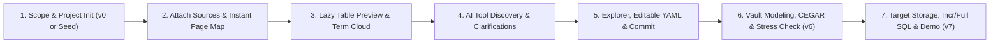

### 1.3 Plain-English Artifact Glossary (Every File Users Encounter)

| User-Facing Concept | File / Format Inside `.opendv/projects/<id>/` | What It Is & Why It Matters | Do Users Edit It Manually? |
| :--- | :--- | :--- | :--- |
| **Project State (Tier 1)** | `project.json` + `cas/` + `waves/` + `audit.jsonl` | Permanent source of truth: attached source configs (`0` secrets), ontology versions, `UniversalVaultSchemaIR v2.0`, `SchemaWaveDelta` locks, human decisions (`horizon_assumptions[]`), and tamper-evident HMAC audit ledger. | Managed automatically (exportable as `Core` `.opendv.zip`). |
| **Evidence Profiles & Page Map** | `cas/` (`tables.jsonl`, `document_map.json`, `concept_memory.json`) | Deterministic schema stats (PK/FK/types) and lightweight document TOC/page flags (`0` chunk shredding) + steward pinned/muted terms. | Curated cleanly in Steps 2–3 (`★ Pin` / `✕ Mute`). |
| **Conceptual Ontology (`Graph A`)** | `versions/vX.Y.Z/ontology.yaml` | Human-reviewed business glossary: Concepts, definitions, FIBO matches, attributes, SQL/logical types, Relationships, `3-Tier` key preferences, Enums, and PII rules. | Reviewed/edited visually or in Step 5 Tab 3 YAML. |
| **DV Model & Evolution Lock** | `final_contract.yaml` & `deployed_contract.yaml` *(auto-bound)* | Physical Data Vault blueprint (`hub_*`, `lnk_*`, `sat_*`, `mas_*`, `esat_*`, `sal_*`, `ref_*`, `pit_*`) plus immutable Wave-1..K lock preventing breaking changes. | Auto-synthesized by Step 6 (only reviewed or waived via Decisions). |
| **Certified Schema IR** | `head_schema_ir` (`UniversalVaultSchemaIR v2.0`) | Zero-SQL universal blueprint (`FIXED_BINARY(32)`, monotonic `field_id`s, `PredicateAST`, Zero/Ghost seeds, layout hints). | Output of Step 6; input to Step 7 (`v7`). |
| **Target Materialization (Tier 2)** | `targets/<target_id>/` (`target_manifest.json`, `V001..V00N.sql`, `demo_vault.duckdb`) | Engine-specific DDL, Iceberg/Parquet/dbt outputs, and built-in local DuckDB demo database. Completely regenerable from Tier 1. | Generated & executed in Step 7 (`v7`). |
| **Portable Project Archive** | `<project>.core.opendv.zip` **(Default)** or `.full_demo.opendv.zip` | Signed zip package sharing projects safely across Git, teammates, or laptops with secrets & `Local Only` data automatically stripped. | Exported/imported via Header, Step 1, Step 7, or CLI. |

---

## §2. Global Workspace Navigation, Settings Hub & Portable Sharing

### 2.1 Global Header Bar & Active Project Switcher
Across Steps 1–7, `DV Schema Explorer`, `Run Explorer`, and `Settings`:
- Top `54px` header always shows **`SPIKE_MARK_SVG` + `open-dv`** ➔ **`Ontology & Pipeline` | `DV Schema Explorer` | `Run Explorer` | `Settings`** ➔ **Active Project Switcher Pill (`am-ibor-2026 · v1.1.0 · asset_management`)** ➔ **`Export / Import` button**.
- Switching Projects in the dropdown swaps Sources, Ontology History, Stage 6 Wave Timeline, and Step 7 Targets in place without losing work or contaminating another project's baseline.

### 2.2 Platform Settings Hub (`/settings`) & Databricks UC Setup
Before connecting remote warehouses or switching LLM providers, stewards/engineers configure workspace defaults in 3 clean tabs:
1. **`AI Agent Harness & CEGAR Policy`:** Choose execution provider (`agy`, `claude-cli`, `claude`, `gemini`, `deterministic`), configure frontier critic tier (`ModelTier.FRONTIER_CRITIC`), token/USD budget, and default Step 6 CEGAR strictness (`Fast Dev`, `Balanced Enterprise` [default], `Strict Regulated`, `Symbolic-Only`).
2. **`Data Connections & Secrets`:** Store non-sensitive connection profiles (`host`, `http_path`, `default_catalog`, `default_schema`, `credentials_ref`), test connectivity, read the built-in **`How to Configure Databricks Unity Catalog`** guide (`CAN USE`, `GRANT USE CATALOG/SCHEMA/SELECT`, `'pii'='true'` column tags, `OPENDV_ALLOWED_HOSTS`, `uv sync --extra databricks`), and save tokens inside the **`HttpOnly` `AES-256-GCM` Cookie Secret Vault** (`0` plaintext written to disk or `.env`, overriding env vars on-demand).
3. **`Plugins, Agents & Extensions`:** Inspect loaded Source Adapters (`opendv.source_adapters`), Document Page Readers (`opendv.document_parsers`), offline `Local Only` term extractors (`opendv.term_extractors`), Storage Emitters (`opendv.storage_emitters`), and Agent Packages (`agent.yaml` + `SKILL.md` + MCP tools) with `Reload All`.

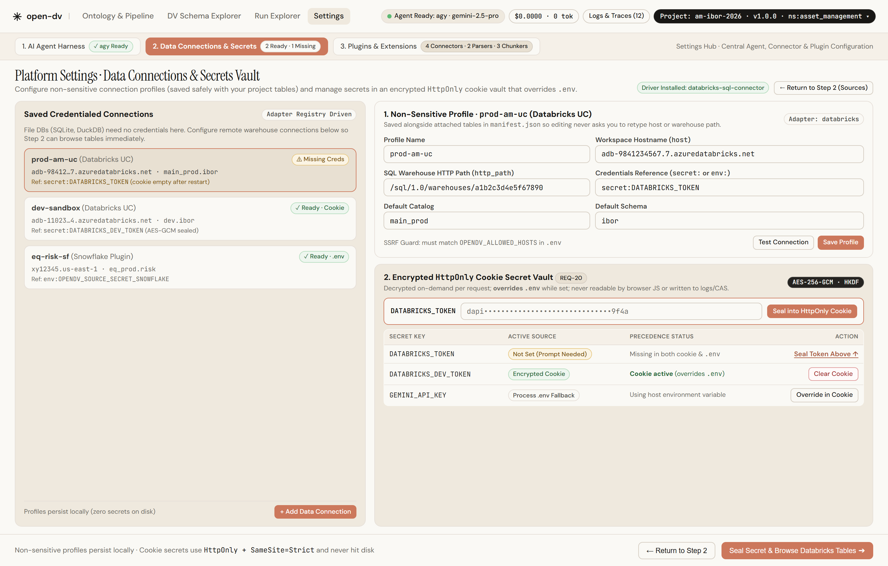
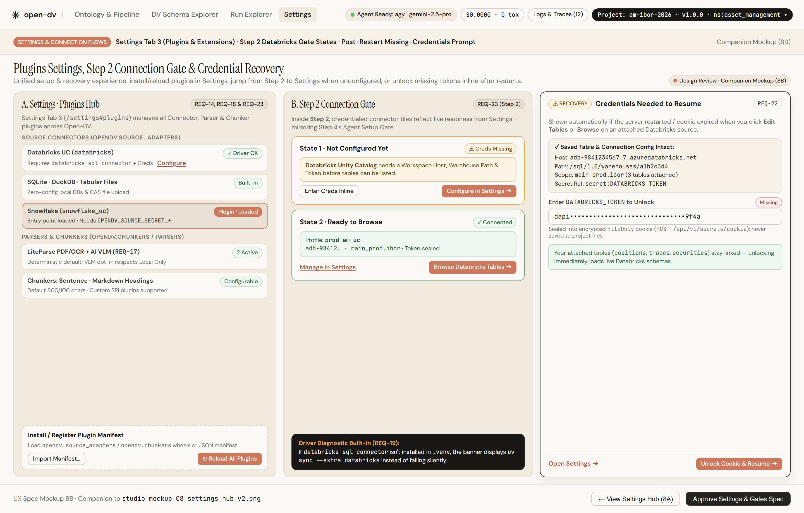

### 2.3 Portable Project Export & Import (`.opendv.zip` · `Core Project State` Default)
Accessible from the **Global Header**, **Step 1 Option B**, **Step 7 Footer**, or `opendv project export|import`:
- **Default Export Profile (`Core Project State` / `core_project_state`):** Confirmed default pre-selected everywhere across UI & CLI (`~12.6 KB`). Exports Tier-1 `project.json`, `cas/` (`Graph B` profiles, Ontology snapshots, certified `UniversalVaultSchemaIR v2.0`, `SchemaWaveDelta`s), `horizon_assumptions.json`, and signed `audit.jsonl`. Perfect for Git and cross-team handoff.
- **Opt-In Demo Profile (`Full Self-Contained Demo` / `full_demo`):** Explicitly selectable when sending a ready-to-query local bundle; embeds `targets/duckdb_local/demo_vault.duckdb` (`ZIP_STORED`), generated `V001..V00N` / full SQL, and all non-`Local Only` uploaded source files (`<= 250 MB`) so Step 3b/4 citations and Step 7 real-data regeneration work out of the box.
- **Built-In Safety Shield:** Automatically strips all secret values (`credentials_ref: DATABRICKS_TOKEN` name kept only) and replaces `Local Only` documents with redacted tombstones. On import into a new machine, verifies ZIP traversal & SHA-256 integrity, re-anchors the HMAC audit ledger with local `K_audit_B` (`IMPORT_REANCHOR`), resolves duplicate names (`am-ibor-2026-copy` or `409`), and marks all Steps 1–7 **`READY_OFFLINE`** immediately (prompting to bind `DATABRICKS_TOKEN` in Settings *only* when live warehouse inspection is needed).

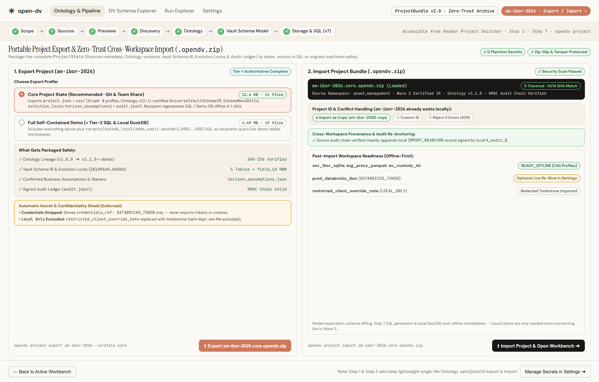

---

## §3. Step-by-Step User Experience Guide (`Steps 1–7`)

### Step 1 — Scope, Project Naming & Baseline Selection
- **Objective:** Create a cleanly named Project scoped to a domain namespace, or resume/import an existing Project.
- **What the User Sees & Does:**
  - **Option A (`New Project`):** Enter `Project Name (Session ID)` (e.g., `am-ibor-2026`, or leave blank for auto-slug) and validated `Domain Namespace` (`asset_management`, live `^[a-z][a-z0-9_]{0,63}$` check with auto-`snake_case` fix hint). Pick one of three clear modes:
    1. **`Blank · v0.0.0`:** Starter Packs hide cleanly (`Blank Genesis Ready`); start purely from Step 2–4 data.
    2. **`Workspace Seed`:** Radio list of repo ontology contracts (`pe_asset_management`, `global_commerce`, `wealth_mgmt`, `am_walkthrough_seed`) auto-filling namespace and marking grandfathered concepts.
    3. **`Starter Packs`:** Domain building blocks with a **`Preview`** button showing included Hubs (`hub_*`), auto-included `Core Spine` (`6` CBCs), Links (`lnk_*`), and FIBO/ISO standards prior to creation.
  - **Option B (`Resume or Import`):** Select any saved project (showing labeled `Namespace: asset_management` pills), upload a single `.yaml`/`.json`/`.ttl` ontology, or import a portable **`.opendv.zip`** project archive (`Mockup 1C`).
- **Expected Output:** Project initialized on disk under `.opendv/projects/<project_id>/` at `v0.0.0` (Blank) or `v1.0.0` (Seed/Pack/Import) with signed `audit.jsonl`.

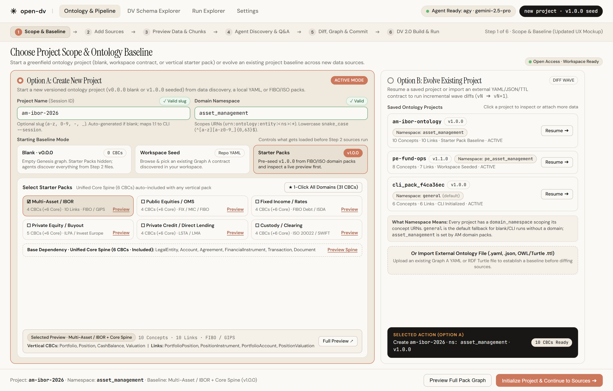
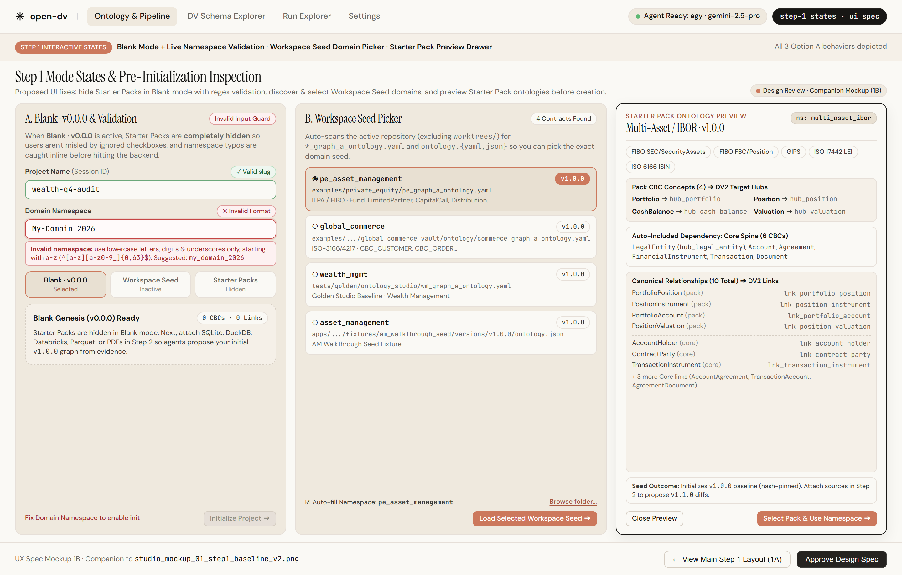

---

### Step 2 — Attach Sources, Connectors, Notes & Privacy Controls
- **Objective:** Connect structured tables (DBs, Parquet/CSV/Databricks) and unstructured policy/notes (`100%` deterministic local profiling — **zero AI cost**).
- **What the User Sees & Does:**
  - Badge reads **`Deterministic Local Profiling · No AI Agent Used`**.
  - **Zone 1 (`Structured Databases & Files`):** Click dynamic adapter tiles from `SourceAdapterRegistry` (`SQLite`, `DuckDB`, `Parquet/CSV/XLSX`, `Databricks UC`, or custom imported plugins via **`Import / Manage Adapters`**):
    - File/DB connectors offer both **Pick Local File** and **URI/Path**.
    - Connector modal renders only relevant fields from contract (`Catalog` & `Credentials Ref` cleanly disabled with hover reasons on SQLite; `host`, `http_path`, `Catalog`, `Schema` dropdowns, SSRF validation, and Settings readiness gate on Databricks UC — plus inline **Missing Credentials Prompt** if a cookie token cleared).
    - Expanding a table displays `Column | Type | Keys & Links | Governance` headers with tooltips explaining `PK (#1)` (Hub grain) and `FK ➔ table.col` (Link edge).
  - **Zone 2 (`Policy Docs & Inline Domain Notes`):** Upload PDFs/DOCX/MD or type a named Inline Domain Note (`Stewardship Domain Notes`) and optionally check **`Do not send to agent (Local Only)`** to keep confidential files completely out of LLM prompts & MCP calls. Clicking Attach indexes **`document_map.json`** (pages/TOC) immediately (`0s` wait, zero chunker knobs).
  - **Zone 3 (`Attached Sources Manager`):** Every attached feed persists its non-sensitive `connector_config`, renders Wave provenance pills (`✓ Modeled in v1.0.0`, `✦ NEW · Unprocessed`, `↻ UPDATED`), and offers **`Preview`**, **`Edit`**, and **`Detach`** (protected if already committed in a version).
- **Expected Output:** Content-addressed `inputs/manifest.json` + deterministic `Graph B` table profiles (`evidence/tables.jsonl`) + `document_map.json` + zero plaintext secrets on disk.

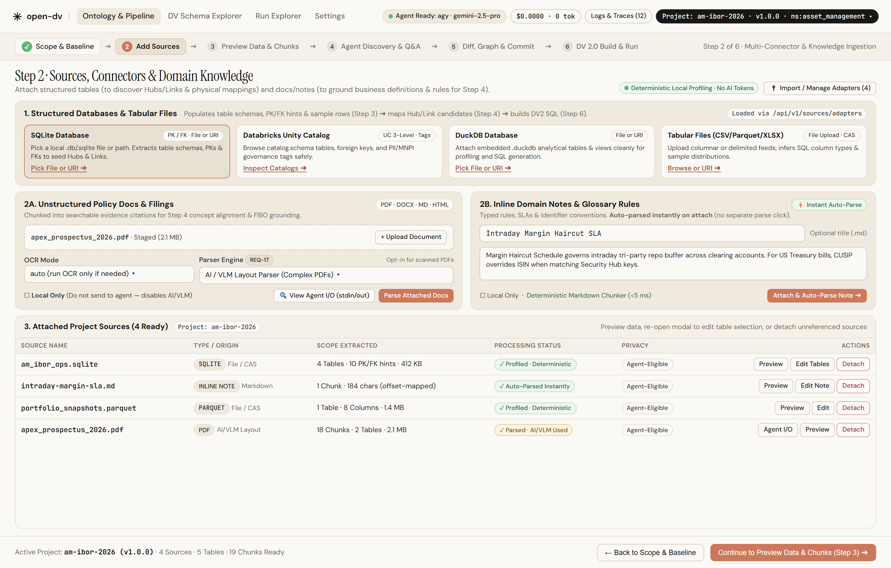
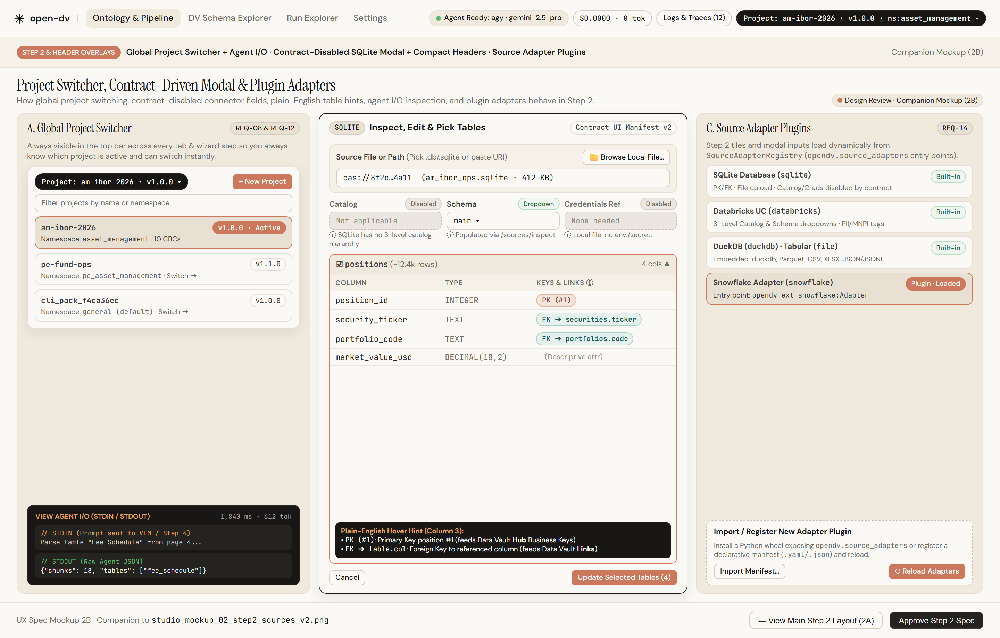

*(Design alignment note: `Mockup 2A` retains the purpose zones and row actions while omitting the retired Step 2 whole-doc VLM toggle in favor of Step 4 selective `view_page_image` under Flow B `REQ-35`.)*

---

### Step 3 — Scalable Lazy Evidence Previews & Seed Curation
- **Objective:** Inspect attached evidence smoothly at 100s-of-tables scale and optionally steer discovery priorities before any LLM tokens are spent.
- **What the User Sees & Does:**
  - Header badge confirms **`Deterministic Evidence View · No AI Agent Used`** + Wave **`New / Unprocessed Only`** toggle.
  - **`3a · Structured Tables`:** Searchable Master-Detail Navigator (`Source ➔ Schema ➔ Table`) loads column profiles, PK/FK constraints, FIBO gap hints, and `20`-row paged samples lazily only when clicked. Above the tree, an interactive **Structured Schema Term Cloud** highlights recurring entity/column tokens — clicking filters tables, and clicking **`★ Pin as Concept Seed`** or **`✕ Mute Noise`** saves steward curation directly into `evidence/concept_memory.json`.
  - **`3b · Document Outlines & Pages` (Flow B):** Displays each document's deterministic `document_map.json` — total pages, extracted TOC/headings, `Table Page` & `Scanned/Raster` page badges, and lazy page previews (or offline lexical summary for `Local Only` docs) without arbitrary 800-char chunk fragmentation.
- **Expected Output:** Verified user confidence in attached schema/document boundaries + optional sticky seed/noise rules persisted in `evidence/concept_memory.json`.

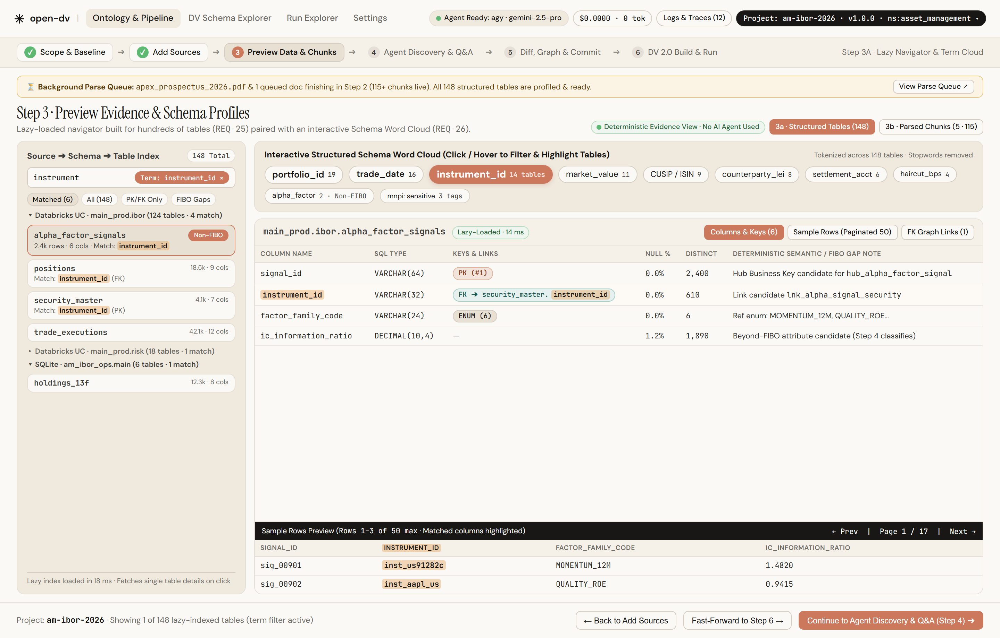

---

### Step 4 — Flow B Multi-Agent MCP Discovery, Nuance Review & Grounding
- **Objective:** Extract and enrich Canonical Business Concepts (`hub_*`), typed attributes, links (`lnk_*`), 3-tier business keys, reference enumerations, and PII governance rules across structured tables and policy documents.
- **What the User Sees & Does:**
  - **Pre-Run Baseline & Mode Picker (Wave 2+):** Displays **`Existing Baseline: v1.0.0`** + `🔒 Deployed in Vault` indicators alongside **`Discovery Mode`**: **`Incremental · New & Updated Sources`** *(default on continuation)*, **`Incremental · Re-verify Full`**, or **`Redo from Scratch · Clean Rebuild`**.
  - **Live Agent Workbench (`Mockup 4A`):** As agents run (`@ontology-first-mate` ➔ `@doc-ontology-scout` / `@page-range-scout` / `@table-cluster-scout` ➔ `@domain-clarifier` ➔ `@ontology-architect` via `opendv-mcp` or SDK `bridge.py`):
    - Top strip animates live stage/persona transitions, elapsed cost/tokens, and **`View Agent I/O (stdin / stdout)`**.
    - Coverage matrix tracks `tables_inspected / total_tables` and `pages_inspected / content_pages` (`0` silent eviction).
    - Progressive cards materialize in real time (`● CONSTRUCTING…`, `✦ NEW`, `⊕ EXTENDS v1.0.0`) alongside interactive **Clarification Question** prompts when overloaded terms conflict.
    - Bottom collapsible dark terminal lets technical users filter per-persona streams live.
  - **Concept Cards & Close-Match Nuance Review (`Mockups 4B, 4C`):** Every card renders:
    - **Concept (`hub_*`)** + concise definition + links (`lnk_*`),
    - **Matched FIBO Class & URI** (or **Slate Path B Empirical** badge for legitimate domain concepts with `table.column` or `1x` `Doc p.#quote` citations — never mislabeled `UNGROUNDED`),
    - **Attribute Rows** mapped from `table.column (SQL TYPE)` or `Doc p.#quote` to accurate auto-inferred logical types (`integer`, `decimal`, `boolean`, `date`),
    - **Warm Amber `≈ Close FIBO Match · Review Nuance` Comparator** comparing firm vs FIBO definition with `[Keep Close Match]`, `[Swap FIBO Class]`, or `[Switch to Path B]`, plus clickable `(page_number, char_start, char_end)` Citation Drawer.
- **Expected Output:** Reviewed proposal accepted into draft graph store + updated `concept_memory.json` / `staged_candidates.json` ready for Step 5.

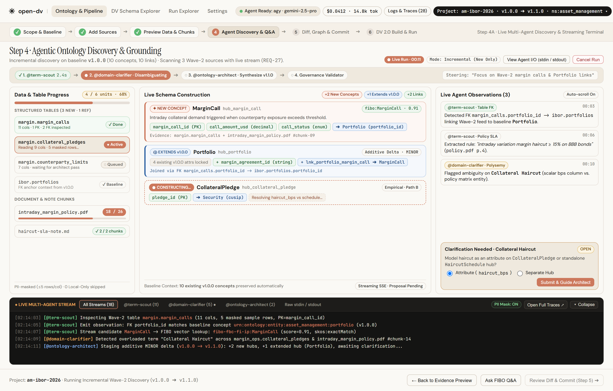
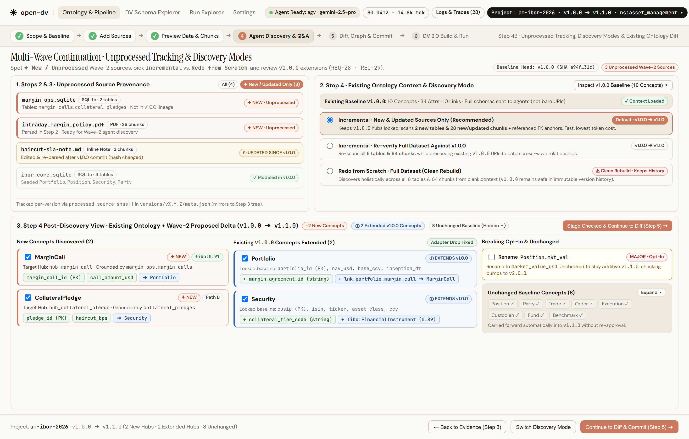
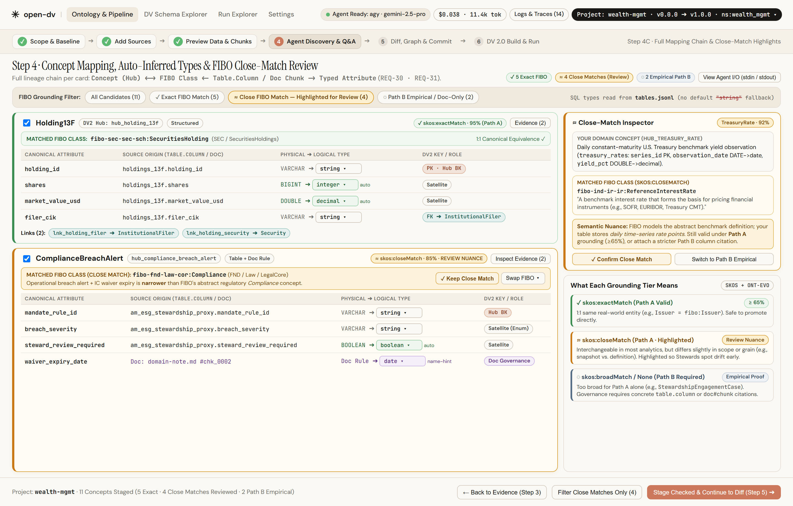

---

### Step 5 — 4-Mode Ontology Explorer, Bidirectional Editable YAML & Lossless Project Handoff
- **Objective:** Inspect, refine, lint for upstream Data Vault smells, and losslessly commit `versions/vX.Y.Z/ontology.yaml` before launching Step 6 (`v6`) modeling.
- **What the User Sees & Does (`Mockups 5A, 5B, 5C`):**
  - **Tab 1 (`Interactive Graph & Inspector`):** Full-height (`>= 560px`) dot-grid `elkjs` graph styled in `CLAUDE_TOKENS` with filter pills (`All`, `✦ New`, `Exact FIBO`, `≈ Close Match`, `Path B Empirical`, `Doc-Observed`, `🔒 Deployed in Vault`, `⚠ Smell Warnings`). Clicking any **Concept node** OR **Relationship edge** immediately opens the synchronized Right Inspector (`Concept | Links | Key Tiers | Governance`).
  - **Tab 2 (`Catalog & Mapping Dictionary`):** Sortable, searchable tables covering Canonical Concepts, Relationships (`lnk_*`), `3-Tier Key Authority Patterns`, `Reference Enumerations`, and `Governance / PII Constraints` — clicking any row centers it on the graph.
  - **Tab 3 (`Editable Ontology YAML`):** Bidirectional **Visual Store ⇄ `ontology.yaml`** authoring powered by AST/CST diagnostics (`Line X: Col Y`) and Section Jump-to Outline:
    - Edits validate in memory as you type without yanking the visual graph mid-keystroke;
    - Pressing **`Save & Sync YAML` (`Ctrl/Cmd+S`)** OR **clicking outside / switching tabs (`onBlur`)** syncs valid YAML straight into Tabs 1, 2, and 4;
    - Persistent compact micro-alert + gutter colors clearly signal **`✓ Saved to Draft Store`** (Green `#5db872`), **`● Unsaved Edits · Valid`** (Amber `#d4a017`), or **`✕ Invalid YAML at Line X: Col Y`** (Crimson `#c64545` — keeps the last valid graph safe while preserving your raw buffer for repair).
  - **Tab 4 (`Version Diff & Governance Scorecard`):** Displays structured `vBase -> Draft` changes alongside `ONT-EVO-001..005` evolution checks and Amber `#d4a017` upstream smell cards (`ONT-AP-001..005`: e.g., source-clone concepts, static lookup tables promoted to Hubs, unclassified PII) with 1-click **`[↻ Apply Recommended Refactor]`** or **`[✓ Sign Steward Waiver]`**.
  - **Project Handoff Bar (`Mockup 5C`):** Shows **`Target Project` ➔ `Ontology Commit vX.Y.Z` ➔ `Target Vault Wave`** (`Wave 1 Cold Start` vs `🔒 Wave N Auto-Locked to Project Run <id>`). Smart CTA cleanly alternates between **`Commit Draft & Open Step 6 (<Project>) ➔`** and **`Continue to Step 6 (<Project>) ➔`**, preserving every typed attribute, `evidence_ref`, key authority pattern, reference enumeration, and PII constraint losslessly.
- **Expected Output:** Immutable committed `versions/vX.Y.Z/ontology.yaml` (`versions/vX.Y.Z/meta.json` stamping `processed_sources`) and smooth handoff into Step 6 (`v6`).

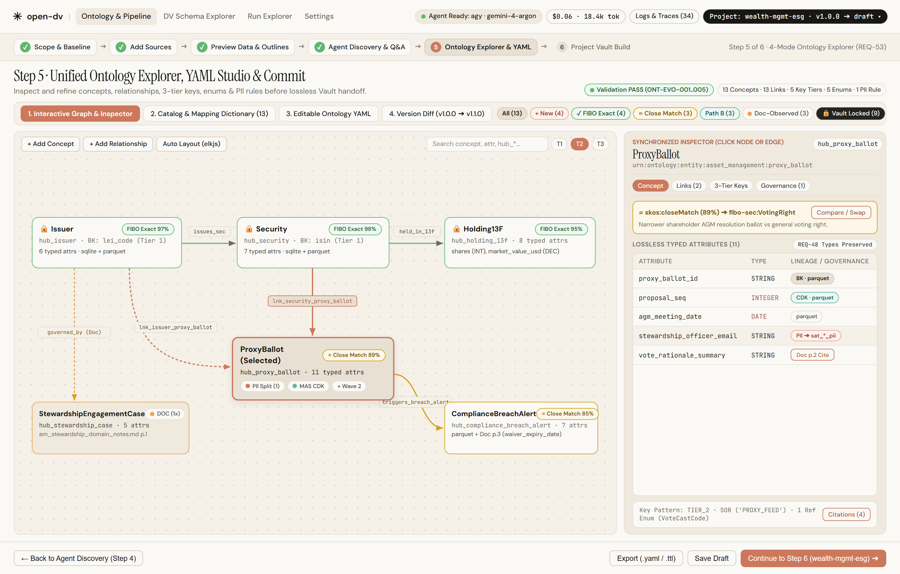
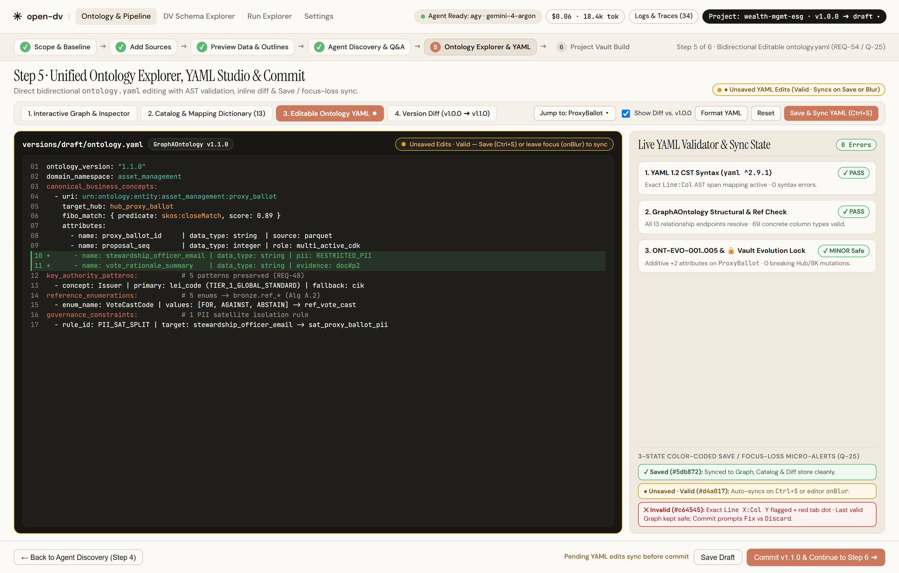
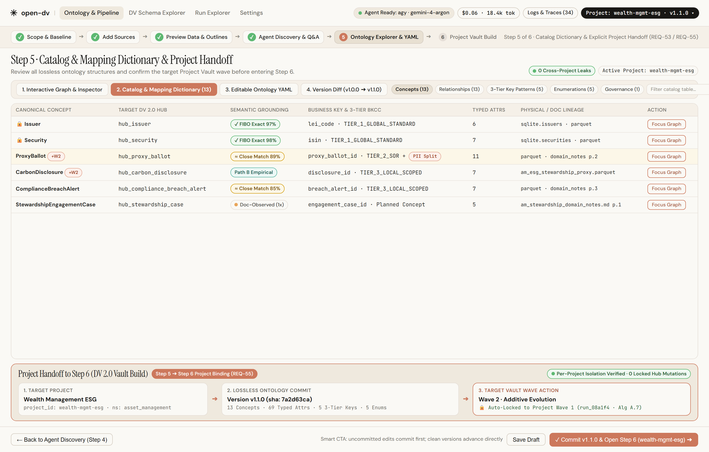

---

### Step 6 (`v6`) — Enterprise DV 2.0 Schema Modeling, Self-Testing Loop & Human Guidance
- **Objective:** Synthesize, verify, repair, anti-pattern-harden, and future-proof a **storage-agnostic `UniversalVaultSchemaIR v2.0`** strictly for the active Project — keeping business stewards informed in plain English while giving architects full white-box control.

#### A. Default Experience — `Guided (Plain-English)` Mode (`Mockups 6F, 6G`)
When entering Step 6, **`Guided (Plain-English)`** is active by default so **zero** internal compiler codes (`DV-DYN`, `BRK-`, `BKCC`, `CDK`, `@toon_v1`) clutter primary headlines:
1. **4-Milestone Journey Bar (`Mockup 6F`):** Maps all 8 backend engine stages + loops onto four human milestones:
   - **`① Confirm Scope & Rigor`** ➔ **`② AI Drafts & Self-Tests Schema`** ➔ **`③ Review Key Business Choices`** ➔ **`④ Readiness Brief & Sign-Off`**
2. **Live Plain-English Narrator & 30-Sec Visual Vault Primer:** Streams crisp cause-and-effect updates (*"Found multiple votes per proxy meeting ➔ automatically added a Sub-Item Key so votes never overwrite each other"*) alongside a 1-line color legend (`Core Entity`, `Relationship`, `Change History`, `Multi-Row History`, `Privacy-Protected`, `ID Crosswalk`).
3. **`"Why Does This Table Exist?"` Side Inspector:** Clicking any entity card (`Proxy Ballot Votes`, `Issuer Protected Contact PII`) explains in plain language why it exists, which source columns feed it, what AI fixed automatically (`Before ➔ After`), and whether changing it in Wave 2+ is **`🔒 Permanent Once Deployed`** or **`🟢 Flexible Later`**.
4. **Consequence-Driven Decision Coach (`Mockup 6G`):** Whenever a real business or future-roadmap choice requires human judgment (replacing cryptic `APPROVE/REJECT/ANSWER`), the Coach shows:
   - **Plain Business Question + Why Sample Files Couldn't Decide**
   - **Reversibility Badge:** **`🔒 Permanent Lock-In Choice`** vs **`🟢 Flexible Additive Choice`**
   - **2-Row Concrete Data Example** (real sample rows demonstrating Option A vs Option B)
   - **Side-by-Side Trade-Off Cards (`Option A Recommended` vs `Option B`)** + note saved cleanly into `ProjectState`.
5. **Pre-Sign-Off Readiness & Confidence Brief (`Mockup 6G` Right Pane):** Summarizes mapped column coverage (`48 / 48`), automated stress tests passed (`15 / 15`), automatic repairs applied, human choices locked in, and future Wave-2+ guarantees before unlocking Step 7 (`v7`).

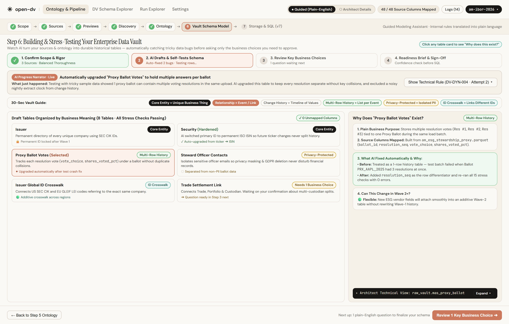
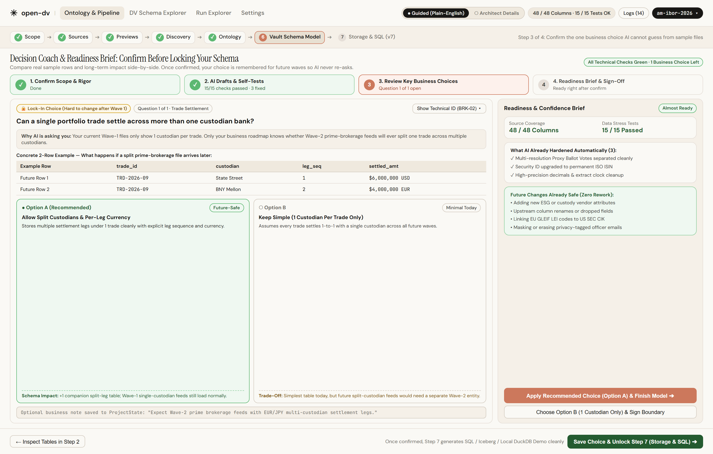

#### B. 1-Click `Architect Details` Mode (`Mockups 6A, 6B, 6C, 6D, 6E`)
Clicking **`Architect Details`** (or expanding **`Show Technical Rule ▾`** on any card) reveals the complete engineering cockpit:
1. **Project Context, Bound State & Contract Clarity (`Mockup 6A`):** Project Selector + Wave Timeline (`✓ Wave 1 ➔ ● Wave 2`) + 3-Pillar Bound Project State (`Ontology vX.Y.Z` + `Selected Tables & Refs` + `Wave 1 Cold Start` or `🔒 Auto-Bound Project deployed_contract` — zero cross-project leaks) + auto-loaded Topology Preview + `CEGAR Loop Policy` preset (`Fast Dev`, `Balanced Enterprise`, `Strict Regulated`, `Symbolic-Only`).
2. **True-Order `00..07` Persona Header, Live `§545` Schema Canvas & `#181715` Terminal (`Mockups 6B, 6C`):** Shows animated execution order (`00 Preflight` ➔ `01 Tabular` ➔ `02 Doc` ➔ `03 Triage/Synth` ➔ `04 Static/CEGAR` ➔ `05 DuckDB Prover` ➔ `06 Semantic Critic` ➔ `07 IR Certification`), progressively populates the `§545` dark-Hub/pill-Link/dashed-PII/teal-PIT graph (with `⏸ Pause Camera` inspection lock + Stage/Attempt Scrubber), and multiplexes persona SSE logs + `View Agent I/O (stdin / stdout)`.
3. **4-Zone CEGAR Loop Observatory (`Mockup 6D`):**
   - **Cyclic Loop Capsule (`① Synth & Patch › ② L1 Codemods (0 tok) › ③ V1–V5 › ④ V6 DuckDB + V6b Smells › ⑤ V7 Critic` `↺ E > 0`)** + monotonic **`Energy E: 130 ➔ 5 ➔ 0 ↓`** + **`★ Best Candidate`** badge;
   - **`0. Loop Storyboard & Stream`** chronological cards fed by 6 typed intermediate SSE events (`PREFLIGHT_RADAR_READY` .. `LOOP_CONVERGENCE_DECISION`);
   - **Dark Counterexample & Critic Inspector** showing `D6`-masked DuckDB failure rows, `@toon_v1` `WARN-STEER`/`REJECT` directives, and 5-dimension Critic scores;
   - **Mid-Loop Controls:** **`[⏸ Pause After Att k]`**, **`[💬 Queue Hint]`**, and **`[✓ Accept Best]`** (unlocked once `V1–V6` are green).
4. **Stage `06b` / `V8` Future-Wave Breaking-Scenario Stress Review (`Mockup 6E`):** After `V1–V7` pass (`Balanced` & `Strict Regulated` auto-run; 1-click button in `Fast Dev`), `@dv-horizon-critic` on **`ModelTier.FRONTIER_CRITIC`** evaluates `BRK-01..08` against unseen future feeds, separating `ABSORBED_NATIVELY` updates from true lock traps, surfacing exact breaking source/column names, enforcing 4 anti-infinite-loop guards, and letting humans either **`[✓ Accept Schema as Reasonably Stable]`** (`>= 85`) OR add assumptions and **`[↻ Steer & Restart Outer Loop]`** (performing a **Warm Stage-03 `@ship-vault` restart** reusing Stages `01–02` scout profiles, saved into `ProjectState.horizon_assumptions[]`).
- **Expected Output Exiting Step 6:** Certified **zero-SQL `UniversalVaultSchemaIR v2.0`** + non-breaking **`SchemaWaveDelta`** + updated `evolution_locks` (`field_id` HWM & epoch counters) + saved `horizon_assumptions[]` persisted cleanly in **Tier-1 `ProjectState`**.

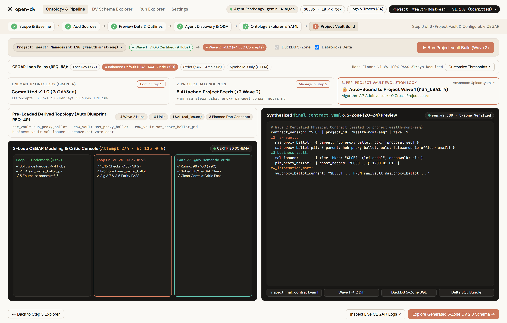
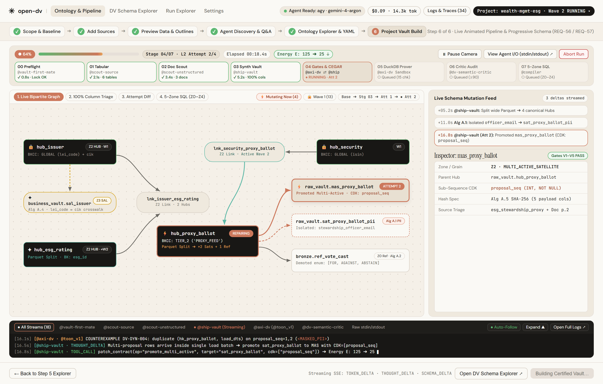
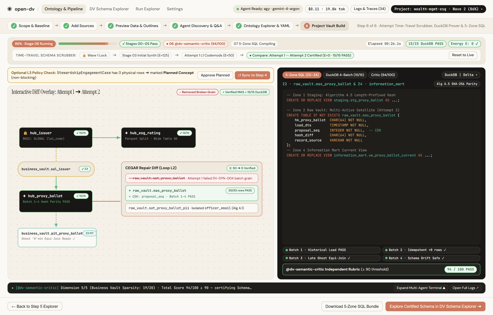
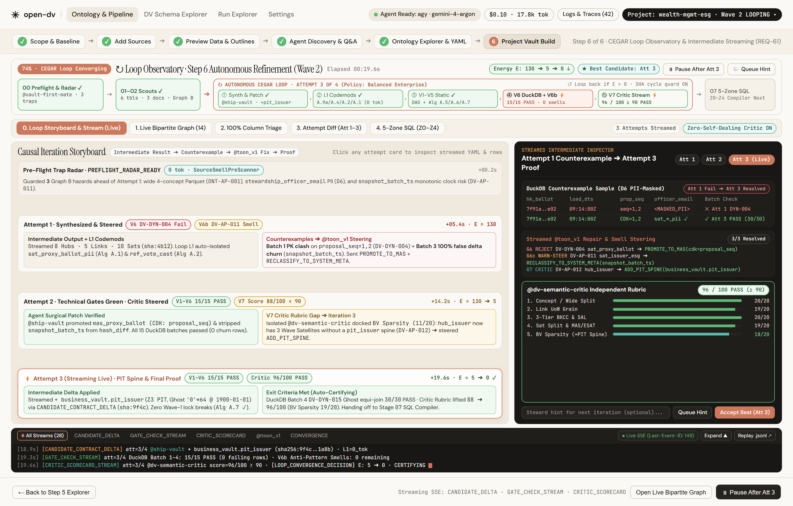
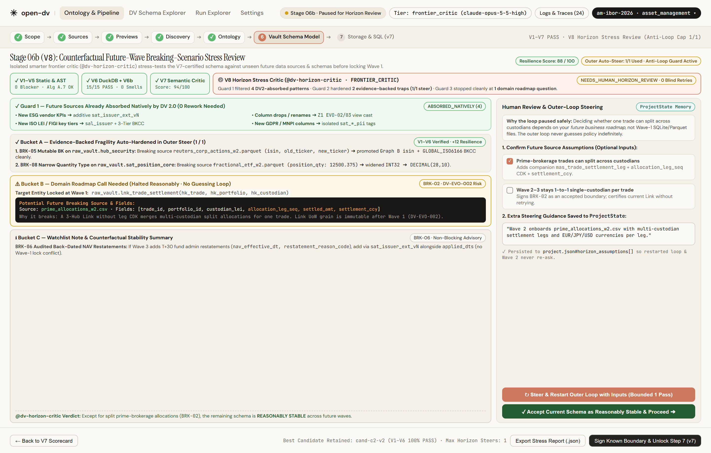

---

### Step 7 (`v7`) — Decoupled Storage Emission, Incremental vs. Full DDL & Built-In Local Demo (`Mockup 07`)
- **Objective:** Materialize the certified `UniversalVaultSchemaIR v2.0` cleanly onto any storage target — either migrating existing deployed tables additively or regenerating cleanly from scratch — and test interactively via the zero-infra **`duckdb_local`** database.
- **What the User Sees & Does:**
  - **Left Target Engine & Mode Panel:** Select target medium (**DuckDB Local** [built-in demo/test default], **Databricks UC Delta**, **Apache Iceberg v2/v3**, **Pure Parquet/Arrow**, **dbt/AutomateDV**, or Tier-2 **Snowflake** / **PostgreSQL** / **BigQuery** / **SQL Server / Fabric** / **Redshift** / **ClickHouse**) and choose deployment mode:
    - **`Incremental Migration (Wave K ➔ Wave N)`:** Emits `V002__wave_2_incremental.sql` (or additive schema update) creating *only* new Hubs/Links/companion Satellites (`sat_*_ext_v2`, `sal_*`, `pit_*`) + non-destructive `CREATE OR REPLACE VIEW` (`stg_*`, `vw_*`) while leaving 100% of existing Wave-1 Raw Vault tables and historical rows intact.
    - **`Full Schema Regeneration (Waves 1..N)`:** Re-emits the complete schema cleanly from `Tier-1 head_schema_ir`, guaranteed `100%` catalog-identical to cumulative incremental waves.
  - **Right Live SQL / Artifact & Built-In `duckdb_local` Demo Runner:** Inspect generated SQL/Iceberg JSON/Parquet manifests (local DDL/ELT execution runs strictly on **`duckdb_local`** and local **Parquet**, while cloud targets generate verified SQL/metadata/`dbt` scripts with zero remote writes), click **`Apply Migration to duckdb_local`**, **`Load Real Attached Wave Data`** (loads real rows strictly from attached Step 2 source files with zero invisible synthetic fallback; materializes Zero/Ghost records only when source binaries are absent), run live SQL queries against `information_mart.vw_issuer_stewardship_360`, test **`[↺ Reset & Test Full Regen]`**, or export the project (defaults to **`Core Project State`**, or select **`Full Self-Contained Demo`** to bundle `demo_vault.duckdb` + non-`Local Only` source files).
- **Expected Output:** Updated **Tier-2 `targets/<target_id>/`** (`target_manifest.json`, cached `migrations/`, cached `full_regeneration/`, persistent `demo_vault.duckdb`) without mutating Tier-1 `ProjectState`.

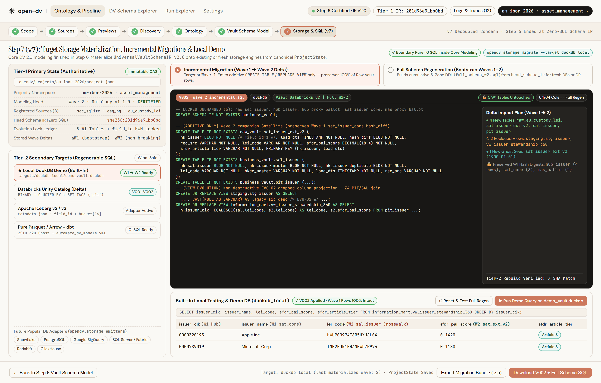

---

### Auxiliary End-State Views (`DV Schema Explorer`, `Run Explorer`, `Dual-CLI` & `Standalone Agents`)
- **Standalone DV Schema Explorer (`/dv-schema`):** Shares Step 6's `<DvBipartiteGraphTab />`, `"Why Does This Table Exist?"` explanations, 4-mode inspector, and `UniversalVaultSchemaIR` viewer for deep cross-run schema browsing.
- **Run Explorer (`/explorer` & `SessionLogsInspector`):** Replays any run's CEGAR Causal Iteration Storyboard, `View Agent I/O (stdin / stdout)`, DuckDB counterexamples, Horizon Stress report, and Readiness Brief deterministically from `.jsonl` ledgers.
- **Dual-CLI (`opendv` / `opendvctl` / `opendv mcp serve`) & Standalone Agent Skills:** Enables headless scripting (`opendv agent run`, `opendv project export|import` defaulting to `--profile core`, `opendv export-storage`, `opendv storage migrate|regenerate|demo`) and direct inside-IDE use (`Claude Code` / `Antigravity`).

---

## §4. Complete End-to-End Scenario Playbook (`20` Real-World Scenarios)

> Every scenario below states the concrete **Trigger / Inputs**, **What Happens in UI & Backend**, and **Exact Expected Outputs & State Updates**.

### Group A — Discovery, Semantic Grounding & Multi-Wave Ontology Scenarios (`SCEN-01` .. `SCEN-09`)

#### `SCEN-01`: Exact Standard FIBO Match (`Issuer`, `Holding13F`)
- **Inputs:** SQLite tables `issuers`, `holdings_13f` (`am_sec_treasury_ibor.sqlite`).
- **Flow:** `@table-cluster-scout` profiles columns via `inspect_table_profile`; `@ontology-architect` queries `search_concepts(scopes=["fibo"])` hitting `fibo-sec-sec-sch:SecuritiesHolding` (`>= 0.65` exact match) and resolves SQL types from `tables.jsonl`.
- **Expected Outputs:** Step 4 renders **Sage Green `✓ skos:exactMatch`** badge (`Grounded · Path A (Exact)`), full FIBO class URI, `hub_holding_13f`, and typed attributes (`shares -> integer`, `market_value_usd -> decimal`). Commits cleanly as `MINOR` (`v1.0.0`) with zero warnings.

#### `SCEN-02`: Domain-Specialized Close FIBO Match (`TreasuryRate`, `ComplianceBreachAlert`)
- **Inputs:** `yield_curves` CSV/SQLite + `am_esg_stewardship_proxy.parquet` flagging mandate breaches.
- **Flow:** Matched against general FIBO classes (`fibo:ReferenceInterestRate`, `fibo:Compliance`) with nuance difference in grain (`daily tenor rate` vs general reference rate). Backend records `skos:closeMatch` (`>= 0.65` valid under Path A2).
- **Expected Outputs:** Card highlights in **Warm Amber (`≈ skos:closeMatch · Review Nuance`)**; **`≈ Close Matches Only`** filter isolates it; clicking opens the side-by-side Domain vs FIBO Comparator with `[Keep Close Match]`, `[Swap FIBO]`, and `[Switch to Path B Empirical]`. Commits cleanly once reviewed.

#### `SCEN-03`: Novel / Proprietary Structured Concept (`Beyond-FIBO` Empirical)
- **Inputs:** `am_esg_stewardship_proxy.parquet` introducing `EsgRating`, `CarbonEmissionsDisclosure`, `ProxyBallot`, `InvestmentMandateRule` (absent from FIBO).
- **Flow:** `search_concepts` confirms no `>= 0.65` FIBO match; `GovernanceValidator` accepts empirical `STRUCTURED_SCHEMA` evidence (`column_profile` `evidence_refs`); `OBS-21` fix ensures UI reflects backend Path B1 validity.
- **Expected Outputs:** Card displays **Slate/Teal `Grounded · Path B (Empirical)`** badge (NEVER `UNGROUNDED`), explicit `table.column (SQL TYPE)` badges (`boolean`, `decimal`, `date`), and splits cleanly into 4 separate Step 6 Hubs instead of collapsing onto 1 Hub (`OBS-28` fix).

#### `SCEN-04`: `1x`-Mentioned Document-Only Policy Entity (Zero Physical Table)
- **Inputs:** `am_stewardship_domain_notes.md` mentioning `StewardshipEngagementCase`, `MacroRegimeSignal`, and `IntradayMarginHaircutSchedule` once each (`0` SQL tables yet).
- **Flow:** `@doc-ontology-scout` / `@page-range-scout` reads intact pages via `read_document_pages` and calls `record_concept_finding(..., verbatim_quote=..., page_number=...)`; Python resolves exact `(char_start, char_end)` spans and infers types (`*_date -> date`, `*_bps -> integer`).
- **Expected Outputs:** Appears under **`Document-Observed`** with **`1x · Semantic` + `Grounded · Path B (Document)`** + clickable Citation Drawer. In Step 6, unbacked policy entities sit cleanly in **`Planned Ontology Concepts (Awaiting Physical Feed)`** instead of crashing `Gate 1` with `PHANTOM_HUB_REJECTED`.

#### `SCEN-05`: Cross-Modal Hybrid Enrichment & 3-Tier Business Key Authority Upgrade
- **Inputs:** `am_sec_treasury_ibor.sqlite` (`issuers.cik`) + `am_esg_stewardship_proxy.parquet` + `am_stewardship_domain_notes.md` (`waiver_expiry_date`, `Issuer.lei_code` > `cik`).
- **Flow:** Agent merges SQL columns + `Doc p.#quote` attributes onto unified CBCs and emits `key_authority_patterns` (`ISO 17442 lei_code` Tier 1 > `SEC cik` Tier 2); Step 5 lossless commit writes both patterns and enumerations into `ontology.yaml`.
- **Expected Outputs:** Step 4 attribute list shows SQL types alongside `Doc p.#quote` rows; `v1.0.0/ontology.yaml` persists non-empty `key_authority_patterns` & `reference_enumerations`; Step 6 uses Tier-1 `'GLOBAL'` `bkcc` rules cleanly.

#### `SCEN-06`: Polysemic / Overloaded Term Clarification Q&A
- **Inputs:** Table column `haircut_bps` alongside policy entity `IntradayMarginHaircutSchedule` (or overloaded `Fund` / `Account`).
- **Flow:** `@domain-clarifier` enforces `NO GUESSING`, checks `DynamicConceptRegistry`, and invokes `emit_clarification_question`.
- **Expected Outputs:** Step 4 surfaces interactive Q&A radio choices + custom rationale box; submitting stores `ClarificationAnswer` under `answers/` and binds `@ontology-architect`'s next synthesis deterministically.

#### `SCEN-07`: Fail-Closed Quarantine & Signed Admin Waiver (`Path B2`)
- **Inputs:** Zero-evidence hypothetical placeholder (`FutureCryptoCustody`) with `< 0.65` FIBO score and no table/doc quote.
- **Flow:** `GovernanceValidator.validate_grounding` blocks auto-promotion (`UngroundedConceptError` HTTP `422`), quarantining candidate into `evidence/staged_candidates.json` (`+ concept_memory.json`). Non-admin waiver attempts fail closed (`InvalidGroundingWaiverError`).
- **Expected Outputs:** UI shows **`Ungrounded · Evidence or Admin Waiver Required`**; only attaching verified table/doc evidence OR executing an Admin `StewardWaiverRecord` (`rationale >= 10` chars) permits commit.

#### `SCEN-08`: `Local Only` Confidential Document & Column PII Isolation
- **Inputs:** `am_restricted_client_override_local_only.md` (`CLIENT_OVERRIDE_99`, `\$50M` rule) checked **`Do not send to agent (Local Only)`**, plus `stewardship_officer_email` / UC `'pii'='true'` column tags.
- **Flow:** MCP tools (`get_document_map`, `read_document_pages`, `view_page_image`, `search_document`) & prompt builder exclude the tainted source (`0` bytes leave locally; local deterministic extractor indexes headings/tokens instead). Non-restricted PII values mask as `<MASKED_PII>` (`<= 5` sample rows) and route to `sat_*_pii`.
- **Expected Outputs:** `View Agent I/O (stdin/stdout)` contains **`0`** matches of `CLIENT_OVERRIDE_99` or raw email/threshold; Step 6 renders dashed Terracotta `sat_proxy_ballot_pii` with PII Mask enabled.

#### `SCEN-09`: Multi-Wave Ontology Evolution (`Incremental` vs `Redo from Scratch` & Deployed Contract Guard)
- **Inputs:** Wave-1 committed `v1.0.0` + Wave-2 Parquet (`SUSTAINALYTICS 2025`), new doc (`✦ NEW`), and edited inline note (`↻ UPDATED`).
- **Flow:** Steps 2–3 diff `versions/v1.0.0/meta.json` `processed_sources`; Step 4 offers `incremental_new` (scans new/updated + FK anchors, binds `deployed_contract` lock), `incremental_reverify`, or `full_rebuild`.
- **Expected Outputs:** `incremental_new` produces `⊕ EXTENDS v1.0.0` cards (`v1.0.0 -> v1.1.0` `MINOR`); `full_rebuild` rebuilds holistically while preserving `v1.0.0` in history; attempting to delete a deployed Hub/Link blocks fail-closed (`ONT_EVO_CONTRACT_VIOLATION`).

---

### Group B — Step 6 Modeling, Loop Repair, Anti-Patterns & Horizon Stress Scenarios (`MOD-01` .. `MOD-07`)

#### `MOD-01`: Clean Cold-Start Convergence (`REASONABLY_STABLE`)
- **Inputs:** Clean Wave-1 project (`issuer`, `security`, `holding_13f`).
- **Flow:** Stages `00..03` synthesize cold-start Vault; `L1` codemods settle in `1` pass (`0` tokens); `V1–V6` DuckDB pass `15/15`; `V7` `@dv-semantic-critic` scores `>= 90`; `V8` `@dv-horizon-critic` confirms `ABSORBED_NATIVELY` + `REASONABLY_STABLE` (`96/100`).
- **Expected Outputs:** Default `Guided` view steps smoothly `① ➔ ② ➔ ③ (auto-skipped/0 holds) ➔ ④ Readiness Brief (48/48 cols, 15/15 tests)`, certifying `UniversalVaultSchemaIR v2.0` (`0` SQL tokens).

#### `MOD-02`: DuckDB Counterexample Auto-Repair (`mas_*` & `esat_*`)
- **Inputs:** `wave1_wide_positions_and_ballots.parquet` containing multiple concurrent votes per meeting (`PRX_NVDA_2024_1..3`) and `A->B->A` boomerang assignments (`TRAP-01`, `TRAP-04`).
- **Flow:** Attempt 1 `V6` DuckDB Batch 1/4 emits masked counterexample rows (`DV-DYN-004` uniqueness violation & `DV-DYN-013` timeline gap). Loop `L2` feeds `@toon_v1` + failing rows to `@ship-vault`.
- **Expected Outputs:** Attempt 2 promotes `mas_proxy_ballot` (composite CDK) and `esat_custodian_assignment` (Driving Key); Defect Energy drops monotonically (`E: 130 ➔ 0 ↓`); `Guided` Narrator explains *"Added Sub-Item Key so multiple votes on the same ballot never overwrite each other"*.

#### `MOD-03`: Anti-Pattern Smell Steering vs. Self-Dealing Audit vs. Steward Waiver
- **Inputs:** Feed with `>= 25` mixed-velocity columns (`God Satellite DV-AP-005`), technical `etl_snapshot_ts` in `hash_diff` (`DV-AP-011`), static 5-row lookup (`DV-AP-004`), and `Strict Regulated` vs `Balanced` policy (`TRAP-02`, `TRAP-03`, `TRAP-07`).
- **Flow:** `SourceSmellPreScanner` warns before Attempt 1 (`<antipattern_radar>`, `0` tokens). Any leftover smell triggers `V6b WARN-STEER` in Loop `L2` (`RECLASSIFY_TO_SYSTEM_META`, split `_core`/`_high_freq`, `ref_*`). If agent submits `AntiPatternJustification`, only isolated `V7` Critic or Human Steward can accept it.
- **Expected Outputs:** Smell count drops `Warnings: N ➔ 0` on Attempt Scrubber (or unwaived nodes show Amber `#d4a017` `[↻ Steer]` / `[✓ Sign Waiver]`; `Strict Regulated` refuses certification until resolved).

#### `MOD-04`: Irreducible Ambiguity Escalated to Human Decision Coach (`L3` Hold)
- **Inputs:** Ambiguous natural key grain or non-additive split (`L3 Key Conflict`).
- **Flow:** `L2` recognizes domain policy ambiguity and pauses immediately into **Loop `L3` Hold** (instead of guessing). `Guided` view renders **`GuidedDecisionCardDTO`** (`Mockup 6G`).
- **Expected Outputs:** User sees plain business question, `🔒 Lock-In Choice` badge, `2`-row sample data contrast, and Option A vs Option B consequences. Selecting Option A stores the decision, resumes SSE live via `Last-Event-ID`, and finishes cleanly.

#### `MOD-05`: Counterfactual Future-Wave Breakage Stress Check & Anti-Infinite-Loop Guards (`V8`)
- **Inputs:** Schema containing Wave-1 `Bucket A` fragility (`ticker` BK while `isin` exists, `INT32` qty) AND `Bucket B` business ambiguity (`lnk_trade_settlement` lacking multi-custodian split CDK).
- **Flow:** Stage `06b` / `V8` (`@dv-horizon-critic` on `ModelTier.FRONTIER_CRITIC`): filters `ABSORBED_NATIVELY` updates, executes at most `1` outer auto-steer for `Bucket A` (`max_horizon_auto_steers=1`, protected by `best_candidate` ratchet), and executes `0` blind retries on `Bucket B`, pausing with concrete future source/fields (`prime_allocations_w2.csv: [trade_id, custodian_lei, allocation_leg_seq, settled_amt, settlement_ccy]`).
- **Expected Outputs:** User (`Mockup 6E`) either clicks **`[✓ Accept Boundary]`** OR enters assumption & clicks **`[↻ Steer & Restart]`**, hardening `mas_trade_settlement_leg`, saving `ProjectState.horizon_assumptions[]`, reporting **`REASONABLY_STABLE (96/100)`**, and guaranteeing `0` infinite loops across restarted/future runs.

#### `MOD-06`: Wave-2 Additive Evolution & `sal_*` Cross-Wave Key Upgrade (`v6` ➔ `v7` Incremental)
- **Inputs:** Wave-1 deployed Vault (`hub_issuer` keyed on `cik`) onboarding Wave-2 `eu_custody_lei` (`lei_code` + `cik <-> lei_code` crosswalk + `EVO-02` dropped column + new attributes).
- **Flow:** Step 6 locks Wave-1 Hubs/Satellites (`DV-EVO-003`), appends Tier-1 `'GLOBAL'` `lei_code`, synthesizes Business Vault `sal_issuer` + `sat_issuer_ext_v2`, and updates `SchemaWaveDelta`. Step 7 (`v7`) runs **`Incremental Migration (Wave 1 ➔ Wave 2)`**.
- **Expected Outputs:** `V002__wave_2_incremental.sql` contains **`0` `DROP`/`ALTER` statements on Wave-1 Raw Vault tables**, preserves `100%` of existing Wave-1 rows/hashes, refreshes `Z1`/`Z4` views (`CREATE OR REPLACE VIEW`), and matches fresh `Full Schema Regeneration` **`64/64` (`100%`)** in `information_schema.columns`.

#### `MOD-07`: CEGAR Policy Profiles & Non-Bypassable Hard-Gate Floor
- **Inputs:** Switching profile across `Fast Dev` (`K_max=2`, Critic optional) vs `Balanced Enterprise` (`K_max=4`, Critic `>= 90`) vs `Strict Regulated` (`K_max=6`, Critic `>= 95`, block unwaived warnings) vs `Symbolic-Only` (`0` LLM retries), plus an intentionally broken `V6` DuckDB invariant.
- **Flow:** Engine enforces `CLI/Step 6 Override > Project Policy > Settings Default > .env`. Even when `Fast Dev` or `--no-semantic-critic` lowers loop retries, the certification gate enforces non-bypassable `V1–V6` static + evolution + PII + DuckDB invariants.
- **Expected Outputs:** Broken `V6` output is stamped **`UNCERTIFIED_DRAFT`** (never promoted to `deployed_contract`), and `AgenticPipelineReport` records exact `effective_cegar_policy`.

---

### Group C — Portability, Recovery & Headless Operations Scenarios (`OPS-01` .. `OPS-04`)

#### `OPS-01`: Default Git-Safe Export & Cross-Laptop Import (`Core Project State`)
- **Inputs:** Certified Wave-2 project (`am-ibor-2026`) containing `DATABRICKS_TOKEN` in cookie vault + `am_restricted_client_override_local_only.md` (`LOCAL_ONLY`).
- **Flow:** Click `Export / Import` (defaults automatically to **`Core Project State`**) or run `opendv project export am-ibor-2026` (no `--profile` needed since `core` is default). Import on Teammate's laptop (`Mockup 1C` / Step 1 Option B / `opendv project import`).
- **Expected Outputs:** Creates **`~12.6 KB` `.core.opendv.zip`** (`0` secret bytes, `Local Only` raw file stripped to tombstone). Import validates traversal/SHA-256, appends `IMPORT_REANCHOR` under local `K_audit_B`, handles existing name (`am-ibor-2026-copy` or `409`), restores identical `head_schema_ir` & `horizon_assumptions`, and runs Steps 4–7 **`READY_OFFLINE`** immediately (`DATABRICKS_TOKEN` flagged optional `NEEDS_LOCAL_SECRET_BINDING` for live Step 2 sync only).

#### `OPS-02`: Self-Contained Demo Export & Instant Zero-Rebuild Query (`Full Demo`)
- **Inputs:** Same project materialized into `targets/duckdb_local/demo_vault.duckdb` in Step 7 (`v7`).
- **Flow:** Explicitly select **`Full Self-Contained Demo`** in Export modal or pass `--profile full_demo`; import into Workspace C (`Demo Laptop`) and open Step 7 / `opendv storage demo --query`.
- **Expected Outputs:** Creates **`.full_demo.opendv.zip`** (`demo_vault.duckdb` stored with `ZIP_STORED` so `>100:1` DEFLATE ratio guards stay intact + all non-`LOCAL_ONLY` uploaded source binaries/docs `<= 250 MB`; `0` secrets leaked). Workspace C inspects PDF citations AND executes `SELECT * FROM information_mart.vw_issuer_stewardship_360` immediately (`2` rows, **`0` rebuild steps**, and real-data Step 7 regen works standalone).

#### `OPS-03`: Cookie Expiry / Server Restart Credential Recovery on Remote Connectors
- **Inputs:** Project with attached Databricks UC tables after browser restart cleared session cookies (`opendv_secrets` absent, `env:DATABRICKS_TOKEN` unset).
- **Flow:** Open Step 2 and click **`Edit`** or **`Re-Profile`** on attached Databricks source (`Mockup 8B`).
- **Expected Outputs:** Service returns `MISSING_CREDENTIALS`; modal renders inline **Missing Credentials Prompt** pre-filling saved non-sensitive `host`, `http_path`, `catalog`, `schema_name`, `selected_tables` from `inputs/manifest.json`; re-entering token seals a fresh `HttpOnly` `AES-256-GCM` cookie and resumes table inspection immediately.

#### `OPS-04`: Headless CI/CD & Standalone Coding-Agent Workflow (`Claude Code` / `Antigravity`)
- **Inputs:** Same project inputs in CI pipeline or local `Claude Code` / `Antigravity` session without launching Web UI.
- **Flow:** Execute `opendv agent run doc-ontology-scout ...`, `opendv ontology studio construct --discovery-mode incremental_new --cegar-profile strict`, `opendv project export am-ibor-2026` (defaults to `core`), and `opendv storage migrate --target duckdb_local|iceberg|databricks`.
- **Expected Outputs:** CLI mounts `opendv mcp serve` parity (`0` Windows `L5` lock deadlocks), respects `core` export default & `V1–V6` floor, emits identical `UniversalVaultSchemaIR v2.0` + Tier-2 storage outputs, and updates `ProjectState` cleanly for subsequent Web UI inspection.

---

## §5. Master End-State Persistence & `.opendv.zip` Inclusion Reference

| Path Under `.opendv/projects/<project_id>/` | Tier & Role | Owner Step | Included in `Core` (Default) | Included in `Full Demo` | Security / Special Handling |
| :--- | :---: | :---: | :---: | :---: | :--- |
| `project.json` | Tier 1 (Authoritative) | Steps 1–6 | **Yes** | **Yes** | Strips any plaintext credentials (`credentials_ref` names only). |
| `cas/` (`tables.jsonl`, `document_map.json`, `concept_memory.json`, `staged_candidates.json`, `versions/vX.Y.Z/`, `head_schema_ir`, `wave_*.yaml`) | Tier 1 (Authoritative CAS) | Steps 2–6 | **Yes** | **Yes** | `LOCAL_ONLY` raw blobs excluded & replaced by redacted tombstone + taint metadata (SHA-256 verified). |
| `waves/W001..W00N_delta.json` (`SchemaWaveDelta`, `evolution_locks`) | Tier 1 (Authoritative Locks) | Step 6 (`v6`) | **Yes** | **Yes** | Locks `field_id` HWM, companion `epoch_tag` (`v2`, `v3`), & Hub BKs. |
| `horizon_assumptions.json` (`ProjectState.horizon_assumptions[]`) | Tier 1 (Authoritative Decisions) | Step 6 (`V8`) | **Yes** | **Yes** | Prevents repeated counterfactual prompts across restarts/waves. |
| `audit.jsonl` (HMAC Ledger) | Tier 1 (Authoritative Ledger) | Steps 1–7 | **Yes** | **Yes** | Verified on import & extended with `IMPORT_REANCHOR` signed by target `K_audit`. |
| `targets/duckdb_local/demo_vault.duckdb` | Tier 2 (Derived / Regenerable) | Step 7 (`v7`) | **No** *(Git-safe)* | **Yes** (`ZIP_STORED`) | Stored uncompressed (`ZIP_STORED`) so sparse pages never trip `>100:1` zip-bomb checks. |
| `inputs/blobs/*` *(non-`LOCAL_ONLY` uploaded `.sqlite`/`.parquet`/`.csv`/`.pdf`/`.md` `<= 250 MB`)* | Source Inputs | Step 2 | **No** *(Git-safe)* | **Yes** | Strips `LOCAL_ONLY` sources to redacted tombstones; enables standalone Step 3b/4 citations & Step 7 real-data regeneration. |
| `targets/<target>/migrations/V*.sql` & `full_regeneration/*` & `target_manifest.json` | Tier 2 (Derived / Regenerable) | Step 7 (`v7`) | **No** | **Yes** | Bit-for-bit regenerable anytime from Tier-1 `cas/` + `project.json`. |
| `.odv_workspace_secret` & `HttpOnly` `opendv_secrets` cookie | Local Workspace Keys / Secrets | Runtime Only | **NEVER** | **NEVER** | Secret values never leave the active machine/session boundary. |
