# Open-DV V2 Master Phased Implementation & Real-Data Live-Agent UAT Plan

> **Module:** `docs/33-v2-phased-implementation-and-real-data-uat-plan.md` · **Revision:** v2.0 (2026-11-21)

> **Status:** Ready for Implementation Approval (`RequestFeedback: true`) · **Branch:** `feat/unified-ontology-pipeline-wizard`  
> **Governing V2 Specifications:** [31-v2-e2e-requirements-gaps-and-uat-spec.md](31-v2-e2e-requirements-gaps-and-uat-spec.md) (`docs/31`) · [32-v2-user-experience-and-scenario-guide.md](32-v2-user-experience-and-scenario-guide.md) (`docs/32`) · [30-enterprise-dv2-modeling-and-loop-engineering.md](30-enterprise-dv2-modeling-and-loop-engineering.md) (`docs/30`) · [29-discovery-grounding-and-evolution-scenarios.md](29-discovery-grounding-and-evolution-scenarios.md) (`docs/29`)  
> **Prior Foundation:** Builds directly on Phases `0`–`6` of [`docs/27`](27-unified-ontology-pipeline-requirements-and-uat.md) & [`docs/28`](28-unified-ontology-pipeline-design-and-plan.md) and resolves all `48` `OBS-01..48`, `65` active `REQ`s (`68` total with `REQ-17/18/24` superseded by Flow B `REQ-35`), and `89` `UAT-*` cases (`87` active + `2` Flow-B-superseded redirects).

---

## §1. Execution Mandate, Engineering Guardrails & Real-Data UAT Strategy

### 1.1 Non-Negotiable Architecture & Quality Gates
1. **Strict TDD-First Discipline Across 4 Layers:** Write failing requirement-mapped tests *before* modifying production code in every phase (`V2-1`..`V2-9`):
   - **Layer 1 (`pytest` Unit, IR, Verifier & Emitters):** Zero-SQL `UniversalVaultSchemaIR v2.0`, 4 `StorageTargetEmitter` engines, `CegarPolicyDTO` + `V1–V6` hard floor, `V6b` anti-patterns (`ONT-AP-001..005`, `DV-AP-001..012`), `V8` Horizon anti-infinite-loop guards, and zero-jargon `Guided` narrator DTOs.
   - **Layer 2 (`pytest` FastAPI, SSE, MCP, Secret Vault & Bundle):** `ProjectStateManager` Tier-1/Tier-2 persistence, per-project `/runs` isolation, `AES-256-GCM` `HttpOnly` cookie secrets overriding `.env`, `document_map.json`, `opendv mcp serve` Windows `L5` lock non-blocking, `.opendv.zip` Zip-Slip/`ZIP_STORED` `.duckdb`/`K_audit` re-anchoring, and incremental `V002` == full regen parity.
   - **Layer 3 (Dual-CLI Parity, Protocol Codegen, Frontend Unit & Token Budget):** `cli-spec.json` + `openapi-v1.json` + `@opendv/protocol-ts` + compiled `opendvctl`, `uv run pytest -m parity`, Vitest (`apps/opendv-web-workbench`), `bun x tsc --noEmit`, and `tests/architecture/` (`< 5,000` `cl100k_base` tokens per module per `D16`, zero hardcoded URLs/literals).
   - **Layer 4 (Live-Agent + Real-Data Chromium Playwright & `89/89` UAT Sign-Off):** End-to-end browser + CLI execution on real multi-wave datasets using live LLM providers (`agy`, `claude`, `claude-cli`).
2. **Ponytail Minimal Complete Change & Security Invariants:**
   - Reuse existing services (`sources_inspect.py`, `GraphBProfiler`, `CatalogTablePickerModal`, `DvBipartiteGraphTab`, `bundle.py`, `waiver_workflows.py`, `workspace_security.py`) rather than duplicating parallel subsystems.
   - Maintain `D18` loopback open access paired with the encrypted `HttpOnly` cookie secret vault (`AES-256-GCM` HKDF over `.odv_workspace_secret`, overriding env vars per request with zero plaintext persisted). Keep cryptographic `StewardWaiverRecord` (`K_audit` / session-signed) inside `waiver_workflows.py` without re-introducing loopback login or legacy header barriers.
   - Lock **`Core Project State` (`core_project_state`) as default** across Global Header, Step 1, Step 7 (`v7`), and `opendv project export`.
3. **100% Live Agent & Real-Data Mandate (`Gate 8` / `D17` / `D28`):**
   - UAT tests MUST execute against **real working LLM agents** (`agy` and `claude` verified available on host `PATH`) and **real downloaded/constructed multi-modal datasets** — zero mocks, zero recorded/canned responses, and zero `--mode deterministic` substitutions in UAT.
   - **Stop-and-Notify Rule:** If live `agy` or `claude` credentials/quotas fail during `Phase V2-9`, pause immediately and report exact diagnostics rather than substituting synthetic outputs.

### 1.2 Four Real Multi-Wave Datasets & Benchmark Suites for UAT Sign-Off

| Benchmark Suite | Composition & Provenance | Targeted Tests, Scenarios & UATs |
| :--- | :--- | :--- |
| **`DS-AM-REAL`** *(Public Asset Management + ESG Stewardship + Policy Docs)* | Live SEC EDGAR `company_tickers.json` + Form 13F + FRED `DGS10` (`data/public_am/am_sec_treasury_ibor.sqlite` built via `fetch_public_datasets.py`), `30 x 31` multi-wave ZSTD Parquet (`am_esg_stewardship_proxy.parquet` via `scripts/generate_esg_parquet.py`), `am_stewardship_domain_notes.md`, a multi-page PDF with embedded tables + 1 scanned diagram page, and `am_restricted_client_override_local_only.md` (`CLIENT_OVERRIDE_99`, `LOCAL_ONLY`). | `UAT-FIX-01`, `SCEN-01..09`, `OBS-01..38`, Steps 1–5 full UI + CLI parity, Selective `view_page_image`, PII split `sat_proxy_ballot_pii`. |
| **`DS-CEGAR-12TRAP`** *(12-Trap Multi-Wave CEGAR & Anti-Pattern Pack)* | Real TPC-DI + SEC 13F + GLEIF LEI-CIK + SFDR PAI fixtures (`tests/fixtures/cegar_antipattern_suite/`: Wave-1 SQLite/Parquet/MD + Wave-2 LEI drift Parquet, bi-temporal NAV restatement CSV, ambiguous OTC collateral CSV) exercising `TRAP-01..12`. | `UAT-FIX-02`, `UAT-S5-05`, `UAT-S6-01..16`, `MOD-01..04`, `MOD-06..07`, `V6` DuckDB counterexamples (`DV-DYN-004`, `013`), `V6b` (`DV-AP-011` churn, `God Sat`), `V7` Critic, `sal_issuer`, `pit_issuer`. |
| **`DS-ERP-REAL`** *(Cross-Domain Non-Financial Enterprise Benchmarks)* | Downloaded **Northwind** (`northwind.sqlite` · 7+ tables) and **Chinook** (`chinook.sqlite` · 9+ tables) declared in `tests/fixtures/public_am/dataset_manifest.yaml`. | Proves zero Asset-Management / Private-Equity hardcoding (`OBS-43`), lazy Step 3 scale, Path B1 structured domain synthesis, `UniversalVaultSchemaIR`, and `v7` cross-domain DDL. |
| **`DS-HORIZON-SEC`** *(Horizon Breakage & Archive Security Corpus)* | Wave-1 schema (`ticker` BK while `isin` exists, `INT32` qty, ambiguous `lnk_trade_settlement`) + Wave-2 counterfactual source (`prime_allocations_w2.csv`) + adversarial `.opendv.zip` archives (Zip-Slip `../evil.json`, 1-byte tampered CAS, unacknowledged confidential raw export). | `UAT-S6-18` (`MOD-05` `V8` `@dv-horizon-critic`, `Bucket A/B`, `REASONABLY_STABLE`), `UAT-NAV-03` (`OPS-01..02` `Core` default vs `Full Demo`, `ZIP_STORED`, `K_audit` re-anchoring), `UAT-SET-03` (`OPS-03`). |

---

## §2. Dependency-Ordered Phased Implementation Plan (`Phases V2-1` .. `V2-9`)

```mermaid
flowchart LR
  V1["V2-1: ProjectState Tier1/2 + UniversalIR v2.0 + .opendv.zip (Core Default)"] --> V2["V2-2: Connectors, Cookie Secrets, Flow B PageMap & Step 3 Lazy APIs"]
  V2 --> V3["V2-3: Agent Packages, opendv-mcp Parity, PromptRenderer & Step 4 Engine"]
  V3 --> V4["V2-4: Step 6 CEGAR, V6/V6b/V7/V8 Critics & Guided Translator"]
  V1 --> V5["V2-5: Step 7 (v7) Storage Emitters, Incr/Full & duckdb_local Demo"]
  V4 --> V5
  V5 --> V6["V2-6: Workbench UI Part 1 (Header, Export/Import 1C, Settings 8A-B, Steps 1-4)"]
  V6 --> V7["V2-7: Workbench UI Part 2 (Step 5 Explorer/YAML, Step 6 Guided+Arch, Step 7)"]
  V7 --> V8["V2-8: Dual-CLI opendv/opendvctl, Protocol-TS, Fixtures, Website & Video"]
  V8 --> V9["V2-9: Full Live-Agent & Real-Data E2E Execution + 89/89 UAT Sign-Off"]
```

### Phase `V2-1` — Canonical Two-Tier `ProjectState`, Zero-SQL `UniversalVaultSchemaIR v2.0` & Portable `.opendv.zip`
- **Workstreams & Traceability:** `WS-01`, `WS-02`, `WS-11` *(Core IR)* · `OBS-04, 39, 44, 45, 48` · `REQ-06, 55, 63, 64, 68`.
- **Exact Code Targets:**
  - `packages/opendv-core/src/opendv_core/models/universal_ir.py` & `ir_lowerer.py` *(moved out of `opendv-duckdb-sandbox` with compatibility shim)*: define zero-SQL `UniversalVaultSchemaIR v2.0` (`FIXED_BINARY(32)`, monotonic `field_id`s, `PredicateAST`, `HashRecipeSpec`, Zero/Ghost `SeedRecordsSpec`, `PhysicalLayoutHints`) and `SchemaWaveDelta` + `HorizonAssumption`.
  - `packages/opendv-service/src/opendv_service/project_state/`: unify `StudioSessionManager` + `PlatformStateContainer` into Tier-1 Authoritative `.opendv/projects/<project_id>/` (`project.json`, `cas/`, `waves/`, `horizon_assumptions.json`, `audit.jsonl`) vs. Tier-2 Disposable `targets/<target_id>/`. Keep `session_id` / `/sessions` REST & `--session` aliases compatible.
  - `apps/opendv-platform-api/src/opendv_platform_api/routers/runs.py` & `projects.py`: enforce strict `project_id` filtering on `/api/v1/runs` and `/baselines` (`0` cross-project `deployed_contract` contamination).
  - `packages/opendv-service/src/opendv_service/studio/bundle.py` & `session_export_workflows.py` & `routers/projects.py`: upgrade to `.opendv.zip` (`ProjectBundle v2.0`) with **`profile="core_project_state"` confirmed default** and optional `"full_demo"`; store `.duckdb`/`.parquet` via `ZIP_STORED` while preserving `100:1` DEFLATE ratio, Windows path/ADS/Zip-Slip, `<= 250 MB`, and `SHA-256` verification; strip plaintext secrets + `LOCAL_ONLY` raw payloads (redacted tombstones; `422 CONFIDENTIAL_SOURCE_EXPORT_UNACKNOWLEDGED` override guard); re-anchor `audit.jsonl` with local `K_audit_B` (`IMPORT_REANCHOR`); support `conflict_mode="fail"|"rename"`; emit offline-first `ImportReadinessReport`.
- **TDD & Exit Criteria:** Failing unit/integration tests authored first proving `0` SQL strings in `UniversalVaultSchemaIR v2.0`, `0` cross-project baseline leaks, `.opendv.zip` `5/5` security/secret/`LOCAL_ONLY`/`K_audit`/`ZIP_STORED` guarantees, and `< 5,000` tokens per module.

### Phase `V2-2` — Step 2 Plugin Connectors, Encrypted `HttpOnly` Cookie Secrets, Flow B `document_map.json` & Step 3 Lazy APIs
- **Workstreams & Traceability:** `WS-03` *(API)*, `WS-04` *(backend)*, `WS-05` · `OBS-03, 06, 07, 09..16, 18, 22` · `REQ-04, 05, 09, 10, 13, 14, 16, 19..23, 25, 26, 28, 35 (Part 1), 43`. *(Retires `REQ-17/18/24`.)*
- **Exact Code Targets:**
  - `apps/opendv-platform-api/src/opendv_platform_api/routers/ontology_studio_sessions.py`: add `GET /workspace-seeds` (excluding `worktrees/`, `.git/`, `node_modules/`, `.venv/`) and `GET /starter-packs/{id}/preview`.
  - `packages/opendv-contracts/src/opendv_contracts/dtos/sources.py` & `packages/opendv-sources/src/opendv_sources/registry/`: add `enabled`, `disabled_reason`, `hint`, `options_source` to `ConnectorFieldSpecDTO`; complete dynamic `SourceAdapterRegistry` dispatch (`list_adapters`, `connector_ingestion.py`) with zero hardcoded adapter switch statements; expand `.env.example`.
  - `packages/opendv-service/src/opendv_service/security/cookie_secrets.py` & `routers/secrets.py`: `POST|GET|DELETE /api/v1/secrets/cookie` sealing secrets in `HttpOnly`, `SameSite="strict"` `AES-256-GCM` cookies (HKDF over `.odv_workspace_secret`, overriding `os.environ` per request with `0` disk persistence); persist non-sensitive `connector_config` in `inputs/manifest.json` + structured `MISSING_CREDENTIALS` diagnostic.
  - `packages/opendv-service/src/opendv_service/studio/document_map_builder.py` & `routers/ontology_studio_evidence.py`: replace Step 2 chunk parsing queue with instantaneous Flow B `document_map.json` indexing (`opendv.document_parsers`); fix `deterministic_pipeline.py` prose-skip bug & route `LOCAL_ONLY` via `tokenize_concept_text`; expose lazy `/evidence/tables/index`, `/evidence/tables/{id}?rows_limit=20&rows_offset=0`, `/evidence/documents/map`, `/documents/{id}/pages`, curated Schema Term Cloud (`evidence/concept_memory.json`), and `versions/vX.Y.Z/meta.json` `processed_sources` provenance diff.
- **TDD & Exit Criteria:** Tests verifying cookie encryption/env override, `0` secrets in `manifest.json`/SSE, instant concurrent uploads (`0` `409` parse locks), lazy table indexing across `200+` mock/real tables, and `NEW`/`UPDATED`/`Modeled` provenance flags.

### Phase `V2-3` — Portable Agent Packages, `opendv mcp serve` Parity, `PromptRenderer` & Flow B Step 4 Engine
- **Workstreams & Traceability:** `WS-06`, `WS-07` *(backend)* · `OBS-17, 18, 22..26` · `REQ-12, 27, 29, 35 (Part 2), 36..41`.
- **Exact Code Targets:**
  - `packages/opendv-agent-harness/src/opendv_agent_harness/agents/`: convert Step 4 (`@ontology-first-mate`, `@doc-ontology-scout`, `@domain-clarifier`, `@ontology-architect`) & Step 6 (`@vault-first-mate`, `@scout-source`, `@scout-unstructured`, `@ship-vault`, `@axi-dv`, `@dv-semantic-critic`, `@dv-horizon-critic`) into portable `<agent-id>/{agent.yaml, SKILL.md, references/, subagents/}` packages with `firstmate` `Hard Rule 1` + 3-tier `skills.sh` progressive disclosure; register via `AgentPackageRegistry` (`opendv.agents` entry points + `.opendv/agents/`).
  - `packages/opendv-agent-harness/src/opendv_agent_harness/prompt_renderer.py` & `routing.py` & `models.py`: runtime `PromptRenderer` compiling `SKILL.md` for Claude (XML tags, `<evidence_payload>`, parallel batching, calm triggers) vs. Gemini (unmixed `TemplatedSystemInstructions`, `skills_paths`, `<plan>`, end-of-context anchoring); add `ModelTier.FRONTIER_CRITIC` (`OPENDV_CLAUDE_CRITIC_MODEL` / `OPENDV_AGY_CRITIC_MODEL`); separate native Anthropic model IDs from `agy` aliases inside `routing.py`.
  - `packages/opendv-service/src/opendv_service/mcp_server.py` & `cli_spec`: implement `opendv mcp serve --transport stdio|http --session <id>` serving all **9 Step 4 Flow B tools** (`view_page_image` blocked on `LOCAL_ONLY`) + Step 6 DV2/AXI tools for `ClaudeCliHarnessAdapter` / `AgyCliHarnessAdapter` (`--mcp-config`, removing `--tools ""`) with `bridge.py` parity; ensure `run_construct_session` / `JobSupervisor` release Windows `L5` `.session.lock` before awaiting CLI subprocesses.
  - `packages/opendv-service/src/opendv_service/studio/agent_runner.py`, `job_runners_construct.py`, `dynamic_concept_registry.py`, & `routers/ontology_studio_citations.py`: multi-persona streamed discovery, `@page-range-scout` / `@table-cluster-scout` coverage ledger, `DiscoveryMode` (`incremental_new`, `incremental_reverify`, `full_rebuild`), 4-layer `DynamicConceptRegistry` (`search_concepts`), deterministic Python `verbatim_quote` -> `(doc_id, page_number, char_start, char_end)` spans (backward compatible with `chunk_id`), and `stdin`/`stdout` log retrieval.
- **TDD & Exit Criteria:** Windows `L5` lock concurrency stress tests, CLI vs SDK parity test on `DS-AM-REAL`, `LOCAL_ONLY` negative prompt/MCP leakage test, `PromptRenderer` golden diff tests, and `0` skipped/silently evicted document pages on `30+`-page PDFs.

### Phase `V2-4` — Step 6 (`v6`) Modeling, Configurable 3-Loop CEGAR, DuckDB `V6`, `V6b` Smells, `V8` Horizon Critic & Guided Translator
- **Workstreams & Traceability:** `WS-09`, `WS-10` *(backend)* · `OBS-28..31, 36, 40..43, 46, 47` · `REQ-44..47, 50..52, 56..58, 60..62, 66, 67`.
- **Exact Code Targets:**
  - `packages/opendv-agent-harness/src/opendv_agent_harness/pipeline/`:
    - Fix `contract_synthesizer.py` wide-table multi-concept decomposition, `contract_evolver.py` `DOCUMENT_OBSERVED` (`UNSTRUCTURED_EXTRACTION_LINK` + `Planned Concepts`), `stages_agentic.py` dynamic monotonic `epoch_tag` (`v2`, `v3`, ...), `alg_a4_sal_inference.py` cross-wave `sal_*` key upgrade (`DV-EVO-003`), and `Alg A.7` deployed Vault locks.
    - Upgrade `axi_repair_loop.py` to true **3-Loop CEGAR (`L1` 0-token codemod fixpoint + `L2` static `V1–V5` + DuckDB `V6` `@toon_v1` repair + `V7` isolated `@dv-semantic-critic >= 90` + `L3` Steward Hold)** governed by `CegarPolicyDTO` (`fast`, `balanced`, `strict`, `symbolic_only`), energy $E(IR_k)$, `SHA-256(JCS)` cycle detection, `best_candidate` ratchet, and **non-bypassable `V1–V6` floor** (`UNCERTIFIED_DRAFT` on failure).
    - Implement `SourceSmellPreScanner` (`<antipattern_radar>`), `V6b` (`ONT-AP-001..005` + `DV-AP-001..012` + `WARN-STEER` `@toon_v1` feedback + Batch-3 `DV-AP-011` churn check), and Zero-Self-Dealing `AntiPatternJustification` audited by isolated `V7`.
    - Add **Stage `06b` / `V8` `@dv-horizon-critic`** on `ModelTier.FRONTIER_CRITIC`: `FragilitySurfaceScanner`, `BRK-01..08`, `ABSORBED_NATIVELY` filter, 4-Guard Anti-Infinite-Loop controller (`max_horizon_auto_steers=1`, `0` retries on `Bucket B`, `best_candidate` ratchet, `REASONABLY_STABLE >= 85`), and `ProjectState.horizon_assumptions[]` persistence.
  - `packages/opendv-duckdb-sandbox`: decouple Batch 1–4 `adversarial_batches.py` / `sandbox_engine.py` from `pe_canonical_ir.json` so adversarial micro-batches synthesize dynamically from any `(CanonicalIR, Graph B)`; stage the **12-Trap Benchmark Suite (`tests/fixtures/cegar_antipattern_suite/`)**.
  - `packages/opendv-service/src/opendv_service/state/persistence.py` & `telemetry/guided_translator.py`: emit real `agent_persona`, `SCHEMA_SNAPSHOT`/`TOPOLOGY_DELTA`, all `6` Observatory SSE payloads (`PREFLIGHT_RADAR_READY`..`LOOP_CONVERGENCE_DECISION`), `Last-Event-ID` resume, and zero-jargon `GuidedNarratorEventDTO` / `TablePlainExplanationDTO` / `GuidedDecisionCardDTO` / `ModelReadinessBriefDTO`.
- **TDD & Exit Criteria:** DuckDB `12/12` Trap Suite pass, `4/4` Horizon stress-loop termination cases (`CASE 1..4B`), `5/5` Guided zero-jargon checks, zero-self-dealing smell audit test, and Northwind/Chinook schema-driven sandbox runs.

### Phase `V2-5` — Decoupled Step 7 (`v7`) Target Storage Emitters, Incremental vs. Full Migrator & Built-In `duckdb_local` Demo DB
- **Workstreams & Traceability:** `WS-11` *(v7 Storage & Local DB)* · `OBS-44, 45` · `REQ-63, 64, 65`.
- **Exact Code Targets:**
  - `packages/opendv-service/src/opendv_service/storage_emitters/` (`opendv.storage_emitters` SPI + `StorageTargetEmitter` base):
    - **`duckdb_local`:** Persistent local testing/demo DB (`targets/duckdb_local/demo_vault.duckdb`), supporting Full Bootstrap, **Incremental Wave Migration (`V002__wave_2_incremental.sql`)**, Bronze ➔ `Z4` Mart sample seeding, and live safe SQL demo execution (`validate_safe_sql()`).
    - **Databricks UC Delta (`databricks_uc`):** Emits native `BINARY NOT NULL` (fixing `databricks_ddl.py#L28` `STRING` coercion), `CLUSTER BY`, `delta.columnMapping.mode = 'name'`, `delta.appendOnly = 'true'`, and UC `SET TAGS ('pii' = 'true')`.
    - **Apache Iceberg v2/v3 (`iceberg`):** Maps monotonic `field_id`s ➔ `schemas[].fields[].id`, `FIXED_BINARY(32)` ➔ `fixed[32]`, `PhysicalLayoutHints` ➔ hidden `day` + `bucket[16]` `partition-specs` & `sort-orders`.
    - **Pure Parquet / Arrow (`parquet`):** Writes ZSTD-compressed columnar schemas + `32B` Ghost Row (`0` SQL engine required).
    - **dbt / AutomateDV YAML (`dbt`) + Tier-2 Adapters (`snowflake`, `postgres`, `bigquery`, `sqlserver_fabric`, `redshift`, `clickhouse`).**
  - `packages/opendv-service/src/opendv_service/storage_migrator.py` & `routers/projects.py`: `POST /api/v1/projects/{id}/storage/migrate|regenerate|demo` maintaining Tier-2 `TargetMaterializationState` (`target_manifest.json`, `last_materialized_wave`, cached `migrations/`, `full_regeneration/`) independently of Tier-1 `ProjectState`.
- **TDD & Exit Criteria:** `4/4` emitter verification suite, `64/64` `information_schema.columns` parity between `Wave 1 + V002 incremental` vs fresh `full_schema_w2.sql`, `0` touched Wave-1 Raw Vault rows/digests, and bit-for-bit Tier-2 regeneration after deleting `targets/`.

### Phase `V2-6` — Web Workbench UI Part 1 (Header Switcher, Export/Import Modal `1C`, 3-Tab Settings `8A–8B` & Steps 1–4 `1A–4C`)
- **Workstreams & Traceability:** `WS-01..07` *(frontend)* · `OBS-01..27, 48` · `REQ-01..06, 08..23, 25..31, 35, 43, 59, 68`.
- **Exact Code Targets (`apps/opendv-web-workbench/src/`, every module `< 5,000` `cl100k_base` tokens, strictly `CLAUDE_TOKENS`):**
  - `explorer/TopBarStatusPills.tsx` & `ontology/wizard/ProjectBundleModal.tsx` (`Mockup 1C`): Active Project Switcher pill (`Project Name · Version · Namespace`) + Global Header, Step 1, and Step 7 **Export / Import (`.opendv.zip`)** modal defaulting to **`Core Project State`** with `Full Self-Contained Demo` opt-in, secret/`LOCAL_ONLY` shields, conflict chooser (`fail` vs `-copy`), and offline-first `ImportReadinessReport`.
  - `explorer/settings/` (`PlatformSettingsView.tsx`, `Mockups 8A–8B`): 3-tab hub (`AI Agent Harness & CEGAR Policy`, `Data Connections & Cookie Secrets` + collapsible Databricks UC Setup Guide, `Plugins, Document Readers & Agent Packages`).
  - `ontology/wizard/Step1ScopeAndBaseline.tsx` (`Mockups 1A–1B`): Project Name + live `^[a-z][a-z0-9_]{0,63}$` fix hints, Blank hides Starter Packs, Workspace Seed picker, Starter Pack Preview drawer, Option B labeled `Namespace:` pills & `.opendv.zip` import.
  - `ontology/wizard/Step2SourcesAndNotes.tsx` & `explorer/builder/CatalogTablePickerModal.tsx` (`Mockups 2A–2B`): Purpose zones, `Deterministic Local Profiling` badge, dynamic `ConnectorFieldSpecDTO` disabling & Schema/Catalog dropdowns, `EXTENSION_TO_MIMES` (`.sqlite/.db/.duckdb`), `host`/`http_path` fields, inline Missing-Credentials prompt, expanded preview `<thead>` + `PK/FK` tooltips, Instant `Attach Inline Note` (custom title + `document_map.json`, no obsolete parse queue/VLM toggle), and `Preview`/`Edit`/`Detach` + provenance badges.
  - `ontology/wizard/Step3PreviewEvidence.tsx` (`Mockup 3A` + Flow B `3b`): Lazy Master-Detail `3a` table navigator + interactive Schema Term Cloud (`★ Pin` / `✕ Mute`), Flow B `3b` Page & Outline Viewer, `✦ NEW` / `↻ UPDATED` / `✓ Modeled` filter.
  - `ontology/wizard/Step4AgentDiscovery.tsx`, `wizard-step4-adapter.ts`, `wizard-step4-sync.ts` (`Mockups 4A–4C`): Baseline banner, `DiscoveryMode` selector, live table/page coverage progress, `View Agent I/O (stdin/stdout)`, collapsible terminal, fixed `#L247` typed `add_attribute` merge & `tables.jsonl` SQL type inference, `Concept <-> FIBO <- table.column` mapping chain, Warm Amber `skos:closeMatch` comparator, `⊕ EXTENDS` cards, `0.65` + Path B1 grounding badge fix (`OBS-21`), and `(doc_id, page_number, char_start, char_end)` citation drawer.
- **TDD & Exit Criteria:** Vitest component/adapter tests (`0` silent `add_relationship`/`add_attribute` drops, `0` mislabeled Path B1 `UNGROUNDED`, default `core_project_state` selected in `ProjectBundleModal`), `bun x tsc --noEmit`, and `test_module_token_budget.py`.

### Phase `V2-7` — Web Workbench UI Part 2 (Step 5 `5A–5C`, Step 6 `Guided ⇄ Architect` `6A–6G`, Step 7 `07`, `/dv-schema` & `/explorer`)
- **Workstreams & Traceability:** `WS-01, WS-08, WS-09, WS-10, WS-11` *(frontend)* · `OBS-28..47` · `REQ-44..67`.
- **Exact Code Targets (`apps/opendv-web-workbench/src/`, `< 5,000` tokens/module, `DESIGN.md` `§545` + 5-Zone `Z0–Z4`):**
  - `ontology/wizard/Step5DiffGraphExport.tsx` & decomposed subtabs (`Mockups 5A–5C`): 4-Mode Ontology Explorer (`1. Interactive Graph & auto-open Node/Edge/Key/Governance Inspector`, `2. Catalog & Mapping Dictionary`, `3. Bidirectional <OntologyYamlEditorTab />` saving on `Ctrl/Cmd+S` or valid `onBlur` with 3-state `#5db872`/`#d4a017`/`#c64545` chrome & micro-alert, `4. Version Diff + ONT-AP-001..005 Smell Refactors & Waivers`), lossless commit (`graph-commit-ops.ts`), smart CTA (`Continue to Step 6 ➔` vs `Commit Draft & Continue`), top-stepper uncommitted guard, and Project Handoff Bar.
  - `ontology/wizard/Step6PipelineBuildAndRun.tsx` & decomposed `step6/` slices + `explorer/modals/StewardHoldModal.tsx` (`Mockups 6A–6G`):
    - **Default `Guided (Plain-English)` View (`6F`, `6G`):** Zero raw rule codes in primary headlines, 4-Milestone Journey Bar, `GuidedNarratorEventDTO` stream, 30-Sec Visual Primer, `"Why Does This Table Exist?"` inspector, consequence-driven `GuidedDecisionCardDTO` (2-row concrete sample, `🔒 Lock-In` vs `🟢 Flexible`, Option A vs B), and `ModelReadinessBriefDTO`.
    - **1-Click `Architect Details` (`6A–6E`):** Strict Project Selector + Wave Timeline + 3-Pillar Bound State + auto-`exportBlueprint()`, `CegarPolicyDTO` presets, animated true-order `00..07` Persona Strip + `#181715` streaming terminal + Hold `Last-Event-ID` reconnect, embedded `<DvBipartiteGraphTab />` (`§545`, `⏸ Pause Camera`, Stage/Attempt Scrubber), 4-Zone CEGAR Loop Observatory (`Cyclic Loop Capsule`, `Energy E`, `0. Loop Storyboard`, Dark Counterexample/Critic Inspector, `Pause`/`Queue Hint`/`Accept Best`), Amber `DV-AP-001..012` `[↻ Refactor]`/`[✓ Sign Waiver]`, and Stage `06b` `V8` Horizon Stress review (`[✓ Accept Boundary]` vs `[↻ Steer & Restart]`).
  - `ontology/wizard/Step7StorageAndSql.tsx` (`Mockup 07`): Target engine switcher (`duckdb_local`, `Databricks UC`, `Iceberg`, `Parquet`, `dbt`, Tier-2), **Incremental Migration (`Wave K ➔ Wave N`)** vs **Full Schema Regeneration (`Waves 1..N`)**, Tier-1/Tier-2 health badges, built-in `demo_vault.duckdb` seeder + live SQL query table, `[↺ Reset & Test Full Regen]`, and Step 7 `.opendv.zip` Export (`core_project_state` default).
  - `/dv-schema` & `/explorer`: Reuse shared `§545` graph, `"Why Does This Table Exist?"` drawer, Causal Attempt Storyboard, Horizon Stress, and Readiness Brief replay widgets.
- **TDD & Exit Criteria:** Vitest tests (`Guided` zero-jargon leak test, YAML `Ctrl+S`/`onBlur` & invalid preservation test, Step 5 smart CTA test, Per-Project Step 6 isolation test, `0` Vite/React runtime errors), `bun x tsc --noEmit`, and `test_module_token_budget.py`.

### Phase `V2-8` — Dual-CLI (`opendv` / `opendvctl`), `@opendv/protocol-ts`, Golden Fixtures, Website, Video & CI Sync Guards
- **Workstreams & Traceability:** `WS-02, WS-06, WS-11` · `REQ-32, 33, 34, 36, 37, 42, 52, 58, 62..65, 68`.
- **Exact Code Targets:**
  - `schemas/v1/cli-spec.json`, `schemas/v1/openapi-v1.json`, `packages/opendv-service/src/opendv_service/cli_spec/`, `packages/opendv-protocol-ts/`, `apps/opendvctl/`: add `opendv project export|import` (default `--profile core`, `--conflict fail|rename|replace`), `opendv export-storage`, `opendv storage migrate|regenerate|demo`, `opendv mcp serve`, `opendv agents list|install|register|export|inspect`, `--discovery-mode`, `--cegar-profile`, `--cegar-max-attempts`, `--cegar-critic-min-score`, `--horizon-max-steers`. Regenerate `@opendv/protocol-ts` and rebuild `opendvctl-windows-x64.exe`.
  - Fixtures & Agents: check in `data/public_am/{am_esg_stewardship_proxy.parquet, am_stewardship_domain_notes.md, am_restricted_client_override_local_only.md}`, `scripts/generate_esg_parquet.py`, `tests/fixtures/cegar_antipattern_suite/` (`12` traps + `generate_and_verify_cegar_suite.py`), and `.agents/skills/open-dv-workflow/`.
  - `apps/opendv-website/`, `apps/opendv-website/AGENTS.md`, `tour-data.ts`, `opendv-tour-en.vtt`, and `tests/architecture/test_scenario_matrix_sync.py`: update interactive 9-scenario matrix (`SCEN-01..09`), plain-English `Hub` vs `FIBO` vs `Path B1` cards, Guided Step 6 & `v7` overview, walkthrough chapters/captions/video, and enforce CI sync tests across `docs/`, `.agents/rules/`, `AGENTS.md`, `CLAUDE.md`, and website.
- **TDD & Exit Criteria:** `uv run pytest -m parity -v`, `uv run pytest tests/architecture/ tests/docs/ -v`, website Playwright/build check all `PASS`.

### Phase `V2-9` — Full Live-Agent & Real-Data End-to-End Verification & `89/89` UAT Sign-Off
- **Workstreams & Traceability:** `REQ-07, 32, 33` · **All `89` `UAT-*` cases & `20` Scenarios (`SCEN-01..09`, `MOD-01..07`, `OPS-01..04`)**.
- **Execution Protocol (Zero Mocks / Zero Deterministic Substitutions):**
  1. Verify live `agy` and `claude` agent credentials/health before starting UAT; capture every CLI command, HTTP request, SSE stream, and Chromium screenshot at `1440x920`, `1024x768`, and `390x844` (`scrollWidth <= clientWidth`).
  2. Execute **Run 1 (`DS-AM-REAL`)**: Wave-1 `am_sec_treasury_ibor.sqlite` ➔ Wave-2 `am_esg_stewardship_proxy.parquet` + `am_stewardship_domain_notes.md` + scanned PDF + `Local Only` `am_restricted_client_override_local_only.md` across Steps 1–7 (`UAT-S1-*`, `UAT-S2-*`, `UAT-S3-*`, `UAT-S4-*`, `UAT-S5-*`, `UAT-SCEN-01..09`, `UAT-SET-*`, `UAT-FIX-01`, `UAT-AGT-*`).
  3. Execute **Run 2 (`DS-CEGAR-12TRAP`)**: Full Steps 4–7 CEGAR Observatory, `V6` DuckDB counterexamples (`mas_*`, `esat_*`, `sal_*`), `V6b` anti-pattern steering & `Strict Regulated` waiver gating, and `v7` `V002` incremental migration parity (`64/64` cols) vs `full_schema` (`UAT-S6-01..17`, `UAT-S7-01..03`, `UAT-FIX-02`, `MOD-01..04`, `MOD-06..07`).
  4. Execute **Run 3 (`DS-ERP-REAL` — Northwind + Chinook)**: Full end-to-end run proving cross-domain zero-hardcoding across Steps 1–7, strict per-project isolation (`UAT-S6-10`), `Guided ⇄ Architect` UX (`UAT-S6-19`), and lazy 100s-table performance (`UAT-S3-01`).
  5. Execute **Run 4 (`DS-HORIZON-SEC`)**: `V8` `@dv-horizon-critic` `ModelTier.FRONTIER_CRITIC` breakage review (`UAT-S6-18` / `MOD-05`) + `.opendv.zip` (`Core` default vs `Full Demo`, Zip-Slip/tamper blocks, cross-workspace `K_audit` re-anchoring, offline continuity, and zero-rebuild DuckDB mart query `UAT-NAV-03` / `OPS-01..02`).
  6. Update `apps/opendv-website` captures with real Run 1/2/4 screenshots + tour verification (`UAT-WEB-01..02`), execute final `/ponytail-review` + `uv run pytest -v` + `bun test` + `bunx playwright test`, mark all `89/89` `UAT-*` checkboxes in the tracked UAT ledger with observed command/output proofs, and prepare the single clean PR via `no-mistakes`.

---

## §3. Consolidated Traceability Matrix (Workstreams ➔ Phases ➔ Automated & UAT Sign-Off)

| Workstream | `OBS-##` Covered | `REQ-##` Covered | Target Phase(s) | Primary Automated Verification Suites | Manual UAT Sign-Off IDs (`89` Total) |
| :--- | :--- | :--- | :--- | :--- | :--- |
| **`WS-01`** Project State & Isolation | `OBS-04, 05, 39, 45` | `REQ-06, 08, 55, 64` | `V2-1, V2-6, V2-7` | `test_project_state_tiers.py`, `test_project_isolation_runs.py` | `UAT-S1-06..07`, `UAT-NAV-01..02`, `UAT-S6-10`, `UAT-S7-01` |
| **`WS-02`** `.opendv.zip` (`Core` Default) | `OBS-48` | `REQ-68` | `V2-1, V2-6, V2-8` | `test_project_bundle_v2_security.py`, `test_cli_project_bundle_parity.py` | `UAT-NAV-03` (`OPS-01`, `OPS-02`) |
| **`WS-03`** Step 1 Scope & Seed Previews | `OBS-01, 02, 03` | `REQ-01..05` | `V2-2, V2-6` | `test_session_import_and_packs.py`, `Step1ScopeAndBaseline.test.tsx` | `UAT-S1-01..05` |
| **`WS-04`** Step 2 Connectors, Secrets & Settings | `OBS-06..14, 22` | `REQ-09..16, 19..23, 35, 43` *(retires `17,18,24`)* | `V2-2, V2-6` | `test_cookie_secrets.py`, `test_connector_ingestion_and_preview.py`, `test_flow_b_document_map.py` | `UAT-S2-01..15`, `UAT-SET-01..05` (`OPS-03`) |
| **`WS-05`** Step 3 Lazy Previews & Cloud | `OBS-15, 16, 18, 22` | `REQ-25, 26, 28, 35` | `V2-2, V2-6` | `test_lazy_evidence_pagination.py`, `Step3PreviewEvidence.test.tsx` | `UAT-S3-01..04` |
| **`WS-06`** Agent Packages, MCP & Prompts | `OBS-23..26` | `REQ-12, 36, 37, 40, 41` | `V2-3, V2-8` | `test_mcp_parity_and_windows_locks.py`, `test_prompt_renderer.py`, `test_agent_packages.py` | `UAT-S2-08`, `UAT-S4-10, 11, 13`, `UAT-AGT-02` (`OPS-04`) |
| **`WS-07`** Step 4 Flow B Discovery & Grounding | `OBS-17..21, 27` | `REQ-27, 29..31, 35, 38, 39` | `V2-3, V2-6` | `test_beyond_fibo_agent_synthesis.py`, `test_dynamic_concept_registry.py`, `test_step4_adapter_sync.py` | `UAT-S4-01..09, 12`, `UAT-SCEN-01..09` |
| **`WS-08`** Step 5 Explorer, YAML & Smells | `OBS-31..34, 37, 38, 42` | `REQ-44, 48, 53, 54, 60` | `V2-6, V2-7` | `test_ontology_yaml_editor_sync.py`, `test_upstream_antipatterns.py`, `Step5DiffGraphExport.test.tsx` | `UAT-S5-01..05` |
| **`WS-09`** Step 6 CEGAR, `V6/V6b/V7/V8` Critics | `OBS-28..31, 35, 36, 42, 43, 46` | `REQ-44..47, 49..51, 58, 60, 62, 66` | `V2-4, V2-7` | `test_cegar_3loop_and_policy.py`, `test_12_trap_duckdb_suite.py`, `test_v8_horizon_critic_guards.py` | `UAT-S6-01..08, 13, 15, 18`, `UAT-FIX-02` (`MOD-01..07`) |
| **`WS-10`** Step 6 Observatory & Guided UX | `OBS-40, 41, 47` | `REQ-52, 56, 57, 59, 61, 67` | `V2-4, V2-7` | `test_observatory_sse_stream.py`, `test_guided_translator_zero_jargon.py`, `test_module_token_budget.py` | `UAT-S6-09, 11, 12, 14, 16, 19` |
| **`WS-11`** `UniversalIR`, Step 7 (`v7`), Demo DB, Docs & CLI | `OBS-44, 45` | `REQ-07, 32..34, 42, 63..65` | `V2-1, V2-5, V2-7..V2-9` | `test_universal_ir_emitters.py`, `test_v7_incremental_vs_full.py`, `test_scenario_matrix_sync.py`, `pytest -m parity` | `UAT-S6-17`, `UAT-S7-01..03`, `UAT-FIX-01`, `UAT-WEB-01..02`, `UAT-AGT-01` |
