# Open-DV V2.1 Master Implementation, Contract & Browser-Driven Real-Data UAT Plan

> **Status:** Enhanced Execution-Grade Master Specification (Checked-In V2.1 Canonical Plan) · **Branch:** `feat/v2-enterprise-vault-and-guided-studio` (rebased on `main` after PR `#245`) · **Default Export Profile:** `core_project_state` (`Core Project State`, confirmed `REQ-68`)  
> **Governing V2 Specifications:** [31-v2-e2e-requirements-gaps-and-uat-spec.md](31-v2-e2e-requirements-gaps-and-uat-spec.md) (`docs/31`) · [32-v2-user-experience-and-scenario-guide.md](32-v2-user-experience-and-scenario-guide.md) (`docs/32`) · [30-enterprise-dv2-modeling-and-loop-engineering.md](30-enterprise-dv2-modeling-and-loop-engineering.md) (`docs/30`) · [29-discovery-grounding-and-evolution-scenarios.md](29-discovery-grounding-and-evolution-scenarios.md) (`docs/29`) · [uat-v2-feedback-and-triage-log.md](design/ontology-studio/uat-v2-feedback-and-triage-log.md)  
> **V1 Foundation & Compatibility Anchors:** [`docs/27`](27-unified-ontology-pipeline-requirements-and-uat.md) · [`docs/28`](28-unified-ontology-pipeline-design-and-plan.md) · Covers `48/48` `OBS-01..48`, `68/68` `REQ-01..68` *(retiring Flow-B-superseded `REQ-17/18/24`)*, `20/20` Scenarios (`SCEN-01..09`, `MOD-01..07`, `OPS-01..04`), `12/12` Traps (`TRAP-01..12`), and `89/89` `UAT-*` sign-off items.

---

## §1. Executive Mandate, V1 Browser-E2E Audit & 6 Compatibility Seams

### 1.1 Non-Negotiable Engineering & Verification Guardrails
1. **4-Layer Strict TDD-First Execution (`Phases V2-1..V2-9`):** Failing requirement-mapped tests MUST be authored and observed failing *before* writing production code in every phase:
   - **Layer 1 (`pytest` Unit, IR, Verifier & Emitters):** Zero-SQL `UniversalVaultSchemaIR v2.0`, 4 `StorageTargetEmitter` engines + `dbt` + Tier-2 dialects, `CegarPolicyDTO`, `V1–V6` hard floor, `V6b` anti-patterns (`ONT-AP-001..005`, `DV-AP-001..012`), `V8` Horizon anti-infinite-loop guards, and `Guided` zero-jargon translator DTOs.
   - **Layer 2 (`pytest` FastAPI, SSE, MCP, Secret Vault & Bundle):** `ProjectStateManager` Tier-1/Tier-2 persistence, per-project `/runs` isolation, `AES-256-GCM` `HttpOnly` cookie vault overriding `.env`, `document_map.json`, `opendv mcp serve` Windows `L5` lock non-blocking, `.opendv.zip` Zip-Slip/`ZIP_STORED` `.duckdb`/`K_audit` re-anchoring, and incremental `V002` vs. full regeneration parity.
   - **Layer 3 (Dual-CLI Parity, Protocol Codegen, Frontend Unit & Token Budget):** `cli-spec.json`, `openapi-v1.json`, `@opendv/protocol-ts`, compiled `opendvctl`, `uv run pytest -m parity`, Vitest (`apps/opendv-web-workbench`), `bun x tsc --noEmit`, and `tests/architecture/` (`< 5,000` `cl100k_base` tokens/module, zero hardcoded literals).
   - **Layer 4 (Single-Origin `:8420` Browser-Driven Real-Data + Live-Agent UAT):** Every dataset, secret, note, discovery run, YAML edit, Steward Hold, Horizon review, `v7` SQL execution, and `.opendv.zip` round-trip driven directly through Chromium UI against live `agy` and `claude` providers.
2. **Confirmed Product & Security Defaults:**
   - **`Core Project State` (`core_project_state`) Is Default (`REQ-68`):** Pre-selected across Header `Export / Import`, Step 1 Option B, Step 7 (`v7`), and `opendv project export` (`Full Demo` `full_demo` is explicit opt-in).
   - **`D18` Loopback Open Access + Cookie Secret Vault + `K_audit` Waivers:** Preserve loopback open access without login barriers while sealing per-session credentials inside an `HttpOnly`, `SameSite="strict"` `AES-256-GCM` cookie (`opendv_secrets`) derived via HKDF from `.odv_workspace_secret`, overriding env vars per request with `0` plaintext disk writes. Preserve cryptographic `StewardWaiverRecord` signatures in `waiver_workflows.py`.
   - **100% Live Agent & Real-Data Mandate (`D17` / `D28` / `Gate 8`):** Zero mocks, zero canned outputs, and zero `--mode deterministic` substitutions in UAT. If `agy` or `claude` credentials/quotas fail during preflight or UAT, **Stop-and-Notify** immediately with exact diagnostics.

### 1.2 Root-Cause Audit: Why V1 `browser_e2e_walkthrough.spec.ts` Missed `OBS-01..48`
Inspecting [`apps/opendv-web-workbench/tests/e2e/browser_e2e_walkthrough.spec.ts`](../apps/opendv-web-workbench/tests/e2e/browser_e2e_walkthrough.spec.ts) and [`tests/e2e/test_browser_pipeline_builder.py`](../tests/e2e/test_browser_pipeline_builder.py) revealed **5 structural bypasses** that V2 UAT eliminates:

| Audit Gap | What V1 Browser E2E Did (Bypass) | Bugs Hidden by Bypass | Mandatory V2 Browser UAT Enforcement |
| :--- | :--- | :--- | :--- |
| **Gap A: API Pre-Seeding** | `beforeAll` called `request.post("/api/v1/ontology/studio/sessions")` directly (`L24-34`), skipping Step 1 UI entirely. | `OBS-01` Blank starter pack leak, `OBS-02` namespace regex `400`, `OBS-03` Workspace Seed blind flag, `OBS-04` opaque session IDs. | **Zero API pre-seeding.** Create every project, validate namespaces, preview starter packs, upload `.yaml`/`.ttl`, and import `.opendv.zip` via Step 1 DOM events. |
| **Gap B: Zero Browser File Uploads** | Step 2 typed `"data/public_am/..."` into `input-picker-uri` (`L84-86`) with `0` `<input type="file">` calls. | `OBS-06` missing `.sqlite/.duckdb` MIME types in `EXTENSION_TO_MIMES`, `OBS-09` missing Edit/Detach, `OBS-11` inline note delay, `OBS-12/13` cookie/Databricks config loss. | Drive **all** `.sqlite`, `.duckdb`, `.parquet`, `.csv`, `.pdf`, `.md`, `LOCAL_ONLY`, `.yaml`/`.ttl`, and `.opendv.zip` files via Playwright `setInputFiles` / `browser` subagent `browser_sandbox/uploads/`. |
| **Gap C: Keyless Step 4 Escape** | Accepted `.or(page.getByTestId("step4-agent-setup-gate"))` (`L126-130`) without running Discovery. | `OBS-17` static card freeze, `OBS-18/20/27` `#L247` silent `"string"` attr drop, `OBS-21` `0.65`/Path B1 `UNGROUNDED` bug, `OBS-23/24/25/26`. | Click **`Run Agent Discovery`** against live `agy`/`claude`; verify streamed SSE coverage, `View Agent I/O`, Q&A, `closeMatch`, PDF page-span citation drawer, and `0` `LOCAL_ONLY` leak. |
| **Gap D: Passive Step 5 Snapshot** | Visited Step 5 and took 1 screenshot without clicking canvas or editing YAML (`L134-138`). | `OBS-32` repeat-commit `"No Changes"` trap, `OBS-33` `v0.0.0` Step 6 slip, `OBS-34` enum/pattern drop, `OBS-37` dead node click, `OBS-38` inert YAML download. | Click canvas Node + Edge directly, edit Tab 3 YAML (`Ctrl+S`, valid `onBlur`, invalid syntax gutter guard), refactor/waive Tab 4 `ONT-AP-*`, click `Commit & Open Step 6`. |
| **Gap E: Split `:5173` vs `:8420` & Missing Steps 6/7 UX** | Tested Vite `:5173` (`dev-server.ts`) instead of `opendv serve` `:8420` static bundle; skipped Project B isolation, CEGAR Observatory, Horizon review, Step 7, and bundle export/import. | Stale `:8420` `workbench.js`, `OBS-39` Project A bleed into B, `OBS-40/41` broken pill order & Hold SSE drop, `OBS-44..48`. | Always run `bun run --cwd apps/opendv-web-workbench build` before launching `opendv serve` on `:8420`; execute single-origin Chromium tests through Steps 6 (`Guided` + `Architect` + `06b`), Step 7 (`v7`), and `.opendv.zip`. |

### 1.3 Six Non-Negotiable V1 (`docs/27–28`) ⇄ V2 (`docs/29–33`) Compatibility Seams
1. **Seam 1 (`PipelineStageId` 8-Enum Preservation — [`tests/test_pipeline_7stage_contracts.py`](../tests/test_pipeline_7stage_contracts.py)):**
   - `test_pipeline_stage_id_preserves_all_8_canonical_stages()` asserts `[s.value for s in PipelineStageId]` equals the exact `8` canonical values (`STAGE_00_ORCHESTRATION` .. `STAGE_07_DETERMINISTIC_COMPILER`).
   - **Rule:** Keep those `8` `PipelineStageId` enum values **unchanged**. Surface `V6b` Anti-Pattern Linter, `V7` Semantic Critic, and `Stage 06b` / `V8` Horizon Stress Critic via typed sub-stage report fields (`SemanticCriticReport`, `AntiPatternReport`, `HorizonStressReport`), `ObservatoryEventType` SSE payloads, and `GET /api/v1/pipelines/runs/{run_id}/logs?stage_id=...` accepting **both** legacy `00..06` aliases (`test_step6_7pill_console_projection_compatibility_on_logs_api`) AND V2 `v2:00..v2:07` / `06b_horizon` filter keys.
2. **Seam 2 (Clean Flow B Cutover — Delete Legacy `/parse`, `/evidence/chunks` & `.odvstudio.zip` / V1 Split Roots):**
   - Existing ~`14` test references in `test_connector_ingestion_and_preview.py` (and sibling suites) plus [`bundle.py`](../packages/opendv-service/src/opendv_service/studio/bundle.py) use V1 `/parse`, `/evidence/chunks`, `.odvstudio.zip`, and split session folders (`GRILL-05`).
   - **Rule (`GRILL-05` Clean Cutover):** Under Flow B (`REQ-35`), Step 2 uploads (`POST /sources/files`) and inline notes (`POST /sources/text`) build `evidence/document_map.json` synchronously (`0s` LLM wait) exposed via `GET /evidence/documents/map` and `GET /evidence/documents/{doc_id}/pages`. Completely **delete** the legacy 800-char chunker (`POST /parse`, `GET /evidence/chunks`, `opendv ontology studio parse`, `chunk_id` fallback, `OBS-14`, `REQ-17/18/24` retired), **delete** `.odvstudio.zip` v1 bundle / split V1 session-root shims, standardize strictly on `.opendv/projects/<project_id>/` + `.opendv.zip` (`ProjectBundle v2.0`), and update those ~`14` legacy tests + `test_schema_sync.py` (`expected_studio_groups`) atomically to Flow B & V2 paths.
3. **Seam 3 (7-Step Wizard Upgrade + Static Bundle Build Gate):**
   - Expand `WIZARD_STEP_LABELS` in [`wizard-types.ts`](../apps/opendv-web-workbench/src/ontology/wizard/wizard-types.ts) from `1..6` to `1..7` (`Step 7: Storage & SQL (v7)`), preserving `D8` (`Fast-Forward to Step 6`) and `D9` (`Export Ontology Only`). Unlock Step 7 once Step 6 certifies a `UniversalVaultSchemaIR v2.0` OR when importing a certified `.opendv.zip`. Keep `UnifiedWizard.test.tsx` 6-step assertions updated cleanly without breaking fast-forward navigation.
   - Because `opendv serve` serves compiled [`apps/opendv-platform-api/src/opendv_platform_api/static/assets/`](../apps/opendv-platform-api/src/opendv_platform_api/static/assets) (`build-static.ts`), CI and UAT scripts MUST execute `bun run --cwd apps/opendv-web-workbench build` before every `:8420` server test.
4. **Seam 4 (Schema, CLI, `@opendv/protocol-ts` & Thin-Router Lockstep — [`test_schema_sync.py`](../tests/architecture/test_schema_sync.py) & [`test_adapter_thinness.py`](../tests/architecture/test_adapter_thinness.py)):**
   - Any new REST route or CLI group/option MUST update together atomically: `opendv_service/cli_spec/definitions.py`, `schemas/v1/cli-spec.json`, `packages/opendv-service/.../cli-spec.json`, [`docs/16-cli-reference.md`](16-cli-reference.md), `schemas/v1/openapi.json`, `schemas/openapi-v1.json`, `packages/opendv-protocol-ts/src/generated/openapi.ts`, `apps/opendvctl`, and `expected_studio_groups` in `test_schema_sync.py`.
   - Every router in `apps/opendv-platform-api/src/opendv_platform_api/routers/*.py` MUST delegate strictly through `OpenDVService` / `get_opendv_service` / `StudioSessionManager` and NEVER invoke `run_axi_dv_verification_pipeline`, `run_agentic_vault_pipeline`, or `build_gate_scorecard_from_axi_result` directly (`test_adapter_thinness.py`).
5. **Seam 5 (`< 5,000` `cl100k_base` Token Budget — [`test_module_token_budget.py`](../tests/architecture/test_module_token_budget.py)):**
   - These 7 existing near-ceiling files **MUST NOT receive large inline edits**; all V2 logic touching them MUST be placed in new `< 5,000`-token sibling modules (target `<= 4,300` tokens):
     - `apps/opendv-cli/src/opendv_cli/main.py` (`4,978` tok)
     - `apps/opendv-web-workbench/src/explorer/builder/CatalogTablePickerModal.tsx` (`4,938` tok)
     - `packages/opendv-agent-harness/src/opendv_agent_harness/pipeline/stages_agentic.py` (`4,891` tok)
     - `packages/opendv-service/src/opendv_service/studio/studio_auth.py` (`4,828` tok) *(already modularized telemetry/helpers sibling candidates)*
     - `apps/opendv-service/pipeline_execution.py` (`packages/opendv-service/src/opendv_service/pipeline_execution.py`, `4,783` tok)
     - `apps/opendv-web-workbench/src/ontology/components/GraphCanvas.tsx` (`4,701` tok)
     - `packages/opendv-duckdb-sandbox/src/opendv_duckdb_sandbox/sandbox_engine.py` (`4,536` tok)
6. **Seam 6 (`BUG-01..08` Mathematical, Hash, FK, Span & Temporal Invariants — [`docs/14`](14-end-to-end-consistency-and-scenarios-audit.md)):**
   - `UniversalVaultSchemaIR v2.0` (`HashRecipeSpec`) and every `v7` emitter MUST preserve: `OCTET_LENGTH` UTF-8 length-prefix hashing (`BUG-01`), binary sparse-FK `IS_NOT_NULL` predicates (`BUG-02`), `WHERE steward_gate_status = 'APPROVED'` (`BUG-03`), `\r\n -> \n` quote span offsets (`BUG-04`), bi-temporal `applied_dts` restatement windowing (`BUG-05`), lowercase SHA-256 hex (`BUG-06`), `(table, column, target_hub)` scoped `BKCC` (`BUG-08`), and canonical lexicographical `(hk_master, hk_duplicate)` `sal_*` key pairs.

### 1.4 Confirmed Design Decisions (`GRILL-01` .. `GRILL-06`)
1. **`GRILL-01` (Step 7 `duckdb_local` = Real Attached Data Only, Zero Invisible Fallback):** `targets/duckdb_local/demo_vault.duckdb` executes full Bronze ➔ `Z4` Mart loads **strictly from real attached Step 2 source files** (`.sqlite`/`.duckdb`/`.parquet`/`.csv`). No silent synthetic fallback rows: when raw source binaries are absent (e.g. metadata-only `Core` import or offline remote catalog), Step 7 creates schemas + Zero/Ghost records only and prompts the user to attach files or run an explicit data-staging script (`btn-v7-load-real-data`).
2. **`GRILL-02` (Local Execution Only vs. Cloud Script/Artifact Generation):** Live DDL + real-data ELT runs **exclusively on local targets** (`duckdb_local` and local ZSTD `Parquet` files). External/cloud targets (`Databricks UC`, `Apache Iceberg`, `dbt`, `Snowflake`, `PostgreSQL`, `BigQuery`, `SQL Server / Fabric`, `Redshift`, `ClickHouse`) emit verified incremental/full SQL, metadata JSON, and `dbt` bundles only (`0` remote warehouse writes).
3. **`GRILL-03` (`V8` Horizon Stress Cadence & Warm Stage-03 Restart):** `@dv-horizon-critic` (`ModelTier.FRONTIER_CRITIC`) runs automatically after `V1–V7` pass under `Balanced` and `Strict Regulated` policies, and via a 1-click button in `Fast Dev` (off in `Symbolic-Only`). Both `Bucket A` auto-steer (`max_horizon_auto_steers=1`) and human `Steer & Restart` (`Bucket B`) perform a **Warm Restart directly at Stage `03` (`@ship-vault`)**, reusing cached Stages `01–02` scout profiles unless inputs changed.
4. **`GRILL-04` (`.opendv.zip` Profile Scoping):** **`Core Project State`** (`core_project_state`, **default**, `~15–50 KB`) stays metadata/IR-only (`project.json`, `cas/` profiles, `document_map.json`, `UniversalVaultSchemaIR`, `SchemaWaveDelta`, `evolution_locks`, `horizon_assumptions`, `audit.jsonl`); **`Full Self-Contained Demo`** (`full_demo`, opt-in) adds `targets/duckdb_local/demo_vault.duckdb` (`ZIP_STORED`) + cached SQL + **all non-`LOCAL_ONLY` uploaded source files (`<= 250 MB`)** so full PDF citations and `[↺ Reset & Test Full Regen]` from real data work out of the box (`LOCAL_ONLY` sources and secrets stay strictly stripped).
5. **`GRILL-05` (Clean V2 Cutover):** No V1 `studio_sessions/`/`platform_state.json`/`.odvstudio.zip` migration shims and no legacy `/parse` / `/evidence/chunks` / `chunk_id` fallback; migrate legacy V1 tests and `test_schema_sync.py` directly onto `.opendv/projects/<project_id>/`, `.opendv.zip`, and Flow B `document_map.json`.
6. **`GRILL-06` (`agy` Primary + `claude` Parity UAT & Phase `V2-5` Midpoint Check-In):** Execute all 4 full browser real-data benchmarks on local **`agy` CLI**, plus a live **`claude` CLI** parity suite (Step 4 Flow B MCP + Step 6 `V7/V8` Critics). Work on `feat/v2-enterprise-vault-and-guided-studio` with clean per-phase commits, **pause once after `Phase V2-5` (backend + `v7` emitters green)** for review, then finish `V2-6..V2-9` (`89/89` browser UAT) and open one cohesive PR into `main`.

---

## §2. Canonical Data Models, Wire DTOs, REST/SSE & Dual-CLI Contracts

> Every Pydantic DTO MUST declare `model_config = ConfigDict(extra="forbid")` unless explicitly noted for extensible plugin metadata bags.

### 2.1 Two-Tier `ProjectState` (`project.json`) & `TargetMaterializationState` (`REQ-64`)

| Layer & File Location (`.opendv/projects/<project_id>/`) | Pydantic Model (`opendv_contracts.dtos.project_state`) | Key Fields & Mandatory Invariants |
| :--- | :--- | :--- |
| **Tier 1 (Authoritative)** `project.json` | `ProjectState` | `project_meta: ProjectMeta` (`project_id`, `display_name`, `domain_namespace`, `created_at_utc`, `updated_at_utc`, `state_schema_version="1.0.0"`, `audit_chain_head_hmac`) · `source_registry: list[RegisteredSourceState]` · `ontology_lineage: OntologyLineageState` · `modeling_head: ModelingHead` · `evolution_locks: EvolutionLockLedger` · `wave_history: list[WaveCommitRecord]` · `horizon_assumptions: list[HorizonAssumptionRecord]` |
| **Tier 1 Sources** `project.json#source_registry` | `RegisteredSourceState` | `source_id`, `adapter_kind`, `fingerprint_sha256`, `first_onboarded_wave`, `last_updated_wave`, `graph_b_profile_cas_sha256`, `privacy_tier: Literal["PUBLIC", "INTERNAL", "LOCAL_ONLY"]`, `schema_column_digests: dict[str, str]`, `non_sensitive_connector_config: dict[str, Any]` (`0` plaintext secrets) |
| **Tier 1 Head** `project.json#modeling_head` | `ModelingHead` | `current_wave: int`, `head_contract_cas_sha256: str`, `head_schema_ir_cas_sha256: str`, `certification_status: Literal["CERTIFIED", "UNCERTIFIED_DRAFT"]`, `effective_taint_tier: str` |
| **Tier 1 Locks** `project.json#evolution_locks` | `EvolutionLockLedger` | `deployed_table_fqns: list[str]`, `immutable_hub_bk_signatures: dict[str, list[str]]`, `immutable_sat_hashdiff_columns: dict[str, list[str]]`, `field_id_high_water_marks: dict[str, int]`, `companion_sat_epoch_counters: dict[str, int]` *(monotonic `v2`, `v3`, ...)* |
| **Tier 1 Wave Delta** `waves/W00N_delta.json` + CAS | `SchemaWaveDelta` | `from_wave`, `to_wave`, `base_schema_ir_sha256`, `target_schema_ir_sha256`, `locked_unchanged_tables`, `added_tables: list[UniversalVaultTable]`, `replaced_views: list[UniversalLogicalView]`, `seed_targets`, `iceberg_metadata_ops`, `evolution_events` — enforces `DV-EVO-001` (no dropped locked tables) & `DV-EVO-004` (no mutated locked Raw/BV fields). |
| **Tier 2 (Regenerable)** `targets/<target_id>/target_manifest.json` | `TargetMaterializationState` + `AppliedMigrationRecord` | `target_id`, `dialect: Literal["duckdb", "databricks_uc", "iceberg", "parquet", "dbt", "snowflake", "postgres", "bigquery", "sqlserver_fabric", "redshift", "clickhouse"]`, `is_local_demo: bool`, `db_file: str \| None`, `last_materialized_wave: int`, `last_schema_ir_sha256: str \| None`, `applied_migrations: list[AppliedMigrationRecord]` (`mode: "INCREMENTAL_MIGRATION" \| "FULL_REGENERATION"`), `cached_full_regeneration_relpath` |

### 2.2 Zero-SQL `UniversalVaultSchemaIR v2.0` (`REQ-63` — `opendv_core.models.universal_ir`)

| DTO | Exact Fields & Types (`extra="forbid"`) | Behavioral Contract |
| :--- | :--- | :--- |
| **`PortableLogicalType`** | `Literal["FIXED_BINARY(32)", "UTF8_STRING", "INT32", "INT64", "DECIMAL(18,4)", "DECIMAL(38,10)", "DATE32", "TIMESTAMP_UTC_US", "BOOLEAN", "JSON_DOCUMENT"]` | Zero dialect types (`TIMESTAMP_NTZ(9)`, `STRING`, `VARCHAR` forbidden inside IR). |
| **`PredicateNode`** | `op: Literal["AND", "OR", "EQ", "IS_NOT_NULL"]`, `field: str \| None`, `literal: str \| int \| float \| bool \| None`, `children: list[PredicateNode]` | Structured AST only; zero raw SQL `WHERE` clauses (`OBS-44` fix). |
| **`HashRecipeSpec`** | `algorithm="SHA256"`, `output_type="FIXED_BINARY(32)"`, `encoding="LENGTH_PREFIXED_UTF8_V1"`, `normalization: Literal["UPPER_TRIM", "EXACT_TRIM"]`, `null_sentinel="-1:^^"`, `bkcc_literal: str \| None`, `input_field_refs: list[str]` | Encodes `Alg A.5` length-prefixed UTF-8 concatenation + `BUG-01`/`BUG-06` invariants without SQL string templates. |
| **`IRField`** | `field_id: int (>=1)`, `name: str (^[a-z][a-z0-9_]*$)`, `logical_type: PortableLogicalType`, `nullable: bool`, `role: Literal["HASH_KEY", "PARENT_HASH_KEY", "HASH_DIFF", "BUSINESS_KEY", "BKCC", "CHILD_DEPENDENT_KEY", "LOAD_TIMESTAMP", "RECORD_SOURCE", "PAYLOAD", "GOVERNANCE_ATTR"]`, `governance_tags: dict[str, str]`, `hash_recipe: HashRecipeSpec \| None` | Monotonic `field_id`s never reused across Waves (`EvolutionLockLedger.field_id_high_water_marks`); drives Iceberg `fields[].id` and Delta `columnMapping.mode='name'`. |
| **`PhysicalLayoutHints`** | `append_only: bool`, `compression: Literal["ZSTD", "SNAPPY"]`, `cluster_fields: list[str]`, `partition_specs: list[LogicalPartitionSpec]` (`IDENTITY\|DAY\|BUCKET`), `pii_tier: Literal["PUBLIC", "INTERNAL", "PII_HIGH"]` | Lowers into Delta `CLUSTER BY` + `SET TAGS ('pii'='true')`, Iceberg `partition-specs`, and Parquet ZSTD metadata. |
| **`LoadSemanticsSpec` & `SeedRecordsSpec`** | `mode: Literal["INSERT_IF_UNSEEN_KEY", "INSERT_ON_HASH_DIFF_CHANGE", "DRIVING_KEY_EFFECTIVITY_CLOSE_INSERT", "PIT_LOGARITHMIC_SNAPSHOT_JOIN"]`, `primary_key_fields`, `delta_hash_field`, `filter_predicate: PredicateNode \| None`; `seed_zero_keys`, `seed_ghost_record`, `unknown_key_hex="00"*32`, `error_key_hex="ff"*32`, `ghost_load_dts_iso="1900-01-01T00:00:00Z"` | Captures DV 2.0 idempotency, sparse FK filtering (`BUG-02`), effectivity closing (`DV-DYN-013`), and Zero/Ghost rows declaratively. |
| **`UniversalVaultTable` / `View` / `SchemaIR`** | `UniversalVaultSchemaIR(schema_ir_version="2.0.0", wave_number, ontology_version, domain_namespace, tables, views)` | Serializes to `final_vault_schema.ir.json`; assertion test enforces `0` SQL keywords (`CREATE`, `SELECT`, `VARCHAR`, `NVARCHAR`) in IR JSON values. |

### 2.3 Portable `.opendv.zip` (`ProjectBundle v2.0`, `Core` Confirmed Default — `REQ-68`)

| Field / Rule | Exact Specification |
| :--- | :--- |
| **`BundleManifest` (`manifest.json`)** | `bundle_schema_version="2.0.0"`, `project_id`, **`profile: Literal["core_project_state", "full_demo"] = "core_project_state"`**, `source_workspace_fingerprint`, `secrets_stripped=True`, `excluded_sources: list[ExcludedSourceTombstone]`, `included_files: list[BundleFileEntry]` (`relpath`, `sha256`, `size_bytes`), `required_credential_env_vars: list[str]`, `audit_chain_head_hmac`, `effective_taint_tier`. |
| **Profile Contents (`GRILL-04`)** | **`core_project_state` (default, Git-safe `~15–50 KB`)**: Tier-1 `project.json` + `cas/` (`Graph B` profiles, ontology versions, `document_map.json`, `UniversalVaultSchemaIR v2.0`, `SchemaWaveDelta`, `evolution_locks`, `horizon_assumptions.json`) + `audit.jsonl`. **`full_demo` (opt-in)**: all `Core` artifacts + `targets/duckdb_local/demo_vault.duckdb` + cached SQL + **all non-`LOCAL_ONLY` uploaded source binaries/docs (`<= 250 MB`)** so PDF citations & Step 7 real-data regen work standalone. |
| **Compression & Security Limits** | `ZIP_STORED` for `.duckdb` / `.parquet` so sparse pages never falsely trip compression limits; `ZIP_DEFLATED` for JSON/YAML/SQL; `MAX_UNCOMPRESSED_BYTES = 250 * 1024 * 1024`; `MAX_ENTRIES = 500`; `MAX_RATIO = 100.0`; Windows reserved names (`CON..LPT9`), ADS (`:`), path traversal (`../`), and SHA-256 mismatch raise `ARCHIVE_SECURITY_VIOLATION` / `BUNDLE_HASH_MISMATCH`. |
| **Confidential & Secret Protection** | Plaintext tokens/keys NEVER exported (`credentials_ref` names only); `LOCAL_ONLY` sources replaced by `ExcludedSourceTombstone` (`include_confidential_raw=True` blocked HTTP `422 CONFIDENTIAL_SOURCE_EXPORT_UNACKNOWLEDGED` unless `acknowledge_confidential=True` + rationale `>= 10` chars). |
| **Import Conflict & Re-Anchor** | `conflict_mode: Literal["fail", "rename", "replace"] = "fail"` (`409` on `"fail"`; `<id>-copy` / `-copy-N` on `"rename"`); verifies source HMAC ledger, re-signs under target `K_audit_B` + appends `IMPORT_REANCHOR` preserving `imported_source_hmac`. |
| **`ImportReadinessReport`** | Returns `imported_project_id`, `profile`, `tier1_head_schema_ir_sha256`, `reanchored_audit_entries`, `offline_sql_regenerable: bool`, `duckdb_demo_ready: bool`, `connector_readiness: list[ConnectorReadinessItem]` (`READY_OFFLINE` vs `NEEDS_LOCAL_SECRET_BINDING` vs `EXCLUDED_LOCAL_ONLY`). |

### 2.4 Step 2 Connectors, `HttpOnly` Cookie Vault, Flow B Page Map & 9 MCP Tools
- **`ConnectorFieldSpecDTO` (`REQ-10`):** `key`, `label`, `field_type`, `required`, `enabled: bool = True`, `disabled_reason: str | None = None`, `hint: str | None = None`, `options_source: str | None = None` (`"inspect"` / `"static"`).
- **`HttpOnly` Cookie Secret Vault (`REQ-20`):**
  - `POST /api/v1/secrets/cookie` `{ "secrets": { "<KEY>": "<PLAINTEXT>" } }` -> encrypts JSON payload via `AES-256-GCM` with key derived via `HKDF-SHA256` from `.odv_workspace_secret`, sets `Set-Cookie: opendv_secrets=<token>; HttpOnly; SameSite=Strict; Path=/api/v1`, returns `CookieSecretStatusDTO(configured_keys: list[CookieSecretMetadataDTO], vault_active=True)` (zero plaintext echoed).
  - `GET /api/v1/secrets/cookie` returns key names + `source: "cookie" | "env" | "unset"` + `overrides_env: bool`; `DELETE /api/v1/secrets/cookie?key=...` removes key/cookie. Per-request resolution injects cookie secrets ahead of `os.environ` in memory only.
- **Flow B `DocumentMapManifest` & 9 MCP Tools (`REQ-35`, `REQ-37`):**
  - `DocumentMapManifest`: per-document `doc_id`, `filename`, `privacy_tier`, `page_count`, `outline: list[OutlineNode]`, `pages: list[DocumentPageEntry(page_number, char_count, has_tables, is_scanned_or_low_density, table_headers, heading_path)]`.
  - **9 Step 4 MCP Tools (identical signatures in `bridge.py` and `opendv mcp serve --transport stdio|http --session <id>`):**
    1. `get_document_map(session_id: str, include_modeled: bool = False) -> DocumentMapResponse` *(filters out `LOCAL_ONLY` content; emits metadata tombstone only if needed)*
    2. `read_document_pages(session_id: str, doc_id: str, start_page: int, end_page: int) -> PageTextResponse` *(hard-blocked on `LOCAL_ONLY`)*
    3. `search_documents(session_id: str, query: str, max_hits: int = 20) -> DocumentSearchResponse` *(hard-blocked on `LOCAL_ONLY`)*
    4. `view_page_image(session_id: str, doc_id: str, page_number: int) -> PageImageResponse` *(enabled ONLY when `is_scanned_or_low_density=True`; hard-blocked HTTP `403` on `LOCAL_ONLY`)*
    5. `list_source_tables(session_id: str, include_modeled: bool = False) -> TableIndexResponse`
    6. `inspect_table_profile(session_id: str, table_id: str, sample_limit: int = 5) -> TableProfileResponse` *(applies `D6` `<MASKED_PII>` redaction automatically)*
    7. `search_concepts(session_id: str, query: str, layers: list[str] | None = None) -> ConceptSearchResponse` *(queries all 4 layers of `DynamicConceptRegistry`)*
    8. `propose_ontology_delta(session_id: str, ops: list[DeltaOpSpec]) -> DeltaProposalResult` *(alias for `record_concept_finding` + typed attributes/relationships)*
    9. `ask_domain_clarification(session_id: str, term: str, question: str, options: list[ClarificationOption], rationale: str) -> ClarificationTicketDTO`
  - **Plus Step 6 DV2/AXI MCP Tools:** `get_deployed_contract`, `get_wave_antipattern_radar`, `submit_vault_candidate_ir`, `submit_antipattern_justification`, `get_duckdb_counterexample_batch`, `emit_steward_hold`.

### 2.5 Step 6 `CegarPolicyDTO`, `V6b`, `V8` Horizon Critic, Observatory SSE & `Guided` UX DTOs
- **`CegarPolicyDTO` (`REQ-58`):**
  - `profile: Literal["fast", "balanced", "strict", "symbolic_only"] = "balanced"`
  - `max_l1_passes: int = 4`, `max_l2_attempts: int (Fast=2, Balanced=4, Strict=6, Symbolic=0)`
  - `enable_v7_semantic_critic: bool (Fast=False, Balanced/Strict=True)`
  - `v7_min_score: int (Balanced=90, Strict=95)`
  - `block_on_unwaived_v6b_warnings: bool (Balanced=False, Strict=True)`
  - `enable_v8_horizon_critic: bool = True`, `max_horizon_auto_steers: int = 1`, `v8_reasonable_stability_threshold: int = 85`
  - `enforce_v1_to_v6_floor: Literal[True] = True` *(non-overridable — failed `V1–V6` ALWAYS yields `certification_status="UNCERTIFIED_DRAFT"`)*
- **`AntiPatternFindingDTO` (`V6b` / `REQ-60`) & `AntiPatternJustification`:**
  - Codes: `ONT-AP-001` *(Source-Specific Prefix Concept)*, `ONT-AP-002` *(Static Lookup Concept Modeled as Hub)*, `ONT-AP-003` *(Fragile/Sequential BK)*, `ONT-AP-004` *(Isolated/Starburst Ontology Node)*, `ONT-AP-005` *(Unclassified PII Attribute)*; `DV-AP-001..012` *(System-Column Churn `DV-AP-011`, Sparse Link `DV-AP-002`, Lookup Hub `DV-AP-004`, Mixed-Velocity God Sat `DV-AP-005`, Unisolated PII `DV-AP-009`, PIT Drift `DV-AP-012`, Boomerang Effectivity `DV-AP-008`, etc.)*.
  - `AntiPatternJustification(finding_code, target_fqn, justification_text, proposed_by_persona)` — **zero self-dealing**: cannot self-waive; evaluated exclusively by isolated `V7` `@dv-semantic-critic` or Human Steward.
- **`HorizonStressReport` (`Stage 06b` / `V8` / `REQ-66`):**
  - `critic_persona="@dv-horizon-critic"`, `model_tier: ModelTier = ModelTier.FRONTIER_CRITIC`, `model_id: str`, `verdict: Literal["REASONABLY_STABLE", "NEEDS_AUTO_HARDEN", "NEEDS_HUMAN_HORIZON_REVIEW"]`, `horizon_resilience_score: int (0..100)`, `absorbed_natively: list[AbsorbedScenarioProof]`, `findings: list[BreakingScenarioFinding(scenario_id: "BRK-01".."BRK-08", title, affected_table, current_design, potential_breaking_source, breaking_fields, dv_evo_lock_threatened, bucket: "AUTO_STEER_ONCE"|"ASK_HUMAN_STEWARD"|"ADVISORY_WATCHLIST", recommended_fix, human_question, estimated_resilience_delta)]`, `toon_steer_directives: list[str]`, `stability_summary: str`.
- **6 `ObservatoryEventType` SSE Event Payloads (`REQ-56`, `REQ-57`, `REQ-61`):**
  1. `PREFLIGHT_RADAR_READY` (`smell_findings`, `horizon_assumptions_loaded`)
  2. `CEGAR_ATTEMPT_STARTED` (`attempt_number`, `max_attempts`, `energy_score`, `candidate_digest`, `agent_persona`, `schema_snapshot_delta`)
  3. `L1_CODEMOD_APPLIED` (`rules_fired`, `before_energy`, `after_energy`, `diff_count`)
  4. `VERIFIER_COUNTEREXAMPLE_EMITTED` (`verifier: "V1..V5"|"V6_DUCKDB"|"V6B_SMELLS"`, `masked_rows: list[dict]`, `toon_directive`)
  5. `CRITIC_SCORECARD_EMITTED` (`verifier: "V7_SEMANTIC"|"V8_HORIZON"`, `score`, `dimensions`, `findings`, `verdict`)
  6. `LOOP_CONVERGENCE_DECISION` (`status: "CERTIFIED"|"PAUSED_L3"|"PAUSED_HORIZON"|"UNCERTIFIED_DRAFT"`, `best_candidate_id`, `energy_trajectory`, `ratchet_engaged`)
- **Zero-Jargon `Guided` UX DTOs (`REQ-67`):**
  - `FORBIDDEN_GUIDED_JARGON = ("DV-DYN", "DV-AP", "DV-EVO", "BRK-", "@toon_v1", "BKCC", "CDK", "Alg A.", "TIER_U3", "hash_diff", "CEGAR")` — CI test asserts `0` occurrences in `GuidedNarratorEventDTO.headline`, `what_is_happening`, `why_it_happens`, `GuidedDecisionCardDTO.plain_question`, `options[].plain_effect`, `TablePlainExplanationDTO.why_this_table_exists`, and `ModelReadinessBriefDTO`. Raw compiler details remain isolated in `technical_drawer`.
  - Bijection `STAGE_TO_MILESTONE` maps internal stages + `V7`/`V8` into `M1_CONFIRM_SCOPE` -> `M2_AI_DRAFT_AND_TEST` -> `M3_REVIEW_DECISIONS` -> `M4_READINESS_SIGNOFF`.

### 2.6 Complete REST/SSE & Dual-CLI Surface Matrix

#### REST & SSE Additions / Upgrades (`apps/opendv-platform-api/src/opendv_platform_api/routers/`)
| Method & Path | Request / Query Contract | Response DTO & Status Codes |
| :--- | :--- | :--- |
| `GET /api/v1/ontology/studio/workspace-seeds` | — | `list[WorkspaceSeedEntryDTO]` (`200`), ignores `worktrees/`, `.git/`, `node_modules/`, `.venv/`. |
| `GET /api/v1/ontology/studio/starter-packs/{pack_id}/preview` | `pack_id` | `StarterPackPreviewDTO` (`200`) showing vertical CBCs + auto `core_spine` + links. |
| `POST\|GET\|DELETE /api/v1/secrets/cookie` | `CookieSecretUpdateRequest` / `?key=...` | `CookieSecretStatusDTO` (`200`, `HttpOnly; SameSite=Strict` cookie; zero plaintext echoed). |
| `GET /api/v1/ontology/studio/sessions/{id}/evidence/tables/index` | `?include_modeled=true\|false` | `list[TableIndexEntryDTO]` (`200`, zero sample rows). |
| `GET /api/v1/ontology/studio/sessions/{id}/evidence/tables/{table_id}` | `?rows_limit=20&rows_offset=0` | `PaginatedTableEvidenceDTO` (`200`, `D6`-masked sample rows). |
| `GET /api/v1/ontology/studio/sessions/{id}/evidence/documents/map` | `?include_modeled=true\|false` | `DocumentMapResponseDTO` (`200`, page outlines + table/raster flags). |
| `GET /api/v1/ontology/studio/sessions/{id}/evidence/documents/{doc_id}/pages` | `?offset=0&limit=5` | `DocumentPagesSliceDTO` (`200`, `403` image on `LOCAL_ONLY`). |
| `POST\|GET /api/v1/ontology/studio/sessions/{id}/evidence/concept-memory` | `ConceptMemoryMutationDTO` (`pin\|mute\|unmute`) | `ConceptMemoryLedgerDTO` (`200`). |
| `GET /api/v1/ontology/studio/sessions/{id}/citations/resolve` | `?doc_id=...&page=...` | `ResolvedCitationSpanDTO` (`200`, exact `(doc_id, page_number, char_start, char_end)` + quote; legacy `chunk_id` / `/parse` / `/chunks` deleted per `GRILL-05`). |
| `POST /api/v1/ontology/studio/sessions/{id}/sources/deltas/validate` *(via `proposals`/`blueprint`)* | `{ yaml_text }` | `YamlValidationResponseDTO` (`200`, AST + `line:col` errors + `ONT-EVO-001..005` + smells). |
| `POST\|GET /api/v1/runs` & `POST /api/v1/pipelines/runs` | `?project_id=<id>` & `cegar_policy`, `horizon_assumptions` | Strictly scoped to `project_id`; zero `"default_project"` fallback (`200`/`201`). |
| `POST /api/v1/runs/{run_id}/controls` & `POST .../horizon-decision` | `{ action: "pause"\|"hint"\|"accept_best" }` / `{ decision, guidance }` | Updates live CEGAR / Stage `06b` loop & persists `horizon_assumptions[]` (`200`). |
| `GET /api/v1/runs/{run_id}/guided-view` | `?include_brief=true` | `GuidedRunViewDTO` (`narrator_events`, `decision_cards`, `table_explanations`, `readiness_brief`). |
| `POST /api/v1/projects/{id}/storage/migrate\|regenerate\|demo` | `{ target, mode, sql_query? }` | `StorageActionResponseDTO` (`200` `TargetMaterializationState` + `V002` diff or safe `SELECT` rows). |
| `GET /api/v1/projects/{id}/bundle` & `POST /api/v1/projects/import` | `?profile=core_project_state\|full_demo` / multipart zip + `conflict_mode` | `.opendv.zip` stream (`200`, `422 CONFIDENTIAL_SOURCE_EXPORT_UNACKNOWLEDGED`) / `ImportReadinessReport` (`201`, `409`). |

#### Dual-CLI Parity Matrix (`opendv` & `opendvctl` — synced with `cli-spec.json` & `docs/16`)
| Command & Flags | Default & Parity Contract |
| :--- | :--- |
| `opendv project export <id> [--profile core_project_state\|full_demo] [-o path] [--acknowledge-confidential --rationale ...]` | **`--profile core_project_state` is default**; strips secrets & `LOCAL_ONLY` raw blobs; mirrors `Mockup 1C`. |
| `opendv project import <zip> [--conflict fail\|rename\|replace] [--actor ...]` | Verifies Zip-Slip/`SHA-256`/HMAC, appends `IMPORT_REANCHOR`, prints `ImportReadinessReport`. |
| `opendv ontology studio construct --session <id> [--discovery-mode incremental_new\|incremental_reverify\|full_rebuild]` | Uses Flow B `document_map.json` + MCP tools; parity with Step 4 UI. |
| `opendv run dv-schema ... [--cegar-profile fast\|balanced\|strict\|symbolic_only] [--cegar-max-attempts N] [--cegar-critic-min-score N] [--horizon-max-steers 1]` | Runs 3-loop CEGAR + `V6`/`V6b`/`V7`/`V8`; overrides precedence `CLI > Project > Settings > .env`. |
| `opendv export-storage --ir <path> --target <duckdb_local\|databricks_uc\|iceberg\|parquet\|dbt\|...>` | Compiles zero-SQL `UniversalVaultSchemaIR v2.0` to target artifacts without re-running Step 6. |
| `opendv storage migrate\|regenerate\|demo --project <id> [--target duckdb_local] [--query "..."]` | Manages Tier-2 `targets/<target>/`, executes `V002` incremental vs full regen, and runs safe `SELECT` queries on `demo_vault.duckdb`. |
| `opendv mcp serve --transport stdio\|http --session <id>` | Exposes all 9 Step 4 Flow B + Step 6 DV2/AXI MCP tools identically to SDK `bridge.py`. |
| `opendv agents list\|install\|register\|export\|inspect [<agent-id> --provider claude\|gemini]` | Manages `.opendv/agents/*/agent.yaml` + compiles provider-specific `SKILL.md` previews. |

---

## §3. Dependency-Ordered Phased Engineering Plan (`Phases V2-1` .. `V2-9`)

```mermaid
flowchart LR
  V1["V2-1: ProjectState Tier1/2 + UniversalIR v2.0 + .opendv.zip (Core Default)"] --> V2["V2-2: Connectors, Cookie Secrets, Flow B PageMap & Step 3 Lazy APIs"]
  V2 --> V3["V2-3: Agent Packages, opendv-mcp Parity, PromptRenderer & Step 4 Engine"]
  V3 --> V4["V2-4: Step 6 CEGAR, V6/V6b/V7/V8 Critics & Guided Translator"]
  V1 --> V5["V2-5: Step 7 (v7) Storage Emitters, Incr/Full & duckdb_local Demo"]
  V4 --> V5
  V5 --> V6["V2-6: Workbench UI Part 1 (Header, Bundle 1C, Settings 8A-B, Steps 1-4)"]
  V6 --> V7["V2-7: Workbench UI Part 2 (Step 5 Explorer/YAML, Step 6 Guided+Arch, Step 7)"]
  V7 --> V8["V2-8: Dual-CLI opendv/opendvctl, Protocol-TS, Fixtures, Website & Video"]
  V8 --> V9["V2-9: Live-Agent & Browser-Driven Real-Data UAT + 89/89 Sign-Off"]
```



### Phase `V2-1` — Clean Two-Tier `ProjectState`, Zero-SQL `UniversalVaultSchemaIR v2.0` & `.opendv.zip`
- **Traceability:** `WS-01`, `WS-02`, `WS-11` *(Core IR)* · `OBS-04, 05, 39, 44, 45, 48` · `REQ-06, 08, 55, 63, 64, 68`.
- **Modules & Parallel Worker Slices (`< 5,000` tok/file):**
  - *Slice 1A (Core IR):* `packages/opendv-core/src/opendv_core/models/universal_ir.py`, `packages/opendv-core/src/opendv_core/ir_lowerer.py` + thin compat re-export in `packages/opendv-duckdb-sandbox/.../ir_lowerer.py`.
  - *Slice 1B (Clean V2 Project State & Run Isolation):* `packages/opendv-contracts/src/opendv_contracts/dtos/project_state.py`, `packages/opendv-service/src/opendv_service/project_state/manager.py` & `wave_delta.py` (clean cutover to `.opendv/projects/<project_id>/` per `GRILL-05`, retiring V1 split roots); update `apps/opendv-platform-api/src/opendv_platform_api/routers/runs.py` & `projects.py` (enforcing strict `project_id` scoping without growing `main.py` or `pipeline_execution.py`).
  - *Slice 1C (`.opendv.zip` Bundle v2):* `packages/opendv-contracts/src/opendv_contracts/dtos/project_bundle.py`, `packages/opendv-service/src/opendv_service/studio/bundle_v2.py` replacing `.odvstudio.zip` v1 logic in `bundle.py` with **`core_project_state` default** (Tier-1 metadata/IR only) and **`full_demo`** opt-in (adding `demo_vault.duckdb` + cached SQL + non-`LOCAL_ONLY` uploaded source files `<= 250 MB` per `GRILL-04`).
- **Failing-First TDD & Exit:** `tests/unit/test_universal_ir_v2_zero_sql.py`, `tests/integration/test_project_state_tiers_and_isolation.py`, `tests/integration/test_project_bundle_v2_security.py`; exit via `uv run pytest tests/unit/test_universal_ir_v2_zero_sql.py tests/integration/test_project_bundle_v2_security.py -v`.

### Phase `V2-2` — Step 2 Plugin Connectors, `HttpOnly` Cookie Secrets, Clean Flow B Page Map & Step 3 Lazy APIs
- **Traceability:** `WS-03` *(API)*, `WS-04` *(backend)*, `WS-05` · `OBS-01..03, 06..16, 18, 22` · `REQ-01..05, 09..16, 19..23, 25, 26, 28, 35 (Part 1), 43`. *(Retires Flow-B-superseded `REQ-17`, `REQ-18`, `REQ-24`.)*
- **Modules & Parallel Worker Slices (`< 5,000` tok/file):**
  - *Slice 2A (Step 1 Seeds & Previews):* `packages/opendv-service/src/opendv_service/studio/workspace_seeds.py` & `routers/ontology_studio_sessions.py` (`GET /workspace-seeds`, `GET /starter-packs/{id}/preview`).
  - *Slice 2B (Connector SPI & Cookie Secrets):* `packages/opendv-contracts/src/opendv_contracts/dtos/sources.py`, `packages/opendv-sources/src/opendv_sources/registry/dynamic_dispatch.py`, `packages/opendv-service/src/opendv_service/state/cookie_secrets.py`, new thin `routers/secrets.py`, expanded `.env.example`.
  - *Slice 2C (Clean Flow B `document_map.json` & Step 3 Lazy APIs):* `packages/opendv-service/src/opendv_service/studio/document_map_builder.py`, `evidence_lazy_index.py`, `processed_sources_diff.py`, fix `deterministic_pipeline.py` prose-skip + `LOCAL_ONLY` `tokenize_concept_text`; expose Flow B routes in `routers/ontology_studio_evidence.py` and **delete** legacy `POST /parse`, `GET /evidence/chunks`, and 800-char chunker code (migrating ~`14` legacy tests cleanly per `GRILL-05`).
- **Failing-First TDD & Exit:** `tests/integration/test_cookie_secret_vault.py`, `tests/integration/test_flow_b_document_map_and_lazy_tables.py`, `tests/integration/test_connector_field_specs_and_seeds.py`.

### Phase `V2-3` — Portable Agent Packages, `opendv mcp serve`, `PromptRenderer` & Step 4 Engine
- **Traceability:** `WS-06`, `WS-07` *(backend)* · `OBS-17..27` · `REQ-12, 27, 29, 30, 31, 35 (Part 2), 36..40, REQ-41`.
- **Modules & Parallel Worker Slices (`< 5,000` tok/file):**
  - *Slice 3A (Agent Packages & `PromptRenderer`):* `packages/opendv-agent-harness/src/opendv_agent_harness/packages/` (all `7` Step 4 & Step 6 `<agent-id>/{agent.yaml, SKILL.md, references/, subagents/}` packs), `registry.py`, `prompt_renderer.py`, `models.py` (`ModelTier.FRONTIER_CRITIC`), `routing.py` (native Anthropic IDs vs `agy` aliases).
  - *Slice 3B (`opendv mcp serve` & Windows Locks):* `packages/opendv-service/src/opendv_service/mcp/server.py` (all 9 Flow B + Step 6 DV2/AXI tools), sibling `studio_lock_release.py` *(avoiding `studio_auth.py` 4,828-tok ceiling)*, `--mcp-config` wiring on `ClaudeCliHarnessAdapter` / `AgyCliHarnessAdapter`.
  - *Slice 3C (Step 4 Engine & Span Citations):* `packages/opendv-service/src/opendv_service/studio/discovery_orchestrator.py`, `dynamic_concept_registry.py` (`4` layers), `citation_spans.py` (CRLF->LF `BUG-04`), and `routers/ontology_studio_citations.py`.
- **Failing-First TDD & Exit:** `tests/unit/test_prompt_renderer_golden.py`, `tests/integration/test_mcp_parity_and_windows_locks.py`, `tests/integration/test_dynamic_concept_registry_and_spans.py`, `tests/security/test_local_only_prompt_and_mcp_shield.py`.

### Phase `V2-4` — Step 6 (`v6`) 3-Loop CEGAR, `V6` DuckDB, `V6b` Smells, `V7/V8` Critics & Guided Translator
- **Traceability:** `WS-09`, `WS-10` *(backend)* · `OBS-28..31, 35, 36, 40..43, 46, 47` · `REQ-44..47, 49..52, 56..58, 60..62, 66, 67`.
- **Modules & Parallel Worker Slices (`< 5,000` tok/file):**
  - *Slice 4A (`V1..V6b` & 3-Loop CEGAR):* New siblings under `packages/opendv-agent-harness/src/opendv_agent_harness/pipeline/` (`cegar_policy.py`, `cegar_energy.py`, `antipattern_scanner.py`, `v7_semantic_critic.py`, `horizon_critic_v8.py` — auto-run in `Balanced`/`Strict`, 1-click on-demand in `Fast Dev`, Warm Stage-03 `@ship-vault` restart per `GRILL-03`) *(do NOT bloat `stages_agentic.py` 4,891 tok)*; update `contract_synthesizer.py`, `contract_evolver.py`, `axi_repair_loop.py`, `alg_a4_sal_inference.py`, `packages/opendv-axi-verifier/src/opendv_axi_verifier/upstream_smells.py` (`ONT-AP-001..005`, `DV-AP-001..012`).
  - *Slice 4B (Schema-Driven DuckDB Perturbations & 12 Traps):* Sibling `packages/opendv-duckdb-sandbox/src/opendv_duckdb_sandbox/dynamic_batch_generator.py` *(do NOT bloat `sandbox_engine.py` 4,536 tok)* replacing static PE fixtures in `adversarial_batches.py`.
  - *Slice 4C (Observatory SSE & Guided Translator):* Sibling `packages/opendv-service/src/opendv_service/telemetry/observatory_stream.py` + `guided_translator.py` + `runs/controls.py` *(keep `pipeline_execution.py` `< 5,000` tok)*, `Last-Event-ID` resume, and `routers/decisions.py` + `routers/pipelines.py`.
- **Failing-First TDD & Exit:** `tests/integration/test_cegar_3loop_and_policy.py`, `tests/integration/test_v8_horizon_critic_guards.py`, `tests/unit/test_guided_translator_zero_jargon.py`, `tests/integration/test_observatory_sse_reconnect.py`.

### Phase `V2-5` — Step 7 (`v7`) Target Storage Emitters, Incremental vs. Full Migrator & Local Real-Data `duckdb_local`
- **Traceability:** `WS-11` *(v7 Storage & Local DB)* · `OBS-44, 45` · `REQ-63, 64, 65`.
- **Modules & Parallel Worker Slices (`< 5,000` tok/file):**
  - *Slice 5A (Storage SPI & Emitters — `GRILL-02`):* `packages/opendv-service/src/opendv_service/storage_emitters/{base.py, duckdb_local.py, databricks_uc.py, iceberg_v2.py, parquet_arrow.py, dbt_automate_dv.py, tier2_sql_dialects.py}` registered via `[project.entry-points."opendv.storage_emitters"]`. Local execution applies **only** to `duckdb_local` + local ZSTD `Parquet`; cloud/warehouse targets emit verified SQL/metadata/`dbt` scripts only (`0` remote writes).
  - *Slice 5B (Incremental Migrator, Real-Data ELT & Safe SQL Runner — `GRILL-01`):* `packages/opendv-service/src/opendv_service/storage_emitters/migrator.py` (Tier-1 delta -> `V00N` incremental vs fresh full regeneration, real Bronze->`Z4` loading strictly from real attached Step 2 sources with `0` invisible synthetic fallback rows, `validate_safe_sql()` + `TargetMaterializationState`) and `routers/projects.py` `/storage/migrate|regenerate|demo`.
- **Failing-First TDD & Exit:** `tests/integration/test_universal_ir_emitters.py`, `tests/integration/test_v7_incremental_vs_full_parity.py`, `tests/security/test_demo_sql_readonly_guard.py`.
- **>>> MIDPOINT CHECK-IN GATE (`GRILL-06`):** Pause cleanly after `Phase V2-5` passes all backend, CEGAR, Horizon, bundle, and `v7` emitter tests for quick user review before starting UI & Browser UAT (`Phases V2-6..V2-9`).

### Phase `V2-6` — Web Workbench UI Part 1 (Header, Export/Import `1C`, Settings `8A–8B` & Steps 1–4)
- **Traceability:** `WS-01..07` *(frontend)* · `OBS-01..27, 48` · `REQ-01..06, 08..23, 25..31, 35, 43, 59, 68`.
- **Modules & Parallel Worker Slices (`< 5,000` tok/file, `CLAUDE_TOKENS`, `0` legacy `--dv-*`):**
  - *Slice 6A (Header, Bundle `1C` & Settings `8A–8B`):* `TopBarStatusPills.tsx`, new `ProjectBundleModal.tsx` (**`core_project_state` pre-selected default**), `explorer/settings/{PlatformSettingsView.tsx, CookieSecretVaultTab.tsx, DatabricksGuideDrawer.tsx, PluginRegistryTab.tsx}`.
  - *Slice 6B (Step 1 & Step 2 + `CatalogTablePickerModal`):* `Step1ScopeAndBaseline.tsx` + `StarterPackPreviewDrawer.tsx`; `Step2SourcesAndNotes.tsx` + `explorer/builder/{pickerFieldRenderer.ts, PickerLocalFileBar.tsx}` *(do NOT push `CatalogTablePickerModal.tsx` over 5,000 tok!)* + `catalogPickerExtensions.ts` (`.sqlite/.db/.sqlite3/.duckdb/.ddb`).
  - *Slice 6C (Steps 3 & 4):* `Step3PreviewEvidence.tsx` + `Step3SchemaTermCloud.tsx` + `Step3DocumentOutlineViewer.tsx`; `Step4AgentDiscovery.tsx`, `Step4CloseMatchComparator.tsx`, `wizard-step4-adapter.ts` (`#L247` typed merge + `tables.jsonl`), `wizard-step4-sync.ts` (`0.65` + Path B1 badges), `CitationInspectorDrawer.tsx`.
- **Failing-First TDD & Exit:** Vitest suite (`ProjectBundleModal`, `Step1ScopeAndBaseline`, `CatalogTablePickerModal`, `Step4AdapterSync`), `bun x tsc --noEmit`, `pytest tests/architecture/test_module_token_budget.py`.

### Phase `V2-7` — Web Workbench UI Part 2 (Step 5 `5A–5C`, Step 6 `Guided ⇄ Architect` `6A–6G`, Step 7 `07`, `/dv-schema` & `/explorer`)
- **Traceability:** `WS-01, 08, 09, 10, 11` *(frontend)* · `OBS-28..47` · `REQ-44..67`.
- **Modules & Parallel Worker Slices (`< 5,000` tok/file):**
  - *Slice 7A (Step 5 Explorer & Editable YAML):* `Step5DiffGraphExport.tsx` + sibling components `step5/{OntologyYamlEditorTab.tsx, OntologyCatalogTab.tsx, OntologyInspectorDrawer.tsx, OntologySmellDiffTab.tsx, graph-commit-ops.ts}` *(keep `GraphCanvas.tsx` `< 5,000` tok!)* + `OntologyWizardShell.tsx` 7-step switcher & uncommitted stepper guard.
  - *Slice 7B (Step 6 `Guided` Default & `Architect` Observatory):* Decomposed under `ontology/wizard/step6/` (`Step6GuidedJourneyView.tsx`, `Step6GuidedDecisionCoach.tsx`, `Step6ReadinessBrief.tsx`, `Step6ProjectHeaderBar.tsx`, `Step6ObservatoryPanel.tsx`, `Step6HorizonReviewPanel.tsx`, `Step6TerminalDock.tsx`, `Step6AttemptScrubber.tsx`) + `explorer/modals/StewardHoldModal.tsx` + shared `<DvBipartiteGraphTab />`.
  - *Slice 7C (Step 7 `v7`, `/dv-schema` & `/explorer`):* `Step7StorageAndSql.tsx` + `step7/Step7DuckDbQueryRunner.tsx`, `DvSchemaExplorerView.tsx`, and `SessionLogsInspector.tsx` replay drawers.
- **Failing-First TDD & Exit:** Vitest suite (`Step5YamlRoundTrip`, `Step6GuidedNoJargon`, `Step6ProjectIsolation`, `Step7StorageAndSql`), `bun x tsc --noEmit`, `bun run --cwd apps/opendv-web-workbench build` (refreshing static assets for `:8420`).

### Phase `V2-8` — Dual-CLI (`opendv` / `opendvctl`), `@opendv/protocol-ts`, Golden Fixtures, Website & Tour Video
- **Traceability:** `WS-02, 06, 11` · `REQ-32, 33, 34, 36, 37, 42, 52, 58, 62..65, 68`.
- **Modules & Artifacts (`< 5,000` tok/file):**
  - *Slice 8A (CLI, Protocol-TS & Sync):* Sibling command modules `apps/opendv-cli/src/opendv_cli/commands/{project_bundle.py, storage.py, mcp.py, agents.py}` *(never bloat `main.py` 4,978 tok)*, `packages/opendv-service/src/opendv_service/cli_spec/definitions.py`, both `cli-spec.json` files, both `openapi*.json` files, `docs/16-cli-reference.md`, `packages/opendv-protocol-ts/`, `apps/opendvctl` binary rebuild, `tests/architecture/test_schema_sync.py`.
  - *Slice 8B (Benchmarks & Standalone Agent Skill):* Stage/check in `data/public_am/{am_esg_stewardship_proxy.parquet, am_stewardship_domain_notes.md, am_restricted_client_override_local_only.md, am_custody_and_voting_guide.pdf}`, `scripts/generate_esg_parquet.py`, `tests/fixtures/cegar_antipattern_suite/{generate_and_verify_cegar_suite.py, ...}`, and `.agents/skills/open-dv-workflow/`.
  - *Slice 8C (Website & Tour Video):* `apps/opendv-website/` (`InferenceMatrixDiagram`, `HowItWorksSection`, `VerifierDeepDiveSection`, `tour-data.ts`, `opendv-tour-en.vtt`, `AGENTS.md`) + `tests/architecture/test_scenario_matrix_sync.py`.
- **Failing-First TDD & Exit:** `uv run pytest -m parity -v`, `uv run pytest tests/architecture/ tests/docs/ -v`, website build + Vitest/Playwright pass.

### Phase `V2-9` — Full Live-Agent & Browser-Driven Real-Data E2E Execution & `89/89` UAT Sign-Off
- **Traceability:** `REQ-07`, `REQ-32`, `REQ-33` · Execute `§4` preflight + all 4 real-data benchmarks through the `:8420` browser UI (`§5`) on **`agy` CLI (primary)** + dedicated live **`claude` CLI parity suite** (Step 4 Flow B MCP discovery + Step 6 `V7/V8` Critics, per `GRILL-06`), capture multi-viewport screenshots, update website media, run final regression suites, and check off all `89/89` `UAT-*` items in [`docs/31`](31-v2-e2e-requirements-gaps-and-uat-spec.md) before opening one clean PR into `main`.

---

## §4. Real-Data Benchmarks, `12`-Trap Suite (`TRAP-01..12`) & Live-Agent Preflight

### 4.1 Live LLM Provider Preflight & Dual-Harness Split (`Phase V2-9.0`, `GRILL-06`)
Before running any browser or CLI UAT step:
1. Verify binaries & health: `Get-Command agy, claude, bun, uv` + `uv run opendv doctor --check-agents` (calls `probe_providers_readiness()`).
2. Execute a 1-turn live canary call against both `agy` (primary across all 4 browser UAT datasets + `FRONTIER_CRITIC`) and `claude` (live `claude` CLI parity suite on Step 4 Flow B MCP + Step 6 `V7/V8` Critics).
3. **Stop-and-Notify Rule:** If either provider fails authentication, model resolution, or quota, halt UAT immediately and report the exact CLI/API error without substituting synthetic or deterministic outputs.

### 4.2 Four Real Multi-Wave Datasets & Adversarial Fixtures

| Suite ID | Exact Source Files & Provenance | Key Test Objective |
| :--- | :--- | :--- |
| **`DS-AM-REAL`** *(AM + Stewardship + Scanned PDF + `LOCAL_ONLY`)* | `data/public_am/am_sec_treasury_ibor.sqlite` *(SEC EDGAR `company_tickers.json`, Form 13F, FRED `DGS10` via [`fetch_public_datasets.py`](../tests/fixtures/public_am/fetch_public_datasets.py))*, `data/public_am/am_esg_stewardship_proxy.parquet` *(`30 x 31` ZSTD via `scripts/generate_esg_parquet.py`)*, `data/public_am/am_stewardship_domain_notes.md`, `data/public_am/am_custody_and_voting_guide.pdf` *(`6` pages: `4` digital text/table pages, `1` embedded fee-schedule table, `1` rasterized scanned custody architecture diagram `< 80` extractable chars triggering selective `view_page_image`)*, and `data/public_am/am_restricted_client_override_local_only.md` *(`CLIENT_OVERRIDE_99`, `\$50M` rule, uploaded with `LOCAL_ONLY` checked)*. | `SCEN-01..09`, `UAT-FIX-01`, Steps 1–5 browser uploads, `document_map.json`, selective `view_page_image`, PII split `sat_proxy_ballot_pii`. |
| **`DS-CEGAR-12TRAP`** *(`tests/fixtures/cegar_antipattern_suite/`)* | Real TPC-DI + SEC 13F + GLEIF LEI-CIK + SFDR PAI fixtures: `wave1_core_ibor_and_crm.sqlite`, `wave1_wide_positions_and_ballots.parquet` (`31` cols / `4` concepts), `wave1_stewardship_and_trading_policy.md`, `wave2_eu_custody_lei_and_drift.parquet`, `wave2_bitemporal_nav_restatements.csv`, `wave2_ambiguous_otc_collateral.csv`. | `TRAP-01..12` below, `UAT-FIX-02`, `MOD-01..07`, DuckDB `V6` counterexamples, `V6b` smells, `v7` `V002` parity. |
| **`DS-ERP-REAL`** *(Cross-Domain Scale & Zero Hardcoding)* | Downloaded `northwind.sqlite` (`7+` tables) & `chinook.sqlite` (`9+` tables) (`dataset_manifest.yaml`) + generated `scale_200_catalog.sqlite` (`200` normalized enterprise tables, `8` cols each). | Proves `0` AM/PE hardcoding (`OBS-43`), Path B1 non-FIBO grounding, Step 3a `< 300ms` lazy index (`UAT-S3-01`), Project B isolation (`UAT-S6-10`). |
| **`DS-HORIZON-SEC`** *(Horizon & Archive Security)* | Wave-1 schema (`ticker` BK while `isin` exists, `INT32` qty, binary `lnk_trade_settlement` lacking split CDK) + Wave-2 `prime_allocations_w2.csv` + 3 adversarial archives (`zip_slip_evil.opendv.zip` w/ `../evil.json`, `tampered_cas_1byte.opendv.zip`, `unacked_local_only.opendv.zip`). | `V8` `@dv-horizon-critic` `UAT-S6-18` (`MOD-05`), `UAT-NAV-03` (`OPS-01..02`), zero-trust zip rejection, `UAT-SET-03` (`OPS-03`). |

### 4.3 Complete `12`-Trap Verification Contract (`DS-CEGAR-12TRAP` · `TRAP-01..12`)

| Trap ID | Concrete Input & Trap Scenario | Rules & Smells Triggered | Exact Expected Output / Repair & Verification Proof |
| :--- | :--- | :--- | :--- |
| **`TRAP-01`** | `wave1_core_ibor_and_crm.sqlite`: `CRM` and `IBOR` both supply colliding local `account_id='1001'`. | `ONT-AP-001`, `DV-AP-001`, `DV-COL-012` | Enforces `TIER_3` source-scoped `BKCC`; CRM `hk` (`383B3D7B6495`) != IBOR `hk` (`8EC7338F8B0F`); `0` silent cross-system merge. |
| **`TRAP-02`** | Leading-zero CIK `'0000909100'` vs INT `909100`, UTF-8 `'Nordisk Suverän Fond'` (`20` chars / `21` bytes), Wave-2 LEI crosswalk. | `KEY-01`, `DV-COL-013`, `REQ-46`, `DV-STR-015` | `UTF8_STRING` preserves `'0000909100'`, `OCTET_LENGTH` (`BUG-01`) hashes `21` bytes, Wave 2 synthesizes Business Vault `sal_issuer` (`4` pairs) without mutating `hub_issuer`. |
| **`TRAP-03`** | `wave1_wide_positions_and_ballots.parquet`: `31` columns spanning `4` distinct concepts. | `ONT-AP-001`, `DV-AP-001`, `REQ-45` | Decomposes cleanly into `4` Hubs + Intra-Feed Link instead of 1 wide god-Hub (`OBS-28` fix). |
| **`TRAP-04`** | Concurrent proxy ballot resolutions (`PRX_NVDA_2024_1..3`) inside single load batch. | `DV-DYN-004`, `DV-STR-008` | Batch 1 crashes standard `sat_*` (`4` PK collisions) -> `L2` promotes `mas_proxy_ballot` (`CDK proposal_seq`, `0` collisions). |
| **`TRAP-05`** | Technical audit timestamp `etl_snapshot_ts` inside business payload. | `DV-AP-011`, `M5 SYSTEM_METADATA` | Batch 3 with `etl_snapshot_ts` causes `12/12` (`100%`) spurious inserts -> `V6b WARN-STEER` reclassifies to metadata (`0/12`, `0%` churn). |
| **`TRAP-06`** | Low-cardinality static `iso_currency_code` (`5` values) & `vote_cast_code` (`3` values). | `ONT-AP-002`, `DV-AP-004`, `ALG-A2` | Demotes/refactors candidate Hub into `ref_iso_currency_code` / `ref_vote_cast_code` reference table (`0` spurious Hubs). |
| **`TRAP-07`** | Sparse optional foreign keys (`executing_broker_lei` `U_nn=0.50`, `prime_custodian_bic` `U_nn=0.25 < 0.95`). | `DV-G2-001`, `DV-AP-002`, `ALG-A4` | Splits nullable role-links cleanly into optional role links with binary `IS_NOT_NULL` load predicate (`BUG-02`). |
| **`TRAP-08`** | Boomerang Portfolio Manager re-assignment `A -> B -> A` on `ACCT-1001`. | `AP-06`, `DV-AP-008`, `DV-DYN-013`, `DV-AST-005` | Naive `PARTITION BY hk_lnk` leaves `2` active PMs; `L2` enforces `esat_*` `PARTITION BY driving_key(account_id)` (`1` active PM). |
| **`TRAP-09`** | `25+` mixed-velocity columns + `3` PII cols (`beneficial_owner_tax_id`, `stewardship_officer_email`, `client_phone`). | `DV-AP-005`, `ONT-AP-005`, `DV-AP-009`, `ALG-A1` | Splits mixed velocities (`sat_*_core` vs `sat_*_daily`) + isolates `3` PII cols into dashed `sat_*_pii` with `'pii'='true'` tag. |
| **`TRAP-10`** | Ambiguous natural key boundary (`"A\|B"` + `"C"` vs `"A"` + `"B\|C"`) & `CONCAT_WS` positional NULL shifts. | `KEY-02`, `KEY-03`, `AP-08`, `DV-AST-002`, `DV-AST-003` | `Alg A.5` (`LENGTH_PREFIXED_UTF8_V1` + `null_sentinel="-1:^^"`) distinguishes both (`0` hash collisions). |
| **`TRAP-11`** | Early-arriving security ISIN missing from master (`1` stub) + backdated NAV restatement (`Oct-20=216.28` -> `Nov-20=245.0`). | `TMP-02`, `TMP-03`, `TMP-04`, `DV-DYN-006`, `DV-DYN-015` | Zero/Ghost key integrity passes; bi-temporal `applied_dts` PIT (`Query D.10b`, `BUG-05`) returns exact `216.28` vs `245.0`. |
| **`TRAP-12`** | Wave-2 `wave2_eu_custody_lei_and_drift.parquet` (`esg_composite_rating` rename, `legacy_fax_no` drop) + `wave2_ambiguous_otc_collateral.csv` (`uti` & `isda` both `U=1.0` across `3` rows). | `ALG-A9A`, `DV-AP-012`, `L3 COMPETING_NATURAL_KEYS` | Additive companion `sat_*_ext_v2` + `pit_*` update (`0` dropped Wave-1 cols); `L3` pauses cleanly to Steward Coach/Hold for `uti` vs `isda`. |

---

## §5. End-to-End Browser-Driven UI Data-Loading & Interactive Live-Agent UAT Protocol

### 5.1 Single-Origin `:8420` Execution Topology & Zero-API-Seeding Mandate
1. **Mandatory Static Asset Sync Before Booting `:8420`:**
   ```powershell
   bun run --cwd apps/opendv-web-workbench build
   uv run opendv serve --host 127.0.0.1 --port 8420
   ```
   Verify `apps/opendv-platform-api/src/opendv_platform_api/static/assets/workbench.js` mtime/hash matches the build output; test single-origin `http://127.0.0.1:8420` across viewports `1440x920`, `1024x768`, and `390x844` (`scrollWidth <= clientWidth`, `0` `console.error`, `0` uncaught `pageerror`).
2. **Dual Browser Verification Harness:**
   - **Automated Playwright E2E (`apps/opendv-web-workbench/tests/e2e/v2_live_browser_uat_suite.spec.ts`):** Runs full end-to-end flows with Chromium headless/headed + trace capture.
   - **Interactive `browser` Subagent Walkthrough (`Model: "flash"`):** Stages every uploaded binary/document under `.opendv/tmp/browser_sandbox/uploads/<filename>` (passing bare `<filename>` to `setInputFiles` / `fileChooser.setFiles`), verifies every origin and screenshot path against `BROWSER_HOST_FACTS`, and stops cleanly for visual inspection.
3. **Zero-API-Seeding Mandate:** Do NOT call `request.post("/api/v1/...")`, `curl`, or Python scripts to create sessions, attach data, inject secrets, trigger discovery, or apply migrations during browser UAT. **Every dataset, secret, note, edit, and export/import MUST enter via real browser clicks and file-input events!**

### 5.2 Canonical `data-testid` Contract Table for Browser Automation

| UI Region | Mandatory `data-testid` Selectors |
| :--- | :--- |
| **Global Header & Project Switcher** | `nav-tab-ontology`, `nav-tab-dv-schema`, `nav-tab-explorer`, `nav-tab-settings`, `project-switcher-trigger`, `project-switcher-option-<id>`, `btn-header-bundle-export-import`, `wizard-stepper-step-1` .. `wizard-stepper-step-7` |
| **`ProjectBundleModal` (`Mockup 1C`)** | `project-bundle-modal`, `radio-bundle-profile-core` *(checked by default)*, `radio-bundle-profile-full-demo`, `shield-local-only-list`, `checkbox-ack-confidential`, `input-ack-rationale`, `btn-download-project-zip`, `input-import-project-zip`, `radio-conflict-rename`, `import-readiness-report`, `btn-confirm-bundle-import` |
| **3-Tab Settings Hub (`Mockup 8A–8B`)** | `settings-tab-harness`, `settings-tab-connections`, `settings-tab-plugins`, `select-cegar-default-profile`, `input-secret-DATABRICKS_TOKEN`, `btn-save-cookie-secrets`, `cookie-vault-status-DATABRICKS_TOKEN`, `btn-toggle-databricks-guide`, `btn-reload-plugins-agents` |
| **Step 1 Scope (`Mockups 1A–1B`)** | `input-project-name`, `input-domain-namespace`, `namespace-validation-hint`, `btn-namespace-autofix`, `btn-mode-blank`, `btn-mode-workspace-seed`, `btn-mode-starter-packs`, `starter-pack-cards-container`, `btn-preview-pack-<id>`, `input-upload-ontology-file`, `btn-init-project`, `option-b-session-row-<id>` |
| **Step 2 Sources & `CatalogTablePickerModal` (`2A–2B`)** | `connector-tile-<adapter_id>`, `catalog-table-picker-modal`, `input-picker-local-file`, `input-picker-uri`, `picker-field-catalog`, `picker-field-schema`, `picker-field-host`, `picker-field-http_path`, `btn-expand-table-<tbl>`, `columns-table-<tbl>`, `pk-badge-<col>`, `fk-badge-<col>`, `missing-credentials-prompt`, `btn-add-selected-tables`, `input-upload-structured-file`, `input-upload-document-file`, `checkbox-do-not-send-local-only`, `input-inline-note-title`, `inline-domain-note-textarea`, `btn-add-inline-note`, `source-row-<id>`, `btn-source-preview-<id>`, `btn-source-edit-<id>`, `btn-source-detach-<id>` |
| **Steps 3–4 (`3A–4C`)** | `step3-filter-new-only`, `step3-schema-term-cloud`, `btn-term-pin-<term>`, `btn-term-mute-<term>`, `tab-step3-documents`, `doc-page-badge-<doc>-p<n>`, `select-discovery-mode`, `btn-run-agent-discovery`, `step4-coverage-counter`, `btn-view-agent-io`, `step4-filter-close-match`, `btn-swap-fibo`, `btn-switch-path-b`, `citation-drawer`, `clarification-option-0`, `btn-submit-clarification`, `ask-fibo-input` |
| **Step 5 (`5A–5C`)** | `step5-tab-graph`, `step5-tab-catalog`, `step5-tab-yaml`, `step5-tab-diff`, `graph-node-<uri>`, `graph-edge-<uri>`, `step5-inspector-drawer`, `yaml-editor-textarea`, `yaml-sync-status-pill`, `btn-save-yaml`, `btn-refactor-smell-<code>`, `btn-waive-smell-<code>`, `step5-handoff-cta` |
| **Step 6 (`6A–6G`)** | `toggle-step6-view-mode` (`guided` \| `architect`), `guided-milestone-bar`, `guided-narrator-stream`, `guided-decision-card`, `guided-readiness-brief`, `select-step6-project`, `select-step6-cegar-policy`, `btn-start-pipeline-run`, `step6-persona-strip`, `step6-observatory-capsule`, `step6-energy-pill`, `btn-cegar-pause`, `btn-cegar-queue-hint`, `btn-cegar-accept-best`, `dv-canvas-pause-camera`, `step6-attempt-scrubber`, `btn-horizon-accept-boundary`, `btn-horizon-steer-restart`, `btn-step6-continue-to-step7` |
| **Step 7 (`07`)** | `step7-target-tab-<target>`, `radio-v7-mode-incremental`, `radio-v7-mode-full-regen`, `btn-v7-run-action`, `btn-v7-load-real-data`, `step7-demo-sql-input`, `btn-v7-exec-sql`, `step7-sql-result-table`, `btn-v7-reset-full-regen`, `btn-download-v7-artifact` |

### 5.3 Step-by-Step Browser Choreography (`Browser Stage B0` .. `B9`)

1. **`Browser Stage B0` — Settings & `HttpOnly` Cookie Vault (`UAT-SET-01..05`, `OPS-03`):**
   - Navigate to `nav-tab-settings`. Verify all 3 tabs (`settings-tab-harness`, `settings-tab-connections`, `settings-tab-plugins`).
   - Under Connections: configure non-sensitive Databricks profile (`host`, `http_path`, `catalog`, `schema_name`), expand `btn-toggle-databricks-guide` (`REQ-43`), enter test secret into `input-secret-DATABRICKS_TOKEN`, click `btn-save-cookie-secrets`.
   - **Browser Assertions:** `await page.evaluate(() => document.cookie)` MUST NOT contain `opendv_secrets` (`HttpOnly` verified); `context.cookies()` shows `httpOnly: true, sameSite: "Strict"`; `cookie-vault-status-DATABRICKS_TOKEN` shows `Configured (Cookie · Overrides env)` with zero plaintext echoed. Click `btn-reload-plugins-agents` under Tab 3 and verify live adapter/parser/emitter/agent tables render cleanly.
2. **`Browser Stage B1` — Step 1 Validation, Previews, Seeds & File Uploads (`UAT-S1-01..07`, `UAT-NAV-01..02`):**
   - Navigate to `/ontology`. Type invalid `"My-Domain 2026"` into `input-domain-namespace` -> verify `btn-init-project` is disabled and `namespace-validation-hint` suggests `my_domain_2026`. Click `btn-namespace-autofix` -> verify green valid state.
   - Click `btn-mode-starter-packs`, open `btn-preview-pack-multi_asset_ibor` drawer (verify `6` core spine CBCs + links), then click `btn-mode-blank` -> assert `starter-pack-cards-container` is completely hidden (`not.toBeVisible()`).
   - Click `btn-mode-workspace-seed` -> verify repo seeds exclude `worktrees/`/`.git/`, select `am_walkthrough_seed`, check Option B `input-upload-ontology-file` (`setInputFiles` with valid `.yaml`/`.ttl`) + inspect `option-b-session-row-*` labeled `Namespace:` badges (`REQ-06`/`OBS-04`).
   - Initialize Project A `am-ibor-2026` cleanly in Blank/Starter Pack mode per run flow.
3. **`Browser Stage B2` — Step 2 Browser-Driven Loading of ALL Real Datasets (`UAT-S2-01..15`):**
   - **SQLite via Browser Local File Picker:** Click `connector-tile-sqlite` -> inside `catalog-table-picker-modal`, assert `picker-field-catalog` & Databricks credential fields are disabled with `disabled_reason` tooltips -> trigger `input-picker-local-file` (`setInputFiles` with `am_sec_treasury_ibor.sqlite` / `wave1_core_ibor_and_crm.sqlite`). Assert `.sqlite` accepted natively, tables auto-listed, expand `btn-expand-table-securities` showing `<thead>` (`Column | Type | Keys & Links | Governance`), hover `pk-badge-ticker` & `fk-badge-cik`, check all tables, click `btn-add-selected-tables`.
   - **Parquet & CSV via Browser Upload:** Click `connector-tile-files` -> upload `wave1_wide_positions_and_ballots.parquet` / `am_esg_stewardship_proxy.parquet` / `wave2_bitemporal_nav_restatements.csv` via `input-upload-structured-file` (`setInputFiles`).
   - **Multi-Page PDF (with Scanned Page) & Markdown Docs:** Rapidly upload `am_custody_and_voting_guide.pdf` and `am_stewardship_domain_notes.md` via `input-upload-document-file` (`setInputFiles`). Assert zero `409` errors, zero parse-queue button, and immediate `Ready · document_map.json (6 pages · 1 table · 1 scanned)` badge.
   - **`LOCAL_ONLY` Restricted Document via Browser Upload:** Check `checkbox-do-not-send-local-only` **before** uploading `am_restricted_client_override_local_only.md` via `input-upload-document-file`. Assert purple `LOCAL_ONLY · Blocked from Agent & VLM` shield badge on `source-row-*`.
   - **Titled Inline Domain Note:** Fill `input-inline-note-title` (`"SEC Rule 13f-1 & Proxy Policy"`) + `inline-domain-note-textarea` -> click `btn-add-inline-note` -> assert `0s` synchronous attachment. Test `btn-source-preview-*`, `btn-source-edit-*` (modify text -> assert `↻ UPDATED`), and `btn-source-detach-*` (detaching unmodeled test file succeeds; detaching `v1.0.0`-modeled file shows `409` protection).
   - **Databricks Cookie Expiry Simulation:** On test UC source, clear cookies (`context.clearCookies()`), click `btn-source-edit-*` -> assert `missing-credentials-prompt` preserves `host`/`http_path`/tables and resumes upon re-entering secret!
4. **`Browser Stage B3` — Step 3 Lazy Scale Navigator, Schema Cloud & Page Viewer (`UAT-S3-01..04`):**
   - On `scale_200_catalog.sqlite`, assert Step 3a left table list renders `< 300ms` with `0` initial row payloads; clicking a table fetches `?rows_limit=20` rows cleanly.
   - Click chips inside `step3-schema-term-cloud`, click `btn-term-pin-issuer_cik` & `btn-term-mute-etl_batch_id`, reload browser (`page.reload()`), assert Pin/Mute state persisted in `evidence/concept_memory.json`.
   - Switch to `tab-step3-documents` -> verify `am_custody_and_voting_guide.pdf` outlines, `Table Page` badge, and `Scanned` badge (`doc-page-badge-*`); toggle `step3-filter-new-only` on Wave 2.
5. **`Browser Stage B4` — Step 4 Live-Agent Discovery in Browser (`UAT-S4-01..13`, `UAT-SCEN-01..09`, `UAT-AGT-01..02`):**
   - Select `DiscoveryMode`, click `btn-run-agent-discovery` against live `agy` / `claude`.
   - Assert animated persona strip, live `step4-coverage-counter` hitting `100%` tables + pages, selective `view_page_image` call on the scanned page only, progressive `✦ NEW` / `⊕ EXTENDS` cards with full `Concept (hub_*) <-> FIBO <- table.column (SQL) -> Logical Type` chains (non-`"string"` types!), and Path B1 cards badged `Grounded · Path B (Empirical)` / `(Document)`.
   - Open `btn-view-agent-io` -> assert `<MASKED_PII>` redaction and **`0` occurrences of `CLIENT_OVERRIDE_99`** across both Claude XML and Gemini Markdown views.
   - Answer Q&A via `clarification-option-0` + `btn-submit-clarification`, filter `step4-filter-close-match` + test comparator actions, click PDF citation pill to verify `citation-drawer` highlights exact verbatim span & page number, and test `ask-fibo-input`.
6. **`Browser Stage B5` — Step 5 4-Mode Explorer, Bidirectional YAML & Upstream Smells (`UAT-S5-01..05`):**
   - Click `graph-node-*` and `graph-edge-*` directly -> assert `step5-inspector-drawer` auto-opens with typed attrs, `TIER_1..4` key patterns, enums, PII tags, and relationship cardinality (`0` dropped fields from Step 4).
   - Switch to `step5-tab-yaml`: make valid edit (Amber `● Unsaved · Valid`), press `Ctrl+S` (Green `✓ Saved`), make second valid edit and click `step5-tab-graph` (`onBlur` auto-syncs graph), introduce broken indentation -> verify Red `✕ Invalid YAML · Line X: Col Y`, preserved last valid graph, and Commit guard; restore valid YAML.
   - Switch to `step5-tab-diff`: click `btn-refactor-smell-ONT-AP-002` and `btn-waive-smell-ONT-AP-005`; click uncommitted `wizard-stepper-step-6` guard test, then click `step5-handoff-cta` (`Commit Draft & Continue ➔` / `Continue to Step 6 ➔`).
7. **`Browser Stage B6` — Step 6 (`v6`) Default `Guided` Flow & `Architect Details` (`UAT-S6-01..19`, `MOD-01..07`):**
   - Verify `toggle-step6-view-mode` defaults to `guided` (`Guided (Plain-English)`): assert **`0` `FORBIDDEN_GUIDED_JARGON` strings** in `guided-milestone-bar`, `guided-narrator-stream`, `guided-decision-card`, `"Why Does This Table Exist?"` table drawers, and `guided-readiness-brief`.
   - Switch to `architect` mode: verify Project B (`chinook-erp`) isolation (`Cold Start`, `0` Project A baselines), switch back to `DS-CEGAR-12TRAP`, select `select-step6-cegar-policy`, run live CEGAR build (`00..07` true order), test `dv-canvas-pause-camera` + `step6-attempt-scrubber`, inspect 4-zone Observatory (`step6-observatory-capsule`, monotonic `step6-energy-pill`, Storyboard, Counterexample Inspector, `btn-cegar-pause`/`btn-cegar-queue-hint`/`btn-cegar-accept-best`), reload browser (`F5`) mid-Hold to verify `Last-Event-ID` SSE resume, resolve Hold & `V6b` smell steer/waiver, and test Stage `06b` (`V8`) Horizon Stress Review (`btn-horizon-accept-boundary` & `btn-horizon-steer-restart` terminating in `<= 1` steer).
8. **`Browser Stage B7` — Step 7 (`v7`) Target Storage Emitters & Live `duckdb_local` SQL Runner (`UAT-S7-01..03`, `GRILL-01`, `GRILL-02`):**
   - Click `btn-step6-continue-to-step7` (`Mockup 07`). Select `step7-target-tab-duckdb_local` -> click `btn-v7-run-action` + `btn-v7-load-real-data` on Wave 1 (loading real rows from attached Step 2 sources; zero synthetic fallback).
   - After Wave-2 certification, select `radio-v7-mode-incremental`, inspect `V002__wave_2_incremental.sql` (`0` `DROP`/`ALTER` on Wave-1 Raw Vault), apply + load real Wave-2 source rows, type `SELECT * FROM information_mart.vw_issuer_stewardship_360` into `step7-demo-sql-input` -> click `btn-v7-exec-sql` -> assert `step7-sql-result-table` renders real rows (`Apple Inc.`, `Microsoft Corp.`); test `DROP TABLE raw_vault.hub_security` -> assert fail-closed read-only SQL rejection!
   - Click `btn-v7-reset-full-regen` (`64/64` column parity from real sources), then switch across `Databricks UC` (`BINARY` + `CLUSTER BY`), `Iceberg` (`fixed[32]` + `field_id`s), `Parquet` (local ZSTD + Ghost Row), and `dbt` tabs & trigger browser file download (`page.waitForEvent("download")`), confirming `0` remote cloud writes.
9. **`Browser Stage B8` — `.opendv.zip` Browser Download, Tamper Block & Cross-Workspace Upload (`UAT-NAV-03`, `OPS-01..02`, `GRILL-04`):**
   - Click `btn-header-bundle-export-import` -> **verify `radio-bundle-profile-core` IS CHECKED BY DEFAULT** -> verify Secret & `LOCAL_ONLY` exclusion shields -> download `.core.opendv.zip` (`page.waitForEvent("download")`), then check `radio-bundle-profile-full-demo` and download `.full_demo.opendv.zip` (confirming `demo_vault.duckdb` + non-`LOCAL_ONLY` uploaded source files are bundled inside `<= 250 MB`).
   - Upload `zip_slip_evil.opendv.zip` and `tampered_cas_1byte.opendv.zip` via `input-import-project-zip` (`setInputFiles`) -> assert UI error banner (`400`/`422`) and `0` extracted files.
   - Upload `.core.opendv.zip` into conflicting workspace -> select `radio-conflict-rename` (`am-ibor-2026-copy`) -> confirm -> inspect `import-readiness-report` (`READY_OFFLINE` + `NEEDS_LOCAL_SECRET_BINDING` + `EXCLUDED_LOCAL_ONLY`); confirm Step 7 shows schemas/Zero/Ghost without fabricating synthetic rows. Upload `.full_demo.opendv.zip` on clean Workspace C -> inspect Step 3b/4 citations AND execute `SELECT * FROM information_mart.vw_issuer_stewardship_360` + `[↺ Reset & Test Full Regen]` from bundled real source files!
10. **`Browser Stage B9` — `/dv-schema`, `/explorer` & Public Website Tour (`UAT-WEB-01..02`):**
    - Navigate to `nav-tab-dv-schema` and `nav-tab-explorer` to confirm replay of `"Why Does This Table Exist?"`, Causal Attempt Storyboard, Horizon Stress report, and Readiness Brief. Inspect `apps/opendv-website` across `1440x920`, `1024x768`, and `390x844` verifying `SCEN-01..09`, Guided/Architect & `v7` copy, and `/tour/` video + `.vtt` chapters.

---

## §6. Complete `89/89` UAT & `20/20` Scenario Expected-Outcome Sign-Off Matrix

> Both **Expected Browser/UI Output** AND **Expected Backend / Disk / SQL / SSE / CLI Output** must pass synchronously before marking `[x]`. (`UAT-S2-09` & `UAT-S2-14` verify Flow B retirement of legacy VLM/parse queues.)

### 6.1 Global Navigation, Project Switcher & Portable `.opendv.zip` (`UAT-NAV-01` .. `UAT-NAV-03`)
| UAT ID | Traceability (`OBS` / `REQ` / `Scen`) | Browser / CLI Input & Dataset | Expected UI Outcome | Expected Backend / Disk / CLI Parity Output |
| :--- | :--- | :--- | :--- | :--- |
| **`UAT-NAV-01`** | `OBS-05`, `REQ-08` | Navigate Steps 1–7, `/dv-schema`, `/explorer`, `/settings` after init. | Header renders `am-ibor-2026 · v1.0.0 · asset_management`; Step 2 shows `Project am-ibor-2026`. | Zustand active project ID matches router state continuously (`0` `Session s-...` labels). |
| **`UAT-NAV-02`** | `OBS-05`, `REQ-08` | Click `project-switcher-trigger` -> switch to `chinook-erp` + `+ New Project`. | Immediately hydrates `chinook-erp` sources, versions, Stage 6 timeline, and logs. | Scoped requests carry `?project_id=chinook-erp`; `0` cross-project data leaked. |
| **`UAT-NAV-03`** | `OBS-48`, `REQ-68`, `OPS-01`, `OPS-02` | Browser Modal `1C` + `opendv project export\|import` (`DS-AM-REAL` + `DS-HORIZON-SEC` zips + `DATABRICKS_TOKEN` + `LOCAL_ONLY`). | `radio-bundle-profile-core` pre-selected by default; `Core` (`~12.6 KB`) & `Full Demo` (`~4.49 MB`) download cleanly; malicious zips rejected cleanly; conflict `-copy` works; clean Workspace C renders `READY_OFFLINE` + instant Step 7 query. | `0` secret/`LOCAL_ONLY` bytes in zips; `422 CONFIDENTIAL_SOURCE_EXPORT_UNACKNOWLEDGED` without ack; `ZIP_STORED` `.duckdb` avoids `>100:1` ratio trap; `ARCHIVE_SECURITY_VIOLATION` / `BUNDLE_HASH_MISMATCH`; `IMPORT_REANCHOR` signed with `K_audit_B`; CLI/API parity exact. |

### 6.2 Step 1 — Scope & Baseline (`UAT-S1-01` .. `UAT-S1-07`)
| UAT ID | Traceability | Browser Input & Setup | Expected UI Outcome | Expected Backend / Disk / CLI Output |
| :--- | :--- | :--- | :--- | :--- |
| **`UAT-S1-01`** | `REQ-01` | Inspect Option A & Option B cards (`Blank`, `Workspace Seed`, `Starter Packs`). | Crisp 1–2 line helpers explain `Workspace Seed` vs Option B bundle/file upload & URN slugging. | Zero premature `POST /init` until explicitly submitted. |
| **`UAT-S1-02`** | `OBS-02`, `REQ-02` | Type `"My-Domain 2026"`, `"123_abc"`, `""` in `input-domain-namespace`, click autofix. | Red helper + disabled CTA on invalid input; autofix yields `my_domain_2026` green state. | `0` invalid `400` calls sent from disabled CTA; direct invalid API call returns `400 SYNTAX_INVALID_ARGUMENT`. |
| **`UAT-S1-03`** | `OBS-01`, `REQ-03` | Click Starter Pack then switch to `btn-mode-blank` -> Init. | Starter Pack cards disappear; `Blank Genesis (v0.0.0) Ready` shows; initializes cleanly at `0` concepts. | `POST /init` (`source_kind="blank"`, `pack_ids=[]`) `201`; `v0.0.0/ontology.yaml` has `concepts: []`. |
| **`UAT-S1-04`** | `OBS-03`, `REQ-04` | Click `btn-mode-workspace-seed`, select `am_walkthrough_seed`. | Lists clean repo contracts (`0` `worktrees/`/`.git/`); auto-fills `asset_management`. | `GET /workspace-seeds` `200`; `POST /init` records `grandfathered_concept_uris`. |
| **`UAT-S1-05`** | `REQ-05` | Click `btn-mode-starter-packs` -> `btn-preview-pack-multi_asset_ibor` & `all_domains`. | Drawer displays vertical CBCs, `6` `core_spine` CBCs, `lnk_*`, and standards pre-init. | `GET /starter-packs/{id}/preview` `200`; `apply` writes `v1.0.0` + JCS `base_sha256`. |
| **`UAT-S1-06`** | `OBS-04`, `REQ-06` | Enter `am-ibor-2026`, test `"admin"` / `"Bad Space"`, test empty auto-slug. | Inline `^[a-z0-9][a-z0-9_-]{0,63}$` errors on bad/reserved IDs; valid slug creates project. | Stored under `.opendv/projects/am-ibor-2026/`; `--session am-ibor-2026` CLI parity exact. |
| **`UAT-S1-07`** | `OBS-04` | View Option B saved project rows & upload `.yaml`/`.ttl` via `input-upload-ontology-file`. | Renders human Project Name + explicit `Namespace: <ns>` badges; uploaded file seeds Option B. | `GET /sessions` includes `project_name`, `session_id`, `domain_namespace`, `active_version`. |

### 6.3 Step 2 — Connectors, Cookie Secrets, Flow B Ingest & Provenance (`UAT-S2-01` .. `UAT-S2-15`)
| UAT ID | Traceability | Browser Input & Dataset | Expected UI Outcome | Expected Backend / Disk Output |
| :--- | :--- | :--- | :--- | :--- |
| **`UAT-S2-01`** | `REQ-15` | View empty Step 2 workspace. | Purpose zones `1. Structured DBs & Files`, `2. Policy Docs & Inline Notes`, `3. Attached Sources`. | Declarative contract-driven layout. |
| **`UAT-S2-02`** | `OBS-06`, `REQ-09` | Click `connector-tile-sqlite`/`duckdb`/`files` -> `input-picker-local-file` (`setInputFiles` `.sqlite`, `.duckdb`, `.parquet`, `.csv`) AND typed URI. | All DB/file extensions accepted cleanly in file picker; auto-inspects tables on file select. | `POST /sources` stages CAS `sha256`; `POST /sources/inspect` returns schema/PK/FKs. |
| **`UAT-S2-03`** | `OBS-07`, `REQ-10` | Compare `SQLite` vs `Databricks UC` modals. | SQLite disables `Catalog`/`Credentials Ref` w/ `disabled_reason`; `Schema` dropdown shows `main`. | `GET /sources/adapters` returns enriched `ConnectorFieldSpecDTO`. |
| **`UAT-S2-04`** | `OBS-08`, `REQ-11` | Expand `holdings_13f` in picker; hover headers & PK/FK pills. | Compact `<thead>` (`Column \| Type \| Keys & Links \| Governance`) + Hub/Link tooltips. | Exact SQL types, `primary_key_ordinal`, `PRAGMA foreign_key_list` mapped cleanly. |
| **`UAT-S2-05`** | `OBS-09`, `REQ-13` | Click `Preview`, `Edit`, `Detach` on SQLite, PDF, Note, and modeled `v1.0.0` source. | `Preview` shows live index/text; `Edit` pre-checks tables; `Detach` removes unmodeled & guards modeled. | `inputs/manifest.json` saves `connector_config`; `DELETE /sources/{id}` `200` vs `409`. |
| **`UAT-S2-06`** | `OBS-10`, `REQ-14` | Open `Import / Manage Source Adapters` drawer w/ custom adapter plugin. | Custom tile + form generated dynamically from registry (`0` frontend hardcoding). | `SourceAdapterRegistry` loads `opendv.source_adapters` entry points dynamically. |
| **`UAT-S2-07`** | `OBS-11`, `REQ-16`, `REQ-35` | Type title `"Stewardship Notes"` + body -> click `btn-add-inline-note`. | Instant `Ready (Note · P pages)` with zero parse button click; immediate Step 3b visibility. | `POST /sources/text` writes CAS + `document_map.json` synchronously (`0s` LLM wait). |
| **`UAT-S2-08`** | `REQ-12` | Check Step 2 profiling banner; click `btn-view-agent-io` on Step 4/6. | Banner states `Deterministic Local Profiling · No AI Agent Used`; button opens stage-filtered logs. | `0` LLM calls logged during Step 2; `/logs` returns filtered `stdin`/`stdout`. |
| **`UAT-S2-09`** | `REQ-17`->`35` | *(Flow B)* Upload scanned PDF w/ `checkbox-do-not-send-local-only` checked. | No global VLM toggle; badge shows `LOCAL_ONLY · Blocked from Agent & VLM`. | MCP `view_page_image` returns HTTP `403` on `LOCAL_ONLY` (`0` VLM bytes). |
| **`UAT-S2-10`** | `REQ-35` | Attach `am_custody_and_voting_guide.pdf` + `LOCAL_ONLY` MD file. | Instant attach with `0` chunker knobs; `LOCAL_ONLY` indexed locally. | `document_map.json` indexes pages; `tokenize_concept_text` runs without prose-skip bug. |
| **`UAT-S2-11`** | `OBS-12`, `REQ-19` | Open Databricks UC modal (w/ and w/o connector installed). | Shows `host`, `http_path`, `catalog`, `schema`, `credentials_ref`; missing driver shows `uv sync --extra databricks`. | SSRF `_validate_host` (`OPENDV_ALLOWED_HOSTS`) enforced; structured `DRIVER_MISSING`. |
| **`UAT-S2-12`** | `REQ-20`, `OPS-03` | Save `DATABRICKS_TOKEN` via Settings cookie vault (with env fallback active); clear cookie. | UI shows `Configured · Overrides env` (`0` plaintext); clearing reverts to env indicator. | `document.cookie` hides `opendv_secrets` (`HttpOnly`); `AES-256-GCM` per-request override; `0` disk secrets. |
| **`UAT-S2-13`** | `REQ-21` | Audit `open-dv/.env.example`. | Grouped 5-section template matches runtime settings. | Every env var in `.env.example` maps 1:1 to `OpenDVSettings` / `routing.py` / adapters. |
| **`UAT-S2-14`** | `REQ-24`->`35` | *(Flow B)* Upload multiple PDFs & inline notes back-to-back rapidly. | Instant `Ready · document_map.json` on all rows (`0` `409` locks, `0` parse wait). | Concurrent uploads write CAS + `document_map.json` cleanly without `JobSupervisor` lock clash. |
| **`UAT-S2-15`** | `OBS-18`, `REQ-28` | Commit `v1.0.0`, attach new Parquet + edit note, toggle `New / Unprocessed`. | Shows `✓ Modeled in v1.0.0`, `✦ NEW · Unprocessed`, and `↻ UPDATED SINCE v1.0.0`. | Diffs `versions/v1.0.0/meta.json` `processed_sources` vs `inputs/manifest.json` deterministically. |

### 6.4 Step 3 — Lazy Previews & Schema Cloud (`UAT-S3-01` .. `UAT-S3-04`)
| UAT ID | Traceability | Browser Input & Dataset | Expected UI Outcome | Expected Backend / Disk Output |
| :--- | :--- | :--- | :--- | :--- |
| **`UAT-S3-01`** | `OBS-15`, `REQ-25` | Open Step 3a on `scale_200_catalog.sqlite` (`200` tables), search & expand 1 table. | `< 300ms` snappy left rail (`Deterministic Evidence View · No AI Agent Used`); paged `20`-row table grid. | `GET /evidence/tables/index` omits rows (`0` payload bloat); `/tables/{id}?rows_limit=20` loads 1 table. |
| **`UAT-S3-02`** | `REQ-25`, `REQ-35` | Switch to `tab-step3-documents` on `am_custody_and_voting_guide.pdf` + `LOCAL_ONLY` doc. | Renders outline, page counts, `Table Page` & `Scanned` badges, and lazy page slices (`LOCAL_ONLY` summary). | `GET /evidence/documents/map` + `/pages?offset=0&limit=5` serve `document_map.json`. |
| **`UAT-S3-03`** | `OBS-16`, `REQ-26` | Click chips in `step3-schema-term-cloud`; `★ Pin` `issuer_cik` & `✕ Mute` `etl_batch_id`; reload. | Stopwords excluded, 2-char financial acronyms kept; filtering + Pin/Mute persist across `F5`. | `tokenize_concept_text` output + curation persisted in `evidence/concept_memory.json`. |
| **`UAT-S3-04`** | `OBS-18`, `REQ-28` | Toggle `step3-filter-new-only` on Wave-2 project across Step 3a & Step 3b. | Hides `✓ Modeled` items; shows only `✦ NEW` / `↻ UPDATED` tables and documents. | Matches `versions/v1.0.0/meta.json` `processed_sources` diff deterministically. |

### 6.5 Step 4 — Live Discovery, MCP Flow B & 9 Scenarios (`UAT-S4-01` .. `UAT-S4-13`, `UAT-SCEN-01` .. `UAT-SCEN-09`)
| UAT ID | Traceability | Browser Input & Setup | Expected UI Outcome | Expected Backend / Disk / CLI Output |
| :--- | :--- | :--- | :--- | :--- |
| **`UAT-S4-01`** | `OBS-17`, `REQ-27`, `REQ-38` | Click `btn-run-agent-discovery` (`DS-AM-REAL`, live `agy`/`claude`). | Persona strip animates across `@ontology-first-mate` -> scouts -> `@domain-clarifier` -> `@ontology-architect`; live counters hit `100%`. | SSE emits `persona_stage_changed`, `source_scan_started`, `source_scan_completed` (`0` dropped items). |
| **`UAT-S4-02`** | `OBS-17`, `REQ-27` | Observe Step 4 cards mid-run prior to completion. | Observations & `● CONSTRUCTING…` -> `✦ NEW` / `⊕ EXTENDS` cards stream live mid-run. | SSE streams `agent_observation`, `candidate_concept_streamed`, `clarification_raised` before `run_complete`. |
| **`UAT-S4-03`** | `REQ-27` | Toggle bottom `#181715` terminal & switch persona tabs. | Filters streams cleanly by persona + `Raw stdin/stdout` + deep links to `SessionLogsInspector`. | Persona-attributed redacted `agent_stream` events persisted in `.jsonl`. |
| **`UAT-S4-04`** | `OBS-18`, `REQ-29` | Run Step 4 `incremental_new` on committed `v1.0.0` + Wave-2 sources. | Pre-run banner shows `Existing Baseline: v1.0.0`; post-run shows `⊕ EXTENDS v1.0.0` cards keeping locked attrs. | `wizard-step4-adapter.ts` merges `add_attribute`/`add_relationship`/`add_external_mapping` without `conceptMap.get` drops. |
| **`UAT-S4-05`** | `OBS-18`, `REQ-29` | Run `incremental_new`, `incremental_reverify`, `full_rebuild` + CLI `--discovery-mode`. | Modes explain scope; `incremental_new` builds `v1.1.0`; `full_rebuild` keeps `v1.0.0` history intact. | `ConstructRequest.discovery_mode` filters evidence accurately; CLI `--discovery-mode` parity exact. |
| **`UAT-S4-06`** | `OBS-19`, `OBS-20`, `OBS-27`, `REQ-30` | Inspect Step 4 `Holding13F`, `TreasuryRate`, `ComplianceBreachAlert` cards. | Shows `Concept (hub_*) <-> FIBO Class <- table.column (SQL) -> Logical Type` (`integer`, `decimal`, `boolean`, `date`). | Fixes `#L247` typed `add_attribute` merge + `evidence/tables.jsonl` SQL type lookup (`0` blanket `"string"`). |
| **`UAT-S4-07`** | `REQ-31`, `SCEN-02` | Click `step4-filter-close-match`; inspect `TreasuryRate` comparator. | Warm Amber borders (`≈ skos:closeMatch`); `[Keep Close]` / `[Swap FIBO]` / `[Switch Path B]` work. | Persists chosen external mapping/grounding path cleanly in proposal store. |
| **`UAT-S4-08`** | `OBS-22`, `REQ-35` | Attach `am_custody_and_voting_guide.pdf` (`6` pp., `1` scanned) & check Step 3b. | Instant attach (`0` chunk UI); Step 3b shows outline, `Table Page`, `Scanned` page badges. | `document_map.json` generated deterministically on attach (`0` legacy chunk dependency). |
| **`UAT-S4-09`** | `OBS-23`, `REQ-35`, `REQ-38` | Run Step 4 on `45+` tables + `30+`-page PDF (`1` scanned page) + click PDF citation. | `100%` inspected coverage; clicking quote opens `citation-drawer` highlighted on exact page/span. | MCP logs confirm `get_document_map`, `read_document_pages`, `view_page_image` (scanned page only, blocked on `LOCAL_ONLY`); `/citations/resolve` resolves spans. |
| **`UAT-S4-10`** | `OBS-24`, `REQ-37`, `OPS-04` | Run `@doc-ontology-scout` via CLI (`agy`/`claude` + `opendv mcp serve`) vs SDK `bridge.py` on Windows. | Both produce equivalent Path A/B concept coverage cleanly. | CLI mounts `--mcp-config` (`0` `--tools ""` flags); `0` Windows `L5` `.session.lock` deadlocks. |
| **`UAT-S4-11`** | `REQ-36` | Run `opendv agent run` & register `.opendv/agents/custom_scout/agent.yaml`. | Custom agent appears in `Settings -> Plugins & Agents` and runs when assigned. | `AgentPackageRegistry` loads `.opendv/agents/*/agent.yaml`; standalone run needs `0` HTTP server. |
| **`UAT-S4-12`** | `OBS-25`, `REQ-39` | Commit `IntradayHaircutSchedule`, quarantine `RepoFacility`, mute `DraftWatermark`; run Wave 2. | `IntradayHaircutSchedule` shows `⊕ EXTENDS`; `RepoFacility` promotes; `DraftWatermark` stays muted; `CollateralSubstitution` `✦ NEW`. | `DynamicConceptRegistry` `search_concepts` spans all `4` layers (`baseline`, `in_run`, `concept_memory+staged`, `workspace`). |
| **`UAT-S4-13`** | `OBS-26`, `REQ-40`, `REQ-41` | Click `btn-view-agent-io` on Claude vs Gemini (`agy`) runs. | Terminal renders provider-specific compiled prompt cleanly. | Claude: XML + `<evidence_payload>` + parallel batching + native Anthropic IDs (`routing.py`); Gemini: unmixed Markdown + `skills_paths` + `<plan>`. |
| **`UAT-SCEN-01`** | `SCEN-01` | SQLite `Issuer`, `Holding13F` discovery. | Sage Green `✓ skos:exactMatch`, explicit FIBO URI, `Grounded · Path A (Exact)`. | `verifier.py` accepts `score >= 0.65` with pinned FIBO hash (`MINOR` delta). |
| **`UAT-SCEN-02`** | `SCEN-02` | `TreasuryRate`, `ComplianceBreachAlert` discovery. | Warm Amber `≈ skos:closeMatch`, side-by-side comparator actions commit cleanly. | Stores `skos:closeMatch` under Path A2 (`>= 0.65`). |
| **`UAT-SCEN-03`** | `SCEN-03`, `OBS-21` | `am_esg_stewardship_proxy.parquet` (`EsgRating`, `ProxyBallot`, etc.). | Slate/Teal **`Grounded · Path B (Empirical)`** (never `UNGROUNDED`) + `table.column (SQL)` chips. | `GovernanceValidator` accepts `STRUCTURED_SCHEMA` + `column_profile` `evidence_refs`. |
| **`UAT-SCEN-04`** | `SCEN-04`, `OBS-21` | `am_stewardship_domain_notes.md` (`1x`-mentioned `StewardshipEngagementCase`, etc.). | `Document-Observed` + `1x · Semantic` + `Grounded · Path B (Document)` + clickable span citation. | Exact `(doc_id, page_number, char_start, char_end)` spans + inferred `date`/`integer`; `DOCUMENT_OBSERVED` accepted. |
| **`UAT-SCEN-05`** | `SCEN-05` | Combine SQLite + Parquet + MD note (`waiver_expiry_date`, `lei_code > cik`). | Unified card shows SQL attrs beside `Doc p.#quote` attrs + `Tier-1` BK patterns. | Merges `column_profile` + `document_span` refs; keeps `key_authority_patterns` & `reference_enumerations`. |
| **`UAT-SCEN-06`** | `SCEN-06` | Ambiguous `haircut_bps` vs `IntradayMarginHaircutSchedule`. | Step 4 renders interactive Q&A radio + rationale box. | `@domain-clarifier` calls `ask_domain_clarification`; `POST /answers` binds synthesis deterministically. |
| **`UAT-SCEN-07`** | `SCEN-07` | Zero-evidence placeholder (`FutureCryptoCustody`). | `Ungrounded · Evidence or Admin Waiver Required`; headless/non-admin blocked. | `GovernanceValidator` raises `UngroundedConceptError` (`422`); Admin `StewardWaiverRecord` (`>= 10` chars) promotes. |
| **`UAT-SCEN-08`** | `SCEN-08` | `LOCAL_ONLY` `am_restricted_client_override_local_only.md` + PII columns. | Purple `Local Only` shield + `<MASKED_PII>` in terminal + dashed `sat_proxy_ballot_pii` in Step 6. | **`0`** bytes of `CLIENT_OVERRIDE_99` or raw PII email/`\$50M` in any prompt, MCP payload, or bundle. |
| **`UAT-SCEN-09`** | `SCEN-09` | Commit `v1.0.0`, add Wave 2, compare `Incremental`, `Redo`, and deployed Hub delete. | `✦ NEW`/`↻ UPDATED` badges; `⊕ EXTENDS` (`v1.1.0`); `Redo` keeps `v1.0.0`; deployed delete blocked. | `processed_sources` diffs cleanly; `validate_deployed_contracts` raises `ONT_EVO_CONTRACT_VIOLATION`. |

### 6.6 Step 5 — Ontology Explorer, Bidirectional YAML & Upstream Smells (`UAT-S5-01` .. `UAT-S5-05`)
| UAT ID | Traceability | Browser Input & Setup | Expected UI Outcome | Expected Backend / Disk Output |
| :--- | :--- | :--- | :--- | :--- |
| **`UAT-S5-01`** | `OBS-32, 33`, `REQ-48` | Commit `v1.0.0` then verify CTA; also edit `v0.0.0` draft and click stepper `6`. | Committed shows `Continue to Step 6 ➔` (`0` `"No Changes"` errors); uncommitted stepper click prompts guard; Amber `Draft Only (0.0.0)`. | `exportBlueprint()` auto-fires on Step 6 entry; committed blueprint preserved cleanly. |
| **`UAT-S5-02`** | `OBS-34`, `REQ-48` | Commit Step 4 proposal with typed attrs, key tiers, enums & governance rules. | Step 5 & Step 6 blueprint preview show all patterns, enums, and PII governance intact. | `v1.0.0/ontology.yaml` stores non-empty `reference_enumerations`, `key_authority_patterns`, `governance_constraints`. |
| **`UAT-S5-03`** | `OBS-37`, `REQ-53` | Click `graph-node-ProxyBallot` & `graph-edge-*` directly; filter pills; Tab 2 & Tab 4. | Clicking node/edge immediately opens `step5-inspector-drawer` (`Concept\|Links\|Key Tiers\|Gov`); Tab 2 Catalog focuses node; Tab 4 shows `vBase->Draft` diff. | Edits sync into `studio-store`; `export-blueprint` preserves updated cardinality & grain. |
| **`UAT-S5-04`** | `OBS-38`, `REQ-54` | Tab 3 (`Mockup 5B`): **(a)** valid edit before blur; **(b)** `Ctrl+S` AND valid `onBlur`; **(c)** invalid YAML + blur/Commit. | **(a)** Amber `● Unsaved · Valid`; **(b)** Green `✓ Saved` updates Graph/Catalog/Diff; **(c)** Crimson `Line X: Col Y` gutter + preserves last valid graph + disables Commit. | `"yaml"` CST parser resolves exact line/col; `POST /deltas/validate` enforces `ONT-EVO-001..005`. |
| **`UAT-S5-05`** | `OBS-42`, `REQ-60` | Seed `sfdc_issuer` (`ONT-AP-001`), enum Hub (`ONT-AP-002`), `MONOTONIC_INT` (`ONT-AP-003`), unclassified PII (`ONT-AP-005`). | `⚠ Smell Warnings` filter highlights Amber `#d4a017` badges; Inspector offers `[↻ Refactor]` & `[✓ Sign Waiver]`. | Refactor emits clean delta; Waiver creates signed `StewardWaiverRecord`. |

### 6.7 Step 6 (`v6`) — CEGAR, Anti-Patterns, Horizon Stress, `UniversalVaultSchemaIR` & `Guided ⇄ Architect` (`UAT-S6-01` .. `UAT-S6-19`)
| UAT ID | Traceability | Browser Input & Dataset | Expected UI Outcome | Expected Backend / Disk Output |
| :--- | :--- | :--- | :--- | :--- |
| **`UAT-S6-01`** | `OBS-28`, `OBS-30`, `REQ-45` | Commit `v1.0.0` (`5` SQLite tables + `31`-col `am_esg_stewardship_proxy.parquet`), run Step 6. | Graph shows all `5` SQLite feeds + splits wide Parquet into `4` Hubs (`hub_esg_rating`, `hub_carbon_disclosure`, `hub_proxy_ballot`, `hub_compliance_breach_alert`). | Forwards `selected_tables` + column `evidence_refs`; `0` 1-Hub collapse (`OBS-28` fix). |
| **`UAT-S6-02`** | `OBS-29`, `REQ-47` | Include `am_stewardship_domain_notes.md` (`3` future policy concepts). | Shows `UNSTRUCTURED_EXTRACTION_LINK` + `Planned Ontology Concepts (Awaiting Physical Feed)`. | `Gate 1` passes (`0` `PHANTOM_HUB_REJECTED`); provenance satellites pass `Gate 5`. |
| **`UAT-S6-03`** | `OBS-31`, `REQ-44` | Certify Wave 1, attempt deleting deployed Hub in Steps 4–5, test `__cold_start__`, run Waves 2–3. | Steps 4–5 lock deployed nodes (`🔒 Deployed in Vault`); Step 6 warns on reset; Waves 2–3 show `v2`, `v3`. | `ONT_EVO_CONTRACT_VIOLATION` on delete; `stages_agentic` advances `epoch_tag` (`v2->v3`). |
| **`UAT-S6-04`** | `OBS-28..31`, `REQ-45` | Run Wave 2 (`SUSTAINALYTICS` + `waiver_expiry_date` + `stewardship_officer_email`). | Adds `sat_*_ext_v2` & dashed Terracotta `sat_*_pii`; Wave-1 tables keep green `🔒 Wave 1 Locked`. | `Alg A.7 & A.9a` prove `0` mutations to Wave-1 Hub/Sat `hash_diff` columns (`DV-EVO-001..007`). |
| **`UAT-S6-05`** | `REQ-46`, `MOD-06` | Onboard Wave-2 `eu_custody` (`lei_code` + `cik <-> lei_code`). | Renders Business Vault `sal_issuer` linking `cik` & Tier-1 `GLOBAL` `lei_code`. | `DV-EVO-003` passes; `business_key_sources` appends `TIER_1_GLOBAL_STANDARD` + `sal_issuer`. |
| **`UAT-S6-06`** | `OBS-35`, `REQ-49` | Enter Step 6 directly from committed `v1.0.0` (and post-Wave-1). | Topology auto-renders immediately; Evolution Card shows `Wave 1 Cold Start` vs `Wave N Auto-Lock` + YAML diff modal. | `exportBlueprint()` auto-fires on Step 6 mount; binds strictly active project baseline. |
| **`UAT-S6-07`** | `REQ-50` | Inspect generated structures on `DS-CEGAR-12TRAP` (`Stages 03–07`). | Shows `ref_*`, `mas_*` (+ CDK), `esat_*` (+ Driving Key), `t_lnk_*`, Zero/Ghost (`1900-01-01`), `pit_*`/`brg_*`. | Passes `Alg A.1–A.5`, Dual Zero Key (`-1`/`-2`), Ghost `0*64`, Zone `Z1..Z4` firewall. |
| **`UAT-S6-08`** | `OBS-36`, `REQ-51`, `MOD-02` | Seed `DV-DYN-004` MAS collision or `< 90` Critic score (`TRAP-04`). | Iterates `L1` (0 tok) -> `L2` (`Att 1 -> Att 2`), prints DuckDB counterexample, converges `15/15` + `>= 90` (or `L3` Hold). | Checkpoints `wave_{w}_contract_attempt_{k}.yaml` in CAS; monotonic `E(IR_k)` down; `SHA-256(JCS)` loop guard; `0` silent fallback. |
| **`UAT-S6-09`** | `REQ-52` | Watch Step 6 Observatory & `SessionLogsInspector`; verify `docs/30`. | Renders `L1/L2/L3`, attempt index, energy drop, DuckDB rows, and 5-dim Critic scores. | Matches `docs/30-enterprise-dv2-modeling-and-loop-engineering.md` behavior 1:1. |
| **`UAT-S6-10`** | `OBS-39`, `REQ-55` | Certify Project A (`am-ibor-2026`); create Project B (`chinook-erp`); enter Step 6 & switch projects. | Step 5 shows `Project Handoff Bar (Target: chinook-erp -> Wave 1 Cold Start)`; Step 6 starts Project B cleanly (`0` Project A bleed). | `fetchPipelineBaselines` filters `project_id === activeProjectId`; `POST /runs` stores exact `project_id`. |
| **`UAT-S6-11`** | `OBS-40`, `REQ-56` | Watch animated `00..07` Persona Strip + `#181715` terminal + Hold `F5` reload resume. | True execution order (`04 Static/CEGAR` before `05 DuckDB` before `06 Critic`), persona filter tabs, live SSE resume post-Hold. | Tags real `agent_persona`, streams `TOKEN_DELTA`/`TOOL_CALL`/`@toon_v1`, resumes via `Last-Event-ID`. |
| **`UAT-S6-12`** | `OBS-41`, `REQ-57` | Watch live graph mid-run, click node (`⏸ Pause Camera`), drag `step6-attempt-scrubber`. | Animates Hubs/Links/`sat_*_pii`; node click pauses camera w/ columns/`BKCC`/DuckDB checks; Scrubber compares `Stage 03 -> Att 1 -> Att 2`. | Backend emits incremental `SCHEMA_SNAPSHOT` / `TOPOLOGY_DELTA` across Stages `01/02`, `03`, `04` attempts, `05`, `06`, `07`. |
| **`UAT-S6-13`** | `REQ-58`, `MOD-07` | Switch `CegarPolicyDTO` (`Fast`, `Balanced`, `Strict`, `Symbolic-Only`) + CLI flags; inject broken `V6`. | Respects `CLI > Project > Settings > .env`; broken `V6` always shows Amber/Red **`UNCERTIFIED_DRAFT`**. | `AgenticPipelineReport.effective_cegar_policy` logged; hard floor blocks promoting failed `V1–V6` runs. |
| **`UAT-S6-14`** | `REQ-59` | Visual & token audit of Steps 5–7 (`Mockups 5A..6G`). | `#faf9f5`..`#e8e0d2`, `#181715`, `#cc785c`, `Instrument Serif` `400`, `DM Sans`, `JetBrains Mono`, `54px/44px/52px` + `SPIKE_MARK_SVG` (`0px` overflow). | `DESIGN.md` & `design-tokens.ts` enforced (`0` `--dv-*` vars, `Z0–Z4` terminology). |
| **`UAT-S6-15`** | `OBS-42`, `REQ-60`, `MOD-03` | Run on God Sat (`TRAP-09`), `etl_snapshot_ts` (`TRAP-05`), lookup Hub (`TRAP-06`), PII (`Strict` vs `Balanced`). | Pre-Run Radar warns (`0` tok); `V6b` lowers `Warnings: N -> 0` or shows `[↻ Steer]`/`[✓ Sign Waiver]`; `Strict` gates unwaived warnings. | `SourceSmellPreScanner`, `@toon_v1 WARN-STEER`, `best_candidate` ratchet, isolated `V7` audit of `AntiPatternJustification` (`0` self-dealing). |
| **`UAT-S6-16`** | `REQ-61`, `MOD-04` | Exercise Loop Observatory (`6D`): Capsule `①..⑤`, Storyboard, Dark Inspector, `Pause`/`Queue Hint`/`Accept Best`. | Cyclic capsule + monotonic `Energy E` pill + masked DuckDB rows + `5`-bar Critic + clean mid-loop controls & `F5` reconnect. | Streams all `6` `ObservatoryEventType` SSE payloads & replays via `Last-Event-ID`. |
| **`UAT-S6-17`** | `OBS-44`, `REQ-63` | Inspect Stage `07` IR + execute `opendv export-storage --ir ... --target iceberg\|databricks_uc\|parquet\|dbt\|duckdb_local`. | Step 6 stops cleanly at `Universal Schema IR & Target Storage Export`. | `final_vault_schema.ir.json` (`0` SQL tokens, `FIXED_BINARY(32)`, monotonic `field_id`, `PredicateAST`); Iceberg `fixed[32]`; Databricks native `BINARY` + `CLUSTER BY` + `SET TAGS`; Parquet ZSTD + Ghost row. |
| **`UAT-S6-18`** | `OBS-46`, `REQ-66`, `MOD-05`, `GRILL-03` | Run Stage `06b` (`V8`, `Mockup 6E`, auto in `Balanced`/`Strict`, 1-click button in `Fast Dev`) on `DS-HORIZON-SEC`; test `[✓ Accept Boundary]` & `[↻ Steer & Restart]`. | Shows `ModelTier.FRONTIER_CRITIC`, `ABSORBED_NATIVELY`; `Bucket A` hardens once via Warm Stage-03 `@ship-vault` restart; `Bucket B` pauses with `prime_allocations_w2.csv`; Steer yields **`REASONABLY_STABLE (96/100)`**. | `4`-guard controller enforces `max_horizon_auto_steers=1`, `0` retries on `Bucket B`, Warm Stage-03 restart reusing Stage `01–02` cache, `best_candidate` ratchet; persists `ProjectState.horizon_assumptions[]`. |
| **`UAT-S6-19`** | `OBS-47`, `REQ-67`, `MOD-01` | Enter Step 6 in default `Guided` mode (`6F–6G`), inspect table explanation, resolve pause via `GuidedDecisionCardDTO`, review Readiness Brief, toggle `Architect`. | `0` `FORBIDDEN_GUIDED_JARGON` strings in primary `Guided` text; 4 Milestones + Narrator + Primer + `"Why Does This Table Exist?"` + 2-row Decision Coach (`🔒 Lock-In`/`🟢 Flexible`) + Readiness Brief. | Zero-jargon CI validator passes (`technical_drawer` isolates codes); submitted choice saves business note & resumes SSE. |

### 6.8 Step 7 (`v7`), Settings, Benchmarks, Website & Agent Parity (`UAT-S7-01` .. `UAT-S7-03`, `UAT-SET-*`, `UAT-FIX-*`, `UAT-WEB-*`, `UAT-AGT-*`)
| UAT ID | Traceability | Browser / CLI Input & Setup | Expected UI Outcome | Expected Backend / Disk / SQL / CLI Output |
| :--- | :--- | :--- | :--- | :--- |
| **`UAT-S7-01`** | `OBS-45`, `REQ-64` | Certify Waves 1–2, inspect Tier-1 `.opendv/projects/<id>/`, delete Tier-2 `targets/`, regenerate Step 7. | Step 7 (`Mockup 07`) regenerates all target SQL/manifests immediately without re-running Step 6. | Tier-1 holds `head_schema_ir_cas_sha256` (`0` SQL) & `evolution_locks`; deleted Tier-2 `targets/` regenerates byte-for-bit identically. |
| **`UAT-S7-02`** | `REQ-64`, `MOD-06`, `GRILL-01` | Materialize Wave 1 + load real attached Wave-1 rows in `duckdb_local`, onboard Wave 2 (`lei_code`, `EVO-02` drop), run `Incremental` vs `Full Regen`. | Shows `V002__wave_2_incremental.sql` vs `Full Schema Regeneration (Waves 1..2)` cleanly (`0` dropped Wave-1 rows; explicit attach prompt if source files absent). | `V002` has **`0` `DROP`/`ALTER`** on Wave-1 Raw Vault tables, preserves 100% Wave-1 real rows/hashes, issues `CREATE OR REPLACE VIEW`, matches full regen **`64/64` (`100%`)** in `information_schema.columns` (`0` invisible synthetic rows). |
| **`UAT-S7-03`** | `REQ-65` | Execute `opendv storage migrate --target duckdb_local` + `demo --query`, browser SQL runner (`SELECT` + blocked `DROP`), preview Databricks/Iceberg/Parquet/dbt. | Live SQL runner displays unified Wave 1+2 `vw_*` rows with `\$0` cloud cost; rejects mutating SQL; downloads target bundles cleanly. | `targets/duckdb_local/demo_vault.duckdb` updates `target_manifest.json`; `validate_safe_sql()` blocks DDL/DML; all emitters pass output validation. |
| **`UAT-SET-01`** | `OBS-13`, `REQ-23` | Configure Databricks profile in `/settings` (`Mockup 8A`), return to Step 2. | Step 2 flips from `Configure in Settings ➔` to saved profile + `Browse Tables ➔`. | `/api/v1/platform/config` saves non-sensitive profiles (`0` tokens stored). |
| **`UAT-SET-02`** | `OBS-13`, `REQ-22` | Attach Databricks UC tables in Step 2, inspect `manifest.json`, click `Edit`. | `Edit` pre-fills `host`, `http_path`, `catalog`, `schema_name`, `credentials_ref`, and checked tables. | `inputs/manifest.json` persists `connector_config` with **`0` plaintext secrets**. |
| **`UAT-SET-03`** | `REQ-22, 20`, `OPS-03` | Clear `opendv_secrets` cookie -> click `Edit` on Databricks source (`Mockup 8B`). | Inline `missing-credentials-prompt` retains saved config & resumes inspect on secret entry. | `POST /api/v1/secrets/cookie` re-seals `AES-256-GCM` cookie without mutating `manifest.json`. |
| **`UAT-SET-04`** | `REQ-23, 14, 36` | Open `Settings -> 3. Plugins, Agents & Extensions` -> click `Reload All`. | Displays all dynamic adapters, parsers, term extractors, storage emitters, and agent packages + driver status. | Refreshes Python entry-point & workspace registries dynamically with `0` server restart. |
| **`UAT-SET-05`** | `REQ-43` | Open `"How to Configure Databricks Unity Catalog"` drawer in Settings & modal. | Documents SQL Warehouse `host`/`http_path`, `OPENDV_ALLOWED_HOSTS`, `GRANT`s, `'pii'='true'`, `uv sync --extra databricks`. | Matches exact connector validator & `databricks_uc.py` emitter logic. |
| **`UAT-FIX-01`** | `REQ-42` | Run `scripts/generate_esg_parquet.py`; drive `DS-AM-REAL` Wave 1 -> Wave 2 in browser. | Full Steps 1–7 flow (`4` Parquet Hubs, `3` doc concepts, `sat_*_pii`, `Local Only` shield). | Deterministic `30 x 31` ZSTD Parquet joining `ticker`, `cusip`, `filer_cik`. |
| **`UAT-FIX-02`** | `OBS-43`, `REQ-62` | Run `generate_and_verify_cegar_suite.py`; drive `DS-CEGAR-12TRAP` (`TRAP-01..12`) in browser + CLI. | `SourceSmellPreScanner`, Loop Observatory (`mas_*`, `esat_*`, `ref_*`, `sal_*`, `pit_*`), `L3` hold, `E -> 0`. | Passes `12/12` DuckDB trap assertions + schema-driven Batch 1–4 perturbations (`0` PE hardcoding). |
| **`UAT-WEB-01`** | `REQ-32` | Verify `apps/opendv-website` (`InferenceMatrixDiagram`, `HowItWorksSection`, `VerifierDeepDiveSection`). | All `9` scenarios (`SCEN-01..09`), Guided/Architect UX, and `v7` toggle cleanly at all 3 viewports. | Website Vitest/Playwright suite passes with `0` scenario drift. |
| **`UAT-WEB-02`** | `REQ-32` | Play `/tour/` walkthrough video + inspect `tour-data.ts` & `opendv-tour-en.vtt`. | Synchronized captions & chapters match Steps 1–7 + Flow B + `v7` end state. | Rendered MP4 & `.vtt` pass asset & transcript sync checks. |
| **`UAT-AGT-01`** | `REQ-34` | Audit `docs/29..33`, `.agents/rules/discovery-and-grounding-scenarios.md`, `AGENTS.md`, `CLAUDE.md`, `open-dv-workflow/SKILL.md`. | Workspace rule `< 24 KB`; all cross-links & matrix counts align 100%. | `uv run pytest tests/architecture/test_scenario_matrix_sync.py -v` passes (`0` failures). |
| **`UAT-AGT-02`** | `REQ-40, 41` | Execute `opendv agents inspect <id> --provider claude\|gemini` across all `7` agent packages. | Renders 3-tier `SKILL.md` + provider compilation clearly. | Claude XML + native IDs vs Gemini unmixed Markdown + `skills_paths` + lazy `references/*.md`. |
