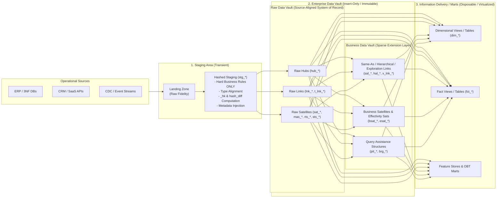
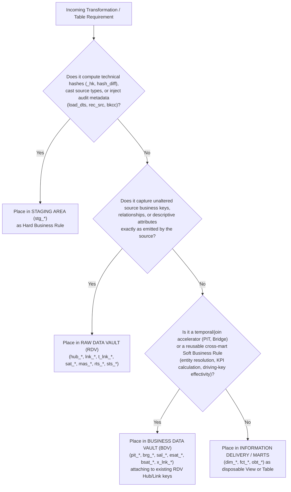
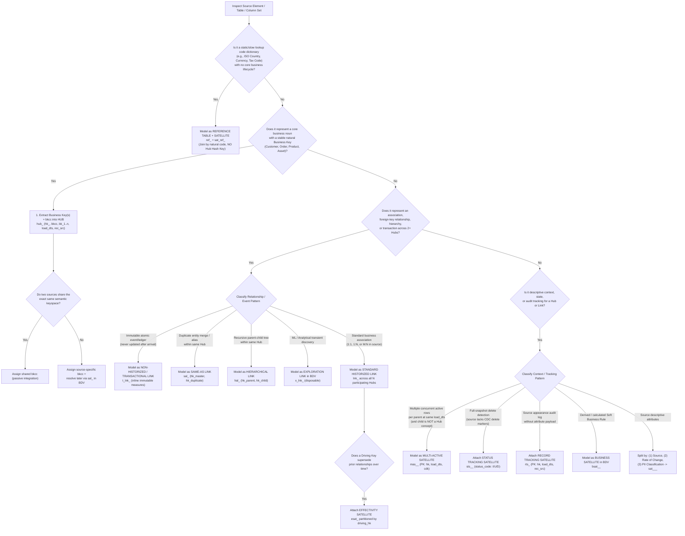
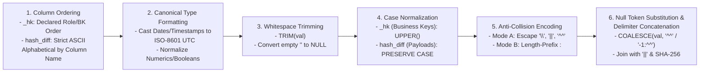
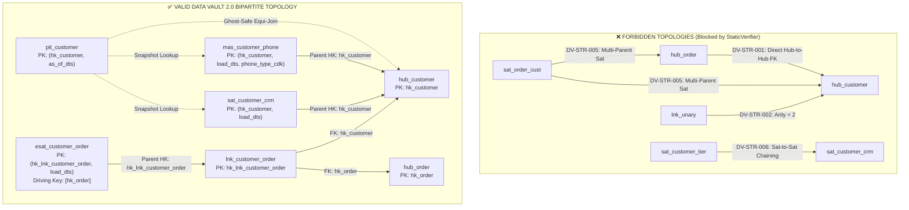
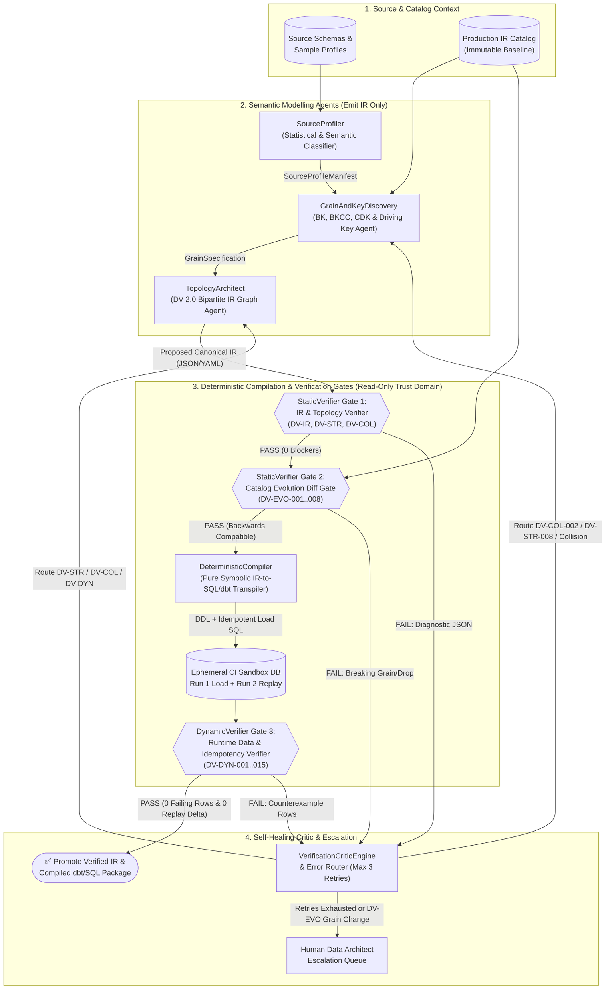
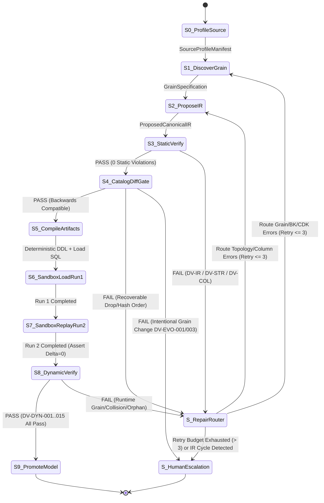

# Data Vault 2.0 Agentic Modelling & Schema Stability Reference Guide (`open-dv`)

> **Master Reference Specification for Autonomous Data Vault 2.0 Agents**  
> **Version:** `1.0.0`  
> **Modular Domain Specifications:**
> - [01 — Core Architecture, Entity Specifications, and Methodology Standards](01-core-modelling-spec.md)
> - [02 — Schema Stability Rules, Invariants, Evolution Mechanics, and Anti-Patterns](02-schema-stability-and-evolution.md)
> - [03 — Automated Verification Gates and Multi-Agent System Architecture](03-verification-and-agentic-architecture.md)
> - [Canonical Intermediate Representation (IR) JSON Schema (`schemas/dv2-canonical-ir.schema.json`)](../schemas/dv2-canonical-ir.schema.json)

---

## Table of Contents

1. [Executive Summary & Neuro-Symbolic Design Philosophy](#1-executive-summary--neuro-symbolic-design-philosophy)
2. [Architectural Layer Boundaries & Rule Placement Taxonomy](#2-architectural-layer-boundaries--rule-placement-taxonomy)
   - [2.1 Four-Zone Enterprise Data Vault Architecture](#21-four-zone-enterprise-data-vault-architecture)
   - [2.2 Hard vs. Soft Business Rules & Layer Matrix](#22-hard-vs-soft-business-rules--layer-matrix)
   - [2.3 Architectural Layer Placement Decision Tree](#23-architectural-layer-placement-decision-tree)
3. [Complete Data Vault 2.0 Entity Specifications & SQL Templates](#3-complete-data-vault-20-entity-specifications--sql-templates)
   - [3.1 Hubs (`hub_<entity>`)](#31-hubs-hub_entity)
   - [3.2 Links (`lnk_`, `t_lnk_`, `sal_`, `hal_`, `x_lnk_`)](#32-links-lnk_-t_lnk_-sal_-hal_-x_lnk_)
   - [3.3 Satellites (`sat_`, `mas_`, `esat_`, `sts_`, `rts_`, `ref_` / `sat_ref_`)](#33-satellites-sat_-mas_-esat_-sts_-rts_-ref_--sat_ref_)
   - [3.4 Query Assistance Structures: Zero Keys, Ghost Records, PIT (`pit_*`), and Bridge (`brg_*`)](#34-query-assistance-structures-zero-keys-ghost-records-pit-pit_-and-bridge-brg_)
   - [3.5 Master Entity Classification Decision Tree](#35-master-entity-classification-decision-tree)
4. [Unified 6-Stage Pre-Hash Canonicalization, Collision Codes (`bkcc`), & Naming Taxonomy](#4-unified-6-stage-pre-hash-canonicalization-collision-codes-bkcc--naming-taxonomy)
   - [4.1 Cryptographic Hash Algorithm Selection](#41-cryptographic-hash-algorithm-selection)
   - [4.2 The Unified 6-Stage Pre-Hash Canonicalization Pipeline](#42-the-unified-6-stage-pre-hash-canonicalization-pipeline)
   - [4.3 Mathematical Proof of Naive Concatenation Collisions & Injective Encoding](#43-mathematical-proof-of-naive-concatenation-collisions--injective-encoding)
   - [4.4 Business Key Collision Codes (`bkcc`) & Passive vs. Active Integration](#44-business-key-collision-codes-bkcc--passive-vs-active-integration)
   - [4.5 Metadata Column Contracts & Naming Taxonomy](#45-metadata-column-contracts--naming-taxonomy)
5. [Schema Stability Invariants, Non-Breaking Evolution Playbooks, & Anti-Patterns](#5-schema-stability-invariants-non-breaking-evolution-playbooks--anti-patterns)
   - [5.1 Fundamental Stability Invariants (`INV-01`–`INV-06`)](#51-fundamental-stability-invariants-inv-01inv-06)
   - [5.2 Key & Temporal Stability Rules (`KEY-01`–`KEY-05`, `TMP-01`–`TMP-04`)](#52-key--temporal-stability-rules-key-01key-05-tmp-01tmp-04)
   - [5.3 Non-Breaking Schema Evolution Playbooks (`EVO-01`–`EVO-08` & `EVO-01a`)](#53-non-breaking-schema-evolution-playbooks-evo-01evo-08--evo-01a)
   - [5.4 Bi-Temporal Dual-Timeline Reconstruction & Early-Arriving Fact Stubbing](#54-bi-temporal-dual-timeline-reconstruction--early-arriving-fact-stubbing)
   - [5.5 Comprehensive Schema Anti-Pattern Catalog (`AP-01`–`AP-15`)](#55-comprehensive-schema-anti-pattern-catalog-ap-01ap-15)
6. [Static & Dynamic Verification Rule Catalogs (`DV-STR-*`, `DV-COL-*`, `DV-EVO-*`, `DV-DYN-*`)](#6-static--dynamic-verification-rule-catalogs-dv-str--dv-col--dv-evo--dv-dyn-)
   - [6.1 Mathematical Bipartite Graph Formulation](#61-mathematical-bipartite-graph-formulation)
   - [6.2 Static Structural & Graph Topology Rules (`DV-STR-001`–`DV-STR-014`)](#62-static-structural--graph-topology-rules-dv-str-001dv-str-014)
   - [6.3 Static Column, DDL, & Hash Contract Rules (`DV-COL-001`–`DV-COL-012`)](#63-static-column-ddl--hash-contract-rules-dv-col-001dv-col-012)
   - [6.4 Schema Evolution & Immutability Diff Gate Rules (`DV-EVO-001`–`DV-EVO-008`)](#64-schema-evolution--immutability-diff-gate-rules-dv-evo-001dv-evo-008)
   - [6.5 Dynamic Data & Runtime Verification Rules (`DV-DYN-001`–`DV-DYN-015`)](#65-dynamic-data--runtime-verification-rules-dv-dyn-001dv-dyn-015)
   - [6.6 Executable Parametric SQL Verification Templates](#66-executable-parametric-sql-verification-templates)
7. [Multi-Agent System Architecture & Closed-Loop Self-Healing State Machine](#7-multi-agent-system-architecture--closed-loop-self-healing-state-machine)
   - [7.1 Multi-Agent System Topology (`SourceProfiler`, `GrainAndKeyDiscovery`, `TopologyArchitect`, `DeterministicCompiler`, `StaticVerifier`, `DynamicVerifier`)](#71-multi-agent-system-topology-sourceprofiler-grainandkeydiscovery-topologyarchitect-deterministiccompiler-staticverifier-dynamicverifier)
   - [7.2 Agent Contracts, Tool Sandboxing, & Anti-Reward-Hacking Boundaries](#72-agent-contracts-tool-sandboxing--anti-reward-hacking-boundaries)
   - [7.3 Closed-Loop Verification & Self-Healing State Machine](#73-closed-loop-verification--self-healing-state-machine)
   - [7.4 Deterministic Error-Routing & Remediation Table](#74-deterministic-error-routing--remediation-table)
   - [7.5 Canonical IR Specification & Deterministic Idempotent Compiler Templates](#75-canonical-ir-specification--deterministic-idempotent-compiler-templates)

---

## 1. Executive Summary & Neuro-Symbolic Design Philosophy

Data Vault 2.0 (formalized by Dan Linstedt and Michael Olschimke, and operationalized in modern cloud data platforms through frameworks such as AutomateDV/dbtvault and datavault4dbt) is a hybrid relational-dimensional enterprise data warehouse architecture engineered for **100% historical auditability, deterministic parallel loading, and zero-reengineering resilience to source system evolution**.

Unlike Third Normal Form (3NF), which commingles identity, cardinality, and mutable attributes in the same table, and unlike Kimball Star Schemas, which apply destructive business rules and slowly changing dimension (SCD) mutations upstream of storage, Data Vault 2.0 enforces a strict **three-way orthogonal decomposition** of all enterprise data:
1. **Identity (`Hubs`):** Immutable registry of unique business keys (`hk_<entity>`, `bkcc`, business key(s), `load_dts`, `rec_src`).
2. **Association & Grain (`Links`):** Immutable registry of intersections, relationships, hierarchies, and atomic transactions across two or more Hubs, physically modeled as many-to-many ($M:N$) to insulate against source cardinality drift.
3. **Context & Temporal State (`Satellites`):** Strictly `INSERT`-only temporal change logs attached to exactly one parent Hub or Link, detecting state transitions via deterministic payload digests (`hash_diff`) and projecting validity intervals virtually via `LEAD(load_dts)` window functions rather than destructive physical `UPDATE` statements.

When designing **`open-dv`**—an autonomous multi-agent system that designs, evolves, and verifies Data Vault 2.0 models—removing hard RDBMS foreign-key constraints in favor of deterministic cryptographic hash keys introduces a critical risk: **LLM hallucinations (such as Hub-to-Hub foreign keys, unsorted `hash_diff` columns, unescaped delimiter collisions, or destructive `DROP`/`UPDATE` migrations) will silently corrupt the enterprise historical record unless blocked by formal verification gates.**

To guarantee mathematical schema stability and data integrity, `open-dv` enforces a **Neuro-Symbolic Verification Architecture** built on three non-negotiable pillars:
1. **IR-First Contract (Zero Direct SQL Generation by LLMs):** Semantic modelling agents (`SourceProfiler`, `GrainAndKeyDiscovery`, `TopologyArchitect`) never author raw SQL DDL or DML directly. They emit and repair models exclusively in the **Canonical Intermediate Representation (IR)** validated against [`schemas/dv2-canonical-ir.schema.json`](../schemas/dv2-canonical-ir.schema.json). A pure symbolic `DeterministicCompiler` transpiles verified IR into SQL DDL, staging views, idempotent load DML, and verification suites.
2. **Two-Phase Defense-in-Depth Verification (`StaticVerifier` + `DynamicVerifier`):**
   - **Compile-Time Static & Evolution Gates (`DV-STR-*`, `DV-COL-*`, `DV-EVO-*`)** verify the bipartite graph topology, column contracts, hash canonicalization rules, and backwards-compatible schema evolution against the immutable baseline catalog *before* opening any database connection.
   - **Runtime Sandbox & Post-Load Gates (`DV-DYN-001`–`DV-DYN-015`)** execute the compiled DDL and load pipeline twice (`Run 1` + `Run 2` replay) in an ephemeral sandbox to prove grain uniqueness, zero hash collisions, orphan-free referential integrity, true-delta Satellite historization, Zero/Ghost record presence, and replay idempotency ($\Delta \text{rows} = 0$).
3. **Isolated Critic & Bounded Self-Healing Loop:** Verification engines run in a read-only trust domain. Modelling agents cannot alter verification rules or baseline catalog snapshots; they can only repair the IR within a bounded retry budget (`max_retries = 3`) or escalate genuine business-grain shifts to human architects.

---

## 2. Architectural Layer Boundaries & Rule Placement Taxonomy

### 2.1 Four-Zone Enterprise Data Vault Architecture

A compliant Data Vault 2.0 Enterprise Data Warehouse (EDW) enforces strict functional and mutability boundaries across four sequential architectural zones: **Landing / Staging**, **Raw Data Vault (RDV)**, **Business Data Vault (BDV)**, and **Information Delivery (Information Marts)**.



### 2.2 Hard vs. Soft Business Rules & Layer Matrix

The fundamental architectural boundary of Data Vault 2.0 is the strict separation between **Hard Business Rules** (technical alignment applied in Staging prior to Raw Vault ingestion) and **Soft Business Rules** (semantic interpretation, deduplication, and calculation applied in the Business Vault or Information Marts).

| Architectural Layer | Persistence & Lifespan | Permitted Transformations | Strictly Forbidden Operations | Target Entities |
| :--- | :--- | :--- | :--- | :--- |
| **Landing Zone** | Transient or Cold Archive (Object Storage / CDC Log) | Byte-exact extraction from source; format serialization (Parquet/Avro/JSON). | Filtering, casting, deduplicating, renaming, or joining. | Raw files / landing tables |
| **Staging Area (`stg_*`)** | Transient (Truncate-and-load per batch or sliding CDC window; often SQL Views in ELT) | **Hard Business Rules Only:** Technical data-type casting; trimming/case normalization for hashing; computing `_hk` and `hash_diff`; injecting `load_dts`, `rec_src`, `bkcc`, `batch_id`; intra-batch exact deduplication; substituting `-1`/`-2` Zero Keys for NULL foreign business keys. | Cross-table joins to other staging tables; filtering out "invalid" business values; currency conversion; status remapping; KPI aggregation. | `stg_<source>_<table_name>` |
| **Raw Data Vault (RDV)** | **Permanent, Immutable, Insert-Only** (System of Record / Audit Trail) | Idempotent set-based `INSERT` of unseen Hub keys (`_hk`), unseen Link intersections (`_hk`), and changed Satellite attribute states (`hash_diff != prev_hash_diff`). | **Any `UPDATE` or `DELETE`** (except legal GDPR crypto-shredding on isolated PII Satellites); any Soft Business Rules; altering source attribute values ("bad data in = bad data recorded"). | `hub_*`, `lnk_*`, `t_lnk_*`, `sat_*`, `mas_*`, `sts_*`, `rts_*`, `ref_*` |
| **Business Data Vault (BDV)** | **Sparse**, Semi-Permanent or Disposable (Derived from RDV) | **Soft Business Rules:** Cross-source entity resolution (`sal_*`); driving-key temporal resolution (`esat_*`); derived financial/risk metrics (`bsat_*`); multi-Satellite temporal alignment (`pit_*`); multi-hop join flattening (`brg_*`). | Duplicating Raw Vault tables unchanged (BDV is a *sparse overlay*, never a 1:1 mirror of RDV); mutating or overwriting RDV tables. | `sal_*`, `hal_*`, `x_lnk_*`, `bsat_*`, `esat_*`, `pit_*`, `brg_*` |
| **Information Delivery (Marts)** | **Disposable / Rebuildable** (SQL Views `CREATE VIEW` or scheduled materializations) | Star-schema projection (`DIM_*`, `FCT_*`), Snowflake schemas, One Big Table (OBT), slowly changing dimension (SCD Type 1/2/3/6) projection, Ghost-Record-accelerated `INNER JOIN` assembly, role-playing dimensions, BI security filtering. | Acting as a system of record; holding state that cannot be deterministically regenerated from RDV + BDV + Reference tables. | `dim_*`, `fct_*`, `obt_*`, `rpt_*` |

### 2.3 Architectural Layer Placement Decision Tree



---

## 3. Complete Data Vault 2.0 Entity Specifications & SQL Templates

### 3.1 Hubs (`hub_<entity>`)

A **Hub** establishes the canonical registry of unique **Business Keys** representing a core business noun/concept (`hub_customer`, `hub_product`, `hub_account`, `hub_order`). A Hub row is created the first time a distinct business key is observed by the enterprise and is never updated or deleted.

| Column Name | Logical Role | Data Type (Recommended) | Nullability | Constraint / Default | Description |
| :--- | :--- | :--- | :--- | :--- | :--- |
| `hk_<entity>` | Surrogate Hash Key | `BINARY(32)` (SHA-256) or `CHAR(64)` | `NOT NULL` | `PRIMARY KEY` | Deterministic hash of `(bkcc, [tenant_id,] bk_1, ..., bk_n)`. |
| `bkcc` | Business Key Collision Code | `VARCHAR(32)` | `NOT NULL` | Part of Logical Unique Key; `'GLOBAL'` if shared keyspace | Disambiguates colliding keyspaces across uncoordinated source systems. |
| `tenant_id` | Multi-Tenant Partition Key *(Optional)* | `VARCHAR(64)` | `NOT NULL` | Part of Logical Unique Key (when multi-tenant) | Isolates multi-tenant SaaS data when tenants share identical keyspaces. |
| `<bk_col_1..n>` | Business Key(s) | `VARCHAR(255)` *(Always text!)* | `NOT NULL` | `UNIQUE (bkcc, [tenant_id,] bk_1, ..., bk_n)` | Single or composite natural key(s) as recognized by the business user. |
| `load_dts` | Load Date Timestamp | `TIMESTAMP_NTZ(9)` / `TIMESTAMPTZ` | `NOT NULL` | Technical arrival timestamp | Timestamp when this business key was **first loaded** into the Data Vault. |
| `rec_src` | Record Source | `VARCHAR(255)` | `NOT NULL` | System + object identifier | Source system and table/feed that **first registered** this business key. |

> [!IMPORTANT]
> **Hub Invariants:**
> 1. **Store Business Keys as `VARCHAR`:** Storing keys as integers strips significant leading zeros (`'00421'` $\to$ `421`) and breaks passive integration when alphanumeric keys arrive.
> 2. **Strictly Forbidden in Hubs:** Descriptive attributes, foreign keys (`hk_parent`), temporal end-dates (`load_end_dts`, `is_current`), `hash_diff`, or unexposed internal source row sequences.

```sql
-- DDL: Raw Data Vault Hub
CREATE TABLE rdv.hub_customer (
    hk_customer   BINARY(32)    NOT NULL,
    bkcc          VARCHAR(32)   NOT NULL,
    customer_id   VARCHAR(128)  NOT NULL,
    load_dts      TIMESTAMP_NTZ NOT NULL,
    rec_src       VARCHAR(128)  NOT NULL,
    CONSTRAINT pk_hub_customer PRIMARY KEY (hk_customer),
    CONSTRAINT uq_hub_customer_bk UNIQUE (bkcc, customer_id)
);

-- DML: Idempotent Set-Based Hub Load from Hashed Staging
INSERT INTO rdv.hub_customer (hk_customer, bkcc, customer_id, load_dts, rec_src)
SELECT src.hk_customer, src.bkcc, src.customer_id, src.load_dts, src.rec_src
FROM (
    SELECT
        stg.hk_customer, stg.bkcc, stg.customer_id, stg.load_dts, stg.rec_src,
        ROW_NUMBER() OVER (PARTITION BY stg.hk_customer ORDER BY stg.load_dts ASC, stg.rec_src ASC) AS rn
    FROM stg.stg_crm_customers stg
    WHERE stg.hk_customer IS NOT NULL
) src
WHERE src.rn = 1
  AND NOT EXISTS (
      SELECT 1 FROM rdv.hub_customer tgt WHERE tgt.hk_customer = src.hk_customer
  );
```

---

### 3.2 Links (`lnk_`, `t_lnk_`, `sal_`, `hal_`, `x_lnk_`)

A **Link** models the intersection, association, hierarchy, or business transaction between **two or more Hubs** (or two or more role-aliased references to the same Hub). **Every Link is physically modeled as a many-to-many ($M:N$) associative entity**, insulating the Data Vault against source cardinality changes (`1:1` $\to$ `1:N` $\to$ `M:N`).

| Column Name | Logical Role | Data Type (Recommended) | Nullability | Constraint | Description |
| :--- | :--- | :--- | :--- | :--- | :--- |
| `hk_<link>` | Link Surrogate Hash Key | `BINARY(32)` / `CHAR(64)` | `NOT NULL` | `PRIMARY KEY` | Deterministic hash of all participating Hub business keys (plus their `bkcc`s) and any degenerate Link keys in fixed role order. |
| `hk_<hub_1..k>` | Hub $1..k$ Foreign Hash Keys ($k \ge 2$) | `BINARY(32)` / `CHAR(64)` | `NOT NULL` | `FOREIGN KEY` | Hash keys of participating Hubs (or Zero Key `0x00..00` / `0xFF..FF` if missing/optional). |
| `[<deg_key>]` | Degenerate / Dependent Child Key *(Optional)* | `VARCHAR(128)` | `NOT NULL` | Included in `hk_<link>` hash | Sub-entity qualifier (e.g., `order_line_no`) that participates in the Link grain without warranting its own Hub. |
| `load_dts` | Load Date Timestamp | `TIMESTAMP_NTZ(9)` | `NOT NULL` | Technical arrival timestamp | Timestamp when this specific association instance was **first observed**. |
| `rec_src` | Record Source | `VARCHAR(255)` | `NOT NULL` | System + object identifier | Source system and feed that first delivered this association. |

#### Specialized Link Variants

| Link Variant | Prefix | Layer | Primary Purpose | Key Structural Difference from Standard Link |
| :--- | :--- | :--- | :--- | :--- |
| **Standard Historized Link** | `lnk_` | Raw / Business Vault | Captures $M:N$ associations between 2+ Hubs; mutable context lives in attached Link Satellites (`sat_lnk_*`). | Contains only `hk_<link>`, `hk_<hub_1..n>`, optional degenerate key, `load_dts`, `rec_src`. |
| **Non-Historized / Transactional Link** | `t_lnk_` (or `nh_lnk_`) | Raw Vault | Captures high-velocity, immutable atomic events (financial ledger postings, IoT telemetry, POS swipes) that **never update** after occurrence. | Embeds **immutable event payload measures and timestamps** (`amount`, `quantity`, `event_dts`, `transaction_id`) directly inside the Link table; **no Satellite or `hash_diff` is attached**. |
| **Same-As Link (SAL)** | `sal_` | Business Vault *(or Raw Vault if source-supplied)* | Entity resolution and master-data deduplication across duplicate/synonym business keys within the same domain. | Connects two role-aliased keys referencing the **exact same Hub**: `hk_<entity>_master` and `hk_<entity>_duplicate`. Order of keys in `hk_sal_*` is strictly directional! |
| **Hierarchical Link (HAL)** | `hal_` | Raw / Business Vault | Recursive parent-child trees, bills of materials (BOM), organizational reporting lines, and chart-of-accounts rollups. | Connects two role-aliased keys referencing the **exact same Hub**: `hk_<entity>_parent` and `hk_<entity>_child`. Order in `hk_hal_*` is strictly directional! |
| **Exploration Link** | `x_lnk_` | Business Vault (Analytics Sandbox) | Transient relationships discovered by ML models, graph algorithms, or heuristic analytics. | Explicitly **disposable and rebuildable**; carries algorithm metadata (`model_version`, `confidence_score`) inline or in an Exploration Satellite. |

```sql
-- 1. Standard Historized 3-Way Link with Degenerate Key (Order Line Unit-of-Work Grain)
CREATE TABLE rdv.lnk_order_line (
    hk_lnk_order_line BINARY(32)    NOT NULL,
    hk_order          BINARY(32)    NOT NULL,
    hk_product        BINARY(32)    NOT NULL,
    hk_customer       BINARY(32)    NOT NULL,
    order_line_no     VARCHAR(32)   NOT NULL, -- Degenerate / Dependent Child Key
    load_dts          TIMESTAMP_NTZ NOT NULL,
    rec_src           VARCHAR(128)  NOT NULL,
    CONSTRAINT pk_lnk_order_line PRIMARY KEY (hk_lnk_order_line)
);

-- 2. Non-Historized / Transactional Link (Immutable Payment Ledger Event)
CREATE TABLE rdv.t_lnk_payment_transaction (
    hk_t_lnk_payment  BINARY(32)     NOT NULL,
    hk_account_debit  BINARY(32)     NOT NULL,
    hk_account_credit BINARY(32)     NOT NULL,
    transaction_id    VARCHAR(128)   NOT NULL,
    transaction_dts   TIMESTAMP_NTZ  NOT NULL,
    amount_minor_unit BIGINT         NOT NULL,
    currency_code     CHAR(3)        NOT NULL,
    load_dts          TIMESTAMP_NTZ  NOT NULL,
    rec_src           VARCHAR(128)   NOT NULL,
    CONSTRAINT pk_t_lnk_payment PRIMARY KEY (hk_t_lnk_payment)
);

-- 3. Same-As Link (Cross-System Entity Resolution) & 4. Hierarchical Link (Org Chart)
CREATE TABLE bdv.sal_customer (
    hk_sal_customer       BINARY(32)    NOT NULL,
    hk_customer_master    BINARY(32)    NOT NULL,
    hk_customer_duplicate BINARY(32)    NOT NULL,
    load_dts              TIMESTAMP_NTZ NOT NULL,
    rec_src               VARCHAR(128)  NOT NULL,
    CONSTRAINT pk_sal_customer PRIMARY KEY (hk_sal_customer)
);

CREATE TABLE rdv.hal_org_unit_hierarchy (
    hk_hal_org_unit    BINARY(32)    NOT NULL,
    hk_org_unit_parent BINARY(32)    NOT NULL,
    hk_org_unit_child  BINARY(32)    NOT NULL,
    load_dts           TIMESTAMP_NTZ NOT NULL,
    rec_src            VARCHAR(128)  NOT NULL,
    CONSTRAINT pk_hal_org_unit PRIMARY KEY (hk_hal_org_unit)
);
```

---

### 3.3 Satellites (`sat_`, `mas_`, `esat_`, `sts_`, `rts_`, `ref_` / `sat_ref_`)

A **Satellite** stores descriptive attributes (context) and tracks their temporal state changes over time as an immutable, `INSERT`-only log attached to **exactly one parent Hub or Link**.

#### Satellite Splitting & Topology Rules
- **Single Parent Only:** Every Satellite attaches to 1 Hub or 1 Link (`DV-STR-005`). No Satellite-on-Satellite chaining (`DV-STR-006`).
- **Three Splitting Axes:** Split Satellites by **(1) Source System** (`DV-STR-012`), **(2) Rate of Change / Velocity** (`EVO-06`), and **(3) PII / Security Classification** (`EVO-07`).
- **No Physical `load_end_dts` (`INV-02`):** Base Satellites never store mutable `load_end_dts` or `is_current` columns; effective intervals `[eff_start_dts, eff_end_dts)` are derived virtually via `LEAD(load_dts)` window views using half-open interval semantics (`as_of_dts >= eff_start_dts AND as_of_dts < eff_end_dts`).

| Satellite Variant | Prefix | Parent Type | Primary Key | Purpose & Mechanics |
| :--- | :--- | :--- | :--- | :--- |
| **Standard Satellite** | `sat_` | Hub or Link | `(hk_<parent>, load_dts)` | Tracks single-active-row temporal changes for descriptive attributes via `hash_diff`. |
| **Business Satellite** | `bsat_` | Hub or Link | `(hk_<parent>, load_dts)` | Stores reusable derived/calculated Soft Business Rule attributes in the Business Vault. |
| **Multi-Active Satellite (MAS)** | `mas_` | Hub or Link | `(hk_<parent>, load_dts, <cdk>)` | Tracks **multiple concurrent active attribute rows** per parent key at the same `load_dts` using a non-null **Child Dependent Key (`<cdk>`)** (e.g., `phone_type`). |
| **Effectivity Satellite (E-Sat)** | `esat_` | **Link Only** | `(hk_<link>, load_dts)` | Tracks the active validity lifespan of a Link relationship across a declared **Driving Key** (`driving_hk_<hub>`). Windowing `LEAD(load_dts)` **must partition by `driving_hk_<hub>`**, never by `hk_<link>`! |
| **Status Tracking Satellite (STS)** | `sts_` | Hub or Link | `(hk_<parent>, load_dts)` | Tracks source record existence transitions (`status_code IN ('I', 'U', 'D')`) when ingesting full snapshots from sources without CDC delete tombstones. |
| **Record Tracking Satellite (RTS)** | `rts_` | Hub or Link | `(hk_<parent>, load_dts, rec_src)` | High-speed audit log containing **zero payload attributes** and **no `hash_diff`**, recording every timestamp and source from which `hk_<parent>` was observed. |
| **Reference Table + Satellite** | `ref_` / `sat_ref_` | Natural Code (`ref_code`) | `ref_`: `(ref_code)`<br>`sat_ref_`: `(ref_code, load_dts)` | Standardized lookup dictionaries (ISO country, currency) joined by **natural code** rather than hash keys, avoiding low-cardinality Hub anti-patterns (`AP-15`). |

```sql
-- 1. Standard Raw Satellite + Virtualized End-Dating View
CREATE TABLE rdv.sat_customer_crm (
    hk_customer   BINARY(32)    NOT NULL,
    load_dts      TIMESTAMP_NTZ NOT NULL,
    hash_diff     BINARY(32)    NOT NULL,
    email_address VARCHAR(255)  NULL,
    full_name     VARCHAR(255)  NULL,
    loyalty_tier  VARCHAR(64)   NULL,
    rec_src       VARCHAR(128)  NOT NULL,
    CONSTRAINT pk_sat_customer_crm PRIMARY KEY (hk_customer, load_dts)
);

CREATE VIEW bdv.v_sat_customer_crm_temporal AS
SELECT
    hk_customer,
    load_dts AS eff_start_dts,
    COALESCE(
        LEAD(load_dts) OVER (PARTITION BY hk_customer ORDER BY load_dts ASC),
        CAST('9999-12-31 23:59:59.999999' AS TIMESTAMP_NTZ)
    ) AS eff_end_dts,
    CASE WHEN LEAD(load_dts) OVER (PARTITION BY hk_customer ORDER BY load_dts ASC) IS NULL THEN TRUE ELSE FALSE END AS is_current,
    hash_diff, email_address, full_name, loyalty_tier, rec_src
FROM rdv.sat_customer_crm;

-- 2. Multi-Active Satellite (MAS) with Child Dependent Key (phone_type)
CREATE TABLE rdv.mas_customer_phone (
    hk_customer  BINARY(32)    NOT NULL,
    load_dts     TIMESTAMP_NTZ NOT NULL,
    phone_type   VARCHAR(32)   NOT NULL, -- Child Dependent Key (CDK)
    hash_diff    BINARY(32)    NOT NULL,
    phone_number VARCHAR(64)   NOT NULL,
    is_primary   BOOLEAN       NOT NULL,
    rec_src      VARCHAR(128)  NOT NULL,
    CONSTRAINT pk_mas_customer_phone PRIMARY KEY (hk_customer, load_dts, phone_type)
);

-- 3. Insert-Only Effectivity Satellite & Driving-Key Window View
CREATE TABLE bdv.esat_customer_account_mgr (
    hk_lnk_cust_acct_mgr BINARY(32)    NOT NULL,
    load_dts             TIMESTAMP_NTZ NOT NULL,
    driving_hk_customer  BINARY(32)    NOT NULL,
    rec_src              VARCHAR(128)  NOT NULL,
    CONSTRAINT pk_esat_cust_acct_mgr PRIMARY KEY (hk_lnk_cust_acct_mgr, load_dts)
);

CREATE VIEW bdv.v_esat_customer_account_mgr AS
SELECT
    e.hk_lnk_cust_acct_mgr,
    e.driving_hk_customer AS hk_customer,
    l.hk_employee,
    e.load_dts AS start_dts,
    COALESCE(
        LEAD(e.load_dts) OVER (PARTITION BY e.driving_hk_customer ORDER BY e.load_dts ASC),
        CAST('9999-12-31 23:59:59.999999' AS TIMESTAMP_NTZ)
    ) AS end_dts,
    CASE WHEN LEAD(e.load_dts) OVER (PARTITION BY e.driving_hk_customer ORDER BY e.load_dts ASC) IS NULL THEN TRUE ELSE FALSE END AS is_active,
    e.rec_src
FROM bdv.esat_customer_account_mgr e
INNER JOIN rdv.lnk_customer_account_mgr l
    ON e.hk_lnk_cust_acct_mgr = l.hk_lnk_cust_acct_mgr;
```

---

### 3.4 Query Assistance Structures: Zero Keys, Ghost Records, PIT (`pit_*`), and Bridge (`brg_*`)

#### Zero Keys vs. Ghost Records Contract

| Concept | Target Tables | Surrogate Hash Key (`BINARY(32)` / `CHAR(64)`) | Business Key / Payload Value | `load_dts` Value | Semantic Meaning & Usage |
| :--- | :--- | :--- | :--- | :--- | :--- |
| **Zero Key (Unknown / Missing Mandatory)** | **Hubs & Links** (`hub_*`, `lnk_*`) | `0x0000...0000` (32 zero bytes / 64 `'0'` hex chars) | `'-1'` (`bkcc = 'SYSTEM'`) | `'1900-01-01 00:00:00'` | Substituted in Staging when a **mandatory** foreign business key on an incoming Link record is `NULL` or missing. |
| **Zero Key (Not Applicable / Error / Optional)** | **Hubs & Links** (`hub_*`, `lnk_*`) | `0xFFFF...FFFF` (32 `0xFF` bytes / 64 `'F'` hex chars) | `'-2'` (`bkcc = 'SYSTEM'`) | `'1900-01-01 00:00:00'` | Substituted in Staging when an **optional** foreign business key on a Link is legitimately inapplicable or fails domain parsing. |
| **Ghost Record** | **Satellites** (`sat_*`, `mas_*`, `bsat_*`) | `0x0000...0000` (32 zero bytes / 64 `'0'` hex chars) | Strings = `'UNKNOWN'`, numerics = `-1` or `0` or `NULL` | `'1900-01-01 00:00:00'` | Seeded once into **every Satellite**. When a Hub key has no active row in Satellite $i$ at snapshot timestamp `as_of_dts`, the PIT table points `hk_sat_i = 0x00..00` and `load_dts_sat_i = '1900-01-01 00:00:00'`, enabling pure **INNER Equi-Joins**. |

#### Point-in-Time (PIT) Tables (`pit_<parent>`) & Logarithmic Snapshot Spines
- **Purpose:** Accelerates radial joins across a Hub/Link and its multiple Satellites by recording the active `(hk_sat_i, load_dts_sat_i)` coordinate as of each `as_of_dts` snapshot.
- **Logarithmic Snapshot Window:** Retains Daily snapshots for T-0..T-30d (31), Weekly for T-31..T-365d (~48), Monthly for Year 2–3 (24), and Quarterly for Year 4–5 (8) — **111 snapshots vs. 1,825 daily snapshots (93.9% row reduction)**.

#### Bridge Tables (`brg_<subject_area>`)
- **Purpose:** Accelerates axial multi-hop joins across a chain of Hubs and Links (`hub_region` $\leftrightarrow$ `lnk_region_store` $\leftrightarrow$ `hub_store` $\leftrightarrow$ `lnk_store_order` $\leftrightarrow$ `hub_order`) so Fact views can join any upstream dimension in a single hop.

---

### 3.5 Master Entity Classification Decision Tree



---

## 4. Unified 6-Stage Pre-Hash Canonicalization, Collision Codes (`bkcc`), & Naming Taxonomy

### 4.1 Cryptographic Hash Algorithm Selection

| Hash Algorithm | Digest Bit Length | Binary Storage (`BINARY`) | Hex String Storage (`CHAR`) | Birthday Bound ($50\%$ Collision Risk) | Collision Probability at $10^{11}$ Keys | `open-dv` Standard Recommendation |
| :--- | :--- | :--- | :--- | :--- | :--- | :--- |
| **SHA-256** | 256 bits | **32 bytes (`BINARY(32)`)** | 64 bytes (`CHAR(64)`) | $\approx 4.0 \times 10^{38}$ keys | $\approx 4.3 \times 10^{-56}$ | **PRIMARY DEFAULT (`BINARY(32)` or `CHAR(64)`)** for all Data Vault 2.0 deployments. |
| **MD5** | 128 bits | 16 bytes (`BINARY(16)`) | 32 bytes (`CHAR(32)`) | $\approx 2.2 \times 10^{19}$ keys | $\approx 1.5 \times 10^{-17}$ | Legacy compatibility only; prohibited in FIPS-140 regulated environments. |

### 4.2 The Unified 6-Stage Pre-Hash Canonicalization Pipeline



1. **Stage 1 — Deterministic Column Ordering:**
   - **Hub `hk_<hub>`:** Ordered as `(bkcc, [tenant_id,] bk_1, ..., bk_n)`.
   - **Link `hk_lnk_<name>`:** Ordered by declared Hub role sequence `(bkcc_hub1, bk_hub1_1..n, bkcc_hub2, bk_hub2_1..n, ..., [deg_key_1..m])`. Never sort directional Links (`sal_*`, `hal_*`) alphabetically!
   - **Satellite `hash_diff`:** Strictly sorted in **ASCII alphabetical order** (`attr_a`, `attr_b`, ..., plus `cdk` columns for `mas_*`).
2. **Stage 2 — Canonical Type Formatting:** Cast `DATE` to `'YYYY-MM-DD'`, `TIMESTAMP` to `'YYYY-MM-DD"T"HH24:MI:SS.FF6'`, `BOOLEAN` to `'TRUE'`/`'FALSE'`, and `NUMERIC` to fixed scale.
3. **Stage 3 — Whitespace Trimming & Empty-String Unification:** `NULLIF(TRIM(CAST(col AS VARCHAR)), '')` so `'   '` and `''` both normalize to `NULL`.
4. **Stage 4 — Asymmetric Case Normalization (`_hk` vs. `hash_diff`):**
   - **Hub/Link `_hk`:** `UPPER(...)` by default (`UPPER_TRIM`) so `'cust-100'` and `'CUST-100'` passively integrate.
   - **Satellite `hash_diff`:** **Case-preserving (`EXACT_TRIM`)** so `'mcdonald'` $\to$ `'McDonald'` triggers a Satellite delta row.
5. **Stage 5 — Anti-Collision Encoding (Delimiter-Escaped or Length-Prefixed):**
   - **Delimiter-Escaped (`DELIMITER_ESCAPED`):** `REPLACE(REPLACE(REPLACE(s, '\', '\\'), '||', '\||'), '^^', '\^^')`.
   - **Length-Prefixed (`LENGTH_PREFIXED`):** `CAST(OCTET_LENGTH(s) AS VARCHAR) || ':' || s` for non-null values and `'-1:^^'` for `NULL`.
6. **Stage 6 — Explicit Null Token Substitution & Digest:** Wrap every column in `COALESCE(..., '^^')` (or `'-1'` for BK / `'-1:^^'` for length-prefixed) before concatenating with `'||'` and hashing with `SHA-256`.

### 4.3 Mathematical Proof of Naive Concatenation Collisions & Injective Encoding

1. **Delimiter Shift Collision (`AP-08a`):**
   - `('ANNE||O', 'BRIEN')` $\to$ `'ANNE||O||BRIEN'` == `('ANNE', 'O||BRIEN')` $\to$ `'ANNE||O||BRIEN'` (SHA-256 `3B724334553C2566...`).
2. **`CONCAT_WS` NULL-Skipping Positional Shift Collision (`AP-08b`):**
   - Because SQL `CONCAT_WS('||', col_1, col_2, col_3)` skips `NULL` arguments unless wrapped in `COALESCE`:
   - `('VAL_X', NULL, 'VAL_Y')` $\to$ `'VAL_X||VAL_Y'` == `('VAL_X', 'VAL_Y', NULL)` $\to$ `'VAL_X||VAL_Y'`, silently dropping a Satellite attribute update!
3. **Injective Resolution:**
   - With Length-Prefixed encoding (`<byte_len>:<val>` and `'-1:^^'` for `NULL`), those four tuples encode to `'7:ANNE||O||5:BRIEN'`, `'4:ANNE||8:O||BRIEN'`, `'5:VAL_X||-1:^^||5:VAL_Y'`, and `'5:VAL_X||5:VAL_Y||-1:^^'`—mathematically one-to-one (injective) across all nullable string tuples.

### 4.4 Business Key Collision Codes (`bkcc`) & Passive vs. Active Integration

- **Rule `KEY-04`:** When multiple source systems feed a shared Hub (`hub_customer`), assign a shared `bkcc` (`'GLOBAL'`) if and only if they share a verified global master keyspace (achieving automatic passive integration). If their local keyspaces can collide (e.g., `SAP_ERP` ID `10042` vs. `STRIPE` ID `10042`), assign distinct `bkcc` codes (`'SAP_ERP'` vs. `'STRIPE'`) included in both `UNIQUE(bkcc, customer_id)` and `hk_customer`. Reconcile synonyms across sources in the Business Vault via a **Same-As Link (`sal_customer`)** + **Effectivity Satellite (`esat_sal_customer`)**. Never hash `rec_src` or `load_dts` into `hk_hub` or `hk_lnk` (`AP-09`).

### 4.5 Metadata Column Contracts & Naming Taxonomy

| Object Class | Schema / Layer | Table / View Prefix | Surrogate Key Column | Foreign Key Column(s) | Primary Key Grain |
| :--- | :--- | :--- | :--- | :--- | :--- |
| **Staging View / Table** | `stg` | `stg_<src>_<obj>` | `hk_<hub>`, `hk_lnk_<name>` | `hk_<hub_1..n>` | Transient batch grain |
| **Raw Hub** | `rdv` | `hub_<concept>` | `hk_<concept>` | *(Forbidden)* | `(hk_<concept>)` |
| **Business Hub** *(Rare)* | `bdv` | `bhub_<concept>` | `hk_<concept>` | *(Forbidden)* | `(hk_<concept>)` |
| **Standard Link** | `rdv` / `bdv` | `lnk_<hub1>_<hub2>[_<role>]` | `hk_lnk_<name>` | `hk_<hub1>`, `hk_<hub2>` | `(hk_lnk_<name>)` |
| **Transactional Link** | `rdv` | `t_lnk_<event>` | `hk_t_lnk_<event>` | `hk_<hub1>`, `hk_<hub2>` | `(hk_t_lnk_<event>)` |
| **Same-As Link** | `bdv` / `rdv` | `sal_<concept>` | `hk_sal_<concept>` | `hk_<concept>_master`, `hk_<concept>_duplicate` | `(hk_sal_<concept>)` |
| **Hierarchical Link** | `rdv` / `bdv` | `hal_<concept>` | `hk_hal_<concept>` | `hk_<concept>_parent`, `hk_<concept>_child` | `(hk_hal_<concept>)` |
| **Exploration Link** | `bdv` | `x_lnk_<discovery>` | `hk_x_lnk_<discovery>` | `hk_<hub1>`, `hk_<hub2>` | `(hk_x_lnk_<discovery>)` |
| **Standard Satellite** | `rdv` | `sat_<parent>_<src>_<ctx>` | *(None)* | `hk_<parent>` | `(hk_<parent>, load_dts)` |
| **Business Satellite** | `bdv` | `bsat_<parent>_<rule_ctx>` | *(None)* | `hk_<parent>` | `(hk_<parent>, load_dts)` |
| **Multi-Active Satellite** | `rdv` | `mas_<parent>_<ctx>` | *(None)* | `hk_<parent>` | `(hk_<parent>, load_dts, <cdk>)` |
| **Effectivity Satellite** | `bdv` / `rdv` | `esat_<link_name>` | *(None)* | `hk_lnk_<name>`, `driving_hk_<hub>` | `(hk_lnk_<name>, load_dts)` |
| **Status Tracking Sat** | `rdv` | `sts_<parent>_<src>` | *(None)* | `hk_<parent>` | `(hk_<parent>, load_dts)` |
| **Record Tracking Sat** | `rdv` | `rts_<parent>` | *(None)* | `hk_<parent>` | `(hk_<parent>, load_dts, rec_src)` |
| **Reference Table / Sat** | `rdv` | `ref_<domain>` / `sat_ref_<domain>` | `<domain>_code` | Natural `<domain>_code` | `(<domain>_code)` / `(<domain>_code, load_dts)` |
| **Point-in-Time Table** | `bdv` | `pit_<parent>` | `hk_pit_<parent>` | `hk_<parent>`, `hk_sat_*`, `load_dts_sat_*` | `(hk_pit_<parent>)` / `UNIQUE(hk_<parent>, as_of_dts)` |
| **Bridge Table** | `bdv` | `brg_<subject_area>` | `hk_brg_<subject_area>` | `hk_lnk_*`, `hk_<hub_*>` | `(hk_brg_<subject_area>)` |

---

## 5. Schema Stability Invariants, Non-Breaking Evolution Playbooks, & Anti-Patterns

### 5.1 Fundamental Stability Invariants (`INV-01`–`INV-06`)

| Invariant ID | Name | Formal Specification | Agent Verification Check |
| :--- | :--- | :--- | :--- |
| **`INV-01`** | **Raw Vault Insert-Only Immutability** | Every table in the Raw Vault (`hub_*`, `lnk_*`, `sat_*`, `esat_*`, `mas_*`, `sts_*`, `rts_*`) is strictly append-only (`INSERT` only). `UPDATE`, `DELETE`, `TRUNCATE`, and `MERGE ... WHEN MATCHED THEN UPDATE/DELETE` statements are forbidden on Raw Vault targets. | AST check on all generated DML pipelines (`DV-EVO-005`): reject any statement targeting a Raw Vault relation that contains `UPDATE`, `DELETE`, `TRUNCATE`, or `OVERWRITE`. |
| **`INV-02`** | **Virtual End-Dating Over Physical Mutation** | Raw Vault Satellites must never store a physically mutated `load_end_dts` or `is_current` column updated on subsequent loads. Effective intervals `[effective_from_dts, effective_to_dts)` are derived virtually via `LEAD(load_dts) OVER (PARTITION BY hk_parent ORDER BY load_dts ASC)` or pre-joined in disposable Business Vault PIT tables. | DDL check on `sat_*` / `esat_*` (`DV-COL-011`): forbid mutable `load_end_dts`, `valid_to`, or `current_flag` columns in Raw Vault tables. |
| **`INV-03`** | **Hub Semantic Grain Invariance** | Once a Hub `hub_<concept>` is deployed, its semantic grain and business key column list `(bkcc, bk_col_1, ..., bk_col_n)` are immutable. Altering the business key columns or semantics of an existing Hub is forbidden. | Schema diff check (`DV-EVO-003`): `hub_*` business key column names, count, order, and canonicalization expression must match the baseline registry exactly. |
| **`INV-04`** | **Link Unit-of-Work Grain Invariance** | A Link `lnk_<rel>` represents a fixed N-ary intersection of parent Hubs `(hk_hub_1, ..., hk_hub_k)` (plus optional degenerate Dependent Child keys). Adding, removing, or changing the participating Hub foreign keys of an existing Link is forbidden. | Schema diff check (`DV-EVO-003`): `lnk_*` foreign key column set is frozen after creation. Any change in arity or participating Hubs requires a new Link table. |
| **`INV-05`** | **Strict Triad Separation of Concerns** | **(a) Hubs** store *only* identity (`hk`, `bkcc`, `bk_*`, `load_dts`, `rec_src`). **(b) Links** store *only* relationship keys (`hk_lnk`, `hk_hub_*`, optional degenerate child key, `load_dts`, `rec_src`). **(c) Satellites** store *only* descriptive state and temporal context attached to *exactly one* parent Hub or Link (`hk_parent`, `load_dts`, `hash_diff`, `rec_src`, payload). | Structural linter (`DV-STR-001`–`DV-STR-009`): (a) No descriptive payload or FKs in Hubs; (b) No mutable state or dates in standard Links; (c) Every Satellite has exactly 1 parent FK and 0 FKs to other Satellites or Hubs. |
| **`INV-06`** | **Idempotent Delta Suppression** | A standard Satellite inserts a new row for `hk_parent` at `load_dts` if and only if no prior row exists for `hk_parent` or the incoming `hash_diff` differs from the most recent `hash_diff` for `hk_parent`. | Pipeline SQL & runtime check (`DV-DYN-008`, `DV-DYN-012`): every `sat_*` load query must include a latest-state `hash_diff` anti-join and intra-batch `LAG(hash_diff)` filter. |

### 5.2 Key & Temporal Stability Rules (`KEY-01`–`KEY-05`, `TMP-01`–`TMP-04`)

| Rule ID | Domain | Formal Specification |
| :--- | :--- | :--- |
| **`KEY-01`** | **Business Key String Canonicalization** | Before hashing or storing in a Hub/Link, every Business Key component must be cast to UTF-8 string, Unicode-normalized (NFC), stripped of leading and trailing whitespace (`TRIM`), and uppercased (`UPPER`) unless the domain explicitly marks the key as case-sensitive (`EXACT_TRIM`). |
| **`KEY-02`** | **Asymmetric NULL & Empty-String Handling** | **(a) Empty strings (`''`)** after `TRIM` must be coerced to `NULL` (`NULLIF(TRIM(col), '')`).<br>**(b) Hub Hash Key:** If *all* BK columns (excluding `bkcc`) are `NULL`, resolve to the Zero Key (`0x00..00` with BK `'-1'`). If *some* columns of a composite BK are `NULL`, substitute explicit null token `'-1'` / `'-1:^^'`.<br>**(c) Satellite `hash_diff`:** Substitute every `NULL` attribute with `'^^'` / `'-1:^^'` so `VALUE -> NULL` and `NULL -> VALUE` transitions produce distinct digests. |
| **`KEY-03`** | **Collision-Free Composite Concatenation** | Naive delimiter concatenation (`a || '||' || b`) and raw `CONCAT_WS('||', a, b)` on nullable columns are **forbidden**. Use **Length-Prefixed Canonical Encoding** (`<byte_len>:<val>`) or **Escaped Delimiter Encoding** (`\||`, `\^^`) with explicit positional null tokens. |
| **`KEY-04`** | **Business Key Collision Code (`bkcc`) vs. `rec_src`** | Every Hub integrating keys from potentially colliding namespaces must include `bkcc` in `UNIQUE(bkcc, bk_1..n)` and `HASH(bkcc, bk_1..n)`. Conversely, `rec_src` is technical audit metadata and **must never** be hashed into `hk_hub` or `hk_lnk`. |
| **`KEY-05`** | **Deterministic Link Key Ordering** | Distinct-entity Links hash parent keys in fixed DDL role order. Directed self-links (`sal_*`, `hal_*`) use role-qualified columns (`_master`/`_duplicate`, `_parent`/`_child`) to preserve directionality. |
| **`TMP-01`** | **Multi-Timeline Separation** | Classify every timestamp into one of three distinct columns: (1) `load_dts` (immutable warehouse arrival time), (2) `applied_dts` (source/business validity timestamp), (3) `event_dts` (immutable atomic event occurrence timestamp). |
| **`TMP-02`** | **Non-Spoofing of `load_dts`** | Late-arriving records must **never** back-date `load_dts` to match `applied_dts`. `load_dts` always equals the actual ingestion batch/stream timestamp for audit reproducibility. |
| **`TMP-03`** | **Hub-First Referential Integrity & Stubbing** | No Link or Satellite row may be inserted unless its referenced `hk_hub` (or `hk_lnk`) exists in the parent table. Early-arriving fact/link streams must automatically insert a **stub Hub row** (`rec_src = '<stream> (STUB)'`) in the same load wave. |
| **`TMP-04`** | **Bi-Temporal Out-of-Order Satellite Grain** | When a source emits out-of-order state updates, the Satellite primary key must be `(hk_parent, load_dts, applied_dts)` and reconstruct state across both `:knowledge_cutoff_dts` (`load_dts`) and `:effective_as_of_dts` (`applied_dts`). |

### 5.3 Non-Breaking Schema Evolution Playbooks (`EVO-01`–`EVO-08` & `EVO-01a`)

| Rule ID | Source Schema Drift Event | Raw Vault Evolution Action | Business Vault / Consumer Shielding |
| :--- | :--- | :--- | :--- |
| **`EVO-01`** | **Added Column(s)** | **Preferred:** Create companion Satellite `sat_<entity>_<domain_ext>` or versioned `sat_<entity>_v2`.<br>**In-place (`EVO-01a`):** `ALTER TABLE ADD COLUMN <col> NULL` **only** if `hash_diff` pads historical nulls identically (`'^^'`) or gates `hash_diff` inclusion on `NOT NULL` to prevent a 100% false-delta reload storm. | Extend PIT table with `(sat_ext_hk, sat_ext_ldts)` initialized to Ghost Record (`0x00..00`, `'1900-01-01'`) and project in semantic view `bv_<entity>`. |
| **`EVO-02`** | **Dropped Column(s)** | **Never `DROP COLUMN` in Raw Vault** (`DV-EVO-004`). Map missing source column to `NULL` in staging or freeze `sat_<entity>_v1` and route new loads to `sat_<entity>_v2`. | Semantic view `bv_<entity>` projects the column from `v1` for historical dates and `NULL` after `v1` freeze date. |
| **`EVO-03`** | **Renamed Column** | **Zero DDL change in Raw Vault.** Map `stg.new_col_name AS legacy_col_name` in Staging so target column names and `hash_diff` remain 100% invariant. | Project both `legacy_col_name` and `new_col_name` in Business Vault / Mart views. |
| **`EVO-04`** | **Widened Data Type** | Metadata-only `ALTER TABLE sat_<entity> ALTER COLUMN <col> SET DATA TYPE <wider_type>` (`DV-EVO-007`). Canonical string formatting keeps `hash_diff` unchanged. | Transparent to PIT and semantic views. |
| **`EVO-05`** | **Incompatible Data Type Change** | **Never overwrite or cast-in-place.** Create `sat_<entity>_<topic>_v2` with the new typed column (freezing `v1`). | PIT table joins both `v1` and `v2` via Ghost Records; Business Vault view harmonizes values via `CASE WHEN p.sat_v2_hk != GHOST THEN ... ELSE ... END`. |
| **`EVO-06`** | **Rate-of-Change Divergence** | **Satellite Splitting:** Split into `sat_<entity>_static` and `sat_<entity>_volatile`. | PIT table tracks `(sat_static_ldts, sat_volatile_ldts)` independently. |
| **`EVO-07`** | **PII / Security Reclassification** | **Security Satellite Split:** Isolate sensitive columns into `sat_<entity>_pii` with dedicated encryption/masking and crypto-shredding lifecycle. | Expose `bv_<entity>_public` (non-PII) and `bv_<entity>_full` (privileged). |
| **`EVO-08`** | **Split / Merged Source Tables or New Source** | **Passive Integration:** Load into shared `hub_<concept>` with source `bkcc` and attach `sat_<concept>_<new_src>`.<br>**Active Integration:** Reconcile cross-source BKs via `sal_<concept>` + `esat_sal_<concept>`. | Golden Entity View in Business Vault traverses `sal_<concept>` to roll up Satellites to master Hub key. |

### 5.4 Bi-Temporal Dual-Timeline Reconstruction & Early-Arriving Fact Stubbing

```sql
-- 1. Bi-Temporal Point-in-Time Query (TMP-01, TMP-02, TMP-04)
-- Reconstructs exact business state valid at :effective_as_of_dts as known by :knowledge_cutoff_dts
WITH known_states AS (
    SELECT
        hk_contract, contract_status, contract_amount, applied_dts, load_dts,
        ROW_NUMBER() OVER (
            PARTITION BY hk_contract
            ORDER BY applied_dts DESC, load_dts DESC
        ) AS rn
    FROM rdv.sat_contract_bitemporal
    WHERE load_dts    <= :knowledge_cutoff_dts
      AND applied_dts <= :effective_as_of_dts
)
SELECT hk_contract, contract_status, contract_amount, applied_dts, load_dts
FROM known_states
WHERE rn = 1;

-- 2. Automated Early-Arriving Fact / Late-Arriving Hub Stubbing (TMP-03)
INSERT INTO rdv.hub_customer (hk_customer, bkcc, customer_id, load_dts, rec_src)
SELECT DISTINCT
    stg.hk_customer, stg.bkcc_customer, stg.customer_id, stg.load_dts,
    CONCAT(stg.rec_src, ' (STUB)') AS rec_src
FROM stg.stg_orders_stream stg
WHERE NOT EXISTS (
    SELECT 1 FROM rdv.hub_customer h WHERE h.hk_customer = stg.hk_customer
);
```

### 5.5 Comprehensive Schema Anti-Pattern Catalog (`AP-01`–`AP-15`)

| ID | Anti-Pattern Name | Structural / SQL Signature | Runtime & Historical Failure Mode | Preventing Rule | Automated Agent Verification Gate |
| :--- | :--- | :--- | :--- | :--- | :--- |
| **`AP-01`** | **Direct Raw Vault Mutation (`UPDATE` / `DELETE`)** | `UPDATE sat_*`, `DELETE FROM hub_*`, or `MERGE ... WHEN MATCHED THEN UPDATE` on Raw Vault tables. | Destroys auditability, rewrites columnar micro-partitions, and breaks batch idempotency. | `INV-01` | `DV-EVO-005`: Fail if Raw Vault DML AST $\notin \{\texttt{INSERT}, \texttt{SELECT}\}$. |
| **`AP-02`** | **Physical `load_end_dts` Mutation Races** | Storing physical `load_end_dts` or `is_current` in `sat_*` and updating prior rows. | Causes deadlocks, doubles I/O write cost, and corrupts intervals on out-of-order arrivals. | `INV-02` | `DV-COL-011`: Reject `load_end_dts`, `valid_to`, or `is_current` in Raw Satellites. |
| **`AP-03`** | **Satellite-to-Satellite Joins or FKs** | Joining `sat_a` directly to `sat_b` without a `hub`/`lnk`/`pit` spine, or chaining `sat_b -> sat_a`. | Produces Cartesian fan-outs across asynchronous `load_dts` timelines. | `INV-05` | `DV-STR-006`: Forbid `parent_entity` $\in V_S$; require Hub/Link/PIT join spine. |
| **`AP-04`** | **Parent Hub Keys or BKs in Satellites** | Adding `hk_customer` or raw `customer_id` columns inside `sat_lnk_*` or `sat_hub_*`. | Denormalizes identity into descriptive storage and causes schema lock-in. | `INV-05` | `DV-STR-005`, `DV-COL-005`: Allow only 1 `parent_hk_column` and 0 BKs in Satellites. |
| **`AP-05`** | **Overloaded / Mutable Links** | Adding `start_date`, `end_date`, `status`, or mutable `amount` directly into a standard `lnk_*`. | Turns a timeless intersection into a mutable table; breaks when relationships recur (`ENG -> AI -> ENG`). | `INV-04`, `INV-05` | Forbid non-key payload or date columns in standard `lnk_*` (use `sat_lnk_*` or `esat_*`). |
| **`AP-06`** | **Effectivity Satellite Without Explicit Driving Key** | Partitioning `LEAD(load_dts)` in `esat_*` by `hk_lnk` instead of `driving_hk_<hub>`. | Never closes out prior relationships when the driving entity switches to a new target entity! | `INV-05` | `DV-STR-007`: Require `driving_keys` as a strict non-empty subset of Link Hub FKs; partition window by `driving_hk`. |
| **`AP-07`** | **Single-Active E-Sat on $M:N$ / $1:N$ Relationship** | Attaching a single-driver `esat_*` where one driver has multiple concurrent active target keys. | Primary key violations or erroneous end-dating of sibling active links in the same batch. | `INV-04`, `INV-06` | `DV-DYN-013`: Verify at most 1 active Link per driving key, or use Multi-Active E-Sat. |
| **`AP-08`** | **Unescaped Delimiter or `CONCAT_WS` NULL-Skipping Collisions** | Computing `hk` or `hash_diff` via raw `a || '||' || b` or `CONCAT_WS('||', a, b, c)` on nullable cols. | Merges distinct BKs (`('A||B','C') == ('A','B||C')`) or drops Satellite updates when `NULL` shifts position. | `KEY-02`, `KEY-03` | `DV-COL-010`, `DV-DYN-002`: Enforce escaped or length-prefixed macro with explicit `COALESCE(..., '^^')`. |
| **`AP-09`** | **Hashing `rec_src` or `load_dts` into Hash Keys** | Including `rec_src` or `load_dts` inside `hk_hub`, `hk_lnk`, or `hash_diff`. | Destroys passive integration across sources and causes 100% false delta inserts on every batch load. | `KEY-04` | `DV-COL-003`, `DV-COL-008`: Ban `rec_src` and `load_dts` from all hash input lists. |
| **`AP-10`** | **Retroactive `hash_diff` Re-Computation on `ADD COLUMN`** | Adding a column to an existing `sat_*` and appending `COALESCE(new_col, '^^')` to `hash_diff` for all rows. | Changes `hash_diff` for 100% of existing entities even when `new_col IS NULL`, causing a full-table false reload. | `EVO-01`, `EVO-01a` | `DV-EVO-006`: Default to new companion Satellite `sat_*_ext` or enforce null-equivalent migration policy. |
| **`AP-11`** | **Source-System-Specific Hubs (`hub_sap_cust`)** | Creating one Hub per source table instead of one Hub per core business concept. | Replicates source silos in the Raw Vault; forces downstream re-architecture when adding sources. | `EVO-08`, `KEY-04` | Flag source prefixes in Hub names; require shared `hub_<concept>` + `bkcc` (`DV-COL-012`). |
| **`AP-12`** | **In-Place Hub/Link Grain Mutation** | Altering `business_keys` on an existing `hub_*` or `hub_references` on an existing `lnk_*`. | Invalidates all historical hash keys and orphans existing Satellites. | `INV-03`, `INV-04` | `DV-EVO-003`: Block any change to key signature of an existing Hub, Link, or MAS. |
| **`AP-13`** | **Orphan Link / Satellite Loads** | Loading `lnk_*` or `sat_*` without stubbing missing early-arriving keys in `hub_*`. | Creates dangling foreign keys (`hk_hub` absent in Hub), dropping facts on inner joins. | `TMP-03` | `DV-DYN-006`, `DV-DYN-007`: Enforce Hub-stubbing step and 0-orphan RI check. |
| **`AP-14`** | **Back-Dating `load_dts` to `applied_dts`** | Overwriting `load_dts` with `applied_dts` or `event_dts` on late-arriving data. | Falsifies the system audit record and causes `(hk, load_dts)` PK collisions. | `TMP-01`, `TMP-02` | Enforce `load_dts = batch_timestamp` and separate `applied_dts` column. |
| **`AP-15`** | **Low-Cardinality Codes or Dependent Line Numbers as Hubs** | Creating `hub_order_line_number` (`'1'`, `'2'`) or `hub_status_code`. | Creates massive hot-spot "super-hubs" linking millions of unrelated records to `'1'`. | `INV-05` | Model line numbers as degenerate keys / `cdk` (`lnk_*` / `mas_*`) and lookups as `ref_*` tables. |

---

## 6. Static & Dynamic Verification Rule Catalogs (`DV-STR-*`, `DV-COL-*`, `DV-EVO-*`, `DV-DYN-*`)

### 6.1 Mathematical Bipartite Graph Formulation

A Data Vault 2.0 schema is formally represented at compile time as a typed directed multigraph:

$$G = (V, E), \quad V = V_H \cup V_L \cup V_S \cup V_B, \quad E = E_{LH} \cup E_{LL} \cup E_{SH} \cup E_{SL} \cup E_{BV}$$

where the vertex sets are mutually disjoint ($V_i \cap V_j = \emptyset$ for $i \neq j$):
- $V_H$: **Hubs** (core business concepts identified by immutable Business Keys).
- $V_L = V_{L\_STD} \cup V_{L\_HIER} \cup V_{L\_SAME} \cup V_{L\_NH} \cup V_{L\_EXP}$: **Links** (Standard associations, Hierarchical self-links, Same-As entity-resolution links, Non-Historized/Transactional links, and Exploration links).
- $V_S = V_{SAT} \cup V_{MAS} \cup V_{ESAT} \cup V_{STS} \cup V_{RTS}$: **Satellites** (Standard descriptive context Satellites, Multi-Active Satellites, Effectivity Satellites, Status Tracking Satellites, and Record Tracking Satellites).
- $V_B = V_{PIT} \cup V_{BRIDGE}$: **Business Vault Acceleration Structures** (Point-in-Time tables and Bridge tables).

For $G$ to be a valid Data Vault 2.0 topology, it must satisfy three formal graph invariants:
1. **Zero Outgoing Edges from Hubs:** $\forall h \in V_H,\ \text{outdeg}(h) = 0$. Hubs are pure root vertices; a Hub never holds a foreign key to another Hub, Link, or Satellite.
2. **Bipartite Link Connectivity:** $\forall l \in V_L,\ \text{outdeg}_{V_H}(l) \ge 2$ (counting role-playing references with distinct `role_name` aliases as distinct outgoing edges in $E_{LH}$).
3. **Satellite Single-Parent Leaf Rule:** $\forall s \in V_S,\ \text{outdeg}(s) = 1$, with target $p(s) \in V_H \cup V_L$, and $\text{indeg}_{V_H \cup V_L \cup V_S}(s) = 0$ (only PIT tables $v \in V_{PIT}$ may reference Satellite primary keys $(hk, load\_dts)$).



---

### 6.2 Static Structural & Graph Topology Rules (`DV-STR-001`–`DV-STR-014`)

| Rule ID | Rule Name | Target Entity | Severity | Formal Pass Predicate (Logic / IR Property) | Failure Mode / Trap Prevented | Remediation Routing |
| :--- | :--- | :--- | :--- | :--- | :--- | :--- |
| **`DV-STR-001`** | **No Direct Hub-to-Hub Edges** | `HUB` | `BLOCKER` | $\forall h \in V_H,\ \text{outdeg}(h) = 0 \land \neg\exists c \in h.\text{columns}: c.\text{references} \in V$ | Embeds volatile 1:N parent-child foreign keys inside a Hub, breaking historical tracking when relationships change. | `TopologyArchitect`: Extract foreign key into a dedicated `LINK` entity. |
| **`DV-STR-002`** | **Link Minimum Hub Arity ($\ge 2$)** | `LINK` | `BLOCKER` | $\forall l \in V_L,\ \|l.\text{hub\_references}\| \ge 2$ | Unary Links (1 Hub reference) are degenerate; attributes belong in a Hub Satellite or Multi-Active Satellite. | `TopologyArchitect`: Add missing Hub reference or convert unary Link into `SAT` / `MAS`. |
| **`DV-STR-003`** | **Link Target Hub Existence** | `LINK` | `BLOCKER` | $\forall l \in V_L,\ \forall r \in l.\text{hub\_references},\ r.\text{target\_hub} \in V_H$ | Dangling graph edges referencing undefined Hub tables. | `TopologyArchitect`: Define missing Hub in `$.hubs` or fix `target_hub` name. |
| **`DV-STR-004`** | **Self-Referencing Link Role Disambiguation** | `LINK` | `BLOCKER` | $\forall l \in V_L:\ \|\{r.\text{target\_hub}\}\| < \|l.\text{hub\_references}\| \implies l.\text{link\_type} \in \{\text{HIERARCHICAL}, \text{SAME\_AS}\} \land \|\{r.\text{role\_name}\}\| = \|l.\text{hub\_references}\| \land \|\{r.\text{fk\_column\_name}\}\| = \|l.\text{hub\_references}\|$ | Ambiguous column names and symmetric hash collisions in employee-manager hierarchies or master-duplicate Same-As Links. | `TopologyArchitect`: Set `link_type` to `HIERARCHICAL` or `SAME_AS` and assign distinct `role_name` and `fk_column_name` (e.g., `hk_customer_master`, `hk_customer_duplicate`). |
| **`DV-STR-005`** | **Satellite Single-Parent Invariant** | `SATELLITE` | `BLOCKER` | $\forall s \in V_S,\ s.\text{parent\_entity} \in (V_H \cup V_L) \land \|s.\text{additional\_parents}\| = 0$ | Orphaned Satellites (0 parents) or multi-parent Satellites ($\ge 2$ parents) that conflate entity context with relationship context. | `TopologyArchitect`: Attach Satellite to exactly one `HUB` or `LINK`. |
| **`DV-STR-006`** | **No Satellite-to-Satellite Chaining** | `SATELLITE` | `BLOCKER` | $\forall s \in V_S,\ s.\text{parent\_entity} \notin V_S$ | Creates snowflake chains of Satellites with cascading temporal join dependencies (`load_dts` range joins). | `TopologyArchitect`: Re-parent child Satellite directly to the root `HUB`/`LINK` or model as `MULTI_ACTIVE` Satellite (`MAS`). |
| **`DV-STR-007`** | **Effectivity Satellite Driving Key Validity** | `ESAT` | `BLOCKER` | $\forall s \in V_{ESAT},\ s.\text{parent\_entity} \in V_L \land \emptyset \subsetneq s.\text{driving\_keys} \subsetneq \{r.\text{fk\_column\_name} \mid r \in p(s).\text{hub\_references}\}$ | Invalid Effectivity Satellite attached to a Hub, or driving key equal to $\emptyset$ or the entire Link FK set (which can never detect relationship replacement). | `TopologyArchitect`: Attach `ESAT` to a `LINK` and specify the driving Hub FK(s) as a non-empty strict subset of the Link's Hub FKs. |
| **`DV-STR-008`** | **Multi-Active Satellite CDK Requirement** | `MAS` | `BLOCKER` | $\forall s \in V_{MAS},\ \|s.\text{child\_dependent\_keys}\| \ge 1 \land \forall k \in s.\text{child\_dependent\_keys},\ k.\text{nullable} = \text{false}$ | Primary key violation on `(hk, load_dts)` when multiple simultaneous active child rows arrive in the same batch. | `GrainAndKeyDiscovery`: Identify non-null Child Dependent Key (`cdk` / `sub_seq`) column(s). |
| **`DV-STR-009`** | **Non-Historized Link Immutability & No Child Satellites** | `NH_LINK` | `ERROR` | $\forall l \in V_{L\_NH},\ \neg\exists s \in V_{SAT} \cup V_{MAS}: s.\text{parent\_entity} = l.\text{name}$ | Attaching mutable state Satellites to an immutable atomic event/transaction Link (`NH_LINK`), violating event-stream grain. | `TopologyArchitect`: Embed immutable transaction measures directly in `NH_LINK` or change `link_type` to `STANDARD`. |
| **`DV-STR-010`** | **Duplicate Link Signature Detection (Chasm/Redundancy Trap)** | `LINK` | `WARNING` / `ERROR` | $\forall l_1, l_2 \in V_L (l_1 \neq l_2):\ (\text{multiset}(l_1.\text{target\_hubs}) = \text{multiset}(l_2.\text{target\_hubs}) \land l_1.\text{degenerate\_keys} = l_2.\text{degenerate\_keys}) \implies l_1.\text{semantic\_role} \neq l_2.\text{semantic\_role}$ | Two separate Links connect the exact same Hubs at the exact same grain without semantic role differentiation, fracturing relationship history. | `TopologyArchitect`: Merge redundant Links into a single Link fed by multiple `source_mappings`, or declare explicit `semantic_role`. |
| **`DV-STR-011`** | **Chasm & Fan Trap Detection Across N-ary vs Binary Links** | `LINK` / `BRIDGE` | `WARNING` | A Bridge traversal path $H_1 \leftrightarrow L_1 \leftrightarrow H_2 \leftrightarrow L_2 \leftrightarrow H_3$ where both $L_1$ and $L_2$ are $M:N$ without an intersecting transaction Link $L_{123}(H_1, H_2, H_3)$ cannot be projected as a grain-preserving detail fact. | Cartesian fan-out / chasm trap when joining two independent $M:N$ Links through a shared Hub without a unifying N-ary Link or Bridge aggregation boundary. | `TopologyArchitect`: Introduce N-ary Link if atomic $H_1\text{-}H_2\text{-}H_3$ grain exists in source, or isolate in separate Bridge tables. |
| **`DV-STR-012`** | **Raw Satellite Single-Source Split Rule** | `SATELLITE` | `ERROR` | $\forall s \in V_S,\ \|s.\text{source\_mappings}\| = 1$ | Combining multiple heterogeneous source systems into one Raw Vault Satellite causes column null-sprawl and false `hash_diff` flip-flopping across load schedules. | `TopologyArchitect`: Split multi-source Satellite into source-specific Raw Satellites (`sat_<entity>_<src1>`, `sat_<entity>_<src2>`). |
| **`DV-STR-013`** | **Connected Component / Isolated Hub Island Check** | `HUB` | `WARNING` | $\forall h \in V_H,\ (\text{indeg}_{V_L}(h) + \text{indeg}_{V_S}(h)) \ge 1$ | Completely disconnected Hub with zero Satellites and zero Links provides no analytical context or relationships. | `TopologyArchitect`: Attach at least one Satellite or Link, or remove unused Hub stub. |
| **`DV-STR-014`** | **Cyclic Hierarchy Termination Guarantee** | `LINK` | `ERROR` | $\forall l \in V_{L\_HIER},\ l.\text{max\_recursion\_depth} \in [1, 100] \land l.\text{cycle\_prevention\_predicate} = \text{true}$ | Recursive CTE queries over Hierarchical Links loop infinitely if cyclic data (`hk_parent == hk_child` or $A \to B \to A$) is not guarded. | `DeterministicCompiler`: Enforce `hk_parent <> hk_child` check and bounded recursive CTE cycle detection. |

---

### 6.3 Static Column, DDL, & Hash Contract Rules (`DV-COL-001`–`DV-COL-012`)

| Rule ID | Rule Name | Target Entity | Severity | Formal Pass Predicate (IR / SQL AST Check) | Remediation Routing |
| :--- | :--- | :--- | :--- | :--- | :--- |
| **`DV-COL-001`** | **Primary Hash Key Non-Null & Vault-Wide Type Parity** | `ALL` | `BLOCKER` | $\forall e \in V,\ e.\text{hk\_column}.\text{nullable} = \text{false} \land e.\text{hk\_column}.\text{data\_type} = \text{ir.hash\_config.storage\_type}$ | `TopologyArchitect`: Set `nullable: false` and match global `hash_config.storage_type` (`CHAR(64)` or `BINARY(32)`). |
| **`DV-COL-002`** | **Hub Business Keys Non-Nullable** | `HUB` | `BLOCKER` | $\forall h \in V_H,\ \|h.\text{business\_keys}\| \ge 1 \land \forall b \in h.\text{business\_keys},\ b.\text{nullable} = \text{false}$ | `GrainAndKeyDiscovery`: Mark all Hub business key columns `nullable: false` (stage loader maps missing source keys to `-1` Zero Key before insert). |
| **`DV-COL-003`** | **Hub Hash Key Input Exact Parity** | `HUB` | `BLOCKER` | $\forall h \in V_H,\ h.\text{hk\_column}.\text{hash\_expression}.\text{input\_columns} = [b.\text{name} \mid b \in h.\text{business\_keys}] \land \text{algo} = \text{ir.hash\_config.algorithm}$ | `TopologyArchitect`: Align `hk_column.hash_expression.input_columns` with the ordered `business_keys` list. |
| **`DV-COL-004`** | **Link Foreign Hash Key Type Parity & Non-Nullability** | `LINK` | `BLOCKER` | $\forall l \in V_L,\ \forall r \in l.\text{hub\_references},\ r.\text{nullable} = \text{false} \land r.\text{data\_type} = \text{hubs}[r.\text{target\_hub}].\text{hk\_column}.\text{data\_type}$ | `TopologyArchitect`: Enforce `nullable: false` and exact data type parity with referenced Hub `hk`. |
| **`DV-COL-005`** | **Satellite Parent HK Type Parity & Non-Nullability** | `SATELLITE` | `BLOCKER` | $\forall s \in V_S,\ s.\text{parent\_hk\_column}.\text{nullable} = \text{false} \land s.\text{parent\_hk\_column}.\text{data\_type} = p(s).\text{hk\_column}.\text{data\_type}$ | `TopologyArchitect`: Match Satellite `parent_hk_column` type and non-nullability to parent Hub/Link `hk`. |
| **`DV-COL-006`** | **Satellite `hash_diff` Lexicographical Input Ordering** | `SATELLITE` | `BLOCKER` | $\forall s \in V_S,\ s.\text{hash\_diff}.\text{input\_columns} = \text{sort}([c.\text{name} \mid c \in s.\text{payload\_columns} \cup s.\text{child\_dependent\_keys}])$ | `TopologyArchitect`: Sort `hash_diff.input_columns` alphabetically and include all payload + CDK columns. |
| **`DV-COL-007`** | **Satellite `hash_diff` Case-Preserving Normalization** | `SATELLITE` | `ERROR` | $\forall s \in V_S,\ s.\text{hash\_diff}.\text{normalization} = \text{'EXACT\_TRIM'}$ | `TopologyArchitect`: Set `normalization: EXACT_TRIM` on `hash_diff` so case changes in attributes are tracked. |
| **`DV-COL-008`** | **Exclusion of System Audit Columns from `hash_diff`** | `SATELLITE` | `BLOCKER` | $\forall s \in V_S,\ s.\text{hash\_diff}.\text{input\_columns} \cap \{\text{load\_dts}, \text{rec\_src}, s.\text{parent\_hk}\} = \emptyset$ | `TopologyArchitect`: Remove `load_dts`, `rec_src`, and `hk` from `hash_diff` inputs (including `load_dts` in `hash_diff` forces a false delta on every batch run!). |
| **`DV-COL-009`** | **Mandatory Audit Columns (`load_dts`, `rec_src`) Presence & Type** | `ALL` | `BLOCKER` | $\forall e \in V_H \cup V_L \cup V_S,\ e.\text{load\_dts}.\text{nullable} = \text{false} \land e.\text{rec\_src}.\text{nullable} = \text{false} \land e.\text{load\_dts}.\text{data\_type} = \text{sys.load\_dts\_type}$ | `TopologyArchitect`: Include non-nullable `load_dts` and `rec_src` with vault-standard data types on every entity. |
| **`DV-COL-010`** | **Delimiter & Null-Token Disjointness** | `MODEL` | `BLOCKER` | $\text{hash\_config.delimiter} \neq \text{hash\_config.null\_token\_bk} \land \text{hash\_config.delimiter} \neq \text{hash\_config.null\_token\_payload} \land \|\text{delimiter}\| \ge 1$ | `TopologyArchitect`: Use disjoint tokens (e.g., delimiter `'||'`, BK null token `'-1'`, payload null token `'^^'`). |
| **`DV-COL-011`** | **Forbidden Stored `end_dts` in Raw Vault Satellites** | `SAT` / `MAS` | `WARNING` | $\forall s \in V_{SAT} \cup V_{MAS},\ \text{'end\_dts'} \notin \{c.\text{name} \mid c \in s.\text{payload\_columns}\}$ | `TopologyArchitect`: Do not store mutable `end_dts` in Raw Satellites; derive `effective_to_dts` dynamically via `LEAD(load_dts) OVER (PARTITION BY hk ORDER BY load_dts)`. |
| **`DV-COL-012`** | **Multi-Source Hub Business Key Collision Code (`bkcc`) Requirement** | `HUB` | `ERROR` | $\forall h \in V_H:\ \|h.\text{source\_mappings}\| > 1 \land \neg h.\text{verified\_global\_master\_key} \implies \exists b \in h.\text{business\_keys}: b.\text{is\_bkcc} = \text{true}$ | `GrainAndKeyDiscovery`: Add a non-null `bkcc` column to `business_keys` when integrating uncoordinated source systems whose local IDs could collide. |

---

### 6.4 Schema Evolution & Immutability Diff Gate Rules (`DV-EVO-001`–`DV-EVO-008`)

| Rule ID | Rule Name | Target | Severity | Formal Pass Predicate ($IR_{\text{base}}$ vs. $IR_{\text{prop}}$ & SQL AST) | Remediation Routing |
| :--- | :--- | :--- | :--- | :--- | :--- |
| **`DV-EVO-001`** | **Global Hash Config Immutability** | `MODEL` | `BLOCKER` | $IR_{\text{base}}.\text{hash\_config} = IR_{\text{prop}}.\text{hash\_config}$ | `TopologyArchitect` / `HumanEscalation`: Never alter hash algorithm, delimiter, or null tokens on an active Vault. |
| **`DV-EVO-002`** | **No Entity Deletion (Hub / Link / Satellite Retention)** | `ALL` | `BLOCKER` | $\forall k \in \{\text{hubs}, \text{links}, \text{satellites}\},\ \text{names}(IR_{\text{base}}[k]) \subseteq \text{names}(IR_{\text{prop}}[k])$ | `TopologyArchitect`: Restore dropped table definition to `IR_prop`. |
| **`DV-EVO-003`** | **Hub, Link, and MAS Grain Immutability** | `HUB` / `LINK` / `MAS` | `BLOCKER` | $\forall e \in IR_{\text{base}}:\ \text{key\_signature}(e_{\text{base}}) = \text{key\_signature}(e_{\text{prop}})$ (exact ordered list of BKs, Link FKs + degenerate keys, or MAS CDKs) | `GrainAndKeyDiscovery` / `HumanEscalation`: Keep existing entity grain intact; introduce a new Hub/Link/Satellite if a new business grain is required. |
| **`DV-EVO-004`** | **No Column Deletion in Existing Entities** | `ALL` | `BLOCKER` | $\forall e \in IR_{\text{base}}:\ \text{col\_names}(e_{\text{base}}) \subseteq \text{col\_names}(e_{\text{prop}})$ | `TopologyArchitect`: Restore dropped column(s) to entity definition; map deprecated source columns to `NULL` in staging. |
| **`DV-EVO-005`** | **Insert-Only Raw Vault DML Enforcement** | `SQL_SCRIPT` | `BLOCKER` | $\forall \text{stmt} \in \text{SQL}_{\text{raw\_vault}}:\ \text{AST\_type}(\text{stmt}) \in \{\text{CREATE\_TABLE\_IF\_NOT\_EXISTS}, \text{ALTER\_TABLE\_ADD\_COLUMN}, \text{INSERT\_INTO\_SELECT}\}$ (Zero `UPDATE`, `DELETE`, `TRUNCATE`, `DROP`, or `CREATE OR REPLACE` on Raw Vault tables) | `DeterministicCompiler`: Recompile load script using strictly idempotent `INSERT INTO ... SELECT ... WHERE NOT EXISTS` / delta anti-join templates. |
| **`DV-EVO-006`** | **Hash-Diff Stability Under Satellite Evolution** | `SATELLITE` | `ERROR` | If $\text{col\_names}(s_{\text{prop}}) \supsetneq \text{col\_names}(s_{\text{base}})$, either (a) new columns are isolated in a new Satellite $s_{\text{ext}}$, or (b) $s_{\text{prop}}$ declares an explicit `hash_diff_migration_policy` verified to produce identical hashes when new columns are `NULL`. | `TopologyArchitect`: Prefer splitting new attributes into a separate Satellite `sat_<entity>_<ext>` rather than mutating an existing Satellite's `hash_diff` input vector. |
| **`DV-EVO-007`** | **Column Data Type Widening Only** | `ALL` | `BLOCKER` | $\forall c \in \text{cols}(e_{\text{base}}):\ \text{type}(c_{\text{prop}}) = \text{type}(c_{\text{base}}) \lor \text{is\_lossless\_widening}(\text{type}(c_{\text{base}}), \text{type}(c_{\text{prop}}))$ (e.g., `VARCHAR(50)` $\to$ `VARCHAR(200)`) | `TopologyArchitect`: Revert narrowing or incompatible type change; add a new column or Satellite if type semantics changed. |
| **`DV-EVO-008`** | **Nullable Constraint Monotonicity** | `SATELLITE` | `BLOCKER` | $\forall c \in \text{cols}(s_{\text{base}}):\ (c_{\text{base}}.\text{nullable} = \text{true} \implies c_{\text{prop}}.\text{nullable} = \text{true}) \land \forall c_{\text{new}} \in (\text{cols}(s_{\text{prop}}) \setminus \text{cols}(s_{\text{base}})):\ c_{\text{new}}.\text{nullable} = \text{true}$ | `TopologyArchitect`: New payload columns added to an existing populated Satellite must be `nullable: true`, and previously nullable columns cannot be tightened to `NOT NULL`. |

---

### 6.5 Dynamic Data & Runtime Verification Rules (`DV-DYN-001`–`DV-DYN-015`)

| Rule ID | Check Name | Target Entity | Severity (Sandbox CI / Prod) | Pass Predicate (SQL Result Set Criterion) | Execution Cadence |
| :--- | :--- | :--- | :--- | :--- | :--- |
| **`DV-DYN-001`** | **Hub Hash Key (`hk`) & Composite BK Uniqueness** | `HUB` | `BLOCKER` / `CRITICAL` | `COUNT(*) - COUNT(DISTINCT hk) = 0` AND `COUNT(*) - COUNT(DISTINCT composite_bk) = 0` | Every Sandbox CI Run & Every Batch Load |
| **`DV-DYN-002`** | **Hub & Link Cryptographic / Concatenation Hash Collision Check** | `HUB`, `LINK` | `BLOCKER` / `CRITICAL` | `SELECT hk FROM hub GROUP BY hk HAVING COUNT(DISTINCT composite_bk) > 1` returns `0` rows | Every Sandbox CI Run & Daily Production Audit |
| **`DV-DYN-003`** | **Link Hash Key (`hk_lnk`) & FK-Tuple Grain Uniqueness** | `LINK` | `BLOCKER` / `CRITICAL` | `COUNT(*) - COUNT(DISTINCT hk_lnk) = 0` AND `COUNT(*) - COUNT(DISTINCT (fk_1, .., fk_k, deg_1, ..)) = 0` | Every Sandbox CI Run & Every Batch Load |
| **`DV-DYN-004`** | **Standard & Effectivity Satellite `(hk, load_dts)` Grain Uniqueness** | `SAT`, `ESAT` | `BLOCKER` / `CRITICAL` | `SELECT hk, load_dts FROM sat GROUP BY hk, load_dts HAVING COUNT(*) > 1` returns `0` rows | Every Sandbox CI Run & Every Batch Load |
| **`DV-DYN-005`** | **Multi-Active Satellite `(hk, load_dts, cdk_1..m)` Grain Uniqueness** | `MAS` | `BLOCKER` / `CRITICAL` | `SELECT hk, load_dts, cdk_1..m FROM mas GROUP BY hk, load_dts, cdk_1..m HAVING COUNT(*) > 1` returns `0` rows | Every Sandbox CI Run & Every Batch Load |
| **`DV-DYN-006`** | **Satellite-to-Parent Referential Integrity (Orphan Detection)** | `SAT`, `MAS`, `ESAT` | `BLOCKER` (CI) / `WARNING` (Lag Window) | `SELECT COUNT(*) FROM sat LEFT JOIN parent ON sat.hk = parent.hk WHERE parent.hk IS NULL` = `0` (in Prod, filter `WHERE sat.load_dts < NOW() - INTERVAL '<sla>'`) | Every Sandbox CI Run & Post-Load Convergence Check |
| **`DV-DYN-007`** | **Link-to-Hub Foreign Key Referential Integrity (Orphan Detection)** | `LINK` | `BLOCKER` (CI) / `WARNING` (Lag Window) | For each $i \in \{1..k\}$: `SELECT COUNT(*) FROM lnk LEFT JOIN hub_i ON lnk.fk_i = hub_i.hk WHERE hub_i.hk IS NULL` = `0` | Every Sandbox CI Run & Post-Load Convergence Check |
| **`DV-DYN-008`** | **Satellite Consecutive `hash_diff` True-Delta Historization Check** | `SAT`, `ESAT` | `BLOCKER` / `ERROR` | `LAG(hash_diff) OVER (PARTITION BY hk ORDER BY load_dts) = hash_diff` returns `0` rows (no redundant unchanged versions inserted) | Every Sandbox CI Run & Every Batch Load |
| **`DV-DYN-009`** | **System Zero Keys (`-1`, `-2`) & Ghost Record (`1900-01-01`) Presence** | `HUB`, `LINK`, `SAT` | `BLOCKER` / `ERROR` | Every Hub/Link contains `0x00..00` (`-1`) and `0xFF..FF` (`-2`); every Satellite contains Ghost Record `(0x00..00, '1900-01-01T00:00:00')` | Every Sandbox CI Run & Post-Deploy Initialization |
| **`DV-DYN-010`** | **Staging-to-Hub & Staging-to-Link Completeness Reconciliation** | `HUB`, `LINK` | `BLOCKER` / `CRITICAL` | `SELECT COUNT(*) FROM stg LEFT JOIN hub ON stg.hk = hub.hk WHERE hub.hk IS NULL` = `0` (zero dropped business keys or relationships) | Every Sandbox CI Run & Every Batch Load |
| **`DV-DYN-011`** | **Staging-to-Satellite Current-State Payload Reconciliation** | `SAT`, `MAS` | `BLOCKER` / `CRITICAL` | Latest record per `hk` in Satellite (`ROW_NUMBER() OVER (PARTITION BY hk ORDER BY load_dts DESC) = 1`) has `sat.hash_diff = stg.hash_diff` for 100% of staged records | Every Sandbox CI Run & Every Batch Load |
| **`DV-DYN-012`** | **Two-Run Replay Idempotency Test** | `ALL_RAW_VAULT` | `BLOCKER` | Executing the load pipeline a second time ($L(S)$ at $t_2 > t_1$) on the same staging dataset $S$ yields $\Delta \text{row\_count} = 0$ across every Hub, Link, and Satellite | Every Sandbox CI Run |
| **`DV-DYN-013`** | **Effectivity Satellite Single Active Relationship per Driving Key** | `ESAT` | `BLOCKER` / `ERROR` | Joining `esat` (at current active state `LEAD(load_dts) OVER (PARTITION BY driving_hk ORDER BY load_dts) IS NULL`) to parent `lnk` (excluding Zero Key `0x00..00`) yields at most 1 active `hk_lnk` per driving key tuple | Every Sandbox CI Run & Every Batch Load |
| **`DV-DYN-014`** | **Ghost/Zero-Key Business Metric Leakage Guard** | `ESAT`, `BRIDGE`, `BV_VIEW` | `ERROR` | Active Effectivity timelines and Business Vault KPI aggregations exclude `hk = '0000...0000'` and `hk = 'ffff...ffff'` where required by business logic | Every Sandbox CI Run |
| **`DV-DYN-015`** | **PIT Table Completeness & Non-Null Pointer Integrity** | `PIT` | `BLOCKER` / `ERROR` | Every `(hk, as_of_dts)` in `PIT` resolves to a valid `(sat_hk, sat_load_dts)` present in each child Satellite (defaulting to the `'1900-01-01'` Ghost Record when no historical row existed at `as_of_dts`) | Every Sandbox CI Run & Post-PIT Rebuild |

---

### 6.6 Executable Parametric SQL Verification Templates

Every template below is designed so that **0 returned rows = `PASS`**, and **any returned row is an actionable counterexample** fed into the `VerificationCriticEngine` diagnostic payload.

```sql
-- =============================================================================
-- TEMPLATE 1: Hub Uniqueness & Hash Collision Bijection (DV-DYN-001, DV-DYN-002)
-- =============================================================================
SELECT
    'HUB_DUPLICATE_HK' AS violation_type,
    hk_{{ entity_name }} AS offending_key,
    COUNT(*) AS row_count
FROM {{ schema }}.hub_{{ entity_name }}
GROUP BY hk_{{ entity_name }}
HAVING COUNT(*) > 1

UNION ALL

SELECT
    'HUB_HASH_COLLISION' AS violation_type,
    hk_{{ entity_name }} AS offending_key,
    COUNT(DISTINCT {{ bk_concat_expr }}) AS row_count
FROM {{ schema }}.hub_{{ entity_name }}
GROUP BY hk_{{ entity_name }}
HAVING COUNT(DISTINCT {{ bk_concat_expr }}) > 1;

-- =============================================================================
-- TEMPLATE 2: Satellite & Multi-Active Satellite Grain (DV-DYN-004, DV-DYN-005)
-- =============================================================================
SELECT {{ parent_hk_col }}, load_dts, COUNT(*) AS duplicate_count
FROM {{ schema }}.{{ sat_table_name }}
GROUP BY {{ parent_hk_col }}, load_dts
HAVING COUNT(*) > 1;

SELECT {{ parent_hk_col }}, load_dts, {{ cdk_columns_csv }}, COUNT(*) AS duplicate_count
FROM {{ schema }}.{{ mas_table_name }}
GROUP BY {{ parent_hk_col }}, load_dts, {{ cdk_columns_csv }}
HAVING COUNT(*) > 1;

-- =============================================================================
-- TEMPLATE 3: Referential Integrity & Orphan Detection (DV-DYN-006, DV-DYN-007)
-- =============================================================================
SELECT s.{{ parent_hk_col }} AS orphan_hk, s.load_dts, s.rec_src
FROM {{ schema }}.{{ sat_table_name }} s
LEFT JOIN {{ schema }}.{{ parent_table_name }} p
  ON s.{{ parent_hk_col }} = p.{{ parent_hk_col }}
WHERE p.{{ parent_hk_col }} IS NULL
  AND ({{ lag_tolerance_predicate }});

SELECT l.{{ link_hk_col }}, l.{{ fk_col_i }} AS missing_hub_fk, '{{ target_hub_i }}' AS target_hub_table, l.load_dts
FROM {{ schema }}.{{ link_table_name }} l
LEFT JOIN {{ schema }}.{{ target_hub_i }} h
  ON l.{{ fk_col_i }} = h.{{ target_hub_i_hk_col }}
WHERE h.{{ target_hub_i_hk_col }} IS NULL
  AND ({{ lag_tolerance_predicate }});

-- =============================================================================
-- TEMPLATE 4: Satellite True-Delta Historization Integrity (DV-DYN-008)
-- =============================================================================
WITH chronological_versions AS (
    SELECT
        {{ parent_hk_col }},
        load_dts,
        hash_diff,
        LAG(hash_diff) OVER (PARTITION BY {{ parent_hk_col }} ORDER BY load_dts ASC) AS prev_hash_diff
    FROM {{ schema }}.{{ sat_table_name }}
    WHERE {{ parent_hk_col }} NOT IN ('{{ zero_key_unknown_hash }}', '{{ zero_key_error_hash }}')
)
SELECT {{ parent_hk_col }}, load_dts, hash_diff, prev_hash_diff
FROM chronological_versions
WHERE hash_diff = prev_hash_diff;

-- =============================================================================
-- TEMPLATE 5: Zero Keys (-1, -2) & Ghost Record Presence (DV-DYN-009)
-- =============================================================================
SELECT 'MISSING_UNKNOWN_ZERO_KEY' AS check_failure, '{{ hub_or_link_table }}' AS entity
WHERE NOT EXISTS (
    SELECT 1 FROM {{ schema }}.{{ hub_or_link_table }}
    WHERE {{ hk_col }} = '0000000000000000000000000000000000000000000000000000000000000000'
)
UNION ALL
SELECT 'MISSING_ERROR_ZERO_KEY' AS check_failure, '{{ hub_or_link_table }}' AS entity
WHERE NOT EXISTS (
    SELECT 1 FROM {{ schema }}.{{ hub_or_link_table }}
    WHERE {{ hk_col }} = 'ffffffffffffffffffffffffffffffffffffffffffffffffffffffffffffffff'
)
UNION ALL
SELECT 'MISSING_SATELLITE_GHOST_RECORD' AS check_failure, '{{ sat_table_name }}' AS entity
WHERE NOT EXISTS (
    SELECT 1 FROM {{ schema }}.{{ sat_table_name }}
    WHERE {{ parent_hk_col }} = '0000000000000000000000000000000000000000000000000000000000000000'
      AND load_dts = '1900-01-01T00:00:00'
);

-- =============================================================================
-- TEMPLATE 6: Staging-to-Vault Completeness & State Reconciliation (DV-DYN-010, DV-DYN-011)
-- =============================================================================
SELECT stg.{{ hk_col }}, stg.rec_src
FROM {{ staging_schema }}.{{ staging_table }} stg
LEFT JOIN {{ schema }}.{{ hub_table }} h ON stg.{{ hk_col }} = h.{{ hk_col }}
WHERE h.{{ hk_col }} IS NULL;

WITH latest_sat AS (
    SELECT {{ parent_hk_col }}, hash_diff,
           ROW_NUMBER() OVER (PARTITION BY {{ parent_hk_col }} ORDER BY load_dts DESC) AS rn
    FROM {{ schema }}.{{ sat_table_name }}
),
dedup_stg AS (
    SELECT DISTINCT {{ parent_hk_col }}, hash_diff
    FROM {{ staging_schema }}.{{ staging_table }}
)
SELECT s.{{ parent_hk_col }}, s.hash_diff AS staged_hash_diff, l.hash_diff AS vault_latest_hash_diff
FROM dedup_stg s
LEFT JOIN latest_sat l ON s.{{ parent_hk_col }} = l.{{ parent_hk_col }} AND l.rn = 1
WHERE l.{{ parent_hk_col }} IS NULL OR s.hash_diff <> l.hash_diff;

-- =============================================================================
-- TEMPLATE 7: Effectivity Satellite Active Driving-Key Uniqueness (DV-DYN-013)
-- =============================================================================
WITH current_esat AS (
    SELECT
        hk_lnk_{{ link_name }},
        driving_hk_{{ driving_entity }},
        LEAD(load_dts) OVER (
            PARTITION BY driving_hk_{{ driving_entity }}
            ORDER BY load_dts ASC
        ) AS next_load_dts
    FROM {{ schema }}.esat_{{ link_name }}
)
SELECT
    driving_hk_{{ driving_entity }},
    COUNT(*) AS concurrent_active_links
FROM current_esat
WHERE next_load_dts IS NULL
  AND hk_lnk_{{ link_name }} <> '0000000000000000000000000000000000000000000000000000000000000000'
  AND driving_hk_{{ driving_entity }} <> '0000000000000000000000000000000000000000000000000000000000000000'
GROUP BY driving_hk_{{ driving_entity }}
HAVING COUNT(*) > 1;
```

---

## 7. Multi-Agent System Architecture & Closed-Loop Self-Healing State Machine

### 7.1 Multi-Agent System Topology (`SourceProfiler`, `GrainAndKeyDiscovery`, `TopologyArchitect`, `DeterministicCompiler`, `StaticVerifier`, `DynamicVerifier`)



### 7.2 Agent Contracts, Tool Sandboxing, & Anti-Reward-Hacking Boundaries

| Component / Agent | Role Type | Input Contract | Output Contract | Allowed Tools & Sandboxing Constraints |
| :--- | :--- | :--- | :--- | :--- |
| **1. `SourceProfiler`** (`SourceProfilerAgent`) | LLM + Statistical Profiler | Raw source DDL, sample rows, CDC metadata | `SourceProfileManifest` (candidate uniqueness ratios, null rates, functional dependencies $X \to Y$, column volatility classification, PII tags) | Read-only `SELECT` on source/staging schemas. Cannot write IR or SQL. |
| **2. `GrainAndKeyDiscovery`** (`GrainDiscoveryAgent`) | Semantic LLM Agent | `SourceProfileManifest` + existing Enterprise `HubRegistry` | `GrainSpecification` (maps source tables to Enterprise Business Concepts, selects Business Keys, assigns `bkcc` codes, identifies Multi-Active `child_dependent_keys` and Link driving keys) | Read-only access to `HubRegistry` and `SourceProfileManifest`. Cannot emit SQL. |
| **3. `TopologyArchitect`** (`TopologyArchitectAgent`) | Graph Modelling LLM Agent | `GrainSpecification` + `BaselineCatalogIR` + (optional) `CriticDiagnosticReport` | `ProposedCanonicalIR` ([`schemas/dv2-canonical-ir.schema.json`](../schemas/dv2-canonical-ir.schema.json)) | Can only emit/patch JSON/YAML IR documents. **Zero access** to SQL execution, warehouse credentials, or verifier code. |
| **4. `DeterministicCompiler`** | Pure Symbolic Transpiler (Non-LLM) | Statically verified `ProposedCanonicalIR` | Deterministic SQL DDL, Staging Hashing Views, Idempotent Load DML (or `AutomateDV` / `datavault4dbt` YAML + Jinja models), and `DV-DYN-*` SQL test suite | Pure function $f(\text{IR}) \to (\text{SQL}_{\text{DDL}}, \text{SQL}_{\text{DML}}, \text{SQL}_{\text{TESTS}})$. Enforces alphabetical `hash_diff` sorting, delimiter escaping, and Zero/Ghost record seeding by construction. |
| **5. `StaticVerifier`** | Symbolic Compile-Time Gatekeeper | `ProposedCanonicalIR` + `BaselineCatalogIR` + compiled SQL AST | Static & Evolution `RuleViolation[]` (`DV-IR-*`, `DV-STR-*`, `DV-COL-*`, `DV-EVO-*`) | Executes in isolated read-only trust domain before any database connection is opened. |
| **6. `DynamicVerifier`** | Symbolic Runtime Gatekeeper | Compiled DDL/DML + Ephemeral Sandbox DB (`Run 1` + `Run 2` replay) | Runtime `RuleViolation[]` (`DV-DYN-001`–`DV-DYN-015`) with sample counterexample rows and replay row deltas | Executes in isolated trust domain. Modelling agents have **zero write permissions** to verification rules, test queries, or baseline catalog snapshots. |

---

### 7.3 Closed-Loop Verification & Self-Healing State Machine



---

### 7.4 Deterministic Error-Routing & Remediation Table

| Violation Code Group | Root Cause Class | Target Agent | Automated Self-Healing Action | Escalation Trigger |
| :--- | :--- | :--- | :--- | :--- |
| **`DV-IR-001`** | Malformed JSON/YAML syntax or missing required IR keys | `TopologyArchitect` | Re-serialize IR strictly conforming to `dv2-canonical-ir.schema.json`. | $> 3$ consecutive schema validation failures. |
| **`DV-STR-001..007`, `009..013`** | Graph topology violation (Hub-to-Hub FK, Sat-to-Sat edge, multi-parent Sat, invalid ESAT driving key) | `TopologyArchitect` | Apply graph rewrite transformation (e.g., extract Hub FK to Link, re-parent Satellite to root Hub/Link, split multi-source Satellite). | $> 3$ retries or cyclic IR hash detected ($H(\text{IR}_k) \in \{H(\text{IR}_0)..H(\text{IR}_{k-1})\}$). |
| **`DV-STR-008`, `DV-COL-002`, `DV-COL-012`** | Missing Multi-Active `child_dependent_keys`, nullable Hub BK, or missing `bkcc` | `GrainAndKeyDiscovery` | Re-inspect `SourceProfileManifest` functional dependencies to select non-null composite grain / CDK / `bkcc`, then regenerate IR via `TopologyArchitect`. | Source data genuinely lacks a unique sub-key (requires source remediation or surrogate sequence generation policy). |
| **`DV-COL-001`, `003..011`** | Column type mismatch, unsorted `hash_diff` inputs, or metadata included in `hash_diff` | `TopologyArchitect` | Normalize data types to `hash_config.storage_type`, sort `hash_diff.input_columns` alphabetically, and strip audit columns from hash inputs. | $> 3$ retries. |
| **`DV-EVO-002`, `004`, `006`, `008`** | Accidental drop of existing table/column or in-place Satellite column addition | `TopologyArchitect` | Restore dropped entities/columns from `BaselineCatalogIR` and move newly discovered attributes into a new companion Satellite `sat_<entity>_<ext>`. | Never escalates unless user explicitly requested destructive purge. |
| **`DV-EVO-001`, `003`, `007`** | Breaking mutation of Vault hash config or existing Hub/Link/MAS key grain | `HumanEscalation` | Immediately halt autonomous loop and emit a structured `SchemaEvolutionReviewRequest` comparing baseline vs. proposed grain. | Immediate (0 autonomous retries permitted for breaking grain mutations). |
| **`DV-DYN-001..005`, `013`** | Post-load duplicate grain rows in Hub, Link, SAT, MAS, or active ESAT | `GrainAndKeyDiscovery` | Analyze sample duplicate counterexample rows from Sandbox DB; promote standard `SAT` to `MAS` with discovered CDK, or add missing degenerate key to `LINK`. | $> 3$ retries. |
| **`DV-DYN-006..007`, `010..011`** | Orphaned Satellite/Link keys or staging-to-vault reconciliation mismatch | `TopologyArchitect` | Fix `source_mappings` join/filter misalignment so staging extracts feed both parent Hub and child Link/Satellite consistently (including automated Hub stubbing). | $> 3$ retries. |
| **`DV-DYN-008`, `012`** | Consecutive identical `hash_diff` rows or non-idempotent duplicate rows on Run 2 replay | `DeterministicCompiler` | Bug in compiler template (e.g., missing `LEFT ANTI JOIN` or broken `LAG(hash_diff)` window filter); halt pipeline and alert platform engineering. | Immediate compiler defect alert. |

---

### 7.5 Canonical IR Specification & Deterministic Idempotent Compiler Templates

The formal JSON Schema (Draft 2020-12) for the `open-dv` Canonical Intermediate Representation is maintained at [`schemas/dv2-canonical-ir.schema.json`](../schemas/dv2-canonical-ir.schema.json). Once an IR document passes `StaticVerifier` (`DV-STR-*`, `DV-COL-*`, `DV-EVO-*`), the `DeterministicCompiler` emits idempotent `INSERT-ONLY` load templates that satisfy `DV-DYN-008` and `DV-DYN-012` by construction:

```sql
-- 1. Idempotent Hub Load Pattern (Anti-Join on hk + Deduplicated Batch)
INSERT INTO {{ schema }}.hub_{{ entity }} (hk_{{ entity }}, {{ bk_cols_csv }}, load_dts, rec_src)
WITH staged_distinct AS (
    SELECT hk_{{ entity }}, {{ bk_cols_csv }}, MIN(load_dts) AS load_dts, MIN(rec_src) AS rec_src
    FROM {{ staging_schema }}.{{ staging_table }}
    WHERE hk_{{ entity }} IS NOT NULL
    GROUP BY hk_{{ entity }}, {{ bk_cols_csv }}
)
SELECT s.hk_{{ entity }}, s.{{ bk_cols_csv }}, s.load_dts, s.rec_src
FROM staged_distinct s
LEFT JOIN {{ schema }}.hub_{{ entity }} h ON s.hk_{{ entity }} = h.hk_{{ entity }}
WHERE h.hk_{{ entity }} IS NULL;

-- 2. Idempotent Link Load Pattern (Anti-Join on hk_lnk)
INSERT INTO {{ schema }}.lnk_{{ link_name }} (hk_lnk_{{ link_name }}, {{ fk_cols_csv }}, load_dts, rec_src)
WITH staged_distinct AS (
    SELECT hk_lnk_{{ link_name }}, {{ fk_cols_csv }}, MIN(load_dts) AS load_dts, MIN(rec_src) AS rec_src
    FROM {{ staging_schema }}.{{ staging_table }}
    WHERE hk_lnk_{{ link_name }} IS NOT NULL
    GROUP BY hk_lnk_{{ link_name }}, {{ fk_cols_csv }}
)
SELECT s.hk_lnk_{{ link_name }}, s.{{ fk_cols_csv }}, s.load_dts, s.rec_src
FROM staged_distinct s
LEFT JOIN {{ schema }}.lnk_{{ link_name }} l ON s.hk_lnk_{{ link_name }} = l.hk_lnk_{{ link_name }}
WHERE l.hk_lnk_{{ link_name }} IS NULL;

-- 3. Idempotent Standard Satellite Load Pattern (Intra-Batch LAG + Target Latest Anti-Join)
INSERT INTO {{ schema }}.sat_{{ sat_name }} ({{ parent_hk_col }}, load_dts, hash_diff, rec_src, {{ payload_cols_csv }})
WITH latest_vault_state AS (
    SELECT {{ parent_hk_col }}, hash_diff,
           ROW_NUMBER() OVER (PARTITION BY {{ parent_hk_col }} ORDER BY load_dts DESC) AS rn
    FROM {{ schema }}.sat_{{ sat_name }}
),
staged_dedup AS (
    SELECT
        {{ parent_hk_col }}, load_dts, hash_diff, rec_src, {{ payload_cols_csv }},
        LAG(hash_diff) OVER (PARTITION BY {{ parent_hk_col }} ORDER BY load_dts ASC) AS prev_staged_hash_diff,
        ROW_NUMBER() OVER (PARTITION BY {{ parent_hk_col }} ORDER BY load_dts ASC) AS batch_seq
    FROM {{ staging_schema }}.{{ staging_table }}
)
SELECT s.{{ parent_hk_col }}, s.load_dts, s.hash_diff, s.rec_src, s.{{ payload_cols_csv }}
FROM staged_dedup s
LEFT JOIN latest_vault_state v
  ON s.{{ parent_hk_col }} = v.{{ parent_hk_col }} AND v.rn = 1
WHERE (
    (s.batch_seq = 1 AND (v.{{ parent_hk_col }} IS NULL OR v.hash_diff <> s.hash_diff))
    OR
    (s.batch_seq > 1 AND s.hash_diff <> s.prev_staged_hash_diff)
);
```
