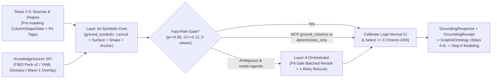

# Open-DV Ontology Grounding User Guide (`opendv.grounding`)

> **Component README:** [`README.md`](README.md) · **Contributor Guide:** [`contributor-guide.md`](contributor-guide.md) · **Architecture Design:** [`docs/designs/ontology-grounding-engine-and-fibo-pack.md`](../../designs/ontology-grounding-engine-and-fibo-pack.md) · **Full CLI Reference:** [`docs/16-cli-reference.md`](../../16-cli-reference.md)

The Open-DV Ontology Grounding Engine (`src/opendv/grounding/`) maps profiled tabular columns, observed value shapes, structural checksums, and steward notes onto canonical **FIBO Pack v2** (`master_2026Q3`: `2,240` classes, `767` properties, `942` individuals) or custom **YAML domain glossaries**—computing Logit-Normal confidence intervals, distinguishing genuine out-of-vocabulary domain concepts (`Path B1`) from technical surrogates and ETL audit columns (`NO_MATCH`), minting tamper-evident `GroundingReceipt`s, and projecting safe `OntologyDelta`s into `GraphAOntology`.

## Table of Contents

1. [Big Picture: Platform Flow, Modes, Actors & Expected Outcomes](#1-big-picture-platform-flow-modes-actors--expected-outcomes)
2. [Choosing Your Workflow](#2-choosing-your-workflow)
3. [Prerequisites & Setup](#3-prerequisites--setup)
4. [Complete Configuration & Parameter Reference](#4-complete-configuration--parameter-reference)
5. [Step-by-Step Worked Examples (Concrete Inputs & Outputs)](#5-step-by-step-worked-examples-concrete-inputs--outputs)
6. [Privacy, PII Containment & Anti-Tamper Receipt Governance](#6-privacy-pii-containment--anti-tamper-receipt-governance)
7. [Troubleshooting Common Errors & Error Codes](#7-troubleshooting-common-errors--error-codes)

---

## 1. Big Picture: Platform Flow, Modes, Actors & Expected Outcomes

### 1.1 Where `opendv.grounding` Sits & Its Responsibility

Open-DV enforces a strict **5-Layer architecture**:

```text
Layer 5: cli / api           (Typer CLI: opendv ontology ground|fibo-sync|fibo-qa & FastAPI REST)
   │
Layer 4: service             (Layer-4 Agentic Orchestrator, 4-Step Projection, MCP ground_columns, FiboPackOps)
   │
Layer 3: agents | modeling   (Agent harnesses for LLM reranking; peer DV 2.0 modeling engine in Step 6)
   │
Layer 2b: sources            (Connectors capturing pre-masking ColumnShapeStats & grounding_adapter)
   │
Layer 2a: grounding          <── THIS COMPONENT: src/opendv/grounding/ (Steps 2-5 Engine & Providers)
   │
Layer 1: models              (GroundingRequest/Response DTOs, ColumnShapeStats, GroundingReceipt, OntologyDelta)
```

End-to-end across **Steps 1–7**, `opendv.grounding` bridges raw source inspection (`Steps 2–3`) and ontology construction (`Steps 4–5`) before Data Vault 2.0 modeling (`Step 6`):



- **What `opendv.grounding` owns:** Modality-neutral lexical indexing (`LexicalIndex`), Logit-Normal fusion and uncertainty calibration (`calibration.py`), domain-neutral checksum/format validators (`validators.py`), pre-masking column shape profiling (`profiler.py`), 3-stage synchronous grounding (`ColumnGroundingEngine`), multi-wave ontology/memory composition (`OverlayKnowledgeSource`), and reference providers (`FiboKnowledgeSource`, `GlossaryKnowledgeSource`).
- **What collaborating layers own:**
  - **Layer 2b (`src/opendv/sources/`):** Extracts `shape_samples=200` before masking across CSV, Parquet, SQLite, DuckDB, Excel, and Databricks UC, then converts `SourceProfile`s into `GroundingRequest`s (`grounding_adapter.py`).
  - **Layer 4 (`src/opendv/service/`):** Runs the agentic fast-path orchestrator & chunked reranker (`_grounding_orchestrator.py`, `_grounding_reranker.py`), enforces `<= 64 KB` Step-4 MCP `ground_columns` (`_mcp_grounding_tool.py`), projects responses into `GraphAOntology` (`_grounding_projection.py`), mints `GroundingReceipt`s in `project.sqlite`, and executes pure-JSON `fibo_pack_ops.py` sync/repin audits.
  - **Build-Time Tooling (`scripts/`):** Compiles upstream EDM Council FIBO OWL/TTL releases (`scripts/vendor_fibo.py`) and runs 5-fold OOF calibration (`scripts/calibrate_fibo_grounding.py`).

---

### 1.2 Internal Grounding Execution Stages (`G0`–`G6`)

| Stage | Where It Runs | What Happens Inside |
| :---: | :--- | :--- |
| **`G0`** | `sources/` + `structured/` | Captures `ColumnShapeStats` before masking (sentinels `""`, `"N/A"`, `"NA"`, `"NONE"`, `"NULL"`, `"UNKNOWN"`, `"TBD"`, `"-1"`, `"-2"`; strict code-only `observed_enum_values`; `pii_suppressed=True` min/max clearing on PII) and strips raw PII spans from steward notes without emitting `[REDACTED_PII]`. |
| **`G1`** | `structured/engine.py` | Evaluates table-level anchor hypotheses (`TableAnchorCandidate`: `entity`, `agreement`, `event_occurrence`, `party_role` — skipped on flat glossaries without penalizing completeness) and provisional intra-table `ColumnPair`s (`amount_currency`, `effective_interval`, `composite_key`, `alternative_keys`). |
| **`G2`** | `structured/` + `providers/` | Pre-screens unambiguous ETL/SCD2 metadata (`load_end_dts`, `is_current`, non-PK `batch_id`), recalls lexical hits (`LexicalIndex`) + value/checksum/pattern hits (`match_values_or_mentions`), runs backend axiom checks (`evaluate_structured_candidates`: reified ranges, `inverse_of` direction, `rdfs:domain` `disjoint_with`, hard range vetoes), and reconciles `paired_columns`. |
| **`G3`** | Layer-2a Fast-Path or Layer-4 Orchestrator | Columns passing fast-path gates (`p >= 0.95`, `CI width <= 0.12`, `sigma_eff <= 0.65`, `sigma_disagree <= 0.25`, `0` vetoes, checksum corroboration) finish symbolically (`symbolic_fast_path`). Remaining candidates either enter bounded `<= 25`-col LLM batches + at most 1 `suggested_search_terms` rescue pass (`agentic`), or skip LLM cleanly under MCP (`symbolic_only`) or explicit opt-out (`deterministic_only`). |
| **`G4`** | `kernel/calibration.py` | Fuses observed modality channels (`lex`, `surface`, `shape_range`, `anchor`, `agent`) via softmax with null hypothesis $P(\varnothing)$, computes Logit-Normal $[L_i, U_i]$ bounds clamped to $[10^{-6}, 1 - 10^{-6}]$, selects $\min(\text{max\_choices}, k_{90})$, emits `MATCHED` / `AMBIGUOUS` / `NO_MATCH`, assigns `suggested_predicate`, and finalizes `AND`-gated `technical_surrogate` triage. |
| **`G5`** | `service/` (Step 4–5) | For MCP `ground_columns` and Discovery runs, mints `server_verified` `GroundingReceipt`s in `project.sqlite` and executes the 4-step deterministic `project_grounding_to_deltas` sequence (`GraphAOntology` `OntologyDelta`s + `ClarificationQuestion`s + locked Hub/Link protection). |
| **`G6`** | `service/fibo_pack_ops.py` | At upgrade time (`fibo-sync`), verifies Pack v2 integrity, audits existing project URIs across 3 drift tiers, and safely repins deprecated URIs (`--apply-repin`) preserving receipts strictly on verified matching `(old_uri, table_id, schema_fingerprint)` tuples. |

---

### 1.3 Execution Modes, Actors & Expected Outcomes

| Actor / Mode | `execution_mode_used` | LLM Calls? | Receipt Minting | Best Used For |
| :--- | :--- | :---: | :--- | :--- |
| **Fast-Path Column** (`cusip`, `lei`, `isin`, `sedol`, `iban`, `figi`, strong exact glossary codes) | `symbolic_fast_path` | **0** | Yes (in Step-4 project runs) | Unambiguous standardized identifiers & codes meeting all fast-path calibration bounds. |
| **Agentic Standalone / REST** (`opendv ontology ground`, `POST /api/v1/ontology/ground`) | `agentic_reranked` *(default on non-fast-path cols)* | Bounded `<= 25`-col batches (+1 rescue max) | Project runs only | Shorthand column names (`maturity_ext_flg`, `cust_nm_full`), ambiguous acronyms, and domain nuances. |
| **Step-4 Discovery Coordinator** (`@ontology-first-mate` via MCP `ground_columns`) | `symbolic_fast_path` / `symbolic_only` | **0 nested calls** (caller IS the coordinator LLM) | **Yes** (`grounding_receipt_id` stored in `project.sqlite`) | Full Step-4 -> Step-5 `GraphAOntology` construction with Wave-1 `OverlayKnowledgeSource` & `.opendv.zip` safety. |
| **Audited Deterministic Opt-Out** (`--mode deterministic_only --skip-reason "..."`) | `deterministic_only` | **0** | Optional in project mode | Air-gapped CI checks, reproducible calibration audits, and deterministic dry runs. |

#### Output Statuses & Expected Outcomes
Every grounded column returns a `ColumnGroundingResult` (`status` + `no_match_category` / `review_reason`):
- **`MATCHED`:** High confidence ($p_1 \ge 0.65$, $L_1 \ge 0.45$, $P(\varnothing) < 0.25$, $n_{\text{eff}} > 0$, single surviving choice $k^* = 1$). Carries `suggested_predicate` (`skos:exactMatch` or `skos:closeMatch`; `skos:relatedMatch` never auto-promotes to `Path A`).
- **`AMBIGUOUS`:** Needs human steward or coordinator review; `review_reason` states why (`unverified_masked_values`, `elevated_null_probability`, `competing_candidates`, `wide_confidence_interval`, or `close_match_nuance`). Includes up to `3` ranked choices (`k90`) and plain-language `steward_summary`.
- **`NO_MATCH`:** Classified cleanly via `no_match_category`:
  - `system_audit_metadata` — ETL/CDC/SCD2 operational columns (`etl_run_digest`, `load_end_dts`, `is_current`).
  - `technical_surrogate` — Auto-increment/UUID surrogates *only* when the same table already holds a validated natural business key (`AND`-gated so legacy `id`-only tables are not blindly discarded).
  - `insufficient_evidence` — Zero usable non-null values ($n_{\text{eff}} = 0$) or opaque headers (`col_1`, `f2`, `attr_3`).
  - `below_threshold` — Plausible hits exist ($p_1 \ge 0.20$) but null probability stayed above threshold ($\ge 0.65$).
  - `out_of_vocabulary_domain` — Legitimate domain concept missing from the reference pack (`Path B1` candidate).

---

## 2. Choosing Your Workflow

| Workflow | Command / Entry Point | Requires Project DB? | Supports Custom Glossaries? | Output Format |
| :--- | :--- | :---: | :---: | :--- |
| **Standalone Ad-Hoc Grounding** | `opendv --json ontology ground --input req.json` | No | Yes (`--knowledge-source glossary`) | `GroundingResponse` JSON or plain-text table |
| **Project Profile Grounding** | `opendv --json ontology ground --project <id>` | Yes (`.opendv/projects/<id>/`) | Yes (`--glossary ...`) | `GroundingResponse` over attached `SourceProfile[]` |
| **Full Step-4 -> Step-5 Discovery** | `opendv ontology construct --project <id> --wait` | Yes (writes `GraphAOntology` + receipts) | Via project pack / custom overlay | `GraphAOntology` revision with `GroundingReceipt`s |
| **Read-Only FIBO Concept Search** | `opendv --json ontology fibo-qa --query "..."` | Optional (`--project`) | FIBO Pack v2 only | `FiboQueryResp` (`PATH_A1` / `PATH_A2` scores) |
| **Pack Install & Drift Repin** | `opendv --json ontology fibo-sync --pack-file ... --check-project <id>` | Required for `--check-project` | FIBO Pack v2 only | `FiboSyncResp` + 3-tier `FiboProjectDriftReport` |

### Quick Rule of Thumb
- Use **`opendv ontology ground --input ...`** to test column grounding on ad-hoc JSON schemas or custom YAML glossaries in seconds.
- Use **`opendv ontology construct --project <id> --wait`** when running the full 7-Step Open-DV pipeline (Stage 4 mints server-verified `GroundingReceipt`s and commits `GraphAOntology` safely).
- Use **`opendv ontology fibo-sync`** whenever installing a newer compiled FIBO Pack v2 file or auditing an older Wave-1/Wave-2 project after upgrading FIBO.

---

## 3. Prerequisites & Setup

### Deterministic / Glossary / Offline Usage (Zero LLM Keys)

```bash
# Install dependencies and verify unified CLI & bundled FIBO Pack v2
uv sync
uv run opendv --json doctor
```

By default, `FiboKnowledgeSource` loads the bundled **FIBO Pack v2** (`src/opendv/grounding/providers/fibo/fibo-core-pack.json`, `master_2026Q3`) and calibrated parameters (`fibo_calibration.json`). To point to an alternative verified local Pack v2 JSON file, pass `--fibo-pack <path>` or set:

```bash
export OPENDV_FIBO_PACK_PATH=/path/to/fibo-master_2026Q3-68a3a1cd.json
```

### Agentic Mode Usage (Default `mode="agentic"`)

Standalone `opendv ontology ground` defaults to `agentic` mode for non-fast-path columns. Configure an agent harness provider and secret before running without `--mode deterministic_only`:

```bash
uv run opendv --json settings set --harness-provider agy
uv run opendv secrets set ANTHROPIC_API_KEY --prompt
```

> **Flag Placement Rule:** Global flags (`--json`, `--api-url`, `--env-first`) always precede the `ontology` group: `uv run opendv --json ontology ground ...`. Notice `opendv ontology fibo-sync` is strictly local/in-process and rejects `--api-url` (`exit 2`).

---

## 4. Complete Configuration & Parameter Reference

### 4.1 CLI Commands & Flags (`opendv ontology`)

| Subcommand | Flag | Choices / Type | Default | Description |
| :--- | :--- | :--- | :--- | :--- |
| **`ontology ground`** | `--project` | `str` | `None` | Project ID whose attached `SourceProfile`s to ground (mutually exclusive with `--input`). |
| | `--input` | Path to JSON | `None` | Serialized `GroundingRequest` JSON file (mutually exclusive with `--project`). |
| | `--knowledge-source` | `fibo \| glossary` | `"fibo"` | Selects bundled/custom FIBO Pack v2 or YAML glossary backend. |
| | `--fibo-pack` | Path to JSON | `None` | Custom Pack v2 JSON file (overrides bundled pack). |
| | `--glossary` | Path to YAML | `None` | YAML glossary file (**required** when `--knowledge-source glossary`; **forbidden** with `fibo`). |
| | `--mode` | `agentic \| deterministic_only` | `None` (`agentic` on `GroundingPolicy`) | Overrides request `policy.mode`. |
| | `--skip-reason` | Non-blank `str` | `None` | **Required** non-blank audit rationale when `--mode deterministic_only`; **forbidden** under `agentic`. |
| **`ontology fibo-sync`** | `--pack-file` | Path to JSON | `None` | Compiles-nothing pure-JSON verification and atomic installation into `<OS_USER_STATE>/opendv/packs/fibo/`. |
| | `--tag` | `str` | `None` | Pack version tag label for `--pack-file` install or pack selection during `--check-project`. |
| | `--check-project` | `str` | `None` | Audits committed FIBO `ExternalMapping`, `ConceptAttribute`, `OntologyRelationship`, and `OntologyEnumeration` URIs against installed pack. |
| | `--apply-repin` | flag | `false` | Applies non-breaking `deprecated_with_replacement` repins cleanly via CAS deltas (requires `--check-project`). |
| **`ontology fibo-qa`** | `--query` | `str` (**required**) | — | Natural-language or term query against `LexicalIndex`. |
| | `--project` | `str` | `None` | Optional project context for project pack / memory resolution. |
| | `--namespace` | `str` | `None` | Optional module/namespace filter. |
| | `--top-k` | `int` | `10` | Maximum matches returned (`PATH_A1` $\ge 0.65$, `PATH_A2`). |

### 4.2 REST API (`POST /api/v1/ontology/ground`)

When running `opendv serve` (`127.0.0.1:8420`), CLI callers passing `--api-url` or web clients invoke `POST /api/v1/ontology/ground`:
- **Request Body (`OntologyGroundReq`):** Same fields as CLI (`request`, `project_id`, `knowledge_source`, `fibo_pack`, `glossary_path`, `policy`), enforcing `request` XOR `project_id`, `max_tables <= 50`, `max_columns <= 500`.
- **Concurrency & Payload Guards:** Bounded by `asyncio.Semaphore(4)` on FastAPI `app.state`.
- **Path Containment Security:**
  - Non-loopback requests with non-null `fibo_pack` or `glossary_path` fail closed with **`403 LOOPBACK_ORIGIN_FORBIDDEN`**.
  - Loopback asset paths are checked by `enforce_grounding_asset_path` against `[workspace_root, state_dir / "packs" / "fibo"]` (or `OPENDV_WORKSPACE_ROOTS`), rejecting UNC/ADS/reserved/`..`/symlinks (`400 SYNTAX_INVALID_ARGUMENT`), missing files (`404 RESOURCE_NOT_FOUND`), and exceeding size caps (`fibo_pack <= 4 MB`, `glossary <= 2 MB`).

### 4.3 Step-4 MCP Tool (`ground_columns`)

During Step-4 `ontology construct`, `@ontology-first-mate` invokes the synchronous `ground_columns` MCP tool (project ID bound server-side on `BrokerToolContext`):
- **Parameters:** `table_ids: list[str] | None`, `column_offset: int = 0` (single-table scope required if `> 0`), `steward_notes: dict[str, str] | None` (`"global"` / `"table"` / `"table.column"` keys), `max_choices: int = 3`.
- **5-Stage `<= 64 KB` Payload Cascade:** Automatically preserves budget fit by (1) dropping `runner_ups`, (2) truncating `steward_summary` to 160 chars, (3) omitting `suggested_deltas` (`suggested_deltas_truncated=true`), (4) paginating excess tables into `truncated_table_ids`, and (5) paginating wide single tables via `next_column_offset`.

### 4.4 `GroundingRequest` & `GroundingPolicy` Fields (`--input req.json`)

| Object | Field | Type / Bounds | Default | Purpose |
| :--- | :--- | :--- | :--- | :--- |
| **`GroundingRequest`** | `tables` | `list[TableEvidence]` | **Required** | Bounded `1..50` tables (`<= 500` total columns; unique `(table_id or table_name)`). |
| | `global_steward_notes` | `list[str]` (`<= 20`, each `<= 4000` chars) | `[]` | Domain hints sanitized inside prompts (raw PII stripped cleanly). |
| | `policy` | `GroundingPolicy` | `GroundingPolicy()` | Mode, threshold, CI level, and context switches. |
| **`TableEvidence`** | `table_name` / `table_id` | `str` / `str \| null` | Required / `null` | Table identifier and optional canonical `src:table` ID. |
| | `columns` | `list[ColumnEvidence]` | **Required** | Column metadata, types, and bounded samples (`<= 200` values per col). |
| **`ColumnEvidence`** | `column_name` / `data_type` | `str` / `str` | **Required** | Physical column name and SQL/logical type. |
| | `sample_values` | `list[Any]` (`<= 200`) | `[]` | Sample literals (or `<MASKED_PII>`/`<PII:16hex>` tokens); masked BEFORE any LLM call. |
| | `precomputed_shape` | `ColumnShapeStats \| null` | `null` | Pre-masking Step-2 shape stats (`profiled_non_null_count`, `structural_patterns`, `pii_suppressed`, `surrogate_kind`). |
| | `is_pk`, `pk_ord`, `fk_ref`, `nullable`, `null_ratio`, `distinct_count_est`, `pii_tags`, `steward_note` | Struct metadata | Defaults | Structural signals; note externally masked columns (`sample_values=["<MASKED_PII>"]` with `precomputed_shape=null`) yield $n_{\text{eff}} = 0$ and block auto-promotion (`review_reason="unverified_masked_values"`). |
| **`GroundingPolicy`** | `mode` | `"agentic" \| "deterministic_only"` | `"agentic"` | Execution mode (`skip_reason` mandatory for `"deterministic_only"`). |
| | `max_choices` | `int >= 1` | `3` | Maximum ranked candidates (`min(max_choices, k90)`). |
| | `cumulative_mass_target` | `float` `(0, 1]` | `0.90` | Posterior mass target for `k90` selection. |
| | `ci_level` | `float` `(0, 1)` | `0.90` | Logit-Normal two-sided confidence interval level. |
| | `no_match_threshold` | `float` `[0, 1]` | `0.65` | Null probability $P(\varnothing)$ cutoff for `NO_MATCH`. |
| | `enable_table_context` | `bool` | `true` | Enables/disables table anchor & sibling `anchor` channel alignment. |

### 4.5 Domain-Neutral YAML Glossary Format (`--knowledge-source glossary`)

YAML glossaries (`<= 2 MB`, YAML aliases/anchors forbidden via `SafeLoader`) support both flat dictionaries (just `label`, `definition`, `aliases`) and structured domain models:

```yaml
version: 1
terms:
  customer:
    label: Customer
    definition: Subscribing commercial organization or individual tenant billed for SaaS services.
    aliases: ["Account Holder", "Tenant"]
    kind: entity                    # entity | event | identifier | attribute | code | relationship
    expected_type: string
  customer_id:
    label: Customer ID
    definition: Canonical enterprise identifier uniquely designating a subscribing customer.
    kind: identifier
    domain_entity: customer
    identifies: customer
    identifier_scope: enterprise_sor  # global_standard | enterprise_sor | local_source
    expected_type: string
    pattern: "^CUST-[0-9]{4,10}$"     # Validated against ReDoS hazards
  iso_currency_code:
    label: Currency Code
    definition: Three-letter ISO 4217 settlement currency code for invoice amounts.
    kind: code
    domain_entity: billing_invoice
    expected_type: string
    allowed_values: ["USD", "EUR", "GBP", "CAD", "JPY"]
  billed_to_customer:
    label: Billed To Customer
    definition: Relationship linking a billing invoice to the responsible customer entity.
    kind: relationship                # Maps to entry_kind="object_property" (not a table anchor)
    domain_entity: billing_invoice
    target_entity: customer
    expected_type: string
```

Optional `pii_category_hint` (e.g., `"EMAIL"`, `"SSN"`) triggers orthogonal `PII_ISOLATION` protection cleanly during projection even on non-FIBO glossaries.

### 4.6 Calibrated FIBO Defaults & Benchmark Verification

[`src/opendv/grounding/providers/fibo/fibo_calibration.json`](../../../src/opendv/grounding/providers/fibo/fibo_calibration.json) stores the empirical scalars fit over `190` public-dataset columns (`seed=20261126`, 5-fold table-grouped `GroupKFold`, `130` dev / `60` held-out across `FDIC`, `FRED/ECB`, `GLEIF`, `ISDA/OTC`, `NO_MATCH`, `OpenFIGI`, and `SEC EDGAR 13F/XBRL`):

| Parameter / Metric | Fitted Value / Verified Result | Meaning |
| :--- | :--- | :--- |
| **`T` / `s_null_base` / `gamma_null` / `c_cal`** | `0.5` / `-1.22` / `0.1` / `2.95` | Softmax temperature, null prior base, channel null slope, and 90% CI scale factor. |
| **`channel_weights`** | `lex=2.2`, `surface=2.4`, `shape_range=1.8`, `anchor=1.1`, `agent=2.0` | Multi-modal log-odds channel weights. |
| **Held-Out Accuracy (`n_heldout=60`)** | `top1_acc=0.9615`, `top3_recall=0.9808`, `overall_acc=0.95` | Positive top-1, top-3 recall, and combined accuracy including abstentions. |
| **Calibration, B1 & Abstention** | `abstain_ECE=0.0332`, `ci90_coverage=0.931`, `path_b1_f1=0.8571`, `no_match_f1=0.875` | 10-bin calibration error, 90% interval coverage, and `NO_MATCH` / `Path B1` F1. |
| **Gate Sanity** | `cusip_fast_path_ok=true`, `starter_packs_ok=true` | Verifies CUSIP fast-path and all `8` Asset Management starter packs score $\ge 0.6500$. |

---

## 5. Step-by-Step Worked Examples (Concrete Inputs & Outputs)

### 5.1 Standalone FIBO Grounding (`opendv ontology ground --input`)

Save a UTF-8 JSON file (without BOM) named `holdings_req.json`:

```json
{
  "tables": [
    {
      "table_name": "holdings_13f",
      "steward_notes": ["Quarterly institutional 13F securities holdings report."],
      "columns": [
        {
          "column_name": "cusip",
          "data_type": "VARCHAR(9)",
          "is_pk": true,
          "pk_ord": 1,
          "nullable": false,
          "sample_values": ["037833100", "594918104", "02079K305", "67066G104"]
        },
        {
          "column_name": "custodian_lei",
          "data_type": "VARCHAR(20)",
          "nullable": false,
          "sample_values": ["7LTWFZYICNSX8D621K86", "5493006KMX1VFTPYPW14", "851WYGNLUQLFZBSYGB56"]
        },
        {
          "column_name": "market_value_usd",
          "data_type": "DECIMAL(18,2)",
          "nullable": false,
          "sample_values": ["1250000.00", "842150.50", "910200.00"]
        },
        {
          "column_name": "ccy_cd",
          "data_type": "CHAR(3)",
          "nullable": false,
          "sample_values": ["USD", "USD", "EUR", "GBP"]
        },
        {
          "column_name": "customer_email",
          "data_type": "VARCHAR(120)",
          "pii_tags": ["EMAIL"],
          "sample_values": ["<MASKED_PII>", "<MASKED_PII>", "<MASKED_PII>"]
        },
        {
          "column_name": "etl_run_digest",
          "data_type": "VARCHAR(64)",
          "nullable": false,
          "sample_values": ["20261127_run_01", "20261127_run_02"]
        }
      ]
    }
  ]
}
```

Run deterministically (for offline verification) or omit `--mode deterministic_only` to engage agentic reranking on ambiguous columns:

```bash
# Deterministic audit mode (zero LLM calls)
uv run opendv ontology ground \
  --input holdings_req.json \
  --mode deterministic_only \
  --skip-reason "documentation_walkthrough"

# Machine-readable JSON output
uv run opendv --json ontology ground \
  --input holdings_req.json \
  --mode deterministic_only \
  --skip-reason "documentation_walkthrough"

# Agentic mode (default; uses configured harness for shorthand/ambiguous columns)
uv run opendv --json ontology ground --input holdings_req.json --mode agentic
```

**Observed plain-text output (`deterministic_only`):**

```text
source=fibo-core version=2.0.0 mode=deterministic_only
Column                        | Status    | Top Match                                                                                  | Confidence / CI     
------------------------------+-----------+--------------------------------------------------------------------------------------------+---------------------
holdings_13f.cusip            | MATCHED   | Committee on Uniform Securities Identification Procedures (CUSIP) number (skos:exactMatch) | 1.000 [0.985, 1.000]
holdings_13f.custodian_lei    | AMBIGUOUS | legal entity identifier (skos:closeMatch)                                                  | 0.990 [0.367, 1.000]
holdings_13f.market_value_usd | AMBIGUOUS | market value (skos:closeMatch)                                                             | 0.279 [0.002, 0.988]
holdings_13f.ccy_cd           | AMBIGUOUS | currency (skos:closeMatch)                                                                 | 0.921 [0.004, 1.000]
holdings_13f.customer_email   | AMBIGUOUS | customer identifier (skos:closeMatch)                                                      | 0.477 [0.003, 0.997]
holdings_13f.etl_run_digest   | NO_MATCH  | system_audit_metadata                                                                      | null=1.000          
```

Notice what `--json` also reveals on `holdings_13f`:
- `cusip` hits the `cusip: 1.0` structural validator, resolves `identified_entity_uri: .../Security`, `standard_authority: "CUSIP"`, `point=0.9996`, `lower=0.9851`, and selects `MATCHED` (`logit_normal_matched`).
- `paired_columns` automatically groups `[{"kind": "amount_currency", "columns": ["market_value_usd", "ccy_cd"]}]`.
- `customer_email` (`sample_values=["<MASKED_PII>", ...]`, no `precomputed_shape`) keeps $n_{\text{eff}} = 0$ and flags `review_reason: "unverified_masked_values"` so masked values never auto-promote without verification.
- `etl_run_digest` is filtered cleanly as `NO_MATCH` (`system_audit_metadata`, `null=1.000`).

And querying FIBO directly via `fibo-qa`:

```bash
uv run opendv --json ontology fibo-qa --query "CUSIP" --top-k 2
```

Returns deterministic normalized score `0.8816` (`PATH_A1`) for `Committee on Uniform Securities Identification Procedures (CUSIP) number` and `0.6104` (`PATH_A2`) for `CUSIP International Numbering System (CINS) number`.

---

### 5.2 Domain-Neutral Custom YAML Glossary Grounding

Ground a non-financial SaaS table (`billing_records.json`) against the bundled [`example_glossary.yaml`](../../../src/opendv/grounding/providers/glossary/example_glossary.yaml):

```json
{
  "tables": [
    {
      "table_name": "billing_records",
      "columns": [
        {
          "column_name": "invoice_id",
          "data_type": "VARCHAR(32)",
          "is_pk": true,
          "pk_ord": 1,
          "nullable": false,
          "sample_values": ["INV-2026-0001", "INV-2026-0002", "INV-2026-0003"]
        },
        {
          "column_name": "customer_id",
          "data_type": "VARCHAR(16)",
          "nullable": false,
          "fk_ref": "customers.customer_id",
          "sample_values": ["CUST-1001", "CUST-1002", "CUST-1003"]
        },
        {
          "column_name": "order_total_amount",
          "data_type": "DECIMAL(12,2)",
          "nullable": false,
          "sample_values": ["199.00", "450.50", "1299.99"]
        },
        {
          "column_name": "iso_currency_code",
          "data_type": "CHAR(3)",
          "nullable": false,
          "sample_values": ["USD", "EUR", "GBP"]
        },
        {
          "column_name": "subscription_status",
          "data_type": "VARCHAR(16)",
          "nullable": false,
          "sample_values": ["ACTIVE", "TRIALING", "PAST_DUE"]
        },
        {
          "column_name": "etl_run_digest",
          "data_type": "VARCHAR(64)",
          "nullable": false,
          "sample_values": ["run_001", "run_002"]
        }
      ]
    }
  ]
}
```

```bash
uv run opendv ontology ground \
  --input billing_records.json \
  --knowledge-source glossary \
  --glossary src/opendv/grounding/providers/glossary/example_glossary.yaml \
  --mode deterministic_only \
  --skip-reason "documentation_walkthrough"
```

**Observed plain-text output:**

```text
source=glossary version=1.0.0 mode=deterministic_only
Column                              | Status   | Top Match                             | Confidence / CI     
------------------------------------+----------+---------------------------------------+---------------------
billing_records.invoice_id          | MATCHED  | Invoice ID (skos:closeMatch)          | 0.989 [0.963, 0.997]
billing_records.customer_id         | MATCHED  | Customer ID (skos:closeMatch)         | 0.967 [0.895, 0.990]
billing_records.order_total_amount  | MATCHED  | Order Total Amount (skos:exactMatch)  | 0.950 [0.853, 0.984]
billing_records.iso_currency_code   | MATCHED  | Currency Code (skos:closeMatch)       | 0.994 [0.981, 0.998]
billing_records.subscription_status | MATCHED  | Subscription Status (skos:exactMatch) | 0.981 [0.941, 0.994]
billing_records.etl_run_digest      | NO_MATCH | system_audit_metadata                 | null=1.000          
```

---

### 5.3 Project-Backed Grounding & Multi-Wave Step-4 Discovery

Inside a project workspace, Step 2/3 profiling captures pre-masking `ColumnShapeStats` once on attach, and Step 4 composes `OverlayKnowledgeSource([ProjectGraphASource, FiboKnowledgeSource])`:

```bash
# 1. Initialize project and attach sources (Step 2-3 captures shape_stats before PII masking)
uv run opendv project init --project am_demo --namespace asset_management --starter-pack multi_asset_ibor
uv run opendv source attach --project am_demo --kind csv --uri data/public_am/sec_13f_holdings.csv

# 2. Ground attached project profiles directly (standalone preview over project sources)
uv run opendv --json ontology ground --project am_demo

# 3. Run full Step-4 Discovery (mints server_verified GroundingReceipts + projects GraphAOntology)
uv run opendv ontology construct --project am_demo --discovery-mode incremental_new --wait
```

Across **Wave-2 (`incremental_new`)**, `OverlayKnowledgeSource`:
- Indexes committed `Wave-1` concepts (including `SCEN-04` document-only concepts with `table_bindings=[]`), attributes, enumerations, relationships, and `ExternalMapping.standard_uri`s so existing entities are extended via `AddTableBinding` instead of creating duplicate Hubs (`AP-11`).
- Honors `ConceptMemorySpec` directives (`PINNED` boosts/preserves `origin_kind="reference_standard"` when pinning an uncommitted FIBO URI; `MUTED` suppresses rejected candidates).
- Bypasses Wave-1 folding cleanly when running `--discovery-mode full_rebuild`.

---

### 5.4 FIBO Pack v2 Compilation, Local Installation & 3-Tier Drift Audit

Build-time (`scripts/vendor_fibo.py` — the sole script using `rdflib`) compiles EDM Council's `prod.ttl.zip` into canonical JCS Pack v2 JSON:

```bash
# Maintainer build-time update (downloads prod.ttl.zip or reads --offline-archive / --source-dir)
uv run python scripts/vendor_fibo.py --update-repo

# Or compile a standalone release artifact to custom output path
uv run python scripts/vendor_fibo.py --tag master_2026Q3 --out dist/fibo-master_2026Q3.json
```

At runtime (zero `rdflib`), operators install a precompiled Pack v2 JSON into user state and audit committed projects:

```bash
# 1. Verify JCS SHA-256 & Pack v2 schema, and install atomically into user packs dir
uv run opendv --json ontology fibo-sync --pack-file dist/fibo-master_2026Q3.json --tag master_2026Q3

# 2. Audit committed FIBO URIs in a project (read-only 3-tier report)
uv run opendv --json ontology fibo-sync --check-project am_demo

# 3. Auto-repin safe deprecated_with_replacement URIs (concepts, attributes, relationships, enumerations)
uv run opendv --json ontology fibo-sync --check-project am_demo --apply-repin
```

The 3 drift tiers in `FiboProjectDriftReport` are:
1. **`deprecated_with_replacement`:** Older FIBO URI is marked `deprecated=true` and appears in `replaces_uris` of an active target. `--apply-repin` emits `RepinExternalMapping`, `UpdateAttributeMetadata`, `UpdateRelationshipMetadata`, and `UpdateEnumerationMetadata` deltas—preserving server-verified receipt confidence only when the prior receipt matches `(old_standard_uri, table_id, schema_fingerprint)` and `concept.table_bindings`, else falling back to `lexical_score` (`grounding_receipt_id=null`).
2. **`removed_or_split`:** Bound FIBO URI is absent from the newer pack without a 1:1 replacement; flagged for steward review.
3. **`pack_sha256_mismatch`:** Active pack SHA-256 differs from the pack digest recorded at prior commit time (reported cleanly without silently rewriting project history).

---

### 5.5 Programmatic Python API (`opendv.grounding` & Layer-4 Orchestrator)

In-process callers can run purely synchronous symbolic grounding (`ColumnGroundingEngine`) or Layer-4 agentic orchestration (`ground_columns_orchestrated`):

```python
from pathlib import Path
from opendv.grounding.kernel.overlay import OverlayKnowledgeSource
from opendv.grounding.providers.fibo.knowledge_source import FiboKnowledgeSource
from opendv.grounding.providers.glossary.knowledge_source import GlossaryKnowledgeSource
from opendv.grounding.structured.engine import ColumnGroundingEngine
from opendv.models import ColumnEvidence, GraphAOntology, GroundingRequest, TableEvidence
from opendv.models.grounding import GroundingPolicy


def ground_synchronously_with_fibo() -> None:
    req = GroundingRequest(
        tables=[
            TableEvidence(
                table_name="sec_positions",
                columns=[
                    ColumnEvidence(
                        column_name="cusip",
                        data_type="VARCHAR(9)",
                        is_pk=True,
                        nullable=False,
                        sample_values=["037833100", "594918104"],
                    )
                ],
            )
        ],
        policy=GroundingPolicy(mode="deterministic_only", skip_reason="sdk_example"),
    )
    engine = ColumnGroundingEngine(FiboKnowledgeSource())
    response = engine.ground(req)
    print(response.tables[0].columns[0].status)


def ground_with_glossary_and_overlay(glossary_path: Path, wave1_ont: GraphAOntology) -> None:
    req = GroundingRequest(
        tables=[
            TableEvidence(
                table_name="invoices",
                columns=[ColumnEvidence(column_name="cust_id", data_type="VARCHAR(16)")],
            )
        ],
        policy=GroundingPolicy(mode="deterministic_only", skip_reason="overlay_example"),
    )
    overlay = OverlayKnowledgeSource(GlossaryKnowledgeSource(glossary_path), ontology=wave1_ont)
    engine = ColumnGroundingEngine(overlay)
    draft = engine.ground_symbolic(req)
    response = engine.finalize(req, draft, rerank_results=None)
    print(len(response.tables))
```

---

## 6. Privacy, PII Containment & Anti-Tamper Receipt Governance

1. **Pre-Masking Shape Stats (`ColumnShapeStats`):** Step-2 profiling computes regex checksum hit-ratios and bounded length/min/max stats *in memory* before masking, clearing `length_min`/`length_max`/`numeric_min`/`numeric_max` to `None` and keeping `observed_enum_values == []` whenever PII is detected (`pii_suppressed=True`).
2. **Sample-Free, URI-Free Agent Packets (`RerankColumnPacket`):** Agentic reranking never receives raw `sample_values`, `observed_enum_values`, or raw ontology URIs—only stripped type/shape metadata, integer candidate indices, and labels/definitions.
3. **Zero Placeholder Leaks (`REDACTED_PLACEHOLDER_LEAK`):** Raw PII literals detected inside steward notes are stripped cleanly by `pii_core.strip_pii_spans()` without emitting `<MASKED_PII>` or `[REDACTED_PII]`, and `_grounding_reranker.py` scans every field before calling `AgentHarnessPort`.
4. **Externally Pre-Masked Safety Gate:** When external callers pass `<MASKED_PII>` samples without `precomputed_shape`, `CalibrationOutcome` records $n_{\text{eff}} = 0$, widens CIs, blocks `MATCHED`, and emits `AMBIGUOUS` with `review_reason="unverified_masked_values"`.
5. **`GroundingReceipt` & `.opendv.zip` Anti-Laundering (`SCEN-07`):**
   - Step-4 commits verify that non-null `grounding_receipt_id`s belong to `server_verified` receipts matching the target URI, table binding scope, and profile `schema_fingerprint`.
   - Exporting and importing a `.opendv.zip` archive marks imported receipts as `provenance="imported_unverified"` and records them in `ImportReadinessReport.unverified_receipt_ids`: existing unchanged base mappings stay preserved on unrelated YAML commits, while trying to reuse an `imported_unverified` receipt for a net-new mutation or fake confidence boost fails closed with `ONT_EVO_CONTRACT_VIOLATION`.

---

## 7. Troubleshooting Common Errors & Error Codes

| Symptom / Error Code | HTTP / Exit | Why It Triggered | Exact Fix |
| :--- | :---: | :--- | :--- |
| **`AGENT_NOT_CONFIGURED`** | `422` / `2` | Standalone `ground` ran in default `mode="agentic"` without a configured harness provider or secret. | Configure a harness (`opendv settings set --harness-provider ...` + API key) or pass `--mode deterministic_only --skip-reason "..."`. |
| **`SYNTAX_INVALID_ARGUMENT`** (`Invalid JSON: expected value at line 1 column 1`) | `400` / `2` | `--input` JSON file has a UTF-8 BOM (`\ufeff` — common in PowerShell `Set-Content -Encoding UTF8`), malformed JSON, blank `--skip-reason` in `deterministic_only`, `glossary_path` passed with `fibo`, or invalid regex in YAML glossary. | Re-save JSON as UTF-8 **without BOM**, fix flag combinations, or simplify/fix the YAML `pattern`. |
| **`SYNTAX_INVALID_ARGUMENT`** (`--api-url` on `fibo-sync`) | `400` / `2` | `opendv ontology fibo-sync` was called with `--api-url` / `OPENDV_API_URL`. | Run `fibo-sync` locally against the local project/state directory without `--api-url`. |
| **`LOOPBACK_ORIGIN_FORBIDDEN`** | `403` / `2` | Remote HTTP request supplied a local `fibo_pack`/`glossary_path`, or loopback path escaped `[workspace_root, packs/fibo]`. | Keep custom asset paths inside `OPENDV_WORKSPACE_ROOTS` / workspace root on loopback, or pass inline `GroundingRequest` without local file paths remotely. |
| **`REDACTED_PLACEHOLDER_LEAK`** | `422` / `2` | A `<MASKED_PII>` or `[REDACTED_*` literal appeared inside a serialized LLM rerank prompt. | Remove redaction placeholders from static `steward_notes` or rely on raw-PII stripping/Step-2 profiling. |
| **`ONT_EVO_CONTRACT_VIOLATION`** | `422` / `2` | Proposal cited a tampered, wrong-table/URI, `skos:relatedMatch`, or `imported_unverified` `grounding_receipt_id`, or `repin` lacked `replaces_uris` provenance. | Re-run MCP `ground_columns` or `ontology construct` in the active workspace to mint fresh `server_verified` receipts. |
| **`REFERENCE_PACK_INTEGRITY_FAILURE`** | `500` / `1` | FIBO Pack v2 JSON failed schema validation (`pack_schema_version="2.0.0"`) or SHA-256 verification. | Re-download/recompile via `scripts/vendor_fibo.py` and verify via `opendv ontology fibo-sync --pack-file ...`. |
| **`ARCHIVE_SECURITY_VIOLATION`** | `422` / `2` | `vendor_fibo.py` detected traversal, symlinks/reparse points, ADS, BOM/`b"\x00"`/`DOCTYPE`/`ENTITY`, or zip-bomb ratio limits. | Use EDM Council's official `prod.ttl.zip` or a clean local checkout without symlinks or XML entity expansion. |
| **PowerShell `cusip` / `email` stays `AMBIGUOUS` (`unverified_masked_values`)** | Exit `0` | Passed `"<MASKED_PII>"` without Step-2 `precomputed_shape` or ran `deterministic_only` with too few non-null samples. | Attach/profile source through `opendv source attach` or populate `precomputed_shape`, and run `mode="agentic"` on ambiguous shorthands. |
