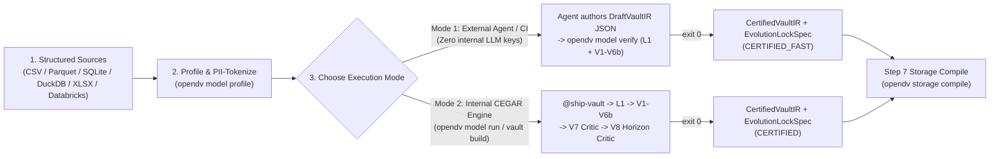

# Open-DV Modeling Engine User Guide (`opendv.modeling`)

> **Architecture & Stage Walkthrough:** [`docs/designs/dv2-modeling-engine-and-governance.md`](../../designs/dv2-modeling-engine-and-governance.md) · **External Agent Skill:** [`.agents/skills/opendv-modeling/SKILL.md`](../../../.agents/skills/opendv-modeling/SKILL.md) · **Full CLI Reference:** [`docs/16-cli-reference.md`](../../16-cli-reference.md)

The Open-DV Modeling Engine turns **profiled tabular sources** (CSV, Parquet, SQLite, DuckDB, Excel, or Databricks Unity Catalog) plus an optional **business ontology** and **governance rules** into a **mathematically verified Data Vault 2.0 schema (`CertifiedVaultIR`)** and **additive wave lock (`EvolutionLockSpec`)**—without ever letting an LLM write raw SQL DDL or DML.

Downstream Step 7 (`opendv storage compile`) then deterministically lowers that `CertifiedVaultIR` into SQL/DDL across **5 Zones (`Z0`–`Z4`)** and **11 targets** (`duckdb_local`, `databricks_uc`, `snowflake`, `postgres`, `bigquery`, `sqlserver_fabric`, `redshift`, `clickhouse`, `iceberg`, `parquet`, and `dbt`).



---

## 1. Choosing Your Workflow: Mode 1 vs. Mode 2

You can use the modeling engine in three ways depending on who authors the model and whether you want `.opendv/` project persistence:

| Workflow | Entry Command | Internal LLM Keys? | Disk State | What It Does Best |
| :--- | :--- | :--- | :--- | :--- |
| **Mode 1: Stateless External Agent / CI** | `opendv model spec`, `profile`, `verify` | **No (`0` LLM calls)** | Zero `.opendv/` writes | You or an external coding agent (Antigravity, Claude Code, Codex, Gemini CLI) author `DraftVaultIR` JSON using [`.agents/skills/opendv-modeling/SKILL.md`](../../../.agents/skills/opendv-modeling/SKILL.md), then verify deterministically in `:memory:` DuckDB. |
| **Mode 2 (Stateless CLI): Managed CEGAR** | `opendv model profile`, `model run` | **Yes** (`agy`, `claude`, `gemini`, `claude-cli`) | Zero `.opendv/` writes | Runs Open-DV's internal `@ship-vault` synthesis + deterministic sharding + `V1–V6b` gates + `V7` Semantic Critic + `V8` Horizon Critic over JSON files without creating a project database. |
| **Mode 2 (Managed Project): Full Workbench** | `opendv project init` -> `vault build` -> `storage compile` | **Yes** (unless policy is `symbolic_only`) | `.opendv/projects/<id>/project.sqlite` | Persists source profiles, PII-tokenized proving sample caches, multi-wave `EvolutionLockSpec` history, pre-cert waivers (`vault waive`), Holds (`vault hold` / `vault horizon`), and serves the `:8420` Web Workbench. |

### Quick Rule of Thumb
- Use **Mode 1 (`model profile` + `model verify`)** when integrating with an external coding agent or deterministic CI gate without configuring internal API keys.
- Use **Mode 2 Stateless (`model run`)** when testing autonomous end-to-end vault synthesis on ad-hoc files.
- Use **Mode 2 Managed (`vault build`)** for multi-wave enterprise projects, Web Workbench review, persisted pre-certification waivers, and direct Step 7 SQL compilation.

---

## 2. Prerequisites & Setup

### Mode 1 Setup (Zero LLM Keys)

```bash
# Install Python dependencies and the opendv CLI
uv sync

# Verify Python environment and CLI health
uv run opendv --json doctor
```

### Mode 2 Setup (Internal LLM Synthesis & Critics)

```bash
# Configure which agent harness Mode 2 uses (e.g., agy, claude, claude-cli, gemini)
uv run opendv --json settings set --harness-provider agy --cegar-policy balanced

# Store provider API keys in your OS keyring if required by your harness provider
uv run opendv secrets set ANTHROPIC_API_KEY --prompt

# (Optional) Trust a workspace if overriding .opendv/agents/dv2-modeling-guide.md
uv run opendv --json settings trust-workspace --path .
```

> **Note:** Global `--json` always comes **before** the subcommand group (`uv run opendv --json model ...`, `uv run opendv --json vault ...`, `uv run opendv --json settings ...`). Use global `--env-first` before the subcommand if you want environment variables to take precedence over keyring secrets.

---

## 3. Complete Configuration & Parameter Reference

### 3.1 CLI Commands & Flags

#### Stateless Modeling Commands (`opendv model`)

| Command | Flag | Type / Choices | Default | Description |
| :--- | :--- | :--- | :--- | :--- |
| **`model spec`** | `--part` | `all \| schema \| guide \| preferences` | `all` | Returns live JSON Schemas, minimal IR examples, immutable constraints, `dv2-modeling-guide.md`, and `ModelingPreferences` defaults. |
| **`model profile`** | `--source` | `<kind>:<uri>` (repeatable) | `None` | Structured source to profile (split on first `:`, so `duckdb:C:/data/v.db` works on Windows). |
| | `--sources-file` | Path to JSON or YAML | `None` | Source manifest (`{"sources": [...]}` or YAML/JSON list). At least one `--source` or `--sources-file` is required. |
| | `--sample-rows` | `int` (`1..5000`) | `200` | Maximum PII-tokenized real rows sampled per table (`LIMIT sample_rows + 1` to detect full vs. partial table). |
| | `--no-real-row-proving` | flag | `false` | Skips capturing sample rows; real-row `V6` (`DV-DYN-004/006/007`) reports `DISABLED_BY_USER`. |
| | `--max-questions` | `int >= 0` | `5` | Max `P1–P4` clarification questions returned (`0` returns all remaining candidates from `--questions-offset`). |
| | `--questions-offset` | `int >= 0` | `0` | Zero-based pagination offset into prioritized `P1–P4` candidates. |
| | `--out` | File path | `None` | Write `ProfileBundle` JSON atomically to disk. |
| **`model verify`** | `--input` | Path to JSON (**required**) | — | `VerifyDraftRequest` JSON (`policy`, `modeling_preferences`, optional `ontology`, `persisted_waivers`, `wave`, etc.). |
| | `--draft-ir` | Path to JSON (**required**) | — | Agent-authored `DraftVaultIR` JSON. |
| | `--profile` | Path to JSON | `None` | `ProfileBundle` JSON from `opendv model profile` (auto-hydrates `profiles`, `source_rows_by_table`, `table_sample_flags`). |
| | `--dry-run` | flag | `false` | Validates request, `DraftVaultIR` schemas, `INV-05`, preferences, and PII tokenization without running DuckDB proving. |
| | `--out` | File path | `None` | Write `VerifyDraftResult` JSON to disk. |
| **`model run`** | `--input` | Path to JSON (**required**) | — | `DVModelingRequest` JSON (Mode 2 config, optional `business_context_hints`, `resume` payload, etc.). |
| | `--profile` | Path to JSON | `None` | `ProfileBundle` JSON from `opendv model profile`. |
| | `--guide` | File path | `None` | Workspace `dv2-modeling-guide.md` override (contained in trusted root, `<= 2,500` tokens, no symlinks). |
| | `--dry-run` | flag | `false` | Validates request, guide trust, token ceilings, preferences, and PII tokenization with zero LLM calls. |
| | `--out` | File path | `None` | Write `DVModelingResult` JSON to disk. |

#### Managed Governance Commands (`opendv settings` & `opendv vault`)

| Command | Key Flags | Purpose |
| :--- | :--- | :--- |
| **`settings project-set`** | `--project <id>`, repeatable `--pref key=value`, `--hints-file <path>` \| `--hints-text <str>`, `--proving-sample-rows <1..5000>`, `--real-row-proving` / `--no-real-row-proving` | Updates `ModelingPreferences`, project `business_context_hints` (`""` clears hints), and Step 2/3 proving sample settings. |
| **`vault build`** | `--project <id>`, `--policy <symbolic_only\|fast\|balanced\|strict>`, `--wait` | Launches Mode-2 managed CEGAR synthesis over project sources & `GraphAOntology`. |
| **`vault status`** | `--project <id>`, `--run <run_id>`, `--holds-only` | Inspects active run status, waived rules (`anti_pattern_justifications`), and open Clarification/Horizon holds. |
| **`vault waive`** | `--project <id>`, `--rule <rule_id>`, `--entity <name>`, `--rationale <>=20 chars>`, `--waiver-id <id>` | Records a `V6b` waiver **before** Wave-1 certification (works even when `active_wave_id` is `None`). |
| **`vault hold`** | `--project <id>`, `--run <run_id>`, `--answers-json <json>`, `--wait` | Answers an open Hold (`S6-02` survey or `S6-05` agent clarification) and resumes the CEGAR run. |
| **`vault horizon`** | `--project <id>`, `--run <run_id>`, `--action <accept\|steer\|revert>`, `--assumptions-json`, `--notes`, `--added-fields`, `--wait` | Resolves a `V8` `S6-06` Horizon checkpoint (`accept` finalizes, `steer` runs bounded repair, `revert` restores pre-steer IR). |

---

### 3.2 Exit Codes, `status`, and `next_action` Contract

Every verification or modeling command communicates its result programmatically through HTTP/CLI exit codes and two top-level JSON fields (`status` and `next_action`):

| Exit Code | `status` | `next_action` | Meaning & What To Do |
| :---: | :--- | :--- | :--- |
| **`0`** | `CERTIFIED_FAST` (Mode 1 or `fast`/`symbolic_only`) or `CERTIFIED` (Mode 2) | `READY_FOR_DOWNSTREAM` | Verification succeeded (`deterministic_energy == 0`). `certified_ir` and `evolution_lock` are ready for Step 7 (`storage compile`). |
| **`5`** | `UNCERTIFIED_DRAFT` | `REPAIR_DRAFT_IR` | Hard structural/runtime violation (`V1–V6` or unwaivable `INV-05`). Inspect `remediation_hints` and `verifier_report.all_diagnostics`, fix `draft.json`, and re-run. |
| **`5`** | `UNCERTIFIED_DRAFT` | `WAIVE_OR_ADJUST_PREFERENCES` | All `V1–V6` deterministic gates passed (`v1_v6_fail_count == 0`), but a policy-blocking `V6b` rule failed. Fix the schema, attach an `AntiPatternJustification` (`persisted_waivers`), or adjust `ModelingPreferences` (`disabled_v6b_blocks` under non-`strict`). |
| **`5`** | `HOLD_CHECKPOINTED` | `ASK_HUMAN_HOLD` | Mode 2 paused for human input at `S6-02` (survey), `S6-05` (`pending_clarifications`), or `S6-06` (`V8` Horizon). Read `pending_questions`, supply answers in `resume` (or `vault hold`/`vault horizon`), and resume. |
| **`2`** | — (`VALIDATION_ERROR` / `SYNTAX_INVALID_ARGUMENT`) | — | Invalid JSON, unknown CLI flag/option, token cap exceeded (`> 1,500` hints or `> 2,500` guide), untrusted guide path, or raw untokenized PII in rows. |
| **`1`** | `FAILED` | `FAILED` | Runtime execution error or missing internal Mode-2 LLM harness configuration/credentials. |

---

### 3.3 `CegarPolicy` Presets & Energy Scoring

Set `"policy"` in `req.json` (or `--policy` on `vault build`) to control strictness, critic gates, and loop budget:

| Policy | Max Retries (`K_max`) | Gate `V7` Floor | Gate `V8` Mode | Blocking `V6b` Rules | Allows `disabled_v6b_blocks`? | Default Mode-2 Budget | Terminal Certified Status |
| :--- | :---: | :---: | :---: | :--- | :---: | :--- | :--- |
| **`symbolic_only`** | `0` (`1` pass) | None (`V7` off) | `off` | None (`V6b` advisory only; skips DuckDB `V6` unless prover injected) | Yes | `1` turn, `60,000` tok, `120s` | `CERTIFIED_FAST` |
| **`fast`** | `2` | None (`V7` off) | `on_demand` | None (`V6b` advisory only) | Yes | `24` turns, `250,000` tok, `600s` | `CERTIFIED_FAST` |
| **`balanced`** *(default)* | `4` | `90` (`FRONTIER_CRITIC`) | `auto` | `DV-AP-001`, `DV-AP-003`, `DV-AP-009`, `DV-AP-010`, `DV-AP-011` | Yes | `40` turns, `500,000` tok, `1,200s` | `CERTIFIED` |
| **`strict`** | `6` | `95` (`FRONTIER_CRITIC`, locked) | `auto` | **All `17`** (`ONT-AP-001..005` + `DV-AP-001..012`) | **No** (must be `[]`) | `60` turns, `800,000` tok, `1,800s` | `CERTIFIED` |

**CEGAR Energy Equations (`src/opendv/models/policy.py`):**
- **Deterministic Energy** (blocks certification when `> 0`):  
  `deterministic_energy = 100 * v1_v6_fail + 10 * blocking_v6b_fail`
- **Combined CEGAR Energy** (tracks convergence across retries):  
  `E(IR_k) = 100 * v1_v6_fail + 10 * v6b_fail + max(0, v7_floor - v7_score)` *(penalty term is `0` when `v7_floor` or `v7_score` is `None`)*

---

### 3.4 Tier-1 `ModelingPreferences` Reference

All 8 deterministic switches live on `ModelingPreferences` (`src/opendv/models/modeling_preferences.py`). In Mode 1/2 JSON files, place them under `"modeling_preferences"`; in managed projects, update them with repeatable `--pref key=value` flags on `opendv settings project-set`.

| Field | Allowed Values | Default | Effect on `L1`, `V6b`, & Mode-2 Synthesis |
| :--- | :--- | :--- | :--- |
| **`multi_source_hub_strategy`** | `"unified_canonical_when_same_arity"` \| `"companion_hub_with_sal"` | `"unified_canonical_when_same_arity"` | Merge compatible multi-source BKs into one canonical `hub_*` with `col_mappings`, or create separate companion Hubs bridged by `business_vault.sal_*`. |
| **`low_cardinality_strategy`** | `"auto_ref_table"` \| `"keep_in_satellite"` | `"auto_ref_table"` | Promote static columns with `<= 20` distinct values to Zone 0 `ref_*` lookup tables or retain them inside Satellites. |
| **`link_cardinality_strategy`** | `"prefer_standard_or_mas"` \| `"allow_transactional_links"` | `"prefer_standard_or_mas"` | Prefer mutable `lnk_*` + `sat_*`/`mas_*`, or allow immutable `t_lnk_*` transaction links (note: `t_lnk_*` rejects all Satellites per `DV-STR-009`). |
| **`esat_on_mutable_links`** | `"auto_when_turnover_known"` \| `"always_on_driving_hub"` \| `"off"` | `"auto_when_turnover_known"` | Controls when `Alg A.3` / synthesis attaches append-only `Z2` `esat_*` tables + `Z3` `vw_<esat>_intervals` views on mutable Links. |
| **`surrogate_key_strategy`** | `"reject_when_natural_exists"` \| `"allow_with_bkcc_note"` | `"reject_when_natural_exists"` | Enforces natural BKs over surrogate columns (`id`, `uuid`, `*_sk`). Under `balanced`, `DV-AP-003` auto-downgrades to `ADVISORY` only when `best_non_surrogate_bk_uniqueness_ratio < 0.99`, `key_tier == "TIER_3_LOCAL_SCOPED"`, and non-`GLOBAL` BKCC. |
| **`disabled_v6b_blocks`** | `list[str]` of valid `ONT-AP-001..005` / `DV-AP-001..012` IDs | `[]` | Downgrades specific `V6b` rules from blocking to non-blocking under `balanced`. **Forbidden** under `strict` (raises exit `2`). |
| **`clarify_mode`** | `"auto"` \| `"ask_on_ambiguity"` | `"auto"` | `"auto"` logs survey items in `suggested_questions` and proceeds; `"ask_on_ambiguity"` pauses Mode 2 at `S6-02` `HOLD_CHECKPOINTED` if `survey_modeling_hints` finds unaddressed questions. |
| **`max_survey_questions`** | `int >= 1` or `null` | `5` | Maximum `P1–P4` clarification questions returned per Mode-2 discovery batch (`null` returns all candidates). |

Example CLI update:

```bash
uv run opendv --json settings project-set \
  --project proj-am \
  --pref multi_source_hub_strategy=unified_canonical_when_same_arity \
  --pref esat_on_mutable_links=always_on_driving_hub \
  --pref disabled_v6b_blocks=DV-AP-003 \
  --pref clarify_mode=ask_on_ambiguity \
  --pref max_survey_questions=10
```

---

### 3.5 Tier-2 Governance (`dv2-modeling-guide.md` & `business_context_hints`)

Governance follows a strict precedence ladder so domain prose can steer naming/grain without weakening Data Vault invariants:

1. **Immutable `V1–V6` Structural/Runtime Invariants & `v7_floor`** — cannot be waived or overridden.
2. **Tier-1 `ModelingPreferences`** — deterministic user choices enforced by `L1` and `V6b`.
3. **Tier-2 Guidance (Mode 2 only):**
   - **`dv2-modeling-guide.md` (`<= 2,500` `cl100k_base` tokens):** Shared modeling rules read from built-in `src/opendv/agents/packs/dv2-modeling-guide.md`, workspace `.opendv/agents/dv2-modeling-guide.md` (requires `settings trust-workspace`), or `--guide <path>` on `opendv model run`.
   - **`business_context_hints` (`<= 1,500` `cl100k_base` tokens, `<= 12,000` chars):** Free-text business hints passed in Mode 2 `DVModelingRequest.business_context_hints` or persisted via `settings project-set --hints-file domain_hints.md`. Mode 2 fences this text inside `<untrusted_business_context>` for `@ship-vault`, `V7`, and `V8`.

> **Important Mode 1 Restriction:** `verify_draft_vault` (`opendv model verify`) **rejects** `business_context_hints` and `guide_markdown` (`exit 2`). In Mode 1, the external agent reads user answers / domain hints upstream and translates them directly into concrete `DraftVaultIR` fields (`survivorship_priority`, `DraftBridgeSpec`, `esat_*`, `t_lnk_*`).

Example `domain_hints.md` for Mode 2:

```markdown
- hub_customer: ERP (erp_customers) is authoritative over CRM (crm_customers) for legal_name and credit_tier; use CRM only when ERP is NULL.
- trades -> accounts -> funds represents an analytical attribution grain requiring a Z3 multi-hop bridge brg_trade_account_fund.
- crm_account_mgr tracks historical relationship-manager reassignments on customer accounts; model append-only Z2 effectivity (esat_customer_rep_crm) rather than an immutable transaction link.
- trades represents immutable execution events; t_lnk_trade_account is expected with no attached Satellites.
```

---

### 3.6 Request JSON Field Reference (`--input req.json`)

When calling `opendv model verify --input req.json` (Mode 1) or `opendv model run --input req.json` (Mode 2), `req.json` accepts the fields below. When you also pass `--profile profile_bundle.json`, `profiles`, `source_rows_by_table`, and `table_sample_flags` are hydrated automatically if omitted from `req.json`.

| Field | Mode 1 (`VerifyDraftRequest`) | Mode 2 (`DVModelingRequest`) | Type / Default | Purpose |
| :--- | :---: | :---: | :--- | :--- |
| **`policy`** | Optional | Optional | `"balanced"` | Selects `symbolic_only \| fast \| balanced \| strict`. |
| **`modeling_preferences`** | Optional | Optional | `ModelingPreferences()` | Tier-1 deterministic switches (all 8 fields). |
| **`ontology`** | Optional (`None`) | **Required** | `GraphAOntology` | Business concepts, relationships, and enumerations (`concepts`, `relationships`, `enumerations`, `ontology_version`). |
| **`profiles`** | Auto from `--profile` | Auto from `--profile` | `list[SourceProfile]` | Physical column schemas & statistics (from `ProfileBundle.profiles`). |
| **`source_rows_by_table`** | Auto from `--profile` | Auto from `--profile` | `dict[str, list[dict]] \| null` | HMAC-tokenized (`<PII:16hex>`) real sample rows keyed by `table_id`. Raw unmasked PII scalars fail closed (`exit 2`). |
| **`table_sample_flags`** | Auto from `--profile` | Auto from `--profile` | `dict[str, bool] \| null` | Per-`table_id` `is_complete_table` booleans (`true` enables full `DV-DYN-007` FK proving). |
| **`real_row_proving`** | Optional (`null` = `true`) | Optional (`null` = `true`) | `bool \| null` | Explicitly enable/disable DuckDB Pass-2 real-data proving (`DV-DYN-001..015`). |
| **`cdc_volatility_by_table`** | Optional | Optional | `dict[table_id, dict[col, float]] \| null` | Caller-supplied `[0.0, 1.0]` column change rates guiding `Alg A.1` high/low churn Satellite splits. |
| **`fk_turnover_by_table`** | Optional | Optional | `dict[table_id, dict[col, float]] \| null` | Caller-supplied `[0.0, 1.0]` FK reassignment turnover rates triggering `P3` survey / `esat_*`. |
| **`persisted_waivers`** | Optional | Optional | `list[AntiPatternJustification]` | Pre-approved `V6b` waivers merged onto `ir.justifications` before gates run. |
| **`prior_locks`** | Optional | Optional | `list[EvolutionLockSpec]` | Prior wave lock history. |
| **`wave`** | Optional | Optional | `WaveEvolutionInput` | `evolution_locks`, `prior_certified_ir`, `prior_wave_id`, `wave_number_override` for Wave 2+ additive evolution. |
| **`run_id` / `project_id`** | Not used | Optional | `"run-local"` / `"proj-local"` | Identifiers stamped on telemetry and `CertifiedVaultIR`. |
| **`clusters`** | Not used | Optional | `[]` | Explicit `[["cluster_id", ["table_id", ...]]]` sharding hints. |
| **`business_context_hints`** | **Forbidden** | Optional | `str \| null` (`<= 1,500` tok) | Mode-2 untrusted Business Vault & domain hints. |
| **`v7_critic_tier`** | Not used | Optional | `"FRONTIER_CRITIC"` | Model tier for Gate `V7` (`STANDARD_WORKER` allowed under `balanced`; locked to `FRONTIER_CRITIC` under `strict`). |
| **`model_overrides`** | Not used | Optional | `dict[agent_or_tier, model_id]` | Override specific Mode-2 agent/tier models (`ship-vault`, `dv-semantic-critic`, `dv-horizon-critic`). |
| **`horizon_assumptions`** | Not used | Optional | `list[HorizonAssumptionSpec]` | Steward horizon decisions carried forward across waves. |
| **`resume`** | Not used | Optional | `ModelingResumeInput` | Stateless checkpoint resume state (`checkpoint`, `hold_answers`, `answered_question_ids`, `revert_to_pre_steer`, `resumed_draft_ir`, `pre_steer_fallback_draft_ir`, etc.). |

---

### 3.7 Supported Source Adapters & Manifest Format

`opendv model profile` supports **6 structured adapters**:

| `kind` | URI Example | Required Options / Secrets | Notes |
| :--- | :--- | :--- | :--- |
| **`csv`** | `data/public_am/sec_13f_holdings.csv` | None | Local UTF-8 CSV; unordered sample read (`no full-table sort`). |
| **`parquet`** | `C:/data/custody_lei.parquet` | None | Local Parquet file. |
| **`sqlite`** | `data/public_am/am_sec_treasury_ibor.sqlite` | Optional `selected_tables` | PK/rowid-ordered sampling on base tables. |
| **`duckdb`** | `data/public_am/ds_cegar_12trap.duckdb` | Optional `selected_tables` | PK/rowid-ordered sampling on base tables (`ORDER BY rowid` skipped on views). |
| **`xlsx`** | `C:/data/positions.xlsx` | None | First/named workbook sheets profiled as tables. |
| **`databricks_uc`** | `uc://prod.gold` | `options` (`host`, `http_path`, `catalog`, `schema`) + `secret_refs` | SSRF-validated host; 100-column batched stats; excludes `MAP`/`ARRAY`/`STRUCT` from `APPROX_COUNT_DISTINCT`. |

A `--sources-file` JSON manifest (`manifest.json`) uses this structure:

```json
{
  "sources": [
    {
      "source_id": "erp",
      "kind": "csv",
      "uri": "tests/fixtures/business_vault_hints/erp_customers.csv"
    },
    {
      "source_id": "crm",
      "kind": "csv",
      "uri": "tests/fixtures/business_vault_hints/crm_customers.csv"
    }
  ]
}
```

For `databricks_uc`, include `options` and `secret_refs` (never literal tokens in manifest files):

```json
{
  "sources": [
    {
      "source_id": "uc_gold",
      "kind": "databricks_uc",
      "uri": "uc://prod.gold",
      "selected_tables": ["trades", "accounts"],
      "profile_timeout_seconds": 30,
      "options": {
        "host": "https://adb-1234567890.12.azuredatabricks.net",
        "http_path": "/sql/1.0/warehouses/abcdef0123456789",
        "catalog": "prod",
        "schema": "gold"
      },
      "secret_refs": ["DATABRICKS_TOKEN"]
    }
  ]
}
```

---

## 4. Step-by-Step Worked Examples (Concrete Inputs & Outputs)

### 4.1 Mode 1 End-to-End Walkthrough (Zero Internal LLM Keys)

We use the bundled 6-table fixture in [`tests/fixtures/business_vault_hints/`](../../../tests/fixtures/business_vault_hints/manifest.json):
- `erp_customers.csv` (`C-100`: `legal_name='Acme Capital'`, `credit_tier='AAA'`, `billing_region=NULL`, `email=NULL`; `C-200`: `email='ops@beacon.io'`)
- `crm_customers.csv` (`C-100`: `legal_name='Acme Cap'`, `credit_tier='A'`, `billing_region='US-EAST'`, `email='billing@acme.io'`; `C-200`: `email='old@beacon.io'`)
- `crm_account_mgr.csv` (`C-100` assigned to `REP-1` at `2026-01-01`, reassigned to `REP-2` at `2026-02-01`)
- `funds.csv` -> `accounts.csv` -> `trades.csv` (2-hop path `T-900 -> A-10 -> F-01`)

#### Step 1: Inspect Live Contract Schemas & Constraints

```bash
uv run opendv --json model spec --part all
```

Check `constraints.inv_05`, `constraints.column_triage` (`>= 15`-char rationale on `OMITTED_INTENTIONALLY`), and `constraints.pii_isolation` before authoring your IR.

#### Step 2: Profile Sources & Paginate Survey Questions

```bash
# Page 1: top 3 highest-priority questions (P1 -> P2 -> P3 -> P4)
uv run opendv --json model profile \
  --sources-file tests/fixtures/business_vault_hints/manifest.json \
  --sample-rows 200 \
  --max-questions 3 \
  --questions-offset 0 \
  --out profile_bundle.json

# Optional Page 2: fetch all remaining candidates (P2/P3/P4)
uv run opendv --json model profile \
  --sources-file tests/fixtures/business_vault_hints/manifest.json \
  --max-questions 0 \
  --questions-offset 3 \
  --out profile_bundle_rest.json
```

**Actual `profile_bundle.json` Output (Truncated to Key Fields for Readability):**

```json
{
  "profiles": [
    {
      "source_id": "erp",
      "kind": "csv",
      "uri": "tests/fixtures/business_vault_hints/erp_customers.csv",
      "schema_fingerprint": "f1a2b3c4d5e67890f1a2b3c4d5e67890f1a2b3c4d5e67890f1a2b3c4d5e67890",
      "tables": [
        {
          "table_id": "erp:erp_customers",
          "table_name": "erp_customers",
          "row_count_est": 2,
          "pk_uniqueness_ratio": 1.0,
          "best_non_surrogate_bk_candidate_col": "cust_id",
          "best_non_surrogate_bk_uniqueness_ratio": 1.0,
          "columns": [
            {
              "col_name": "cust_id",
              "sql_type": "VARCHAR",
              "nullable": false,
              "is_pk": true,
              "pk_ord": 1,
              "fk_ref": null,
              "null_ratio": 0.0,
              "distinct_count_est": 2,
              "surrogate_score": 0.0,
              "format_shape": "CODE_UPPER",
              "pii_tags": []
            },
            {
              "col_name": "email",
              "sql_type": "VARCHAR",
              "nullable": true,
              "is_pk": false,
              "pk_ord": null,
              "fk_ref": null,
              "null_ratio": 0.5,
              "distinct_count_est": 1,
              "surrogate_score": 0.0,
              "format_shape": "EMAIL",
              "pii_tags": ["EMAIL"]
            }
          ]
        }
      ],
      "pk_containment_overlaps": []
    }
  ],
  "pk_containment_overlaps": [
    {
      "left_source_id": "accounts",
      "left_table_id": "accounts:accounts",
      "left_col": "cust_id",
      "right_source_id": "crm",
      "right_table_id": "crm:crm_customers",
      "right_col": "cust_id",
      "overlap_ratio": 1.0,
      "compared_hashes": 2
    }
  ],
  "source_rows_by_table": {
    "erp:erp_customers": [
      {
        "cust_id": "C-100",
        "legal_name": "Acme Capital",
        "credit_tier": "AAA",
        "billing_region": null,
        "email": null
      },
      {
        "cust_id": "C-200",
        "legal_name": "Beacon Holdings",
        "credit_tier": "AA",
        "billing_region": "EU-WEST",
        "email": "<PII:98e1115c6aa44515>"
      }
    ]
  },
  "table_sample_flags": {
    "erp:erp_customers": true,
    "crm:crm_customers": true,
    "crm_mgr:crm_account_mgr": true,
    "funds:funds": true,
    "accounts:accounts": true,
    "trades:trades": true
  },
  "questions": [
    {
      "question_id": "Q-P1-customer-9837d9fb",
      "concept_name": "hub_customer",
      "title": "Survivorship: customer (crm, erp)",
      "prompt": "crm, erp overlap on [billing_region, credit_tier, email, legal_name] for customer.",
      "sample_rows": [
        "cust_id=C-100 billing_region: crm=US-EAST vs erp=<NULL>",
        "cust_id=C-100 credit_tier: crm=A vs erp=AAA",
        "cust_id=C-100 email: crm=<NON_NULL> vs erp=<NULL>",
        "cust_id=C-100 legal_name: crm=Acme Cap vs erp=Acme Capital",
        "cust_id=C-200 credit_tier: crm=BBB vs erp=AA"
      ],
      "impact_if_locked": "survivorship_priority",
      "recommended_answer": "crm, erp"
    }
  ],
  "total_candidates": 11,
  "returned_count": 3,
  "offset": 0,
  "remaining_count": 8,
  "by_priority": {
    "P1": 1,
    "P2": 3,
    "P3": 1,
    "P4": 6
  }
}
```

Notice how:
- PII values (`email`) are already HMAC-tokenized as `"<PII:98e1115c6aa44515>"` in `source_rows_by_table` and summarized as `"<NON_NULL>"` / `"<NULL>"` in `Q-P1-customer-9837d9fb.sample_rows`—never leaking raw email addresses.
- `table_sample_flags` records `"true"` for all 6 tables (`<= 200` rows), enabling full-table `DV-DYN-007` FK proving in Gate `V6`.

#### Step 3: Encode Interview Decisions into `req.json` & `draft.json`

After interviewing the user on `P1` (ERP overrides CRM for customer survivorship), `P2` (2-hop `trades -> accounts -> funds` bridge), and `P3` (`crm_account_mgr` is a mutable reassignment timeline -> `esat_customer_rep_crm`; `trades` is an immutable event -> `t_lnk_trade_account`), author `req.json` and `draft.json`:

**Example `req.json` (`VerifyDraftRequest`):**

```json
{
  "policy": "balanced",
  "modeling_preferences": {
    "multi_source_hub_strategy": "unified_canonical_when_same_arity",
    "low_cardinality_strategy": "keep_in_satellite",
    "link_cardinality_strategy": "allow_transactional_links",
    "esat_on_mutable_links": "auto_when_turnover_known",
    "surrogate_key_strategy": "reject_when_natural_exists",
    "disabled_v6b_blocks": [],
    "clarify_mode": "auto",
    "max_survey_questions": 5
  },
  "ontology": {
    "ontology_version": "1.0.0",
    "domain_namespace": "asset_management",
    "concepts": [
      {
        "concept_uri": "urn:opendv:am:customer",
        "concept_name": "Customer",
        "description": "Institutional or retail investor client across ERP and CRM.",
        "key_authority_tier": "TIER_2_ENTERPRISE_SOR",
        "bkcc_default": "ENTERPRISE",
        "table_bindings": [
          {
            "source_id": "erp",
            "table_id": "erp:erp_customers",
            "col_name": "cust_id"
          },
          {
            "source_id": "crm",
            "table_id": "crm:crm_customers",
            "col_name": "cust_id"
          }
        ]
      }
    ],
    "relationships": [],
    "enumerations": []
  }
}
```

**Example `draft.json` (`DraftVaultIR`, concise subset illustrating key DV 2.0 structures):**

```json
{
  "ir_version": "2.0",
  "project_id": "stateless",
  "ontology_version": "1.0.0",
  "wave_number": 1,
  "hubs": [
    {
      "hub_name": "hub_customer",
      "key_tier": "TIER_2_ENTERPRISE_SOR",
      "business_keys": [
        {
          "table_id": "erp:erp_customers",
          "col_name": "cust_id",
          "canonical_col_name": "cust_id",
          "source_id": "erp",
          "key_tier": "TIER_2_ENTERPRISE_SOR",
          "bkcc_value": "ENTERPRISE"
        },
        {
          "table_id": "crm:crm_customers",
          "col_name": "cust_id",
          "canonical_col_name": "cust_id",
          "source_id": "crm",
          "key_tier": "TIER_2_ENTERPRISE_SOR",
          "bkcc_value": "ENTERPRISE"
        }
      ],
      "source_bindings": [
        {
          "source_id": "erp",
          "table_id": "erp:erp_customers",
          "col_mappings": { "cust_id": "cust_id" }
        },
        {
          "source_id": "crm",
          "table_id": "crm:crm_customers",
          "col_mappings": { "cust_id": "cust_id" }
        }
      ],
      "attributes": [],
      "survivorship_priority": ["erp", "crm"]
    },
    {
      "hub_name": "hub_account",
      "key_tier": "TIER_2_ENTERPRISE_SOR",
      "business_keys": [
        {
          "table_id": "accounts:accounts",
          "col_name": "account_id",
          "canonical_col_name": "account_id",
          "source_id": "accounts",
          "key_tier": "TIER_2_ENTERPRISE_SOR",
          "bkcc_value": "ENTERPRISE"
        }
      ],
      "source_bindings": [
        {
          "source_id": "accounts",
          "table_id": "accounts:accounts",
          "col_mappings": { "account_id": "account_id" }
        }
      ],
      "attributes": []
    },
    {
      "hub_name": "hub_fund",
      "key_tier": "TIER_2_ENTERPRISE_SOR",
      "business_keys": [
        {
          "table_id": "funds:funds",
          "col_name": "fund_id",
          "canonical_col_name": "fund_id",
          "source_id": "funds",
          "key_tier": "TIER_2_ENTERPRISE_SOR",
          "bkcc_value": "ENTERPRISE"
        }
      ],
      "source_bindings": [
        {
          "source_id": "funds",
          "table_id": "funds:funds",
          "col_mappings": { "fund_id": "fund_id" }
        }
      ],
      "attributes": []
    }
  ],
  "links": [
    {
      "link_name": "lnk_account_fund",
      "link_kind": "STANDARD",
      "participants": [
        {
          "role_name": "account",
          "hub_name": "hub_account",
          "fk_col_name": "hk_account",
          "source_col_names": ["account_id"],
          "is_nullable": false
        },
        {
          "role_name": "fund",
          "hub_name": "hub_fund",
          "fk_col_name": "hk_fund",
          "source_col_names": ["fund_id"],
          "is_nullable": false
        }
      ],
      "source_bindings": [
        {
          "source_id": "accounts",
          "table_id": "accounts:accounts",
          "col_mappings": { "account_id": "account_id", "fund_id": "fund_id" }
        }
      ],
      "attributes": []
    }
  ],
  "satellites": [
    {
      "sat_name": "sat_customer_erp",
      "sat_kind": "STANDARD",
      "parent_name": "hub_customer",
      "source_bindings": [
        {
          "source_id": "erp",
          "table_id": "erp:erp_customers",
          "col_mappings": { "legal_name": "legal_name", "credit_tier": "credit_tier", "billing_region": "billing_region" }
        }
      ],
      "attributes": [
        { "name": "legal_name", "logical_type": "UTF8_STRING", "nullable": false, "is_pii": false },
        { "name": "credit_tier", "logical_type": "UTF8_STRING", "nullable": false, "is_pii": false },
        { "name": "billing_region", "logical_type": "UTF8_STRING", "nullable": true, "is_pii": false }
      ]
    },
    {
      "sat_name": "sat_customer_crm",
      "sat_kind": "STANDARD",
      "parent_name": "hub_customer",
      "source_bindings": [
        {
          "source_id": "crm",
          "table_id": "crm:crm_customers",
          "col_mappings": { "legal_name": "legal_name", "credit_tier": "credit_tier", "billing_region": "billing_region" }
        }
      ],
      "attributes": [
        { "name": "legal_name", "logical_type": "UTF8_STRING", "nullable": false, "is_pii": false },
        { "name": "credit_tier", "logical_type": "UTF8_STRING", "nullable": false, "is_pii": false },
        { "name": "billing_region", "logical_type": "UTF8_STRING", "nullable": true, "is_pii": false }
      ]
    },
    {
      "sat_name": "sat_customer_erp_pii",
      "sat_kind": "PII",
      "parent_name": "hub_customer",
      "source_bindings": [
        {
          "source_id": "erp",
          "table_id": "erp:erp_customers",
          "col_mappings": { "email": "email" }
        }
      ],
      "attributes": [
        { "name": "email", "logical_type": "UTF8_STRING", "nullable": true, "is_pii": true, "classification_tag": "EMAIL" }
      ]
    }
  ],
  "bridges": [],
  "column_triage": [
    { "table_id": "erp:erp_customers", "col_name": "cust_id", "disposition": "MODELED", "target_ref": "hub_customer" },
    { "table_id": "erp:erp_customers", "col_name": "legal_name", "disposition": "MODELED", "target_ref": "sat_customer_erp" },
    { "table_id": "erp:erp_customers", "col_name": "credit_tier", "disposition": "MODELED", "target_ref": "sat_customer_erp" },
    { "table_id": "erp:erp_customers", "col_name": "billing_region", "disposition": "MODELED", "target_ref": "sat_customer_erp" },
    { "table_id": "erp:erp_customers", "col_name": "email", "disposition": "MODELED", "target_ref": "sat_customer_erp_pii" }
  ],
  "justifications": []
}
```

> **Note:** Remember to include every remaining `(table_id, col_name)` across all profiled tables (`crm`, `crm_mgr`, `funds`, `accounts`, `trades`) in `column_triage`, and give any `OMITTED_INTENTIONALLY` column a `rationale` with **at least 15 non-whitespace characters**.

#### Step 4: Validate & Verify Deterministically (`model verify`)

```bash
# 1. Fast schema + INV-05 + PII-tokenization sanity check
uv run opendv --json model verify \
  --input req.json \
  --draft-ir draft.json \
  --profile profile_bundle.json \
  --dry-run

# 2. Full deterministic L1 + V1-V6 (Edge + Real-Row DuckDB) + Tiered V6b check
uv run opendv --json model verify \
  --input req.json \
  --draft-ir draft.json \
  --profile profile_bundle.json \
  --out verify_result.json
```

**Example Passing Output (`exit 0`, `verify_result.json` excerpt):**

```json
{
  "status": "CERTIFIED_FAST",
  "next_action": "READY_FOR_DOWNSTREAM",
  "deterministic_energy": 0,
  "final_energy_e": 0,
  "preferences_sha256": "4c8e0f5d...",
  "remediation_hints": [],
  "verifier_report": {
    "passed": true,
    "v1_v6_fail_count": 0,
    "v6b_fail_count": 0,
    "prover_report": {
      "schema_proof_results": {
        "DV-DYN-003": true,
        "DV-DYN-004": true,
        "DV-DYN-007": true
      },
      "real_data_proof_results": {
        "DV-DYN-004": {
          "status": "PASS_FULL",
          "detail": "All Satellite business payloads unique per (parent_hk, load_dts[, cdk]).",
          "table_row_counts": { "sat_customer_erp": 2, "sat_customer_crm": 2 }
        },
        "DV-DYN-007": {
          "status": "PASS_FULL",
          "detail": "All Link parent FK checks passed on complete sampled tables."
        }
      }
    }
  },
  "fragility_summary": {
    "hub_bks": ["hub_customer(TIER_2_ENTERPRISE_SOR):cust_id"],
    "link_arities": ["lnk_account_fund[STANDARD]:account->hub_account,fund->hub_fund"],
    "single_active_sats": ["sat_customer_erp->hub_customer", "sat_customer_crm->hub_customer"],
    "narrow_numeric_cols": [],
    "bitemporal_gaps": ["sat_customer_erp", "sat_customer_crm"],
    "candidate_alt_bks": []
  },
  "evolution_lock": {
    "wave_number": 1,
    "locked_hub_bks": {
      "hub_customer": ["cust_id"],
      "hub_account": ["account_id"],
      "hub_fund": ["fund_id"]
    },
    "locked_links": ["lnk_account_fund"]
  }
}
```

**Example Failing Output (`exit 5`, when a Hub carries descriptive attributes or unisolated PII):**

```json
{
  "status": "UNCERTIFIED_DRAFT",
  "next_action": "REPAIR_DRAFT_IR",
  "deterministic_energy": 110,
  "final_energy_e": 110,
  "remediation_hints": [
    {
      "gate": "V1",
      "rule_id": "INV-05",
      "entity_name": "hub_customer",
      "suggested_fix": "Remove descriptive attributes from Hub and place them in a Satellite.",
      "waivable": false
    },
    {
      "gate": "V6b",
      "rule_id": "DV-AP-009",
      "entity_name": "sat_customer_erp",
      "suggested_fix": "Isolate PII columns into a sat_*_pii Satellite (sat_kind='PII') or waive.",
      "waivable": true
    }
  ]
}
```

Apply each `suggested_fix` to `draft.json` and re-run `opendv --json model verify` until `status == "CERTIFIED_FAST"` (`exit 0`). When compiling the verified 6-table fixture in DuckDB (`Z0`–`Z4`):
- `information_mart.vw_customer_current` resolves `C-100` to `legal_name='Acme Capital'`, `credit_tier='AAA'`, and `billing_region='US-EAST'` (CRM fallback where ERP is `NULL`), while keeping `email` out of Zone 4 inside `sat_customer_*_pii`.
- `business_vault.brg_trade_account_fund` resolves `(T-900, A-10, F-01)` via zero-key-guarded `LEFT JOIN`s.
- `business_vault.vw_esat_customer_rep_crm_intervals` closes `REP-1` at `effective_to='2026-02-01'` and marks `REP-2` `is_current=TRUE`.
- `raw_vault.t_lnk_trade_account` remains strictly immutable.

---

### 4.2 Mode 2 End-to-End Walkthrough (Autonomous CEGAR, Hold, `STEER` & `revert`)

In Mode 2, Open-DV's internal agents (`@ship-vault`, `V7` Semantic Critic, `V8` Horizon Critic) synthesize and verify the schema automatically.

#### Stateless CLI Mode 2 (`opendv model run`)

**Input `req_mode2.json` (`DVModelingRequest`):**

```json
{
  "run_id": "am-hints-run-01",
  "project_id": "am-hints-demo",
  "policy": "balanced",
  "v7_critic_tier": "FRONTIER_CRITIC",
  "modeling_preferences": {
    "multi_source_hub_strategy": "unified_canonical_when_same_arity",
    "low_cardinality_strategy": "auto_ref_table",
    "link_cardinality_strategy": "allow_transactional_links",
    "esat_on_mutable_links": "auto_when_turnover_known",
    "surrogate_key_strategy": "reject_when_natural_exists",
    "disabled_v6b_blocks": [],
    "clarify_mode": "ask_on_ambiguity",
    "max_survey_questions": 3
  },
  "business_context_hints": "ERP (erp_customers) overrides CRM for customer legal_name and credit_tier. Include a multi-hop Z3 bridge brg_trade_account_fund across trades -> accounts -> funds. Keep t_lnk_trade_account immutable and track crm_account_mgr reassignments in Z2 esat_customer_rep_crm.",
  "ontology": {
    "ontology_version": "1.0.0",
    "domain_namespace": "asset_management",
    "concepts": [
      {
        "concept_uri": "urn:opendv:am:customer",
        "concept_name": "Customer",
        "description": "Investor client.",
        "key_authority_tier": "TIER_2_ENTERPRISE_SOR",
        "bkcc_default": "ENTERPRISE",
        "table_bindings": [
          { "source_id": "erp", "table_id": "erp:erp_customers", "col_name": "cust_id" },
          { "source_id": "crm", "table_id": "crm:crm_customers", "col_name": "cust_id" }
        ]
      }
    ],
    "relationships": [],
    "enumerations": []
  }
}
```

Run `--dry-run` first to verify token budgets (`<= 1,500` hint tokens, `<= 2,500` guide tokens) and guide workspace trust with zero LLM calls, then run Mode 2:

```bash
uv run opendv --json model run \
  --input req_mode2.json \
  --profile profile_bundle.json \
  --guide .opendv/agents/dv2-modeling-guide.md \
  --dry-run

uv run opendv --json model run \
  --input req_mode2.json \
  --profile profile_bundle.json \
  --guide .opendv/agents/dv2-modeling-guide.md \
  --out run_result.json
```

**Example Checkpoint Pause Output (`exit 5`, when `clarify_mode="ask_on_ambiguity"` or `V8` flags a `Bucket B` / `< 85` question):**

```json
{
  "run_id": "am-hints-run-01",
  "status": "HOLD_CHECKPOINTED",
  "next_action": "ASK_HUMAN_HOLD",
  "policy": "balanced",
  "wave_number": 1,
  "attempts_used": 1,
  "final_energy_e": 0,
  "deterministic_energy": 0,
  "pending_questions": [
    {
      "question_id": "hq-v8-low-score",
      "brk_code": "BRK-01",
      "title": "Horizon resilience score 82/100 requires Steward review",
      "prompt": "V8 Horizon Critic scored architectural resilience at 82/100 (< 85). Accept the current schema as-is or steer for revision.",
      "options": [
        {
          "option_id": "accept",
          "label": "Accept schema",
          "description": "Accept current schema and record horizon boundary assumption.",
          "implications": "Proceeds to seal and target emission."
        },
        {
          "option_id": "steer",
          "label": "Steer schema",
          "description": "Hold and steer schema architecture before certification.",
          "implications": "Allows Steward guidance or structural hints before sealing."
        }
      ],
      "impact_summary": "Gates Horizon resilience scores below 85/100 for Steward review."
    }
  ],
  "checkpoint": {
    "run_id": "am-hints-run-01",
    "step": "step6",
    "phase": "S6-06",
    "status": "HOLD_CHECKPOINTED",
    "last_seq": 14,
    "ontology_rev_id": "1.0.0",
    "sources_fingerprint": "f1a2b3c4d5e67890",
    "budget_turns_used": 2,
    "budget_tokens_used": 6420,
    "token_count_source": "reported",
    "pre_steer_fallback_ref": "sha256:9b3e...",
    "resume_payload": {
      "v7_score": 94,
      "post_steer": false
    }
  }
}
```

To **STEER** (with pre-steer rollback preserved) or **`revert`** cleanly in stateless `model run`:

```json
{
  "run_id": "am-hints-run-01",
  "project_id": "am-hints-demo",
  "policy": "balanced",
  "ontology": {
    "ontology_version": "1.0.0",
    "domain_namespace": "asset_management",
    "concepts": [],
    "relationships": [],
    "enumerations": []
  },
  "resume": {
    "checkpoint": {
      "run_id": "am-hints-run-01",
      "step": "step6",
      "phase": "S6-06",
      "status": "HOLD_CHECKPOINTED",
      "last_seq": 14,
      "ontology_rev_id": "1.0.0",
      "sources_fingerprint": "f1a2b3c4d5e67890",
      "budget_turns_used": 2,
      "budget_tokens_used": 6420,
      "token_count_source": "reported",
      "pre_steer_fallback_ref": "sha256:9b3e...",
      "resume_payload": { "v7_score": 94, "post_steer": false }
    },
    "hold_answers": {
      "answers": {
        "action": "steer",
        "hq-v8-low-score": "steer",
        "added_fields": "allocation_leg_seq,settled_amt"
      }
    },
    "answered_question_ids": ["hq-v8-low-score"],
    "revert_to_pre_steer": false
  }
}
```

Set `"revert_to_pre_steer": true` (and supply `pre_steer_fallback_certified_ir` / `pre_steer_fallback_draft_ir` in stateless mode) to restore the pre-steer certified snapshot directly without re-running synthesis (`<= 1` post-`STEER` `V8` pass is enforced automatically).

#### Managed Project Mode 2 (`project.sqlite` + `--wait`)

```bash
# 1. Record any Wave-1 pre-certification waiver (even before active_wave_id is set)
uv run opendv --json vault waive \
  --project proj-am \
  --rule DV-AP-003 \
  --entity hub_legacy_item \
  --rationale "Upstream legacy ERP exposes only integer surrogate key with no natural code."

# 2. Run managed Mode-2 CEGAR synthesis
uv run opendv --json vault build --project proj-am --policy balanced --wait

# 3. Inspect active waivers and any open Holds
uv run opendv --json vault status --project proj-am --holds-only

# 4. Answer a Step-6 survey or agent clarification Hold
uv run opendv --json vault hold \
  --project proj-am \
  --run run-001 \
  --answers-json '{"Q-P1-customer-9837d9fb": "erp, erp takes priority over crm"}' \
  --wait

# 5. Or steer / revert a V8 S6-06 Horizon checkpoint
uv run opendv --json vault horizon \
  --project proj-am \
  --run run-001 \
  --action steer \
  --notes "Split settlement allocations into mas_trade_settlement_leg with leg_seq CDK." \
  --added-fields allocation_leg_seq,settled_amt

uv run opendv --json vault horizon \
  --project proj-am \
  --run run-001 \
  --action revert
```

---

### 4.3 Programmatic Python API (`opendv.modeling`)

Callers inside Python (such as `VaultService` or custom test harnesses) invoke `verify_draft_vault` (Mode 1) and `model_vault` (Mode 2) directly with injected Layer-2 `IRRuntimeProver` and Layer-3 `ModelingHarnessPort` ports:

```python
from pathlib import Path
from opendv.modeling import (
    DVModelingRequest,
    VerifyDraftRequest,
    model_vault,
    verify_draft_vault,
)
from opendv.models import DraftVaultIR, GraphAOntology, ModelingPreferences
from opendv.service.workflows.modeling_stateless import profile_sources_stateless
from opendv.storage.prover.duckdb_prover import DuckDbProverAdapter


def run_mode1_example(manifest_path: Path, draft: DraftVaultIR, ontology: GraphAOntology):
    bundle = profile_sources_stateless(sources_file=manifest_path, max_questions=3)
    req = VerifyDraftRequest(
        draft_ir=draft,
        profiles=bundle.profiles,
        ontology=ontology,
        policy="balanced",
        modeling_preferences=ModelingPreferences(low_cardinality_strategy="keep_in_satellite"),
        source_rows_by_table=bundle.source_rows_by_table,
        table_sample_flags=bundle.table_sample_flags,
    )
    return verify_draft_vault(req, prover=DuckDbProverAdapter())
```

---

## 5. Querying Excluded `mas_*` and `sat_*_pii` Satellites & Survivorship

To protect privacy and preserve 1:1 Hub grain, `information_mart.vw_<hub>_current` (`Z4`) **automatically excludes**:
- **`sat_*_pii` (`sat_kind == "PII"`):** Personal/sensitive attributes remain isolated in `raw_vault.sat_*_pii`.
- **`mas_*` (`sat_kind == "MAS"`):** Multi-active Satellites have 1:N concurrent rows per `hk_<hub>` keyed by `(hk_<hub>, load_dts, <cdk...>)` and are excluded from both `pit_*` and `vw_<hub>_current`.

When all Satellites on a Hub are `PII` or `MAS`, `information_mart.vw_<hub>_current` falls back to projecting `hk_<hub>` plus the Hub's canonical business keys (`hub_canonical_bk_cols`). Query `mas_*` and `sat_*_pii` directly while filtering Dual Zero/Ghost sentinels (`0x00..00` and `0xFF..FF`):

### Template A: Latest Multi-Active Batch per Hub Key (`mas_*`)

Use `RANK()` over `PARTITION BY hk_<hub>` to return all sibling CDK rows belonging to the newest loaded snapshot batch (or `ROW_NUMBER()` over `PARTITION BY hk_<hub>, <cdk>` for latest-per-key):

```sql
WITH ranked_mas AS (
    SELECT
        m.hk_customer,
        m.phone_type,
        m.phone_number,
        m.is_primary,
        m.load_dts,
        RANK() OVER (
            PARTITION BY m.hk_customer
            ORDER BY m.load_dts DESC
        ) AS _batch_rk
    FROM raw_vault.mas_customer_phone AS m
    WHERE m.hk_customer <> REPEAT('0', 64)
      AND m.hk_customer <> REPEAT('f', 64)
)
SELECT
    h.customer_id,
    r.phone_type,
    r.phone_number,
    r.is_primary,
    r.load_dts
FROM raw_vault.hub_customer AS h
INNER JOIN ranked_mas AS r
    ON r.hk_customer = h.hk_customer
WHERE r._batch_rk = 1
  AND h.hk_customer <> REPEAT('0', 64)
  AND h.hk_customer <> REPEAT('f', 64);
```

### Template B: Authorized Current PII Lookup (`sat_*_pii`)

```sql
WITH current_pii AS (
    SELECT
        p.hk_customer,
        p.email,
        p.load_dts,
        ROW_NUMBER() OVER (
            PARTITION BY p.hk_customer
            ORDER BY p.load_dts DESC
        ) AS _rn
    FROM raw_vault.sat_customer_erp_pii AS p
    WHERE p.hk_customer <> REPEAT('0', 64)
      AND p.hk_customer <> REPEAT('f', 64)
)
SELECT
    v.hk_customer,
    v.cust_id,
    v.legal_name,
    v.credit_tier,
    p.email
FROM information_mart.vw_customer_current AS v
LEFT JOIN current_pii AS p
    ON p.hk_customer = v.hk_customer
   AND p._rn = 1;
```

### `survivorship_priority` vs. `companion_hub_with_sal`

- **Unified Canonical Hub (`unified_canonical_when_same_arity`):** Compatible same-arity sources share one Hub (e.g., `hub_customer`). Setting `survivorship_priority: ["erp", "crm"]` (or `["src:table_a", "src:table_b"]` when one source binds multiple tables) orders non-`PII`, non-`MAS` Satellites into type-safe `COALESCE(NULLIF(TRIM(sat_erp.col), ''), NULLIF(TRIM(sat_crm.col), ''))` projections inside `vw_<hub>_current` (`DV-STR-017` rejects incompatible types across sources; `sat_*_ext_vN` extensions sort before their base Satellite by descending `companion_epoch`).
- **Companion Hubs with Same-As Link (`companion_hub_with_sal`):** Incompatible keyspaces or Wave-2+ locked Hubs get separate Hubs linked by `business_vault.sal_<entity>` (`hk_master`, `hk_duplicate`). Because companion Hubs have separate `hk_*` keys, **`survivorship_priority` does not span across `sal_*`**—join `vw_<master>_current` and `vw_<companion>_current` via `business_vault.sal_<entity>` and apply `COALESCE` in downstream marts.

---

## 6. Troubleshooting Common Errors & Remediation Rules

| Rule / Error Code | Why It Triggered | Exact Fix |
| :--- | :--- | :--- |
| **`INV-05`** | A `DraftHubSpec.attributes` list is non-empty. | Set `"attributes": []` on the Hub and move all descriptive columns to a `sat_*` (`sat_kind="STANDARD"` or `"PII"`). |
| **`DV-COL-001`** | Profiled columns are missing from `column_triage`, `UNRESOLVED`, or `OMITTED_INTENTIONALLY` rationale `< 15` chars. | Add every `(table_id, col_name)` to `DraftVaultIR.column_triage` and write a `>= 15`-character rationale for any intentionally omitted column. |
| **`ANTI_SILO_VIOLATION`** | An active source or Hub forms a disconnected graph island. | Connect all active Hubs/sources into a single connected component using `lnk_*`, `t_lnk_*`, `hal_*`, unified Hub bindings, or `sal_*`. |
| **`DV-STR-009`** | A Satellite (`sat_*`, `mas_*`, `esat_*`, `sat_*_pii`) is attached to an immutable `TRANSACTIONAL` (`t_lnk_*`) Link. | Move immutable event payload columns into `DraftLinkSpec.attributes` on `t_lnk_*`, re-parent the Satellite to an owning `hub_*`, or switch `link_kind="STANDARD"`. |
| **`DV-STR-012`** | A single Satellite mixes columns from more than one `source_id` or `table_id`. | Split into one Satellite per source feed (`sat_<entity>_<source>`) and let `survivorship_priority` unify them in `Z4`. |
| **`DV-STR-016`** | `BridgeHopSpec` hops in `DraftBridgeSpec` (`brg_*`) are disconnected, reference missing role FKs, or form a non-`hal_*` cycle. | Align `BridgeHopSpec(link_name, from_fk_col, to_fk_col)` sequentially from `root_hub` along acyclic Link edges. |
| **`DV-STR-017`** | Overlapping attribute columns across `survivorship_priority` Satellites have incompatible types, or `survivorship_priority` names an unowned source. | Align `logical_type` to a compatible widened type (e.g., `DecimalType`), alias one column in `col_mappings`, or restrict `survivorship_priority` to exact `source_id` / `source_id:table_id` entries owned by that Hub. |
| **`DV-AP-003`** | A Hub uses a surrogate-only BK (`id`, `*_sk`, `uuid`) when a viable natural key candidate (`>= 0.99`) exists. | Switch `business_keys` to the natural key, or use `TIER_3_LOCAL_SCOPED` when no natural BK `< 0.99` exists, or submit an explicit `AntiPatternJustification` / `allow_with_bkcc_note`. |
| **`DV-AP-009`** | A column tagged with PII (`is_pii=true` / email/SSN/etc.) is inside a `STANDARD` Satellite instead of `PII`. | Move all PII columns into a dedicated `sat_*_pii` Satellite (`sat_kind="PII"`). |
| **`DV-DYN-004`** | Real-row proving found multiple distinct rows for the same `(parent_hk, load_dts)` key inside a single-active Satellite. | Add `child_dependent_keys` + set `sat_kind="MAS"` (`mas_*`), add missing Hub composite BK parts, or verify source grain. |
| **`DV-DYN-007` (`SKIPPED_PARTIAL_SAMPLE`)** | Parent source table exceeds `--sample-rows` (`is_complete_table == false`), so bounded samples cannot prove FK completeness without false orphans. | Raise `--sample-rows` up to `5000` if the table fits, or rely on full-table FK validation during Step 7 materialization (`storage compile --verify-runtime`). |
| **`REDACTED_PLACEHOLDER_LEAK` / raw PII** | `source_rows_by_table` contains raw PII or unhashed `"<MASKED_PII>"` placeholders. | Always generate `ProfileBundle` via `opendv model profile` so PII columns hold `<PII:16hex>` HMAC tokens. |
| **`UNTRUSTED_WORKSPACE_OVERRIDE`** | `--guide` or `.opendv/agents/dv2-modeling-guide.md` is outside trusted roots, contains symlinks, or is not SHA-256 trusted. | Run `uv run opendv --json settings trust-workspace --path .` and avoid symlinks on ancestor directories. |
