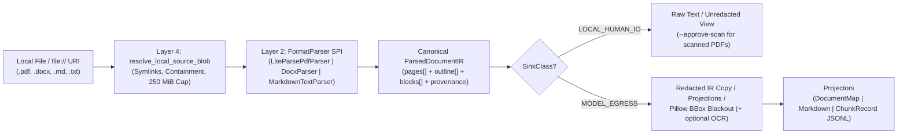

# Open-DV Unstructured Parsing User Guide (`opendv.parsing`)

> **Component README:** [`README.md`](README.md) · **Contributor Guide:** [`contributor-guide.md`](contributor-guide.md) · **Architecture Design:** [`unstructured-parsing-engine.md`](../../designs/unstructured-parsing-engine.md) · **External Agent Skill:** [`SKILL.md`](../../../.agents/skills/opendv-parsing/SKILL.md) · **Full CLI Reference:** [`16-cli-reference.md`](../../16-cli-reference.md)

The Open-DV Unstructured Parsing Engine (`src/opendv/parsing/` + `src/opendv/service/parsing_svc.py`) provides deterministic, layout-aware ingestion for `.pdf`, `.docx`, `.md`/`.markdown`, and `.txt` documents across standalone CLI (`opendv parse`), inbound MCP (`opendv mcp serve --profile parsing|all`), pure Python SPI callers, and integrated `open-dv` Steps 2–7 grounding and Data Vault 2.0 modeling workflows.

## Table of Contents

1. [Big Picture: Platform Flow, Sink Isolation & IR Contracts](#1-big-picture-platform-flow-sink-isolation--ir-contracts)
2. [Choosing Your Workflow](#2-choosing-your-workflow)
3. [Prerequisites & Setup](#3-prerequisites--setup)
4. [Complete Configuration & Parameter Reference](#4-complete-configuration--parameter-reference)
5. [Step-by-Step Worked Examples (Concrete Inputs & Outputs)](#5-step-by-step-worked-examples-concrete-inputs--outputs)
6. [Privacy, PII Detection, Redaction & Regex Limitations](#6-privacy-pii-detection-redaction--regex-limitations)
7. [Troubleshooting Common Errors & Remediation Rules](#7-troubleshooting-common-errors--remediation-rules)

---

## 1. Big Picture: Platform Flow, Sink Isolation & IR Contracts

### 1.1 Where `opendv.parsing` Sits in the 5-Layer DAG

```text
Layer 5: cli / api          (opendv parse ... & opendv mcp serve --profile project|parsing|all)
   │
Layer 4: service            (ParsingService, resolve_local_source_blob, _mcp_parse_tools, Steps 2-6 bridges)
   │
Layer 3: agents | modeling  (Consumes DocumentMap & PageTextView via VerifierContext; zero parsing imports)
   │
Layer 2: parsing            <── THIS COMPONENT: Pure SPI core (LiteParse, DOCX, MD/TXT, Pillow, Projectors)
         │  peers: sources | grounding | verifier | storage (ZERO cross-imports with parsing)
Layer 1: models             (SourceBlob, ParsedDocumentIR, ChunkRecord, OcrBox, pii_tokenizer.py)
```



### 1.2 Sink Isolation & Core Data Contracts

- **`SourceBlob`:** Context-managed path or closed temp-spool handle (`250 MiB` default cap) keeping large files out of Python heap RAM.
- **`ParsedDocumentIR`:** Separates immutable `pages[]` (`PageSlice` with 1-based `page_number`, `slice_kind`, `canonical_text`, `canonical_text_sha256`, `needs_ocr`, `extracted_via`) from `outline[]` (`DocumentOutlineNode`), ordered `blocks[]` (`DocumentBlock` with `PageSpan` and clamped `[0.0, 1.0]` `NormalizedBBox`), and `ParseProvenance`.
- **`ChunkRecord`:** Fixed-key DuckDB-safe JSONL substrate (`chunk_id`, `doc_sha256`, `format_id`, `page_number`, `slice_kind`, `canonical_text_sha256`, `heading_path`, `block_id`, `block_kind`, `reading_order`, `text`, `char_start`, `char_end`, `bbox_json`, `table_json`, `redacted`) emitted without `exclude_none=True`.
- **`LOCAL_HUMAN_IO` vs. `MODEL_EGRESS`:** Local CLI and direct Python calls default to `redaction="off"` (`--redact` opt-in). Outbound agent paths (`opendv mcp serve --profile parsing`, `DocumentMapProjector` for `ProfileBundle`, Steps 3–4 scout tools) enforce `MODEL_EGRESS` (`redaction="on"`), returning redacted IR copies or masked projections without mutating internal raw parses needed by Gate `V4`.

---

## 2. Choosing Your Workflow

| Workflow | Entry Point | `.opendv/` State? | Default Sink | Best For |
| :--- | :--- | :---: | :--- | :--- |
| **Mode 1: Stateless CLI** | `uv run opendv --json parse ...` | No | `LOCAL_HUMAN_IO` (`--redact` opt-in) | Local extraction, visual inspection, validation, and DuckDB `chunks.jsonl` pipelines. |
| **Inbound MCP Server** | `uv run opendv mcp serve --profile parsing` | No | `MODEL_EGRESS` (`--allow-unredacted` opt-in) | External MCP hosts (`6` parsing tools, or `23` tools with `--profile all --project <id>`). |
| **Python Library SPI** | `ParsingService` / `ParsingEngine` | No | Configurable | Custom pipelines injecting `FormatParser`, `IRProjector`, or `OcrProviderFn`. |
| **Grounding & Modeling Bridges** | `opendv ontology ground --input --doc`, `opendv model profile\|verify` | Optional | `strip_pii_spans` / `MODEL_EGRESS` | Adding document summary notes to grounding or profiling `DOC_SOURCE_KINDS` for Gate `V4`. |

---

## 3. Prerequisites & Setup

Core dependencies (`liteparse>=2.21.2,<2.22`, `Pillow>=10.0.0`, `python-docx`) install automatically with `uv sync`:

```bash
uv sync
uv run opendv --json parse spec
```

To enable local OCR fallback on scanned PDFs (`--ocr` / `ocr=True`), install the optional `[ocr]` extra and ensure the system `tesseract` binary is on `PATH`:

```bash
uv sync --extra ocr
```

Verify that `pytesseract_available` is `true` and `tesseract_binary` is non-null in `parse spec` output (`capabilities`).

---

## 4. Complete Configuration & Parameter Reference

### 4.1 Stateless CLI Commands (`opendv parse`)

| Subcommand | Positional / Required | Optional Flags | Notes |
| :--- | :--- | :--- | :--- |
| `parse spec` | — | — | Emits schemas, `4` formats, `3` projectors, and `ParsingCapabilitiesSnapshot`. |
| `parse inspect` | `<path>` | `--allow-root DIR`, `--max-pages 1000`, `--timeout-ms 30000` | Classifies `scanned_pages` vs. `digital_pages`; does not fail when `page_count > max_pages`. |
| `parse extract` | `<path>` | `--pages 1-5,8`, `--redact`, `--ocr`, `--out FILE`, `--allow-root DIR`, `--max-pages 1000`, `--timeout-ms 30000` | Pushes `--pages` down to `LiteParse`; enforces `len(requested_pages) <= max_pages`. |
| `parse render-page` | `<path>`, `--page N` | `--dpi 150`, `--redact`, `--ocr`, `--approve-scan`, `--out FILE`, `--allow-root DIR`, `--timeout-ms 30000` | PDF only (`dpi <= 300`, `<= 40_000_000` pre-render pixels). Returns `output_path` or `png_b64`. |
| `parse validate` | `<ir_path>` | `--out FILE` | Exits `0` if valid, `2` (`VERIFICATION_GATE_FAILED`) with diagnostics if invalid. |
| `parse export` | `<ir_path>`, `--target document_map\|markdown\|chunks` | `--format json\|jsonl`, `--redact`, `--out FILE` | Streams JSONL cleanly; `--json --format jsonl` requires `--out FILE`. |

All `opendv parse` commands reject `--api-url` and `OPENDV_API_URL` (`exit 2`, `SYNTAX_INVALID_ARGUMENT`).

### 4.2 Unified Inbound MCP (`opendv mcp serve`)

| Flag | Default (`project`) | Default (`parsing` / `all`) | Behavior |
| :--- | :--- | :--- | :--- |
| `--profile` | `project` | `parsing` or `all` | `project` = `17` tools, `parsing` = `6` tools, `all` = `23` tools. |
| `--project` | Required | Forbidden (`parsing`) / Required (`all`) | Passing `--project` (even `""`) with `--profile parsing` exits `2`. |
| `--allow-root` | Forbidden | `[cwd]` | Repeatable local root containment for parsing MCP tools. |
| `--allow-unredacted` / `--no-allow-unredacted` | Forbidden | `False` | Required to permit `redact=False` or `approve_scan=True` unredacted views. |
| `--max-inline-bytes` | Forbidden | `65536` | Threshold (`>= 1`) above which payloads spill to `SpilloverRef`. |
| `--spill-dir` | Forbidden | `<OS_USER_STATE>/opendv/parse_spill` | Owner-only directory receiving `<uuid>.{json,jsonl,png}` spillover files. |

### 4.3 Hard Resource & Guard Ceilings

| Guard | Limit | ErrorCode on Breach |
| :--- | :--- | :--- |
| Local input / `SourceBlob` size | `262,144,000` bytes (`250 MiB`) | `ARCHIVE_SIZE_LIMIT_EXCEEDED` (`2` / `413`) |
| `.docx` archive decompression | `<= 500` entries, `<= 250 MiB` inflated, `<= 100.0` ratio above `1 MiB` | `ARCHIVE_SIZE_LIMIT_EXCEEDED` (`2` / `413`) |
| `.docx` / virtual text slicing | `24,000` chars per `virtual_section_page` (`ChunkRecord <= 4,000` chars) | Masked *before* split |
| Visual page render budget | `dpi <= 300` (`400`), `width_pt * height_pt * (dpi/72)^2 <= 40,000,000` px | `ARCHIVE_SIZE_LIMIT_EXCEEDED` (`2` / `413`) |

---

## 5. Step-by-Step Worked Examples (Concrete Inputs & Outputs)

### 5.1 CLI Extraction, Validation & DuckDB JSONL Pipeline

```bash
uv run opendv --json parse spec
uv run opendv --json parse inspect data/public_am/am_custody_and_voting_guide.pdf
uv run opendv --json parse extract data/public_am/am_custody_and_voting_guide.pdf --pages 1-2,5 --out base_ir.json
uv run opendv --json parse validate base_ir.json --out validate_diags.json
uv run opendv --json parse export base_ir.json --target chunks --format jsonl --out chunks.jsonl
```

Sample `parse inspect` envelope (`data` excerpt):

```json
{
  "source_uri_sanitized": "data/public_am/am_custody_and_voting_guide.pdf",
  "binary_sha256": "example-sha256",
  "byte_size": 12450,
  "format_id": "pdf",
  "page_count": 6,
  "scanned_pages": [4],
  "digital_pages": [1, 2, 3, 5, 6],
  "renderable": true,
  "warnings": []
}
```

Sample `chunks.jsonl` output (each line is a fixed-schema `ChunkRecord` readable via `duckdb.sql("SELECT * FROM read_ndjson('chunks.jsonl')")`):

```jsonl
{"chunk_id":"a1b2c3d4e5f6:blk_0:0","doc_sha256":"a1b2c3d4e5f6","format_id":"pdf","page_number":1,"slice_kind":"physical_page","canonical_text_sha256":"9f86d081","heading_path":["Custody Guide"],"block_id":"blk_0","block_kind":"heading","reading_order":0,"text":"Custody Guide","char_start":0,"char_end":13,"bbox_json":"{\"x0\":0.1,\"x1\":0.5,\"y0\":0.08,\"y1\":0.12}","table_json":null,"redacted":false}
{"chunk_id":"a1b2c3d4e5f6:blk_1:0","doc_sha256":"a1b2c3d4e5f6","format_id":"pdf","page_number":1,"slice_kind":"physical_page","canonical_text_sha256":"9f86d081","heading_path":["Custody Guide"],"block_id":"blk_1","block_kind":"paragraph","reading_order":1,"text":"Institutional custody overview.","char_start":14,"char_end":45,"bbox_json":null,"table_json":null,"redacted":false}
```

### 5.2 Grounding Notes (`--input --doc`) & Modeling Profiling (`model profile`)

```bash
# Attach repeatable --doc notes onto an ad-hoc GroundingRequest JSON run
uv run opendv --json ontology ground --input grounding_req.json --doc data/public_am/am_custody_and_voting_guide.pdf --mode deterministic_only --skip-reason "doc_context"

# Profile mixed SQLite + PDF sources into ProfileBundle.document_maps
uv run opendv --json model profile --source sqlite:data/public_am/am_sec_treasury_ibor.sqlite --source pdf:data/public_am/am_custody_and_voting_guide.pdf --out profile_bundle.json
```

### 5.3 Python SPI Composition (`ParsingService` + `ParsingRegistry`)

```python
from pathlib import Path
from opendv.models.document_ir import ParseOptions
from opendv.service.parsing_svc import ParsingService

svc = ParsingService(allowed_roots=[Path.cwd()])
ir = svc.parse_document(
    Path("data/public_am/am_custody_and_voting_guide.pdf"),
    options=ParseOptions(pages=[1, 2]),
    sink_class="MODEL_EGRESS",
    redaction="on",
)
diags = svc.validate_ir(ir)
assert diags == []
chunks_jsonl = "".join(svc.stream_export(ir, target="chunks", sink_class="MODEL_EGRESS"))
```

---

## 6. Privacy, PII Detection, Redaction & Regex Limitations

`src/opendv/models/pii_tokenizer.py` and `src/opendv/parsing/redaction.py` apply deterministic masking (`MASKED_PII_TOKEN = "<MASKED_PII>"`) under `MODEL_EGRESS`. Operators must understand the exact detector boundaries and known false-negative / false-positive limits:

### 6.1 Deterministic Text PII & Secret Detectors (`9` Detectors)

1. **US SSN (`RE_SSN`):** `\b\d{3}-\d{2}-\d{4}\b`. *Limit:* Requires ASCII hyphens (`XXX-XX-XXXX`); undashed (`123456789`) or space-separated SSNs are not matched.
2. **US EIN (`RE_EIN`):** `\b\d{2}-\d{7}\b`. *Limit:* Requires hyphenated `XX-XXXXXXX` form; non-EIN identifiers using the same pattern can false-positive.
3. **US ABA Routing Number (`RE_ABA_DIGITS` + `RE_ABA_CONTEXT` + `is_valid_aba_routing`):** `\b\d{9}\b` passing the `[3, 7, 1]` Mod-10 checksum, excluding synthetic prefixes `("1900", "2026", "0000")`, and requiring `\b(aba|routing|rtn)\b` (case-insensitive) within `±32` characters in prose OR within the same Markdown/DOCX/PDF table row/header. *Limit:* Bare 9-digit numbers more than `32` characters from routing keywords outside tables are not masked; numbers prefixed with `1900`/`2026`/`0000` are intentionally exempted.
4. **Email Address (`RE_EMAIL`):** `\b[A-Za-z0-9._%+-]+@[A-Za-z0-9.-]+\.[A-Za-z]{2,}\b`. *Limit:* Obfuscated forms (`name [at] domain`), non-ASCII IDN local parts, or PDF line-wrapped addresses split across newlines are not matched.
5. **US/NANP Phone (`RE_PHONE`):** `(?<!\d)(?:\+?1[-.\s]?)?(?:\(\d{3}\)|\d{3})[-.\s]\d{3}[-.\s]\d{4}(?!\d)`. *Limit:* Matches 10-digit NANP numbers (`+1` optional) separated by `-`, `.`, or whitespace; international numbers (`+44 ...`), unseparated 10-digit strings, and extensions outside the 10 digits are not matched.
6. **IBAN (`RE_IBAN`):** `\b[A-Z]{2}\d{2}[A-Z0-9]{11,30}\b`. *Limit:* Matches uppercase, unspaced IBANs only (spaced `DE89 3704 ...` or lowercase strings are missed; no Mod-97 checksum check is applied, so matching uppercase IDs can false-positive).
7. **Payment Card PAN (`RE_CC_PAN` + `is_valid_luhn`):** `(?<!\d)(?:\d[ -]?){12,18}\d(?!\d)` gated by Luhn Mod-10 (`13..19` digits). *Limit:* Line-wrapped numbers or non-ASCII dashes are missed; any non-card 13–19 digit number passing Luhn Mod-10 can false-positive.
8. **64-Hex Digest / Secret (`RE_HEX_64`):** `\b[0-9a-fA-F]{64}\b`. *Limit:* In unstructured prose (`col_name=None`), standalone 64-char hex tokens (including SHA-256 checksums inside document bodies) ARE masked as `<MASKED_PII>` unless exempted via a structured digest/HK column name (`is_non_credential_digest_column`).
9. **High-Entropy Tokens (`find_high_entropy_tokens`):** Whitespace-split tokens (stripped of `",;()[]{}'\"<>"`) with `len >= 24` and Shannon entropy `H >= 4.2` bits/char, exempting `urn:`, `http://`, `https://`, `<MASKED_PII>`, `[REDACTED`, `snake_case`, `UPPER_SNAKE_CASE`, and `CamelCase`/`camelCase`. *Limit:* Secrets shorter than `24` characters or below `4.2` bits/char are missed; long mixed alphanumeric identifiers `>= 24` chars can false-positive.

### 6.2 Structural, Visual & Gate Separation Limits

- **No Free-Form Prose NER:** Person names, street addresses, dates of birth, and non-US national IDs are not detected in unstructured prose (`RE_PII_COLUMN` applies only to structured table column names).
- **Pre-Split Masking:** `.docx` and `.md`/`.txt` text is masked *before* `24,000`-char `virtual_section_page` splitting so PII spanning a slice boundary cannot evade detection.
- **Visual Blackout (`render_page` under `MODEL_EGRESS`):** `align_pii_spans_to_boxes` maps detected spans onto `NormalizedWordBox` / `OcrBox` boxes with `padding_px=2` and draws opaque black rectangles via `Pillow`. Fails closed with `UNREDACTED_SCAN_BLOCKED` if PII exists without matching word boxes or on scanned pages lacking `[ocr]`/`ocr_provider`. Raster figures, embedded photos, and handwritten signatures without native text or OCR boxes cannot be redacted by regex.
- **Downstream Gate Separation:** `validate_ir` intentionally permits `<MASKED_PII>` in redacted IR copies (`provenance.redacted=True`), whereas downstream Gate `V4`, `citations.py`, and grounding rerankers reject `<MASKED_PII>` / `[REDACTED_*]` (`REDACTED_PLACEHOLDER_LEAK`). Grounding summary notes therefore sanitize via `strip_pii_spans(..., strip_placeholders=True)` instead of emitting `<MASKED_PII>`.

---

## 7. Troubleshooting Common Errors & Remediation Rules

| Symptom / `ErrorCode` | Root Cause | Resolution |
| :--- | :--- | :--- |
| `SYNTAX_INVALID_ARGUMENT` (`exit 2`) on `parse` | Passed `--api-url` / `OPENDV_API_URL`, invalid `--pages`, `--dpi > 300`, or `--json --format jsonl` without `--out`. | Run `opendv parse` locally without `--api-url`, verify 1-based `--pages`, keep `--dpi <= 300`, and pass `--out chunks.jsonl`. |
| `SYNTAX_INVALID_ARGUMENT` (`exit 2`) on `mcp serve` | Mixed `--project` with `--profile parsing`, omitted `--project` on `--profile project\|all`, or passed parsing flags under `--profile project`. | Match flags strictly to `--profile project`, `--profile parsing`, or `--profile all`. |
| `UNREDACTED_SCAN_BLOCKED` (`exit 2`) | Scanned page rendered without `--approve-scan` (`LOCAL_HUMAN_IO`) or without `[ocr]`/`ocr_provider` (`MODEL_EGRESS`), or PII box alignment missed. | Pass `--approve-scan` only for local human viewing, or install `[ocr]` + `tesseract` and pass `--ocr` (or configure `--allow-unredacted` on MCP). |
| `DRIVER_MISSING` (`exit 2`) | `--ocr` requested when `pytesseract` or `tesseract` binary is missing. | Run `uv sync --extra ocr` and install the system `tesseract` executable on `PATH` (human action). |
| `VERIFICATION_GATE_FAILED` (`exit 2`) | Tampered `ParsedDocumentIR` in `parse validate`, password-locked/corrupt PDF, or OLE2 encrypted `.docx`. | Re-extract a clean IR from an unencrypted source or inspect emitted `ValidationDiagnostic[]`. |
| `ARCHIVE_SECURITY_VIOLATION` (`exit 2`) | Path traversal, symlink, UNC, ADS `:`, `--allow-root` escape, or XML `DOCTYPE`/`ENTITY` in `.docx`. | Place files inside `--allow-root` without symlinks and remove unsafe OOXML entity declarations. |
| `ARCHIVE_SIZE_LIMIT_EXCEEDED` (`exit 2`) | Source `> 250 MiB`, `> max_pages`, `> 40,000,000` render pixels, or `.docx` zip-bomb limits exceeded. | Use `--pages` windowing, lower `--dpi`, or split oversized documents. |
