# Manual Testing Feedback & Q&A Tracker (`open-dv` Unified Workbench + CLI + Skill)

> **Service Endpoint:** `http://127.0.0.1:8420` (loopback daemon active) · **Branch:** `feat/unified-ontology-pipeline-wizard` ([PR #245](https://github.com/nogoo9/open-dv/pull/245))  
> **Consolidated Deliverables:** [31-v2-e2e-requirements-gaps-and-uat-spec.md](../../31-v2-e2e-requirements-gaps-and-uat-spec.md) *(E2E Architecture, Organized Gaps/Requirements & 89-Item UAT Expected-Output Matrix)* · [32-v2-user-experience-and-scenario-guide.md](../../32-v2-user-experience-and-scenario-guide.md) *(Step 1–7 User Experience & 20-Scenario Playbook)*  
> **Mode:** Observation & Triage only — no repo code edits until you say you're ready to plan & apply fixes.

---

## Summary Ledger

| ID | Type | Surface | Summary | Severity / Priority | Status |
| :--- | :--- | :--- | :--- | :--- | :--- |
| `OBS-01` | Observation | Step 1 UI | Starter Packs remain visible/selectable when `Blank · v0.0.0` (or `Workspace Seed`) is active, and selections are silently ignored on submit | High | Logged |
| `OBS-02` | Observation | Step 1 UI | Domain Namespace input lacks hint/instructions and client-side regex checks (backend enforces `^[a-z][a-z0-9_]{0,63}$` with HTTP 400) | High | Logged |
| `OBS-03` | Observation | Step 1 UI | `Workspace Seed` sends a blind boolean with no selectable list of discovered workspace domains/contracts | High | Logged |
| `OBS-04` | Observation | Step 1 UI | Existing rows render opaque `s-<hex> (general)` / `(asset_management)` without labeling `Namespace` or showing a human Project Name | Medium | Logged |
| `REQ-01` | Instruction | Step 1 UI | Add concise hints/instructions for Option A vs. Option B and each baseline mode (`Blank · v0.0.0`, `Workspace Seed`, `Starter Packs`) | High | Logged |
| `REQ-02` | Instruction | Step 1 UI | Add Domain Namespace explanation + live client-side validation + inline fix suggestions + disabled submit guard when invalid | High | Logged |
| `REQ-03` | Instruction | Step 1 UI | Hide (or completely omit) Starter Packs when `Blank · v0.0.0` is selected, replacing with a clear Blank Genesis readiness panel | High | Logged |
| `REQ-04` | Instruction | Step 1 UI + API | Discover available workspace ontology contracts via backend API and show a selectable domain picker under `Workspace Seed` | High | Logged |
| `REQ-05` | Instruction | Step 1 UI + API | Add pre-initialization **Starter Pack Ontology Preview** (CBC concepts/hubs, Core Spine dependencies, relationships/links, standards) | High | Logged |
| `REQ-06` | Instruction | Step 1 UI | Expose editable **Project Name (Session ID)** input (`^[a-z0-9][a-z0-9_-]{0,63}$`, optional auto-slug fallback) wired to backend `session_id` | High | Logged |
| `REQ-07` | Instruction | Fix Plan / QA | Generate a full post-fix manual UAT checklist & step-by-step verification instructions covering every logged issue/request as part of the consolidated fix plan | High | Logged |
| `Q-01` | Question | Step 1 Naming | "Session" vs. "Project" — which is a better name for users? | — | Decided (`Project`) |
| `Q-02` | Question | Step 1 Labels | What do the bracketed `(general)` vs `(asset_management)` labels mean in existing session rows? | — | Answered |
| `OBS-05` | Observation | Global TopBar / Header | Active project is only a non-interactive ID pill (`sessionDigest`) without version/namespace or switcher; Step 2 header still says `Session <id>` | High | Logged |
| `OBS-06` | Observation | Step 2 / Connector Modal | `SQLite` / `DuckDB` modal only accepts typed URI strings (no local file picker) and `.sqlite/.db/.sqlite3/.duckdb/.ddb` are missing from `EXTENSION_TO_MIMES` | High | Logged |
| `OBS-07` | Observation | Step 2 / Connector Modal | `Catalog`, `Schema`, and `Credentials Ref` inputs render unconditionally for SQLite without hints or inspected dropdowns | High | Logged |
| `OBS-08` | Observation | Step 2 / Table Preview | Expanded table columns list has no `<thead>` headers or legend explaining col 3 (`PK (#1)`, `FK ➔ table.col`) or col 4 (Governance Tags) | Medium | Logged |
| `OBS-09` | Observation | Step 2 UI | Attached source rows lack `Preview`, `Edit`, and `Detach` controls (even though `DELETE /sources/{id}` exists), and `manifest.json` omits `connector_config` | High | Logged |
| `OBS-10` | Observation | Step 2 + Backend Plugins | Connector tiles, `list_adapters()`, and `connector_ingestion.py` are hardcoded rather than dynamically driven by `SourceAdapterRegistry` plugins; Step 2 lacks source-purpose guidance | High | Logged |
| `OBS-11` | Observation | Step 2 UI + API | Inline Domain Notes sit unparsed as hardcoded `domain-note.md` until `Parse Attached Documents` is clicked in the separate Documents card | High | Logged |
| `REQ-08` | Instruction | Global TopBar / Header | Add always-visible **Active Project + Project Switcher** dropdown (name, version, namespace, instant switch, `+ New Project`) across all views | High | Logged |
| `REQ-09` | Instruction | Step 2 / Connector Modal | Support **Pick Local File** (CAS upload) + **Local Path / URI** in connector modals for all `client_uploadable` file DBs & files | High | Logged |
| `REQ-10` | Instruction | Step 2 / Connector Modal | Update `ConnectorUIManifestDTO` (`ConnectorFieldSpecDTO`) with `enabled`, `disabled_reason`, and `hint` flags so irrelevant fields are disabled via contract + schema/catalog dropdowns | High | Logged |
| `REQ-11` | Instruction | Step 2 / Table Preview | Add a small compact `<thead>` header (`Column`, `Type`, `Keys & Links`, `Tags`) and plain-English hover tooltips on headers and `PK` / `FK` badges | Medium | Logged |
| `REQ-12` | Instruction | Wizard-wide / Logs | Badge deterministic vs. AI-agent operations and expose a **`View Agent I/O (stdin / stdout)`** button wherever agents run | High | Logged |
| `REQ-13` | Instruction | Step 2 UI + Backend | Persist `connector_config` in manifest and add **`Preview`**, **`Edit`**, and **`Detach`** (`DELETE /sources/{id}`) actions on attached source rows | High | Logged |
| `REQ-14` | Instruction | Backend + UI Plugins | Complete plugin-driven `SourceAdapterRegistry` dispatch (`list_adapters`, ingestion, Step 2 dynamic UI cards + **Import / Manage Adapters**) | High | Logged |
| `REQ-15` | Instruction | Step 2 UI | Reorganize Step 2 into clear purpose-driven zones explaining what each connector/source is for and where it is used in Steps 3–6 | High | Logged |
| `REQ-16` | Instruction | Step 2 UI + Backend | Instant Step 2 attachment + custom note names + immediate page/outline readiness in `document_map.json` *(updated for Flow B)* | High | Logged |
| `Q-03` | Question | Step 2 / SQLite Modal | What do `Catalog`, `Schema`, and `Credentials Ref` mean on SQLite connectors? | — | Answered |
| `Q-04` | Question | Step 2 / Table Preview | What is the 3rd column (`PK (#1)`, `FK ➔ securities.ticker`) in the table column preview? | — | Answered |
| `Q-05` | Question | Step 2 / Agents | Do AI agents run during Step 2 inference, and how can users inspect raw agent `stdin` / `stdout`? | — | Answered |
| `Q-06` | Question | Step 2 / Domain Notes | Is the Inline Domain Note processed immediately when attached? | — | Answered |
| `Q-07` | Question | Step 2 / Parsing & Agents | How are domain notes & unstructured docs parsed, and should AI agents parse them? | — | Superseded (`Flow B` / `REQ-35`) |
| `REQ-17` | Instruction | Step 2 / Unstructured Parsing | Optional opt-in Step 2 VLM parser toggle for complex PDFs | Medium | Superseded by `REQ-35` (`view_page_image` tool in Step 4) |
| `Q-08` | Question | Step 2 / Unstructured Processor | Can we adjust chunker & unstructured processor parameters, and make chunkers/parsers pluggable? | — | Superseded (`Flow B` / `REQ-35`) |
| `REQ-18` | Instruction | Step 2 / API + Plugins | Expose 800-char chunker settings & `opendv.chunkers` SPI *(document parsers kept pluggable; arbitrary fixed chunking replaced by Flow B)* | High | Superseded by `REQ-35` |
| `OBS-12` | Observation | Step 2 / Databricks Modal & Docs | `CatalogTablePickerModal.tsx` omits non-sensitive Databricks `connection_fields` (`host`, `http_path`) already declared in `get_ui_manifest()`, and `.env.example` omits most runtime/connector/agent env vars | High | Logged |
| `REQ-19` | Instruction | Step 2 / Connector Modal | Render all non-sensitive connector `connection_fields` (`host`, `http_path`, `catalog`, `schema_name`, hints, `enabled`/`disabled_reason`) dynamically from adapter manifests, with clear driver-missing diagnostics (`databricks-sql-connector`) | High | Logged |
| `REQ-20` | Instruction | Security / Secrets Cookie Service | Add an encrypted `HttpOnly` cookie secret vault service (`AES-256-GCM` via HKDF-derived workspace key) decrypting on-demand per request, **overriding env vars** when set in the cookie, without ever persisting plaintext secrets | High | Logged |
| `REQ-21` | Instruction | DX / Configuration | Update `open-dv/.env.example` with a complete, documented template of all required and optional runtime, agent harness, Databricks UC, security, OCR, and CLI env vars | Medium | Logged |
| `Q-09` | Question | Security / Architecture | Feasibility, cryptography, cookie limits, override precedence, and trade-offs for an encrypted `HttpOnly` secret cookie service | — | Answered |
| `OBS-13` | Observation | Settings & Step 2 | `PlatformSettingsView.tsx` only configures AI agents (no Data Connections / Credentials panel); attached Databricks tables do not persist non-sensitive config (`host`, `http_path`, `catalog`, `schema_name`, `credentials_ref`), and Step 2 lacks a missing-credentials prompt or Settings link | High | Logged |
| `REQ-22` | Instruction | Step 2 + Backend | Persist non-sensitive Databricks/connector config (`host`, `http_path`, `catalog`, `schema_name`, `credentials_ref`, `selected_tables` — zero plaintext secrets) alongside attached tables, and prompt on-demand for missing credentials (e.g., after server restart / cleared cookie) before resuming | High | Logged |
| `REQ-23` | Instruction | Settings Panel & Step 2 Gate | Expand Settings (`/settings`) into a unified hub (`AI Agent Harness`, `Data Connections & Secrets`, and `Plugins & Extensions` extended with `Agents, Skills & MCP` per `REQ-36`) and wire a Step 2 readiness gate | High | Logged |
| `OBS-14` | Observation | Step 2 / Parse Queue & Limits | `POST /parse` rejects concurrent runs with HTTP 409, lacks a bounded per-doc job queue/limits, has no sticky Auto-Parse vs. Manual toggle, and doesn't display live chunks parsed or per-doc `Queued/Parsing/Done` state | High | Logged |
| `OBS-15` | Observation | Step 3 / Scale & Lazy Load | `/evidence/tables` and `/evidence/chunks` eagerly return all tables, all sample rows (`<=50` each), and all chunks unpaginated; `Step3PreviewEvidence.tsx` mounts everything at once (won't scale to hundreds of tables) | High | Logged |
| `OBS-16` | Observation | Step 3 / Term Explorer | `observed_term_counts` uses raw regex without stopwords, and Step 3b renders static pills (no interactive word cloud, click/hover filtering/highlighting, or structured schema term explorer in Step 3a) | Medium | Logged |
| `REQ-24` | Instruction | Step 2 + Backend Queue | Sticky Auto/Manual chunk parse toggle & Step 2 chunk parsing queue *(replaced by instant Flow B attachment + lightweight `document_map.json` + Step 4 coverage monitor)* | High | Superseded by `REQ-35` |
| `REQ-25` | Instruction | Step 3 UI + API | Re-architect Step 3a & 3b with lazy-loaded/paginated APIs (`/evidence/tables/index` + lazy table detail & row paging; Step 3b switches to `document_map.json` Page & Outline Viewer per `REQ-35`) | High | Logged |
| `REQ-26` | Instruction | Step 3 UI + API | Add **Interactive Schema Term Cloud** for Step 3a Structured Tables (`table`/`col`/`PK`/`FK`/`FIBO-gap` filtering & highlighting); Step 3b chunk word cloud superseded by Flow B Document Outline Viewer (`REQ-35`) | High | Updated (`3a` kept) |
| `Q-10` | Question | Step 2 vs. Step 3 Architecture | Is document parsing better triggered in Step 2 or Step 3? | — | Superseded (`Flow B` / `Q-16`) |
| `Q-11` | Question | Step 3 / Agents | Are AI agents involved in Step 3? | — | Answered |
| `OBS-17` | Observation | Step 4 UI + Backend Runner | Step 4 runs one monolithic `@ontology-architect` call (`output_schema=OntologyProposal`), silently drops chunks past prompt budget, emits zero per-table/chunk/persona progress, and shows static disabled UI (`"Run in progress — view live logs"`) until completion | High | Logged |
| `OBS-18` | Observation | Steps 2–4 Multi-Wave Continuation | No `New / Unprocessed` provenance tracking on sources/tables/chunks in Steps 2–3; Step 4 hides baseline concepts before run, sends bare concept URIs to prompts, lacks `Incremental` vs. `Redo from Scratch` modes, and silently drops `add_relationship` / `add_external_mapping` targeting existing baseline concepts (`wizard-step4-adapter.ts#L265-L305`) | Critical | Logged |
| `REQ-27` | Instruction | Step 4 UI + SSE Streaming | Add interactive Step 4 Live Agent Workbench: staged persona progress, per-table & page coverage checklist, live streaming observations & candidate schema cards, and a small expandable/collapsible multi-agent stream terminal | High | Logged |
| `REQ-28` | Instruction | Steps 2–3 + Lineage Backend | Stamp processed `source_id` / `sha256` / `table_id` per committed version/proposal and display **`✦ NEW · Unprocessed`**, **`↻ UPDATED SINCE vX.Y.Z`**, and **`✓ Modeled in vX.Y.Z`** badges + `New / Unprocessed Only` filter across Steps 2 & 3 | High | Logged |
| `REQ-29` | Instruction | Step 4 + Backend + CLI | Add **Existing Baseline Context bar**, **`Discovery Mode`** selector (**`Incremental · New Sources`**, **`Incremental · Re-verify Full`**, **`Redo from Scratch · Clean Rebuild`**), full baseline schemas in prompts, and `✦ NEW` / `⊕ EXTENDS vX.Y.Z` diff cards (fixing silent adapter drops) | High | Logged |
| `Q-12` | Question | Step 4 / Agent Architecture | How do Step 4 agents stream/execute today under the hood vs. what is needed for live progress, observations & schema visuals? | — | Answered |
| `Q-13` | Question | Steps 2–4 / Multi-Wave Evolution | What do users see today vs. what should they see when continuing work on an existing ontology with new data? | — | Answered |
| `OBS-19` | Observation | Step 4 UI / Concept Cards | `renderConceptCard` hides matched FIBO entity name/URI (`c.fibo_match.uri`), `target_hub` (`hub_*`), definition, and `dependent_links`, showing only concept name + bare `skos:closeMatch · 92%` (`Step4AgentDiscovery.tsx#L229-L240`) | High | Logged |
| `OBS-20` | Observation | Step 4 UI + Backend / Adapter | Bare attribute strings in `AddConceptOp.attributes` fallback to `data_type: "string"` in `normalizeOpAttributes` (`#L58-L65`), rendering unlabelled `"string"` input boxes with zero `table.column` / SQL type provenance despite `tables.jsonl` profiling `BIGINT`/`DOUBLE`/`BOOLEAN` | High | Logged |
| `REQ-30` | Instruction | Step 4 UI + Backend / Adapter | Upgrade Step 4 concept cards to display full provenance chain (**Canonical Concept (`hub_*`) ↔ Matched FIBO Class ← `table.column (SQL Type)` / `doc p.#quote` → Auto-Inferred Logical Type Dropdown + Links**), cross-referencing `evidence/tables.jsonl` | High | Logged |
| `REQ-31` | Instruction | Step 4 UI / FIBO Grounding | Highlight `skos:closeMatch` concepts in **Warm Amber** (`≈ Close FIBO Match · Review Nuance`) vs. Sage Green (`exactMatch`) & Slate (`Path B`), add grounding-tier filter chips, and surface side-by-side FIBO vs. Concept definition comparison | Medium | Logged |
| `Q-14` | Question | Step 4 / Output Semantics | What am I seeing in Step 4 output (FIBO entities vs. concepts), what is `"string"`, should we show full mappings, and what does `closeMatch` mean? | — | Answered |
| `OBS-21` | Observation | Step 4–5 Sync / Grounding Status | `wizard-step4-sync.ts#L69-L72` hardcodes UI `grounding_status: "UNGROUNDED"` whenever `fibo_match.score < 0.7`, ignoring the `0.65` Path A threshold and valid **Path B1 empirical** concepts (`STRUCTURED_SCHEMA` / `DOCUMENT_OBSERVED` + `evidence_refs`) | High | Logged |
| `REQ-32` | Instruction | Docs, Website & Walkthrough Video | Fix `OBS-21` UI grounding badges and publish the canonical 9-Scenario Discovery & Grounding Matrix ([29-discovery-grounding-and-evolution-scenarios.md](../../29-discovery-grounding-and-evolution-scenarios.md)) across repo `docs/`, `apps/opendv-website`, and the walkthrough video + WebVTT captions | High | Logged |
| `REQ-33` | Instruction | Test Suite & UAT Sign-Off | Enforce all 9 scenarios (`SCEN-01..09`) across unit/governance tests, FastAPI studio integration tests, Playwright E2E specs, and the final UAT sign-off matrix | High | Logged |
| `Q-15` | Question | Step 4 / Novel Concept Lifecycle | How are newly discovered and Beyond-FIBO concepts detected, proposed, grounded, and governed across scenarios? | — | Answered |
| `REQ-34` | Instruction | VCS Docs & Project Agent Settings | Check canonical matrix into `docs/29-discovery-grounding-and-evolution-scenarios.md` and wire into `.agents/rules/discovery-and-grounding-scenarios.md`, `AGENTS.md`, `CLAUDE.md`, `apps/opendv-website/AGENTS.md`, `open-dv-workflow` skill, and `test_scenario_matrix_sync.py` so every future test/doc/video agent enforces it automatically | High | Logged |
| `OBS-22` *(OBS-AGENT-01)* | Observation | Steps 2–4 / Ingestion & Terms | Static 800-char chunking fragments tables/definitions; `observed_term_counts` (`_TERM_RE`) keeps stopwords & drops 2-letter acronyms with zero Step 4 consumers; deterministic fallback skips prose whenever structured keys exist (`deterministic_pipeline.py#L557-L569`) | High | Logged |
| `OBS-23` *(OBS-AGENT-02)* | Observation | Step 4 Agent / Prompt Budget | `StudioAgentRunner._run_real_harness_sync` runs a single monolithic `ONTOLOGY_ARCHITECT` call with `tools=()` and `subagents=()`, silently popping chunks past `32,000` chars / `48` chunks (`agent_runner_helpers.py#L339-L341`) and blocking tool-backed FIBO/Clarification calls | High | Logged |
| `OBS-24` *(OBS-AGENT-03)* | Observation | Harness / CLI vs. SDK Parity | `ClaudeCliHarnessAdapter` passes `--tools ""` (`claude_cli_adapter.py#L6`) and `AgyCliHarnessAdapter` mounts no MCP server while SDK adapters bind tools via `bridge.py`; personas are 1-line Python strings (`term_scout.py#L32-L35`) instead of portable packages | High | Logged |
| `OBS-25` *(OBS-AGENT-04)* | Observation | Step 4 / Concept Memory | `FiboPackGroundingVerifier` indexes static FIBO only (`verifier.py#L79-L119`); `build_safe_agent_prompt` sends bare URIs; `staged_candidates.json` overwrites across waves (`deterministic_pipeline.py#L886-L887`) with no `concept_memory.json` or in-run symbol table | High | Logged |
| `OBS-26` *(OBS-AGENT-05)* | Observation | Agent Harness / Prompts & Models | Step 4 personas lack `firstmate` numbered invariants/tools, 3-tier `SKILL.md` progressive disclosure, and Gemini vs. Claude prompt adaptation; `DEFAULT_CLAUDE_MODEL_MAP` uses `agy` aliases (`claude-opus-5-5-high`) mapped only inside `claude_cli_adapter.py#L44-L47` | High | Logged |
| `REQ-35` *(REQ-AGENT-01)* | Instruction | Steps 2–4 / Flow B MCP & Citations | Adopt **Flow B**: instant Step 2 CAS + `document_map.json`, Step 3b Document Page & Outline Viewer, 9 Step 4 MCP tools (full-doc pages, selective `view_page_image`, `inspect_table_profile`, `search_concepts`, `get_baseline_concept`, fuzzy-OCR quote-anchored `record_concept_finding`, `emit_clarification_question`), `Local Only` `tokenization.py` upgrade, and page-span + legacy `chunk_id` `/citations/resolve` fallback | Critical | Logged |
| `REQ-36` *(REQ-AGENT-02)* | Instruction | Agent Packages / Standalone & Settings | Package **all** Step 4 & Step 6 agents as portable `<agent-id>/{agent.yaml, SKILL.md, references/, subagents/}` bundles installable standalone (`Claude Code` / `Antigravity` / `opendv agent run`) AND registered in `open-dv` (`AgentPackageRegistry` + `Settings → Agents, Skills & MCP`) | High | Logged |
| `REQ-37` *(REQ-AGENT-03)* | Instruction | Harness / CLI vs. SDK Parity & Locks | Ship `opendv mcp serve --transport stdio\|http --session <id>` for CLI `--mcp-config` parity with in-process `bridge.py` SDK execution, ensuring `run_construct_session` never holds `L5` `.session.lock` while awaiting CLI subprocesses on Windows | High | Logged |
| `REQ-38` *(REQ-AGENT-04)* | Instruction | Step 4 / Subagent Fan-Out | Add `@page-range-scout` and `@table-cluster-scout` subagent fan-out plus MCP `pages_inspected` / `tables_inspected` coverage ledger feeding Step 4 progress (`REQ-27`) | High | Logged |
| `REQ-39` *(REQ-AGENT-05)* | Instruction | MCP / 4-Layer `DynamicConceptRegistry` | Expose open-vocab `✦ NEW` extraction + 4-layer lookup (`vX.Y.Z` baseline custom concepts, live in-run symbol table, cross-wave `concept_memory.json` + incremental `staged_candidates`, workspace catalog) via `search_concepts` | High | Logged |
| `REQ-40` *(REQ-AGENT-06)* | Instruction | Agent Personas / `firstmate` & `skills.sh` | Standardize Step 4 & Step 6 prompts on `firstmate` Hard Rule 1 (`@ontology-first-mate` read-only coordinator, `Scout` vs. `Ship`, `NO GUESSING`) + 3-tier `SKILL.md` (`frontmatter` → `SKILL.md` → `references/*.md`) | High | Logged |
| `REQ-41` *(REQ-AGENT-07)* | Instruction | Harness / `PromptRenderer` & Models | Compile single `SKILL.md` via vendor-tuned `PromptRenderer` (XML + parallel batching + calm triggers for Claude vs. unmixed `TemplatedSystemInstructions` + `skills_paths` + `<plan>` + end-of-context anchoring for Gemini) and fix per-provider model ID routing | High | Logged |
| `Q-16` *(Q-AGENT-01)* | Question | Flow A vs. Flow B Architecture | Step 2 chunking & term cloud vs. Flow B instant Step 2/3 page map + Step 4 tool-driven exploration | — | Decided (`Confirmed Flow B`) |
| `Q-17` *(Q-AGENT-02)* | Question | Agent Portability & Parity | Standalone (`Claude`/`Antigravity`) AND installable in `open-dv` across CLI + SDK service modes | — | Answered |
| `Q-18` *(Q-AGENT-03)* | Question | Flow B Quality Controls | Preventing lazy skimming, offset hallucinations, and duplicate custom concepts without pre-chunking | — | Answered |
| `Q-19` *(Q-AGENT-04)* | Question | Prompt Optimization Research | Structuring system prompts using `firstmate`, `skills.sh` progressive disclosure, and Claude/Gemini tuning | — | Answered |
| `REQ-42` | Instruction | Test Data / E2E & UAT Fixtures | Formalize & check in `data/public_am/` multi-modal test fixtures (`am_esg_stewardship_proxy.parquet`, `am_stewardship_domain_notes.md`, `am_restricted_client_override_local_only.md`) + `generate_esg_parquet.py` generator across automated & manual UAT (`SCEN-01..09`) | High | Logged |
| `REQ-43` | Instruction | Settings / Step 2 / Docs | Add an interactive `"How to Configure Databricks Unity Catalog"` helper drawer in Settings & Databricks modal + `docs/` covering Warehouse `host`/`http_path`, `OPENDV_ALLOWED_HOSTS`, `CAN USE` + `GRANT USE CATALOG/SCHEMA/SELECT`, and UC `'pii'='true'` tag propagation | Medium | Logged |
| `Q-20` | Question | Step 2 / Databricks UC Setup | Required Unity Catalog info (`host`, `http_path`, SSRF allowlist, PAT/SP token, `databricks-sql-connector`), read-only grants & PII column tags | — | Answered |
| `OBS-27` | Observation | Step 4 Adapter / Attributes | Proposal JSON already emits all `69` typed `add_attribute` ops (`integer`, `decimal`, `boolean`, `date`) + `table.column` refs, but `wizard-step4-adapter.ts#L247` skips existing names (`!target.attributes.some(...)`), dropping them in favor of `add_concept`'s bare `"string"` stubs (`OBS-20` root cause) | High | Logged |
| `OBS-28` | Observation | Step 4 ➔ Step 6 / Synthesis | `_synthesize_cumulative_contract` (`contract_synthesizer.py#L133-L179`) assigns only **1 Primary Hub per table**, collapsing wide multi-concept feeds (`am_esg_stewardship_proxy.parquet` = 4 concepts) into 1 Hub/Sat instead of splitting per Step 4's decomposition | Critical | Logged |
| `OBS-29` | Observation | Step 4 ➔ Step 6 / Doc Concepts | `Gate 1` (`gate1_contract_grain.py#L197-L201`) rejects hubs without physical columns (`PHANTOM_HUB_REJECTED`), while `wizard-step6-adapter.ts#L100-L115` drops Step 4 `DOCUMENT_OBSERVED` concepts/candidates (`contract_evolver.py#L293-L322` falls back to generic `hub_document`) | High | Logged |
| `OBS-30` | Observation | Step 2/4 ➔ Step 6 / Connectors | `wizard-step6-adapter.ts#L126-L141` infers `table_name` from filename stem instead of forwarding Step 2 `selected_tables` / `evidence/tables.jsonl` schemas and drops Step 4 column-level `evidence_refs` | High | Logged |
| `OBS-31` | Observation | Steps 4–6 / Vault Stability | Certified `deployed_contract` is not auto-bound into Step 4/5 UI/guards; Step 6 defaults safely only per auto-load (allowing accidental `__cold_start__` override on existing Vaults); and `stages_agentic.py#L245` hardcodes `epoch_tag = "v2"`, colliding on Wave 3+ `sat_*_ext_v2` | Critical | Logged |
| `REQ-44` | Instruction | Steps 4–6 / Vault Lock & Epochs | Auto-bind latest certified `final_contract.yaml` into Step 4/5 (`deployed_contract` guard + `🔒 Deployed in Vault` badges), guard Step 6 against accidental `__cold_start__` reset, and replace hardcoded `epoch_tag = "v2"` with dynamic wave/version epochs (`v2`, `v3`, ...) | Critical | Logged |
| `REQ-45` | Instruction | Step 4 ➔ Step 6 / Concept Routing | Forward Step 2 `selected_tables` + Step 4 `evidence_refs` (`bronze_table.column ➔ concept_uri / target_hub`) into Step 6 so wide multi-concept tables split cleanly into their Hubs/Links and Wave-2 extensions become additive companion Satellites without duplicating Hubs | High | Logged |
| `REQ-46` | Instruction | Step 6 / `sal_*` Key Evolution | Preserve Wave-1 `hub_*` key signatures (`DV-EVO-003`), append Wave-2 `business_key_sources` (`cik` ➔ `lei_code`), and auto-synthesize Business Vault `sal_*` (`Same-As Link`) crosswalks non-destructively | High | Logged |
| `REQ-47` | Instruction | Step 6 / Doc-Only Concepts | Route extracted unstructured concepts through `UNSTRUCTURED_EXTRACTION_LINK` + provenance satellites (`Gate 5`) and isolate pure policy-only concepts (`0` physical feeds) as `Planned Ontology Concepts` instead of `PHANTOM_HUB_REJECTED` | High | Logged |
| `Q-21` | Question | Step 4 ➔ Step 6 & DV Stability | Step 4 concept/attribute detection quality, how Step 4 feeds Step 6 today vs. gaps, and guarantees for multi-wave DV 2.0 schema stability | — | Answered |
| `OBS-32` | Observation | Step 5 ➔ Step 6 / Commit Deadlock | Primary `"Commit Ontology"` button calls `commitChanges()` unconditionally (`Step5DiffGraphExport.tsx#L258-L265`); once `hasUnsavedChanges === false`, `graph-editor-slice.ts#L515-L524` returns `false` (`"No Changes to Commit"`) and blocks advancing to Step 6 | High | Logged |
| `OBS-33` | Observation | Step 5 ➔ Step 6 / Stepper Bypass | Top stepper (`OntologyWizardShell.tsx#L138-L148`) lets users enter Step 6 with uncommitted changes / `v0.0.0`, where Step 6 renders green `Committed 0.0.0` (`#L165`) while `startPipelineRun` (`pipeline-execution-slice.ts#L246`) silently omits `blueprint` | High | Logged |
| `OBS-34` | Observation | Step 4 ➔ Step 5 / Lossy Sync & Commit | `wizard-step4-sync.ts#L82-L224` & `graph-commit-ops.ts#L109-L152` drop Step 4's `5` `key_authority_patterns`, `5` `reference_enumerations` (`reference_enumerations: []` in `v1.0.0/ontology.yaml#L544`), and `1` `governance_constraint` before Step 6 runs | Critical | Logged |
| `OBS-35` | Observation | Step 6 / Contract UX & Preview | Step 6 displays cryptic `"Deployed Contract Baseline (D12)"` + raw `.yaml` file upload without explaining `ontology.yaml` vs `final_contract.yaml` vs `deployed_contract.yaml`, and `OntologyWizardShell.tsx#L126-L135` never calls `exportBlueprint()` on Step 6 entry | High | Logged |
| `OBS-36` | Observation | Step 6 / Loop Engineering Gap | `execute_axi_repair_loop` (`axi_repair_loop.py#L63-L101`) is single-shot (`1` pipeline call, zero LLM retry loop, no feedback from `STAGE_06` DuckDB counterexamples), and `stages_agentic.py#L135-L137` uses a 1-line Stage 04 system prompt | Critical | Logged |
| `REQ-48` | Instruction | Step 5 ➔ Step 6 / Lossless Commit & CTA | Make Step 5 commit lossless across attributes, SQL types, `evidence_refs`, `key_authority_patterns`, `reference_enumerations` & `governance_constraints`; split Step 5 CTA (`Commit & Continue ➔` vs `Continue to Step 6 ➔`); guard uncommitted top-stepper transitions | Critical | Logged |
| `REQ-49` | Instruction | Step 6 / Contract Explainer & Preview | Replace `"Deployed Contract Baseline (D12)"` with plain-English **Step 6 Vault Evolution Mode & Contract Card** (`Wave 1 Cold Start` vs `Wave N Additive Lock`), auto-call `exportBlueprint()` on Step 6 entry to pre-render topology, and add **Inspect Contract YAML / Diff** drawer | High | Logged |
| `REQ-50` | Instruction | Steps 4–6 / Enterprise DV 2.0 & Key Integration | Operationalize enterprise DV 2.0 Semantic Grounding & Global Key Integration end-to-end: 3-Tier `BKCC` (`GLOBAL` vs scoped), `sal_*` crosswalks, `mas_*` Multi-Active Satellites, `esat_*` Driving Key timelines, `t_lnk_*` non-historized events, `ref_*` enum demotion, Ghost/Zero-Key `PIT`/`Bridge`, and sparse Business Vault | High | Logged |
| `REQ-51` | Instruction | Step 6 / 3-Loop CEGAR + Critic | Upgrade `axi_repair_loop.py` + `stages_agentic.py` to 3 nested CEGAR loops (`L1` codemod fixpoint + `L2` static `V1–V5` & dynamic DuckDB `V6` `@toon_v1` repair + `V7` independent `@dv-semantic-critic` rubric) with `E(IR_k)` energy/hash cycle guard (`K_max = 4`) & `L3` Steward Hold escalation | Critical | Logged |
| `REQ-52` | Instruction | Step 6 & Docs / Loop UI & Playbook | Stream live L1/L2/L3 iteration cards, defect energy delta & `@dv-semantic-critic` scores into Step 6 & `SessionLogsInspector`, and check in `docs/30-enterprise-dv2-modeling-and-loop-engineering.md` alongside `docs/29-discovery-grounding-and-evolution-scenarios.md` | High | Logged |
| `Q-22` | Question | Step 5 ➔ 6, Contract & DV2/Loop Strategy | Diagnosis of Step 5 ➔ 6 bugs (`OBS-32..35`), explanation of Step 6 contracts, and full research + step-by-step Enterprise DV 2.0 / Semantic Grounding + 3-Tier `BKCC` / Validation / CEGAR Loop Strategy | — | Answered |
| `OBS-37` | Observation | Step 5 / Ontology Explorer | Clicking nodes/edges on `GraphCanvas.tsx#L446-L470` sets `store.selectNode`/`selectEdge` rather than `OntologyWizardShell`'s `visualEditorOpen` (`#L87`), opening nothing; edges, key tiers, enums & governance have zero inspector; no filter pills, catalog table, or real diff table; legacy `--dv-*` CSS vars | High | Logged |
| `OBS-38` | Observation | Step 5 / Editable YAML View | `Step5DiffGraphExport.tsx#L214-L242` offers only blind file download with zero YAML viewer/editor (`YamlDrawer.tsx` only parses `PipelineInputDTO`, leaving `"yaml": "^2.9.1"`, `serializeGraphAYaml` & `parseLoadedGraphPayload` unwired in Step 5) | High | Logged |
| `REQ-53` | Instruction | Step 5 / 4-Mode Ontology Explorer | Upgrade Step 5 into a 4-Mode Unified Ontology Explorer (`Interactive Graph & Inspector` with node+edge click auto-open & filter pills, `Catalog & Mapping Dictionary` across Concepts/Links/Key Tiers/Enums/Governance, `Editable Ontology YAML`, and `Version Diff & Scorecard`) styled with `CLAUDE_TOKENS` | High | Logged |
| `REQ-54` | Instruction | Step 5 / Bidirectional Editable YAML | Add `<OntologyYamlEditorTab />` (`Visual Store ⇄ ontology.yaml`) using `"yaml"` (`^2.9.1`) CST/AST line-accurate validation + `GraphAOntology` check, intentional `Save & Sync (Ctrl/Cmd+S)` **or** `onBlur`/tab-switch auto-sync when valid, 3-state color-coded border/tab badge (`Sage Green = Saved`, `Warm Amber = Unsaved Valid`, `Crimson Red = Unsaved Invalid`), compact `Saved / Unsaved` micro-alert, section jump bar, and `vBase ↔ Draft` YAML diff | High | Logged |
| `OBS-39` | Observation | Step 5 ➔ Step 6 / Project Isolation | `fetchPipelineBaselines` (`step6-run-hydration.ts#L315-L344`) fetches `/api/v1/runs` globally without filtering by active Project (`session_id` / `project_id`), leaking Project A's certified run (`idx === 0`) as Project B's auto-bound `deployed_contract`; `startDvPipelineRun` omits `project_id` | Critical | Logged |
| `REQ-55` | Instruction | Step 5 ➔ Step 6 / Project-Based Step 6 | Make Step 6 strictly **Project-Based**: enforce per-project isolation of baselines/runs/sandboxes, pass `project_id` on every run, add Step 6 Project Selector + Wave Timeline + 3-Pillar Bound Project State card (`Mockup 6A`), and render explicit **Project Handoff Bar** in Step 5 (`Mockup 5C`) | Critical | Logged |
| `Q-23` | Question | Step 5 ➔ Step 6 / Project Scoping | How Step 5 transitions into Step 6 with explicit Project awareness, and making Step 6 Project-based with per-project baseline isolation | — | Answered |
| `OBS-40` | Observation | Step 6 / Progress & Live Streams | `Step6PipelineBuildAndRun.tsx` omits any animated progress bar, hides per-stage agent personas, inverts `05`/`06` pills vs `runner.py`, drops `TOKEN_DELTA`/`THOUGHT_DELTA` in `pipeline-execution-slice.ts`, and fails to reconnect SSE on Hold resume | High | Logged |
| `OBS-41` | Observation | Step 6 / Static Post-Run Schema Table | `_wrapped_complete` omits intermediate schema deltas, so `topologyRows` populates only at `run_complete` inside a static `190px` 4-column table instead of a live interactive DV 2.0 graph & inspector | High | Logged |
| `REQ-56` | Instruction | Step 6 / Animated Strip & Streaming Terminal | Mount animated `00..07` true-order stage & persona progress header (`@vault-first-mate` .. `@compiler`) + docked `#181715` multi-agent SSE terminal with real persona attribution, `TOOL_CALL`/`@toon_v1` events, and Hold-resume reconnect (`Mockup 6B`) | High | Logged |
| `REQ-57` | Instruction | Step 6 / Live Progressive Schema Canvas | Emit incremental `SCHEMA_SNAPSHOT`/`TOPOLOGY_DELTA` payloads and embed an interactive 4-Mode DV 2.0 Schema Workspace (`DvBipartiteGraphTab`, `Pause Camera`, Stage/Attempt Diff Scrubber, Mutation Feed, Entity Inspector, 5-Zone SQL) (`Mockups 6B/6C`) | High | Logged |
| `REQ-58` | Instruction | Step 6, Settings & CLI / Configurable CEGAR | Make Step 6 3-Loop CEGAR policy & thresholds configurable (`CegarPolicyDTO` + `OPENDV_CEGAR_*`) via 4 presets (`fast`, `balanced`, `strict`, `symbolic_only`) + granular Step 6 / Settings / CLI overrides while enforcing a non-bypassable `V1–V6` hard-gate floor | High | Logged |
| `Q-24` | Question | Terminology & Step 6 / Typo Clarification & Configurable CEGAR | Confirmed `"giis"` was a prompt typo for `"good"` (*"good strategy"*); retired the coined acronym cleanly in favor of standard `Semantic Grounding + 3-Tier BKCC + sal_* Integration` naming + configurable CEGAR (`REQ-58`) | — | Answered |
| `Q-25` | Question | Step 5 / Editable YAML Sync & Validity UX | Confirmed preference for intentional save or focus-loss (`onBlur`) sync, color-coded invalid state (`#c64545`), and compact `Saved / Unsaved` micro-alert (`REQ-54`) | — | Answered |
| `REQ-59` | Instruction | Step 5 & 6 / Canonical `DESIGN.md` Alignment | Enforce canonical [DESIGN.md](../../../DESIGN.md) & [design-tokens.ts](../../../apps/opendv-web-workbench/src/explorer/design-tokens.ts) palette (`#faf9f5` / `#f5f0e8` / `#efe9de` / `#e8e0d2` / `#cc785c` / `#181715` + `#5db872`/`#d4a017`/`#c64545`), bundled `Instrument Serif` (weight `400`), `DM Sans` & `JetBrains Mono`, `54px/44px/52px` workbench chrome with `SPIKE_MARK_SVG`, `§545` bipartite grammar, and **5-Zone (`Z0–Z4`)** / `information_mart` naming across all new Steps 5 & 6 UI components (`Mockups 5A–5C, 6A–6C`) | High | Logged |
| `OBS-42` | Observation | Steps 4–6 / Anti-Pattern Blind Spots | `toon_codec.py`, `gate1_contract_grain.py`, and `validator_structural.py` enforce binary syntax/DAG rejects only (`PASS` / `REJECT` / `ASK-USER`), letting heuristic source silos, lookup Hubs, God Satellites, audit-column delta churn (`DV-AP-011`), and upstream ontology smells slip through without user warnings or loop steering | High | Logged |
| `REQ-60` | Instruction | Steps 4–6 / Anti-Pattern Linter, User Warnings & Loop Steering | Add `V6b AntiPatternLinter` (`ONT-AP-001..005` + `DV-AP-001..012`), zero-token `SourceSmellPreScanner` (`<antipattern_radar>`), graded `@toon_v1` `WARN-STEER` feedback into CEGAR Loop L2, zero-self-dealing `AntiPatternJustification` audited by `@dv-semantic-critic`, and `#d4a017` Amber user warnings + 1-click `[↻ Refactor]` / `[✓ Sign Steward Waiver]` UX in Steps 5 & 6 | High | Logged |
| `Q-26` | Question | Steps 4–6 / Anti-Pattern Detection, Warnings & Agent Steering | How to check for DV 2.0/ontology anti-patterns, warn stewards cleanly, and steer agents with closed-loop feedback (`OBS-42`, `REQ-60`, `§7`) | — | Answered |
| `REQ-61` | Instruction | Step 6 & Run Explorer / Loop Observatory UI & Intermediate Streaming | Replace flat linear bar ambiguity with a **4-Zone Loop Observatory UI** (`Cyclic CEGAR Loop Capsule` `①..⑤` + `Energy E` step-down pill, `0. Loop Storyboard & Stream`, dark Intermediate Counterexample & Critic Inspector, mid-loop `Pause`/`Queue Hint`/`Accept Best` controls) fed by 6 typed intermediate SSE events (`PREFLIGHT_RADAR_READY` .. `LOOP_CONVERGENCE_DECISION`, `Mockup 6D`) | High | Logged |
| `Q-27` | Question | Step 6 / Showing the Loop & Streaming Intermediate Results in UI | How to visually explain the cyclic CEGAR loop in the UI and stream back intermediate contracts, DuckDB counterexamples, `@toon_v1` directives, and critic scores in real time (`REQ-61`, `§8`, `Mockup 6D`) | — | Answered |
| `OBS-43` | Observation | DuckDB Sandbox & Fixtures / PE Coupling & Clean Fixtures | `adversarial_batches.py#L14-L18` and `sandbox_engine.py#L135-L140` couple Batch 4 / defaults to Private Equity fixtures (`2026-09-30` / `12.80x` EV), while `generate_esg_parquet.py` produces clean 1-row-per-ballot fixtures lacking `mas_*`/churn/boomerang/collision traps needed to test CEGAR `L2` & `V6b` | High | Logged |
| `REQ-62` | Instruction | DuckDB Sandbox & Benchmark Suite / Schema-Driven Perturbations & 12-Trap Pack | Add schema-driven adversarial micro-batch synthesis from any project's `(CanonicalIR, Graph B)` and check in the DuckDB-verified (`12/12` PASS) **TPC-DI + SEC 13F + GLEIF LEI 12-Trap Benchmark Suite** (`TRAP-01..12` in `tests/fixtures/cegar_antipattern_suite/`) | High | Logged |
| `Q-28` | Question | Testing & Validation / DuckDB Value & CEGAR Benchmark Data | Why DuckDB shadow testing (`V6`) is irreplaceable beyond static/LLM checks, plus the built `12`-trap multi-wave dataset (`OBS-43`, `REQ-62`, `§9`) | — | Answered |
| `OBS-44` | Observation | Core Modeling & Step 6 / SQL Coupling Inside `CanonicalIR` | `ir_lowerer.py` lives inside `opendv-duckdb-sandbox`, `IRSystemColumns` embeds dialect types (`TIMESTAMP_NTZ(9)`/`VARCHAR`), `databricks_ddl.py#L28` coerces `BINARY` to `STRING`, `contract_v5`/`canonical_ir` embed raw SQL `WHERE` strings, and monotonic `field_id`s / logical partitioning hints are absent (`§10.1`) | High | Logged |
| `REQ-63` | Instruction | Core IR, Step 6 & CLI / Storage-Agnostic `UniversalVaultSchemaIR v2.0` | Promote a zero-SQL `UniversalVaultSchemaIR v2.0` (`FIXED_BINARY(32)`, monotonic `field_id`s, `PredicateAST`, `HashRecipeSpec`, Seed Zero/Ghost, `PhysicalLayoutHints`) into `opendv-core` as modeling's certified output, decoupling downstream pluggable **`StorageTargetEmitter`** plugins (`iceberg`, `databricks`, `parquet`, `dbt`, `sql`) via `opendv export-storage` and Step 6 Tab 4 (`§10`) | High | Logged |
| `Q-29` | Question | Architecture / Storage-Agnostic Vault Representation Across Targets | How to represent the modeled Vault without SQL so Databricks, Apache Iceberg, Pure Parquet, dbt, or any storage engine can generate tables cleanly (`OBS-44`, `REQ-63`, `§10`) | — | Answered |
| `OBS-45` | Observation | Persistence & Step 6 (`v7`) / Split-Brain State & SQL Mixed Into Modeling | `StudioSessionManager` (`<studio_root>/<session_id>/`) and monolithic `PlatformStateContainer` (`platform_state.json`) split state with no canonical `ProjectState`, no `SchemaWaveDelta`, no `field_id` / epoch HWM, and no decoupled `v7` Incremental vs Full DDL target tracking (`§11`) | Critical | Logged |
| `REQ-64` | Instruction | Step 7 (`v7`), Core State & CLI / Decouple `v7` Materialization (`Incremental` vs `Full`) + Canonical `ProjectState` | Separate `v7` / Step 7 out of Step 6 modeling (`UniversalVaultSchemaIR v2.0`), unify Tier-1 Authoritative `ProjectState` (`project.json` + CAS + `SchemaWaveDelta` + `evolution_locks`) vs Tier-2 Regenerable `TargetMaterializationState`, and support both **Incremental Migration (`Wave K -> Wave N`)** and **Full Schema Regeneration** (`Mockup 07`, `§11`) | High | Logged |
| `REQ-65` | Instruction | Step 7 (`v7`) & Storage Emitters / Built-In Local Demo DuckDB (`duckdb_local`) & Popular Database Roadmap | Ship `duckdb_local` (`targets/duckdb_local/demo_vault.duckdb`) as the built-in zero-infra local testing/demo DB (supporting incremental migrations + live `Z0–Z4` query previews) alongside phased `opendv.storage_emitters` for **Databricks UC**, **Apache Iceberg**, **Parquet**, **Snowflake**, **PostgreSQL**, **BigQuery**, **SQL Server / Fabric**, **Redshift**, **ClickHouse**, and **dbt** (`§11.4`) | High | Logged |
| `Q-30` | Question | Architecture / Separating `v7` SQL Generation (Incremental vs Full), Defining Canonical `ProjectState` & Local Demo DB | How to separate `v7` SQL/storage emission, structure authoritative Tier-1 vs secondary Tier-2 `ProjectState`, support incremental migrations vs full regeneration, and provide a built-in local demo DB (`OBS-45`, `REQ-64`, `REQ-65`, `§11`, `Mockup 07`) | — | Answered |
| `OBS-46` | Observation | Step 6 (`v6`) & Harness Routing / Missing Future-Wave Stress Critic & Dedicated Frontier Model Tier | Step 6 (`v6`) validates only current-wave data (`V1–V7`) without counterfactual future-source breakage analysis (`BRK-01..08`), and `ModelTier` (`models.py#L73-L78`, `routing.py#L22-L40`) lacks a dedicated higher-reasoning `FRONTIER_CRITIC` tier separate from `@ship-vault` (`§12`) | High | Logged |
| `REQ-66` | Instruction | Step 6 (`v6`), Harness Routing & UI / `V8` Counterfactual Horizon Stress Critic (`@dv-horizon-critic`), Smarter Model Tier & Bounded Anti-Infinite-Loop Human Review | Add Stage `06b` / Gate `V8` (`@dv-horizon-critic` on `ModelTier.FRONTIER_CRITIC`), `FragilitySurfaceScanner`, `BRK-01..08` + `ABSORBED_NATIVELY` filter, 3-bucket triage (`AUTO_STEER_ONCE` capped at `1`, `ASK_HUMAN_STEWARD`, `ADVISORY_WATCHLIST`), `REASONABLY_STABLE` report, and Human Review (`Accept Boundary` vs `Steer & Restart` saved into `ProjectState.horizon_assumptions[]`, `Mockup 6E`, `§12`) | High | Logged |
| `Q-31` | Question | Step 6 (`v6`) & Loop Control / Analyzing Potential Breaking Data Sources & Reasonable Human Escalation | How `V8` spots future data sources/fields that can break the proposed schema on a smarter model, reports `REASONABLY_STABLE` when safe, feeds bounded outer-loop feedback, and escalates cleanly for human inputs without an infinite loop (`OBS-46`, `REQ-66`, `§12`, `Mockup 6E`) | — | Answered |
| `OBS-47` | Observation | Step 6 (`v6`) & Modals / Compiler Jargon & Opaque Decisions Overload Non-Specialist Users | `Step6GateBadges.tsx#L27-L33`, `Step6PipelineBuildAndRun.tsx#L267`, and `StewardDecisionFields.tsx#L55` expose raw rule IDs (`DV-DYN`, `D12`, `APPROVE/REJECT/ANSWER`) without plain-English progress narration, DV primer, sample rows, or lock-in reversibility cues (`§13`) | High | Logged |
| `REQ-67` | Instruction | Step 6 (`v6`) & Decision Modals / Human-Centered Guided Modeling UX (`Guided ⇄ Architect`), 4 Milestones, Plain Narrator, Visual Primer, Decision Coach & Readiness Brief | Default Step 6 to `Guided (Plain-English)` mode (`Architect Details` 1 click away), collapse 8 engine stages onto a 4-Milestone Journey Bar + Live Narrator, add 30-sec Visual Primer + `"Why Does This Table Exist?"` inspector, upgrade holds/smells/horizon prompts into `GuidedDecisionCardDTO` (2-row example, `🔒 Lock-In` vs `🟢 Flexible` badge, Option A vs B trade-offs), and present a Readiness Brief before Step 7 (`Mockup 6F`, `6G`, `§13`) | High | Logged |
| `Q-32` | Question | Step 6 (`v6`) UX / Guiding Users Through Complex Modeling Decisions | How to redesign Step 6 UI so users clearly understand what AI is doing, why each table exists, and the real-world consequences of decisions without losing deep architect tools (`OBS-47`, `REQ-67`, `§13`, `Mockup 6F`, `6G`) | — | Answered |
| `OBS-48` | Observation | Global Header, Step 1 & Backend Bundle / CLI `.odvstudio.zip` Drops Step 6–7 `ProjectState` & Has No Web UI Export/Import Controls | `bundle.py` / `session_export_workflows.py` enforce Zero-Trust `.odvstudio.zip` security for Steps 1–5 (`session.json`, `versions/`, `inputs/`, `audit.jsonl`), but omit Step 6–7 `ProjectState` (`UniversalVaultSchemaIR`, `SchemaWaveDelta`, `evolution_locks`, `targets/`), lack `Core` vs `Full Demo` profiles, and have zero Web UI export/import buttons (`Step1ScopeAndBaseline.tsx#L383-L421`, `§14`) | High | Logged |
| `REQ-68` | Instruction | Global Header, Step 1, Step 7 & Backend / Unified Portable `.opendv.zip` (`ProjectBundle v2.0`) Full-Project Export & Zero-Trust Import | Upgrade `bundle.py` to `.opendv.zip` packaging full `ProjectState` (`Core ~12.6 KB Git-safe` vs `Full Demo + duckdb_local ~4.49 MB`, `.duckdb` stored `ZIP_STORED`), strip secrets & `Local Only` files automatically, verify SHA-256 + `K_audit` re-anchoring + conflict copy modes, emit offline-first connector readiness report (`Mockup 1C`), and expose in Header Switcher, Step 1, Step 7 & `opendv project export|import` (`§14`) | High | Logged |
| `Q-33` | Question | Architecture & Workflow / Project Export and Import Support | What export/import exists today vs full `.opendv.zip` project portability (`ProjectState` + zero-secret/Local-Only safety + `Core` vs `Full Demo`, `OBS-48`, `REQ-68`, `§14`, `Mockup 1C`) | — | Decided (`Core Project State` Default) |

---

## Side-Conversation Artifacts & Golden UAT Test Data Inventory

> *(Discovered & audited across all active `/btw` side threads: `d9dfa2c4`, `af243e06`, and `7080c8ba`.)*

| Artifact / File | Origin Thread | Purpose & Schema / Content Highlights | Primary UAT & Scenario Coverage |
| :--- | :--- | :--- | :--- |
| `am_sec_treasury_ibor.sqlite` + CSVs (`fred_treasury_rates.csv`, `sec_13f_holdings.csv`, `sec_security_master.csv`) | `301d93ce` / `af243e06` | Structured SQLite & CSV Wave-1 baseline (`issuers`, `securities`, `institutional_filers`, `holdings_13f`, `yield_curves`) | `UAT-S2-*`, `UAT-S3-*`, `SCEN-01`, `SCEN-02`, `SCEN-09` |
| `am_esg_stewardship_proxy.parquet` | `af243e06` (`Step 16087`) | `30` rows × `31` typed ZSTD Parquet columns joining `am_sec_treasury_ibor.sqlite` via `ticker`, `cusip`, `issuer_name`, `filer_cik="0001067983"`. Introduces **4 novel structured concepts** across Wave 0 (`MSCI_ESG` / `SFDR_ARTICLE_8` 2024) & Wave 1 (`SUSTAINALYTICS` / `PARIS_ALIGNED_BENCHMARK` 2025): `EsgRating`, `CarbonEmissionsDisclosure`, `ProxyBallot`/`ShareholderResolution`, `InvestmentMandateRule`/`ComplianceBreachAlert` | `UAT-FIX-01`, `SCEN-02`, `SCEN-03`, `SCEN-09` |
| `generate_esg_parquet.py` | `af243e06` (`Step 16068`) | `165`-line DuckDB generator reproducing `am_esg_stewardship_proxy.parquet` cleanly (mirrored from `af243e06/scratch/`; check into `open-dv/scripts/` via `REQ-42`) | `REQ-42`, `UAT-FIX-01` |
| `am_stewardship_domain_notes.md` | `af243e06` (`Step 16094`) | `2,385`-byte domain specification introducing **3 `1x` doc-only concepts** (`StewardshipEngagementCase`, `MacroRegimeSignal`, `IntradayMarginHaircutSchedule`), cross-modal attributes (`waiver_expiry_date`, `vote_rationale_summary`, `public_disclosure_cutoff_days`), PII satellite split (`stewardship_officer_email`), and Tier-1 ISO BK rules (`Issuer.lei_code` > `cik`; `Security.isin` > `cusip` > `ticker`) | `UAT-FIX-01`, `SCEN-04`, `SCEN-05`, `SCEN-08` |
| `am_restricted_client_override_local_only.md` | `af243e06` (`Step 16094`) | `289`-byte privacy taint canary (`CLIENT_OVERRIDE_99`, `compliance.desk@internal-example.invalid`, \$50M `OXY`/`CVX` restricted-list rule) for verifying **`Do not send to agent (Local Only)`** prompt + MCP blocking | `UAT-FIX-01`, `SCEN-08` |
| `feedback_addendum_databricks_secrets_env.md` | `af243e06` (`Step 16128`) | Databricks non-sensitive modal fields, AES-256-GCM `HttpOnly` cookie secret service, and complete `.env.example` template (merged as `OBS-12`, `REQ-19..21`, `Q-09`, `UAT-S2-11..13`) | `UAT-S2-11..13`, `UAT-SET-01..03` |
| `feedback_addendum_term_extraction_plugins.md` | `7080c8ba` (`Step 16395`) | Confirmed Flow B MCP discovery, portable Agent Packages, 4-layer `DynamicConceptRegistry`, `firstmate` + `skills.sh` + dual-vendor `PromptRenderer` & optional `Local Only` offline parser/extractor plugins (merged as `OBS-22..26`, `REQ-35..41`, `Q-16..19`, `UAT-S4-08..13`, `UAT-AGT-02`) | `UAT-S4-08..13`, `UAT-AGT-02` |
| **Side-Thread Clarifications Integrated Into Tracker** | `d9dfa2c4`, `af243e06` | (1) `Workspace Seed` (`grandfathered_concept_uris` in `workspace/`) vs. Option B `Import Ontology File` (`REQ-01`); (2) Databricks UC SQL Warehouse setup + minimum read-only SQL grants + UC `'pii'='true'` tag setup (`Q-20`, `REQ-43`) | `UAT-S1-01`, `UAT-S1-04`, `UAT-SET-05` |
| `generate_and_verify_cegar_suite.py` + `manifest_12_traps.json` | `301d93ce` (Built & Verified `12/12` in DuckDB `2.0.0`) | TPC-DI + SEC 13F + GLEIF LEI + SFDR **12-Trap CEGAR & Anti-Pattern Benchmark Suite** (`wave1_core_ibor_and_crm.sqlite`, `wave1_wide_positions_and_ballots.parquet`, `wave2_eu_custody_lei_and_drift.parquet`, `wave2_bitemporal_nav_restatements.csv`, `wave2_ambiguous_otc_collateral.csv`, `wave1_stewardship_and_trading_policy.md`) exercising `TRAP-01..12` (`mas_*` collisions, `100%` `etl_snapshot_ts` churn, `A->B->A` boomerang `esat_*`, sparse FKs, God Sat + PII, `sal_issuer`, delimiter/NULL/UTF-8 hash proofs, bi-temporal restatements, and `L3` holds — stage into `open-dv/tests/fixtures/cegar_antipattern_suite/` via `REQ-62`) | `OBS-43`, `REQ-60`, `REQ-62`, `UAT-FIX-02`, `UAT-S5-05`, `UAT-S6-15`, `UAT-S6-16` |
| `verify_universal_schema_emitters.py` + `vault_schema_ir_v2.json` | `301d93ce` (Built & Verified `4/4` Emitters) | Proof-of-concept **Storage-Agnostic `UniversalVaultSchemaIR v2.0`** (`0` SQL tokens) compiling identically into **Apache Iceberg v2** (`iceberg_mas_proxy_ballot.metadata.json`, `fixed[32]`, monotonic `field_id`s, hidden `bucket[16]+day`), **Databricks UC Delta** (`databricks_unity_catalog_delta.sql`, native `BINARY`, `CLUSTER BY`, `SET TAGS`), **Pure Parquet/ZSTD** (`mas_proxy_ballot.parquet` + `parquet_table_manifest.json` with `32B` Ghost Row), and **dbt/AutomateDV YAML** (`automate_dv_models.yml`) | `OBS-44`, `REQ-63`, `Q-29`, `UAT-S6-17` |
| `verify_project_state_and_v7_incremental.py` + `project.json` + `demo_vault.duckdb` | `301d93ce` (Built & Verified `4/4` Checks) | Reference **Canonical `ProjectState` (`Tier 1` vs `Tier 2`) + `v7` Incremental/Full Migrator** (`DuckDB 2.0.0`): commits Wave 1 ➔ Wave 2 `SchemaWaveDelta`, applies non-breaking `V002__wave_2_incremental.sql` onto live `demo_vault.duckdb` (`0` Wave-1 rows touched across `hub_issuer`/`sat_issuer_core`/`mas_proxy_ballot`), proves **`64/64` column catalog parity** vs fresh `full_schema_w2.sql`, queries `information_mart.vw_issuer_stewardship_360` across Wave 1+2, and regenerates `targets/databricks_uc/` identically from Tier-1 CAS after wipe | `OBS-45`, `REQ-64`, `REQ-65`, `Q-30`, `UAT-S7-01..03` |
| `verify_v6_horizon_critic_and_loop_guard.py` + `horizon_stress_verification_summary.json` | `301d93ce` (Built & Verified `4/4` Cases) | Reference **Stage `06b` / `V8` Counterfactual Horizon Stress Critic (`@dv-horizon-critic` on `ModelTier.FRONTIER_CRITIC`) + 4-Guard Anti-Infinite-Loop Controller**: proves `BRK-01..08` stress analysis, `ABSORBED_NATIVELY` anti-paranoia filter, `CASE 1` 1-steer convergence (`96/100`), `CASE 2` immediate human pause (`0` blind retries on `BRK-02` `prime_allocations_w2.csv`), `CASE 3` human `Steer & Restart` persisting `ProjectState.horizon_assumptions[]`, and `CASE 4A/B` hard cap (`max_horizon_auto_steers=1`) + `V1–V6` regression `best_candidate` ratchet | `OBS-46`, `REQ-66`, `Q-31`, `UAT-S6-18` |
| `verify_step6_guided_ux_translator.py` + `guided_ux_bundle.json` | `301d93ce` (Built & Verified `5/5` Checks) | Reference **Guided Step 6 Plain-English UX Translator & Decision Coach**: enforces **`0` internal jargon leaks** across `5` translated `GuidedNarratorEventDTO` streams while keeping exact rules in `technical_drawer`, proves deterministic `8`-stage ➔ `4`-milestone mapping (`12` states), generates `3` complete `GuidedDecisionCardDTO`s (`>= 2` sample rows, `🔒 Lock-In` vs `🟢 Flexible` badge, Option A/B cards), explains all `7` Vault archetypes (`TablePlainExplanationDTO`), and emits `ModelReadinessBriefDTO` (`48/48` cols, `15/15` tests) | `OBS-47`, `REQ-67`, `Q-32`, `UAT-S6-19` |
| `verify_project_export_import_bundle.py` + `bundle_roundtrip_summary.json` | `301d93ce` (Built & Verified `5/5` Checks) | Reference **Portable `.opendv.zip` (`ProjectBundle v2.0`) Export & Zero-Trust Cross-Workspace Import**: packs `am-ibor-2026.core.opendv.zip` (`12,623 B`, `14` files) and `am-ibor-2026.full_demo.opendv.zip` (`4,487,244 B`, `19` files, `.duckdb` `ZIP_STORED`); proves `0` secret / `LOCAL_ONLY` leaks, traversal & 1-byte CAS tamper rejection, HMAC `K_audit` re-anchoring (`3` entries), conflict copy (`am-ibor-2026-copy`), offline Tier-1 IR + Databricks `NEEDS_LOCAL_SECRET_BINDING` report, and instant Z4 Mart query (`2` rows) on imported `demo_vault.duckdb` | `OBS-48`, `REQ-68`, `Q-33`, `UAT-NAV-03` |

---

## Observations & Bugs (`OBS-##`)

### `OBS-01` — Starter Packs shown unconditionally in `Blank · v0.0.0` and `Workspace Seed`
- **Source:** [Step1ScopeAndBaseline.tsx](../../../apps/opendv-web-workbench/src/ontology/wizard/Step1ScopeAndBaseline.tsx#L208-L273)
- **Observed Behavior:** Starter Packs checkboxes render whenever packs are fetched (`line 208`), regardless of whether `Blank · v0.0.0`, `Workspace Seed`, or `Starter Packs` is chosen. On submit (`lines 272–273`), selected `packIds` are silently ignored unless `newSourceKind === "starter_packs"`.
- **Impact:** Misleading UX — users think checking a Starter Pack in Blank mode will seed their ontology, or feel cluttered seeing irrelevant pack cards.

### `OBS-02` — Zero client-side validation or format guidance on `Domain Namespace`
- **Source:** [Step1ScopeAndBaseline.tsx](../../../apps/opendv-web-workbench/src/ontology/wizard/Step1ScopeAndBaseline.tsx#L193-L205) vs. [session_workflows.py](../../../packages/opendv-service/src/opendv_service/studio/session_workflows.py#L47) (`#L180-L186`)
- **Observed Behavior:** UI accepts arbitrary text (uppercase letters, hyphens, spaces, leading digits, `> 64` chars) without warnings, while the backend strictly enforces `^[a-z][a-z0-9_]{0,63}$` and fails on submit with `HTTP 400 SYNTAX_INVALID_ARGUMENT`.

### `OBS-03` — `Workspace Seed` offers no selectable domain/contract list
- **Source:** [Step1ScopeAndBaseline.tsx](../../../apps/opendv-web-workbench/src/ontology/wizard/Step1ScopeAndBaseline.tsx#L271) & [session_workflows.py](../../../packages/opendv-service/src/opendv_service/studio/session_workflows.py#L50-L79) (`#L189-L226`)
- **Observed Behavior:** The UI sends boolean `fromWorkspace: true` with no visibility into which workspace seed files exist, whereas the repo contains multiple distinct domain contracts:
  - `pe_asset_management`: [pe_graph_a_ontology.yaml](../../../examples/private_equity/pe_graph_a_ontology.yaml)
  - `global_commerce`: [commerce_graph_a_ontology.yaml](../../../examples/pipeline_samples/global_commerce_vault/ontology/commerce_graph_a_ontology.yaml)
  - `wealth_mgmt`: [wm_graph_a_ontology.yaml](../../../tests/golden/ontology_studio/wm_graph_a_ontology.yaml)
  - `am_walkthrough_seed`: [ontology.json](../../../apps/opendv-web-workbench/tests/fixtures/am_walkthrough_seed/versions/v1.0.0/ontology.json)

### `OBS-04` — Opaque session IDs & unexplained bracketed namespace in Option B
- **Source:** [Step1ScopeAndBaseline.tsx](../../../apps/opendv-web-workbench/src/ontology/wizard/Step1ScopeAndBaseline.tsx#L352)
- **Observed Behavior:** Existing items render as `s-a1b2c3d4 (general)` or `cli_pack_f4ca36ec (general)` vs `(asset_management)`. Without an explicit `Project Name` input and labeled `Namespace:` pill, users cannot name sessions meaningfully or tell what the parenthesized token means.

### `OBS-05` — Active project lacks version/namespace context & quick switcher
- **Source:** [TopBarStatusPills.tsx](../../../apps/opendv-web-workbench/src/explorer/TopBarStatusPills.tsx#L145-L162), [OpenDVWorkbenchExplorer.tsx](../../../apps/opendv-web-workbench/src/explorer/OpenDVWorkbenchExplorer.tsx#L94-L101), [Step2SourcesAndNotes.tsx](../../../apps/opendv-web-workbench/src/ontology/wizard/Step2SourcesAndNotes.tsx#L430-L441)
- **Observed Behavior:** Top navigation only renders a non-interactive `sessionDigest` pill showing the bare `session_id` (no active version badge, no namespace, no switcher control), while Step 2's card header still displays `Session <id>`. Users must return to Step 1 Option B just to switch projects.

### `OBS-06` — File-based DB connectors lack direct file upload picker in modal
- **Source:** [CatalogTablePickerModal.tsx](../../../apps/opendv-web-workbench/src/explorer/builder/CatalogTablePickerModal.tsx#L321), [sources-preview-slice.ts](../../../apps/opendv-web-workbench/src/ontology/store/sources-preview-slice.ts#L20-L42), [sources_inspect.py](../../../packages/opendv-service/src/opendv_service/use_cases/sources_inspect.py#L61-L112)
- **Observed Behavior:** Even though backend adapter manifests mark SQLite and DuckDB `client_uploadable=True`, the picker modal only offers a text `URI` field (no file browser/dropzone), and `EXTENSION_TO_MIMES` in `sources-preview-slice.ts` rejects `.sqlite`, `.db`, `.sqlite3`, `.duckdb`, and `.ddb`.

### `OBS-07` — Unconditional `Catalog` / `Schema` / `Credentials Ref` text inputs on SQLite
- **Source:** [CatalogTablePickerModal.tsx](../../../apps/opendv-web-workbench/src/explorer/builder/CatalogTablePickerModal.tsx#L320-L326), [sqlite_inspector.py](../../../packages/opendv-sources/src/opendv_sources/adapters/sqlite_inspector.py#L108-L117)
- **Observed Behavior:** `CatalogTablePickerModal` renders `Catalog`, `Schema`, and `Credentials Ref` text boxes for SQLite without hints or dropdowns, even though SQLite has `supports_catalog_hierarchy=False`, `secret_ref_fields=[]`, and only a single `main` schema returned by `list_namespaces()`.

### `OBS-08` — Table column preview omits column headers and PK/FK legend
- **Source:** [CatalogTablePickerModal.tsx](../../../apps/opendv-web-workbench/src/explorer/builder/CatalogTablePickerModal.tsx#L67-L83) (`#L360-L371`)
- **Observed Behavior:** Expanding a table renders `<table><tbody>` with no `<thead>`: col 1 = column name, col 2 = SQL type, col 3 = `PK (#1)` / `FK ➔ table.col` badges, col 4 = governance tags. Without headers or tooltips, users cannot immediately tell what `PK (#1)` or `FK ➔ ...` means.

### `OBS-09` — Attached sources list is read-only (no `Preview`, `Edit`, or `Detach`)
- **Source:** [Step2SourcesAndNotes.tsx](../../../apps/opendv-web-workbench/src/ontology/wizard/Step2SourcesAndNotes.tsx#L459-L512), [ontology_studio_evidence.py](../../../apps/opendv-platform-api/src/opendv_platform_api/routers/ontology_studio_evidence.py#L123-L130), [connector_ingestion.py](../../../packages/opendv-service/src/opendv_service/studio/connector_ingestion.py#L81-L94)
- **Observed Behavior:** Once a connector, file, or inline note is attached, the row only displays name/mime/bytes/badge—there is no UI button to inspect/preview it, re-open the modal/editor to edit selected tables, or detach it (despite `DELETE /sources/{id}` and `store.deleteSource` already existing in backend/store). Manifest records also do not persist `connector_config` (`uri`, `namespace`, `selected_tables`) for re-opening in Edit mode.

### `OBS-10` — Connector system & UI tiles are hardcoded rather than plugin-driven
- **Source:** [source_registry.py](../../../packages/opendv-sources/src/opendv_sources/registry/source_registry.py#L20-L50), [sources_inspect.py](../../../packages/opendv-service/src/opendv_service/use_cases/sources_inspect.py#L44-L146), [connector_ingestion.py](../../../packages/opendv-service/src/opendv_service/studio/connector_ingestion.py#L45-L55) (`#L167-L274`), [Step2SourcesAndNotes.tsx](../../../apps/opendv-web-workbench/src/ontology/wizard/Step2SourcesAndNotes.tsx#L51-L76)
- **Observed Behavior:** While `opendv_sources` defines a Python `opendv.source_adapters` entry-point `SourceAdapterRegistry`, `list_adapters()` and `connector_ingestion.py` hardcode `sqlite`/`duckdb`/`file`/`databricks` switch statements, and Step 2 hardcodes 4 tiles without fetching `/api/v1/sources/adapters` or supporting adapter import/registration. Step 2 also lacks UX copy explaining what each connector/source is for.

### `OBS-11` — Inline Domain Notes are not processed immediately & hardcode filename
- **Source:** [Step2SourcesAndNotes.tsx](../../../apps/opendv-web-workbench/src/ontology/wizard/Step2SourcesAndNotes.tsx#L159-L164), [OntologyWizardShell.tsx](../../../apps/opendv-web-workbench/src/ontology/wizard/OntologyWizardShell.tsx#L336-L343), [studio_router_adapters.py](../../../apps/opendv-platform-api/src/opendv_platform_api/studio_router_adapters.py#L219-L239)
- **Observed Behavior:** Clicking `Attach Inline Note` stores the text in CAS (`sources/text`) hardcoded as `domain-note.md`, but does **not** chunk or parse it into `evidence/chunks.jsonl`. It remains unparsed until the user clicks **`Parse Attached Documents`** inside the separate Unstructured Documents card.

### `OBS-12` — Non-sensitive Databricks connection fields omitted in modal & sparse `.env.example` *(merged from side-thread addendum)*
- **Source:** [CatalogTablePickerModal.tsx](../../../apps/opendv-web-workbench/src/explorer/builder/CatalogTablePickerModal.tsx#L320-L326), [databricks_uc.py](../../../packages/opendv-sources/src/opendv_sources/adapters/databricks_uc.py#L201-L217), [.env.example](../../../.env.example#L1-L21)
- **Observed Behavior:** `DatabricksUnityCatalogAdapter.get_ui_manifest()` already declares non-sensitive `host` (*Workspace Hostname*) and `http_path` (*Warehouse HTTP Path*), plus `secret_ref_fields=["credentials_ref"]`, but `CatalogTablePickerModal` never renders `host` or `http_path`. Meanwhile `open-dv/.env.example` documents only ~11 vars even though the codebase reads 60+ configuration variables.

### `OBS-13` — Settings lacks Data Connections panel, Databricks config isn't persisted with tables, and Step 2 lacks a credentials gate
- **Source:** [PlatformSettingsView.tsx](../../../apps/opendv-web-workbench/src/explorer/settings/PlatformSettingsView.tsx#L1-L120), [connector_ingestion.py](../../../packages/opendv-service/src/opendv_service/studio/connector_ingestion.py#L81-L94), [Step2SourcesAndNotes.tsx](../../../apps/opendv-web-workbench/src/ontology/wizard/Step2SourcesAndNotes.tsx#L51-L76)
- **Observed Behavior:**
  1. `/settings` (`PlatformSettingsView`) only configures AI agent harness providers/tiers/budgets — there is no dedicated **Data Connections & Credentials** setup panel.
  2. Attached Databricks tables do not save non-sensitive connection parameters (`host`, `http_path`, `catalog`, `schema_name`, `credentials_ref`, `selected_tables`) in `inputs/manifest.json` (`connector_config`), so re-opening/editing or refreshing after a restart loses connection context.
  3. Opening Databricks UC in Step 2 immediately opens a generic modal without checking whether connection profiles or credentials exist, provides no 1-click **`Configure in Settings ➔`** link when unconfigured, and offers no inline missing-credential prompt when secrets are unavailable (e.g., after restart or cleared cookies).

### `OBS-14` — Single-job `POST /parse` lock, no sticky Auto/Manual toggle, and no live per-doc queue/chunk counter
- **Source:** [ontology_studio_evidence.py](../../../apps/opendv-platform-api/src/opendv_platform_api/routers/ontology_studio_evidence.py#L150-L171), [job_supervisor.py](../../../apps/opendv-platform-api/src/opendv_platform_api/job_supervisor.py#L61-L108), [job_runners_parse.py](../../../packages/opendv-service/src/opendv_service/studio/job_runners_parse.py#L291-L301)
- **Observed Behavior:** `POST /parse` enforces one session-wide job at a time (`ensure_no_active_session_job` rejects overlapping parse triggers), lacks a bounded multi-document parse queue or per-job limits UI, has no sticky **`Auto-Parse on Attach` vs. `Manual`** selector, and Step 2 does not display live `chunks_parsed` counts or per-document `Queued / Parsing / Done` visual progress (even though `chunk_parsed` SSE events are emitted by `job_runners_parse.py`).

### `OBS-15` — Step 3 eagerly fetches & renders all tables, rows, and chunks at once (not scalable to 100s of tables)
- **Source:** [ontology_studio_evidence.py](../../../apps/opendv-platform-api/src/opendv_platform_api/routers/ontology_studio_evidence.py#L174-L186), [connector_ingestion.py](../../../packages/opendv-service/src/opendv_service/studio/connector_ingestion.py#L445-L519), [Step3PreviewEvidence.tsx](../../../apps/opendv-web-workbench/src/ontology/wizard/Step3PreviewEvidence.tsx#L114-L505)
- **Observed Behavior:** Both `/evidence/tables` and `/evidence/chunks` serialize every table (including up to `50` sample rows each) and every chunk in one payload, and `Step3PreviewEvidence` renders every full table card and chunk in the DOM at once without tree navigation, pagination, or lazy per-table loading.

### `OBS-16` — Raw regex observed terms & missing interactive Word Clouds for Step 3a (Structured) and Step 3b (Unstructured)
- **Source:** [connector_ingestion.py](../../../packages/opendv-service/src/opendv_service/studio/connector_ingestion.py#L56) (`#L491-L495`), [Step3PreviewEvidence.tsx](../../../apps/opendv-web-workbench/src/ontology/wizard/Step3PreviewEvidence.tsx#L343-L366)
- **Observed Behavior:** `observed_term_counts` matches raw `_TERM_RE` (`\b[A-Za-z][A-Za-z0-9_]{2,}\b`) without stopword filtering (including `"the"`, `"and"`, etc.) and renders static pills in Step 3b only — users cannot click or hover a term to filter/highlight matching chunks, and Step 3a has no schema/column/PK/FK term cloud either.

### `OBS-17` — Step 4 monolithic agent call, static persona pills, silent chunk truncation & blind run UI
- **Source:** [agent_runner.py](../../../packages/opendv-service/src/opendv_service/studio/agent_runner.py#L267-L329), [agent_runner_helpers.py](../../../packages/opendv-service/src/opendv_service/studio/agent_runner_helpers.py#L241-L251) (`#L336-L341`), [job_runners_construct.py](../../../packages/opendv-service/src/opendv_service/studio/job_runners_construct.py#L272-L296), [Step4AgentDiscovery.tsx](../../../apps/opendv-web-workbench/src/ontology/wizard/Step4AgentDiscovery.tsx#L316-L379)
- **Observed Behavior (Verified in Code):**
  1. `_run_real_harness_sync` (`agent_runner.py#L277-L290`) executes **one single `AgentTaskSpec`** bound to `persona=AgentPersona.ONTOLOGY_ARCHITECT` with `output_schema=OntologyProposal` — `@term-scout` and `@domain-clarifier` exist only in system-prompt prose (`"Synthesize ... via @term-scout -> @domain-clarifier -> @ontology-architect"`), not as distinct streamed sub-stages.
  2. `build_safe_agent_prompt` (`agent_runner_helpers.py#L241-L251`, `#L336-L341`) packs all tables & budgeted chunks into one prompt and **silently pops chunks** once `max_agent_prompt_chars` is reached — giving no user visibility into what was scanned vs. skipped.
  3. While `harness.run_task` executes, `writer.buffer_event("agent_stream", ...)` only relays raw LLM `delta_text` tokens (`agent_runner.py#L305-L318`); structured events like `fibo_grounding` are buffered only *after* the entire `OntologyProposal` finishes (`job_runners_construct.py#L272-L296`).
  4. In the UI (`Step4AgentDiscovery.tsx#L316-L379`), `@term-scout`, `@domain-clarifier`, and `@ontology-architect` are static `<span className="claude-pill">` labels, and during execution the only UI change is disabling the primary CTA (`"Run in progress — view live logs"`) and showing `Cancel Active Job`.

### `OBS-18` — Missing `New / Unprocessed` provenance badges (Steps 2–3), blank pre-run baseline & silent adapter drops on existing ontology continuation (Step 4)
- **Source:** [job_runners_construct.py](../../../packages/opendv-service/src/opendv_service/studio/job_runners_construct.py#L179-L212), [agent_runner_helpers.py](../../../packages/opendv-service/src/opendv_service/studio/agent_runner_helpers.py#L303-L307), [wizard-step4-adapter.ts](../../../apps/opendv-web-workbench/src/ontology/wizard/wizard-step4-adapter.ts#L126-L306)
- **Observed Behavior (Verified in Code):**
  1. **No processed-source watermark:** Committed versions (`versions/vX.Y.Z/`) and `inputs/manifest.json` do not record which `source_id`/`source_sha256`/`table_id`s were already modeled in the current head ontology, so Steps 2 & 3 cannot distinguish newly attached Wave-2 sources from baseline `v1.0.0` sources, and `run_construct_session` blindly loads **all** active evidence (`#L179`).
  2. **Blank pre-run Step 4 on existing ontology:** `deriveStep4State` (`wizard-step4-adapter.ts#L129-L132`) only reads `newestPending.operations` and `stagedCandidates` (`base_ontology` is ignored completely), so returning to Step 4 on an existing `v1.0.0` project shows `Structured Schema (0)` / `Document-Observed (0)` before discovery starts.
  3. **Minimal baseline context sent to agents:** `build_safe_agent_prompt` (`agent_runner_helpers.py#L303-L307`) sends `existing_concepts` only as bare `[c.concept_uri]` strings — omitting existing attributes, PKs, relationships, and FIBO mappings.
  4. **Silent Frontend Adapter Drop Bug (`wizard-step4-adapter.ts#L250-L305`):** When an agent proposes extending an **existing** `v1.0.0` concept (e.g., adding a link or FIBO mapping to `Portfolio`), `conceptMap.get(uri)` is `undefined`, causing **`add_relationship` (`#L265-L284`) and `add_external_mapping` (`#L285-L305`) to be silently dropped**, while `add_attribute` (`#L250-L264`) fabricates a partial card hardcoded to `STRUCTURED_SCHEMA` with zero existing baseline attributes shown.
  5. **No Discovery Mode choice:** Neither `ConstructRequest` nor Step 4 lets the user choose **`Incremental (New Data Only)`**, **`Incremental (Re-verify Full Dataset)`**, or **`Redo from Scratch (Full Rebuild)`**.

### `OBS-19` — Step 4 concept cards hide matched FIBO entity name/URI, target hub, definition & links
- **Source:** [Step4AgentDiscovery.tsx](../../../apps/opendv-web-workbench/src/ontology/wizard/Step4AgentDiscovery.tsx#L185-L296) and live session artifact `s-8cba9defb6f14058/proposals/prop-wealth-mgmt-001.json`
- **Observed Behavior:** Even though the proposal stores rich metadata (`target_hub`, `definition`, `external_mappings[].target_uri`, and relationships), `renderConceptCard` renders only `c.concept_name` (`#L220`) and `{c.fibo_match.predicate} · {(c.fibo_match.score * 100).toFixed(0)}%` (`#L229-L240`) — omitting the matched FIBO entity name/URI (`fibo:ReferenceInterestRate`, `fibo:InstitutionalInvestor`), `target_hub`, definition, and dependent links. Users cannot tell whether the card title is a FIBO class or their own Canonical Business Concept, or which FIBO entity it matched.

### `OBS-20` — Step 4 attribute rows flatten all columns to `"string"` inputs & omit `table.column` provenance *(see root cause `OBS-27`)*
- **Source:** [wizard-step4-adapter.ts](../../../apps/opendv-web-workbench/src/ontology/wizard/wizard-step4-adapter.ts#L52-L86), [Step4AgentDiscovery.tsx](../../../apps/opendv-web-workbench/src/ontology/wizard/Step4AgentDiscovery.tsx#L242-L279), `prop-wealth-mgmt-001.json`, `evidence/tables.jsonl`
- **Observed Behavior:** In `prop-wealth-mgmt-001.json`, `AddConceptOp.attributes` emits bare strings (e.g., `["shares", "market_value_usd", "yield_pct", "controversy_flag"]`), which `normalizeOpAttributes` (`#L58-L65`) turns into `data_type: "string"` for every attribute — ignoring **both** the physical SQL types profiled in `evidence/tables.jsonl` AND the `69` rich `add_attribute` ops emitted later in the very same proposal (`OBS-27`). `Step4AgentDiscovery.tsx` then renders unlabelled text inputs pre-filled with `"string"` and gives zero indication which `table.column` (or `doc p.#quote`) each attribute came from.

### `OBS-21` — Frontend store mislabels valid Path B empirical concepts as `"UNGROUNDED"`
- **Source:** [wizard-step4-sync.ts](../../../apps/opendv-web-workbench/src/ontology/wizard/wizard-step4-sync.ts#L69-L72)
- **Observed Behavior:** `buildConceptNodeFromCandidate` computes `grounding_status` strictly as `mappings.length > 0 && (c.fibo_match?.score ?? 0) >= 0.7 ? "GROUNDED" : "UNGROUNDED"`. This contradicts backend governance ([validator_governance.py](../../../packages/opendv-service/src/opendv_service/ontology/validator_governance.py#L419-L453)) in two ways: (1) Path A uses `0.65`, not `0.70`, and (2) valid Beyond-FIBO concepts with `STRUCTURED_SCHEMA` or `DOCUMENT_OBSERVED` origin + `evidence_refs` (`StewardshipEngagementCase`, proprietary tables) pass backend **Path B1 Empirical** governance automatically yet get flagged `"UNGROUNDED"` in the Step 4–5 UI store.

### `OBS-22` *(OBS-AGENT-01)* — Fixed 800-char chunking & cosmetic `_TERM_RE` fragment document context
- **Sources:** [connector_ingestion.py](../../../packages/opendv-service/src/opendv_service/studio/connector_ingestion.py#L56) (`#L482-L518`), [tokenization.py](../../../packages/opendv-service/src/opendv_service/ontology/matching/tokenization.py#L19-L125), [clarification_harness.py](../../../packages/opendv-service/src/opendv_service/construction/clarification_harness.py#L144-L160), [Step3PreviewEvidence.tsx](../../../apps/opendv-web-workbench/src/ontology/wizard/Step3PreviewEvidence.tsx#L343-L366), [deterministic_pipeline.py](../../../packages/opendv-service/src/opendv_service/construction/deterministic_pipeline.py#L557-L593)
- **Observed Behavior:**
  1. Unstructured files are statically sliced into 800-char chunks (`chunks.jsonl`), breaking multi-page tables, definitions, and exceptions apart regardless of document structure.
  2. Step 3's `_TERM_RE` does not even reuse `open-dv`'s 7-step `tokenize_concept_text()` (`FINANCIAL_ACRONYMS` + `STOPWORDS` in `tokenization.py#L19-L125`), keeping stopwords (`the`, `and`, `for`), splitting phrases, and discarding 2-letter acronyms (`LP`, `GP`, `PE`) with zero Step 4 consumers.
  3. Meanwhile, `ClarificationHarness` (`#L144-L160`) only regex-scans chunks against hardcoded `KNOWN_POLYSEMIC_DEFINITIONS`, and `DeterministicConstructionPipeline` (`#L557-L569`) completely skips `evidence_chunks` whenever structured table keys exist (`if (not table_list or not discovered_table_keys)`), falling back to a naive Title-Case regex otherwise.

### `OBS-23` *(OBS-AGENT-02)* — Seven Step 4 agentic discovery weaknesses (monolithic zero-tool call & `32,000`-char silent eviction)
- **Sources:** [agent_runner.py](../../../packages/opendv-service/src/opendv_service/studio/agent_runner.py#L266-L329), [agent_runner_helpers.py](../../../packages/opendv-service/src/opendv_service/studio/agent_runner_helpers.py#L157-L172) (`#L187-L251`, `#L303-L342`), [config.py](../../../packages/opendv-core/src/opendv_core/config.py#L227-L248)
- **Observed Behavior (All 7 Step 4 Weaknesses):**
  1. **Fake multi-agent chain & zero tools:** `StudioAgentRunner._run_real_harness_sync()` executes one single `AgentPersona.ONTOLOGY_ARCHITECT` task with `tools=()` and `subagents=()` (`agent_runner.py#L277-L290`).
  2. **Severe silent evidence eviction:** Structured tables serialize first into `max_agent_prompt_chars = 32_000` / `max_agent_prompt_chunks = 48` / `850`-char-per-chunk (`"... [truncated]"` at `agent_runner_helpers.py#L167-L172`), so excess chunks are silently discarded via `payload["chunks"].pop()` (`#L339-L341`) with zero UI warning.
  3. **Crude prose chunk ranking:** `_score_prose_chunk()` (`#L157-L164`) scores by unique tokens + `:|` delimiters, causing clean plain-English SLA/policy sentences to lose to boilerplate lists.
  4. **Zero FIBO search tool:** Passes `fibo_modules` codes only (`#L314-L327`), forcing the LLM to hallucinate camelCase FIBO IRIs from memory.
  5. **Zero zoom-in / retrieval tools:** Agents cannot call `read_document_pages`, `search_document`, or `inspect_table_profile` when sections span pages or truncate at char `850`.
  6. **Shallow baseline context:** `existing_concepts` sends bare concept URIs only (`#L303-L307`), omitting attributes, types, PKs, links, and synonyms.
  7. **No agentic Clarification emission:** `output_schema=OntologyProposal` prevents emitting `ClarificationQuestion` records (`agent_runner.py#L289`).

### `OBS-24` *(OBS-AGENT-03)* — CLI vs. SDK tool/skill parity gap & non-portable hardcoded personas
- **Sources:** [claude_cli_adapter.py](../../../packages/opendv-agent-harness/src/opendv_agent_harness/adapters/claude_cli_adapter.py#L1-L6), [agy_cli_adapter.py](../../../packages/opendv-agent-harness/src/opendv_agent_harness/adapters/agy_cli_adapter.py#L1-L6), [bridge.py](../../../packages/opendv-agent-harness/src/opendv_agent_harness/tools/bridge.py#L25-L120), [term_scout.py](../../../packages/opendv-agent-harness/src/opendv_agent_harness/personas/term_scout.py#L32-L35), [registry.py](../../../packages/opendv-agent-harness/src/opendv_agent_harness/registry.py#L21-L75)
- **Observed Behavior:** SDK adapters bind `AgentToolDefinition`s in-process via `bridge.py`, whereas `ClaudeCliHarnessAdapter` passes `--tools ""` (`claude_cli_adapter.py#L6`) with no `--mcp-config` and `AgyCliHarnessAdapter` mounts no external `opendv` MCP server either. Existing personas use 1-line Python strings (`term_scout.py#L32-L35`) instead of portable `SKILL.md` + `references/` packages usable both standalone and embedded in `open-dv`.

### `OBS-25` *(OBS-AGENT-04)* — Amnesia on previously discovered custom concepts & cross-wave evidence
- **Sources:** [verifier.py](../../../packages/opendv-service/src/opendv_service/ontology/matching/verifier.py#L79-L119), [deterministic_pipeline.py](../../../packages/opendv-service/src/opendv_service/construction/deterministic_pipeline.py#L880-L887), [agent_runner_helpers.py](../../../packages/opendv-service/src/opendv_service/studio/agent_runner_helpers.py#L303-L307)
- **Observed Behavior:** `FiboPackGroundingVerifier._build_default_matcher()` indexes only static packaged FIBO classes; `build_safe_agent_prompt()` passes `existing_concepts` solely as bare URI strings; `DeterministicConstructionPipeline` unconditionally overwrites `evidence/staged_candidates.json`; and there is no `evidence/concept_memory.json` or live intra-run symbol table.

### `OBS-26` *(OBS-AGENT-05)* — Prompt engineering divergence & unmapped model routing
- **Sources:** [vault_first_mate.py](../../../packages/opendv-agent-harness/src/opendv_agent_harness/personas/vault_first_mate.py#L31-L45), [term_scout.py](../../../packages/opendv-agent-harness/src/opendv_agent_harness/personas/term_scout.py#L32-L35), [routing.py](../../../packages/opendv-agent-harness/src/opendv_agent_harness/routing.py#L22-L30), [claude_cli_adapter.py](../../../packages/opendv-agent-harness/src/opendv_agent_harness/adapters/claude_cli_adapter.py#L44-L47)
- **Observed Behavior:** Step 6 personas (`vault-first-mate`, `ship-vault`, `scout-source`, `scout-unstructured`) retain compact `firstmate` invariants (`Hard Rule 1`, `NO GUESSING`, explicit thresholds), whereas Step 4 personas (`term-scout`, `domain-clarifier`, `ontology-architect`) collapsed to 1–2 sentence stubs with zero progressive `SKILL.md` / `references/` separation or Gemini vs. Claude prompt adaptation. Also, `DEFAULT_CLAUDE_MODEL_MAP` (`routing.py#L28-L29`) defaults to `agy` proxy IDs (`claude-opus-5-5-high`, `claude-sonnet-5-5-medium`) whose translation table lives only inside `claude_cli_adapter.py#L44-L47`, risking invalid model IDs if called via SDK mode.

### `OBS-27` — `wizard-step4-adapter.ts#L247` discards all `69` typed `add_attribute` ops emitted by Step 4
- **Sources:** [wizard-step4-adapter.ts](../../../apps/opendv-web-workbench/src/ontology/wizard/wizard-step4-adapter.ts#L231-L250) & live session `.opendv/ontology_studio/s-8cba9defb6f14058/proposals/prop-wealth-mgmt-001.json#L1179-L1233`
- **Observed Behavior:** In `prop-wealth-mgmt-001.json`, Step 4's agent actually detected all `13/13` concepts and emitted `69` separate `add_attribute` ops with exact logical types (`shares`=`"integer"`, `market_value_usd`=`"decimal"`, `controversy_flag`=`"boolean"`, `rating_effective_date`=`"date"`) and column-level `evidence_refs`. However, `deriveStep4State` (`#L247`) skips any `add_attribute` whose `attrName` already exists in `target.attributes` (`if (!target.attributes.some((a) => a.name === attrName))`) — silently dropping every typed attribute op in favor of the bare `"string"` stubs pre-seeded by `add_concept.attributes` (`OBS-20`).

### `OBS-28` — Step 6 `_synthesize_cumulative_contract` collapses wide multi-concept tables into 1 Primary Hub
- **Sources:** [contract_synthesizer.py](../../../packages/opendv-agent-harness/src/opendv_agent_harness/pipeline/contract_synthesizer.py#L133-L179), [alg_a4_sal_inference.py](../../../packages/opendv-axi-verifier/src/opendv_axi_verifier/codemods/alg_a4_sal_inference.py#L183-L217)
- **Observed Behavior:** `_synthesize_cumulative_contract` processes each physical feed in a loop and picks **one single Primary Hub** per table (`resolve_best_concept_by_columns` `#L178`), routing all non-FK columns onto one Satellite (`sat_<t_slug>`). When Step 4 decomposes a wide denormalized dataset (`am_esg_stewardship_proxy.parquet`) into 4 distinct concepts (`EsgRating`, `CarbonDisclosure`, `ProxyBallot`, `ComplianceBreachAlert`), Step 6 collapses the feed onto a single winning Hub rather than honoring Step 4's multi-concept `(concept_uri, target_hub) <- (bronze_table, column_name)` decomposition.

### `OBS-29` — Step 6 rejects or bypasses Step 4 `DOCUMENT_OBSERVED` concepts lacking physical feeds
- **Sources:** [gate1_contract_grain.py](../../../packages/opendv-axi-verifier/src/opendv_axi_verifier/verifiers/gate1_contract_grain.py#L197-L201), [wizard-step6-adapter.ts](../../../apps/opendv-web-workbench/src/ontology/wizard/wizard-step6-adapter.ts#L87-L117), [contract_evolver.py](../../../packages/opendv-agent-harness/src/opendv_agent_harness/pipeline/contract_evolver.py#L293-L322)
- **Observed Behavior:** `Gate 1` (`gate1_contract_grain.py#L197-L201`) rejects any Hub with zero entries in `column_triage_ledger` as `SEMANTIC_ERROR [Gate 1 - PHANTOM_HUB_REJECTED]`. Meanwhile, `partitionPipelineSources` (`wizard-step6-adapter.ts#L100-L115`) emits unstructured docs without Step 4's discovered `DOCUMENT_OBSERVED` `candidates` (`StewardshipEngagementCase`, `MacroRegimeSignal`, `IntradayMarginHaircutSchedule`), causing `contract_evolver.py#L293-L322` to fall back to generic `hub_document -> available_hubs[0]`.

### `OBS-30` — Step 6 adapter passes filename stems instead of Step 2 `selected_tables` & drops column `evidence_refs`
- **Sources:** [wizard-step6-adapter.ts](../../../apps/opendv-web-workbench/src/ontology/wizard/wizard-step6-adapter.ts#L126-L141)
- **Observed Behavior:** `partitionPipelineSources` builds `SourceFeedDTO.options.table_name` solely from the filename stem (`am_sec_treasury_ibor` from `am_sec_treasury_ibor.sqlite`, stripping extension) instead of reading Step 2's multi-table `selected_tables` (`issuers`, `securities`, `institutional_filers`, `holdings_13f`, `yield_curves` in `evidence/tables.jsonl`), and drops Step 4/5's column-level `evidence_refs` when invoking Step 6.

### `OBS-31` — Unbound Vault `deployed_contract` in Step 4/5, `__cold_start__` Wave-2 footgun & hardcoded `epoch_tag = "v2"`
- **Sources:** [pipeline-execution-slice.ts](../../../apps/opendv-web-workbench/src/ontology/store/pipeline-execution-slice.ts#L108-L111) (`#L249-L262`), [stages_agentic.py](../../../packages/opendv-agent-harness/src/opendv_agent_harness/pipeline/stages_agentic.py#L245)
- **Observed Behavior:**
  1. While `validate_ontology_delta(..., deployed_contract=...)` exists on backend APIs, Steps 4 & 5 in the Web UI do not automatically fetch & bind the active certified Step 6 `final_contract.yaml` into Step 4/5 guards or show `🔒 Deployed in Vault` badges.
  2. In Step 6, users can still select `Fresh Cold-Start Vault` (`__cold_start__`) even after certified Vault runs exist for the active project, bypassing `Algorithm A.7` additive checks without confirmation.
  3. `stages_agentic.py#L245` hardcodes `epoch_tag = "v2"` during contract evolution, meaning Wave 3+ schema additions generate `sat_*_ext_v2` again instead of advancing dynamically (`v2` ➔ `v3` ➔ `v4`).

### `OBS-32` — Step 5 `"Commit Ontology"` button deadlocks once the ontology is already committed
- **Sources:** [Step5DiffGraphExport.tsx](../../../apps/opendv-web-workbench/src/ontology/wizard/Step5DiffGraphExport.tsx#L258-L265), [OntologyWizardShell.tsx](../../../apps/opendv-web-workbench/src/ontology/wizard/OntologyWizardShell.tsx#L465-L468), [graph-editor-slice.ts](../../../apps/opendv-web-workbench/src/ontology/store/graph-editor-slice.ts#L515-L524)
- **Observed Behavior:** Step 5 renders `{hasUnsavedChanges ? "Commit Draft & Continue" : "Commit Ontology"}` wired unconditionally to `onCommit` (`const ok = await store.commitChanges(...); if (ok) goToStep(6);`). When `hasUnsavedChanges === false` (e.g., after already committing `v1.0.0`, or returning to Step 5 cleanly), `commitChanges()` hits `if (operations.length === 0)`, emits the toast `"No Changes to Commit"`, returns **`false`**, and blocks advancing to Step 6.

### `OBS-33` — Top stepper bypasses uncommitted Step 5 draft & shows misleading `Committed 0.0.0` in Step 6
- **Sources:** [OntologyWizardShell.tsx](../../../apps/opendv-web-workbench/src/ontology/wizard/OntologyWizardShell.tsx#L138-L148) (`#L476`), [Step6PipelineBuildAndRun.tsx](../../../apps/opendv-web-workbench/src/ontology/wizard/Step6PipelineBuildAndRun.tsx#L165), [pipeline-execution-slice.ts](../../../apps/opendv-web-workbench/src/ontology/store/pipeline-execution-slice.ts#L246-L248)
- **Observed Behavior:** Clicking `6. DV 2.0 Build` in the top stepper runs `goToStep(6)` without checking whether Step 5 has uncommitted changes or is still on `v0.0.0`. Step 6 then displays a green pill `Committed 0.0.0`, while `startPipelineRun` (`#L246`) evaluates `hasCommittedOntology === false` and silently passes **`blueprint: undefined`** (running Step 6 without the Step 4/5 ontology).

### `OBS-34` — Step 4 ➔ Step 5 sync & commit silently drops `key_authority_patterns`, `reference_enumerations` & `governance_constraints`
- **Sources:** [wizard-step4-sync.ts](../../../apps/opendv-web-workbench/src/ontology/wizard/wizard-step4-sync.ts#L82-L224), [graph-commit-ops.ts](../../../apps/opendv-web-workbench/src/ontology/store/graph-commit-ops.ts#L109-L152), live session `.opendv/ontology_studio/s-8cba9defb6f14058/proposals/prop-wealth-mgmt-001.json`, and committed `.opendv/ontology_studio/s-8cba9defb6f14058/versions/v1.0.0/ontology.yaml#L544`
- **Observed Behavior:** `prop-wealth-mgmt-001.json` emitted **`5` `add_key_authority_pattern`**, **`5` `add_reference_enumeration`**, and **`1` `add_governance_constraint`** ops (in addition to `69` typed `add_attribute` ops). Neither `syncStep4DecisionsToStore` nor `buildDeltaOperationsAndVersion` syncs those op families into the commit delta, so committed `v1.0.0/ontology.yaml#L544` has **`reference_enumerations: []`**, zero typed attributes (`data_type: string` everywhere), and lost key/governance rules before Step 6 ever executes.

### `OBS-35` — Step 6 never calls `exportBlueprint()` on entry & uses cryptic `"Deployed Contract Baseline (D12)"` UX
- **Sources:** [OntologyWizardShell.tsx](../../../apps/opendv-web-workbench/src/ontology/wizard/OntologyWizardShell.tsx#L126-L135), [export-promote-slice.ts](../../../apps/opendv-web-workbench/src/ontology/store/export-promote-slice.ts#L265-L300), [Step6PipelineBuildAndRun.tsx](../../../apps/opendv-web-workbench/src/ontology/wizard/Step6PipelineBuildAndRun.tsx#L267-L302)
- **Observed Behavior:** Switching to `activeStep === 6` loads `loadPipelineBaselines` and `hydrateSessionLatestRun` but **never invokes `store.exportBlueprint()`**, leaving `Derived Data Vault 2.0 Topology` blank prior to execution. Furthermore, the control panel asks for `"Deployed Contract Baseline (D12)"` alongside a raw `.yaml` file input without explaining that **`ontology.yaml` (`Graph A`, Steps 1–5)** is the conceptual model while **`final_contract.yaml` / `deployed_contract.yaml` (Step 6)** is the auto-synthesized physical DV 2.0 evolution lock (not required on Wave 1).

### `OBS-36` — Step 6 `execute_axi_repair_loop` is single-shot with zero LLM CEGAR retry or DuckDB sandbox feedback
- **Sources:** [axi_repair_loop.py](../../../packages/opendv-agent-harness/src/opendv_agent_harness/pipeline/axi_repair_loop.py#L63-L101), [stages_agentic.py](../../../packages/opendv-agent-harness/src/opendv_agent_harness/pipeline/stages_agentic.py#L135-L137) (`#L422-L431`)
- **Observed Behavior:** Despite taking `max_repair_retries: int = 3`, `execute_axi_repair_loop` makes a **single** call to `run_axi_dv_verification_pipeline` (`#L87-L96`) with no LLM repair iteration loop (`for`/`while`) when residual violations fail static gates `V1–V5`, uses a 1-line generic `system_instructions` prompt (`stages_agentic.py#L135-L137`), silently falls back on invalid Stage 04 evolution proposals (`#L427-L429`), never feeds `STAGE_06` DuckDB runtime counterexamples (`DV-DYN-001..015`) back to `@ship-vault`, and lacks an independent semantic rubric critic.

### `OBS-37` — Step 5 Ontology Explorer has disconnected node/edge click wiring, no relationship/rule inspector & cramped single-box UI
- **Sources:** [Step5DiffGraphExport.tsx](../../../apps/opendv-web-workbench/src/ontology/wizard/Step5DiffGraphExport.tsx#L128-L201), [GraphCanvas.tsx](../../../apps/opendv-web-workbench/src/ontology/components/GraphCanvas.tsx#L446-L470) (`#L570-L595`), [VisualEditorDrawer.tsx](../../../apps/opendv-web-workbench/src/ontology/components/VisualEditorDrawer.tsx#L42-L100), [OntologyWizardShell.tsx](../../../apps/opendv-web-workbench/src/ontology/wizard/OntologyWizardShell.tsx#L87) (`#L445-L448`)
- **Observed Behavior:**
  1. **Silent broken click-to-inspect:** Clicking a concept node or relationship edge on `GraphCanvas` calls `store.selectNode(...)` / `store.selectEdge(...)` (`#L450`, `#L463`), which toggles the legacy `store.layout.rightDrawerOpen`. Meanwhile, Step 5 gates `VisualEditorDrawer` strictly behind `OntologyWizardShell`'s local `visualEditorOpen` state (`#L87`, `#L195` of `Step5DiffGraphExport.tsx`) — so clicking nodes or edges on the Step 5 graph **opens nothing** unless you already clicked `+ Add / Edit Concept, Attribute or Link`.
  2. **Zero relationship, key-tier, enum, or governance inspection:** `VisualEditorDrawer` edits only one `ConceptNode` (`#L58-L100`). Users cannot inspect/edit relationship edges (`lnk_*`, `cardinality`, `grain_semantics`), `key_authority_patterns`, `reference_enumerations`, or `governance_constraints`, nor filter the graph by `exactMatch` / `closeMatch` / `Path B` / `Doc-Observed` / `Locked`, browse a searchable Catalog table, or view an actual concept-by-concept Diff table (only 4 count pills at `#L128-L133`).
  3. **Cramped viewport & unstyled legacy CSS:** `GraphCanvas` renders inside a short `minHeight: 340px` container (`#L188`) with unmapped `--dv-border-strong` / `--dv-hub-accent` legacy CSS variables (`#L583-L589`) instead of `CLAUDE_TOKENS`.

### `OBS-38` — Step 5 offers blind YAML file download only, with zero live or editable `ontology.yaml` view
- **Sources:** [Step5DiffGraphExport.tsx](../../../apps/opendv-web-workbench/src/ontology/wizard/Step5DiffGraphExport.tsx#L214-L242), [YamlDrawer.tsx](../../../apps/opendv-web-workbench/src/explorer/builder/YamlDrawer.tsx#L54-L104), [package.json](../../../apps/opendv-web-workbench/package.json#L12), [jcs-export.ts](../../../apps/opendv-web-workbench/src/ontology/store/jcs-export.ts), [graph-parser.ts](../../../apps/opendv-web-workbench/src/ontology/store/graph-parser.ts#L156)
- **Observed Behavior:** Step 5's only YAML affordance is an `<option value="yaml">` download button (`#L230-L241`) that writes a file straight to disk without showing its contents. The existing `YamlDrawer` (`explorer/builder/YamlDrawer.tsx`) parses strictly `PipelineInputDTO` (`parseYamlToPipelineInputDto`) rather than `GraphAOntology`, leaving `"yaml": "^2.9.1"`, `serializeGraphAYaml`, and `parseLoadedGraphPayload` completely unused for live inspection or editing in Step 5.

### `OBS-39` — Step 6 leaks `deployed_contract` baselines across projects & lacks Project-based context/switching
- **Sources:** [step6-run-hydration.ts](../../../apps/opendv-web-workbench/src/ontology/wizard/step6-run-hydration.ts#L315-L344), [pipeline-execution-slice.ts](../../../apps/opendv-web-workbench/src/ontology/store/pipeline-execution-slice.ts#L106-L112) (`#L280-L292`), [axi_repair_loop.py](../../../packages/opendv-agent-harness/src/opendv_agent_harness/pipeline/axi_repair_loop.py#L491), [Step6PipelineBuildAndRun.tsx](../../../apps/opendv-web-workbench/src/ontology/wizard/Step6PipelineBuildAndRun.tsx#L178-L185)
- **Observed Behavior:**
  1. **Cross-project baseline contamination bug:** `fetchPipelineBaselines` fetches `/api/v1/runs` across **all** projects/sessions and only sorts `activeSid` first (`#L327-L329`) without filtering out other projects. When a brand-new Project B has `0` completed runs, Project A's latest completed run sits at `idx === 0` (`is_latest_certified: true`) and `loadPipelineBaselines` (`#L108-L110`) **auto-binds Project A's `deployed_contract` onto Project B**!
  2. **Missing Project identity & Step 6 Project entry:** `startDvPipelineRun` (`#L280-L292`) omits `project_id` (falling back to `"default_project"` at `axi_repair_loop.py#L491`), Step 6 renders only an opaque `s-<hex>` chip (`#L179-L184`) with no Project Selector or Wave Timeline, and Step 5 has no Project Handoff summary telling the user which Project & Vault Wave they are transitioning into.

### `OBS-40` — Step 6 lacks an animated progress bar, hides per-stage agent personas, inverts stages `05`/`06`, and drops all live LLM stream events in the UI
- **Sources:** [Step6PipelineBuildAndRun.tsx](../../../apps/opendv-web-workbench/src/ontology/wizard/Step6PipelineBuildAndRun.tsx#L313-L315) (`#L449-L469`), [PipelineRunProgressBar.tsx](../../../apps/opendv-web-workbench/src/explorer/progress/PipelineRunProgressBar.tsx#L1-L250), [wizard-types.ts](../../../apps/opendv-web-workbench/src/ontology/wizard/wizard-types.ts#L95-L152), [runner.py](../../../packages/opendv-agent-harness/src/opendv_agent_harness/pipeline/runner.py#L349-L365), [persistence.py](../../../packages/opendv-service/src/opendv_service/state/persistence.py#L347-L382), [pipeline-execution-slice.ts](../../../apps/opendv-web-workbench/src/ontology/store/pipeline-execution-slice.ts#L353-L486) (`#L553-L566`)
- **Observed Behavior:**
  1. **Zero animated progress bar or agent visibility:** Although legacy `PipelineRunProgressBar.tsx` exists in Run Explorer, `Step6PipelineBuildAndRun.tsx` never mounts any progress bar — while executing, the Start CTA simply locks to static `"Run in progress — view live logs"` (`#L314`) and the 7 console boxes (`#L449-L469`) flip plain labels (`00 · RUNNING`, `03 · PENDING`) with zero animated bar, zero elapsed/token/cost telemetry, and zero indication of which AI Agent Persona or Symbolic Engine (`@vault-first-mate`, `@scout-source`, `@scout-unstructured`, `@ship-vault`, `@axi-dv`, `@dv-semantic-critic`, `@compiler`) executes each step.
  2. **Inverted stage pills (`05` vs `06`):** `PIPELINE_STAGE_PILLS` (`wizard-types.ts#L130-L143`) places `05 · 5-Zone Lower` (`STAGE_07_DETERMINISTIC_COMPILER`) **before** `06 · Prover & Sandbox` (`STAGE_06_AXI_DV_DYNAMIC_SANDBOX`), inverting true execution order in `runner.py#L349-L365`.
  3. **Dropped LLM streams & hold-resume SSE disconnect:** Backend `persistence.py#_wrapped_stream` (`#L347-L382`) hardcodes `agent_persona="vault-first-mate"` (`#L375`) on every delta, truncates stream text to `100` chars (`#L358`), and omits `TOOL_CALL`/`TOOL_RESULT` events. Worse, frontend `pipeline-execution-slice.ts#L353-L486` subscribes **only** to `STAGE_STARTED`, `STAGE_COMPLETED`, `STAGE_FAILED`, `hold`, and `run_complete` — ignoring `TOKEN_DELTA` and `THOUGHT_DELTA` completely — and `resolveActiveHold` (`#L553-L566`) falls back to silent `pollRunUntilSettled` without reconnecting `EventSource`.

### `OBS-41` — Step 6 provides zero live/progressive updates to the DV 2.0 schema model during execution & renders only a tiny static post-run table
- **Sources:** [persistence.py](../../../packages/opendv-service/src/opendv_service/state/persistence.py#L316-L345), [pipeline-execution-slice.ts](../../../apps/opendv-web-workbench/src/ontology/store/pipeline-execution-slice.ts#L472-L474), [Step6PipelineBuildAndRun.tsx](../../../apps/opendv-web-workbench/src/ontology/wizard/Step6PipelineBuildAndRun.tsx#L482-L547), [DvBipartiteGraphTab.tsx](../../../apps/opendv-web-workbench/src/explorer/dv-schema/DvBipartiteGraphTab.tsx#L1-L160)
- **Observed Behavior:**
  1. **Zero incremental schema deltas:** `_wrapped_complete` (`persistence.py#L316-L345`) emits only `{wave_index, duration_ms}` in `summary_metrics` with zero entity topology, `column_triage_ledger`, CEGAR attempt index, or energy $E(IR_k)$ snapshot. `pipeline-execution-slice.ts#L472-L474` therefore populates `topologyRows` **only once at the very end** inside `run_complete`.
  2. **Non-interactive 190px static table:** Even after completion, `Step6PipelineBuildAndRun.tsx#L482-L547` renders only a cramped `maxHeight: 190px` 4-column static HTML `<table>` (`Entity | Kind | Zone | Source Mapping`). Users cannot watch Hubs/Links/Satellites/PII splits/CEGAR repairs materialize live on an interactive graph, click nodes to inspect `BKCC` keys, `Alg A.5` hashes, or source lineage, scrub between Stage 03 ➔ Attempt 1 ➔ Attempt 2 schema states, or inspect live 5-Zone SQL inline — despite `DvBipartiteGraphTab.tsx` and `DvSchemaExplorerView.tsx` already existing in the workbench.

### `OBS-42` — Verification gates enforce binary syntax/DAG rejects only, missing graded anti-pattern smell detection, user warnings, and closed-loop agent steering across Steps 4–6
- **Sources:** [toon_codec.py](../../../packages/opendv-axi-verifier/src/opendv_axi_verifier/toon_codec.py#L220-L226), [gate1_contract_grain.py](../../../packages/opendv-axi-verifier/src/opendv_axi_verifier/verifiers/gate1_contract_grain.py#L165-L175), [validator_structural.py](../../../packages/opendv-service/src/opendv_service/ontology/validator_structural.py#L121-L210), [stages_agentic.py](../../../packages/opendv-agent-harness/src/opendv_agent_harness/pipeline/stages_agentic.py#L135-L138)
- **Observed Behavior:**
  1. **Binary `PASS` / `REJECT` / `ASK-USER` action space only (`toon_codec.py#L220-L226`):** `diagnostic_string_to_toon_violation` cannot emit a graded `WARN-STEER` or `ADVISORY` action with canonical refactor operators for heuristic DV 2.0 modeling smells (`God Satellite`, `Micro-Satellite Sprawl`, `Mega-Link`, technical audit columns in `hash_diff`), leaving stewards unwarned whenever SQL compiles cleanly.
  2. **Upstream ontology smells pass Step 4/5 unchecked (`validator_structural.py#L121-L210`, `gate1_contract_grain.py#L165-L175`):** `StructuralValidator` checks cyclic DAGs, provisional tokens, and duplicate `target_hub` names, while `ANTI_SILO_VIOLATION` only catches two Hubs sharing the exact same `ontology_concept_uri`. Source-prefixed clone Concepts (`sfdc_customer` vs `sap_customer`), static low-cardinality enums modeled as Concepts/Hubs, or wide 1-table-1-Concept collapses pass Steps 4–5 and Gate 1 cleanly.
  3. **No pre-generation trap radar or adversarial justification check (`stages_agentic.py#L135-L138`):** Neither Step 4 `@ontology-architect` nor Step 6 `@ship-vault` receives a pre-computed `Graph B` `<antipattern_radar>` before Attempt 1, and agents have no audited exception path (`AntiPatternJustification`) checked by an independent critic (`@dv-semantic-critic`).

### `OBS-43` — DuckDB `adversarial_batches.py` couples Batch 4 defaults to Private Equity fixtures & existing `public_am` Parquet lacks multi-active/churn/boomerang/collision traps needed to exercise CEGAR `L2` & `V6b`
- **Sources:** [adversarial_batches.py](../../../packages/opendv-duckdb-sandbox/src/opendv_duckdb_sandbox/adversarial_batches.py#L14-L18), [sandbox_engine.py](../../../packages/opendv-duckdb-sandbox/src/opendv_duckdb_sandbox/sandbox_engine.py#L135-L140), `generate_esg_parquet.py`
- **Observed Behavior:**
  1. **Domain-coupled sandbox defaults (`adversarial_batches.py#L14-L18`, `sandbox_engine.py#L135-L140`):** Batch 4 docstring & fallback IR still center on the hardcoded Private Equity valuation restatement (`2026-09-30`, `12.80x -> 14.50x` EV, `pe_canonical_ir.json`) instead of synthesizing adversarial Batch 1–4 perturbations dynamically from any user project's `(CanonicalIR, Graph B)` schema.
  2. **Clean-only `public_am` fixture (`generate_esg_parquet.py#L93`):** Existing Asset Management Parquet generates unique 1-row-per-ballot IDs (`PRX_{ticker}_{year}_{1..3}`), leaving multi-active concurrent rows (`DV-DYN-004`), technical timestamp delta churn (`DV-AP-011`), boomerang `A->B->A` assignments (`DV-DYN-013`), and homonym key collisions (`TIER_3` `BKCC`) unexercised until the dedicated **12-Trap Benchmark Suite (`§9.3`)** was built.

### `OBS-44` — `CanonicalIR` and Step 6 couple core modeling to SQL dialect strings and `opendv-duckdb-sandbox`, lacking a pure storage-agnostic schema representation for Databricks, Apache Iceberg, and Parquet/Arrow
- **Sources:** [ir_lowerer.py](../../../packages/opendv-duckdb-sandbox/src/opendv_duckdb_sandbox/ir_lowerer.py#L1-L140), [canonical_ir.py](../../../packages/opendv-core/src/opendv_core/models/canonical_ir.py#L38-L52) (`#L209`), [contract_v5.py](../../../packages/opendv-core/src/opendv_core/models/contract_v5.py#L144), [databricks_ddl.py](../../../packages/opendv-duckdb-sandbox/src/opendv_duckdb_sandbox/dialects/databricks_ddl.py#L26-L45)
- **Observed Behavior:**
  1. **Lowering trapped inside DuckDB sandbox (`ir_lowerer.py`):** Lowering `NoMistakeDataVault2ContractV5 ➔ CanonicalIR` lives inside `opendv-duckdb-sandbox` instead of `opendv-core`.
  2. **SQL dialect types & lossy coercion (`canonical_ir.py#L42-L50`, `databricks_ddl.py#L28`):** `IRSystemColumns` embeds dialect-specific SQL strings (`TIMESTAMP_NTZ(9)`, `VARCHAR(255)`), while `normalize_databricks_type` collapses `BINARY(32)` down to `STRING` instead of native Databricks `BINARY` (`32` bytes).
  3. **Raw SQL `WHERE` clauses (`contract_v5.py#L144`, `canonical_ir.py#L209`):** `where_filter_condition` and `steward_filter_predicate` store unparsed SQL strings inside modeling artifacts rather than a portable `PredicateAST`.
  4. **Missing `field_id`s & layout hints:** `IRColumnDef` omits immutable monotonic `field_id`s (`1..N`) and logical partition/clustering/tag metadata needed by **Apache Iceberg**, **Databricks Delta Column Mapping**, and **Pure Parquet/Arrow** (`§10.1`).

### `OBS-45` — Split-brain persistence (`StudioSessionManager` vs. monolithic `platform_state.json`) lacks a unified `ProjectState`, monotonic `SchemaWaveDelta` locks, and decoupled `v7` target materialization tracking
- **Sources:** [session_manager.py](../../../packages/opendv-service/src/opendv_service/studio/session_manager.py#L1-L67), [persistence.py](../../../packages/opendv-service/src/opendv_service/state/persistence.py#L38-L120)
- **Observed Behavior:**
  1. **Two disconnected persistence stores:** Steps 1–5 persist per-session folders under `<studio_root>/<session_id>/` (`session.json`, `inputs/`, `versions/`, `proposals/`, `audit.jsonl`, `jobs/`, `.staging/`), while Step 6 writes all projects, bronze sources, runs, and artifacts into a single global `<state_dir>/platform_state.json`.
  2. **No unified cumulative `ProjectState` (`Wave 1 ➔ Wave N`):** Neither store persists a canonical per-project cumulative `head_schema_ir` (`UniversalVaultSchemaIR v2.0`), ordered `SchemaWaveDelta` patches, per-table `field_id` high-water marks, or companion satellite epoch counters as one coherent Tier-1 project record.
  3. **Target SQL & DB materialization mixed inside Step 6 without migration state:** Step 6 currently bundles dialect SQL generation inline as the final pipeline stage and lacks per-target `TargetMaterializationState` tracking (`last_materialized_wave`, `applied_migrations[]`, cached `full_regeneration/`) needed to emit **Incremental Migrations (`Wave K ➔ Wave N`)** vs. **Full Schema Regenerations** cleanly (`§11`).

### `OBS-46` — Step 6 (`v6`) validates only current-wave data without counterfactual future-source breakage stress testing, and `ModelTier` lacks a dedicated smarter `FRONTIER_CRITIC` tier
- **Sources:** [models.py](../../../packages/opendv-agent-harness/src/opendv_agent_harness/models.py#L73-L78), [routing.py](../../../packages/opendv-agent-harness/src/opendv_agent_harness/routing.py#L22-L40), [hold_manager.py](../../../packages/opendv-agent-harness/src/opendv_agent_harness/hold_manager.py#L33-L60)
- **Observed Behavior:**
  1. **No counterfactual future-wave stress gate (`V8`):** Step 6 currently validates only against *already-attached* Wave-W sources; fragile long-term choices (e.g., locking a `STANDARD_LINK` without a leg CDK, using mutable `ticker` instead of `isin`, or narrowing quantities to `INT32`) pass silently and only break when future sources onboard under immutable `DV-EVO-001..005` locks (`§12.2`).
  2. **Flat 2-tier model routing (`models.py#L73-L78`, `routing.py#L22-L40`):** `ModelTier` defines only `HIGH_REASONING` and `FAST_TIER`, offering no dedicated higher-reasoning **`FRONTIER_CRITIC`** tier (`OPENDV_CLAUDE_CRITIC_MODEL` / `OPENDV_AGY_CRITIC_MODEL`) to critique and stress-test `@ship-vault`'s output from an isolated frontier perspective.
  3. **No structured Human Review & Loop-Restart contract for future assumptions:** Without an outer-loop cap + assumption memory, either fragile schemas certify blindly or speculative critiques risk infinite retry churn (`§12.3`).

### `OBS-47` — Step 6 (`v6`) and Steward Hold modals expose raw engine codes (`Gate 0..6`, `15/15 DV-DYN`, `APPROVE/REJECT/ANSWER`) without plain-English narration, DV primer, sample rows, or lock-in guidance
- **Sources:** [Step6GateBadges.tsx](../../../apps/opendv-web-workbench/src/ontology/wizard/Step6GateBadges.tsx#L27-L33), [Step6PipelineBuildAndRun.tsx](../../../apps/opendv-web-workbench/src/ontology/wizard/Step6PipelineBuildAndRun.tsx#L267), [StewardDecisionFields.tsx](../../../apps/opendv-web-workbench/src/explorer/modals/StewardDecisionFields.tsx#L55-L128)
- **Observed Behavior:**
  1. **System-internal jargon everywhere:** `Step6GateBadges.tsx#L27-L33` shows `Gate 0..6` and `15/15 DV-DYN`, and `Step6PipelineBuildAndRun.tsx#L267` shows `Deployed Contract Baseline (D12)` without plain-English explanation of what passed, failed, or auto-repaired.
  2. **No human mental-model framing or DV primer:** Users have no 30-second guide explaining why Data Vault splits entities, links, history satellites, PII tables, or crosswalks (`Why does this table exist?`).
  3. **Opaque human decisions (`StewardDecisionFields.tsx#L55`):** Decisions ask users to click `APPROVE | REJECT | ANSWER` on candidate IDs without a concrete 2-row data example, side-by-side Option A/B consequences, or whether the decision is locked forever after Wave 1 (`§13`).

### `OBS-48` — Project bundle export/import (`.odvstudio.zip` in `bundle.py`) is CLI-only for Steps 1–5, omits Step 6–7 `ProjectState`, and has no Web UI controls
- **Sources:** [bundle.py](../../../packages/opendv-service/src/opendv_service/studio/bundle.py#L1-L260), [session_export_workflows.py](../../../packages/opendv-service/src/opendv_service/studio/session_export_workflows.py#L404-L457), [Step1ScopeAndBaseline.tsx](../../../apps/opendv-web-workbench/src/ontology/wizard/Step1ScopeAndBaseline.tsx#L383-L422), [Step5DiffGraphExport.tsx](../../../apps/opendv-web-workbench/src/ontology/wizard/Step5DiffGraphExport.tsx#L50-L52)
- **Observed Behavior:**
  1. **Zero Web UI Export/Import Project actions:** Step 1 (`#L383`) only imports a single `.yaml`/`.json`/`.ttl` ontology file, while line `#L421` tells users to run `opendv ontology studio bundle export` from a shell.
  2. **Steps 6 & 7 state excluded:** `.odvstudio.zip` archives Steps 1–5 (`session.json`, `versions/`, `inputs/`, `audit.jsonl`) only, omitting Tier-1 `ProjectState` (`UniversalVaultSchemaIR v2.0`, `SchemaWaveDelta`s, `evolution_locks`, `horizon_assumptions[]`) and optional Tier-2 `targets/duckdb_local/` demo DBs.
  3. **Sparse `.duckdb` compression false positive on naive `100:1` zip-bomb checks:** Storing sparse `.duckdb` blocks with `ZIP_DEFLATED` compressed `4.47 MB` below `1%` (`> 100:1`), triggering `ArchiveSecurityViolationError` until stored with `ZIP_STORED` (`§14.4`).

---

## Instructions & Enhancement Requests (`REQ-##`)

- **`REQ-01` (Step 1 Mode Hints):** Add crisp 1-to-2 line descriptions on **Option A** vs **Option B** and inside all three seed mode buttons (`Blank · v0.0.0`, `Workspace Seed`, `Starter Packs`) — explicitly clarifying that **`Workspace Seed`** loads an already-committed `GraphAOntology` file from the local repo `workspace/` directory (marking its concepts as `grandfathered_concept_uris`), whereas **Option B · `Import Ontology File`** should be used to upload an arbitrary `.yaml`/`.json` contract from elsewhere on disk.
- **`REQ-02` (Namespace Hint + Client Validation):** Explain URN scoping (`urn:ontology:entity:<ns>:*`), enforce `^[a-z][a-z0-9_]{0,63}$` live in the browser, show inline valid/error status with a suggested auto-normalized `snake_case` fix, and disable submit while invalid.
- **`REQ-03` (Hide Starter Packs Under Blank):** Conditionally render the Starter Pack selector only when `Starter Packs` is the active baseline mode; under `Blank · v0.0.0`, hide Starter Packs completely and display a `Blank Genesis (v0.0.0) Ready` confirmation card.
- **`REQ-04` (Workspace Seed Domain List):** Add a backend discovery endpoint (e.g., `GET /api/v1/ontology/studio/workspace-seeds`, ignoring `worktrees/`, `.git/`, `node_modules/`, `.venv/`) returning found contracts (`domain_namespace`, `version`, relative path, standards/concept preview) and render them as a selectable radio list in Step 1 with optional namespace auto-fill.
- **`REQ-05` (Starter Pack Ontology Preview):** Add a **Preview** action on every Starter Pack card (`GET /api/v1/ontology/studio/starter-packs/{pack_id}/preview` + summary bar) showing vertical CBC concepts + target DV2 hubs (`hub_*`), auto-included `core_spine` dependency (`6` CBCs), canonical relationships + target links (`lnk_*`), standards alignment, and `v1.0.0` seed outcome before creating the project.
- **`REQ-06` (Project Naming & Confirmed Terminology):** Adopt **"Project"** across the UI copy (replacing user-facing "Session" labels where appropriate) and expose an editable **Project Name (Session ID)** input (`^[a-z0-9][a-z0-9_-]{0,63}$`, optional auto-generated slug fallback, rejecting reserved route keywords) wired directly to the already-supported `session_id` parameter in [session_manager.py](../../../packages/opendv-service/src/opendv_service/studio/session_manager.py#L7-L9) (`#L68-L76`), while retaining CLI `--session <id>` and REST `/sessions` backward compatibility.
- **`REQ-07` (Fix-Plan Post-Fix UAT Checklist Deliverable):** When building and executing the consolidated fix plan, generate a complete, step-by-step **Manual UAT Verification Checklist** (exact UI/CLI actions, valid & negative test inputs, expected outcomes, and pass/fail checkboxes) mapped 1:1 to every `OBS-##` and `REQ-##` item fixed. New UAT verification cases will be appended incrementally below as additional areas are tested.
- **`REQ-08` (Global Active Project Pill & Switcher Dropdown):** Keep an always-visible interactive **Active Project Switcher** in the global header bar (`Ontology & Pipeline`, `DV Schema Explorer`, `Run Explorer`, `Settings`) displaying `Project Name · Version · Namespace`, with a dropdown list to switch projects immediately (or create `+ New Project` via Step 1) and clean **`Project <id>`** labels everywhere in UI.
- **`REQ-09` (Direct Local File Picker + Path/URI in Connector Modals):** Update `CatalogTablePickerModal` and `EXTENSION_TO_MIMES` so any `client_uploadable` file/embedded DB connector (`SQLite`, `DuckDB`, `CSV/Parquet/XLSX/JSON`) offers both **Upload / Pick Local File** (staging to CAS + auto-inspecting tables) and **Local Path / URL** input.
- **`REQ-10` (Contract-Driven Modal Fields, Disable Flags & Inspected Dropdowns):** Upgrade [ConnectorUIManifestDTO](../../../packages/opendv-contracts/src/opendv_contracts/dtos/sources.py#L126-L157) (`ConnectorFieldSpecDTO` on `connection_fields`) to accept explicit **`enabled: bool = True`**, **`disabled_reason: str | None`**, **`hint: str | None`**, and **`options_source`** metadata. In `CatalogTablePickerModal`, disable irrelevant options directly from the contract (e.g., `Catalog` and `Credentials Ref` have `enabled=False` + plain-English `disabled_reason` on SQLite/DuckDB while `enabled=True` on Databricks UC), show inline field hints, and render `Catalog` / `Schema` as inspected dropdowns populated from `/api/v1/sources/inspect`.
- **`REQ-11` (Compact Table Preview Header & Plain-English Hover Tooltips):** Add a small compact `<thead>` row inside expanded table previews (`Column`, `Type`, `Keys & Links`, and `Governance` when present) plus plain-English hover tooltips on both the column headers and badges (e.g., hover `PK (#1)`: *"Primary Key — uniquely identifies each row; #1 is its position in a composite key (feeds Data Vault Hubs)"*; hover `FK ➔ securities.ticker`: *"Foreign Key referencing column ticker on table securities (feeds Data Vault Links)"*).
- **`REQ-12` (Deterministic vs. AI-Agent Clarity & `View Agent I/O (stdin / stdout)`):** Label deterministic schema/parser actions explicitly (e.g., `Deterministic Local Profiling · No AI Agent Used`), and wherever an AI agent performs work (Steps 4–6 or any future AI-assisted connector/mapper), surface a direct **`View Agent I/O (stdin / stdout)`** button opening `SessionLogsInspector` filtered to that stage's prompt input (`stdin`) and raw model response (`stdout`).
- **`REQ-13` (Manage Attached Sources: `Preview`, `Edit`, `Detach`):** Persist `connector_config` (`adapter`, `uri`, `namespace`, `selected_tables`) in `inputs/manifest.json` and add **`Preview`** (show profiled schema, `document_map.json` pages/outline, or note content in modal), **`Edit`** (re-open `CatalogTablePickerModal` pre-populated for connectors or inline note editor for notes), and **`Detach`** (`DELETE /sources/{id}` with confirmation and clear lock/referenced-version error handling) buttons on every attached source row.
- **`REQ-14` (Plugin Architecture & Adapter Import UI):** Complete end-to-end plugin dispatch via `SourceAdapterRegistry` (`opendv.source_adapters` entry points + SPI `get_ui_manifest()` / `profile_for_studio()` so `list_adapters()` and `connector_ingestion.py` need zero hardcoded adapter switches), render Step 2 connector tiles and modal forms dynamically from `GET /api/v1/sources/adapters`, and add an **`Import / Manage Source Adapters`** drawer/modal showing loaded adapters, capabilities, plugin status, and how to register/import additional adapters.
- **`REQ-15` (Step 2 Layout Reorganization & Purpose Explanations):** Re-layout Step 2 into clearer visual zones (`1. Structured Databases & Files` for schema/hub/link discovery vs. `2. Policy Docs & Inline Domain Notes` for business rules, FIBO context & glossary definitions vs. `3. Attached Sources Manager`) with clear per-connector explanations of what each source type contributes to Steps 3–6.
- **`REQ-16` (Instant Inline Domain Note Attachment & Naming — Updated for Flow B):** Allow optional custom note titles (`OBS-11`), immediately store notes in CAS and index their outline/page entry into `document_map.json` (`0s` wait, zero manual `Parse` click required), and display instant `Ready (Note · P pages)` provenance badges (`REQ-28`, `REQ-35`).
- **`REQ-17` *(Superseded by `REQ-35`)*:** Step 2 whole-doc VLM PDF parser toggle is replaced in **Flow B** by Step 4 agents calling `view_page_image(doc_id, page_number)` selectively *only* on scanned/diagram pages (still automatically blocked whenever `Do not send to agent (Local Only)` is checked, with all calls visible in `View Agent I/O`).
- **`REQ-18` *(Superseded by `REQ-35`)*:** Fixed 800-char chunker settings (`chunk_size`, `chunk_overlap`, `opendv.chunkers`) are retired for AI discovery in **Flow B** because Step 4 agents inspect intact pages and multi-page tables via `read_document_pages`. Pluggable document page/outline readers (`opendv.document_parsers`) are preserved under `REQ-23` / `REQ-35`.
- **`REQ-19` (Dynamic Non-Sensitive Connector Fields & Driver Diagnostics — merged from addendum):** Render every non-sensitive field from `ConnectorUIManifestDTO.connection_fields` (`host`, `http_path`, `catalog`, `schema_name`, plus `enabled`/`disabled_reason`/`hint` per `REQ-10`). Pass `options: { host, http_path }` cleanly on `POST /api/v1/sources/inspect` and `POST /sessions/{id}/sources/connectors` (never treating `host`/`http_path` as secrets, while still enforcing SSRF `_validate_host` + `OPENDV_ALLOWED_HOSTS` rules). When `databricks-sql-connector` is absent in `.venv`, return a clear, actionable UI/API remediation message (`uv sync --extra databricks`).
- **`REQ-20` (Encrypted `HttpOnly` Cookie Secret Service — On-Demand Decrypt & Env Override — merged from addendum):**
  - **Endpoints (CSRF-guarded via [csrf.py](../../../apps/opendv-platform-api/src/opendv_platform_api/security/csrf.py#L92-L120)):**
    - `POST /api/v1/secrets/cookie`: Validates `name` against allowed secret names (`OPENDV_SOURCE_SECRET_*`, `DATABRICKS_TOKEN`, `DATABRICKS_API_KEY`, `GEMINI_API_KEY`, `ANTHROPIC_API_KEY`, etc.), merges/encrypts `dict[str, str]` into an `AES-256-GCM` sealed blob, and sets the `opendv_secrets` cookie.
    - `GET /api/v1/secrets/cookie`: Returns **metadata only** (configured key names, last-updated timestamps, whether overriding an env var) — **never** returns plaintext secret values to browser JS.
    - `DELETE /api/v1/secrets/cookie/{name}` (and `DELETE /api/v1/secrets/cookie`): Removes one or all cookie-stored secrets.
  - **Cryptography & Key Derivation:** Reuse existing [workspace_security.py](../../../packages/opendv-service/src/opendv_service/studio/workspace_security.py#L1-L49) root 256-bit secret (`.odv_workspace_secret`) with a dedicated RFC 5869 HKDF-SHA256 subkey (`INFO_COOKIE_SECRETS = b"opendv-cookie-secrets-v1"`) + `cryptography.hazmat.primitives.ciphers.aead.AESGCM` (random 96-bit nonce + AAD bound to cookie schema version / principal).
  - **Cookie Security Flags:** `HttpOnly=True`, `SameSite="strict"`, `Path="/api/v1"`, `Secure=True` on HTTPS (loopback `http://127.0.0.1` allows non-HTTPS dev).
  - **Precedence & Zero-Persistence:** `credentials_ref: "secret:<NAME>"` / `"env:<NAME>"` resolves from the **request-scoped decrypted `HttpOnly` cookie vault first** (overriding `os.environ` when set and non-empty), falling back to `os.environ.get(<NAME>)`. Plaintext secrets are **never** written to `manifest.json`, `session.json`, CAS, SSE logs, or `SourceFeedDTO`.
- **`REQ-21` (Complete Documented `.env.example` Template — merged from addendum):** Replace the minimal 21-line `open-dv/.env.example` with a clearly grouped, commented reference covering Core Workspace & Paths, Server Mode / Auth / SSRF, Databricks UC, AI Agent Harness & Models, and Document/OCR binaries (full staged reference template collapsed below).
  <details>
  <summary>Staged Complete `.env.example` Reference Template</summary>

  ```dotenv
  # ==============================================================================
  # Open-DV Platform & Ontology Studio Environment Configuration (.env.example)
  # Copy to .env and uncomment/set values as needed. Never commit .env to Git!
  # Precedence in Web UI: Browser HttpOnly Encrypted Secret Cookie > .env / OS Env
  # ==============================================================================

  # ------------------------------------------------------------------------------
  # 1. Core Workspace, Paths & Storage (Recommended / Server Required)
  # ------------------------------------------------------------------------------
  # Required in API server mode unless passed via --workspace or opendv.config.yaml
  OPENDV_WORKSPACE_ROOT=.
  # Path to YAML/JSON config file (optional)
  OPENDV_CONFIG=opendv.config.yaml
  # Multi-root workspace allowlist (OS pathsep: ';' on Windows, ':' on Linux/macOS)
  # OPENDV_WORKSPACE_ROOTS=.
  # Root directory for Ontology Studio CAS, sessions, and audit ledgers
  # OPENDV_STUDIO_ROOT=.opendv/ontology_studio
  # Root directory for platform state (CAS, ledgers, DuckDB sandboxes, artifacts)
  # OPENDV_STATE_DIR=.opendv/state
  # Optional override alias for OPENDV_STATE_DIR
  # OPENDV_STORAGE_ROOT=.opendv/state

  # ------------------------------------------------------------------------------
  # 2. Server Mode, Network, Auth & CSRF / SSRF Security
  # ------------------------------------------------------------------------------
  # Deployment mode: local_standalone (loopback only) | remote_platform (JWT RBAC)
  OPENDV_SERVER_MODE=local_standalone
  # OPENDV_SERVER_PORT=8420
  # OPENDV_API_URL=http://127.0.0.1:8420
  # Allowed browser origins for CORS (comma-separated)
  # OPENDV_CORS_ORIGINS=http://localhost:5173,http://127.0.0.1:5173,http://localhost:8420,http://127.0.0.1:8420
  # Static bundle directory for Web UI (if overriding auto-detected bundle)
  # OPENDV_STATIC_DIR=

  # --- Authentication & RBAC ---
  # Shared bearer token for automated/headless API or CLI calls in remote/authenticated setups
  # OPENDV_TOKEN=
  # OPENDV_ROLE=admin

  # --- Remote Platform RS256 JWT Settings (required when OPENDV_SERVER_MODE=remote_platform) ---
  # OPENDV_JWT_PUBLIC_KEY=
  # OPENDV_JWT_PUBLIC_KEY_PATH=
  # OPENDV_JWT_ISSUER=opendv-platform
  # OPENDV_JWT_AUDIENCE=opendv-api
  # Dangerous escape hatch: allow non-loopback bind without auth (dev testing only)
  # OPENDV_ALLOW_REMOTE_UNAUTHENTICATED=false

  # --- Outbound Connector SSRF Allowlist ---
  # Required in server mode for remote connectors (e.g. Databricks workspace hostnames)
  # OPENDV_ALLOWED_HOSTS=adb-1234567890123456.7.azuredatabricks.net
  # Alias read by Databricks adapter:
  # OPENDV_ALLOWED_DATABRICKS_HOSTS=
  # Server-flag toggle enforced by adapter SSRF guards:
  # OPENDV_IS_SERVER=true

  # ------------------------------------------------------------------------------
  # 3. Databricks Unity Catalog Connector (Optional; cookie secrets override these)
  # ------------------------------------------------------------------------------
  # Install driver first: uv sync --extra databricks
  # DATABRICKS_HOST=adb-1234567890123456.7.azuredatabricks.net
  # DATABRICKS_HTTP_PATH=/sql/1.0/warehouses/a1b2c3d4e5f67890
  # Secret referenced via credentials_ref='env:DATABRICKS_TOKEN' or 'secret:DATABRICKS_TOKEN'
  # DATABRICKS_TOKEN=
  # DATABRICKS_API_KEY=
  # Custom connector secret convention (allowlisted prefix for env:<NAME> / secret:<NAME>):
  # OPENDV_SOURCE_SECRET_MY_CONN=

  # ------------------------------------------------------------------------------
  # 4. AI Agent Harness, Providers & Model Tiers
  # ------------------------------------------------------------------------------
  # Active provider: agy | agy-cli | claude-cli | claude-code | gemini | claude | deterministic
  # OPENDV_AGENT_PROVIDER=agy
  # OPENDV_STUDIO_AGENT_TIMEOUT=180

  # --- Gemini / Google Antigravity SDK & CLI (REQ-41 defaults) ---
  # GEMINI_API_KEY=
  # GOOGLE_API_KEY=
  # GEMINI_BASE_URL=
  # GOOGLE_GEMINI_BASE_URL=
  # OPENDV_AGY_CLI_BIN=agy
  # OPENDV_AGY_HIGH_MODEL=gemini-4-argon
  # OPENDV_AGY_FAST_MODEL=gemini-4-hydrogen
  # OPENDV_GEMINI_DECISION_MODEL=gemini-decision-1
  # Vertex AI (if using GCP service credentials for Gemini/Claude on Vertex):
  # GOOGLE_CLOUD_PROJECT=
  # GOOGLE_CLOUD_LOCATION=us-central1
  # GOOGLE_APPLICATION_CREDENTIALS=

  # --- Anthropic Claude SDK / CLI / Vertex / Bedrock (provider-native IDs per REQ-41; agy aliases supported on agy provider) ---
  # ANTHROPIC_API_KEY=
  # ANTHROPIC_BASE_URL=
  # OPENDV_CLAUDE_CLI_BIN=claude
  # OPENDV_CLAUDE_EFFORT=high
  # OPENDV_CLAUDE_HIGH_MODEL=claude-opus-4-6
  # OPENDV_CLAUDE_FAST_MODEL=claude-sonnet-4-6
  # OPENDV_CLAUDE_SCOUT_MODEL=claude-haiku-4-5
  # ANTHROPIC_VERTEX_PROJECT_ID=
  # CLOUD_ML_REGION=
  # AWS_REGION=
  # AWS_DEFAULT_REGION=
  # AWS_PROFILE=

  # --- Deterministic / Offline Test Mode ---
  # OPENDV_DETERMINISTIC_HIGH_MODEL=deterministic-argon-v1
  # OPENDV_DETERMINISTIC_FAST_MODEL=deterministic-flash-v1
  # OPENDV_FALLBACK_CLI_SCHEMA_OMISSION_RETRY=true

  # ------------------------------------------------------------------------------
  # 5. FIBO Packs, Document Parsers & OCR Binaries (Optional)
  # ------------------------------------------------------------------------------
  # OPENDV_FIBO_PACK_PATH=
  # OPENDV_BASELINE_DIGESTS_PATH=
  # External OCR / Office tools (if not on system PATH):
  # OPENDV_TESSERACT_CMD=
  # TESSERACT_CMD=
  # LIBREOFFICE_PATH=
  # SOFFICE_PATH=
  ```

  </details>
- **`REQ-22` (Persist Connector Config with Attached Tables & On-Demand Missing-Credentials Prompt):**
  - Extend `inputs/manifest.json` (extending `REQ-13`) and session/project metadata to persist **non-sensitive Databricks & remote connector configuration** (`adapter`, `host`, `http_path`, `uri`, `catalog`, `schema_name`, `credentials_ref`, `selected_tables`) together with the attached tables — **never** storing plaintext tokens/passwords on disk.
  - Before executing `POST /api/v1/sources/inspect` or re-syncing/profiling an attached remote source, check if the referenced secret (`secret:<NAME>` / `env:<NAME>`) resolves in the encrypted `HttpOnly` cookie vault (`REQ-20`) or backend env (`GET /api/v1/secrets/status?refs=...`). If missing (e.g., server restarted in ephemeral mode, cookie expired/cleared, or env var unset), return a structured **`MISSING_CREDENTIALS`** diagnostic and show an **inline Missing Credentials Prompt** allowing the user to supply/re-seal the token directly into the encrypted cookie (or `.env`) and immediately resume browsing tables.
- **`REQ-23` (Unified 3-Tab Settings Hub for Agents, Data Connections & Plugins + Step 2 Gate):**
  - Reorganize **Settings (`/settings`, [PlatformSettingsView.tsx](../../../apps/opendv-web-workbench/src/explorer/settings/PlatformSettingsView.tsx#L1-L120))** into a dedicated 3-section platform setup hub:
    1. **AI Agent Harness & API Keys** (providers, tiers, budgets, plus encrypted cookie override status for `GEMINI_API_KEY` / `ANTHROPIC_API_KEY` via `REQ-20`);
    2. **Data Connections & Secrets** (saved named connection profiles for all credentialed adapters declared in `SourceAdapterRegistry`, e.g., Databricks Unity Catalog profiles storing non-sensitive `host`, `http_path`, `default_catalog`, `default_schema`, `credentials_ref`, secret entry backed by `REQ-20` `POST /api/v1/secrets/cookie`, live readiness badge, and **`Test Connection`**); and
    3. **Plugins & Extensions** (central management for Source Connectors `opendv.source_adapters`, Document Page/Outline Readers `opendv.document_parsers`, and **Agents, Skills & MCP** `AgentPackageRegistry` via `REQ-36`, showing driver readiness e.g. `databricks-sql-connector`, manifest/package install/register, and **`Reload All Plugins`**).
  - In **Step 2**, mirror Step 4's Agent Setup Gate pattern for credentialed connectors (`Databricks UC`, future plugin DBs):
    - **When configured & credentials resolve:** show saved profile selector + immediate **`Browse Tables ➔`** (shows catalogs/schemas/tables right away without retyping connection settings).
    - **When unconfigured or credentials are missing:** display a clear status pill + 1-click **`Configure in Settings ➔`** action (deep-linking straight to `/settings#connections` and returning cleanly to Step 2) alongside the option to supply missing credentials inline (`REQ-22`).
- **`REQ-24` *(Superseded by `REQ-35`)*:** Sticky `Auto-Parse on Attach` / `Manual Parse` toggles and background chunk-queue counters in Step 2 are replaced by **Flow B**: files and inline notes attach into CAS immediately (`0s` LLM wait) with fast deterministic `document_map.json` page/TOC indexing, while live discovery progress moves into Step 4's `pages_inspected / content_pages` & `tables_inspected` monitor (`REQ-27` + `REQ-38`).
- **`REQ-25` (Step 3 Scalable Lazy-Loaded Navigation — Aligned to Flow B):**
  - Split/extend backend evidence APIs for lazy loading:
    - `GET /sessions/{id}/evidence/tables/index` returning lightweight summary metadata only (source/connector, schema, `table_id`, `table_name`, column count, PK/FK counts, row estimate — zero full columns/sample rows payload), plus search/filter query params (`q`, `source_id`, `has_fk`, `page`, `limit`).
    - `GET /sessions/{id}/evidence/tables/{table_id}?rows_limit=20&rows_offset=0` loading one table's full column profile, FIBO gap hints, and paginated sample rows on demand when clicked.
    - `GET /sessions/{id}/evidence/documents/map` + `GET /sessions/{id}/evidence/documents/{doc_id}/pages?offset=...&limit=...` replacing arbitrary 800-char chunk dumps with lazy **Document Outline & Page Previews** (`REQ-35`).
  - Redesign **Step 3 (`3a · Structured Tables` & `3b · Document Outlines & Pages`)** with a **Master-Detail Navigator** plus an explicit **`Deterministic Evidence View · No AI Agent Used`** badge.
- **`REQ-26` (Interactive Structured Schema Term Cloud & Steward Seed Curation in Step 3a — Scoped for Flow B):**
  - Build a clean stopword-filtered domain term index across **Step 3a structured schemas** (tokenized table names, column names, PK/FK hints, and FIBO gap hints) and render an **Interactive Schema Word Cloud** in Step 3a (hover count preview + click to filter the table tree and highlight matching columns/hints, plus **`★ Pin as Concept Seed`** / **`✕ Mute Noise`** curation actions persisted directly to `evidence/concept_memory.json` so Step 4 honors steward priorities and mutes boilerplate across waves). *(Step 3b unstructured chunk regex word cloud is superseded by the Flow B Document Page & Outline Viewer in `REQ-35`.)*
- **`REQ-27` (Step 4 Interactive Live Agent Workbench — Staged Execution, Data/Page Coverage Progress, Live Schema/Observations & Expandable Terminal):**
  - **Staged Backend Runner (`agent_runner.py` + `job_runners_construct.py`):** Replace monolithic single-shot execution with observable Flow B tool-driven stages (`1. @ontology-first-mate` coordinating `@doc-ontology-scout` / `@page-range-scout` / `@table-cluster-scout` scanning intact tables & document pages with zero silent dropping → `2. @domain-clarifier` detecting polysemy/conflicts & emitting live `ClarificationQuestion`s → `3. @ontology-architect` synthesizing URNs, attributes & links → `4. Governance Validator`).
  - **Structured Progress & Construction SSE Events:** Emit typed intermediate events (`source_scan_started`, `source_scan_completed`, `persona_stage_changed`, `agent_observation`, `candidate_concept_streamed`, `candidate_extension_streamed`, `clarification_raised`, plus redacted `agent_stream` lines per persona) so the UI renders live state without polling hacks.
  - **Step 4 Live UI Layout (see Mockup `4A`):**
    1. Active persona stage pipeline strip + live tokens/cost/elapsed timer + `Cancel Run` + `View Agent I/O (stdin / stdout)`.
    2. **Data, Table & Page Coverage Progress Panel** (progress bar + per-table `tables_inspected` & per-document `pages_inspected / content_pages` status: `Done`, `Active`, `Queued`, `Baseline FK Anchor`).
    3. **Live Schema Construction Column** showing `✦ NEW CONCEPT` cards, `⊕ EXTENDS vX.Y.Z` cards, and pulsing `● CONSTRUCTING…` cards materializing in real time.
    4. **Live Agent Observations & Clarifications Feed** streaming extracted FKs, SLA rules, FIBO matches, and interactive ambiguity prompts.
    5. **Compact Collapsible Multi-Agent Stream Terminal** docked at bottom (`Collapse` / `Expand`) with persona filter tabs (`All Streams`, `@ontology-first-mate` / `@doc-ontology-scout`, `@domain-clarifier`, `@ontology-architect`, `Raw stdin / stdout`).
- **`REQ-28` (Steps 2 & 3 `New / Unprocessed`, `Updated` & `Modeled in vX.Y.Z` Source Provenance Indicators):**
  - Record committed `processed_sources` (`source_id`, `source_sha256`, `table_ids`, `page_count`, `modeled_at_version`) inside `versions/vX.Y.Z/meta.json` (and compute diff against current `inputs/manifest.json` + `evidence/`).
  - Expose provenance status on `/sources`, `/evidence/tables/index`, and `/evidence/documents/map`, and display crisp status badges across Step 2 Attached Sources & Step 3 Table Tree / Docs Outline Rail: **`✦ NEW · Unprocessed`**, **`↻ UPDATED SINCE v1.0.0`** (e.g., edited note or modified document), and **`✓ Modeled in v1.0.0`**, alongside a **`New / Unprocessed Only`** quick filter pill.
- **`REQ-29` (Step 4 Existing Baseline Context, `Incremental` vs. `Redo from Scratch` Discovery Modes & Extended-Concept Diffing):**
  - **Pre-Run Baseline Context Banner:** When `base_ontology` (`> v0.0.0`) has existing concepts, render a collapsible **`Existing Baseline: v1.0.0 (10 Concepts · 34 Attrs · 10 Links)`** strip + **`Inspect v1.0.0 Baseline ▾`** drawer so Step 4 is never blank before running discovery.
  - **Discovery Mode Selector (`ConstructRequest.discovery_mode` + `--discovery-mode` CLI flag):**
    1. **`incremental_new`** *(Default when continuing an existing ontology with unprocessed sources)*: Locks existing `v1.0.0` schema as context, scans only **`✦ NEW`** and **`↻ UPDATED`** tables/document pages (plus FK-linked baseline tables for join context), and proposes additive `v1.1.0` changes.
    2. **`incremental_reverify`**: Preserves existing `v1.0.0` concept URIs while re-scanning the **full dataset** to uncover cross-wave links or missing attributes.
    3. **`full_rebuild` (`Redo from Scratch · Full Dataset`)**: Resets the discovery baseline context (plus `concept_memory.json` curation locks) to blank (`v0.0.0` clean slate) and re-models **all** attached sources holistically while keeping prior committed `v1.0.0` versions safe in immutable version history.
  - **Richer Prompt Context & Fixed Step 4 Extension Rendering:** Upgrade `build_safe_agent_prompt` to pass existing concept summaries (URIs, attributes, PKs, links, FIBO mappings) rather than bare URI strings, and fix `wizard-step4-adapter.ts` + `Step4AgentDiscovery.tsx` to seed/group extensions onto existing concepts (`⊕ EXTENDS v1.0.0 · Portfolio`) so `add_attribute`, `add_relationship`, and `add_external_mapping` on baseline concepts never silently vanish.
- **`REQ-30` (Full Step 4 Mapping Cards, `add_attribute` Merge Fix & Auto-Inferred Types from `tables.jsonl` / Doc Hints):**
  - Fix `wizard-step4-adapter.ts#L247` (`OBS-27`) so incoming typed `add_attribute` operations **merge onto / upgrade** existing bare `"string"` stubs pre-seeded from `AddConceptOp.attributes` (preserving their emitted logical type, `is_optional`, `description`, and column-level `evidence_refs`) rather than discarding them. Also enrich any remaining bare attributes in `wizard-step4-adapter.ts` by cross-referencing `evidence/tables.jsonl` column profiles (`BIGINT/INT` $\rightarrow$ `integer`, `DOUBLE/FLOAT/DECIMAL/NUMERIC` $\rightarrow$ `decimal`, `BOOLEAN` $\rightarrow$ `boolean`, `DATE` $\rightarrow$ `date`, `TIMESTAMP` $\rightarrow$ `timestamp`, `VARCHAR/TEXT` $\rightarrow$ `string`, plus date/flag/amount naming heuristics for doc-only attributes like `waiver_expiry_date`).
  - Upgrade `renderConceptCard` in `Step4AgentDiscovery.tsx` (see Mockup `4C`) to show the complete end-to-end mapping chain cleanly:
    1. **Concept Header:** `concept_name` + `target_hub` (`hub_*`) + concise definition + discovered links (`lnk_*`).
    2. **Matched FIBO Class Banner:** Human-readable FIBO label + CURIE/URI & module path (e.g., `fibo-sec-sec-sch:SecuritiesHolding` alongside `skos:exactMatch · 95%`), never just a bare predicate & percentage.
    3. **Structured Attribute Mapping Table:** `Canonical Attribute` $\leftarrow$ `table.column` (or `Doc: <source> p.#quote` badge for doc-discovered attributes) $\rightarrow$ `SQL Type ➔ Logical Type <select>` dropdown + `PK` / `FK` / `Satellite` role pill.
- **`REQ-31` (Highlight & Filter `skos:closeMatch` Concepts + Side-by-Side Nuance Review):**
  - Visually distinguish FIBO grounding tiers on cards and filters (see Mockup `4C`): **Sage Green** for `skos:exactMatch` (`✓ Exact FIBO Match`), **Warm Amber border + highlight callout** for `skos:closeMatch` (`≈ Close FIBO Match · Review Nuance`), and **Slate** for `skos:broadMatch` / Empirical Path B (`table.column` / `Doc p.#quote`).
  - Add top filter chips (`All`, `✓ Exact FIBO`, `≈ Close Matches`, `Empirical Path B`) plus a side-by-side **Close-Match Inspector** comparing the user's domain concept definition against the matched FIBO class definition with 1-click actions (`Keep Close Match`, `Swap FIBO Class`, or `Switch to Path B Empirical`).
- **`REQ-32` (Document All 9 Discovery & Grounding Scenarios Across Docs, Website & Walkthrough Video + Fix `OBS-21` UI Grounding Badges):**
  - Fix `wizard-step4-sync.ts` (`OBS-21`) so UI grounding status cleanly distinguishes **`Grounded · Path A (Exact)`**, **`Grounded · Path A (Close · Review)`**, **`Grounded · Path B (Empirical)`**, and **`Ungrounded (Waiver / Evidence Needed)`** using the canonical `0.65` Path A threshold.
  - Publish the complete 9-scenario reference architecture captured in [29-discovery-grounding-and-evolution-scenarios.md](../../29-discovery-grounding-and-evolution-scenarios.md) (`SCEN-01..09`: Exact FIBO, Close Match, Novel Structured Path B1, `1x` Doc-Only Path B1, Cross-Modal Hybrid, Polysemy Clarification Q&A, Fail-Closed Quarantine/Admin Waiver, `Local Only`/PII Isolation, and Multi-Wave Incremental vs. Rebuild) across:
    - Repository docs (`open-dv/docs/`);
    - Website ([`InferenceMatrixDiagram.tsx`](../../../apps/opendv-website/src/illustrations/InferenceMatrixDiagram.tsx), `site-data.ts`, [`HowItWorksSection.tsx`](../../../apps/opendv-website/src/sections/HowItWorksSection.tsx), [`VerifierDeepDiveSection.tsx`](../../../apps/opendv-website/src/sections/VerifierDeepDiveSection.tsx));
    - Video & transcript ([`tour-data.ts`](../../../apps/opendv-website/src/data/tour-data.ts), [`TourPage.tsx`](../../../apps/opendv-website/src/pages/TourPage.tsx), updated MP4 recording + `opendv-tour-en.vtt` captions).
- **`REQ-33` (Automated Test Matrix & UAT Sign-Off Coverage Across All 9 Scenarios):**
  - Require automated regression coverage across Unit/Governance (`pytest`), FastAPI Studio API integration, and Playwright E2E suites plus final UAT sign-off (`UAT-SCEN-01..09` and `UAT-WEB-01..02`) verifying every single scenario in [29-discovery-grounding-and-evolution-scenarios.md](../../29-discovery-grounding-and-evolution-scenarios.md).
- **`REQ-34` (Check In Scenario Matrix & Wire Into Project Agent Settings Across Rules, Constitutions & Skills):**
  - Check in the living specification at `open-dv/docs/29-discovery-grounding-and-evolution-scenarios.md` (seeded from §1–§4 of [29-discovery-grounding-and-evolution-scenarios.md](../../29-discovery-grounding-and-evolution-scenarios.md)) and wire it into `open-dv`'s hierarchical agent configuration (following §5) so all future agent tasks automatically enforce it:
    1. `.agents/rules/discovery-and-grounding-scenarios.md` (auto-discovered workspace rule `< 24 KB` mandating `docs/29` compliance across testing, UAT, docs, website, and video generation);
    2. [`AGENTS.md`](../../../AGENTS.md) §4 `P0` table + [`CLAUDE.md`](../../../CLAUDE.md) mandatory read list;
    3. `apps/opendv-website/AGENTS.md` (directory-scoped rule for website diagrams, copy, video scripts & `.vtt` captions);
    4. `.agents/skills/open-dv-workflow/SKILL.md` (wiring `docs/29` into E2E workflows & `search-docs`);
    5. `tests/architecture/test_scenario_matrix_sync.py` (CI guard preventing drift between `docs/29`, agent rules, and website `SCEN-01..09` definitions).
- **`REQ-35` *(REQ-AGENT-01 · Confirmed Flow B — Instant Step 2/3 Page Map, Step 4 MCP Full-Doc Tools, Dirty-Data Grounding Split & Citation Safeguard)*:**
  - **Step 2 & Step 3:** Attach files/notes instantaneously into CAS (`0s` LLM wait, `0` tokens) with light on-demand `pypdf`/`liteparse` page indexing (`document_map.json`: page count, extracted TOC/headings, table-bearing page flags, raster/scanned page badges — zero arbitrary 800-char chunk splitting). Support pluggable `opendv.document_parsers` (`liteparse_pdfium` default + optional rich-layout plugins like `docling` / `marker` under `Settings → Plugins, Agents & Extensions`). Keep **`Local Only`** (`do_not_send_to_agent=True`) and offline fallback running locally using `ADR-008` `tokenize_concept_text()` (`FINANCIAL_ACRONYMS` + `STOPWORDS` in `tokenization.py`) + structural table/heading heuristics alongside optional offline `opendv.term_extractors` plugins (`lexical_bm25_phrase`, `spacy_yake_nlp`, `gliner_keybert`), while removing the `if (not table_list or not discovered_table_keys)` prose-skip bug (`deterministic_pipeline.py#L557-L569`).
  - **9 Step 4 MCP Tools (`opendv-mcp`):** `get_document_map(doc_id)`, `read_document_pages(doc_id, start_page, end_page)` (intact pages + multi-page Markdown tables), `view_page_image(doc_id, page_number)` (selective VLM vision *only* on scanned/diagram pages, blocked on `Local Only`), `search_document(doc_id, pattern)`, `inspect_table_profile(table_id)` (≤ 5 PII-masked sample rows, PK/FK constraints), `search_concepts(query, scopes=...)`, `get_baseline_concept(concept_uri)`, `record_concept_finding(canonical_name, kind, attributes[], verbatim_quote, doc_id?, page_number?, table_id?, matched_uri?, rationale)`, and `emit_clarification_question(...)`.
  - **Dirty-Data Normalization vs. Deterministic Grounding Split:** Let the LLM normalize OCR typos (`"1ntraday collater-\nal"` ➔ `Intraday Collateral`) and cryptic SQL abbreviations (`cpty_mrg_hrc_bps`) into clean `canonical_name` + `synonyms[]` + `verbatim_quote`, while **Python** deterministically resolves `verbatim_quote` on `page_number` (with fuzzy OCR fallback for minor typos/line-breaks) into exact `(doc_id, page_number, char_start, char_end)` spans for `ONT-EVO-002` and `DynamicConceptRegistry` binds verified FIBO / `v1.0.0` URIs (never trusting LLM-invented offsets or camelCase IRIs).
  - **Engineering Safeguard 1 (Citations Compatibility):** Upgrade `/citations/resolve` and `CitationInspectorDrawer` to resolve `(doc_id, page_number, char_start, char_end)` directly against CAS document pages while preserving full backward compatibility for legacy `chunk_id` proposals.
- **`REQ-36` *(REQ-AGENT-02 · Portable, Installable & Registerable Agent Packages Across All `open-dv` Agents)*:**
  - Package every Step 4 (`@ontology-first-mate`, `@doc-ontology-scout` preserving `@term-scout` alias continuity, `@domain-clarifier`, `@ontology-architect`) and Step 6 (`@vault-first-mate`, `@scout-source`, `@scout-unstructured`, `@ship-vault`, `@axi-dv`) agent as a uniform bundle:
    - `<agent-id>/agent.yaml` (`id`, `role`, `default_model_tier`, `stages`, `allowed_mcp_tools`, `subagents`, `io_schemas`) + `SKILL.md` + `references/` + `subagents/`.
  - Support **both** standalone export/execution (**Claude Code**: `.claude/agents/<agent-id>.md` + `.mcp.json` + skill folder; **Antigravity**: `agy` `plugin.json`/`.agents/skills/` + MCP config; shell **headless CLI**: `opendv agent run <agent-id> --docs ... --tables ... --out ...` without starting the Studio server) AND dynamic registration inside `open-dv` (`AgentPackageRegistry` via built-in `opendv_agent_harness/agents/`, `[project.entry-points."opendv.agents"]`, `.opendv/agents/*/agent.yaml` & `~/.opendv/agents/*`, CLI `opendv agents list|install|register|export|inspect`, and `Settings → Agents, Skills & MCP` allowing per-stage agent assignment across Steps 4 & 6).
- **`REQ-37` *(REQ-AGENT-03 · Unified Dual-Backend Runtime Parity + Windows `L5` Lock Safeguard)*:**
  - Serve **all** Step 6 `AgentToolDefinition` handlers from `tools/catalog.py` (DV 2.0 sandbox, AXI gates, compiler tools) AND all 9 Step 4 Flow B Document/Registry tools via a single **`opendv mcp serve --transport stdio|http --session <id>`** enforcing workspace containment, PII masking, and `Local Only` taint rules.
  - Upgrade `ClaudeCliHarnessAdapter` and `AgyCliHarnessAdapter` to mount ephemeral session-scoped `opendv-mcp` (`--mcp-config`, replacing `--tools ""`), inject compiled `SKILL.md` + `references/`, and pass `SubagentSpec`s (`--agents` / native delegation), while `AntigravityHarnessAdapter` / `ClaudeAgentHarnessAdapter` execute the exact same `agent.yaml` + `SKILL.md` + Python tool functions in-process via `bridge.py` (`to_antigravity_tool_callable` / `build_claude_sdk_mcp_bundle`).
  - **Engineering Safeguard 2 (Windows `L5` Lock Deadlock Prevention):** Ensure parent orchestrators (`run_construct_session`, `JobSupervisor`) do **not** hold `.session.lock` (`L5`) across CLI subprocess waits so child `opendv-mcp` processes invoking write tools (`record_concept_finding`, `emit_clarification_question`) never deadlock on `msvcrt.locking`.
- **`REQ-38` *(REQ-AGENT-04 · Subagent Fan-Out & Dense Document Coverage Guardrails)*:**
  - Equip orchestrators (`@ontology-first-mate` / `@doc-ontology-scout` and `@vault-first-mate`) with delegate leaf subagents (`@page-range-scout` e.g., pages `1–15`, `16–30`, and `@table-cluster-scout`) for dense data dictionaries or 100+ table catalogs, tracking `pages_inspected / content_pages` and `tables_inspected / total_tables` into Step 4's live progress monitor (`REQ-27`) and flagging uncovered non-boilerplate content pages before exit.
- **`REQ-39` *(REQ-AGENT-05 · 4-Layer `DynamicConceptRegistry` via MCP — Brand-New + Previously Discovered Concepts)*:**
  - Keep open-vocabulary `✦ NEW` novel Path B extraction unrestricted (`MarginHaircutSchedule`, `TriPartyRepo`) when `search_concepts(query, scopes=["fibo", "project_baseline", "staged_wave", "in_run", "workspace"])` finds no match, grounding via Path B empirical citations, while exposing 4 live continuity layers:
    1. **Committed Baseline (`versions/vX.Y.Z`, `scheme="project_baseline"`):** Indexes committed custom & steward-waived hubs, `synonyms[]`, `attributes[]`, and links alongside FIBO so `get_baseline_concept` produces `AddAttributeOp` / `AddSynonymOp` / `AddRelationshipOp` (`⊕ EXTENDS vX.Y.Z`) rather than duplicate Hubs;
    2. **Live Intra-Run Symbol Table (`scope="in_run"`):** Immediately indexes concepts recorded by Subagent/Batch `1..k` for Subagents `k+1..N`;
    3. **Cross-Wave Steward Ledger (`evidence/concept_memory.json` + incremental `staged_candidates.json`):** Auto-promotes borderline Wave-1 candidates with combined Wave 1 + Wave 2 `EvidenceRef`s when corroborated, while keeping human merges (`alias -> canonical_uri`), renames, and `rejected_noise` sticky across incremental waves (cleared only on explicit `Redo from Scratch`);
    4. **Optional Workspace Catalog (`*_graph_a_ontology.yaml`, `scheme="workspace_ontology"`):** Shares promoted domain concepts across sibling projects.
- **`REQ-40` *(REQ-AGENT-06 · Adopt `firstmate` Fleet Invariants & `skills.sh` 3-Tier Progressive Disclosure)*:**
  - Unify Step 4 (`@ontology-first-mate`) and Step 6 (`@vault-first-mate`) around `firstmate`'s proven invariants and explicit numeric gates (`U_nn >= 0.95`, `W_amp >= 50 MB/day`):
    1. **Hard Rule 1 (`Read-Only Coordinator`):** Coordinators maintain coverage/vault ledgers and delegate workers without reading full PDFs inline or directly mutating contracts/SQL.
    2. **Explicit `Scout` vs. `Ship` Contracts:** `Scout` agents (`read_only=True`) gather quote/table-anchored evidence; `Ship` agents (`@ontology-architect`, `@ship-vault`) author declarative `OntologyDelta` / `NoMistakeDataVault2ContractV5` specs (never raw SQL DDL/DML) against deterministic critic loops (`GovernanceValidator` / `axi-dv` Gates `0–5` `@toon_v1`, `max_retries = 3`).
    3. **`NO GUESSING ON AMBIGUITY` (`Captain-Hold`):** Forbid guessing keys, grains, or `v1.0.0` alias merges — invoke `emit_clarification_question` / `request_steward_decision` instead.
    4. **3-Tier Progressive Disclosure (`skills.sh` / `agentskills.io` + `plugin.json` + `LocalAgentConfig(skills_paths=[...])`):** **Tier 1 (`~80–120` tokens)** strict `SKILL.md` YAML frontmatter (`name` + 3rd-person trigger `description` stating *what*, *when*, and *when NOT* to activate, compatible with `npx skills add`); **Tier 2 (`~150–250` lines)** concise `SKILL.md` workflow state machine, invariants, tool matrix & self-check gate; **Tier 3 (`references/*.md`, on demand only)** holding `fibo-skos-predicates.md`, `dirty-ocr-vision-heuristics.md`, `dv2-elm-calculus.md`, and `toon-repair-playbook.md` out of baseline token context.
- **`REQ-41` *(REQ-AGENT-07 · Dual-Vendor `PromptRenderer`, Per-Provider Model Routing Safeguard & Per-Agent Prompt Optimization Blueprint)*:**
  - Compile each Agent Package's single canonical `SKILL.md` at runtime through `PromptRenderer` in `opendv-agent-harness` into vendor-tuned system instructions matching the active provider:
    - **Anthropic Claude (`claude-opus-4-6`, `claude-sonnet-4-6`, `claude-haiku-4-5`) Overlay:**
      - Use native hierarchical XML tags (`<role>`, `<hard_invariants>`, `<tool_protocol>`, `<delegation>`, `<output_contract>`) and wrap untrusted PDF/DB tool outputs inside `<evidence_payload source_id="...">` to block indirect prompt injection.
      - Explicitly enable **parallel tool batching** (*"Batch independent `read_document_pages`, `inspect_table_profile`, and `search_concepts` calls together"*).
      - **Calm Conditional Tool Triggers (Claude 4.6 Calibration):** Replace aggressive `CRITICAL: ALWAYS USE...` mandates with exact trigger conditions (*"Call `view_page_image` when text extraction is garbled or the page flag shows `is_scanned=true`"*) to avoid over-triggering loops.
    - **Google Gemini (`gemini-4-carbon`, `gemini-4-argon`, `gemini-4-hydrogen`, `gemini-3.5-flash-lite`, optional `gemini-decision-1`) Overlay:**
      - Use `TemplatedSystemInstructions(identity=...)` + native `skills_paths=[...]` when running on `google.antigravity`, keeping **strictly unmixed delimiters** (all-Markdown or all-XML — never mix both inside the same prompt block).
      - **Plan-Before-Act + Diagnostic-First Loop:** Require Gemini to emit a short `<plan>` right after `get_document_map` (listing target page ranges & tables), call lookup/diagnostic tools (`search_concepts`, `get_baseline_concept`) *before* recording (`record_concept_finding`), and check `uncovered_content_pages == 0` before emitting final JSON.
      - **End-of-Context Task Anchoring & Model Defaults:** Place long schema/page context first and anchor the concrete task constraint + `"Based on the verified evidence above..."` at the end; align `routing.py` / config defaults cleanly with current Gemini 4 models (`gemini-4-carbon` / `gemini-4-argon` for `HIGH_REASONING`, `gemini-4-hydrogen` / `gemini-3.5-flash-lite` for `FAST_TIER` scouts, plus optional `gemini-decision-1` for calibrated ambiguity triage).
  - **Engineering Safeguard 3 (`routing.py` Provider-Aware Model IDs):** Separate native Anthropic SDK/CLI model defaults (`claude-opus-4-6`, `claude-sonnet-4-6`, `claude-haiku-4-5`) from `agy`-proxy aliases (`claude-opus-5-5-high` ➔ `claude-opus-4-6`, `claude-sonnet-5-5-medium` ➔ `claude-sonnet-4-6`) in `routing.py` rather than only inside `claude_cli_adapter.py`, respecting `OPENDV_*_MODEL` and `/settings` overrides.
  - **Per-Agent Prompt Optimization Blueprint:**

| Agent Package | Step | Shape (`firstmate`) | Default Tier | Key Prompt Focus & Vendor Tuning |
| :--- | :---: | :---: | :---: | :--- |
| `@ontology-first-mate` | 4 | Read-Only Coordinator | `HIGH_REASONING` | Coverage ledger check, incremental vs. rebuild awareness, escalates polysemy (`Captain-Hold`). |
| `@doc-ontology-scout` | 4 | Read-Only `Scout` + `@page-range-scout` | `FAST_TIER` | TOC-first nav + VLM *only* on scanned/diagram pages; parallel read batches (Claude) / Plan-Before-Act page slicing (Gemini); open-vocab Path A+B findings anchored via `verbatim_quote`. |
| `@domain-clarifier` | 4 | Read-Only `Scout` | `HIGH_REASONING` | `NO GUESSING`: checks ambiguity vs. `DynamicConceptRegistry` (`Alias of v1.0.0 vs. New Hub?`); optional `gemini-decision-1` calibration. |
| `@ontology-architect` | 4 | `Ship` + Verifier Loop | `HIGH_REASONING` | Diagnostic `search_concepts` / `get_baseline_concept` before emitting `AddConceptOp`/`AddAttributeOp`/`AddRelationshipOp`; XML `<evidence_payload>` isolation (Claude) & strict schema reminder at prompt end (Gemini). |
| `@vault-first-mate` | 6 | Read-Only Coordinator | `HIGH_REASONING` | Retains `Hard Rule 1` + `vault-ledger.jsonl` continuity; delegates Stage `01`–`07` subagents; enforces `ci.revalidate_repairs` across worktrees. |
| `@scout-source` / `@scout-unstructured` | 6 | Read-Only `Scout` | `FAST_TIER` | Information-theoretic metrics (`U(C)`, `U_nn`) + `Alg A.9a/A.9b`; strict quote/table grounding, zero raw-hash log spam. |
| `@ship-vault` (+ `@axi-dv`) | 6 | Isolated Worktree `Ship` | `HIGH_REASONING` | 3-Pass CoT (`100%` column triage ledger, 3-Tier BKCC, `W_amp >= 50 MB/day`); reads `references/toon-repair-playbook.md` on demand up to `max_retries = 3`. |

- **`REQ-42` (Formalize & Check In Multi-Modal Golden UAT Fixture Pack + Parquet Generator):**
  - Check in the Asset Management + Stewardship golden fixture suite created in `af243e06` (`data/public_am/{am_sec_treasury_ibor.sqlite, am_esg_stewardship_proxy.parquet, am_stewardship_domain_notes.md, am_restricted_client_override_local_only.md}` — or mirror under `tests/fixtures/public_am/` if `data/` remains untracked) together with the DuckDB ZSTD generator (`generate_esg_parquet.py` ➔ `open-dv/scripts/generate_esg_parquet.py`).
  - Wire this cohesive multi-wave dataset into automated Playwright E2E tests and the final manual UAT run (`UAT-FIX-01`, `UAT-SCEN-01..09`) so every test exercises real joins (`ticker`, `cusip`, `filer_cik`), Wave 0 ➔ Wave 1 incremental additions, `1x` document-only concepts (`StewardshipEngagementCase`, `MacroRegimeSignal`, `IntradayMarginHaircutSchedule`), cross-modal attributes (`waiver_expiry_date`), PII satellite splitting (`stewardship_officer_email`), ISO Tier-1 business keys (`lei_code`, `isin`), and `Local Only` prompt/MCP blocking (`CLIENT_OVERRIDE_99`).
- **`REQ-43` (In-App & Docs Databricks Unity Catalog Setup & Governance Tag Guide):**
  - Add a collapsible **`"How to Configure Databricks Unity Catalog"`** helper drawer inside `Settings → 2. Data Connections & Secrets` and Step 2's Databricks UC modal (plus matching section in `open-dv/docs/`) documenting exact SQL Warehouse `host` / `http_path` steps, `OPENDV_ALLOWED_HOSTS` SSRF allowlisting, minimum read-only grants (`CAN USE` on SQL Warehouse + `GRANT USE CATALOG / USE SCHEMA / SELECT`), Unity Catalog column PII tag propagation (`ALTER TABLE ... ALTER COLUMN ... SET TAGS ('pii' = 'true')` ➔ `sat_*_pii`), and `uv sync --extra databricks` remediation (`Q-20`).
- **`REQ-44` *(OBS-31 · End-to-End Deployed Vault Lock, Cold-Start Safety Guard & Dynamic Epoch Tags)*:**
  - Automatically fetch and bind the active project's latest certified Step 6 `deployed_contract` (`final_contract.yaml`) into Step 4 discovery prompts and Step 5 commit/delta checks (`validate_ontology_delta(..., deployed_contract=...)`), displaying `🔒 Deployed in Vault` badges on existing Hubs, Links, and BK signatures (`ONT_EVO_CONTRACT_VIOLATION` before breakages ever reach Step 6).
  - In Step 6, when certified Vault baselines already exist, guard `__cold_start__` selection behind an explicit confirmation warning (`"Start new cold-start branch?"`) so additive runs never accidentally bypass `Algorithm A.7`.
  - Replace hardcoded `epoch_tag = "v2"` (`stages_agentic.py#L245`) with dynamic monotonic epoch resolution (`v2` ➔ `v3` ➔ `v4` or ontology version slug) so Wave 3+ `Alg A.9a` companion Satellites (`sat_*_ext_v3`) never collide with prior epochs.
- **`REQ-45` *(OBS-28, OBS-30 · Step 4 Multi-Concept Wide-Table Decomposition & Table/Column Provenance Forwarding to Step 6)*:**
  - Fix `wizard-step6-adapter.ts#L126-L141` (`partitionPipelineSources`) to emit all physical tables from Step 2 `selected_tables` / `evidence/tables.jsonl` alongside Step 4/5's column-level `evidence_refs` (`bronze_table.column_name ➔ concept_uri / target_hub`).
  - Update `_synthesize_cumulative_contract` (`contract_synthesizer.py`) so wide multi-concept tables (`am_esg_stewardship_proxy.parquet`) decompose into multiple concept Hubs, intra-table Links, and attribute-routed Satellites honoring Step 4's explicit column mappings, while new datasets targeting an already-deployed Wave-1 Hub attach as additive source-specific companion Satellites (`sat_<hub>_<feed>`) without mutating existing Satellites (`DV-EVO-006`) or minting duplicate Hubs.
- **`REQ-46` (Cross-Wave Key Namespace Evolution via Business Vault `sal_*` Same-As Links):**
  - When Wave 1 keys a Hub on one identifier system (e.g., `hub_issuer` via `cik`) and Wave 2 onboards datasets keyed on a higher-tier standard (`lei_code`) or crosswalk mapping (`cik <-> lei_code`), preserve Wave 1's `business_key_sources` untouched (`DV-EVO-003`), append the Wave-2 source entry, and auto-synthesize a Business Vault `sal_*` (`Same-As Link`) connecting historical and new hub hashes non-destructively.
- **`REQ-47` *(OBS-29 · Explicit Step 6 Disposition & Provenance for `DOCUMENT_OBSERVED` Concepts)*:**
  - Forward Step 4's `DOCUMENT_OBSERVED` `candidates`, links, and span metadata cleanly into Step 6 (`partitionPipelineSources`), generating proper `UNSTRUCTURED_EXTRACTION_LINK` + AI provenance satellites (`Gate 5`) for concepts backed by extracted document entities, and tracking pure policy/future concepts (`0` physical feeds and `0` extraction rows yet) in a dedicated **`Planned Ontology Concepts (Awaiting Physical Feed)`** section rather than rejecting them as `PHANTOM_HUB_REJECTED` or falling back to `available_hubs[0]`.
- **`REQ-48` *(OBS-32, OBS-33, OBS-34 · Lossless Step 5 Ontology Commit & Frictionless Step 5 ➔ Step 6 Handoff)*:**
  - **Lossless Sync & Commit:** Update `wizard-step4-sync.ts`, `studio-store` graph slices, and `graph-commit-ops.ts` so `key_authority_patterns`, `reference_enumerations`, `governance_constraints`, typed `add_attribute` data types, and column/doc `evidence_refs` are preserved cleanly into `versions/vX.Y.Z/ontology.yaml` (never stripped to `reference_enumerations: []` or `string`).
  - **Smart Step 5 CTA & Stepper Guard:** When `hasUnsavedChanges === true` (or `v0.0.0` has staged candidates), show **`Commit Draft & Continue to Step 6 ➔`**; once committed cleanly (`hasUnsavedChanges === false` and `active_version !== "0.0.0"`), switch the primary CTA to **`Continue to Step 6 ➔`** (calling `exportBlueprint()` + `goToStep(6)` directly without failing on `"No Changes to Commit"`). Guard clicking Step `6` in the top stepper with a prompt (`Commit & Proceed` vs `Continue without Ontology`) when draft changes exist, and fix Step 6's header badge so `0.0.0` shows Amber **`Draft Only · Uncommitted (0.0.0)`** rather than green `Committed 0.0.0`.
- **`REQ-49` *(OBS-35 · Clear Step 6 Contract UX, Pre-Run Blueprint Preview & Contract YAML/Diff Inspector)*:**
  - Replace `"Deployed Contract Baseline (D12)"` with a plain-English **Step 6 Evolution Lock & Contract Card** distinguishing: (1) **Semantic Input:** Step 5 Committed Ontology (`vX.Y.Z · <sha>`), (2) **Generated Output:** Step 6 Physical DV 2.0 Model Contract (`final_contract.yaml` — column triage + physical Hubs/Links/Satellites/BKCC/PIT), and (3) **Evolution Lock Mode:** **`Wave 1 · First Build (Cold Start — auto-synthesized, no upload needed)`** vs **`Wave N · Additive Evolution Lock (auto-bound to prior certified Run <id>)`**, tucking manual external `.yaml` upload into an **Advanced: Import External Vault Contract** accordion.
  - Trigger `store.exportBlueprint()` automatically on entering `activeStep === 6` (when committed) so `Derived Data Vault 2.0 Topology` + source/enum/key tier previews appear **before** clicking Run, plus an **Inspect Generated `final_contract.yaml` & Wave Diff** drawer.
- **`REQ-50` *(Enterprise DV 2.0, Semantic Grounding & Global Key Integration Playbook · `M1–M9`)*:**
  - Operationalize the full enterprise modeling rules documented in [30-enterprise-dv2-modeling-and-loop-engineering.md](../../30-enterprise-dv2-modeling-and-loop-engineering.md):
    - **Semantic Grounding + 3-Tier `BKCC` + `sal_*` Integration:** Deterministic Tier-1 `'GLOBAL'` passive integration (`LEI`/`ISIN`/`CUSIP`), Tier-3 source-scoped collision immunity, and non-destructive Business Vault `sal_*` crosswalks ordered by authority tier (`DV-STR-015`).
    - **Full Structural Specialization:** Explicit `@ship-vault` + `Graph B` heuristics for **`mas_*` (`MULTI_ACTIVE` + non-null CDK)** when a key emits concurrent multi-row values per load batch, **`esat_*` + Driving Key** when $\mu_{FK} > 0$, **`t_lnk_*` (`NON_HISTORIZED`)** for immutable event streams, **`ref_*`** enum demotion from preserved `reference_enumerations`, **5-W Event Kernel vs. Sparse FK ($U_{nn} < 0.95$)** split, **Zero Keys (`-1`/`-2`) + Ghost Records (`'0'*64 @ 1900-01-01`) + sparse `PIT`/`Bridge`**, and strict **Hard vs. Soft Business Rule firewall (`Z1 ➔ Z2 ➔ Z3 ➔ Z4`)**.
- **`REQ-51` *(OBS-36 · 3-Nested-Loop CEGAR Architecture, Independent Critic `@dv-semantic-critic` & Formal Convergence Guard)*:**
  - Replace the single-shot call in `axi_repair_loop.py` and the 1-line Stage 04 prompt with a real **3-Loop Counterexample-Guided Abstraction Refinement (CEGAR)** engine (full spec in [30-enterprise-dv2-modeling-and-loop-engineering.md](../../30-enterprise-dv2-modeling-and-loop-engineering.md)):
    - **Loop L1 (Symbolic Codemod Fixpoint · 0 LLM tokens):** Iterate `Alg A.9a ➔ A.4 ➔ A.2 ➔ A.3 ➔ A.1` until `contract_{t+1} == contract_t` (max 3 passes).
    - **Loop L2 (Neuro-Symbolic CEGAR Repair · `k = 1..K_max`, default `K_max = 4`):** Feed BOTH `V1–V5` static/AST `@toon_v1` diagnostics AND `V6` (`STAGE_06` 4-Batch DuckDB `DV-DYN-001..015`) offending counterexample rows (PII-masked per `D6`) back into `@ship-vault` (`firstmate` invariants via `PromptRenderer`), **never** falling back silently on invalid Stage 04 outputs (`stages_agentic.py#L427`).
    - **Independent Evaluator `V7` (`@dv-semantic-critic`):** Once `V1–V6` are 100% green, invoke `@dv-semantic-critic` in a clean separate context scoring `0–100` across 5 enterprise rubric dimensions (`Wide-Table/Concept Fidelity`, `Link UoW Grain`, `3-Tier BKCC & Sal Crosswalks`, `Satellite Specialization`, `Business Vault Sparsity`); iterate L2 if `S_critic < 90` with actionable non-breaking fixes.
    - **Convergence, Cycle & Anti-Reward-Hacking Guard (`L3` Escalation):** Minimize defect energy $E(IR_k)$, detect `SHA-256(JCS(IR_k))` cycles / plateaus over 2 attempts, checkpoint `best_candidate` & `wave_{w}_contract_attempt_{k}.yaml`, honor `HarnessBudget` (`D21`), and escalate irreducible business decisions (`UNMAPPED_ONTOLOGY_CONCEPT`, `COMPETING_NATURAL_KEYS`, `DV-EVO-003`) to Loop L3 (`StewardHoldModal` or `↺ Sync Drift to Step 4`). All default bounds/weights are configurable via `REQ-58`.
- **`REQ-52` *(Step 6 & Docs · Live CEGAR Loop Convergence Telemetry UI & Checked-In Strategy Specification)*:**
  - Display live **Loop L1 / L2 / L3 Iteration Progress, Defect Energy Drop, DuckDB Counterexample Fixes & `@dv-semantic-critic` Confidence Score (`/100`)** inside Step 6's Pipeline Console (`Step6PipelineBuildAndRun.tsx`) and `SessionLogsInspector`, and check in **`docs/30-enterprise-dv2-modeling-and-loop-engineering.md`** (alongside `docs/29`) so all future testing, website, and modeling agents enforce the exact strategy.
- **`REQ-53` *(OBS-37 · Step 5 4-Mode Unified Ontology Explorer, Synchronized Inspector & Catalog Dictionary)*:**
  - Upgrade Step 5 into a full-workspace **4-Mode Ontology Explorer** (matching `DvSchemaExplorerView`'s 4-tab pattern and keeping each decomposed subcomponent `< 5,000` tokens per `D16`), styled with `CLAUDE_TOKENS` (eliminating unmapped `--dv-*` variables):
    1. **`1. Interactive Graph & Inspector`:** Tall (`>= 560px`) dot-grid `elkjs` canvas with filter pills (`All`, `✦ New`, `FIBO Exact`, `≈ Close Match`, `Path B Empirical`, `Doc-Observed`, `🔒 Deployed in Vault`) and inline toolbar (`T1/T2/T3` LOD, search, `Auto Layout`, `+ Add Concept / Link`). Clicking **any** concept node OR relationship edge automatically opens a synchronized **Right Inspector / Editor (`Concept | Links | Key Tiers | Governance`)** displaying FIBO match comparisons, typed attributes + provenance, edge `target_link` / `cardinality` / `grain_semantics`, and citations.
    2. **`2. Catalog & Mapping Dictionary`:** Filterable, sortable multi-section data tables for **Canonical Concepts**, **Relationships (`lnk_*`)**, **3-Tier Key Authority Patterns**, **Reference Enumerations (`ref_*`)**, and **Governance / PII Constraints** with inline editing & click-to-focus on Graph.
    3. **`3. Editable Ontology YAML`:** Bidirectional `ontology.yaml` (`GraphAOntology`) editor (`REQ-54`).
    4. **`4. Version Diff & Governance Scorecard`:** Structured `vBase ➔ Draft` diff ledger (`+ Added`, `~ Enriched`, `MAJOR · Destructive`) alongside `ONT-EVO-001..005` checks and any active `🔒 Deployed in Vault` lock warnings.
- **`REQ-54` *(OBS-38 · Bidirectional Editable `ontology.yaml` Studio with Line-Accurate Validation, Blur/Save Sync & Live Diff)*:**
  - Build a dedicated Step 5 `<OntologyYamlEditorTab />` (decomposed `< 5,000` tokens, distinct from Step 6 `PipelineInputDTO` `YamlDrawer`) supporting true **Visual Store ⇄ `ontology.yaml`** round-trip authoring:
    - Serialize the live draft cleanly via `canonicalizeGraphADict` + `serializeGraphAYaml` (preserving all sections from `REQ-48`: concepts, typed attributes, `evidence_refs`, links, key authority patterns, reference enumerations, and governance constraints).
    - Parse edits live using `"yaml"` (`^2.9.1`) CST/AST line/column positions + `GraphAOntology` structural validation (endpoint URIs exist, duplicate URIs/attributes flagged at exact `Line X: Col Y`) + `ONT-EVO-001..005` & `deployed_contract` lock guardrails.
    - **Intentional Save OR Focus-Loss Sync (Zero Mid-Typing Graph Thrash):** Sync edits from `<OntologyYamlEditorTab />` into `studio-store` on **either** (a) pressing **`Save & Sync YAML` (`Ctrl/Cmd+S` / `Ctrl/Cmd+Enter`)** OR (b) **editor focus loss (`onBlur` leaving the editor container / switching Step 5 tabs)** whenever the YAML validates cleanly (`0` syntax/schema/lock errors; checking `event.relatedTarget` so internal toolbar actions like `Format` or `Jump-to Outline` do not trigger false blurs).
    - **3-State Color-Coded Validity Chrome (Editor Border + Gutter + Tab 3 Indicator, Aligned to `DESIGN.md` Tokens):**
      1. **Success Green (`#5db872`, `DESIGN.md` `{colors.success}`):** `✓ Saved & Synced` (`isDirty === false`, `isValid === true`).
      2. **Warning Amber (`#d4a017`, `DESIGN.md` `{colors.warning}`):** `● Unsaved Edits · Valid` (`isDirty === true`, `isValid === true` — auto-applies on `Save` or `onBlur`).
      3. **Error Crimson (`#c64545`, `DESIGN.md` `{colors.error}`):** `✕ Invalid YAML · Unsaved` (`isValid === false` — exact `Line X: Col Y` highlighted in red gutter; if focus leaves while invalid, **never** overwrite the last valid visual graph store, keep raw user YAML intact for fixing, and keep Tab 3 badged with a red alert dot `Editable Ontology YAML ●`).
    - **Compact `Saved / Unsaved` Micro-Alert & Commit Guard:** Render a persistent compact inline micro-alert pill/strip in the YAML header (plus crisp status transition feedback on `Ctrl/Cmd+S` or `onBlur`) showing **`✓ Saved to Draft Store`**, **`● Unsaved YAML Edits`**, or **`⚠ Unsaved — Invalid YAML at Line X: Col Y (Visual Graph kept at last valid state)`**; if Step 5 **`Commit` / `Continue to Step 6`** is clicked while an invalid unapplied YAML buffer exists, prompt `Fix Invalid YAML in Tab 3` vs `Discard Invalid YAML Edits`.
    - Also include section **Jump-to Outline** (`canonical_business_concepts`, `<concept>`, `canonical_relationships`, `key_authority_patterns`, `reference_enumerations`, `governance_constraints`), inline **`vBase ↔ Draft` YAML diff toggle** (green `+` / amber `~` gutter markers), `Format & Canonicalize`, `Reset`, `Copy`, and `Import .yaml`.
- **`REQ-55` *(OBS-39 · Project-Based Step 6 Architecture, Strict Per-Project Isolation & Explicit Step 5 ➔ Step 6 Project Handoff)*:**
  - **Unified Project Scope & `project_id` Propagation:** Make `Project` (`project_id` == user-named slugged `session_id` + `project_name` + `domain_namespace`, `REQ-06`/`REQ-08`) the canonical top-level container across Steps 1–6 and `/runs`; pass explicit `project_id` from `startDvPipelineRun` into `/api/v1/pipelines/runs` and persisted reports (never `"default_project"`).
  - **Strict Per-Project Baseline Isolation (`OBS-39` Fix):** Filter `fetchPipelineBaselines` strictly to `r.project_id === activeProjectId || r.session_id === activeSid` so Project A's certified Vault contract can **never** leak into Project B (`Wave 1` projects with `0` project runs cleanly default to `Cold Start`). Keep external `.yaml` import strictly opt-in under an Advanced accordion.
  - **Explicit Step 5 ➔ Step 6 Project Handoff Bar (`Mockup 5C`):** Anchor a summary bar at the bottom of Step 5 displaying **`Target Project`** ➔ **`Ontology Commit vX.Y.Z`** ➔ **`Target Vault Wave (Wave 1 Cold Start vs. 🔒 Wave N Auto-Locked to Project Run <id>)`** before clicking **`Commit & Open Step 6 (<Project>) ➔`** or **`Continue to Step 6 ➔`**.
  - **Project-Based Step 6 View (`Mockup 6A`):** Render an interactive **Project Selector Dropdown** + **Project Wave Timeline Strip** (`✓ Wave 1 -> ● Wave 2`) + **3-Pillar Bound Project State Card** (Semantic Ontology + Project Data Sources + Per-Project Vault Evolution Lock) inside Step 6 so users can both transition seamlessly from Step 5 **and** open/switch directly to any Project inside Step 6 without losing context.
- **`REQ-56` *(OBS-40 · Step 6 Animated Multi-Stage & Persona Progress Header, True `00..07` Stage Strip & Docked Multi-Agent Streaming Terminal)*:**
  - **Animated Multi-Stage Progress Header (`<Step6LiveProgressHeader />`, `< 5,000` tokens):** Display an animated progress bar (`0% -> 100%` with active pulse shimmer), current Stage + CEGAR iteration (`Stage 04 of 07 · Loop L2 Attempt k/K_max`), elapsed timer, cumulative tokens & cost (`D21`), monotonic defect energy $E(IR_k)$ drop, **`Abort Run`**, and **`View Agent I/O (stdin / stdout) ↗`**.
  - **True Execution Order & Explicit Agent Persona Badges (`00..07`):** Fix `PIPELINE_STAGE_PILLS` (`wizard-types.ts`) so **all 8 stages** render left-to-right in real `runner.py` execution order, each displaying its owning AI Agent Persona / Symbolic Engine, live status (`✓ Done`, `● Running`, `○ Queued`, `⚠ Hold`), elapsed duration, and key counters:
    1. `00 Preflight & Lock` (`@vault-first-mate`) ➔ 2. `01 Tabular Scout` (`@scout-source`) ➔ 3. `02 Doc Scout` (`@scout-unstructured`) ➔ 4. `03 Triage & Synth` (`@ship-vault`) ➔ 5. `04 Static Gates & L1/L2 CEGAR` (`@axi-dv ⇄ @ship-vault`) ➔ 6. `05 4-Batch DuckDB Prover` (`@axi-dv Sandbox`) ➔ 7. `06 Semantic Critic` (`@dv-semantic-critic`) ➔ 8. `07 5-Zone SQL Compiler` (`@compiler`).
  - **Multiplexed Multi-Agent SSE Stream & Docked Terminal (`#181715`):** Update `persistence.py#_wrapped_stream` to preserve real `agent_persona`, PII-redacted full stream text (`<= 2,000` chars/event), `TOOL_CALL`, `TOOL_RESULT`, `@toon_v1`, and `CEGAR_ITERATION` events; subscribe `pipeline-execution-slice.ts` `EventSource` to all live stream events; re-attach `EventSource` (`Last-Event-ID`) on `resolveActiveHold`; and render a docked resizable `#181715` terminal with per-persona filter tabs (`All`, `@vault-first-mate`, `@scout-source`, `@scout-unstructured`, `@ship-vault`, `@axi-dv`, `@dv-semantic-critic`, `DuckDB Prover`, `Raw stdin/stdout`), `Auto-Follow`, and deep link to `SessionLogsInspector`.
- **`REQ-57` *(OBS-41 · Step 6 Live Progressive DV 2.0 Schema Construction Canvas, Stage/Attempt Time-Travel Scrubber & Interactive Entity Inspector)*:**
  - **Incremental `SCHEMA_SNAPSHOT` / `TOPOLOGY_DELTA` SSE Events:** Emit structured lightweight schema state payloads inside `layer2_visual_payload` after `exportBlueprint()` (baseline), `Stage 01/02` (profiled feeds/doc extractions), `Stage 03` (initial Raw Vault + `100%` column triage), **every** `Stage 04` L1 codemod & L2 CEGAR attempt (`sat_*_pii`, `mas_*`, `esat_*`, `sal_*`, `ref_*`, `wave_{w}_contract_attempt_{k}.yaml`), `Stage 05` (per-entity DuckDB `15/15` batch badges), `Stage 06` (`@dv-semantic-critic` rubric), and `Stage 07` (`pit_*`/`brg_*` + 5-Zone SQL).
  - **Embedded 4-Mode Interactive Schema Workspace (`< 5,000` tokens/module, reusing `<DvBipartiteGraphTab />` & `<DvSchemaExplorerView />` primitives):** Replace Step 6's `190px` static table with:
    1. **`1. Live Bipartite Schema Graph`** (`elkjs` + `@xyflow/react` dot-grid with animated transitions, `🔒 Wave 1 Locked`, `✦ Wave 2 Added`, `⚡ Mutating Now`, `🛡 PII Isolated` styling, filter chips, and `⏸ Pause Camera` inspection lock so mid-run clicks never yank the viewport)
    2. **`2. Interactive Topology & 100% Column Triage Matrix`**
    3. **`3. Attempt-by-Attempt Contract Diff`** + **Stage & CEGAR Time-Travel Scrubber** (`Wave 1 Lock -> Stage 03 -> Attempt 1 -> Attempt 2`) showing visual & YAML structural diffs interactively
    4. **`4. 5-Zone Compiled SQL (Z0–Z4)`** (`DuckDB` / `Databricks` / `Snowflake` + `Open Full DV Schema Explorer ↗`)
  - **Synchronized Right Split Panel:** Pair the canvas with (top) **Live Schema Mutation Feed** (`+ Split wide table`, `+ Isolated PII`, `↻ Promoted mas_*`) and (bottom) **Click-to-Inspect Entity Drawer** (columns, `BKCC` tier, `Algorithm A.5` hash formula, Bronze `table.column` / `Doc p.#` lineage, DuckDB 4-batch status, and inline Steward Hold resolution).
- **`REQ-58` *(Step 6, Settings, Contracts & Dual-CLI · Configurable CEGAR Loop Policy, Profiles & Non-Bypassable Hard-Gate Floor)*:**
  - **Typed Contract & Env Config (`CegarPolicyDTO` + `OPENDV_CEGAR_*`):** Add `CegarPolicyDTO` to [pipeline.py](../../../packages/opendv-contracts/src/opendv_contracts/dtos/pipeline.py) (`PipelineInputDTO.governance_policy["cegar_policy"]` / dedicated optional field) and `CoreModelingConfig` ([config.py](../../../packages/opendv-core/src/opendv_core/config.py)) + `.env.example`, supporting **4 built-in presets** (`fast`, `balanced` [default], `strict`, `symbolic_only`) plus granular fields (`max_l1_codemod_passes` `1..10`, `max_l2_repair_attempts` `0..10`, `enable_duckdb_sandbox_feedback`, `enable_semantic_critic`, `semantic_critic_min_score` `50..100`, `semantic_critic_signoff_floor`, 5-dimension `rubric_weights`, `plateau_patience` `1..5`, `max_cegar_cost_usd` within `HarnessBudget`, `max_cegar_timeout_seconds`, and `escalation_mode`: `"steward_hold" | "fail_fast" | "return_best_draft"`). Full spec in [30-enterprise-dv2-modeling-and-loop-engineering.md](../../30-enterprise-dv2-modeling-and-loop-engineering.md).
  - **4-Tier Override Precedence Across UI & CLI:** Resolve effective policy via `Step 6 Per-Run Override / CLI Flag` > `Project Saved Policy` > `Settings Hub Default (Settings -> 1. AI Agent Harness & CEGAR Policy)` > `.env OPENDV_CEGAR_*`. Surface a clean **Step 6 Pre-Run `CEGAR Loop Policy` Selector** (`Fast Dev` | `Balanced Enterprise (Default)` | `Strict Regulated` | `Symbolic-Only (0 LLM)` + `Customize Thresholds` accordion) alongside matching Dual-CLI flags (`--cegar-profile`, `--cegar-max-attempts`, `--cegar-critic-min-score`, `--no-semantic-critic`).
  - **Non-Bypassable Certification Floor & Auditability:** Lowering retries or disabling `@dv-semantic-critic` **never** certifies (`CERTIFIED` / `deployed_contract.yaml`) any candidate violating **Hard Static Gates `V1–V5` (`|V_blocker| > 0` or `|V_error| > 0`, `Alg A.7` lock, `D6` PII isolation)** or **Dynamic DuckDB Checks `V6` (`DV-DYN-001..015`)** — unverified outputs return `UNCERTIFIED_DRAFT` only, and every `AgenticPipelineReport` persists its `effective_cegar_policy` snapshot.
- **`REQ-59` *(Strict `DESIGN.md` Token, Bundled Typography `Instrument Serif`/`DM Sans`/`JetBrains Mono`, 3-Tone Workbench Shell & 5-Zone Bipartite Grammar Across Steps 5 & 6 — User Feedback 2026-11-21)*:**
  - **Root Drift Corrected:** Generic off-brand renders drifted onto cool indigo/slate/purple boxes, dropped the `open-dv` `54px` / `44px` / `52px` workbench frame + `SPIKE_MARK_SVG`, lost editorial `Instrument Serif` weight `400` contrast, and slipped back to legacy zone/acronym strings. All Step 5 and Step 6 implementations and mockups MUST strictly inherit [DESIGN.md](../../../DESIGN.md) and [design-tokens.ts](../../../apps/opendv-web-workbench/src/explorer/design-tokens.ts) (`CLAUDE_TOKENS`, `EXPLORER_COLORS`, `EXPLORER_STATUS_TAGS`).
  - **Canonical 3-Tone Claude Palette & Semantic Tokens:** Use warm parchment light surfaces (`#faf9f5`, `#f5f0e8`, `#efe9de`, `#e8e0d2`, borders `#e6dfd8` / `#ebe6df` / `#d5cdc2`, inks `#141413` / `#3d3d3a` / `#252523` / `#6c6a64` / `#8e8b82`), deep editorial dark surfaces (`#181715`, `#1f1e1b`, `#252320`), Terracotta primary accents (`#cc785c`, hover `#a9583e`), teal `Z3` PIT/Bridge accents (`#5db8a6`), warm amber (`#e8a55a`), and `DESIGN.md` semantic validity colors (`#5db872` `{colors.success}`, `#d4a017` `{colors.warning}`, `#c64545` `{colors.error}`) — strictly forbidding cool slate/indigo/purple card themes.
  - **Bundled Typography & Fixed Workbench Shell:** Enforce bundled `Instrument Serif` (weight `400` only) for editorial headings, `DM Sans` for UI copy/controls, and `JetBrains Mono` for YAML, SQL, URIs, hashes, timings, and metrics inside the standard `54px` header (`16×16` `#141413` `SPIKE_MARK_SVG` + 4-tab switcher), `44px` 6-step progress stepper, and `52px` sticky footer with `0px` viewport overflow.
  - **`§545` Bipartite Graph & `§405–414` 5-Zone Standardization:** Render DV 2.0 graphs with `#181715` dark obsidian Hub nodes, `20px` `#efe9de` cream/amber pill Link & `sal_*` crosswalk connectors, dashed `#cc785c` Terracotta `sat_*_pii` PII-isolated satellites, `#5db8a6` teal `Z3` PIT/Bridge tables, and canonical **5-Zone (`Z0–Z4`)** labels (`bronze`, `staging`, `raw_vault`, `business_vault`, `information_mart`).
  - **Realigned Reference Mockups (`v2`, Playwright-rendered `1440×920` `@2x`):** [`studio_mockup_05a_ontology_explorer_v2.png`](../../assets/unified-wizard/studio_mockup_05a_ontology_explorer_v2.png), [`studio_mockup_05b_editable_yaml_and_diff_v2.png`](../../assets/unified-wizard/studio_mockup_05b_editable_yaml_and_diff_v2.png), [`studio_mockup_05c_project_handoff_to_step6_v2.png`](../../assets/unified-wizard/studio_mockup_05c_project_handoff_to_step6_v2.png), [`studio_mockup_06_project_vault_and_cegar_loop_v2.png`](../../assets/unified-wizard/studio_mockup_06_project_vault_and_cegar_loop_v2.png), [`studio_mockup_06b_live_animated_pipeline_and_schema_v2.png`](../../assets/unified-wizard/studio_mockup_06b_live_animated_pipeline_and_schema_v2.png), and [`studio_mockup_06c_live_cegar_schema_diff_and_sql_v2.png`](../../assets/unified-wizard/studio_mockup_06c_live_cegar_schema_diff_and_sql_v2.png).
- **`REQ-60` *(OBS-42 · End-to-End Anti-Pattern Linter (`ONT-AP-001..005` & `DV-AP-001..012`), `#d4a017` Steward Warnings & 3-Stage Closed-Loop Agent Steering)*:**
  - **Two-Stage Anti-Pattern Catalog (`V6b` · [30-enterprise-dv2-modeling-and-loop-engineering.md](../../30-enterprise-dv2-modeling-and-loop-engineering.md)):**
    - **Upstream Steps 4–5 (`ONT-AP-001..005`):** Detect source-system/wide-table clone Concepts (`ONT-AP-001`), lookups/metrics/line-items promoted to Hubs (`ONT-AP-002`), fragile/mutable/surrogate/kitchen-sink Business Keys (`ONT-AP-003`), orphan Hub islands & radial starbursts (`ONT-AP-004`), and unclassified PII/sensitive attributes lacking `PII_ISOLATION` constraints (`ONT-AP-005`).
    - **Downstream Step 6 Static & DuckDB Empirical (`DV-AP-001..012`):** Detect siloed/collapsed Hubs (`DV-AP-001`), Mega-Links $\ge 5$ or over-split binary chasm Links (`DV-AP-002`), fragile/mixed-tier BKs (`DV-AP-003`), lookup/sequence Hubs (`DV-AP-004`), God Satellites $\ge 25$ cols or mixed velocity (`DV-AP-005`), micro-satellite sprawl (`DV-AP-006`), `t_lnk_*` vs historized mismatch (`DV-AP-007`), missing `esat_*` + Driving Key (`DV-AP-008`), unisolated PII (`DV-AP-009`), Zone 1/3 soft-rule leakage (`DV-AP-010`), DuckDB Batch-3 technical audit column `100%` delta churn (`DV-AP-011`), and missing `pit_*`/`brg_*` across $\ge 3$ Satellites (`DV-AP-012`).
  - **3-Point Closed-Loop Agent Steering (`§7.5`):** (1) Run zero-token `SourceSmellPreScanner` on `Graph B` before Step 4 / Stage `03` to inject `<antipattern_radar>` warnings ahead of Attempt 1; (2) extend `toon_codec.py` with `WARN-STEER` rows carrying canonical rewrite operators + $5 \cdot |V_{\text{warn}}(IR_k)|$ energy reduction inside CEGAR Loop **L2** (`best_candidate` ratchet prevents `V1–V6` regressions); and (3) enforce **Zero-Self-Dealing** on agent exceptions — agents may submit `AntiPatternJustification`, which **only** `@dv-semantic-critic` (`V7` isolated context) or an explicit Human Steward HMAC Waiver (`K_waiver` in [waiver_workflows.py](../../../packages/opendv-service/src/opendv_service/studio/waiver_workflows.py)) can approve.
  - **`DESIGN.md`-Aligned User Warning UX & Policy Controls (`§7.6`, `CegarPolicyDTO`):** Surface `#d4a017` Amber warning badges on Step 5 Explorer nodes / Tab 3 YAML gutter and Step 6 Pre-Run Radar / Attempt Scrubber / `§545` schema nodes with 1-click **`[↻ Refactor / Steer Agent]`** and **`[✓ Sign Steward Waiver]`** actions; wire `steer_on_antipattern_warnings: bool = True` and `block_certification_on_unwaived_warnings: bool` (`False` in `fast`/`balanced`, `True` in `strict`) into `CegarPolicyDTO`.
- **`REQ-61` *(Step 6 & Run Explorer · 4-Zone CEGAR Loop Observatory UI, Causal Iteration Storyboard, 6 Typed Intermediate SSE Events & Mid-Loop Human Controls — User Request 2026-11-21)*:**
  - **Four-Zone Loop Observatory UI ([30-enterprise-dv2-modeling-and-loop-engineering.md](../../30-enterprise-dv2-modeling-and-loop-engineering.md), [`Mockup 6D`](../../assets/unified-wizard/studio_mockup_06d_cegar_loop_observatory_v2.png)):**
    1. **Two-Tier Envelope + Cyclic Loop Capsule:** Avoid backward linear bar jumps by nesting the 5 cyclic micro-phases (`① Synth & Patch › ② L1 Codemods (0 tok) › ③ V1–V5 Static › ④ V6 DuckDB + V6b Smells › ⑤ V7 Critic Stream` with `↺ Loop back if E > 0`) inside the Terracotta CEGAR bracket between `00–02` preflight and `07 5-Zone SQL`, paired with a live monotonic **Energy Step-Down Pill** (`E: 130 ➔ 5 ➔ 0 ↓`) and **`★ Best Candidate: Att k`** badge.
    2. **`0. Loop Storyboard & Stream (Live)` Subtab:** Chronological causal cards (`Pre-Flight Radar ➔ Attempt 1 ➔ Attempt 2 ➔ Attempt 3 Live`) explicitly showing `Streamed Intermediate Output + L1 Codemods ➔ Exact Counterexample / Smell Diagnosis ➔ @toon_v1 Fix ➔ Verification Proof`.
    3. **Synchronized `#181715` Intermediate Payload Inspector:** Displays `D6` PII-masked DuckDB counterexample rows alongside resolved attempt rows, streamed `@toon_v1` repair directives, live 5-dimension `@dv-semantic-critic` rubric bars, and inspectable intermediate CAS contract snapshots (`wave_{w}_contract_attempt_{k}.yaml`).
    4. **Mid-Loop Human-on-the-Loop Controls:** Expose **`[⏸ Pause After Att k]`**, **`[💬 Queue Hint]`** (injects a Steward directive into iteration `k+1`), and **`[✓ Accept Best Early]`** (unlocked once `V1–V6` are `100%` green).
  - **6 Typed Intermediate SSE Payloads & Replay ([persistence.py#_wrapped_stream](../../../packages/opendv-service/src/opendv_service/state/persistence.py#L347-L382)):** Stream `PREFLIGHT_RADAR_READY`, `CANDIDATE_CONTRACT_DELTA`, `GATE_CHECK_STREAM`, `AGENT_THOUGHT_AND_PATCH_STREAM`, `CRITIC_SCORECARD_STREAM`, and `LOOP_CONVERGENCE_DECISION` into Step 6 & `.jsonl` ledgers (`Last-Event-ID` resume and Run Explorer replay parity).
- **`REQ-62` *(OBS-43 · Schema-Driven DuckDB Adversarial Micro-Batch Synthesizer & Checked-In 12-Trap Multi-Wave CEGAR/Anti-Pattern Benchmark Suite)*:**
  - **Schema-Driven DuckDB Adversarial Perturbation Synthesizer:** Decouple Batch 3 & Batch 4 shadow synthesis in `adversarial_batches.py` and `sandbox_engine.py` from `pe_canonical_ir.json` so *any* arbitrary user `(CanonicalIR, Graph B)` automatically receives injected boundary-shift/UTF-8 payloads, replay idempotency verification, out-of-order `applied_dts` restatements, and technical-column churn probes (`DV-AP-011`).
  - **Check In & Wire the 12-Trap Benchmark Suite (`§9.3`):** Promote `generate_and_verify_cegar_suite.py` and its 6 deterministic fixtures + `manifest_12_traps.json` (`TRAP-01..12`, empirically verified `12/12` in DuckDB `2.0.0`) into `open-dv/tests/fixtures/cegar_antipattern_suite/` (alongside `public_am` in `REQ-42`) as the regression CI suite for `SourceSmellPreScanner`, `V6` DuckDB counters, `V6b` anti-pattern steering, Loop `L2` convergence, and Loop `L3` Steward Holds.
- **`REQ-63` *(OBS-44 · Storage-Agnostic `UniversalVaultSchemaIR v2.0` in `opendv-core` & Pluggable Downstream `StorageTargetEmitter` Plugins — User Request 2026-11-21)*:**
  - **Pure Zero-SQL Modeling IR (`opendv-core`):** Promote `UniversalVaultSchemaIR v2.0` (`§10`, prototype verified in `verify_universal_schema_emitters.py`) and move IR lowering out of `opendv-duckdb-sandbox` into `opendv-core`. Store only portable logical types (`FIXED_BINARY(32)`, `UTF8_STRING`, `INT32`/`64`, `DECIMAL(p,s)`, `DATE32`, `TIMESTAMP_UTC_US`, `BOOLEAN`), immutable monotonic `field_id`s (`1..N`), structured `PredicateAST` & `HashRecipeSpec`, `LoadSemanticsSpec` + Zero/Ghost `SeedRecordsSpec`, and `PhysicalLayoutHints` (`cluster_fields`, `partition_specs`, `compression`, `append_only`, `governance_tags`).
  - **Pluggable Downstream Storage Medium Emitters (`opendv.storage_emitters`):** Decouple all storage-target translation strictly after modeling finishes: (1) **Apache Iceberg v2/v3** (`schemas[].fields[].id`, `fixed[32]`, hidden `day` + `bucket[16]` `partition-specs`, `sort-orders`), (2) **Databricks Unity Catalog Delta** (preserve native `BINARY` instead of `STRING`, `CLUSTER BY`, `delta.columnMapping.mode='name'`, `delta.appendOnly='true'`, UC `SET TAGS`), (3) **Pure Parquet / Arrow** (typed ZSTD files + sidecar manifest, `0` SQL engine required), (4) **dbt / AutomateDV YAML**, and (5) **DuckDB / Warehouse SQL**. Expose `opendv export-storage --ir <path> --target iceberg|databricks|parquet|dbt|duckdb` and upgrade Step 6 Tab 4 / Stage `07` from `"5-Zone SQL"` to **`Universal Schema IR & Target Storage Export`**.
- **`REQ-64` *(OBS-45 · Separate `v7` / Step 7 Storage & DDL Generation with `Incremental` vs. `Full` Modes + Canonical `ProjectState` Architecture — User Request 2026-11-21)*:**
  - **Strict Separation Between Step 6 Modeling and `v7` / Step 7 ([Mockup 07](../../assets/unified-wizard/studio_mockup_07_step7_storage_and_local_demo_v2.png), `§11.1`):** Step 6 terminates strictly at certifying the zero-SQL `UniversalVaultSchemaIR v2.0` + non-breaking `SchemaWaveDelta` (`Wave K ➔ Wave N`); **`v7` / Step 7 (`Storage & SQL`)** runs separately downstream with two explicit modes (`§11.3`):
    1. **Incremental Migration Mode (`Wave K ➔ Wave N` Delta when target tables exist):** Inspects `TargetMaterializationState.last_materialized_wave` (plus live DB introspection), preserves 100% of existing Wave `1..K` Raw Vault tables and `hash_diff` digests (`0` `DROP`, `0` destructive `ALTER`), emits additive `CREATE TABLE` *only* for new Hubs/Links/companion `sat_*_ext_vN`/`sal_*`/`pit_*`, seeds Zero/Ghost rows *only* on new tables, and emits non-destructive `CREATE OR REPLACE VIEW` for `Z1` `EVO-02`/`03` staging & `Z4` marts.
    2. **Full Schema Regeneration Mode (`Waves 1..N` Cumulative):** Re-emits the complete 5-Zone schema (`full_schema_wN.sql` or Iceberg/Parquet bundle) deterministically from `ProjectState.modeling_head.head_schema_ir_cas_sha256` for greenfield deployments, CI, or disaster recovery (`64/64` column catalog parity verified in `verify_project_state_and_v7_incremental.py`).
  - **Unified Canonical `ProjectState` (Tier-1 Primary vs. Tier-2 Secondary · `.opendv/projects/<project_id>/`, `§11.2`):** Merge `StudioSessionManager` and `PlatformStateContainer` into one per-project state model clearly separating **Tier-1 Authoritative Modeling State** (`project.json` + CAS `cas/` + `waves/` + `audit.jsonl`: `project_meta`, `source_registry[]`, `ontology_lineage`, `modeling_head`, `evolution_locks` including `field_id_high_water_marks` & `companion_sat_epoch_counters`, and `wave_history[]` with `SchemaWaveDelta`) from **Tier-2 Secondary Derived Target State** (`targets/<target_id>/`: `target_manifest.json`, cached `migrations/V00K__*.sql`, cached `full_regeneration/full_schema_wN.sql`, and local demo `.duckdb`) which is stored for convenience yet 100% regenerable if wiped.
- **`REQ-65` *(Step 7 `v7` & CLI · Built-In Local Testing/Demo DuckDB Target `duckdb_local` & Popular Enterprise Database Roadmap — User Request 2026-11-21)*:**
  - **Tier-0 Built-In Local Testing & Demo Database (`duckdb_local`, `§11.4`):** Ship a persistent on-disk local target `targets/duckdb_local/demo_vault.duckdb` (`\$0` infra) supporting **Full Bootstrap**, **Incremental Wave Migration** (`Wave 1 ➔ Wave 2`), interactive sample Bronze ➔ `Z4` Mart data seeding, and live UI/CLI SQL demo queries (`opendv storage migrate|regenerate|demo`) as a pre-flight dress rehearsal before cloud deployment.
  - **Phased Popular Database & Lakehouse Roadmap (`opendv.storage_emitters`, `§11.4`):** Standardize adapter contracts across **Tier 1** (`Databricks UC Delta`, `Apache Iceberg v2/v3`, `Pure Parquet/Arrow`, `dbt/AutomateDV`) and **Tier 2 Planned Cloud/RDBMS** (`Snowflake`, `PostgreSQL 15+`, `Google BigQuery`, `SQL Server / Synapse / Fabric`, `Amazon Redshift`, `ClickHouse`).
- **`REQ-66` *(OBS-46 · Step 6 `V8` Counterfactual Future-Wave Breaking-Scenario Stress Critic `@dv-horizon-critic`, Smarter Frontier Model Tier & Bounded Anti-Infinite-Loop Human Review — User Request 2026-11-21)*:**
  - **Smarter Frontier Critic Routing (`ModelTier.FRONTIER_CRITIC`, `models.py`, `routing.py`, `§12.1`):** Add a dedicated `ModelTier.FRONTIER_CRITIC = "frontier_critic"` (`OPENDV_CLAUDE_CRITIC_MODEL` / `OPENDV_AGY_CRITIC_MODEL`) strictly for **`V7`** and **`V8` (`Stage 06b`)**, running `@dv-horizon-critic` in an isolated read-only context seeded by deterministic `FragilitySurfaceScanner` (`0` tokens).
  - **8-Class Counterfactual Stress Analysis (`BRK-01..08`) + Anti-Paranoia Filter (`§12.2`):** After `V1–V7` pass, stress-test the proposed schema against unseen future sources/schemas/fields (`BRK-01..08`), explicitly separating **`ABSORBED_NATIVELY`** future changes (additive `sat_*_ext_vN`, `EVO-02/03`, `sal_*`, `sat_*_pii`) from true lock risks (`Bucket A` `AUTO_STEER_ONCE`, `Bucket B` `ASK_HUMAN_STEWARD`, `Bucket C` `ADVISORY_WATCHLIST`), always naming concrete breaking future source & fields (`HorizonStressReport`).
  - **Bounded Outer Loop & 4-Guard Anti-Infinite-Loop Control (`§12.3`, `CegarPolicyDTO`):** Enforce: (1) Native absorbability filter; (2) Immediate human pause (`0` blind auto-retries) for `Bucket B` business roadmap questions; (3) Hard outer-loop cap (`max_horizon_auto_steers = 1` default, `0..2`) + marginal-gain ($\Delta R < 5$) + `V1–V6` regression `best_candidate` ratchet; and (4) **`REASONABLY_STABLE`** fast path (`score >= 85` & `0` Bucket A/B findings).
  - **Step 6 Human Review & Loop-Restart UX ([Mockup 6E](../../assets/unified-wizard/studio_mockup_06e_horizon_breaking_scenarios_review_v2.png), `§12.4`):** Surface `HorizonStressReport` cleanly in Step 6 so the human reviewer can either **`[✓ Accept Current Schema as Reasonably Stable / Known Boundary]`** OR check/enter future-source assumptions and click **`[↻ Steer & Restart Outer Loop]`** — persisting decisions into Tier-1 `ProjectState.horizon_assumptions[]` so neither restarted runs nor Wave 2..N repeat the question (verified `4/4` in `verify_v6_horizon_critic_and_loop_guard.py`).
- **`REQ-67` *(OBS-47 · Guided Step 6 Modeling UX: `Guided ⇄ Architect` Disclosure, 4-Milestone Journey Bar, Live Narrator, Visual Primer, Decision Coach & Readiness Brief — User Request 2026-11-21)*:**
  - **1. Dual-Layer Progressive Disclosure (`Guided (Plain-English) [Default]` ⇄ `Architect Details`, `§13.1`, [`Mockup 6F`](../../assets/unified-wizard/studio_mockup_06f_guided_modeling_narrator_and_primer_v2.png)):** Guarantee zero unexplained internal compiler jargon (`DV-DYN`, `DV-AP`, `BRK-`, `@toon_v1`, `BKCC`, `CDK`) in primary Guided UI headlines while preserving 1-click access to deep rule traces (`Show Technical Rule ▾`) and full `Observatory 6D`/`Horizon 6E` views.
  - **2. 4-Milestone Human Journey Bar + Live Plain-English Narrator (`§13.2`):** Collapse 8 internal stages + nested loops onto `① Confirm Scope & Rigor ➔ ② AI Drafts & Self-Tests Schema ➔ ③ Review Key Business Choices ➔ ④ Readiness Brief & Sign-Off`, driven by `GuidedNarratorEventDTO` explaining what happened, why, and what AI automatically fixed.
  - **3. 30-Second Visual Vault Primer + `"Why Does This Table Exist?"` Inspector (`§13.3`):** Add a compact top legend (`Core Entity`, `Relationship`, `Change History`, `Multi-Row History`, `Privacy-Protected`, `ID Crosswalk`) plus click-to-read plain table explanations (`TablePlainExplanationDTO`: plain purpose, mapped source columns, Before ➔ After AI fixes, and Wave-2+ mutability).
  - **4. Consequence-Driven Decision Coach (`GuidedDecisionCardDTO`, upgrading `StewardHoldModal` + `V6b` + `V8`, [`Mockup 6G`](../../assets/unified-wizard/studio_mockup_06g_guided_decision_coach_and_readiness_v2.png)):** Replace bare `APPROVE / REJECT / ANSWER` with plain business question, 1-sentence reason sample files couldn't answer, **`🔒 Lock-In Choice`** vs **`🟢 Flexible`** reversibility badge, **2-row concrete data example**, side-by-side **`Option A (Recommended)` vs `Option B`** trade-offs, and persistent note saved into `ProjectState`.
  - **5. Pre-Sign-Off Readiness & Confidence Brief (`ModelReadinessBriefDTO`, `§13.4`):** Summarize mapped column coverage (`48/48`), passed stress tests (`15/15`), auto-fixed bugs, saved human choices, and future-safe guarantees before unlocking Step 7 (`v7`) (verified `5/5` in `verify_step6_guided_ux_translator.py`).
- **`REQ-68` *(OBS-48 · Portable `.opendv.zip` (`ProjectBundle v2.0`) Full-Project Export & Zero-Trust Cross-Workspace Import — User Request 2026-11-21)*:**
  - **1. Upgrade `bundle.py` to Full `ProjectBundle v2.0` (`.opendv.zip`, `§14.2`):** Extend `.odvstudio.zip` to export/import complete Tier-1 `ProjectState` (`project.json`, `cas/`, `horizon_assumptions.json`, signed `audit.jsonl`) across **two explicit profiles** — **`Core Project State` (`core_project_state`, Confirmed Default across all UI & CLI surfaces · `~12.6 KB`, Git & CI ready)** vs opt-in **`Full Self-Contained Demo` (`full_demo` · `~4.49 MB`, adds `targets/duckdb_local/demo_vault.duckdb` stored via `ZIP_STORED` so sparse DB pages never falsely trigger `> 100:1` zip-bomb checks + `V001..V00N` / `full_schema` SQL)**.
  - **2. Automatic Secret & `Local Only` Shield + Zero-Trust Import (`§14.3`):** Strip plaintext tokens/cookies (`credentials_ref` only) and `LOCAL_ONLY` raw payloads (redacted tombstone + taint kept; raw confidential export blocked unless `acknowledge_confidential=True` + rationale `>= 10` chars); enforce traversal/ADS/reserved-name/tamper guards (`ARCHIVE_SECURITY_VIOLATION`, `BUNDLE_HASH_MISMATCH`), cross-workspace HMAC chain verification & `IMPORT_REANCHOR` signing (`K_audit_B`), ID conflict resolution (`fail` `409` vs `rename` `-copy`), and offline-first `ImportReadinessReport` (`READY_OFFLINE` vs optional live `NEEDS_LOCAL_SECRET_BINDING` — verified `5/5` in `verify_project_export_import_bundle.py`).
  - **3. Expose Across 4 Surfaces ([Mockup 1C](../../assets/unified-wizard/studio_mockup_01c_project_export_import_modal_v2.png)):** Wire into **Global Header Project Switcher** (`Export / Import`), **Step 1 Option B** (`Import Portable Project .opendv.zip` alongside legacy single-file `.yaml`/`.json`/`.ttl`), **Step 7 (`v7`) Footer**, and **CLI/REST** (`opendv project export|import`, `GET /api/v1/projects/{id}/bundle`, `POST /api/v1/projects/import`).

### End-to-End Flow B Reference (`Step 2 ➔ Step 3 ➔ Step 4 ➔ Standalone`)
1. **Step 2 (`Add Sources`):** Attach databases (`SQLite`/`DuckDB`/`Databricks UC`), PDFs, Office docs, or inline notes ➔ instant CAS storage (`tables.jsonl` profiled for structured DBs; light page index/TOC cached on disk in `document_map.json` — `0s` LLM wait, `0` chunker config).
2. **Step 3 (`Preview Data & Outlines` · Deterministic):** Inspect `3a` Lazy Table Tree + Interactive Schema Term Cloud, and `3b` **Document Page & Outline Viewer** (page count, headings/TOC, table/scanned page badges, plus **`✦ NEW · Unprocessed`**, **`↻ UPDATED`**, and **`✓ Modeled in v1.0.0`** status).
3. **Step 4 (`Agent Discovery & Q&A`):** Select Discovery Mode (`Incremental` vs. `Redo from Scratch`, `REQ-29`) and run the registered Step 4 Agent Package (`agy`/`claude-cli` via `opendv-mcp` **OR** `antigravity`/`claude` SDK via `bridge.py`). Watch live table/page coverage (`pages_inspected / content_pages`), subagent streams (`@ontology-first-mate`, `@doc-ontology-scout`, `@page-range-scout`, `@domain-clarifier`, `@ontology-architect`), live candidate schema cards (`✦ NEW` / `⊕ EXTENDS v1.0.0` / corroborated `staged_candidates`), and the collapsible multi-agent terminal (`REQ-27`).
4. **Standalone Equivalent:** Run `opendv agent run doc-ontology-scout --docs policy.pdf --sqlite db.sqlite --out proposal.json` OR use the exported agent skill + `opendv-mcp` directly inside `Claude Code` or `Antigravity` on your local workspace.

---

## Questions & Verified Answers (`Q-##`)

### `Q-01` — *"Should we name it Session or Project — which is better?"*
- **Recommendation:** Name it **Project** in the UI (**Project Name (Session ID)** field).
- **Why:**
  1. A Studio workspace persists across multiple waves (`v0.0.0 ➔ v1.0.0 ➔ v1.1.0+`), multiple evidence rounds, and downstream DV 2.0 pipeline runs — **"Session"** sounds temporary/ephemeral (like a browser login or chat), whereas **"Project"** accurately tells users their contract and versions are saved and resumable.
  2. Keeping `(Session ID)` as helper text alongside the slug rules (`^[a-z0-9][a-z0-9_-]{0,63}$`) preserves an exact 1:1 mental map to the CLI `--session <id>` flag and REST `/api/v1/ontology/studio/sessions/{session_id}` endpoints without breaking any API or CLI compatibility.
  3. Notice how clearly **"Project Name"** (`am-ibor-2026`, what you call this workspace effort) also separates itself from **"Domain Namespace"** (`asset_management`, which scopes the semantic URNs inside the contract).
- **Decision (Confirmed):** Use **Project** throughout the UI (e.g., `Project Name (Session ID)`, `Saved Ontology Projects`, `Initialize Project`), while retaining CLI `--session <id>` and REST `/sessions` compatibility under the hood.

### `Q-02` — *"What does the bracketed `(general)` vs `(asset_management)` mean?"*
- **Code Source:** Rendered directly by `{s.session_id} ({s.domain_namespace})` in [Step1ScopeAndBaseline.tsx](../../../apps/opendv-web-workbench/src/ontology/wizard/Step1ScopeAndBaseline.tsx#L352).
- **Meaning:** The parenthesized string is the project's **`domain_namespace`**:
  - **`general`**: The default `GenesisDraft` fallback namespace assigned when a session is created without specifying a custom domain (for example, CLI commands run without `--domain-namespace`, or blank sessions using the default).
  - **`asset_management`**: Assigned when creating from Asset Management Starter Packs (`all_domains`, `multi_asset_ibor`, etc.) or when explicitly chosen as the domain namespace in Step 1.
- **Technical Role:**
  1. Scopes canonical entity URNs (`urn:ontology:entity:<domain_namespace>:<concept>`).
  2. Participates in the deterministic RFC 8785 JCS SHA-256 baseline digest (`base_sha256`).
  3. Guides filename lookup for `<domain_namespace>_graph_a_ontology.yaml` when auto-seeding from a workspace.
- **Planned UI Improvement:** Replace bare parentheses `(general)` / `(asset_management)` with explicit **`Namespace: asset_management`** and **`Namespace: general (default)`** pills plus an inline explainer note.

### `Q-03` — *"For SQLite connectors — what are `Catalog`, `Schema`, and `Credentials Ref`?"*
- **Verified Answer from Code:**
  - Those inputs exist because [CatalogTablePickerModal.tsx](../../../apps/opendv-web-workbench/src/explorer/builder/CatalogTablePickerModal.tsx#L321-L325) shares one generic toolbar across all connectors (especially Databricks Unity Catalog, which uses 3-level `<catalog>.<schema>.<table>` namespaces and `env:<VAR>`/`secret:<NAME>` credential references).
  - For **SQLite**:
    - **`Catalog`** is **not applicable** (`supports_catalog_hierarchy=False` in [sources_inspect.py](../../../packages/opendv-service/src/opendv_service/use_cases/sources_inspect.py#L65); [sqlite_inspector.py](../../../packages/opendv-sources/src/opendv_sources/adapters/sqlite_inspector.py#L112-L115) returns `catalog=None`).
    - **`Schema`** defaults to **`main`** (SQLite's standard default schema in `list_namespaces()`).
    - **`Credentials Ref`** is **not needed** for local SQLite files (`secret_ref_fields=[]`).
- **Planned Fix:** `REQ-10` hides `Catalog` & `Credentials Ref` when an adapter manifest says they aren't used, shows field hints, and uses dropdowns for inspected schemas/catalogs.

### `Q-04` — *"What is the 3rd column in the table preview (e.g. `FK ➔ securities.ticker` or `PK (#1)`)?"*
- **Verified Answer from Code:** [CatalogTablePickerModal.tsx](../../../apps/opendv-web-workbench/src/explorer/builder/CatalogTablePickerModal.tsx#L67-L83) renders 4 unnamed columns inside each expanded table (`L363-L368`):
  1. **Column Name**
  2. **Data Type** (`physical_type ?? data_type`, e.g., `TEXT`, `INTEGER`, `REAL`)
  3. **Key & Relationship Constraints (`PK` / `FK`):**
     - `PK (#1)`: Column is part of the table's **Primary Key**, and `#1` is its 1-based ordinal position (`primary_key_ordinal` — helpful for composite keys). Extracted on SQLite via `PRAGMA table_info`.
     - `FK ➔ securities.ticker`: Column is a **Foreign Key** pointing to column `ticker` on table `securities`. Extracted on SQLite via `PRAGMA foreign_key_list` ([connector_ingestion.py](../../../packages/opendv-service/src/opendv_service/studio/connector_ingestion.py#L176-L181)). These directly seed Data Vault **Hubs** (`PK`) and **Links** (`FK`).
  4. **Governance Tags** (when present, e.g., Unity Catalog PII / MNPI tags).

### `Q-05` — *"If agents are used for the inference, can we add a button to see agent `stdin` / `stdout`?"*
- **Verified Answer from Code:**
  - Right now in **Step 2**, **no AI agents are called**: SQLite/DuckDB/tabular schema inference uses deterministic local `sqlite3`/`PRAGMA`/`DuckDB` profiling ([connector_ingestion.py](../../../packages/opendv-service/src/opendv_service/studio/connector_ingestion.py#L115-L282)), and document chunking uses deterministic local parsers ([job_runners_parse.py](../../../packages/opendv-service/src/opendv_service/studio/job_runners_parse.py)).
  - **AI agents run later** in **Step 4** (Ontology Discovery / Refinement / Ask FIBO), **Step 5** (Visual AI suggestions if any), and **Step 6** (DV 2.0 Pipeline LLM stages).
  - **Planned Fix (`REQ-12`):** Mark Step 2 clearly as `Deterministic Local Profiling (No Agent Used)` so you aren't guessing, and add an explicit **`View Agent I/O (stdin / stdout)`** button at every step/stage where an AI agent actually runs, opening `SessionLogsInspector` filtered directly to that stage's prompt input and raw agent output.

### `Q-06` — *"Is the Inline Domain Note processed immediately?"*
- **Verified Answer from Code:** **No (partially stored only).** Clicking **`Attach Inline Note`** ([Step2SourcesAndNotes.tsx](../../../apps/opendv-web-workbench/src/ontology/wizard/Step2SourcesAndNotes.tsx#L159-L164) → `POST /sources/text`) immediately writes the markdown note into CAS and `inputs/manifest.json` (hardcoded filename `domain-note.md`), **but it does NOT parse or index it into `evidence/chunks.jsonl` yet**. Currently you still have to click **`Parse Attached Documents`** inside the Unstructured Documents card to turn the note into chunks visible in Step 3 / Step 4.
- **Planned Fix (`REQ-16` · Updated for Flow B):** Auto-index Inline Domain Notes into CAS + `document_map.json` immediately upon clicking **`Attach Inline Note`** (no separate parse step required) and display instant `Ready` status.

### `Q-07` — *"How are domain notes parsed, should we use agents for them, and what about unstructured docs?"* *(Superseded for AI Discovery by Flow B / `Q-16` & `REQ-35`)*
- **Verified Answer from Code (`job_runners_parse.py`, `job_runners_evidence.py`, `ingestion/service.py`):**
  1. **How Domain Notes are parsed today:** Stored in CAS as UTF-8 Markdown, CRLF/CR normalized to LF ([job_runners_parse.py](../../../packages/opendv-service/src/opendv_service/studio/job_runners_parse.py#L41-L48)), routed through `MarkdownDocumentAdapter` inside [IngestionService](../../../packages/opendv-sources/src/opendv_sources/ingestion/service.py#L70-L89) with Unicode NFC normalization, exact `O(N)` char / UTF-16 offset mapping, and sentence-boundary chunking (`default_chunk_size=800`, `default_chunk_overlap=100`).
  2. **How Unstructured Docs are parsed today:** [build_studio_ingestion_service](../../../packages/opendv-service/src/opendv_service/studio/job_runners_evidence.py#L46-L66) routes files deterministically by extension/MIME through `LiteParseDocumentAdapter(ocr_mode)` (PDFs), `LibreOfficeDocumentAdapter(ocr_mode)` (Office docs), `MarkupDocumentAdapter` (HTML), `MarkdownDocumentAdapter`, `StructuredDataDocumentAdapter` (JSON), and `PlainTextDocumentAdapter` — stamping each chunk as `SIMPLE`, `TABULAR`, or `COMPLEX` ([job_runners_parse.py](../../../packages/opendv-service/src/opendv_service/studio/job_runners_parse.py#L260-L267)).
- **Supersession Note (`Flow B` · `REQ-35`):** Instead of whole-document Step 2 VLM toggles (`REQ-17`), **Flow B** keeps Step 2/3 fast deterministic `document_map.json` indexing and lets Step 4 agents call `view_page_image(doc_id, page_number)` *selectively* on scanned/diagram pages (`Local Only` still blocked).

### `Q-08` — *"Can we adjust the chunker or other parameters for the unstructured processor (and make them pluggable)?"* *(Superseded by Flow B / `REQ-35`)*
- **Verified Answer from Code:** **Yes — the core engine already supports them.** [IngestionService](../../../packages/opendv-sources/src/opendv_sources/ingestion/service.py#L76-L84) (`chunk_text` `#L236-L287`) accepts `chunk_size` (default `800`), `chunk_overlap` (default `100`, `<= chunk_size // 2`), `max_chunks`, and `ocr_mode`, while [LiteParseDocumentAdapter](../../../packages/opendv-sources/src/opendv_sources/adapters/liteparse_adapter.py#L40-L45) supports layout/OCR thresholds and table extraction. Currently `ParseRequest` only exposes `source_ids` and `ocr_mode`.
- **Supersession Note (`Flow B` · `REQ-35`):** Arbitrary 800-char chunker tuning (`REQ-18`) is retired for AI discovery in favor of full-page MCP tools (`read_document_pages`); pluggable Document Page/Outline Readers (`opendv.document_parsers`) are kept under `REQ-23` / `REQ-35`.

### `Q-09` — *"Encrypted `HttpOnly` Cookie Secret Service: Feasibility, Cryptography & Trade-Offs?"* *(merged from side-thread addendum)*
- **Verdict:** **Yes — cleanly feasible and well-aligned with `open-dv`'s security model.** All primitives already exist (`cryptography` AES-GCM, `.odv_workspace_secret` HKDF key derivation, and `verify_csrf` Fetch Metadata + Origin checks).
- **Key Engineering Caveats to Handle in the Fix Plan (`REQ-20`):**
  1. **Browser 4 KB Cookie Size Limit:** Encrypted cookie values max out around ~3 KB of JSON (~10–15 normal API/PAT tokens). If multi-KB credentials (such as full `GOOGLE_APPLICATION_CREDENTIALS` service-account JSON or PEM keys) are needed later, store only an opaque 256-bit random handle in the `HttpOnly` cookie pointing to an ephemeral encrypted server-memory map (like `_ACTIVE_SESSIONS` in `studio_auth.py`).
  2. **Async Background Jobs (Step 6 / Parse / Construct):** FastAPI request handlers decrypt the cookie on-demand into memory (`request.state.decrypted_secrets` or an ephemeral resolver context) and pass a request-scoped read-only lookup into the job runner (without logging or saving it to disk). Restarting the server preserves cookie secrets (when encrypted inside the cookie and sealed by persistent `.odv_workspace_secret`).
  3. **CLI Parity:** CLI commands (`opendv` / `opendvctl`) have no browser cookie jar, so `.env` / process env vars remain the fallback when invoking from terminal.

### `Q-10` — *"Is document parsing better done at Step 2 or Step 3?"* *(Superseded by Flow B / `Q-16` & `REQ-35`)*
- **Final Flow B Resolution (`REQ-35` / `Q-16`):** **Confirmed Flow B eliminates heavy Step 2 chunk parsing queues (`REQ-24`) altogether:** Step 2 attaches files into CAS + builds lightweight `document_map.json` immediately (`0s` LLM wait), Step 3 previews structured tables (`3a`) and Document Outlines & Pages (`3b`), and Step 4 agents explore full intact documents via MCP tools (`read_document_pages`, `view_page_image`) with live `pages_inspected / content_pages` coverage tracking (`REQ-38`).

### `Q-11` — *"For Step 3 — are AI agents involved?"*
- **Verified Answer from Code:** **No — Step 3 is 100% deterministic (zero AI agents / zero LLM calls).**
  - Structured profiles (`3a`) come directly from SQLite `PRAGMA`, DuckDB introspection, and local column profiling persisted in `evidence/tables.jsonl` ([connector_ingestion.py](../../../packages/opendv-service/src/opendv_service/studio/connector_ingestion.py#L445-L479)).
  - In the current pre-fix code (`3b`), chunks & `observed_term_counts` come from local parser outputs + deterministic regex tokenization ([connector_ingestion.py](../../../packages/opendv-service/src/opendv_service/studio/connector_ingestion.py#L482-L518)). Under **Flow B (`REQ-35`)**, Step 3b switches cleanly to the deterministic **Document Page & Outline Viewer (`document_map.json`)**.
  - **AI agents only begin in Step 4** (including selective per-page VLM via `view_page_image` when `is_scanned=true` and privacy permits).
  - Step 3 will display a clear **`Deterministic Evidence View · No AI Agent Used`** badge per `REQ-12`.

### `Q-12` — *"Investigate Step 4: what do the agents stream today vs. how can we show live progress, live schema/observations & an expandable terminal?"*
- **Verified Investigation Findings (`agent_runner.py`, `job_runners_construct.py`, `Step4AgentDiscovery.tsx`):**
  1. **What runs today:** [StudioAgentRunner._run_real_harness_sync](../../../packages/opendv-service/src/opendv_service/studio/agent_runner.py#L267-L329) builds one monolithic prompt ([build_safe_agent_prompt](../../../packages/opendv-service/src/opendv_service/studio/agent_runner_helpers.py#L254-L342)) and runs a **single** `harness.run_task` call under `AgentPersona.ONTOLOGY_ARCHITECT` with `tools=()`, `subagents=()`, and `output_schema=OntologyProposal`.
  2. **Why Step 4 looks blind while running:** Although `_handle_stream_event` emits raw `agent_stream` token chunks, the pipeline emits **zero per-table scan updates, zero per-page coverage updates, zero live observations, and zero intermediate concept cards** (`fibo_grounding` SSE events fire only after the full job finishes at [job_runners_construct.py#L272-L296](../../../packages/opendv-service/src/opendv_service/studio/job_runners_construct.py#L272-L296)). Meanwhile, `Step4AgentDiscovery.tsx#L316-L379` leaves persona pills static and disables the button (`"Run in progress — view live logs"`), and excess chunks are silently popped past `max_agent_prompt_chars` (`agent_runner_helpers.py#L339-L341`).
- **Planned Architecture (`REQ-27`, `REQ-35`, `REQ-38`):** Execute `@ontology-first-mate` ➔ `@doc-ontology-scout` (`@page-range-scout` / `@table-cluster-scout`) ➔ `@domain-clarifier` ➔ `@ontology-architect` via `opendv-mcp` / `bridge.py`, emitting structured SSE table/page coverage progress, live observations, streaming concept cards, and multiplexed persona logs into Step 4's docked expandable terminal (see Mockup `4A`).

### `Q-13` — *"What do we see in Step 4 if there is an existing ontology (continued work where we add more data)?"*
- **What happens TODAY (Verified Code Behavior + Adapter Bug):**
  1. **Before running Step 4 discovery:** Because [deriveStep4State](../../../apps/opendv-web-workbench/src/ontology/wizard/wizard-step4-adapter.ts#L126-L132) ignores `base_ontology`, returning to Step 4 on an existing `v1.0.0` project shows **0 concepts (`Structured Schema (0)` / `Document-Observed (0)`)** — giving no indication of what `v1.0.0` already models.
  2. **Under the hood when clicking `Run Agent Discovery`:** [run_construct_session](../../../packages/opendv-service/src/opendv_service/studio/job_runners_construct.py#L137-L206) loads `base_ontology` (`v1.0.0`) AND **all** active tables/chunks (no filter for newly added sources yet), and `build_safe_agent_prompt` sends `existing_concepts` as **bare URI strings only** (`agent_runner_helpers.py#L303-L307`).
  3. **After discovery finishes (Critical UI Bug in `wizard-step4-adapter.ts#L250-L305`):**
     - If an agent proposes a **new concept** (e.g., `MarginCall`), it appears normally.
     - If an agent proposes **adding a relationship (`add_relationship`) or FIBO mapping (`add_external_mapping`) onto an existing `v1.0.0` concept** (e.g., linking `Portfolio -> MarginCall`), `conceptMap.get(uri)` returns `undefined` and **`wizard-step4-adapter.ts` silently drops it from Step 4's UI!** Adding an attribute (`add_attribute`) shows a stripped synthetic card without existing baseline attributes.
- **What you SHOULD see (`REQ-28` + `REQ-29`, see Mockup `4B`):**
  1. In **Steps 2 & 3**: `✦ NEW · Unprocessed`, `↻ UPDATED`, and `✓ Modeled in v1.0.0` badges + filter.
  2. In **Step 4 before running**: Existing Baseline strip (`v1.0.0 · 10 Concepts · 10 Links` expandable drawer) + explicit **`Discovery Mode`** picker (**`Incremental · New & Updated Sources`**, **`Incremental · Re-verify Full`**, **`Redo from Scratch · Clean Rebuild`**).
  3. In **Step 4 after running**: Unchanged baseline concepts collapsed cleanly (`8 Unchanged in v1.0.0`), new entities badged **`✦ NEW`**, and existing extended entities badged **`⊕ EXTENDS v1.0.0`** showing locked baseline attributes alongside highlighted green/blue additions (and opt-in `⚠ MAJOR` cards for any breaking changes).

### `Q-14` — *"For Step 4 output, what am I seeing? Are these FIBO entities? What is `"string"`? Should we show the full mapping? And what does `closeMatch` mean — should we highlight it?"*
- **Verified Answers from Code & Live Session (`s-8cba9defb6f14058/proposals/prop-wealth-mgmt-001.json`):**
  1. **What you are seeing (CBCs vs. FIBO entities):** Each card title (`InstitutionalFiler`, `Holding13F`, `TreasuryRate`, `ComplianceBreachAlert`) is **your project's Canonical Business Concept (CBC)** — which becomes a **Data Vault 2.0 Hub** (`hub_holding_13f`, `hub_treasury_rate`) — *not* the raw FIBO class itself. The matched FIBO entity (`.../SecuritiesHolding`, `.../ReferenceInterestRate`) IS stored inside `external_mappings[].target_uri`, **but `Step4AgentDiscovery.tsx#L229-L240` currently hides `c.fibo_match.uri`**, showing only `{predicate} · {score}%`.
  2. **What `"string"` is:** It is an editable logical data-type input (`ConceptAttribute.data_type`: `string`, `integer`, `decimal`, `boolean`, `date`, `timestamp`). Because the LLM proposal emitted attribute names as bare strings and `normalizeOpAttributes` (`wizard-step4-adapter.ts#L58-L65`) defaults bare strings to `"string"` instead of looking up `evidence/tables.jsonl` (`BIGINT`, `DOUBLE`, `BOOLEAN`, `DATE`), **every attribute currently shows `"string"`** (`OBS-20`).
  3. **Should we show the full mapping?** **Yes (`REQ-30`).** Each card should display the complete chain: `Concept (hub_*)` $\leftrightarrow$ `Matched FIBO Class` $\leftarrow$ `table.column (SQL type)` / `📄 Doc rule` $\rightarrow$ `Logical Type dropdown` + `Links (lnk_*)`.
  4. **What `skos:closeMatch` means & whether to highlight it (`REQ-31`):** Under SKOS ([`verifier.py`](../../../packages/opendv-service/src/opendv_service/ontology/matching/verifier.py#L30-L41) / [`validator_governance.py`](../../../packages/opendv-service/src/opendv_service/ontology/validator_governance.py#L7-L12)), both `skos:exactMatch` (1:1 same concept) and `skos:closeMatch` (highly overlapping, usually slightly narrower/wider in grain or scope — e.g., daily `TreasuryRate` vs. general `fibo:ReferenceInterestRate`) satisfy **Path A semantic grounding** ($\ge 65\%$), whereas `skos:broadMatch` / unmapped require **Path B empirical proof**. **Yes, highlight `skos:closeMatch` in Warm Amber** with a filter tab and side-by-side definition comparison so Stewards quickly catch any subtle semantic drift before committing.

### `Q-15` — *"How are new concepts handled? Are they detected and proposed?"*
- **Verified Answer from Code (`prop-wealth-mgmt-001.json`, `validator_governance.py`, `deterministic_pipeline.py`):**
  - **Yes — new concepts (`add_concept` ➔ `hub_*`) are automatically detected & proposed** from both structured table grains (`Structured Schema`) and `1x`-mentioned document/note domain rules (`Document-Observed`, e.g., `StewardshipEngagementCase`, `MacroRegimeSignal`, `IntradayMarginHaircutSchedule` even when no physical table exists yet).
  - **Three-Path Governance:** Novel/proprietary concepts without a FIBO match pass automatically via **Path B1 Empirical** (`STRUCTURED_SCHEMA` / `DOCUMENT_OBSERVED` with `evidence_refs`), while zero-evidence placeholders are quarantined in `staged_candidates` (**Path B2**) until evidence is attached or an Admin signs a cryptographic `StewardWaiverRecord`.
  - Complete 9-scenario matrix (`SCEN-01..09`) documented in [29-discovery-grounding-and-evolution-scenarios.md](../../29-discovery-grounding-and-evolution-scenarios.md) for docs, website, video, tests & UAT (`REQ-32`, `REQ-33`).

### `Q-16` *(Q-AGENT-01)* — *"Flow A (Step 2 chunking + Step 3 concept cloud) vs. Flow B (zero chunking until Step 4 tool-driven exploration)?"*
- **Confirmed Decision — Flow B (`REQ-35`):** Retire arbitrary 800-char chunking and Step 2 unstructured queue tuning. Step 2 attaches files into CAS instantaneously (`0s` wait); Step 3 previews structured tables (`3a`) and raw Document Outlines / Page Flags (`3b`, `document_map.json`); Step 4 launches tool-equipped multi-agent exploration using `get_document_map`, `read_document_pages`, selective `view_page_image`, `search_document`, `inspect_table_profile`, and `search_concepts`.

### `Q-17` *(Q-AGENT-02)* — *"Can agents be standalone AND installable/registerable in `open-dv`, working across CLI (`claude` / `agy`) and Agent SDK service modes?"*
- **Verified Answer (`OBS-24` ➔ `REQ-36` + `REQ-37`):** **Yes.** `bridge.py` already maps `AgentToolDefinition`s to `google.antigravity` & `claude_agent_sdk` in-process, and `registry.py` already abstracts `agy`/`claude-cli` vs. SDK providers. Shipping `opendv mcp serve` + portable `<agent-id>/{agent.yaml, SKILL.md, references/, subagents/}` packages gives **100% parity** across standalone coding-agent use, Studio CLI mode, and SDK microservice execution.

### `Q-18` *(Q-AGENT-03)* — *"Without Step 2 chunking, how do we prevent lazy skimming, offset hallucinations, and duplicate custom concepts?"*
- **Verified Safeguards (`REQ-35`, `REQ-38`, `REQ-39`):** (1) MCP coverage ledger + `@page-range-scout` / `@table-cluster-scout` fan-out (`pages_inspected / content_pages`), (2) deterministic Python `verbatim_quote` + `page_number` matching into exact `(char_start, char_end)` spans for `ONT-EVO-002`, and (3) 4-layer `DynamicConceptRegistry` exposed via `search_concepts` (`versions/vX.Y.Z`, live `in_run`, `concept_memory.json`, workspace catalog).

### `Q-19` *(Q-AGENT-04)* — *"How did `firstmate` structure prompts, and how should we optimize `open-dv`'s prompts using `skills.sh` and Claude/Gemini tuning?"*
- **Research Summary (`OBS-26` ➔ `REQ-40` + `REQ-41`):** Keep `firstmate`'s `Hard Rule 1` (`Read-Only Coordinator`), strict `Scout` (`read_only`) vs. `Ship` (bounded critic loop) contracts, and `NO GUESSING` Captain-Hold across both Steps 4 & 6; refactor prompts into 3-tier `SKILL.md` + on-demand `references/*.md`; and compile at runtime via `PromptRenderer` (XML + `<evidence_payload>` + parallel batching + calm triggers for Claude vs. unmixed `TemplatedSystemInstructions` + `skills_paths` + `<plan>`-before-act + end-of-context anchoring for Gemini).

### `Q-20` — *"What information does `open-dv` require for Databricks Unity Catalog, and how do I configure it in Databricks?"* *(captured from `af243e06` · `Step 16109`)*
- **Verified Answer from Code ([databricks_uc.py](../../../packages/opendv-sources/src/opendv_sources/adapters/databricks_uc.py#L45-L48), [databricks_inspector.py](../../../packages/opendv-sources/src/opendv_sources/adapters/databricks_inspector.py#L28-L195)):**
  1. **Required Settings:**
     - **Workspace Hostname (`host` / `DATABRICKS_HOST`):** Public Databricks workspace hostname (e.g., `adb-1234567890123456.7.azuredatabricks.net`) **plus** `OPENDV_ALLOWED_HOSTS` SSRF allowlist in server mode (private/loopback IPs blocked).
     - **SQL Warehouse HTTP Path (`http_path` / `DATABRICKS_HTTP_PATH`):** Found under *SQL Warehouses → Connection details* (e.g., `/sql/1.0/warehouses/a1b2c3d4e5f67890`).
     - **Catalog, Schema & URI:** `databricks://<catalog>/<schema>` (or `uc://<catalog>/<schema>` / `<catalog>.<schema>`), valid identifier `^[A-Za-z_][A-Za-z0-9_]*$`.
     - **Token / Secret Ref:** `secret:DATABRICKS_TOKEN` (via Settings encrypted `HttpOnly` cookie vault per `REQ-20`) or `env:DATABRICKS_TOKEN` / `env:OPENDV_SOURCE_SECRET_<NAME>` (never raw tokens stored in `manifest.json`; prefer a read-only Service Principal over a personal PAT).
     - **Python Extra:** `uv sync --extra databricks` (`databricks-sql-connector>=3.0.0`, flagged cleanly by `REQ-19`).
  2. **Minimum Read-Only Databricks Unity Catalog Grants & Optional PII Tags:**
     - Grant **`CAN USE`** permission on the SQL Warehouse, then execute read-only SQL grants (`GRANT USE CATALOG`, `GRANT USE SCHEMA`, `GRANT SELECT`) and optional column PII tags (`ALTER TABLE ... ALTER COLUMN ... SET TAGS ('pii' = 'true')`) so `open-dv` auto-routes tagged columns into `sat_*_pii` (`REQ-43`).

### `Q-21` — *"For Step 4, how good are we at detecting new concepts or attributes? And how is that related to Step 6, or is it not used at all — especially for ensuring DV 2.0 schema stability when adding new datasets?"*
- **Verified Answer from Code & Live Session (`s-8cba9defb6f14058/proposals/prop-wealth-mgmt-001.json`):**
  1. **Step 4 Concept & Attribute Detection Quality Today:**
     - **Strong semantic recall on small/medium corpora:** On the live run (`prop-wealth-mgmt-001.json`), Step 4 achieved **`13/13` concept recall** (`6` SQLite/CSV entities, all `4` new concepts decomposed from the wide `am_esg_stewardship_proxy.parquet` file, all `3` `1x` document-only concepts from `am_stewardship_domain_notes.md`), plus **`69` typed `add_attribute` ops**, **`13` `add_relationship` ops**, and **`5` `add_key_authority_pattern` ops**.
     - **Why Step 4 UI showed `"string"` anyway (`OBS-27` / `OBS-20`):** `wizard-step4-adapter.ts#L247` (`!target.attributes.some(...)`) silently dropped all `69` typed `add_attribute` ops (`integer`, `decimal`, `boolean`, `date`, `bronze_table.column_name`) because bare `"string"` stubs from `add_concept.attributes` already occupied those names.
     - **Scaling & Wave-2 limits today (`OBS-23`, `OBS-25`):** Past `32,000` chars / `48` chunks, excess document chunks are popped (`agent_runner_helpers.py#L339-L341`), and static-only FIBO matching + bare URI `existing_concepts` weaken Wave-2 custom-concept continuity until Flow B MCP (`REQ-35`) & `DynamicConceptRegistry` (`REQ-39`) land.
  2. **How Step 4 Feeds Step 6 Today (Used, With 3 Lossy Handoff Gaps):**
     - **Used today:** Step 6 exports committed Step 5 `GraphAOntology` (`pipeline-execution-slice.ts#L246-L289`) into `/api/v1/pipelines/runs` to power **Anti-Silo Hub consolidation** (`alg_a4_sal_inference.py#L183-L217` + `gate1_contract_grain.py#L169-L180` preventing two tables from creating duplicate Hubs for one `concept_uri`), **3-Tier `BKCC` key collision rules** (`alg_a4_cold_start.py#L205-L335`), **canonical `lnk_*` naming** (`contract_synthesizer.py#L404-L409`), **`sal_*` crosswalk detection**, and **reverse drift sync** (`↺ Sync Drift to Step 4`).
     - **Three lossy handoff bugs today:** (a) `_synthesize_cumulative_contract` (`#L133-L179`) assigns only **1 Primary Hub per table**, collapsing wide multi-concept tables (`OBS-28`); (b) `Gate 1` rejects doc-only Hubs lacking physical rows as `PHANTOM_HUB_REJECTED`, while `wizard-step6-adapter.ts` omits `DOCUMENT_OBSERVED` `candidates` (`OBS-29`); and (c) `wizard-step6-adapter.ts#L126-L141` passes filename stems rather than Step 2 `selected_tables` or Step 4 column `evidence_refs` (`OBS-30`).
  3. **DV 2.0 Schema Stability Across New Datasets:**
     - **Strong additive verification engine already built:** `axi-dv` **`Algorithm A.7`** (`alg_a7_evolution_lock.py`, `DV-EVO-001..007`) forbids deleting deployed Hubs/Links/Satellites, forbids mutating Hub BK columns/`bkcc_prefix`/`hash_config`/Link arity, requires nullable `soft_deprecated_columns` instead of `DROP COLUMN`, blocks `UPDATE`/`DELETE`/`TRUNCATE` via `sqlglot`, and **`Algorithm A.9a`** (`alg_a9a_schema_drift.py`) isolates new attributes into append-only companion **`sat_*_ext_<epoch>`** Satellites so historical `hash_diff`s remain immutable.
     - **4 Stability Hardening Fixes Required (`REQ-44..47`):** Auto-bind Step 6 certified `deployed_contract` into Step 4/5 guards (`OBS-31`), guard against accidental `__cold_start__` on Wave 2+ & fix hardcoded `epoch_tag = "v2"` (`stages_agentic.py#L245`), honor Step 4 wide-table multi-concept splitting + source companion Satellites (`REQ-45`), support `sal_*` cross-wave key evolution (`REQ-46`), and isolate future policy-only concepts cleanly (`REQ-47`).

### `Q-22` — *"Is there an issue transiting from Step 5 to Step 6? What is the Contract in Step 6? How do we improve Enterprise DV 2.0 modeling & validation with Loop Engineering?"*
- **Full Architectural Strategy & Playbook:** See [30-enterprise-dv2-modeling-and-loop-engineering.md](../../30-enterprise-dv2-modeling-and-loop-engineering.md).
- **Direct Summary from Verified Code:**
  1. **Four Step 5 ➔ Step 6 bugs exist (`OBS-32..35`):** (a) clicking `"Commit Ontology"` after committing calls `commitChanges()`, hits `"No Changes to Commit"`, and refuses `goToStep(6)`; (b) clicking Step `6` in the top bar bypasses uncommitted Step 5 changes (`Committed 0.0.0` pill while `startPipelineRun` drops `blueprint`); (c) Step 4 ➔ 5 sync/commit drops `key_authority_patterns`, `reference_enumerations` (`[]` in `v1.0.0/ontology.yaml`), `governance_constraints`, and typed attributes; and (d) Step 6 never calls `exportBlueprint()` on entry (`OntologyWizardShell.tsx#L126-L135`).
  2. **What "The Contract" in Step 6 Is:** Steps 1–5 produce your **Conceptual/Semantic Contract (`ontology.yaml` / `Graph A`)**. Step 6 automatically synthesizes your **Physical DV 2.0 Model Contract (`final_contract.yaml`)** (`100% column_triage_ledger` + physical `hub_*` / `lnk_*` / `sat_*` / `ref_*` / `pit_*` / `BKCC`) and compiles it to `CanonicalIR` (`Z0–Z4`). **`"Deployed Contract Baseline (D12)"` (`deployed_contract.yaml`) is simply the prior certified wave's `final_contract.yaml`** acting as an additive evolution lock (`Wave 1 Cold Start` requires zero file upload; `Wave 2+` auto-binds prior certified runs).
  3. **Enterprise DV 2.0 + Semantic Grounding + 3-Loop CEGAR Upgrade (`OBS-36`, `REQ-48..52`):** Currently `execute_axi_repair_loop` (`axi_repair_loop.py#L63-L101`) is single-shot with zero LLM retry or DuckDB feedback. Our target design couples DV 2.0 best practices (`mas_*`, `esat_*`, `t_lnk_*`, `ref_*`, Hard/Soft Rule Firewall, Zero/Ghost Records, PIT/Bridge) and **Semantic Grounding + 3-Tier `BKCC` + `sal_*` Integration** (Tier-1 `'GLOBAL'` passive convergence, Tier-3 isolation, `sal_*` crosswalks) with a **3-Loop CEGAR Engine** (L1 Codemod Fixpoint + L2 Static `V1–V5` & DuckDB `V6` `@toon_v1` repair + Independent `@dv-semantic-critic` `V7` rubric `>= 90` + L3 Steward Hold/Sync) governed by energy $E(IR_k)$ & `SHA-256(JCS)` cycle detection.

### `Q-23` — *"How do we transit from Step 5 to Step 6 while knowing the active Project — and shouldn't Step 6 be based off Projects?"*
- **Verified Code Finding (`OBS-39` ➔ `REQ-55`):**
  1. **Yes — Step 6 MUST be strictly Project-Based:** Right now [fetchPipelineBaselines](../../../apps/opendv-web-workbench/src/ontology/wizard/step6-run-hydration.ts#L315-L344) fetches `/api/v1/runs` globally without filtering out other projects, so when Project B has `0` runs, Project A's latest certified run sits at `idx === 0` (`is_latest_certified: true`) and silently auto-binds as Project B's `deployed_contract` (`pipeline-execution-slice.ts#L108-L110`)! Meanwhile `startDvPipelineRun` (`#L280-L292`) omits `project_id`, falling back to `"default_project"` (`axi_repair_loop.py#L491`).
  2. **Clean Project-Based Flow (`Mockups 5C & 6A`):** Make `Project` (`project_id`, `project_name`, `domain_namespace`, `REQ-06`/`REQ-08`) the canonical container owning Ontology Versions (`v1.0.0`, `v1.1.0`), Sources, Vault Evolution Lock, Sandboxes, and CEGAR runs. Step 5 surfaces a **Project Handoff Bar** (`Target Project` ➔ `Ontology vX.Y.Z` ➔ `Wave N Vault Action`) before transitioning, AND Step 6 exposes a **Project Selector + Wave Timeline Strip + 3-Pillar Bound Project State Card** so users can both transition cleanly from Step 5 or jump directly into Step 6 for any Project with zero cross-project contamination.

### `Q-24` — *"Where was `"giis"` mentioned or used — and can CEGAR be configurable?"*
- **1. Typo Clarification & Cleanup (`"giis"` ➔ `"good strategy"`):**
  - **`open-dv` Codebase (`packages/`, `apps/`, `docs/`, `.agents/`): `0` occurrences.**
  - User confirmed `"giis"` in the earlier prompt (`step 16779`) was simply a typo for **`"good"`** (*"good strategy"*). All coined acronym labels in [30-enterprise-dv2-modeling-and-loop-engineering.md](../../30-enterprise-dv2-modeling-and-loop-engineering.md) and across all requirements/UAT checks (`REQ-50..52`, `UAT-S6-07/09`, `docs/30-enterprise-dv2-modeling-and-loop-engineering.md`) have been retired cleanly in favor of standard **`Semantic Grounding + 3-Tier BKCC + sal_* Integration`** naming.
- **2. Making CEGAR Configurable (`REQ-58`, `§6.6`):**
  - **Yes — fully configurable with 4 presets + granular per-knob overrides + a hard-gate safety floor.** See `REQ-58` and [30-enterprise-dv2-modeling-and-loop-engineering.md](../../30-enterprise-dv2-modeling-and-loop-engineering.md).

### `Q-25` — *"For Tab 3 (Editable Ontology YAML): intentional save or auto-sync when we lose focus — and if invalid, color-code it and show a small Saved/Unsaved alert?"*
- **Confirmed Decision (`REQ-54`, `UAT-S5-04`):**
  1. **Dual Clean Trigger (Zero Mid-Typing Graph Thrash):** `<OntologyYamlEditorTab />` validates live in memory as you type, and commits edits into the Visual Graph Store (`studio-store`) on **either** intentional **`Save & Sync YAML` (`Ctrl/Cmd+S` / `Ctrl/Cmd+Enter`)** OR **editor focus loss (`onBlur` leaving the editor container / switching tabs)** whenever the YAML buffer is valid (`0` syntax/schema/lock errors). Internal clicks inside the YAML toolbar use `relatedTarget` guards so they don't blur-sync prematurely.
  2. **3-State Color-Coded Validity Chrome + Tab Dot Badge (`DESIGN.md` Tokens):**
     - **Success Green (`#5db872`, `DESIGN.md` `{colors.success}`):** Valid & Synced (`✓ Saved`).
     - **Warning Amber (`#d4a017`, `DESIGN.md` `{colors.warning}`):** Valid with pending edits (`● Unsaved`).
     - **Error Crimson (`#c64545`, `DESIGN.md` `{colors.error}`):** Invalid syntax/schema/URI/lock (`✕ Invalid YAML · Line X: Col Y` red border/gutter + red dot `●` on Tab 3); if focus leaves while invalid, the visual Graph/Catalog retains the last valid state cleanly, raw invalid YAML edits remain intact for fixing, and Step 5 Commit prompts `Fix Invalid YAML in Tab 3` vs `Discard`.
  3. **Persistent Compact Micro-Alert:** Always-visible inline status strip/pill (`✓ Saved to Draft Store` / `● Unsaved YAML Edits` / `⚠ Unsaved — Invalid YAML at Line X: Col Y`) so state is never ambiguous.

### `Q-26` — *"Are there ways to check for anti-patterns, warn users, and steer agents in the right direction with feedback as part of the loop?"*
- **Verified Finding & Target Architecture (`OBS-42`, `REQ-60`, [30-enterprise-dv2-modeling-and-loop-engineering.md](../../30-enterprise-dv2-modeling-and-loop-engineering.md)):**
  1. **Gap Today (`OBS-42`):** `open-dv`'s `V1–V6` gates already hard-reject broken SQL/DAG syntax (`PASS`/`REJECT`/`ASK-USER`), **but** miss graded modeling smells (`God Satellites`, `Micro-Satellite Sprawl`, `Mega-Links`, source-prefixed Concepts, lookup Hubs, and technical `updated_at` columns inflating `hash_diff` delta churn).
  2. **Closed-Loop 3-Point Steering (`REQ-60`, `§7.5`):**
     - **Before Generation (`0` tokens):** Deterministic `SourceSmellPreScanner` scans `Graph B` and injects `<antipattern_radar>` warnings into Step 4 `@ontology-architect` and Step 6 `@ship-vault` prompts so Attempt 1 avoids known traps immediately.
     - **During Loop L2 (`WARN-STEER`):** New `V6b` (`ONT-AP-001..005` + `DV-AP-001..012`, including DuckDB Batch-3 delta churn check `DV-AP-011`) emits `@toon_v1` `WARN-STEER` rows carrying canonical rewrite operators and lowering defect energy $E(IR_k)$ without regressing `V1–V6`.
     - **Zero-Self-Dealing Exceptions (`V7` Audit):** Agents can only claim an exception by submitting `AntiPatternJustification`, which must be approved either by isolated `@dv-semantic-critic` or a Human Steward HMAC Waiver (`K_waiver`).
  3. **User Warning UI:** Both Step 5 (`Explorer` / `Tab 3 YAML`) and Step 6 (`Pre-Run Radar` / `Attempt Scrubber` / `§545` Schema Canvas) render `#d4a017` Amber warning badges with impact explanations and 1-click **`[↻ Refactor / Steer Agent]`** vs **`[✓ Sign Steward Waiver]`** buttons.

### `Q-27` — *"From the UI, how can we show the loop to the user so they understand what is happening, including streaming intermediate results?"*
- **Design Solution (`REQ-61`, [30-enterprise-dv2-modeling-and-loop-engineering.md](../../30-enterprise-dv2-modeling-and-loop-engineering.md), [`Mockup 6D`](../../assets/unified-wizard/studio_mockup_06d_cegar_loop_observatory_v2.png)):**
  1. **Replace Flat Linear Bars with a Cyclic Loop Capsule:** Nest the 5 repeating micro-phases (`① Synth & Patch › ② L1 Codemods › ③ V1–V5 Static › ④ V6 DuckDB + V6b Smells › ⑤ V7 Critic` with `↺ Loop back if E > 0`) inside a dedicated Terracotta CEGAR bracket between linear `00–02` and `07`, paired with a live **`Energy E: 130 ➔ 5 ➔ 0 ↓`** pill and **`★ Best Candidate`** badge so users never see confusing backward progress jumps.
  2. **Causal Iteration Storyboard (`0. Loop Storyboard & Stream`):** Show one chronological card per attempt chaining `Intermediate Output (CAS sha + L1 codemods) ➔ Counterexample / Critic Gap ➔ @toon_v1 Fix ➔ Verification Proof`.
  3. **Stream 6 Typed Intermediate SSE Payloads (`persistence.py`):** Broadcast `PREFLIGHT_RADAR_READY`, `CANDIDATE_CONTRACT_DELTA`, `GATE_CHECK_STREAM` (with `<= 3` PII-masked failing rows), `AGENT_THOUGHT_AND_PATCH_STREAM`, `CRITIC_SCORECARD_STREAM`, and `LOOP_CONVERGENCE_DECISION` live into Step 6's Dark Intermediate Inspector, `1. Live Bipartite Graph`, multiplexed terminal, and `.jsonl` replay log — plus **`Pause After Att k`**, **`Queue Hint`**, and **`Accept Best Early`** controls.

### `Q-28` — *"What is the value of the DuckDB test — and can we search or build relevant data to test the loop, anti-pattern detection, and steering?"*
- **Verified Answer & Built Benchmark (`OBS-43`, `REQ-62`, [30-enterprise-dv2-modeling-and-loop-engineering.md](../../30-enterprise-dv2-modeling-and-loop-engineering.md)):**
  1. **Why DuckDB Testing (`V6`) Is Irreplaceable:** Running compiled 5-Zone SQL inside `:memory:` DuckDB (`50–250 ms`, `enable_external_access=False`, `\$0` cloud spend) proves empirical invariants static ASTs and LLMs cannot see: (a) Multi-active PK collisions (`DV-DYN-004`), (b) replay idempotency (`Batch 2`), (c) technical audit column `100%` false delta churn (`DV-AP-011`), (d) orphan FKs & NULL inner-join fact drops (`Zero Keys`/`Ghost Records` `DV-DYN-006/009/015`), (e) local homonym BK collisions vs `bkcc`, (f) boomerang `A->B->A` `esat_*` window leaks (`DV-DYN-013`), (g) real SQL dialect/UTF-8 hashing parity (e.g., DuckDB 2.0 requiring `OCTET_LENGTH(ENCODE(col))` instead of `CAST(col AS BLOB)` on `'Nordisk Suverän Fond'`), and (h) PII-masked counterexample rows that steer CEGAR `L2` in 1–2 turns.
  2. **Relevant Public Benchmarks + Built `12`-Trap Suite (`12/12` Verified):** Synthesizing **TPC-DI** (dirty keys, silos, evolution) + **SEC 13F** + **GLEIF LEI-CIK** + **SFDR PAI**, we built and empirically verified `generate_and_verify_cegar_suite.py` + `manifest_12_traps.json` covering `TRAP-01..12` across `.sqlite`, `.parquet`, `.csv`, and `.md`.

### `Q-29` — *"SQL isn't universal and is outside of modeling — what schema representation can we use to generate tables for any storage medium (Databricks, Iceberg, Parquet, etc.)?"*
- **Architectural Answer & Verified Prototype (`OBS-44`, `REQ-63`, [30-enterprise-dv2-modeling-and-loop-engineering.md](../../30-enterprise-dv2-modeling-and-loop-engineering.md)):**
  1. **Use a Zero-SQL Logical Physical Schema IR (`UniversalVaultSchemaIR v2.0`) as Modeling's Certified Endpoint:** Move IR lowering out of `opendv-duckdb-sandbox` into `opendv-core`, strip raw SQL types (`TIMESTAMP_NTZ(9)`/`VARCHAR`) & raw SQL `WHERE` strings, and encode **portable logical types** (`FIXED_BINARY(32)`, `UTF8_STRING`, `INT32`/`64`, `DECIMAL(p,s)`, `DATE32`, `TIMESTAMP_UTC_US`, `BOOLEAN`), **immutable monotonic `field_id`s (`1..N`)**, structured **`PredicateAST`** & **`HashRecipeSpec`**, **`SeedRecordsSpec`** (`Zero`/`Ghost`), and **`PhysicalLayoutHints`** (`partition_specs`, `cluster_fields`, `compression`, `append_only`, `governance_tags`).
  2. **Compile Downstream via Pluggable `StorageTargetEmitter` Plugins (`4/4` Verified):** `verify_universal_schema_emitters.py` proves that one `vault_schema_ir_v2.json` deterministically emits **Apache Iceberg v2** (`fixed[32]`, `field_id`s, hidden `bucket[16]+day` partitioning), **Databricks UC Delta** (native `BINARY`, `CLUSTER BY`, `SET TAGS`), **Pure Parquet/ZSTD** (direct file generation + Ghost record, `0` SQL engine required), and **dbt/AutomateDV YAML** — while DuckDB in `V6` serves strictly as an internal relational grain solver (`§10.5`).

### `Q-30` — *"Can we separate SQL/storage generation as `v7` (supporting Incremental when tables exist vs Full Regeneration), properly define the persisted `ProjectState` (with generated SQL as secondary), and include 1 local DB for testing/demo plus a future popular DB roadmap?"*
- **Verified Architecture & Working Prototype (`OBS-45`, `REQ-64`, `REQ-65`, `4/4` Verified, [30-enterprise-dv2-modeling-and-loop-engineering.md](../../30-enterprise-dv2-modeling-and-loop-engineering.md), [`Mockup 07`](../../assets/unified-wizard/studio_mockup_07_step7_storage_and_local_demo_v2.png)):**
  1. **Clean `v7` / Step 7 Separation (`§11.1`):** Step 6 core modeling finishes at certifying the zero-SQL `UniversalVaultSchemaIR v2.0` + `SchemaWaveDelta` (`Wave K ➔ Wave N`). **`v7` / Step 7 (`Storage & SQL`)** operates cleanly downstream in two explicit modes (`§11.3`): **Incremental Migration (`Wave K ➔ Wave N` Delta)** when target tables already exist (additive `CREATE TABLE` only for new Hubs/Links/companion `sat_*_ext_vN`/`sal_*`/`pit_*` + non-destructive `CREATE OR REPLACE VIEW` for `Z1` `EVO-02`/`03` and `Z4` marts, preserving 100% of existing Raw Vault tables & rows) OR **Full Schema Regeneration (`Waves 1..N`)** from `head_schema_ir`.
  2. **Canonical Two-Tier `ProjectState` (`.opendv/projects/<project_id>/`, `§11.2`):** Merges today's split-brain persistence (`OBS-45`) into **Tier-1 Primary Authoritative State** (`project.json` + CAS `cas/`: `project_meta`, `source_registry[]`, `ontology_lineage`, `modeling_head`, `evolution_locks` with `field_id_high_water_marks` & epoch counters, and `wave_history[]` with `SchemaWaveDelta`) and **Tier-2 Secondary / Derived Target State** (`targets/<target_id>/`: `target_manifest.json` with `last_materialized_wave`, cached `migrations/`, cached `full_regeneration/`, and local demo `.duckdb`) which is disposable & bit-for-bit regenerable from Tier 1 (`Check 4 PASS`).
  3. **Built-In `duckdb_local` Demo DB + Popular DB Roadmap (`§11.4`):** Ships persistent local `targets/duckdb_local/demo_vault.duckdb` for zero-infra demos & live `vw_*` queries (`64/64` column parity proved between `Wave 1 + V002` incremental and fresh `full_schema_w2.sql`), alongside tiered `opendv.storage_emitters` for **Databricks UC**, **Apache Iceberg**, **Parquet**, **dbt**, **Snowflake**, **PostgreSQL**, **BigQuery**, **SQL Server / Fabric**, **Redshift**, and **ClickHouse**.

### `Q-31` — *"In `v6`, can a smarter critic analyze what future data sources/schemas/fields might break our proposed schema — reporting `REASONABLY_STABLE` when safe, feeding the outer loop, or pausing reasonably for human inputs to accept or restart without infinite looping?"*
- **Verified Architecture & Working Prototype (`OBS-46`, `REQ-66`, `4/4` Verified, [30-enterprise-dv2-modeling-and-loop-engineering.md](../../30-enterprise-dv2-modeling-and-loop-engineering.md), [`Mockup 6E`](../../assets/unified-wizard/studio_mockup_06e_horizon_breaking_scenarios_review_v2.png)):**
  1. **Add Gate `V8` (`Stage 06b`: `@dv-horizon-critic` on `ModelTier.FRONTIER_CRITIC`, `§12.1`):** Runs right after `V1–V7` pass, on a strictly stronger frontier reasoning model (`OPENDV_CLAUDE_CRITIC_MODEL` / `OPENDV_AGY_CRITIC_MODEL`) in an isolated read-only context fed by deterministic `FragilitySurfaceScanner`.
  2. **Concrete Future-Source Stress Analysis + `REASONABLY_STABLE` Reporting (`BRK-01..08`, `§12.2`):** Filters out extensions already absorbed cleanly by additive DV 2.0 (`ABSORBED_NATIVELY`) and identifies exact future breaking sources/columns (`prime_allocations_w2.csv: [trade_id, custodian_lei, allocation_leg_seq, settled_amt, settlement_ccy]`, mutable `ticker` vs `isin`, `INT32` overflow, missing `applied_dts`). When `score >= 85` with `0` Bucket A/B blockers, reports **`REASONABLY_STABLE`** cleanly (`96/100` in `CASE 1`/`CASE 3`).
  3. **Bounded Outer Loop & Zero Infinite Loops (`4` Hard Guards, `§12.3`):** (a) Auto-hardening (`Bucket A`) runs **at most `1` time** (`max_horizon_auto_steers = 1` + `V1–V6` regression `best_candidate` ratchet); (b) Policy/roadmap ambiguities (`Bucket B`) execute **`0` blind auto-retries** and pause straight for human review (`CASE 2`); (c) Human reviewers can **`Accept Schema as Reasonably Stable & Sign Boundary`** OR check/enter assumptions and **`Steer & Restart Outer Loop`**, persisting decisions into Tier-1 `ProjectState.horizon_assumptions[]` so neither restarted loops nor future waves repeat the prompt (`CASE 4A/B` proved `0` infinite loops).

### `Q-32` — *"This modeling step is quite complex — how should the UI provide more guidance so users understand what is happening and make appropriate decisions?"*
- **Verified 5-Pillar UX Architecture & Mockups (`OBS-47`, `REQ-67`, `5/5` Verified, [30-enterprise-dv2-modeling-and-loop-engineering.md](../../30-enterprise-dv2-modeling-and-loop-engineering.md), [`Mockup 6F`](../../assets/unified-wizard/studio_mockup_06f_guided_modeling_narrator_and_primer_v2.png), [`Mockup 6G`](../../assets/unified-wizard/studio_mockup_06g_guided_decision_coach_and_readiness_v2.png)):**
  1. **Default to Plain-English `Guided` Mode (`Architect Details` 1 click away):** Hide raw compiler codes (`DV-DYN`, `BRK-`, `CDK`, `BKCC`, `@toon_v1`) behind expandable drawers by default so non-DV specialists read crisp business narration without sacrificing full architect forensics.
  2. **4 Human Milestones + Live Plain-English Narrator + 30-Sec Primer (`Mockup 6F`):** Collapse 8 internal stages onto 4 human milestones (`Scope ➔ AI Drafts & Self-Tests ➔ Business Choices ➔ Readiness`), narrate cause-and-effect auto-fixes live, explain every Vault table archetype in 1 line, and include a `"Why Does This Table Exist?"` side panel.
  3. **Consequence-Driven Decision Coach + Readiness Brief (`Mockup 6G`):** Present every human decision with: *(a)* plain question + why sample data couldn't decide, *(b)* `🔒 Lock-In` vs `🟢 Flexible` reversibility pill, *(c)* 2-row concrete sample data illustration, *(d)* side-by-side Option A vs Option B consequences, and *(e)* an end-of-step Readiness & Confidence Brief before Step 7 (`v7`).

### `Q-33` — *"Can we export and import the project?"*
- **Ground-Truth Answer & Target Design (`OBS-48`, `REQ-68`, `5/5` Verified, [30-enterprise-dv2-modeling-and-loop-engineering.md](../../30-enterprise-dv2-modeling-and-loop-engineering.md), [`Mockup 1C`](../../assets/unified-wizard/studio_mockup_01c_project_export_import_modal_v2.png)):**
  1. **Partially Today (Steps 1–5 CLI `.odvstudio.zip` + Single-File Ontology in UI):** `bundle.py` already supports CLI `opendv ontology studio bundle export|import` with full Zero-Trust Zip security and `audit.jsonl` HMAC verification for Steps 1–5 only, while Step 1 (`Step1ScopeAndBaseline.tsx#L383`) and Step 5 only import/export bare `.yaml`/`.json`/`.ttl` files (no Web UI bundle controls, and Step 6–7 `ProjectState` is dropped).
  2. **Unified Target: Full Portable `.opendv.zip` (`ProjectBundle v2.0`, `§14.2`, `Core Project State` Confirmed Default):** Packages all Steps 1–7 (`project.json`, `cas/` Graph B + Ontology + `UniversalVaultSchemaIR v2.0` + `SchemaWaveDelta`, `evolution_locks`, `horizon_assumptions`, `audit.jsonl`) defaulting everywhere in UI & CLI to **`Core Project State`** (`12.6 KB`, Git-ready) with opt-in **`Full Self-Contained Demo`** (`4.49 MB`, `+ demo_vault.duckdb` stored `ZIP_STORED` & `V001..V00N` SQL) — automatically stripping plaintext secrets & `Local Only` raw files, verifying tamper/traversal safety, re-anchoring `audit.jsonl` to local `K_audit`, resolving duplicate IDs (`-copy`), and surfacing one-click Export/Import in the **Global Header Switcher**, **Step 1**, **Step 7**, and `opendv project export|import` (`5/5 PASS` in `verify_project_export_import_bundle.py`).

---

## Updated Step 1 Mockups (Design Review Preview)

### 1A — Main Step 1 Screen (`Starter Packs` + `Project Name` + Mode Hints + Labeled `Namespace:` Pills)
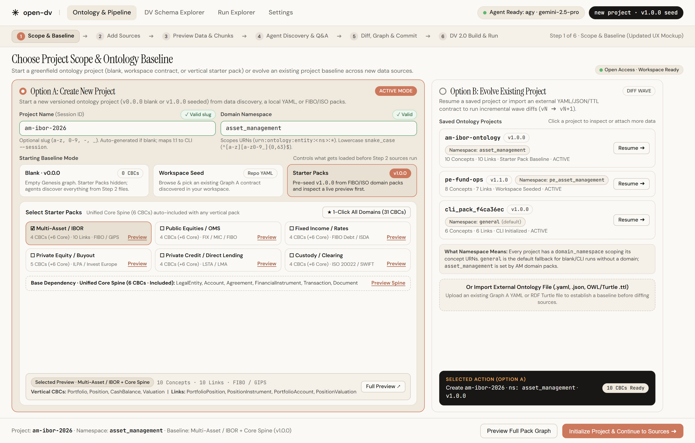

### 1B — Step 1 Interactive States (`Blank` Hides Packs + Live Validation, `Workspace Seed` Picker, Starter Pack Preview Drawer)
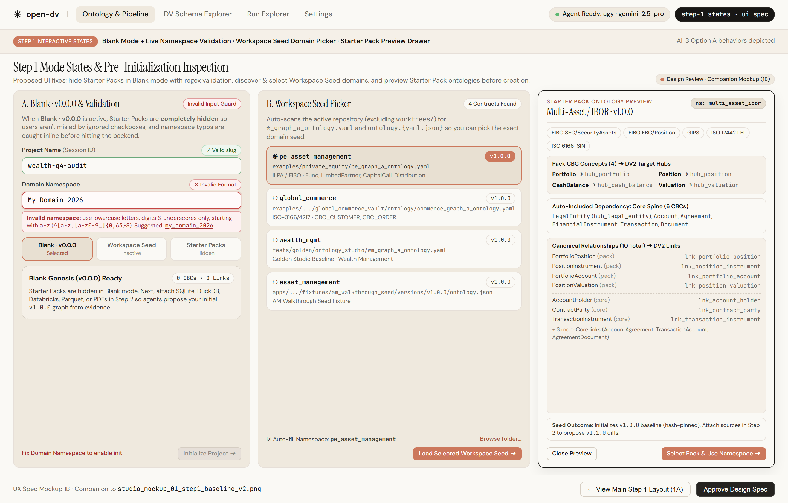

### 1C — Portable Project Export & Zero-Trust Import (`.opendv.zip`: `Core Git-Safe` vs `Full Local DuckDB Demo`, Secret/Privacy Shield & Connector Re-Bind · `OBS-48`, `REQ-68`, `Q-33`)
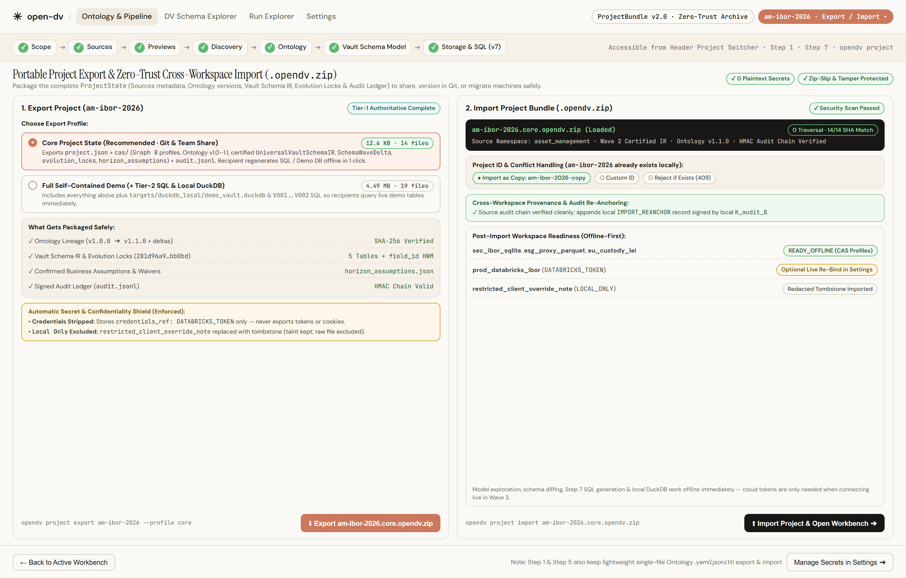

---

## Updated Step 2 & Global Header Mockups (Design Review Preview)

### 2A — Main Step 2 Layout (`Global Project Bar` + Purpose Zones + Attached Source Actions)
> [!NOTE]
> The purpose-driven zones, `Global Project Bar`, and `Preview / Edit / Detach` row actions remain active under **Confirmed Flow B (`REQ-35`)**; the Step 2 whole-doc VLM toggle shown inside `2A` is retired in favor of Step 4 selective `view_page_image`.
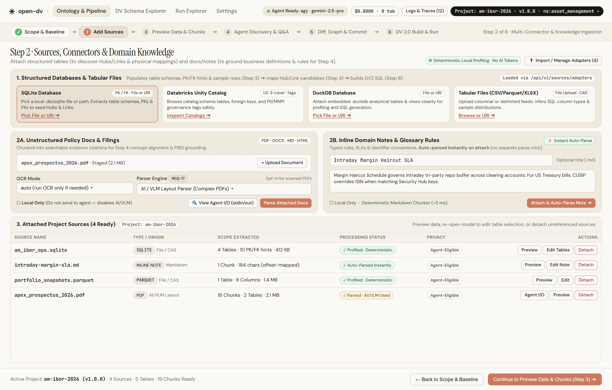

### 2B — Step 2 Interactive Overlays (`Project Switcher + Agent I/O`, Contract-Disabled SQLite Modal, Source Adapter Plugins)
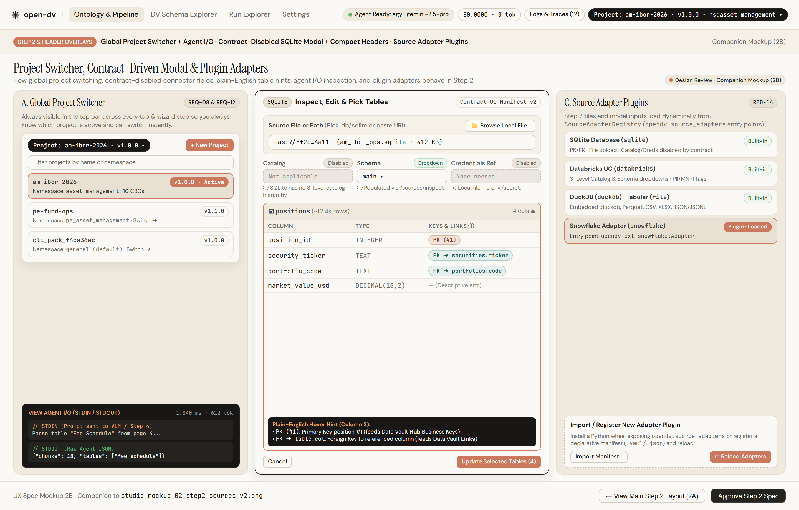

### 2C — Historical Pre-Flow-B Draft: Sticky Auto/Manual Parse Toggle, Chunker Settings & Parsing Queue
> [!NOTE]
> Superseded by **Confirmed Flow B (`REQ-35` / `Q-16`)**: Step 2 now attaches files & inline notes into CAS + `document_map.json` instantaneously (`0s` LLM wait, zero 800-char chunker settings or parse queue), moving progress tracking into Step 4's live coverage monitor (`REQ-38`).
> *(Historical superseded Flow-A draft snapshot: `studio_mockup_02c_step2_parse_queue_and_settings.png` — replaced by Confirmed Flow B.)*

---

## Updated Step 3 Scalable Preview & Outline Mockups (Design Review Preview)

### 3A — Scalable Master-Detail Table Navigator (100s Tables) & Structured Schema Word Cloud
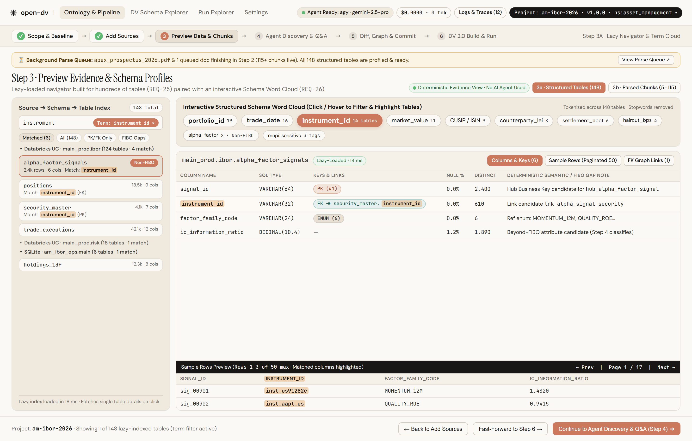

### 3B — Historical Pre-Flow-B Draft: Paginated Unstructured Chunks & Interactive Domain Word Cloud
> [!NOTE]
> Superseded by **Confirmed Flow B (`REQ-35`)**: Step 3b renders the deterministic **Document Page & Outline Viewer (`document_map.json`)** — showing page counts, extracted headings/TOC, table-bearing & scanned-page badges, and lazy page previews rather than shredded 800-char chunks or `_TERM_RE` pills.
> *(Historical superseded Flow-A draft snapshot: `studio_mockup_03b_parsed_chunks_preview_v2.png` — replaced by Confirmed Flow B.)*

---

## Updated Settings Hub & Connection Gate Mockups (Design Review Preview)

### 8A — Platform Settings Hub (`AI Agent Harness` | `Data Connections & Secrets` | `Plugins & Extensions`)
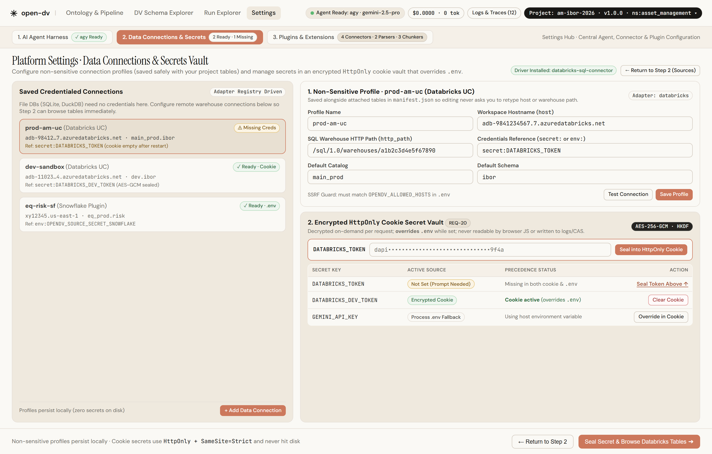

### 8B — Plugins Settings, Step 2 Databricks Gate & On-Demand Credential Recovery
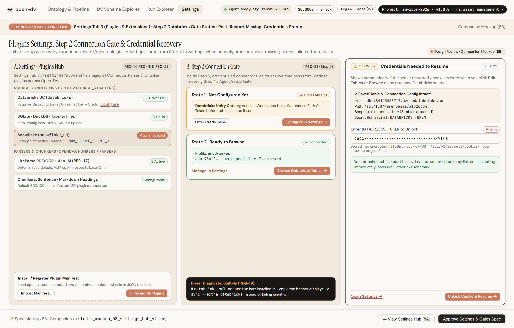

---

## Updated Step 4 Live Agent Discovery & Multi-Wave Continuation Mockups (Design Review Preview)

### 4A — Live Multi-Agent Discovery Workbench (Progress + Live Schema + Collapsible Terminal)
> [!NOTE]
> Under **Flow B (`REQ-35`..`REQ-40`)**, `@term-scout` in this pre-addendum layout expands to `@ontology-first-mate` coordinating `@doc-ontology-scout` (`@page-range-scout` / `@table-cluster-scout`), and the progress matrix tracks `tables_inspected / total_tables` plus `pages_inspected / content_pages`.
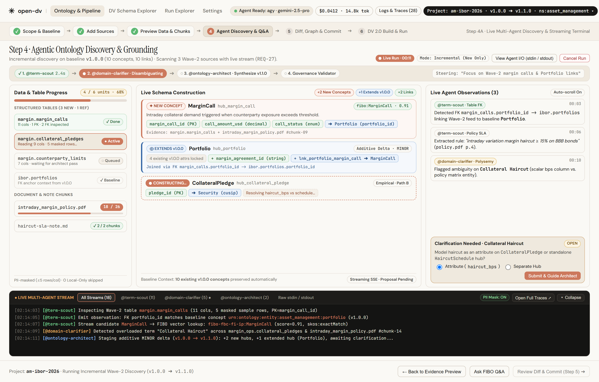

### 4B — Multi-Wave Continuation (`New / Unprocessed` Badges, Discovery Modes & Existing `v1.0.0` Extension View)
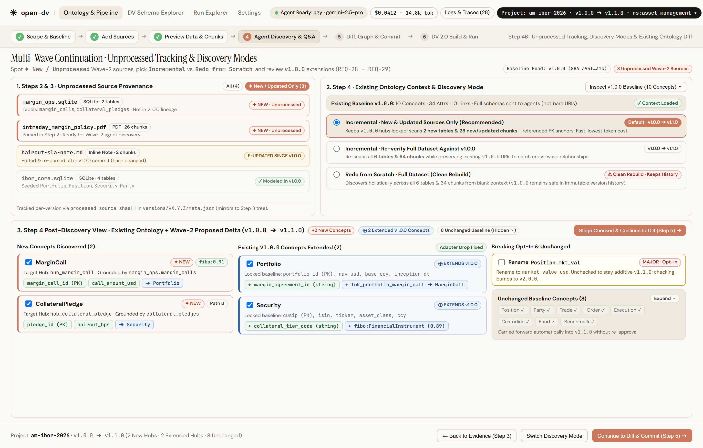

### 4C — Concept Mapping Chain (`Hub <-> FIBO <-> Table.Column -> Auto Type`) & `skos:closeMatch` Highlights
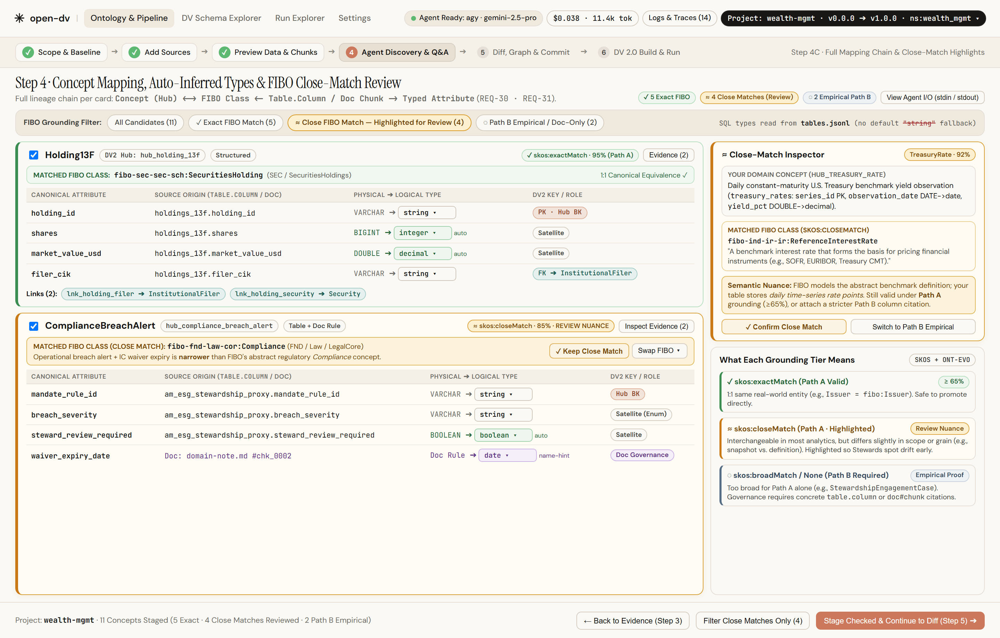

---

## Updated Step 5 Unified Ontology Explorer & Editable YAML Mockups (Design Review Preview)

### 5A — 4-Mode Ontology Explorer (`Interactive Graph & Synchronized Node/Edge/Rule Inspector` + `Catalog Dictionary`)
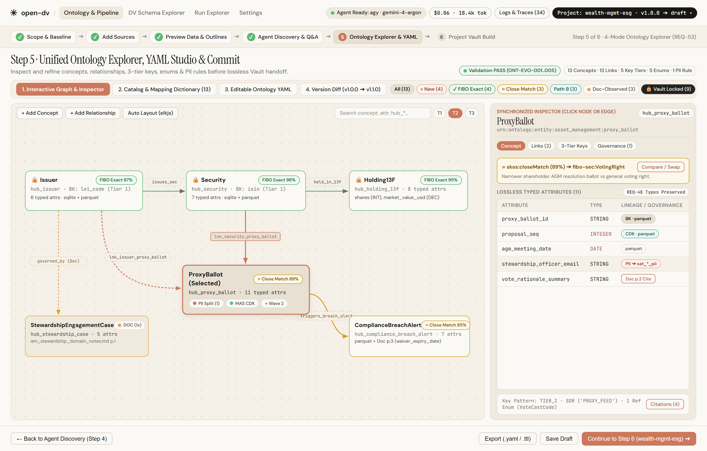

### 5B — Bidirectional Editable `ontology.yaml` Studio, 3-Layer Live Validation & `vBase ↔ Draft` YAML Diff
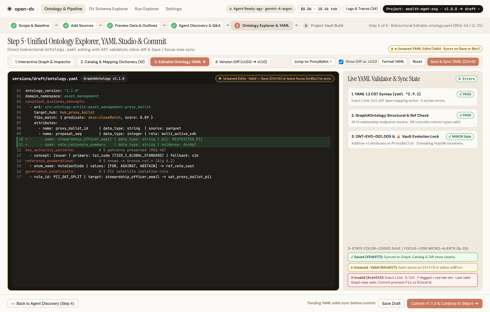

### 5C — Step 5 Catalog Dictionary & Explicit Project-Scoped Handoff to Step 6
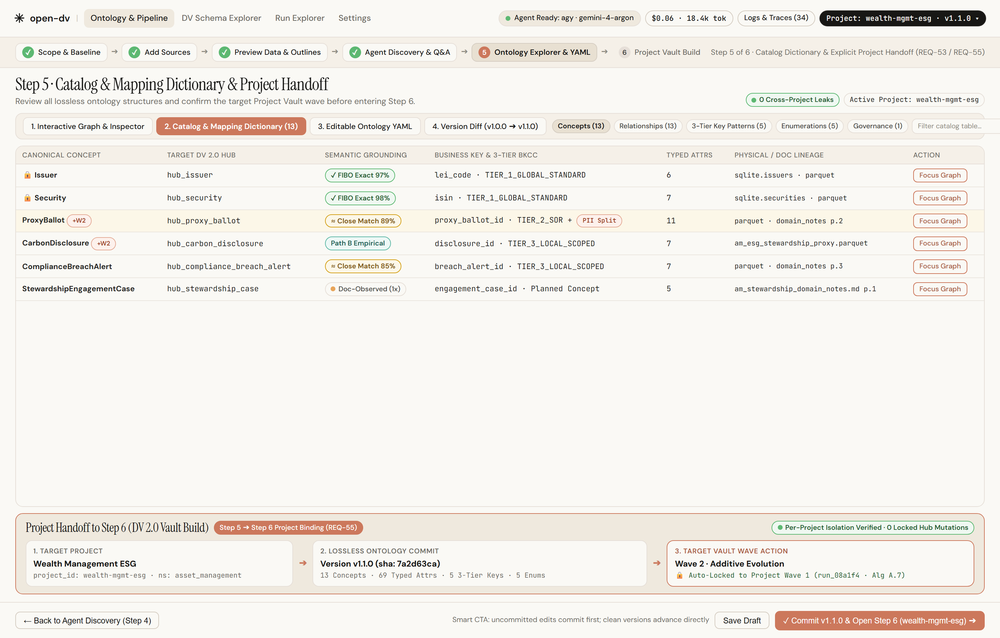

---

## Updated Step 6 Project-Scoped Vault, Live Animated Pipeline & Interactive Schema Mockups (Design Review Preview)

### 6A — Project-Based Step 6 (`Project Selector`, `Wave 1 -> Wave 2 Timeline`, `3-Pillar Bound Project State`, `3-Loop CEGAR Console` & `Pre-Loaded Contract`)
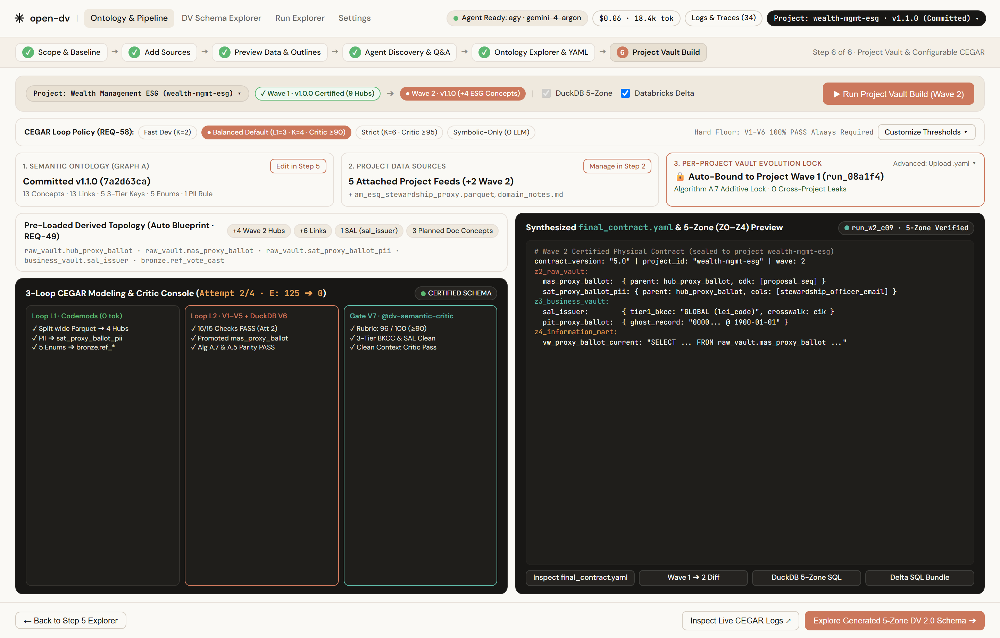

### 6B — Step 6 Live In-Motion Build (`Animated 00..07 Progress & Agent Persona Strip` + `Interactive Self-Constructing Schema Canvas` + `Docked #181715 Multi-Agent Streaming Terminal`)
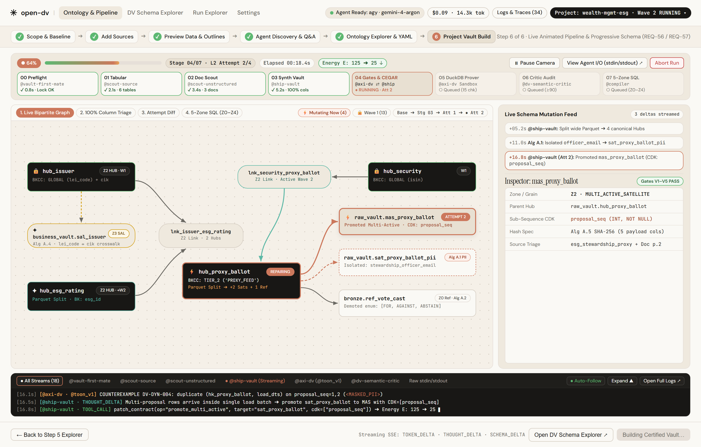

### 6C — Step 6 CEGAR Schema Diff Scrubber, 4-Batch DuckDB Prover Verification & Live 5-Zone SQL Inspector (`with Inline L3 Steward Notice`)
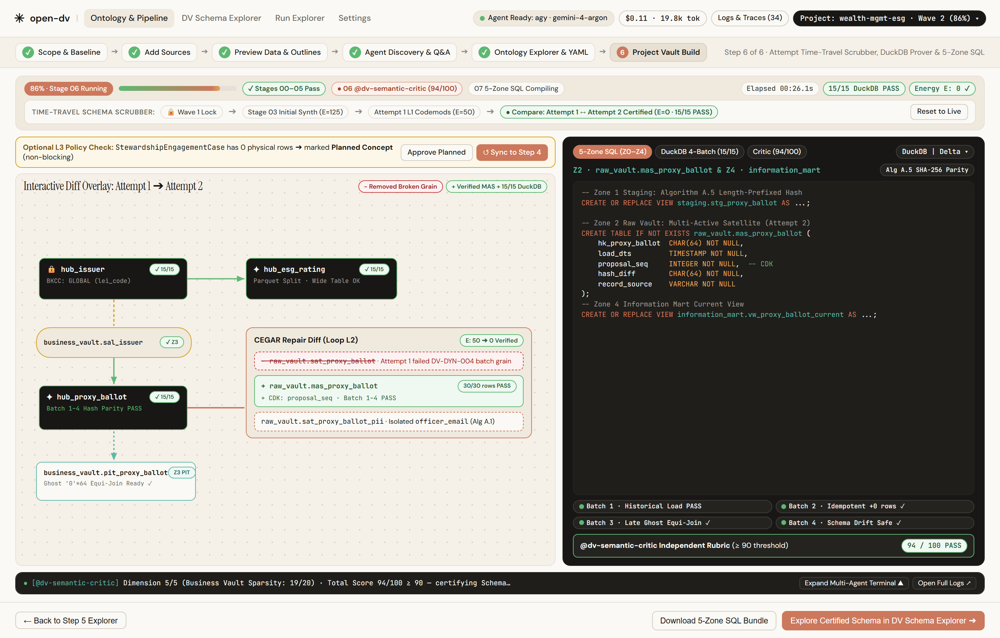

### 6D — Step 6 Live CEGAR Loop Observatory, Causal Attempt Storyboard & Streamed Intermediate Results (`REQ-61`, `Q-27`)
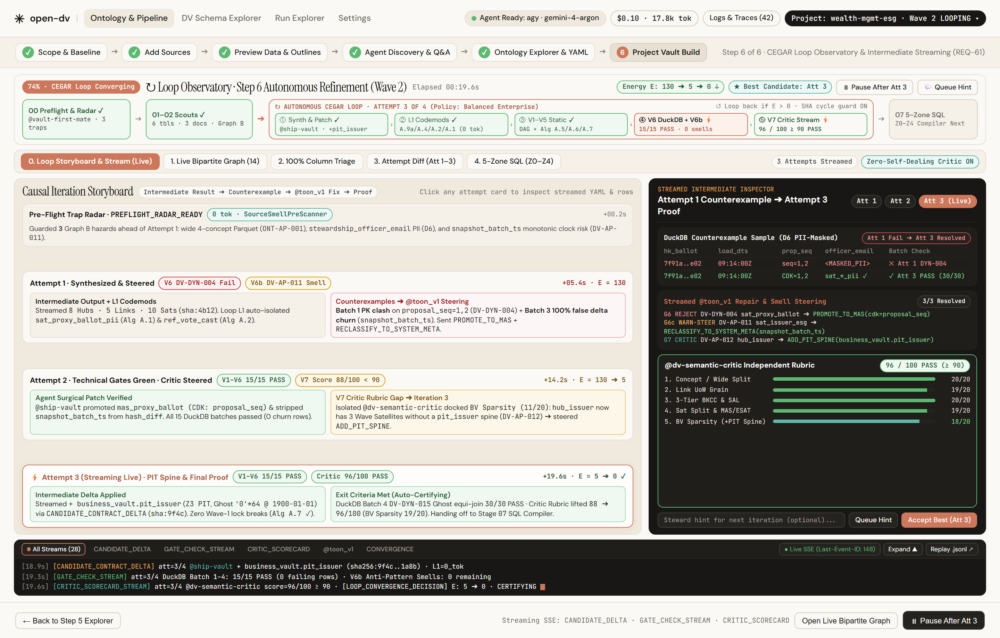

### 6E — Step 6 Future-Wave Breaking-Scenario Stress Analyzer (`V8` · `@dv-horizon-critic`), Stability Report & Bounded Human-Steered Loop Review (`OBS-46`, `REQ-66`, `Q-31`)
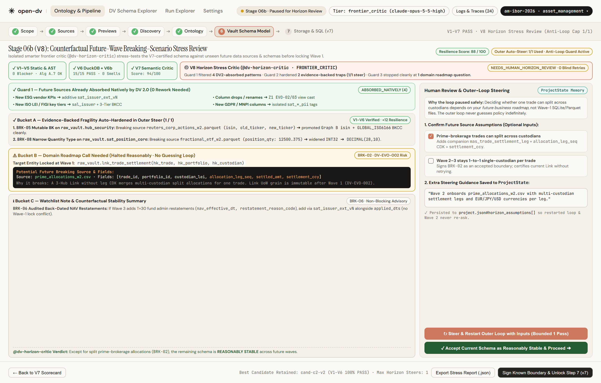

### 6F — Step 6 Guided Mode (`Plain-English Narrator`, `4-Milestone Bar`, `30-Sec Visual Primer` & `"Why Does This Table Exist?"` Inspector · `OBS-47`, `REQ-67`, `Q-32`)
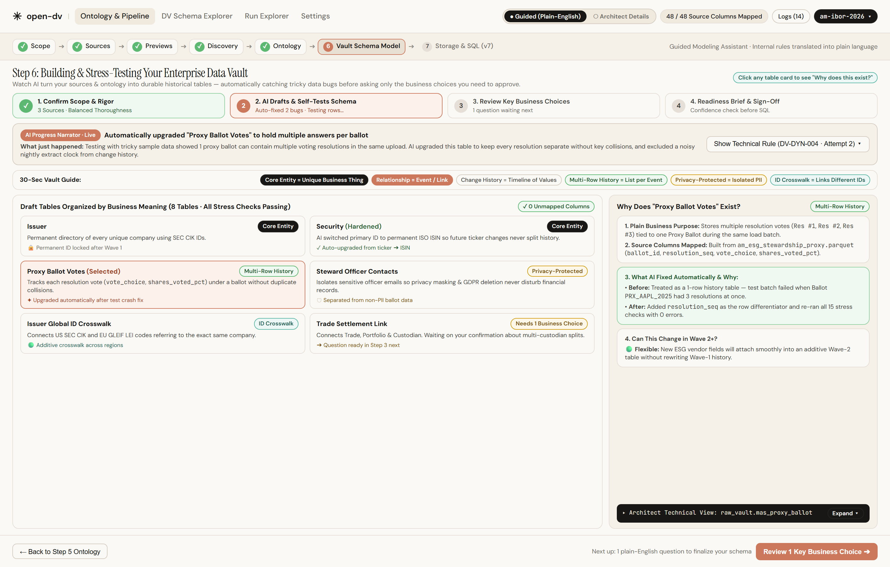

### 6G — Step 6 Consequence-Driven Decision Coach (`2-Row Data Sample`, `Lock-In Badge`, `Option A vs B`) & Pre-Sign-Off Readiness Brief (`OBS-47`, `REQ-67`, `Q-32`)
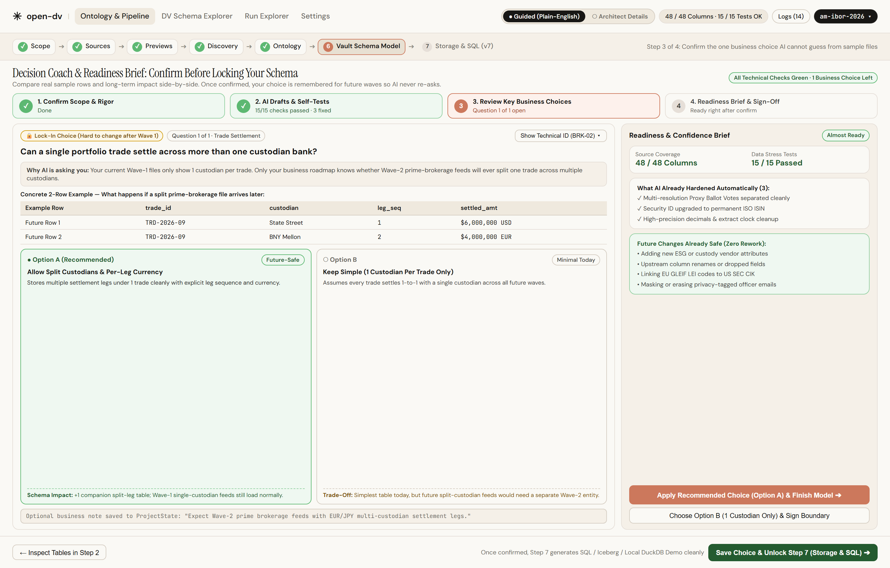

---

## Updated Step 7 (`v7`) Target Storage, Incremental/Full SQL & Local DuckDB Demo Mockup (Design Review Preview)

### 07 — Decoupled Step 7 (`v7`): Canonical `ProjectState` (`Tier 1` vs `Tier 2`), `Incremental Migration` vs `Full Schema Regeneration`, & Built-In `duckdb_local` Demo (`OBS-45`, `REQ-64`, `REQ-65`, `Q-30`)
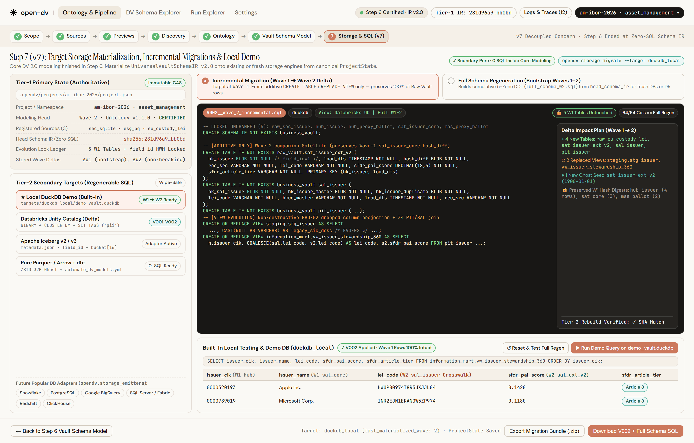

---

## Post-Fix Manual UAT Verification Checklist (Living Draft)

> *(Required by `REQ-07`: Maintained alongside feedback so that once fixes are implemented, you have exact re-test instructions & pass/fail checks for every item.)*

### Step 1 — Scope & Baseline
- [ ] **`UAT-S1-01` (`REQ-01` · Mode Hints):** Verify clear 1–2 line instructions/hints appear on **Option A**, **Option B**, **`Blank · v0.0.0`**, **`Workspace Seed`**, and **`Starter Packs`**, as well as below **`Project Name (Session ID)`** and **`Domain Namespace`**.
- [ ] **`UAT-S1-02` (`OBS-02`, `REQ-02` · Namespace Validation):** Enter invalid namespaces (`My-Domain 2026`, `123_abc`, empty string) → confirm inline `^[a-z][a-z0-9_]{0,63}$` error badge, suggested `snake_case` fix, and disabled `Initialize` CTA; enter `asset_management` → confirm green valid state and enabled submit.
- [ ] **`UAT-S1-03` (`OBS-01`, `REQ-03` · Blank Mode Isolation):** Select **`Blank · v0.0.0`** → confirm Starter Packs are completely hidden and replaced by the **`Blank Genesis (v0.0.0) Ready`** card; click Initialize → confirm a clean `0`-concept `v0.0.0` baseline is created (even if Starter Packs had been checked beforehand).
- [ ] **`UAT-S1-04` (`OBS-03`, `REQ-04` · Workspace Seed Picker):** Select **`Workspace Seed`** → confirm Starter Packs are hidden, discovered repo contracts (`pe_asset_management`, `global_commerce`, `wealth_mgmt`, `am_walkthrough`) render as selectable options, namespace auto-fill updates cleanly, and initialization loads the selected Graph A ontology.
- [ ] **`UAT-S1-05` (`REQ-05` · Starter Pack Preview):** Select **`Starter Packs`** → click **`Preview`** on `Multi-Asset / IBOR` (and check `1-Click All Domains`) → confirm preview shows vertical CBC concepts + target DV2 hubs (`hub_*`), auto-included `Core Spine` (`6` CBCs), canonical relationships + target links (`lnk_*`), and standards alignment prior to initialization.
- [ ] **`UAT-S1-06` (`REQ-06`, `Q-01` · Project Naming & Slug Guard):** Test valid custom **`Project Name (Session ID)`** (`am-ibor-2026`), negative inputs (`admin` reserved keyword, `Bad Space` invalid chars), and blank auto-generated fallback → confirm inline validation on bad inputs, creation under the chosen ID, and matching lookup via CLI `--session am-ibor-2026`.
- [ ] **`UAT-S1-07` (`OBS-04`, `Q-02` · Labeled Namespace Pills):** Inspect **Option B** saved projects list → confirm projects display readable names plus explicit **`Namespace: asset_management`** / **`Namespace: general (default)`** badges replacing bare parentheses.

### Global Header & Project Switcher
- [ ] **`UAT-NAV-01` (`OBS-05`, `REQ-08` · Always-Visible Active Project):** Navigate across Steps 1–6, `DV Schema Explorer`, `Run Explorer`, and `Settings` → confirm the top header continuously displays the active **Project Name · Version · Namespace** pill (with no stale `Session <id>` labels in Step 2).
- [ ] **`UAT-NAV-02` (`REQ-08` · Quick Project Switcher):** Open the header Project Switcher dropdown, select a different project, and test **`+ New Project`** → confirm sources/ontology/logs hydrate cleanly for the switched project without needing to manually backtrack to Step 1.
- [ ] **`UAT-NAV-03` (`OBS-48`, `REQ-68`, `Q-33` · Portable Project Export & Zero-Trust Import `.opendv.zip` Across Header, Step 1, Step 7 & CLI):** On a Wave-2 certified project containing a simulated secret (`DATABRICKS_TOKEN` in cookie vault) and a `Local Only` document (`CLIENT_OVERRIDE_99`) → (a) open **Global Header Project Switcher ➔ `Export / Import`** (`Mockup 1C`) and export both **`Core Project State`** (`~12.6 KB`) and **`Full Self-Contained Demo`** (`~4.5 MB`, `+ demo_vault.duckdb` via `ZIP_STORED`) and verify `0` secret bytes and `0` `Local Only` raw bytes exist inside either zip (and unacknowledged raw confidential export raises `422` `CONFIDENTIAL_SOURCE_EXPORT_UNACKNOWLEDGED`); (b) upload a zip-slip traversal or 1-byte tampered CAS archive and verify fail-closed rejection; (c) import `Core` into a fresh workspace (and a second time with duplicate ID ➔ `409` fail vs `am-ibor-2026-copy` rename) and confirm identical `head_schema_ir_cas_sha256`, `evolution_locks`, `horizon_assumptions`, re-anchored `audit.jsonl` (`IMPORT_REANCHOR`), offline Step 7 SQL regeneration, and `DATABRICKS_TOKEN` `NEEDS_LOCAL_SECRET_BINDING` readiness prompt; and (d) import `Full Demo` via Step 1 Option B or `opendv project import` and query `information_mart.vw_issuer_stewardship_360` directly on imported `demo_vault.duckdb` with `0` rebuild steps.

### Step 2 — Sources, Connectors, Plugins, Agent I/O & Domain Notes
- [ ] **`UAT-S2-01` (`REQ-15` · Layout & Purpose Hints):** Verify Step 2 clearly explains what each connector/source zone contributes downstream (structured schemas → Hub/Link candidates vs. docs/notes → glossary rules & evidence citations).
- [ ] **`UAT-S2-02` (`OBS-06`, `REQ-09` · Local File Upload + URI in DB Modal):** Open `SQLite` (and `DuckDB`) connector modal → confirm you can either **Browse / Pick Local `.db`/`.sqlite`/`.duckdb` File** (staging to CAS and auto-inspecting tables) OR enter a local path/URI directly.
- [ ] **`UAT-S2-03` (`OBS-07`, `REQ-10`, `Q-03` · Contract-Disabled Fields & Schema Dropdown):** Inspect `GET /api/v1/sources/adapters` to verify `connection_fields` includes `enabled`, `disabled_reason`, and `hint`. Open `SQLite` modal → confirm irrelevant fields (`Catalog`, `Credentials Ref`) appear disabled with hover `disabled_reason` tooltips, while `Schema` renders a dropdown (`main`) populated from `/sources/inspect` (and `Databricks UC` keeps `Catalog`, `Schema`, and `Credentials Ref` enabled).
- [ ] **`UAT-S2-04` (`OBS-08`, `REQ-11`, `Q-04` · Compact Table Preview Header & Hover Hints):** Expand a SQLite table with primary and foreign keys → confirm a small compact `<thead>` row (`Column`, `Type`, `Keys & Links`) renders cleanly and hovering over column headers or `PK (#1)` / `FK ➔ table.col` badges reveals plain-English explanations.
- [ ] **`UAT-S2-05` (`OBS-09`, `REQ-13` · Preview / Edit / Detach Attached Sources):** After attaching SQLite tables, a PDF, and an inline note → click **`Preview`** on each (confirm profiled schema, `document_map.json` outline/pages, or note text display), click **`Edit`** on SQLite (re-opens modal with previously selected tables checked so selection can be updated), and click **`Detach`** (removes unreferenced source; verifies protective error message if referenced by a committed/pending version).
- [ ] **`UAT-S2-06` (`OBS-10`, `REQ-14` · Plugin Connectors & Import Adapters UI):** Open **`Import / Manage Source Adapters`** → verify loaded adapters come dynamically from `/api/v1/sources/adapters` (`SourceAdapterRegistry`), inspect capabilities/extension metadata, and verify registering a sample/custom adapter plugin surfaces a new Step 2 connector card dynamically.
- [ ] **`UAT-S2-07` (`OBS-11`, `REQ-16`, `REQ-35`, `Q-06` · Immediate Inline Domain Note Attachment & Page Map):** Enter a custom note title + text (`Intraday Margin Haircut SLA`) and click **`Attach Inline Note`** → confirm it immediately transitions to `Ready (Note · P pages)` in CAS + `document_map.json` without clicking `Parse Attached Documents`, and verify its outline/pages appear immediately in Step 3b.
- [ ] **`UAT-S2-08` (`REQ-12`, `Q-05` · Deterministic Badge & Agent `stdin`/`stdout` Button):** Confirm Step 2 clearly indicates `Deterministic Local Profiling (No AI Agent)` during connector profiling, and click **`View Agent I/O (stdin / stdout)`** on an agent-powered step (Step 4 discovery / Step 6 LLM stage) → confirm `SessionLogsInspector` opens directly to that stage's prompt input (`stdin`) and raw output (`stdout`).
- [ ] **`UAT-S2-09` *(Superseded by `UAT-S4-09`)*:** Replaced Step 2 whole-doc VLM toggle with Step 4 selective `view_page_image` MCP tool (still verifying `Local Only` automatically blocks `view_page_image` & prompts).
- [ ] **`UAT-S2-10` *(Updated for Flow B · `REQ-35`)*:** Verify pluggable Document Page Readers (`opendv.document_parsers`) appear cleanly without imposing arbitrary 800-char chunk settings in Step 2, while `Local Only` fallback indexing extracts intact tables/headings cleanly.
- [ ] **`UAT-S2-11` (`OBS-12`, `REQ-19` · Non-Sensitive Databricks Modal Fields):** Open the **Databricks UC** connector modal → confirm **Workspace Hostname (`host`)**, **Warehouse HTTP Path (`http_path`)**, **Catalog**, and **Schema** fields render from `ConnectorUIManifestDTO.connection_fields`, and missing `databricks-sql-connector` shows a clear remediation message (`uv sync --extra databricks`) rather than a raw traceback.
- [ ] **`UAT-S2-12` (`REQ-20`, `Q-09` · Encrypted `HttpOnly` Cookie Secrets & Env Override):** Set a secret (`DATABRICKS_TOKEN` or `OPENDV_SOURCE_SECRET_TEST`) via the cookie secrets UI/API when an env var with a different value is also set → confirm:
  1. `GET /api/v1/secrets/cookie` returns key metadata only (never the plaintext value);
  2. Browser JS `document.cookie` cannot see `opendv_secrets` (`HttpOnly`);
  3. On-demand connector/source resolution uses the **cookie value** over the env value;
  4. Clearing the cookie falls back cleanly to the env var, and no plaintext secret appears in `manifest.json` or SSE logs.
- [ ] **`UAT-S2-13` (`REQ-21` · `.env.example` Completeness):** Verify `open-dv/.env.example` documents core workspace, server auth/JWT/CSRF/SSRF, Databricks UC, AI agent harness, and OCR/FIBO env vars accurately matching runtime settings loaders.
- [ ] **`UAT-S2-14` *(Superseded by `UAT-S4-08` · Flow B Instant Attach)*:** Attach multiple multi-page PDFs + inline notes in Step 2 → confirm instantaneous CAS storage + `document_map.json` page/outline readiness (`0s` LLM wait, zero HTTP 409 parse queue blocking).
- [ ] **`UAT-S2-15` (`OBS-18`, `REQ-28` · Wave-2 `New / Unprocessed` & `Updated` Source Badges in Step 2):** Commit `v1.0.0` from initial sources, then attach a new SQLite table/PDF and edit an existing inline note → confirm Step 2 shows **`✓ Modeled in v1.0.0`** on initial sources, **`✦ NEW · Unprocessed`** on Wave-2 additions, and **`↻ UPDATED SINCE v1.0.0`** on the edited note, plus working **`New / Unprocessed Only`** filter.

### Step 3 — Scalable Evidence Preview & Interactive Schema Term Cloud
- [ ] **`UAT-S3-01` (`OBS-15`, `REQ-25`, `Q-11` · Lazy-Loaded 100s-Table Scale Navigator & Deterministic Badge):** Load a project with many attached tables (`50–200+`) → confirm Step 3 displays **`Deterministic Evidence View · No AI Agent Used`**, loads only lightweight table summaries via `/evidence/tables/index` initially, lets users search/filter the Source ➔ Schema ➔ Table tree smoothly, and lazily fetches column profile + paginated sample rows only for the selected table.
- [ ] **`UAT-S3-02` *(Updated for Flow B · `REQ-35`)*:** Inspect Step 3b → confirm the **Document Page & Outline Viewer** renders page counts, extracted headings/TOC, table-page & raster/scanned page badges, and lazy page previews cleanly (plus deterministic summary fallback for `Local Only` sources).
- [ ] **`UAT-S3-03` (`OBS-16`, `REQ-26` · Step 3a Structured Schema Term Cloud & Curation):** Inspect Step 3a → confirm an interactive **Schema Term Cloud** surfaces stopword-free tokens from table names, columns, PK/FK constraints, and FIBO gap hints, clicking/hovering a term filters matching tables and highlights columns/hints cleanly, and **`★ Pin as Concept Seed`** / **`✕ Mute Noise`** persist to `evidence/concept_memory.json`.
- [ ] **`UAT-S3-04` (`OBS-18`, `REQ-28` · Step 3 Table/Doc `New / Unprocessed` Filter):** On a Wave-2 project (`v1.0.0` + new data), verify the Step 3a table navigator and Step 3b document outline rail highlight **`✦ NEW`** / **`↻ UPDATED`** tables/documents vs. **`✓ Modeled in v1.0.0`**, and confirm filtering isolates only Wave-2 additions.

### Step 4 — Interactive Agent Discovery, Live Streams & Multi-Wave Continuation
- [ ] **`UAT-S4-01` (`OBS-17`, `REQ-27`, `REQ-38`, `Q-12` · Live Persona Pipeline & Table/Page Coverage Progress):** Start **`Run Agent Discovery`** → confirm the stage strip updates live across **`1. @ontology-first-mate` (`@doc-ontology-scout` / `@page-range-scout` / `@table-cluster-scout`) ➔ `2. @domain-clarifier` ➔ `3. @ontology-architect` ➔ `Governance`**, and the **Data, Table & Page Progress** panel tracks `tables_inspected / total_tables` and `pages_inspected / content_pages` (`Queued` / `Active` / `✓ Done`) in real time (zero silent dropping).
- [ ] **`UAT-S4-02` (`OBS-17`, `REQ-27` · Live Schema Construction & Agent Observations Feed):** During an active Step 4 run, confirm semantic observations (discovered FKs, extracted SLA rules, FIBO matches, ambiguities) and candidate concept cards (`✦ NEW` / `⊕ EXTENDS` / `CONSTRUCTING…`) appear progressively via SSE before job completion.
- [ ] **`UAT-S4-03` (`REQ-27` · Compact Expandable Multi-Agent Stream Terminal):** Expand and collapse Step 4's bottom dark stream terminal while discovery runs → confirm filter tabs (`All Streams`, `@ontology-first-mate` / `@doc-ontology-scout`, `@domain-clarifier`, `@ontology-architect`, `Raw stdin / stdout`) stream persona-tagged redacted logs live and deep-link to full Session Logs Inspector.
- [ ] **`UAT-S4-04` (`OBS-18`, `REQ-29`, `Q-13` · Existing Ontology Baseline Context & Adapter Extension Rendering):** Open Step 4 on an existing `v1.0.0` project with new Wave-2 data → confirm **`Existing Baseline: v1.0.0`** context renders before running discovery, and after running, any `add_attribute`, `add_relationship`, or `add_external_mapping` targeting an existing `v1.0.0` concept (e.g., `Portfolio`, `Security`) renders inside an **`⊕ EXTENDS v1.0.0`** card alongside **`✦ NEW`** concepts rather than disappearing.
- [ ] **`UAT-S4-05` (`OBS-18`, `REQ-29` · `Incremental` vs. `Redo from Scratch` Discovery Modes):** Verify **`Incremental · New & Updated Sources Only`** sends only new/updated evidence + locked baseline context (`v1.0.0 ➔ v1.1.0`), **`Incremental · Re-verify Full Dataset`** scans all sources against `v1.0.0` URIs, and **`Redo from Scratch · Full Dataset`** rebuilds across the complete attached dataset holistically while keeping prior `v1.0.0` commits intact in version history (plus matching `--discovery-mode` CLI behavior).
- [ ] **`UAT-S4-06` (`OBS-19`, `OBS-20`, `REQ-30`, `Q-14` · Full Concept Mapping Chain & Auto-Inferred Types):** Inspect Step 4 concept cards (`Holding13F`, `TreasuryRate`, `ComplianceBreachAlert`) → confirm each card displays its **Canonical Concept (`hub_*`)**, explicit **Matched FIBO Class** (`fibo-sec-sec-sch:SecuritiesHolding`, etc.), **Source `table.column` or `Doc p.#quote`** per attribute, and **auto-inferred logical types** (`shares` ➔ `integer`, `market_value_usd` ➔ `decimal`, `steward_review_required` ➔ `boolean`, `waiver_expiry_date` ➔ `date`) instead of raw `"string"` defaults.
- [ ] **`UAT-S4-07` (`REQ-31`, `Q-14` · `skos:closeMatch` Highlighting, Filter & Nuance Inspector):** Click **`≈ Close Matches Only`** in Step 4 → confirm concepts with `skos:closeMatch` (`TreasuryRate`, `ComplianceBreachAlert`, `ProxyBallot`) render with highlighted amber visual callouts distinct from green `skos:exactMatch` cards and display a side-by-side FIBO vs. Domain definition comparison with `Keep Close Match` / `Swap FIBO Class` / `Use Path B Empirical` controls.
- [ ] **`UAT-S4-08` (`UAT-AGENT-01` · `OBS-22`, `REQ-35` · Flow B Instant Attach & Step 3 Page/Outline Viewer):** Attach a multi-page PDF with embedded tables and scanned diagram pages + SQLite DB in Step 2 → confirm instant attach with zero chunker knobs; open Step 3b → confirm Document Outline, total pages, table-page & raster-page badges, and `✦ New · Unprocessed` pills render cleanly.
- [ ] **`UAT-S4-09` (`UAT-AGENT-02` · `OBS-23`, `REQ-35`, `REQ-38` · Tool-Driven Discovery Across Dense Docs & VLM Pages):** Attach `45+` tables alongside a `30+` page PDF containing one scanned diagram page → run Step 4 AI Discovery → inspect the expandable terminal / `SessionLogsInspector` and verify: (a) `@doc-ontology-scout` / `@page-range-scout` use `get_document_map` / `read_document_pages` / `inspect_table_profile` dynamically with zero silent dropping, (b) `view_page_image` fires selectively *only* on the scanned page (blocked if `Local Only`), (c) `@ontology-architect` queries `search_concepts`, and (d) `/citations/resolve` + `CitationInspectorDrawer` resolve `(page_number, char_start, char_end)` spans cleanly.
- [ ] **`UAT-S4-10` (`UAT-AGENT-03` · `OBS-24`, `REQ-37` · Dual Runtime Parity: CLI `opendv-mcp` vs. SDK `bridge.py` & Zero Lock Deadlock):** Run `doc-ontology-scout` on the same PDF under (1) CLI mode (`claude-cli` / `agy` + `opendv mcp serve`) and (2) SDK service mode (`claude` / `antigravity` via `bridge.py`) on Windows → confirm CLI mode mounts `opendv-mcp` (never `--tools ""`), calls MCP write tools without `L5` `.session.lock` deadlocks, and matches SDK Path A + Path B coverage.
- [ ] **`UAT-S4-11` (`UAT-AGENT-04` · `REQ-36` · Standalone Agent Export & Custom Package Registration):** Export/install an agent package standalone into `.claude/` or `agy` and run via `opendv agent run`; then register a custom `.opendv/agents/custom_scout/agent.yaml` (or in `Settings → Agents, Skills & MCP`) → verify it appears in Settings and runs in Step 4/6.
- [ ] **`UAT-S4-12` (`UAT-AGENT-05` · `OBS-25`, `REQ-39` · Novel + Previously Discovered Custom Concepts via 4-Layer `DynamicConceptRegistry`):** Wave 1 commits custom Path B concept `IntradayHaircutSchedule`, holds `RepoFacility` in `staged_candidates`, and rejects `DraftWatermark`; Wave 2 adds tables/pages mentioning all three plus brand-new `CollateralSubstitution` → confirm `search_concepts` finds `IntradayHaircutSchedule` (`⊕ EXTENDS v1.0.0`), `RepoFacility` promotes, `DraftWatermark` stays muted, and `CollateralSubstitution` appears as `✦ NEW`.
- [ ] **`UAT-S4-13` (`UAT-AGENT-06` · `OBS-26`, `REQ-40`, `REQ-41`, `Q-19` · Vendor-Tuned Prompt Compiler & Per-Provider Routing):** Inspect `View Agent I/O (stdin/stdout)` under both **Claude** (`claude` / `claude-cli`) and **Gemini** (`antigravity` / `agy`) → confirm Claude receives XML `<hard_invariants>`, parallel tool batching, `<evidence_payload>` tags, and valid Anthropic model IDs (not raw `agy` aliases), while Gemini receives unmixed formatting + `<plan>`-before-act + completeness gate + `skills_paths`, with `references/*.md` loaded only on demand.

### Step 5 — Ontology Explorer, Editable YAML, Lossless Commit & Step 6 Handoff
- [ ] **`UAT-S5-01` (`OBS-32`, `OBS-33`, `REQ-48` · Smart Step 5 CTA & Uncommitted Stepper Guard):** After committing `v1.0.0` in Step 5, verify the primary button cleanly switches to **`Continue to Step 6 ➔`** and advances directly without firing `"No Changes to Commit"`; also test modifying a concept/leaving `v0.0.0` uncommitted and clicking `6` in the top bar → confirm a clear guard prompts to commit vs. proceed explicitly and Step 6 shows Amber `Draft Only (0.0.0)` instead of green `Committed 0.0.0`.
- [ ] **`UAT-S5-02` (`OBS-34`, `REQ-48` · Lossless Step 5 Commit Across Key Patterns, Enumerations & Constraints):** Commit Step 4's proposal containing `add_attribute` logical types, `evidence_refs`, `key_authority_patterns`, `reference_enumerations`, and `governance_constraints`, then inspect committed `versions/v1.0.0/ontology.yaml` → confirm non-empty `reference_enumerations`, `key_authority_patterns`, `governance_constraints`, and concrete attribute `data_type`s persist intact into Step 6.
- [ ] **`UAT-S5-03` (`OBS-37`, `REQ-53` · 4-Mode Ontology Explorer, Node/Edge Auto-Inspector & Catalog Dictionary):** Open Step 5 → click a concept node (`ProxyBallot`) AND a relationship edge on the graph directly without clicking `+ Add / Edit` first → confirm the synchronized right Inspector opens automatically (`Concept | Links | Key Tiers | Governance`), filter pills (`FIBO Exact`, `≈ Close Match`, `Path B Empirical`, `Doc-Observed`, `🔒 Deployed in Vault`) filter cleanly, Tab 2 (`Catalog & Mapping Dictionary`) lists filterable Concepts/Links/Key Tiers/Enums/Governance tables with click-to-focus on graph, and Tab 4 (`Version Diff`) shows structured `vBase ➔ Draft` changes + `ONT-EVO-001..005`.
- [ ] **`UAT-S5-04` (`OBS-38`, `REQ-54`, `Q-25` · Bidirectional Editable `ontology.yaml` View, Save/Blur Sync, Color-Coded Validity & `Saved / Unsaved` Micro-Alert):** Switch to Tab 3 (`Editable Ontology YAML`) → (a) jump via outline to `ProxyBallot`, edit a valid attribute without blurring → confirm compact micro-alert turns **Warm Amber (`● Unsaved Edits · Valid`)** with zero mid-typing graph thrash; (b) test **both** pressing **`Save & Sync YAML` (`Ctrl/Cmd+S` / `Ctrl/Cmd+Enter`)** AND editing again then **clicking outside / switching tabs (`onBlur`)** → confirm changes sync cleanly to Tab 1 Graph, Tab 2 Catalog, Tab 4 Diff, and `v1.0.0 ➔ v1.1.0` commit while turning **Sage Green (`✓ Saved to Draft Store`)**; (c) introduce an invalid YAML indent or dangling endpoint URI and blur out → confirm **Crimson Red (`⚠ Unsaved — Invalid YAML at Line X: Col Y`)** highlights the exact line, Tab 3 displays a red dot `●`, the last valid Graph stays untouched, invalid YAML remains intact when returning, and clicking Commit prompts `Fix` vs `Discard`.
- [ ] **`UAT-S5-05` (`OBS-42`, `REQ-60` · Upstream Ontology Anti-Pattern Smell Warnings, 1-Click Refactor & HMAC Waiver):** Seed or edit draft concepts in Step 4/5 containing `ONT-AP-001` (`sfdc_issuer`), `ONT-AP-002` (5-value static lookup Hub), `ONT-AP-003` (`MONOTONIC_INT` primary key), and `ONT-AP-005` (unclassified `email` PII attribute) → confirm: (a) **`⚠ Smell Warnings`** filter pill isolates flagged nodes cleanly with `#d4a017` Amber badges across Tab 1 Graph, Tab 2 Catalog, and Tab 3 YAML line gutters, (b) clicking a flagged node surfaces its multi-year DV 2.0 impact explanation in the Inspector alongside working **`[↻ Apply Recommended Refactor]`** (e.g., `Convert Concept ➔ ReferenceEnum`, `+ Attach PII Isolation`) and **`[✓ Acknowledge & Sign Waiver]`** (`StewardWaiverRecord`), and (c) waiving vs refactoring updates smell counts cleanly without modifying `open-dv` safety locks.

### Step 6 — Ontology-to-Vault Handoff, Contract Clarity, CEGAR Loop & Multi-Wave DV 2.0 Stability
- [ ] **`UAT-S6-01` (`OBS-28`, `OBS-30`, `REQ-45` · Wide Multi-Concept Decomposition & Multi-Table Forwarding):** Commit `v1.0.0` from `am_sec_treasury_ibor.sqlite` + `am_esg_stewardship_proxy.parquet` + `am_stewardship_domain_notes.md` and run Step 6 → confirm Step 6 forwards every selected SQLite table (`issuers`, `securities`, `institutional_filers`, `holdings_13f`, `yield_curves`) and splits the wide Parquet feed into all 4 Step 4 Hubs/Links/Satellites (`hub_esg_rating`, `hub_carbon_disclosure`, `hub_proxy_ballot`, `hub_compliance_breach_alert`) instead of collapsing to 1 Hub.
- [ ] **`UAT-S6-02` (`OBS-29`, `REQ-47` · `DOCUMENT_OBSERVED` & Future Policy Concept Handling):** In the same run, verify extracted doc entities wire cleanly via `UNSTRUCTURED_EXTRACTION_LINK` + AI provenance satellites (`Gate 5`), while pure policy concepts lacking physical/extracted rows yet (`StewardshipEngagementCase`, `MacroRegimeSignal`, `IntradayMarginHaircutSchedule`) display cleanly as **`Planned Ontology Concepts (Awaiting Physical Feed)`** instead of failing `Gate 1` `PHANTOM_HUB_REJECTED`.
- [ ] **`UAT-S6-03` (`OBS-31`, `REQ-44` · Certified Vault Lock Across Steps 4–6 & Dynamic Wave Epoch):** After certifying Run 1 in Step 6, return to Steps 4 & 5 and verify `deployed_contract` auto-binds (`🔒 Deployed in Vault` badges; attempting to drop/rename a deployed Hub/Link blocks fail-closed before Step 6). Return to Step 6 and confirm trying to pick `__cold_start__` shows an explicit reset confirmation, and executing Wave 2 + Wave 3 evolves companion Satellites cleanly with monotonic epoch tags (`sat_*_ext_v2` ➔ `sat_*_ext_v3`).
- [ ] **`UAT-S6-04` (`OBS-28..31`, `REQ-45` · Additive Companion Satellites & Immutable `hash_diff`):** On Wave 2 (`SUSTAINALYTICS` / `PARIS_ALIGNED_BENCHMARK` + new attributes `waiver_expiry_date`, `vote_rationale_summary`), verify `Algorithm A.7` + `A.9a` preserve every Wave-1 Hub, Link, BK signature, and Satellite `hash_diff` untouched while adding new attributes in companion Satellites (`sat_*_ext_*` / `sat_*_<feed>`) and splitting PII (`stewardship_officer_email`) into `sat_*_pii`.
- [ ] **`UAT-S6-05` (`REQ-46` · Cross-Wave Key Namespace Evolution via Business Vault `sal_*`):** Introduce a Wave-2 issuer feed keyed on `lei_code` (or crosswalk `cik <-> lei_code`) after Wave 1 keyed `hub_issuer` on `cik` → confirm Wave 1's `hub_issuer` key source remains immutable (`DV-EVO-003`), Wave 2 appends `business_key_sources` (`TIER_1_GLOBAL_STANDARD`, `bkcc_prefix="GLOBAL"`), and `sal_issuer` (`Same-As Link`) synthesizes cleanly in Business Vault (`Z2`).
- [ ] **`UAT-S6-06` (`OBS-35`, `REQ-49` · Plain-English Step 6 Contract Explainer, Auto-Loaded Topology & Contract Drawer):** Enter Step 6 directly from committed `v1.0.0` (and after Wave 1 certification) → confirm `exportBlueprint()` auto-populates `Derived Data Vault 2.0 Topology` immediately on entry, the evolution card clearly distinguishes `Wave 1 Cold Start (no upload needed)` vs `Wave N Evolution Lock` (tucking manual `.yaml` upload into Advanced), and **`Inspect final_contract.yaml & Wave Diff`** renders cleanly.
- [ ] **`UAT-S6-07` (`REQ-50` · Enterprise DV 2.0 Specializations, 3-Tier `BKCC` & Hard/Soft Firewall):** Verify Stage 03–07 properly synthesizes `ref_*` tables from preserved `reference_enumerations`, `mas_*` (`MULTI_ACTIVE` + non-null CDK) for multi-valued rows per load batch, `esat_*` + Driving Key when $\mu_{FK} > 0$, `t_lnk_*` for immutable event streams, Dual Zero Keys (`-1`/`-2`) + Ghost Records (`1900-01-01`), and `pit_*` / `brg_*` without copying Raw Vault 1:1 into Business Vault.
- [ ] **`UAT-S6-08` (`OBS-36`, `REQ-51` · 3-Loop CEGAR Repair, DuckDB Counterexample Feedback & `@dv-semantic-critic` Convergence):** Seed a deliberate initial defect (e.g. a multi-active child column triggering `DV-DYN-004` in DuckDB or missing `100%` wide-table split triggering `@dv-semantic-critic < 90`) → confirm Loop L1 fixes deterministic codemods at 0 tokens, Loop L2 feeds `@toon_v1` + masked DuckDB counterexample rows back to `@ship-vault` (`wave_{w}_contract_attempt_{k}.yaml`), energy $E(IR_k)$ decreases monotonically until `15/15` dynamic checks pass + `@dv-semantic-critic >= 90` (or escalates on cycle/plateau into Loop L3 Steward Hold without reward hacking).
- [ ] **`UAT-S6-09` (`REQ-52` · Live Loop Convergence Telemetry UI & Checked-In `docs/30` Strategy Playbook):** Inspect Step 6 Console & `SessionLogsInspector` during a multi-iteration run → confirm live `Loop L1/L2/L3`, attempt counter (`1..4`), energy drop, DuckDB counterexample trace, and `@dv-semantic-critic` scorecard render accurately, and confirm `docs/30-enterprise-dv2-modeling-and-loop-engineering.md` is checked in alongside `docs/29`.
- [ ] **`UAT-S6-10` (`OBS-39`, `REQ-55`, `Q-23` · Project-Based Step 6, Strict Per-Project Baseline Isolation & Step 5 ➔ Step 6 Project Handoff):** Certify Wave 1 on Project A (`wealth-mgmt-esg`), then create a fresh Project B (`global-commerce`) and commit `v1.0.0` in Step 5 → confirm: (a) Step 5 displays the **Project Handoff Bar** (`Target Project: global-commerce` ➔ `Wave 1 Cold Start`), (b) transitioning or jumping straight into Step 6 shows Project B's baseline as `Wave 1 Cold Start` (strictly **0** leaked runs/contracts from Project A), (c) switching Projects via Step 6's **Project Selector** cleanly swaps Ontology, Sources, Wave Timeline, and per-project Vault lock (`deployed_contract`), and (d) `/api/v1/pipelines/runs` persists matching `project_id`.
- [ ] **`UAT-S6-11` (`OBS-40`, `REQ-56` · Animated Multi-Stage & Persona Progress Header + Live Multi-Agent Streaming Terminal):** Start a Step 6 build → confirm the animated progress bar tracks `0% ➔ 100%` across true stage order `00..07` (`04 Static Gates & CEGAR`, `05 4-Batch DuckDB Prover`, `06 Semantic Critic`, `07 5-Zone SQL Compiler`) with explicit persona badges (`@vault-first-mate`, `@scout-source`, `@scout-unstructured`, `@ship-vault`, `@axi-dv`, `@dv-semantic-critic`, `@compiler`), elapsed time, tokens/cost, and energy $E(IR_k)$; switch tabs inside the docked `#181715` streaming terminal to verify live persona-attributed `THOUGHT_DELTA`, `TOKEN_DELTA`, `TOOL_CALL`, and `@toon_v1` streams (and confirm live SSE streaming resumes cleanly after resolving a Steward Hold).
- [ ] **`UAT-S6-12` (`OBS-41`, `REQ-57` · Live Progressive Schema Construction, Stage/Attempt Scrubber & Interactive Node Inspector):** During an active Step 6 build (and post-run), confirm Hubs, Links, Satellites, PII splits (`sat_*_pii`), and CEGAR repairs (`mas_*`, `sal_*`, `ref_*`) animate progressively onto the interactive bipartite schema graph before `run_complete` finishes; click a node mid-run (`⏸ Pause Camera` auto-engages) to inspect its columns, `BKCC`, `Alg A.5` hash, triage source, DuckDB 4-batch checks, and 5-Zone SQL, and scrub between `Stage 03 ➔ Attempt 1 ➔ Attempt 2` to verify live visual/YAML schema diffs.
- [ ] **`UAT-S6-13` (`REQ-58`, `REQ-51` · Configurable CEGAR Loop Profiles, Custom Thresholds, CLI Flags & Hard-Gate Safety Floor):** Switch CEGAR policy across presets (`Fast Dev`, `Balanced Enterprise`, `Strict Regulated`, `Symbolic-Only`) and customize overrides (`max_l2_repair_attempts`, `semantic_critic_min_score`, `--cegar-profile`, `OPENDV_CEGAR_*`) in Settings, Step 6, and CLI → confirm loop terminates/escalates at the active bounds, records `effective_cegar_policy` inside the run report, and strictly refuses to certify (`CERTIFIED` / `deployed_contract`) any candidate violating `V1–V6` static/evolution/PII/DuckDB checks (`UNCERTIFIED_DRAFT`).
- [ ] **`UAT-S6-14` (`REQ-59` · Canonical `DESIGN.md` Visual Parity & 5-Zone Bipartite Grammar Across Steps 5 & 6):** Inspect rendered Step 5 (`5A–5C`) and Step 6 (`6A–6C`) workbench views against [DESIGN.md](../../../DESIGN.md) & [design-tokens.ts](../../../apps/opendv-web-workbench/src/explorer/design-tokens.ts) → confirm `#faf9f5` / `#f5f0e8` / `#efe9de` / `#181715` / `#cc785c` palette (`#5db872` / `#d4a017` / `#c64545` validity accents), bundled `Instrument Serif` (`400`) + `DM Sans` + `JetBrains Mono`, `54px/44px/52px` chrome with `SPIKE_MARK_SVG` (`0px` overflow), `§545` dark Hub + pill Link + dashed `sat_*_pii` + `#5db8a6` `Z3 PIT` canvas grammar, and **5-Zone (`Z0–Z4`)** (`bronze`, `staging`, `raw_vault`, `business_vault`, `information_mart`) terminology throughout.
- [ ] **`UAT-S6-15` (`OBS-42`, `REQ-60` · Pre-Flight Trap Radar, `DV-AP-001..012` Static/DuckDB Smell Steering, Adversarial Justification Audit & Interactive Steward Refactor/Waiver):** Attach a feed containing a God Satellite (`>= 25` mixed-velocity cols), an `updated_at` technical column in `hash_diff` (`DV-AP-011`), a low-cardinality lookup column (`<= 50` distinct values), and an unisolated PII tag → confirm: (a) pre-run **Source Trap Radar** surfaces `SourceSmellPreScanner` warnings & injects `<antipattern_radar>` into Stage `03` (`0` extra tokens), (b) `V6b` emits `@toon_v1` `WARN-STEER` rows inside CEGAR **L2**, automatically steering `@ship-vault` to refactor (`Warnings: N ➔ 0` on Attempt Scrubber with `0` `V1–V6` regressions via `best_candidate`), (c) any agent-submitted `AntiPatternJustification` cannot self-waive and is adversarially verified by isolated `@dv-semantic-critic` (`V7`), and (d) `#d4a017` Amber node badges in Step 6 expose working **`[↻ Steer Agent to Refactor]`** and **`[✓ Sign Steward Waiver]`** buttons (blocking auto-certification cleanly when `block_certification_on_unwaived_warnings = True` in `Strict Regulated` profile).
- [ ] **`UAT-S6-16` (`REQ-61`, `Q-27` · Loop Observatory Storyboard, Cyclic Loop Capsule, Real-Time Intermediate Artifact/Counterexample Streaming & Mid-Loop Human Controls):** Run a multi-attempt Step 6 CEGAR build (`Mockup 6D`) → confirm: (a) Top Loop Strip renders the nested **Cyclic CEGAR Capsule (`① Synth & Patch › ② L1 Codemods › ③ V1–V5 › ④ V6 DuckDB + V6b › ⑤ V7 Critic` `↺ E > 0`)** alongside monotonic **`Energy E` step-down** & **`★ Best Candidate`** badges with **zero** backward bar jumps, (b) `0. Loop Storyboard & Stream (Live)` streams causal `PREFLIGHT_RADAR_READY`, `CANDIDATE_CONTRACT_DELTA`, `GATE_CHECK_STREAM`, `AGENT_THOUGHT_AND_PATCH_STREAM`, `CRITIC_SCORECARD_STREAM`, and `LOOP_CONVERGENCE_DECISION` cards live without waiting for `run_complete`, (c) clicking any attempt card updates the dark Inspector with PII-masked DuckDB counterexample rows, `@toon_v1` directives, and 5-dimension Critic rubric bars (persisted across reload / Run Explorer via `Last-Event-ID`), and (d) **`[⏸ Pause After Att k]`**, **`[💬 Queue Hint]`**, and **`[✓ Accept Best]`** (when `V1–V6` are `100%` green) cleanly steer or settle the running loop.
- [ ] **`UAT-S6-17` (`OBS-44`, `REQ-63`, `Q-29` · Storage-Agnostic `UniversalVaultSchemaIR v2.0` Certification & Pluggable Multi-Medium Generation: Databricks Delta, Apache Iceberg v2, Pure Parquet/Arrow & dbt/SQL):** Inspect Step 6 Stage `07` certified `final_vault_schema.ir.json` + Tab 4 **`Universal Schema IR & Target Storage Export`** AND run `opendv export-storage --ir final_vault_schema.ir.json --target <target>` across all 5 targets → confirm: (a) `final_vault_schema.ir.json` contains `0` SQL strings (`CREATE TABLE`, `VARCHAR(`, `TIMESTAMP_NTZ`), portable logical types (`FIXED_BINARY(32)`, etc.), immutable monotonic `field_id`s (`1..N`), structured `PredicateAST`, `HashRecipeSpec`, Zero/Ghost seeds, and `PhysicalLayoutHints`; (b) **Iceberg** emits `fixed[32]`, matching `fields[].id`, hidden `day` + `bucket[16]` `partition-specs`, and `sort-orders`; (c) **Databricks UC** preserves native `BINARY NOT NULL`, `CLUSTER BY`, `delta.columnMapping.mode = 'name'`, and `SET TAGS ('pii' = 'true')`; (d) **Parquet/Arrow** writes ZSTD `.parquet` with pre-seeded `32B` Ghost rows (`0` SQL engine needed); and (e) **dbt/AutomateDV** emits clean YAML macros.
- [ ] **`UAT-S6-18` (`OBS-46`, `REQ-66`, `Q-31` · Stage `06b` / `V8` Counterfactual Breaking-Scenario Analyzer `@dv-horizon-critic`, `ModelTier.FRONTIER_CRITIC`, Anti-Infinite-Loop Guards & Human Review):** Run Step 6 (`Mockup 6E`) on a schema with (1) `Bucket A` traps (`ticker` BK while `isin` exists in `Graph B`; `INT32` `position_qty`) and (2) `Bucket B` domain ambiguity (`lnk_trade_settlement` lacking split-custodian leg CDK) → confirm: (a) `V8` invokes `@dv-horizon-critic` on `ModelTier.FRONTIER_CRITIC` (`OPENDV_CLAUDE_CRITIC_MODEL` / `OPENDV_AGY_CRITIC_MODEL`) in an isolated context with `4` `ABSORBED_NATIVELY` proofs; (b) `Bucket A` triggers at most **`1`** outer auto-steer (`max_horizon_auto_steers = 1`, zero infinite loop even against stubborn critics, retaining `best_candidate` on `V1–V6` regression); (c) `Bucket B` executes **`0` blind retries** and pauses cleanly with concrete breaking source/fields (`prime_allocations_w2.csv: [trade_id, portfolio_id, custodian_lei, allocation_leg_seq, settled_amt, settlement_ccy]`); (d) clicking **`[↻ Steer & Restart Outer Loop with Inputs]`** writes `ProjectState.horizon_assumptions[]`, hardens `mas_trade_settlement_leg` + `settlement_ccy`, and reports **`REASONABLY_STABLE`** (`>= 85`), while clicking **`[✓ Accept Current Schema as Reasonably Stable]`** signs the boundary and unlocks Step 7 without extra LLM calls.
- [ ] **`UAT-S6-19` (`OBS-47`, `REQ-67`, `Q-32` · Guided Step 6 Modeling UX: `Guided ⇄ Architect` Disclosure, 4-Milestone Bar, Plain Narrator, Visual Primer, Consequence Decision Coach & Readiness Brief):** Enter Step 6 (`Mockup 6F` & `6G`) → confirm: (a) **`Guided (Plain-English)`** is active by default with **0** unexplained compiler/rule codes (`DV-DYN`, `BRK-`, `BKCC`, `CDK`, `@toon_v1`) in primary headlines, while toggling **`Architect Details`** or **`Show Technical Rule ▾`** reveals the complete Observatory/Horizon forensic view; (b) top **4-Milestone Journey Bar** advances cleanly across `Confirm Scope ➔ AI Drafts & Self-Tests ➔ Review Key Business Choices ➔ Readiness & Sign-Off` paired with live `GuidedNarratorEventDTO` narration; (c) clicking any table card (e.g., `Proxy Ballot Votes`) opens `"Why Does This Table Exist?"` (plain purpose, mapped source columns, Before ➔ After AI repair, and `🔒 Permanent` vs `🟢 Flexible` badge); (d) triggering an L3 Hold, `V6b` smell, or `V8` Bucket-B prompt renders a **`GuidedDecisionCardDTO`** (replaces raw `APPROVE/REJECT/ANSWER`) showing plain question, why sample data couldn't decide, `🔒 Lock-In` vs `🟢 Flexible` pill, 2-row concrete data illustration, side-by-side Option A/B cards, and Readiness Brief (`48/48` cols, `15/15` stress tests, auto-fixes, saved choices) unlocking Step 7.

### Step 7 (`v7`) — Decoupled Storage & SQL Materialization, Incremental Migrations, `ProjectState` & Local Demo DB
- [ ] **`UAT-S7-01` (`OBS-45`, `REQ-64` · Unified Canonical `ProjectState` Tier-1 Primary vs. Tier-2 Secondary Persistence):** Certify Wave 1 and Wave 2 on a project → inspect `.opendv/projects/<project_id>/project.json` + `cas/` and verify Tier-1 stores `source_registry`, `ontology_lineage`, `modeling_head` (`head_schema_ir_cas_sha256` with `0` SQL), `evolution_locks` (`field_id_high_water_marks`, `companion_sat_epoch_counters`), and `wave_history` (`SchemaWaveDelta`); then delete `targets/<target_id>/` and confirm `v7` regenerates byte-identical SQL/metadata strictly from Tier 1.
- [ ] **`UAT-S7-02` (`REQ-64`, `Q-30` · Decoupled `v7` `Incremental Migration` vs. `Full Schema Regeneration` Equivalence & Zero Data Loss):** Materialize Wave 1 + sample rows into `duckdb_local`, onboard a Wave-2 source (`lei_code` + new attributes + `EVO-02` dropped column), and run **`Incremental Migration (Wave 1 ➔ Wave 2)`** (`V002__wave_2_incremental.sql`) → confirm: (a) `0` `DROP`/`ALTER` statements touch existing Wave-1 Raw Vault tables and 100% of Wave-1 rows/digests remain intact, (b) `sat_*_ext_v2`, `sal_*`, `pit_*`, and `CREATE OR REPLACE VIEW` (`stg_*`, `vw_*`) apply cleanly, and (c) running **`Full Schema Regeneration (Waves 1–2)`** on a fresh DB produces `100%` identical `information_schema.columns` (`64/64` parity).
- [ ] **`UAT-S7-03` (`REQ-65` · Built-In Local Testing & Demo DB `duckdb_local` + Multi-Engine Export Matrix):** Open Step 7 (`Mockup 07`) and run `opendv storage migrate --target duckdb_local` + `opendv storage demo --query` → confirm zero-infra local execution queries unified Wave-1 + Wave-2 rows across `information_mart.vw_*`, `[↺ Reset & Test Full Regen]` works cleanly, and switching target adapters exports dialect-accurate DDL/metadata (`Databricks UC`, `Apache Iceberg`, `Parquet`, `dbt`, plus adapter hooks for `Snowflake`, `PostgreSQL`, `BigQuery`, `SQL Server / Fabric`, `Redshift`, `ClickHouse`).

### Settings Panel, Agent Registry & Credentialed Data Connections
- [ ] **`UAT-SET-01` (`OBS-13`, `REQ-23` · Unified Settings Hub):** Open **`Settings`** tab → verify separate clear sections for **AI Agent Harness** and **Data Connections & Credentials** (including Databricks UC `host`, `http_path`, `credentials_ref`, cookie-sealed secret status, and **`Test Connection`**), and confirm Step 2 shows **`Configure in Settings ➔`** when unconfigured (and switches straight to direct table browsing once configured).
- [ ] **`UAT-SET-02` (`OBS-13`, `REQ-22` · Persist Config Alongside Attached Tables):** Attach Databricks UC tables in Step 2, inspect `inputs/manifest.json` → verify non-sensitive config (`host`, `http_path`, `catalog`, `schema_name`, `credentials_ref`, `selected_tables`) is saved with zero plaintext secret strings, and clicking **`Edit Tables`** restores all saved connection fields cleanly.
- [ ] **`UAT-SET-03` (`REQ-22`, `REQ-20` · Missing-Credentials Recovery After Restart / Cookie Clear):** Clear the `HttpOnly` secret cookie (or unset env var + restart service) and reopen Databricks tables or **`Edit Tables`** in Step 2 → confirm a clean inline **Missing Credentials Prompt** asks for the secret (`DATABRICKS_TOKEN` etc.), re-seals it into the cookie vault without losing saved `host`/`http_path`/tables, and resumes browsing immediately.
- [ ] **`UAT-SET-04` (`REQ-23`, `REQ-14`, `REQ-36` · Settings Plugins, Document Readers & Agent Packages Tab):** Open **`Settings → 3. Plugins, Agents & Extensions`** → confirm loaded Source Connectors, Document Page Readers (`opendv.document_parsers`: `liteparse_pdfium`, optional `docling`/`marker`), offline `Local Only` extractors (`opendv.term_extractors`), and Agent Packages (`agent.yaml` + `SKILL.md` + MCP tools via `AgentPackageRegistry`) render cleanly with driver diagnostics, manifest/package install, and **`Reload All`**, and verify registered plugins/agents appear in Steps 2/4/6 immediately.
- [ ] **`UAT-SET-05` (`REQ-43`, `Q-20` · Databricks Unity Catalog Setup & Governance Guide Drawer):** Open the collapsible **`"How to Configure Databricks Unity Catalog"`** drawer inside **`Settings → 2. Data Connections & Secrets`** and Step 2's Databricks UC modal → confirm it documents SQL Warehouse `host` / `http_path`, `OPENDV_ALLOWED_HOSTS` SSRF allowlist, minimum read-only grants (`CAN USE`, `GRANT USE CATALOG / USE SCHEMA / SELECT`), Unity Catalog `'pii' = 'true'` tag propagation to `sat_*_pii`, and `uv sync --extra databricks`.

### Scenario Matrix, Golden Fixtures & Website / Video Sign-Off (`SCEN-01..09`, `REQ-32`, `REQ-33`, `REQ-42`, `OBS-21`)
- [ ] **`UAT-FIX-01` (`REQ-42` · Golden Multi-Modal Fixture Pack & Reproducible Parquet Generator):** Verify `scripts/generate_esg_parquet.py` deterministically regenerates `am_esg_stewardship_proxy.parquet` (`30` rows × `31` ZSTD columns joining `am_sec_treasury_ibor.sqlite` via `ticker`, `cusip`, `filer_cik`), attach the full fixture suite (`am_sec_treasury_ibor.sqlite`, `am_esg_stewardship_proxy.parquet`, `am_stewardship_domain_notes.md`, plus `am_restricted_client_override_local_only.md` marked `Local Only`), and verify clean Wave-1 ➔ Wave-2 execution end-to-end.
- [ ] **`UAT-FIX-02` (`OBS-43`, `REQ-62`, `Q-28` · 12-Trap Multi-Wave CEGAR & Anti-Pattern Benchmark Pack + Schema-Driven DuckDB Sandbox Verification):** Execute `generate_and_verify_cegar_suite.py` (`tests/fixtures/cegar_antipattern_suite/`) and run the Step 4 ➔ Step 6 wizard on its Wave-1 (`wave1_core_ibor_and_crm.sqlite`, `wave1_wide_positions_and_ballots.parquet`, `wave1_stewardship_and_trading_policy.md`) and Wave-2 (`wave2_eu_custody_lei_and_drift.parquet`, `wave2_bitemporal_nav_restatements.csv`, `wave2_ambiguous_otc_collateral.csv`) inputs → confirm: (a) schema-driven DuckDB batches synthesize dynamically for arbitrary IRs (zero Private Equity hardcoding), (b) `TRAP-01..12` trigger exact `SourceSmellPreScanner`, `V6`, `V6b WARN-STEER`, `L2` (`mas_proxy_ballot`, `RECLASSIFY_TO_SYSTEM_META`, `ref_*`, `esat_*` driving key, `sal_issuer`, `pit_issuer`), and `L3` Steward Hold behaviors, and (c) `Loop Observatory` converges monotonically (`E -> 0`) without mutating historical `v1`/`v2` hashes.
- [ ] **`UAT-SCEN-01` (`SCEN-01` · Exact Standard FIBO Match):** Discover a canonical entity (`Issuer`, `Holding13F` from `am_sec_treasury_ibor.sqlite`) → confirm Sage Green `✓ skos:exactMatch` (≥ 65%), explicit FIBO class URI + `hub_*`, and `Grounded · Path A (Exact)` status cleanly commit without warnings.
- [ ] **`UAT-SCEN-02` (`SCEN-02` · Close FIBO Match Review):** Discover narrower domain specializations (`TreasuryRate`, `ComplianceBreachAlert` from `am_esg_stewardship_proxy.parquet`) → confirm Warm Amber highlighting, side-by-side FIBO vs. Concept definition comparison, and working `[Keep Close Match]`, `[Swap FIBO]`, `[Switch to Path B]` controls.
- [ ] **`UAT-SCEN-03` (`SCEN-03`, `OBS-21` · Novel Structured Path B1 Concept):** Attach `am_esg_stewardship_proxy.parquet` introducing firm-specific entities (`EsgRating`, `CarbonEmissionsDisclosure`, `ProxyBallot`, `InvestmentMandateRule`) → confirm Step 4 proposes `add_concept`, shows `table.column (SQL TYPE)` + inferred logical types, displays **`Grounded · Path B (Empirical)`** (never `UNGROUNDED`), and commits without requiring FIBO.
- [ ] **`UAT-SCEN-04` (`SCEN-04`, `OBS-21` · `1x` Doc-Only Concept, Zero Physical Table):** Attach `am_stewardship_domain_notes.md` defining rule-driven entities once (`StewardshipEngagementCase`, `MacroRegimeSignal`, `IntradayMarginHaircutSchedule`) → confirm Step 4 surfaces them under `Document-Observed` (`1x · Semantic`), infers attribute types (`date`, `boolean`, `integer`), shows clickable `(page_number, char_start, char_end)` citations, displays **`Grounded · Path B (Document)`**, and commits cleanly.
- [ ] **`UAT-SCEN-05` (`SCEN-05` · Hybrid Table + Doc Enrichment & Key Tiers):** Combine `am_sec_treasury_ibor.sqlite` + `am_esg_stewardship_proxy.parquet` + `am_stewardship_domain_notes.md` → confirm unified concepts show SQL-backed alongside `Doc p.#quote` attributes (`ComplianceBreachAlert` + `waiver_expiry_date`; `ProxyBallot` + `vote_rationale_summary`, `public_disclosure_cutoff_days`) and enforce 3-tier Key Authority hierarchy (`Issuer` Tier-1 `lei_code` > `cik`; `Security` Tier-1 `isin` > `cusip` > `ticker`).
- [ ] **`UAT-SCEN-06` (`SCEN-06` · Polysemic Term Clarification Q&A):** Trigger ambiguity on an overloaded term (`Collateral Haircut`) → confirm `@domain-clarifier` surfaces an interactive Question Card with rationale options, and submitting an answer binds the downstream architect choice deterministically.
- [ ] **`UAT-SCEN-07` (`SCEN-07` · Ungrounded Placeholder Quarantine & Admin Waiver):** Submit a zero-evidence, zero-FIBO concept (`< 0.65`) → confirm UI shows **`Ungrounded · Evidence or Admin Waiver Required`**, headless auto-commit/non-admin waiver fails closed, and only attaching `evidence_refs` OR an explicit Admin cryptographic `StewardWaiverRecord` allows promotion.
- [ ] **`UAT-SCEN-08` (`SCEN-08` · `Local Only` & PII / MNPI Isolation):** Flag `am_restricted_client_override_local_only.md` as **`Local Only`** alongside `am_stewardship_domain_notes.md` (`stewardship_officer_email`) / UC `'pii'='true'` columns → confirm zero `CLIENT_OVERRIDE_99`, `compliance.desk@internal-example.invalid`, or `\$50M` tokens enter LLM prompts or `opendv-mcp` responses (`View Agent I/O (stdin)`), PII samples mask as `<MASKED_PII>` (≤ 5 rows), and governance isolates PII into `sat_proxy_ballot_pii` / `sat_*_pii`.
- [ ] **`UAT-SCEN-09` (`SCEN-09` · Multi-Wave `Incremental` vs. `Redo from Scratch` & Deployed Contract Guard):** Commit `v1.0.0` (SQLite + Wave 0 `MSCI_ESG` / `SFDR_ARTICLE_8` 2024), attach Wave-2 data (`SUSTAINALYTICS` / `PARIS_ALIGNED_BENCHMARK` 2025 + `am_stewardship_domain_notes.md`, `✦ NEW`), edit an existing note (`↻ UPDATED`), then verify: (1) `Incremental (New Only)` shows `⊕ EXTENDS v1.0.0` cards (`v1.0.0 ➔ v1.1.0`), (2) `Redo from Scratch` rebuilds across full dataset while preserving `v1.0.0` history, and (3) dropping a deployed Hub/Link is blocked fail-closed (`ONT_EVO_CONTRACT_VIOLATION`).
- [ ] **`UAT-WEB-01` (`REQ-32` · Documentation & Interactive Website Matrix):** Inspect `open-dv/docs/` and `apps/opendv-website` (`InferenceMatrixDiagram`, `HowItWorksSection`, `VerifierDeepDiveSection`) → confirm all 9 scenarios (`SCEN-01..09`) render interactively with accurate terminology (`Concept/Hub` vs. `FIBO`, `exact` vs. `closeMatch`, `Path B1 Empirical`, `Waiver`, `Local Only`, `Multi-Wave`, Flow B MCP).
- [ ] **`UAT-WEB-02` (`REQ-32` · Updated Walkthrough Video, Chapters & Captions):** Play `/tour/` video & inspect `tour-data.ts` + `opendv-tour-en.vtt` → confirm updated chapters clearly explain Flow B Step 4 streaming & MCP exploration, full `Hub ↔ FIBO ← table.column (SQL) -> Type` mapping, `closeMatch` review, novel `1x` Doc/Beyond-FIBO Path B concepts, and Incremental vs. Rebuild waves.
- [ ] **`UAT-AGT-01` (`REQ-34` · Checked-In `docs/29` Matrix, Workspace Agent Rules & Drift Guard Test):** Verify `docs/29-discovery-grounding-and-evolution-scenarios.md`, `.agents/rules/discovery-and-grounding-scenarios.md`, `AGENTS.md`, `CLAUDE.md`, `apps/opendv-website/AGENTS.md`, and `.agents/skills/open-dv-workflow/SKILL.md` are checked in cleanly (`< 24 KB` per rule), and run `uv run pytest tests/architecture/test_scenario_matrix_sync.py -v` to confirm CI enforces cross-surface scenario alignment.
- [ ] **`UAT-AGT-02` (`REQ-40`, `REQ-41` · Dual-Vendor `PromptRenderer`, 3-Tier `SKILL.md` Disclosure & Per-Agent Optimization Blueprint):** Inspect all 7 agent package groups (`@ontology-first-mate`, `@doc-ontology-scout`, `@domain-clarifier`, `@ontology-architect`, `@vault-first-mate`, `@scout-source` / `@scout-unstructured`, `@ship-vault` + `@axi-dv`) via `opendv agents inspect <agent-id> --provider claude|gemini` → confirm: (a) Claude renders XML tags + `<evidence_payload>` isolation + parallel batching + calm conditional triggers, (b) Gemini renders unmixed `TemplatedSystemInstructions` + `skills_paths` + `<plan>`-before-act + end-of-context anchoring, (c) `routing.py` resolves provider-native model IDs cleanly, and (d) Step 4 & Step 6 `SKILL.md` packages keep compact Tier-1 YAML frontmatter (`name` + 3rd-person trigger `description`) + lean Tier-2 playbooks, loading `references/*.md` only on demand.

---

## Collation by Surface (Ready for Fix Plan)

- **Global Navigation & Project Context**: `OBS-05`, `OBS-39`, `OBS-48`, `REQ-08`, `REQ-55`, `REQ-68`, `Q-33` *(always-visible project switcher, one-click `Export / Import Project (.opendv.zip)` `Mockup 1C` across header, Step 1, and Step 7)*
- **Step 1 — Scope & Baseline**: `OBS-01`, `OBS-02`, `OBS-03`, `OBS-04`, `OBS-48`, `REQ-01`, `REQ-02`, `REQ-03`, `REQ-04`, `REQ-05`, `REQ-06`, `REQ-68`, `Q-01`, `Q-02`, `Q-33` *(updated UX mockups `1A`, `1B` & `1C` generated; `Project` naming confirmed; `Workspace Seed` vs. Option B clarified; Option B adds `.opendv.zip` full-project import alongside legacy single-file `.yaml`/`.json`/`.ttl`)*
- **Step 2 — Sources, Connectors, Plugins & Domain Notes**: `OBS-06`, `OBS-07`, `OBS-08`, `OBS-09`, `OBS-10`, `OBS-11`, `OBS-12`, `OBS-13`, `OBS-14`, `OBS-18`, `OBS-22`, `REQ-09`, `REQ-10`, `REQ-11`, `REQ-13`, `REQ-14`, `REQ-15`, `REQ-16`, `REQ-19`, `REQ-22`, `REQ-23`, `REQ-28`, `REQ-35`, `REQ-43`, `Q-03..06`, `Q-16`, `Q-20` *(`REQ-17`, `REQ-18`, `REQ-24`, `Q-07`, `Q-08`, `Q-10` superseded by Flow B `REQ-35`)*
- **Step 3 — Previews (`3a` Tables & Schema Cloud · `3b` Page Outlines & Provenance)**: `OBS-15`, `OBS-16`, `OBS-18`, `OBS-22`, `REQ-25`, `REQ-26` *(3a + `★ Pin`/`✕ Mute` curation)*, `REQ-28`, `REQ-35`, `Q-11`, `Q-16`
- **Step 4 — Agent Setup Gate, Flow B MCP Discovery, Q&A & Citations**: `OBS-17`, `OBS-18`, `OBS-19`, `OBS-20`, `OBS-21`, `OBS-22`, `OBS-23`, `OBS-24`, `OBS-25`, `OBS-26`, `OBS-27`, `OBS-31`, `OBS-42`, `REQ-12`, `REQ-27`, `REQ-29`, `REQ-30`, `REQ-31`, `REQ-32`, `REQ-35..41`, `REQ-44`, `REQ-60`, `Q-12..19`, `Q-21`, `Q-26` *(mockups `4A`–`4C`, `SourceSmellPreScanner` `<antipattern_radar>` pre-flight injection, + [29-discovery-grounding-and-evolution-scenarios.md](../../29-discovery-grounding-and-evolution-scenarios.md))*
- **Step 5 — Unified Ontology Explorer, Editable YAML, Lossless Commit & Step 6 Project Handoff**: `OBS-21`, `OBS-31`, `OBS-32`, `OBS-33`, `OBS-34`, `OBS-37`, `OBS-38`, `OBS-39`, `OBS-42`, `REQ-32`, `REQ-35`, `REQ-44`, `REQ-48`, `REQ-53`, `REQ-54`, `REQ-55`, `REQ-59`, `REQ-60`, `Q-22`, `Q-23`, `Q-25`, `Q-26` *(store grounding badge, certified Vault `deployed_contract` lock, page-span citation resolver fix, lossless key/enum/governance commit, smart `Continue to Step 6` CTA, uncommitted stepper guard, 4-Mode Explorer + node/edge auto-inspector + Catalog Dictionary `5A`, bidirectional editable `ontology.yaml` Studio with intentional Save `Ctrl/Cmd+S` or `onBlur` sync + 3-state `DESIGN.md` color-coded validity `#5db872`/`#d4a017`/`#c64545` & `Saved/Unsaved` micro-alert `5B`, Project Handoff to Step 6 `5C`, `ONT-AP-001..005` `#d4a017` smell warnings + 1-click `[↻ Refactor]` / `[✓ Sign Steward Waiver]`, and strict `DESIGN.md` Claude token/font/shell alignment)*
- **Step 6 — Project-Based DV 2.0 Pipeline Build, Live Animated Progress, Multi-Agent Streaming & Interactive Schema Canvas**: `OBS-28..31`, `OBS-35`, `OBS-36`, `OBS-39`, `OBS-40`, `OBS-41`, `OBS-42`, `OBS-43`, `OBS-44`, `OBS-45`, `OBS-46`, `OBS-47`, `REQ-12`, `REQ-36`, `REQ-37`, `REQ-40`, `REQ-41`, `REQ-44..47`, `REQ-49..52`, `REQ-55`, `REQ-56`, `REQ-57`, `REQ-58`, `REQ-59`, `REQ-60`, `REQ-61`, `REQ-62`, `REQ-63`, `REQ-64`, `REQ-66`, `REQ-67`, `Q-21`, `Q-22`, `Q-23`, `Q-24`, `Q-26`, `Q-27`, `Q-28`, `Q-29`, `Q-30`, `Q-31`, `Q-32` *(portable `AgentPackageRegistry`, MCP parity, `firstmate` + vendor `PromptRenderer`, multi-concept wide-table split, `sal_*` key evolution, doc-only handling, dynamic wave epochs, clear Contract card + auto-blueprint preview, strict per-project isolation + Project Selector + Wave Timeline `6A`, animated `00..07` true-order stage & persona progress bar + docked `#181715` multi-agent streaming terminal `6B`, live progressive 4-mode interactive DV 2.0 schema canvas + attempt diff scrubber + click-to-inspect drawer `6B/6C`, 4-Zone CEGAR Loop Observatory UI with Cyclic Loop Capsule `①..⑤` + Causal Iteration Storyboard + 6 typed intermediate SSE events + mid-loop `Pause`/`Queue Hint`/`Accept Best` controls `6D`, Stage `06b` / `V8` Counterfactual Future-Wave Breaking-Scenario Stress Critic `@dv-horizon-critic` on `ModelTier.FRONTIER_CRITIC` + 4-Guard Anti-Infinite-Loop controller `6E`, **Human-Centered Guided Mode UX (`Guided ⇄ Architect`, 4-Milestone Bar + Live Plain-English Narrator, 30-Sec Visual Primer, `"Why Does This Table Exist?"` inspector, Consequence Decision Coach with 2-row sample + `🔒 Lock-In`/`🟢 Flexible` badge + Option A/B cards, & Readiness Brief `6F`–`6G`)**, Enterprise DV 2.0 + Semantic Grounding & 3-Tier `BKCC` patterns, configurable 3-Loop CEGAR `CegarPolicyDTO` + `@dv-semantic-critic`, `V6b AntiPatternLinter` `DV-AP-001..012` + `@toon_v1` `WARN-STEER` loop feedback + `AntiPatternJustification` audit + Steward refactor/waiver UX, schema-driven DuckDB Batch 1–4 perturbations, terminating core modeling cleanly at zero-SQL `UniversalVaultSchemaIR v2.0` + `SchemaWaveDelta` inside Tier-1 `ProjectState`, and strict `DESIGN.md` palette/font/5-Zone/bipartite parity)*
- **Step 7 (`v7`) — Decoupled Target Storage, Incremental/Full DDL, Canonical `ProjectState` & Local Demo DB**: `OBS-44`, `OBS-45`, `OBS-48`, `REQ-63`, `REQ-64`, `REQ-65`, `REQ-68`, `Q-29`, `Q-30`, `Q-33` *(cleanly separated Step 7 (`Mockup 07`) consuming Tier-1 authoritative `.opendv/projects/<project_id>/project.json` + `cas/` (`source_registry`, `ontology_lineage`, `modeling_head`, `evolution_locks` with `field_id` HWM & epoch counters, `wave_history` `SchemaWaveDelta`) and Tier-2 disposable `targets/<target_id>/` (`target_manifest.json`, cached `migrations/`, `full_regeneration/`, built-in `duckdb_local` `demo_vault.duckdb`), offering explicit **`Incremental Migration (Wave K ➔ Wave N)`** vs **`Full Schema Regeneration (Waves 1..N)`**, pluggable `opendv.storage_emitters` across **DuckDB Local**, **Databricks UC**, **Apache Iceberg**, **Parquet**, **dbt**, **Snowflake**, **PostgreSQL**, **BigQuery**, **SQL Server / Fabric**, **Redshift**, and **ClickHouse**, plus `.opendv.zip` `ProjectBundle v2.0` export/import serialization of Tier-1 CAS + optional Tier-2 `targets/` & `demo_vault.duckdb`)*
- **DV Schema Explorer (`/dv-schema`)**: `OBS-41`, `OBS-44`, `OBS-47`, `REQ-57`, `REQ-59`, `REQ-63`, `REQ-67` *(reuse/embed `<DvBipartiteGraphTab />`, `"Why Does This Table Exist?"` plain-English drawer, & 4-mode inspector directly inside Step 6 for live progressive construction & deep link `Open Full DV Schema Explorer ↗`, adhering to `DESIGN.md` `§545` bipartite grammar and exporting `UniversalVaultSchemaIR v2.0` across target storage mediums)*
- **Session Logs Inspector (`SSE` / `.jsonl`)**: `OBS-40`, `REQ-12`, `REQ-27`, `REQ-52`, `REQ-56`, `REQ-61` *(Agent `stdin`/`stdout` direct filter trigger, multiplexed `THOUGHT_DELTA` / `TOKEN_DELTA` / `TOOL_CALL` / `@toon_v1` + `CANDIDATE_CONTRACT_DELTA` / `GATE_CHECK_STREAM` / `CRITIC_SCORECARD_STREAM` / `LOOP_CONVERGENCE_DECISION` streaming with real `agent_persona` attribution, live Hold resume `Last-Event-ID` SSE re-attach, docked `#181715` terminal escalation, and CEGAR L1/L2/L3 convergence traces)*
- **Run Explorer (`/explorer`), Settings (`/settings`), Agent Packages & Security/DX Config**: `OBS-13`, `OBS-24`, `OBS-26`, `OBS-46`, `OBS-47`, `OBS-48`, `REQ-20`, `REQ-21`, `REQ-22`, `REQ-23`, `REQ-36`, `REQ-37`, `REQ-41`, `REQ-43`, `REQ-58`, `REQ-60`, `REQ-61`, `REQ-66`, `REQ-67`, `REQ-68`, `Q-09`, `Q-17`, `Q-20`, `Q-31`, `Q-32`, `Q-33` *(merged cookie secrets, Settings Data Connections + Databricks UC Guide + `.opendv.zip` `ConnectorProfileTemplate` post-import `NEEDS_LOCAL_SECRET_BINDING` vs `READY_OFFLINE` readiness rebinding, `Agents, Skills & MCP` registry, `ModelTier.FRONTIER_CRITIC` / `OPENDV_CLAUDE_CRITIC_MODEL` / `OPENDV_AGY_CRITIC_MODEL` routing, `GuidedDecisionCardDTO` upgrade on `StewardHoldModal`, Run Explorer Causal Attempt Storyboard + Horizon Stress + Readiness Brief + portable bundle replay parity, and workspace CEGAR loop profile, `enable_horizon_stress_critic`, `max_horizon_auto_steers`, `steer_on_antipattern_warnings` / `block_certification_on_unwaived_warnings`, & `OPENDV_CEGAR_*` defaults)*
- **Website (`apps/opendv-website`), Docs, Project Agent Settings & Walkthrough Video**: `REQ-32`, `REQ-34`, `REQ-43`, `REQ-52`, `REQ-68` *(check in `docs/29`, `docs/30-enterprise-dv2-modeling-and-loop-engineering.md`, `.agents/rules/discovery-and-grounding-scenarios.md`, `AGENTS.md`, `CLAUDE.md`, `apps/opendv-website/AGENTS.md`, `open-dv-workflow` skill, `test_scenario_matrix_sync.py` + Databricks UC docs + portable `.opendv.zip` bundle docs + website & video)*
- **Dual-CLI (`opendv` / `opendvctl` / `opendv mcp serve`) & `open-dv-workflow` Skill**: `OBS-48`, `REQ-29`, `REQ-34`, `REQ-36`, `REQ-37`, `REQ-58`, `REQ-60`, `REQ-63`, `REQ-64`, `REQ-65`, `REQ-66`, `REQ-68` *(`--discovery-mode`, `--cegar-profile` / `--cegar-max-attempts` / `--cegar-critic-min-score` / `--horizon-max-steers`, `opendv export-storage --ir <path> --target iceberg|databricks|parquet|dbt|duckdb`, `opendv storage migrate|regenerate|demo --project <id> --target <target>`, `opendv project export|import --profile core|full_demo --conflict fail|rename|replace`, `opendv mcp serve` + standalone/installable `opendv agents` CLI)*
- **Golden Test Data, Automated Tests & UAT Sign-Off Deliverable**: `REQ-07`, `REQ-33`, `REQ-34`, `REQ-42`, `REQ-52`, `REQ-55`, `REQ-56`, `REQ-57`, `REQ-58`, `REQ-59`, `REQ-60`, `REQ-61`, `REQ-62`, `REQ-63`, `REQ-64`, `REQ-65`, `REQ-66`, `REQ-67`, `REQ-68` *(VCS golden fixture pack `data/public_am/` + `scripts/generate_esg_parquet.py` + DuckDB-verified 12-Trap CEGAR/Anti-Pattern Benchmark Suite `tests/fixtures/cegar_antipattern_suite/` + `UniversalVaultSchemaIR v2.0` 4-emitter tests + `ProjectState` Tier-1/Tier-2 & `v7` `Incremental == Full` migration tests + `V8` Frontier Horizon Critic & Anti-Infinite-Loop guard tests + `Guided` translator zero-jargon tests + `.opendv.zip` `ProjectBundle v2.0` Core & Full Demo round-trip, secret/Local-Only stripping, Zip-Slip/HMAC tamper & cross-workspace `K_audit` re-anchoring tests, 3-layer automated tests + architecture sync test + step-by-step manual UAT checklist covering `UAT-S1-*`, `UAT-NAV-01..03`, `UAT-S2-*`, `UAT-S3-*`, `UAT-S4-01..13`, `UAT-S5-01..05`, `UAT-S6-01..19`, `UAT-S7-01..03`, `UAT-SET-01..05`, `UAT-FIX-01..02`, `UAT-SCEN-01..09`, `UAT-WEB-01..02`, `UAT-AGT-01..02`)*
