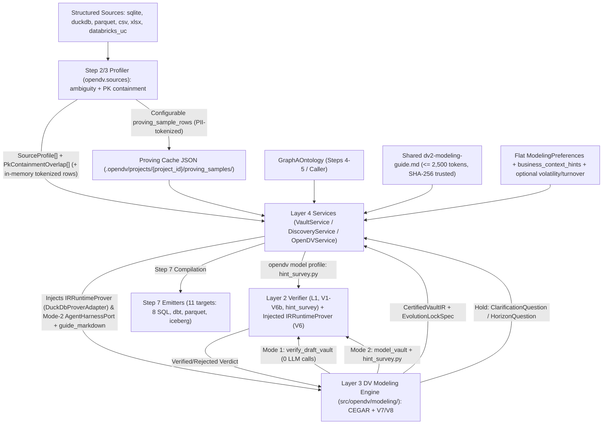
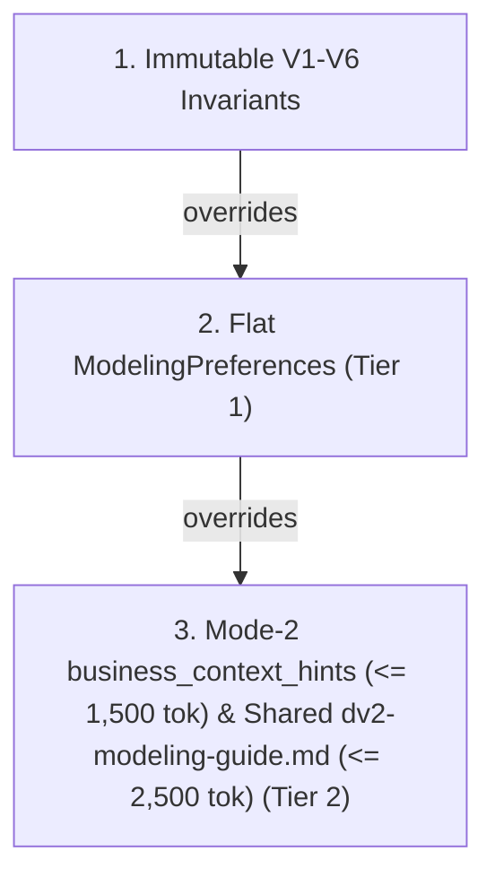
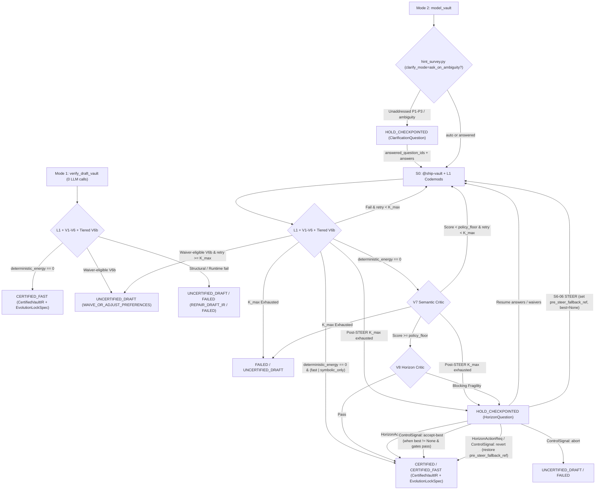

# Data Vault 2.0 Modeling Engine, Flat Governance, Stateless Agent CLI & Real-Data Verification

*   **Author:** Eterna2
*   **Status:** Proposed
*   **Date:** 2026-11-26

--------------------------------------------------------------------------------

## Overview

`open-dv` V2 uses a neuro-symbolic pipeline where LLM agents propose declarative schemas, while deterministic verification gates and SQL compilers validate structural invariants and generate output across five zones (`Z0`–`Z4`) and 11 target engines. Today, deterministic Data Vault 2.0 (`DV 2.0`) compiler defects allow multi-source hash collisions and broken Effectivity Satellites (`esat_*`). Synthesis and critic prompts also drop ontology and profiling signals, runtime verification runs on small synthetic fixtures instead of attached rows, users lack flat preference controls over discretionary modeling rules, and Step 6 logic is coupled to `project.sqlite` and internal LLM credentials.

This design resolves those DV 2.0 fidelity gaps and isolates Step 6 modeling inside a Layer-3 functional package (`src/opendv/modeling/`). It adds a flat two-tier rule governance model, optional free-text Business Vault (`Z3`) hints (`business_context_hints` translated by agents in Mode 1 or synthesized into IR by `@ship-vault` in Mode 2), a configurable data-driven question survey (`survey_modeling_hints`), and unified Step 2/3 real-data proving across all 6 adapters (including `databricks_uc`). It also introduces single-pass global critics with wide-catalog summary compaction, a 4-command stateless CLI (`uv run opendv --json model ...`), an agent skill (`.agents/skills/opendv-modeling/SKILL.md`), and a standalone user guide (`docs/components/modeling/user-guide.md`). Because `open-dv` V2 is pre-release, legacy binary, schema, and settings backward compatibility is not required—letting `schemas/v2/` regenerate via `export_contracts`—while intra-project Wave 1 to Wave 2 additive evolution (`EVO-01..08`, `EvolutionLockSpec`) is preserved.

### Domain & Pipeline Glossary

| Term | Meaning in `open-dv` V2 |
| :--- | :--- |
| **`Steps 1–7`** | End-to-end workflow: `Step 1` project init, `Steps 2–3` source ingestion/profiling, `Steps 4–5` discovery/ontology (`GraphAOntology`), `Step 6` DV 2.0 modeling & verification (`S6`), `Step 7` target compilation (8 SQL dialects + `dbt`, `parquet`, `iceberg`). |
| **`Z0`–`Z4` (Zones)** | Five DV 2.0 layers: `Z0` Bronze raw & `ref_*` lookups; `Z1` Hashed staging views (`stg_*`); `Z2` Append-Only Raw Vault (`hub_*`, `lnk_*`, `t_lnk_*`, `sat_*`, `mas_*`, `esat_*`, `sat_*_pii`, `sat_*_ext_vN`); `Z3` Derived Business Vault (`sal_*`, `esat_sal_*`, `vw_<esat>_intervals`, `pit_*`, `brg_*`); `Z4` Information Mart (`vw_<hub>_current`). |
| **`Layer 1` vs. `L1`** | `Layer 1` is the codebase foundation package (`src/opendv/models/`). `L1` denotes deterministic IR codemods inside Layer-2 `src/opendv/verifier/`: `Alg A.1` (3-axis Satellite split), `Alg A.2` (Hub/Link promotion), `Alg A.3` (Effectivity discovery), `Alg A.4` (BKCC/nullable Link promotion), `Alg A.9a` (Wave-2+ additive schema drift), and `Alg A.9b` (document provenance). |
| **`IR` (`Draft` / `Shard` / `Certified`)** | Storage-neutral Vault intermediate representations: `DraftVaultIR` (agent-proposed), `DraftShardIR` (per-cluster synthesis subset merged by `merge_draft_shards` before cross-shard Bridge/survivorship assembly), and `CertifiedVaultIR` (`Wave 1` initial schema, `Wave 2+` additive extension anchored by `EvolutionLockSpec`). |
| **`Mode 1` vs. `Mode 2`** | `Mode 1` is zero-LLM deterministic verification via `verify_draft_vault` (`opendv model verify`), emitting `"CERTIFIED_FAST"` when gates pass. `Mode 2` is managed synthesis + verification + critic repair via `model_vault` (`opendv model run` / `opendv vault build`). |
| **`CEGAR`, `CegarPolicy`, & `deterministic_energy`** | Counterexample-Guided Inductive Synthesis loop inside Mode 2 (`model_vault`). `CegarPolicy` selects `"balanced" \| "strict" \| "fast" \| "symbolic_only"` (`"fast"` skips `V7`/`V8` critic calls -> `"CERTIFIED_FAST"`). `CegarPolicySpec` separates `deterministic_energy` (`v1_v6_fail` + `blocking_v6b_rules`, `0` when deterministic gates pass) from advisory `V6b`/`V7` penalties. |
| **`V1–V8` Gates** | `V1` structure & DAG rules (`DV-STR-*`, `INV-05` Hub zero-attribute ban, `ANTI_SILO_VIOLATION` requiring cross-source connectivity), `V2–V3` Zone/hashing/granularity (`DV-COL-008` alphabetical `hash_diff`), `V4` provenance (`Alg A.9b`), `V5` evolution (`EVO-01..08`), `V6` DuckDB runtime proving (`schema_proof` vs. `real_data_proof` across `DV-DYN-001..015`: `003` Link HK bijection, `004` uniqueness, `005` Sat delta, `006` Sat FK, `007` Link FK, `011` stg-to-Vault, `013` ESAT rank, `014` ESAT intervals), `V6b` anti-patterns (`DV-AP-001` multi-source Sat mixing, `003` surrogate BK, `009` unisolated PII, `010` disallowed Z1 logic, `011` non-idempotent/redundant load), `V7` semantic critic, `V8` horizon critic. |
| **`BRK-01..08` & `S6-06` (`STEER`)** | Eight multi-wave fragility classes evaluated statically (`FragilitySurfaceSummary`) and by `V8`: `BRK-01` unkeyed/fragile BK stability, `BRK-02` rigid Link arity (`BRK-02b` = partial-NULL Link edges extension), `BRK-03` hidden 1:1 Sat (`docs/30` §12.2), `BRK-05` tier/BKCC lock, `BRK-06` Satellite volatility/width lock. `S6-06` (`STEER`) is the `HOLD_CHECKPOINTED` state where structured `HorizonQuestion` answers steer synthesis. |
| **`Governance Tiers` vs. `KeyTierEnum`** | **Rule Governance Tiers** (`Tier 1` flat `ModelingPreferences` vs. `Tier 2` `business_context_hints` / `dv2-modeling-guide.md`) are distinct from **Business Key Authority (`KeyTierEnum`)** (`TIER_1_GLOBAL_STANDARD`, `TIER_2_ENTERPRISE_SOR`, `TIER_3_LOCAL_SCOPED`) paired with Business Key Collision Codes (`BKCC`). |
| **`-1` / `-2` Zero Keys vs. `Ghost`** | Sentinel hash keys in `hub_*`/`lnk_*`: `-1` (`0x00..00`, `ZERO_KEY_UNKNOWN`) for missing mandatory keys; `-2` (`0xFF..FF`, `ZERO_KEY_ERROR`) for inapplicable optional keys or error records. `Ghost` denotes exclusively `(0x00..00, 1900-01-01)` PIT outer-join anchor rows on Satellites. |
| **`sal_*`, `MAS`/`cdk`, `esat_*`, `D16`** | Same-As Links (`sal_*`), Multi-Active Satellites (`mas_*` keyed by Child Dependent Keys `cdk`), Effectivity Satellites (`esat_*`), and `< 5,000`-token module ceiling (`D16`). Deferred: `sts_*`/`rts_*` (Status/Record Tracking Satellites). |

--------------------------------------------------------------------------------

## The Problem

1. **Deterministic DV 2.0 Fidelity & Compiler Defects:**
    *   **Cross-source Link hash collisions:** Link hash recipes assume one leading `BKCC` and override staging targets with `TIER_2_ENTERPRISE_SOR`, while L1 promotion hardcodes `'GLOBAL'`. Composite keys, dynamic `bkcc_col`, and `TIER_3_LOCAL_SCOPED` keys collide across multi-source Links. Conversely, short-circuiting `LINK_HK` whenever any optional participant is NULL collapses distinct 3-way Links onto zero keys, while `Alg A.4` strips sparse optional participants.
    *   **Multi-source Hub key & tier corruption:** Physical Hub columns and raw source column names share one field, while Hub DDL compilation overwrites per-binding key tiers with the minimum Hub tier. Companion Hubs linked via `sal_*` fail static anti-silo checks, single-source `sal_*` tables emit empty loads without crosswalks, Hubs accept descriptive attributes despite `INV-05`, and Information Mart views (`vw_<hub>_current`) pick overlapping Satellite columns arbitrarily without honoring source precedence.
    *   **Broken Effectivity Satellites (`esat_*`), missing `brg_*`, & Zone 4 `MAS`/`PII` leaks:** `Alg A.3` injects nonexistent `effective_from` and `effective_to` columns, `esat_*` placement conflicts between Zone 2 and Zone 3, `DV-STR-009` permits `esat_*` on immutable `TRANSACTIONAL` Links (`t_lnk_*`), and `dbt` emits invalid `eff_sat` macros while omitting Zone 3 models from `schema.yml`. Meanwhile, multi-hop Bridge (`brg_*`) paths are unused, `vw_<hub>_current` exposes `PII` and `MAS` (Multi-Active Satellite) columns, `pit_*` collapses multi-active rows, and Wave-2 `MAS` extensions drop `child_dependent_keys`.

2. **Prompt Starvation, Unbounded Scaling, & Broken Governance / Steering:**
    *   `@ship-vault`, `V7`, and `V8` receive incomplete prompts omitting ontology relationships/tiers/enumerations, primary-key and cardinality indicators, `BRK-01..08` definitions, retry `prior DraftVaultIR`, and ambiguity metrics. Wide-table `@ship-vault` sharding ignores the `8,192`-output-token ceiling and re-sorts Link participants alphabetically.
    *   `CegarPolicySpec` flags are bypassed by hardcoded `strict` conditionals, while `balanced` fails to block core violations (`DV-AP-009` unisolated PII and `DV-AP-010` disallowed Zone 1 transformations). Meanwhile, unconditional surrogate blocking blocks legacy single-key `id` tables, Wave-1 pre-certification waivers return `404` when `active_wave_id` is `None`, and `S6-06` `STEER` resumes skip synthesis or discard steered IRs because `best` initializes with `energy_e == 0`.
    *   Users lack both flat preference controls over deterministic modeling forks and a data-driven survey to surface source-precedence conflicts, multi-hop analytical grains, and link mutability when they cannot author hints in advance.

3. **Synthetic-Only `V6` Proving & Missing Real-Row Wiring:**
    *   `VaultService` does not wire cached real source rows into `DuckDbProverAdapter.prove` (`IRRuntimeProver.prove`), leaving Gate `V6` to execute on 3–5 synthetic fixture rows by default. Unbounded or naive slicing creates false orphan FK failures (`DV-DYN-007`), duplicate-altering `decollide_masked_pii` distorts counts, unmasked DuckDB exceptions expose raw literals, and full-vault replays inside per-Satellite probes risk DuckDB's 30-second timeout.
    *   Single point-in-time snapshots cannot measure time-series CDC volatility or FK reassignment turnover, yet callers who know those rates lack an explicit input field across `DVModelingRequest` and `VaultBuildReq`.

4. **Project-Store & Nested-LLM Coupling:**
    *   Step 6 modeling spans `src/opendv/agents/` and `src/opendv/service/workflows/`, requiring a live `project.sqlite` workspace and internal LLM credentials. External coding agents cannot use their own model and tools to propose `DraftVaultIR` and verify it deterministically without nested API keys.

5. **Documentation Gaps & Stale Claims:**
    *   `open-dv` lacks a standalone user guide for Step 6 modeling CLI/governance workflows alongside internal design docs, and `AGENTS.md` inaccurately lists unimplemented Status Tracking / Record Tracking Satellites (`sts_*`/`rts_*`).

--------------------------------------------------------------------------------

## Goals

*   **DV 2.0 Compiler & Schema Fidelity:** Enforce per-binding `participant_specs` `LINK_HK` hashing (with partial-NULL optional preservation, distinct `-1` vs. `-2` sentinel padding, and `Alg A.4` nullable participant retention), multi-source Hub physical-key (`hub_canonical_bk_cols`) / per-binding-tier separation, direction-preserving `sal_*`, `INV-05` Hub attribute bans, append-only `Z2` `esat_*` + derived `Z3` `vw_<esat>_intervals` views, `(source_id, table_id)`-scoped `survivorship_priority` `COALESCE` projections (`DV-STR-017`), multi-hop `Z3` `brg_*` Bridge tables, and Zone 4 `PII`/`MAS` filtering plus `MAS` `_ext_vN` `child_dependent_keys` inheritance across all 11 targets (including `parquet`).
*   **Flat Governance, Mode-2 Hints & Data-Driven Survey:**
    *   Provide flat `ModelingPreferences` (`multi_source_hub_strategy`, `low_cardinality_strategy`, `link_cardinality_strategy`, `esat_on_mutable_links`, `surrogate_key_strategy`, `disabled_v6b_blocks`, and `clarify_mode`).
    *   Support project-scoped `business_context_hints` (`<= 1,500` tokens, fenced inside `<untrusted_business_context>` for Mode-2 `@ship-vault` synthesis and `V7`/`V8` exception awareness, and translated by external agents into `DraftVaultIR` in Mode 1) alongside one shared trust-gated `dv2-modeling-guide.md` (`<= 2,500` tokens, precedence `V1–V6 > ModelingPreferences > hints / guide`).
    *   Deliver a configurable zero-LLM hint survey (`survey_modeling_hints` with `max_questions: int | None` and `offset` on stateless `opendv model profile`), Wave-1 pre-certification waivers + `opendv vault status`, and repaired `S6-06` `STEER`.
*   **Complete Single-Pass Context & Bounded Scaling:** Precompute deterministic ambiguity metrics and asymmetric FK->PK cross-source containment in Step 2/3 profiling (no in-turn `evidence_requests`), enrich prompts with compact ontology, column, and `BRK` context, bound `@ship-vault` sharding (`<= 150` cols/shard, `<= 6,500` projected output tokens, preserved participant order, filtered halos, concurrent turn accounting), and switch `V7`/`V8` above `40,000` input tokens directly to a bounded summary floor.
*   **Real-Data `V6` Across All 6 Adapters & Tiered `V6b`:**
    *   Capture a configurable `proving_sample_rows` (`ge=1, le=5000`, default `200`, with explicit `real_row_proving = False` opt-out) of PII-tokenized aligned rows once in Step 2/3 across all 6 adapters (omitting full-table sorts on flat files, guarding `ORDER BY rowid` to base tables, and running 100-column batched queries on `databricks_uc`).
    *   Persist local JSON sidecars under `.opendv/projects/<project_id>/proving_samples/` using an out-of-export project salt, excluded from `.opendv.zip`, using `LIMIT (proving_sample_rows + 1)` to tag `is_complete_table` while projecting `<PII:16hex>` tokens deterministically into type-preserving valid scalars matching the unmodified `CertifiedVaultIR` inside `real_data_proof`.
    *   Split `VerifierReport` `V6` output into explicit `schema_proof` (all 15 `DV-DYN` invariants on edge fixtures) vs. `real_data_proof` (`DV-DYN-007` whenever all parent bindings satisfy `is_complete_table == True`, otherwise `SKIPPED_PARTIAL_SAMPLE`, `TIMEOUT`, or `DISABLED_BY_USER`, plus decoupled single-source `DV-DYN-006`).
    *   Accept optional `cdc_volatility_by_table` (wiring existing `Alg A.1` / `V6b` consumers) and `fk_turnover_by_table` keyed by `table_id` (`[0.0, 1.0]`), fold `BRK-02b` partial-NULL Link edges into `V6`, compute static `FragilitySurfaceSummary`, and block core structural `V6b` checks under `balanced` with `TIER_3_LOCAL_SCOPED` fixability protection for legacy `id`-only tables (filtering surrogates before computing `best_non_surrogate_bk_uniqueness_ratio`).
*   **Layer-3 Component Package, 4-Command Stateless CLI & Agent Skill:** Isolate Step 6 modeling in `src/opendv/modeling/` (`model_vault` + `verify_draft_vault`), register acyclic Layer-3 import contracts in `V2_LAYER_BANS`, expose `uv run opendv --json model {spec, profile, verify, run}` (with `--profile` bundle support and zero `project.sqlite` writes) through stateless Layer-4 service entry points, ship `.agents/skills/opendv-modeling/SKILL.md` + `docs/components/modeling/user-guide.md`, maintain `< 5,000`-token modules (`D16`), and regenerate `schemas/v2/` (`52` CLI subcommands) via `export_contracts`.

--------------------------------------------------------------------------------

## Non-Goals

*   **React Workbench UI (`web/src/`) changes:** Settings forms for `ModelingPreferences`, optional user-supplied `cdc_volatility` / `fk_turnover` / `business_context_hints` inputs, workspace guide trust viewer UI, and `clarify_mode` Hold cards are deferred to GitHub issue [#248](https://github.com/nogoo9/open-dv/issues/248).
*   **Free-form Calculated Business Satellites (`bsat_*`) & Expression-AST DSLs:** Arbitrary calculated KPI formulas (such as rolling VaR or FX unit conversions) stay deferred; Mode-2 `business_context_hints` synthesis and Mode-1 agent translation target only declarative `survivorship_priority`, multi-hop `DraftBridgeSpec`, and `esat_*`/`t_lnk_*` choices.
*   **Separate installable PyPI or monorepo package:** `src/opendv/modeling/` stays an internal Layer-3 subpackage inside `open-dv`, not `packages/opendv-modeling`.
*   **Repo-wide component doc tree & Astro portal wiring:** Defer creating contributor architecture files under `docs/components/<component>/` and rewriting `AGENTS.md`/`SITEMAP.md` doc conventions until `apps/opendv-website/` integration is scheduled (shipping `.agents/skills/opendv-modeling/SKILL.md` and `docs/components/modeling/user-guide.md` now).
*   **Pre-release binary, schema, or settings backward compatibility:** No legacy `LINK_HK` hash dual-mode, no Wave-1 Zone 3 `esat_*` or Hub-attribute exemptions, and no `StrictModel` `exclude_defaults` downgrade serialization.
*   **Extended DV 2.0 constructs & runtime boundaries:** No full Zone 4 dimensional mart (`dim_*`/`fct_*`) synthesis, no `ref_*` historization or moving `ref_*` out of `Z0`, no trailing-NULL `ALTER TABLE ADD COLUMN` on Satellites, no `sts_*`/`rts_*` implementation, no unrestricted Step-6 LLM subagents or Step-6 MCP broker, and no relaxation of the 5-layer DAG or `< 5,000`-token module cap.

--------------------------------------------------------------------------------

## Open Questions

None. All architectural decisions—including local JSON proving-sample caching (Technical Plan §4 item 2), dual `--source` / `--sources-file` profiling inputs (§5.2), `Z2` append-only raw `esat_*` with `Z3` interval views (§2 item 4), and bounded Mode-2 Business Vault hints + stateless configurable survey batching (§3 item 3)—are settled below.

--------------------------------------------------------------------------------

## Critical User Journeys (CUJs)

### CUJ 1: External Coding Agent Surveys, Models & Verifies Without Nested LLM Keys (Mode 1 + Skill)

*   **Given**: A user invokes an external coding agent in a workspace containing source CSVs or database connections and `.agents/skills/opendv-modeling/SKILL.md`, with zero internal `open-dv` LLM API keys configured.
*   **When**: The agent runs `uv run opendv --json model spec` to inspect schemas, profiles sources via `opendv model profile` (`--source` flags or `--sources-file` manifest, emitting `ProfileBundle.questions` + `total_candidates` with optional `--max-questions` / `--questions-offset` to `--out profile_bundle.json`), interviews the user, translates user answers directly into declarative `DraftVaultIR` (`survivorship_priority`, `DraftBridgeSpec`, `esat_*`/`t_lnk_*`) + `GraphAOntology`, and runs `uv run opendv --json model verify --input req.json --draft-ir draft.json --profile profile_bundle.json`.
*   **Then**: `open-dv` runs deterministic `L1` codemods, `V1`–`V6` DuckDB runtime proving against PII-tokenized sample rows, tiered `V6b`, `FragilitySurfaceSummary`, and `EvolutionLockSpec` with zero internal LLM calls and zero prose parsing; returns `remediation_hints` or `WAIVE_OR_ADJUST_PREFERENCES` when needed; and certifies `CertifiedVaultIR` under `"CERTIFIED_FAST"` once `deterministic_energy == 0`.

### CUJ 2: Data Engineer Synthesizes & Evolves a Vault Against Local and Databricks Sources (Mode 2)

*   **Given**: A multi-source dataset combining local Parquet/SQLite feeds and a live `databricks_uc` Unity Catalog schema (Wave 1 followed by an additive Wave 2).
*   **When**: Step 2/3 profiles each source once using `proving_sample_rows` (default `200`, omitting full-table sorts on flat files and running 100-column batched aggregate queries on remote Databricks tables), computes ambiguity stats and local-sample PK containment, caches PII-tokenized JSON under `.opendv/projects/<project_id>/proving_samples/`, and invokes Mode 2 `model_vault` (`opendv model run` or `opendv vault build --wait`).
*   **Then**:
    *   Step 6 executes zero live Databricks queries and reports explicit two-track `V6` results (`schema_proof` across all 15 `DV-DYN` edge fixtures plus `real_data_proof`).
    *   `DV-DYN-007` and cross-source `DV-DYN-006` FK checks execute on every edge whose parent `source_bindings` satisfy `is_complete_table == True` (and same-source `DV-DYN-006` runs independently), flagging partial-parent cross-source edges as `SKIPPED_PARTIAL_SAMPLE`.
    *   Wide catalogs shard deterministically (`<= 150` cols/shard, `<= 6,500` projected output tokens), `V7`/`V8` run in a single pass, and deterministic outputs emit per-binding `LINK_HK` keys, single-source `Z2` `esat_*` + `Z3` `vw_<esat>_intervals`, multi-hop `brg_*` tables, and Wave-2 additive extensions (`EVO-01..08`) across all 11 targets.

### CUJ 3: Steward Governs Modeling Preferences, Authoritative Hints, & Pre-Cert Waivers

*   **Given**: A source catalog contains overlapping ERP/CRM attributes, a low-cardinality status column, a PII `email` column mixed with customer details, and a legacy table whose sole unique key is `id`.
*   **When**: The user sets `clarify_mode="ask_on_ambiguity"`, customizes `.opendv/agents/dv2-modeling-guide.md` (`<= 2,500` tokens, SHA-256 trusted) and project `business_context_hints` (`<= 1,500` tokens), inspects open Holds via `opendv vault status --project <id> --holds-only`, and approves a Wave-1 pre-certification waiver via `opendv vault waive --project <id> --rule ... --entity ... --rationale ...` (or `POST /api/v1/projects/{project_id}/vault/waivers`) or updates `disabled_v6b_blocks` via `opendv settings project-set --project <id> ...`.
*   **Then**: The legacy `id`-only `TIER_3_LOCAL_SCOPED` table auto-downgrades `DV-AP-003` to `ADVISORY`, unisolated PII blocks under `balanced` until fixed or explicitly waived before Wave-1 certification, `L1` respects Tier-1 choices without overwriting them, and `vw_customer_current` compiles deterministic `COALESCE` survivorship precedence (excluding `sat_*_pii`).

### CUJ 4: Steward Executes a Wave-2 `S6-06` `STEER` After `V8` Horizon Review

*   **Given**: A Wave-1 or Wave-2 vault passes deterministic checks (`deterministic_energy == 0`), triggers `V8` Frontier Horizon fragility findings, and pauses at `S6-06` with `HorizonQuestion` items.
*   **When**: The steward submits structured `STEER` answers (such as schema additions or mutable-Link declarations) via CLI/API (`HorizonActionReq`) or `opendv model run --input req_resume.json` (`resume_state` inside `--input`).
*   **Then**: `model_vault` preserves attempt history, stores the pre-steer IR ref (`pre_steer_fallback_ref`) while resetting `best = None` and keeping `skip_synthesis = False`, runs `@ship-vault` with active `STEER` assumptions + `resumed_draft_ir` + `prior_v8_verdict`, deduplicates answered questions by `(brk_code, entity_name, column_name)`, and converges on a valid steered IR (retiring `pre_steer_fallback` only upon full `V1–V8` certification, or returning `ASK_HUMAN_HOLD` with an explicit `"revert"` action on `K_max` exhaustion).

### CUJ 5: Contributor Onboards & Verifies Component Boundaries and Documentation

*   **Given**: A contributor modifies `src/opendv/modeling/` or adds a new functional component to `open-dv`.
*   **When**: They consult `docs/designs/dv2-modeling-engine-and-governance.md` and `docs/components/modeling/user-guide.md`, and run `pytest tests/architecture/ tests/docs/` alongside `export_contracts --check`.
*   **Then**: Layer-3 `V2_LAYER_BANS` enforce acyclic injected-prover decoupling (`zero modeling -> agents` imports), every module stays under `5,000` `cl100k_base` tokens (`D16`), CLI contracts match `schemas/v2/cli-spec.json` (`10` Typer groups + `2` top-level commands / `12` entries, `52` subcommands), and documentation tests verify snippet accuracy across `docs/components/modeling/user-guide.md` and `.agents/skills/opendv-modeling/SKILL.md`.

--------------------------------------------------------------------------------

## Technical Plan (Architecture)

### 1. System Architecture & 5-Layer DAG Integration

Step 6 Data Vault 2.0 modeling moves into a Layer-3 package (`src/opendv/modeling/`) governed by AST import contracts (`tests/architecture/test_import_contracts.py`). This design standardizes on the 5 numbered layers from [`AGENTS.md`](../../AGENTS.md#L83-L92)—`Layer 1` (`models`), `Layer 2` (`sources`, `verifier`, `storage`), `Layer 3` (`agents`, `modeling`), `Layer 4` (`service`), and `Layer 5` (`api`, `cli`)—noting that `v2-clean-sheet-architecture.md` describes the same DAG as 4 logical layers by pairing Layers 2 and 3 as `2a`/`2b`. Generic harness launchers and pack loading stay in `src/opendv/agents/`, while `src/opendv/modeling/` owns `models.py`, `ports.py`, `token_utils.py`, synthesis prompts, governance evaluation, critique compaction, and the re-entrant `model_vault` / `verify_draft_vault` entry points.



#### Layer-3 Import Contract

*   **`src/opendv/modeling` allowed imports:** `opendv.models` (Layer 1) and `opendv.verifier` (Layer 2) only. `DVModelingRequest`, `DVModelingResult`, `WaveEvolutionInput`, and `ModelingResumeInput` live in `src/opendv/modeling/models.py`, while `modeling/ports.py` and `modeling/token_utils.py` (`count_cl100k_tokens`) plus Layer-4 `guide_markdown` injection eliminate all sibling `modeling -> agents` imports and re-export shims.
*   **`src/opendv/modeling` banned imports:** `opendv.sources`, `opendv.storage`, `opendv.agents`, `opendv.service`, `opendv.api`, `opendv.cli`, `duckdb`, `sqlglot`, `fastapi`, `starlette`, `typer`, `rdflib`, `mcp`, and `opendv_*`.
*   **Reverse ban:** Add `"opendv.modeling"` to `V2_LAYER_BANS` for Layer 1 (`models`), Layer 2 (`sources`, `verifier`, `storage`), sibling Layer 3 (`agents`), and Layer 5 (`api`, `cli`, keeping `commands_model.py` routed through Layer-4 `opendv.service` via Layer-1 DTOs/dicts). Only Layer-4 (`service`) and direct Python callers/tests invoke `src/opendv/modeling/` with injected `prover: IRRuntimeProver`.

--------------------------------------------------------------------------------

### 2. Core DV 2.0 Schema, Hashing & SQL Compiler Fixes

Because `open-dv` V2 is pre-release, `schemas/v2/` regenerates via `export_contracts` with zero pre-release dual-mode shims, while Wave 1 to Wave 2 additive evolution remains invariant (`EVO-01..08`).

1.  **Structured `LINK_HK` Participant BKCCs & Partial-NULL Preservation:**
    *   Bind `HashRecipeSpec.participant_specs` **per Link `SourceBindingSpec`** (matching each Link binding 1:1 to its referenced Hub binding deterministically via explicit override / `target_hub_binding_table_id` -> `table_id` -> unique `source_id` -> single-binding Hub, raising a `V1` `BLOCKER` if unresolved).
    *   On `LinkParticipantSpec`, define tri-state `is_nullable: bool | None = None` alongside optional `key_tier`, `bkcc_value`, `bkcc_col`, and `target_hub_binding_table_id` overrides so `L1` distinguishes explicit mandatory `False` from unset before falling back to `null_ratio > 0.0`, and retains nullable `STANDARD` Link participants during `Alg A.4` instead of attaching `IS_NOT_NULL` filters or splitting 3-way Links (`BRK-02b`). Propagate `is_optional_inapplicable=resolved_is_nullable` onto staging `HUB_HK` FK recipes.
    *   Copy Hub `unknown_predicate` / `error_predicate` onto `LinkParticipantHashSpec` only when every referenced column belongs to the Hub's BK columns (remapped to the Link participant's FK columns); otherwise require explicit Link-level predicates.
    *   Hash `LINK_HK` participant-by-participant in declared role order. Suppress `bkcc_col` for `TIER_1_GLOBAL_STANDARD` and require any resolved `bkcc_col` to exist on the Link binding's source table; pass `is_business_key=False` (`hub_name=""`, `key_tier="TIER_2_ENTERPRISE_SOR"`) for normalized, case-preserved `degenerate_keys`; and encode `-1` (`0x00..00` / `unknown_predicate`) vs. `-2` (`0xFF..FF` / `error_predicate` / nullable `NULL`) sentinel branches distinctly (`'-1:^^'` vs. `'-2:^^'`) across both the `BKCC` slot and sub-column value slots with uniform T-SQL UTF-8 collation (updating SQL AST hash validation and baseline docs to recognize both sentinels; on composite BKs with mixed NULL and non-NULL columns, preserve the resolved participant `BKCC` while setting only the missing sub-column slots to `'-1:^^'`, switching `BKCC` to sentinel only when all sub-columns of that participant are blank or sentinel).
    *   Short-circuit `LINK_HK` to zero keys solely when all non-degenerate Hub participants are blank or sentinel (excluding `degenerate_keys` so blank Hub FKs never mint a spurious non-zero Link), or when a Link-level `error_predicate` / `unknown_predicate` triggers (`ZERO_KEY_ERROR` when Link `error_predicate` matches or all non-degenerate participants are `-2` optional; otherwise `ZERO_KEY_UNKNOWN`). Whenever at least one non-degenerate participant holds a valid BK, compute `LINK_HK` across all participants and write `0x00..00` or `0xFF..FF` solely into the missing participant's `hk_hub_i` FK column.

2.  **Multi-Source Canonical Hub Keys, `survivorship_priority`, & Directional/Symmetric `sal_*`:**
    *   Separate raw source column names (`BusinessKeyPart.col_name`) and per-binding tiers (`SourceBindingSpec.key_tier`) from deduplicated physical Hub columns (`BusinessKeyPart.canonical_col_name`), routing all physical Hub consumers through a shared `hub_canonical_bk_cols(hub)` helper, projecting canonical aliases in `StagingViewSpec`, and rejecting conflicting raw-to-canonical aliases within one table in `V1`.
    *   Restrict same-arity canonical Hub merging to compatible keyspaces with positional composite key mapping, exempt `sal_*`-linked companion Hubs from `ANTI_SILO_VIOLATION`, and emit `sal_*` only when a verified crosswalk or multi-key binding exists. Preserve strict directional `(hk_master, hk_duplicate)` `sal_*` ordering (`KEY-05` / `DV-STR-015`) whenever Hubs or key tiers differ, and apply dialect-portable `CASE WHEN` canonical pair deduplication (`NOT EXISTS` + intra-batch `ROW_NUMBER()`) only when Hub and tier are symmetric.
    *   Add optional `survivorship_priority: list[str]` on Hubs keyed by invariant `source_id` (or `f"{source_id}:{table_id}"` when one `source_id` binds multiple tables to one Hub), ordering same-source extensions by descending `(companion_epoch or 1)` and appending unlisted non-`PII`/non-`MAS` Satellites sorted by `sat_name`.
    *   Add `DV-STR-017` for Z4 overlapping-type `COALESCE` checks scoped across distinct `(source_id, table_id)` pairs (exempting `extends_sat_name` overrides), parse neutral Zone 4 expressions uniformly across dialect target types (`lower_logical_type`, wrapping only `UTF8_STRING` arms in `NULLIF(TRIM(col), '')` and casting widened compatible types), and omit superseded base-Satellite columns when `sat_*_ext_vN` introduces an incompatible type per `Alg A.9a` (`survivorship_priority` applies solely to unified same-Hub Satellites; see `docs/components/modeling/user-guide.md` for `companion_hub_with_sal`).

3.  **Hub Descriptive Attribute Ban (`INV-05`):**
    *   Reject non-empty `attributes` on both Draft (`V1` structured `BLOCKER` + deterministic `ValidationError` -> `REPAIR_DRAFT_IR` handling in Mode 1) and Certified Hubs without Wave-1 exemptions.

4.  **Append-Only Single-Source `esat_*` in Zone 2 (`Z2`) + Derived Interval Views in Zone 3 (`Z3`):**
    *   Retain staging-fed append-only `esat_<link>_<src>` tables inside **`Z2` `raw_vault`** (append-only history, never truncated or dropped; aligning Zone boundaries with `v2-clean-sheet-architecture.md`, `DV2_AGENT_REFERENCE_GUIDE.md` §3.3, and `DV-AP-010`, while keeping derived `esat_sal_*` and interval views in `Z3`).
    *   Keep raw `esat_*` single-source per feed under `DV-STR-012` (uniquely named when one `source_id` binds multiple Link tables) and iterate all Link bindings in `Alg A.3` when an identifiable `driving_hub` exists: the **`M`-side FK-owning Hub** whose assignment timeline changes on `M:1` snapshot tables, or the `1`-side entity on `1:N` temporal logs. Detect `is_bitemporal=True` and `applied_dts_col` from `N`-side temporal columns so same-batch feeds do not collapse on `load_dts`, and preserve latest-per-`driving_hk` anti-join inserts across `ABA` reactivations.
    *   Stop injecting nonexistent `effective_from` / `effective_to` columns in `Alg A.3`, ban `ESAT` on immutable `TRANSACTIONAL` Links (`DV-STR-009`), keep `DV-DYN-013` rank checks free of `hk_lnk` tie-breaking, and project closed/current intervals (`hk_lnk`, `driving_hk`, `effective_from`, `effective_to`, `is_current`) via dedicated **`Z3` `MartViewSpec` views** (`zone_id="Z3"`, `view_kind="ESAT_INTERVALS"`, routed by `mart.zone_id` across DDL builders and `DV-DYN-014` rather than Hub-centric Z4 templates, excluding `-1`/`-2` Zero-Key Sentinel rows, ordering by effective timestamp + `load_dts`, and using dialect-safe `NULL` / `BIT` types). Emit native `` `dbt` models for `Z2` `esat_*` tables alongside `view`-materialized `Z3` models registered in `Z3` `schema.yml`.

5.  **Multi-Hop Bridge Tables (`brg_*` in Zone 3):**
    *   Add `BridgeHopSpec` and `DraftBridgeSpec` on `DraftVaultIR` (synthesized post-shard-merge rather than per `DraftShardIR`). Validate connected Hub-Link paths, FK-column existence on role-aliased Links, and edge-level directed hop non-cyclicity (`DV-STR-016` `BLOCKER`, permitting multi-level `hal_*` self-links), lower to `PitBridgeSpec(object_kind="BRIDGE")`, exclude Bridges referencing excluded Links or planned Hubs, and resolve traversed `hk_<hub>` columns deterministically via a dedicated `resolve_bridge_hop_columns` helper.
    *   Chain multi-hop **`LEFT JOIN`**s guarded by `<> 0x00..00 AND <> 0xFF..FF` (`COALESCE(..., 0x00..00)` in composite `PK (root_hk, *link_hks)`). Separate Wave-2+ `WaveMigrator` DDL schema evolution (`DROP_AND_CREATE` / `CREATE OR REPLACE TABLE` when new columns are added) from steady-state batch DML refreshes (`TRUNCATE TABLE` + `INSERT` on already-migrated `pit_*`/`brg_*` tables), restrict `Z3` `TRUNCATE`/`DROP` AST checks exclusively to `pit_*` and `brg_*` (blocking `TRUNCATE`/`DROP` on `Z3` `sal_*`/`esat_sal_*`), and synchronize all dialect emitters including ClickHouse (`join_use_nulls = 1`), `dbt` `SELECT`-only `{{ ref(...) }}` views, and `parquet`.

6.  **Zone 4 `vw_<hub>_current` Filtering, Hub-Only Fallback, `pit_*`, & Wave-2 `MAS` Extensions:**
    *   Filter `sat_*_pii` and `mas_*` out of `information_mart.vw_<hub>_current` (projecting `hk_<hub>` + `hub_canonical_bk_cols` when all Satellites are excluded), placing omitted-Satellite comments inside SQL `SELECT` bodies and `docs/components/modeling/user-guide.md`.
    *   Exclude `sat_kind == "MAS"` or non-empty `child_dependent_keys` from `pit_*`. For Wave-2 `mas_*_ext_vN` and `mas_*_pii_vN`, copy `child_dependent_keys` alongside `cdk` `DraftField`s and `col_mappings`, propagate `(sat.sat_kind == "MAS" or bool(sat.child_dependent_keys))` across all DDL, DML, `V1`, `V5`, `V6`, and `dbt` `ma_sat` paths, and emit T-SQL UTF-8 length-bounded collated CDK columns (`VARCHAR(255)`) inside `PRIMARY KEY`.

--------------------------------------------------------------------------------

### 3. Flat Governance, Business Context Hints, Data-Driven Survey & `S6-06` `STEER`





1.  **Tier 1 — Flat `ModelingPreferences` (`src/opendv/models/modeling_preferences.py`):**
    *   `multi_source_hub_strategy: Literal["unified_canonical_when_same_arity", "companion_hub_with_sal"] = "unified_canonical_when_same_arity"`
    *   `low_cardinality_strategy: Literal["auto_ref_table", "keep_in_satellite"] = "auto_ref_table"`
    *   `link_cardinality_strategy: Literal["prefer_standard_or_mas", "allow_transactional_links"] = "prefer_standard_or_mas"`
    *   `esat_on_mutable_links: Literal["auto_when_turnover_known", "always_on_driving_hub", "off"] = "auto_when_turnover_known"`
    *   `surrogate_key_strategy: Literal["reject_when_natural_exists", "allow_with_bkcc_note"] = "reject_when_natural_exists"`
    *   `disabled_v6b_blocks: list[str] = Field(default_factory=list)` (validated against `VALID_V6B_RULE_IDS` under `balanced`; non-empty values raise `SYNTAX_INVALID_ARGUMENT` under `strict`)
    *   `clarify_mode: Literal["auto", "ask_on_ambiguity"] = "auto"`
    *   `max_survey_questions: int | None = Field(default=5, ge=1)` (`None` returns all candidates on Mode-2 Hold discovery; stateless `profile` CLI also accepts `--max-questions` and `--questions-offset`)
    *   **Persistence & Policy Spec:** Persist `modeling_preferences` and optional Mode-2 `business_context_hints: str | None = None` (`max_length=12_000` char pre-bound, validated to `<= 1,500` `cl100k_base` tokens) on `ProjectSettingsSnapshot` (`WorkspaceSettings` holds global `modeling_preferences` without project hints), exposed via `PUT` / `PATCH /api/v1/projects/{project_id}/settings` (`409 PROJECT_JOB_ACTIVE` lock check) and `opendv settings project-set --project <id>`. React UI work stays tracked in GitHub issue [#248](https://github.com/nogoo9/open-dv/issues/248).
    *   **Deterministic Lowering & Policy Blocking:** Compile `L1CodemodOptions` from `ModelingPreferences` + `ir.justifications`, inject active `ModelingPreferences` into `@ship-vault`/`V7`/`V8` prompts, and replace hardcoded `policy == "strict"` branches with `CegarPolicySpec.blocking_v6b_rules` across all 4 policy presets (`strict` disables auto-exemptions and requires explicit waivers).

2.  **Tier 2 — Shared `dv2-modeling-guide.md` (`<= 2,500` tokens) & Mode-2 `business_context_hints` (`<= 1,500` tokens):**
    *   Retain all 6 packs in `AGENT_PACK_IDS` (`ontology-first-mate`, `table-cluster-scout`, `page-range-scout`, `ship-vault`, `dv-semantic-critic`, `dv-horizon-critic`) and ship builtin `src/opendv/agents/packs/dv2-modeling-guide.md` for global discretionary guidelines. Workspaces override via `.opendv/agents/dv2-modeling-guide.md` (hashed via `compute_workspace_agents_sha256` for `TrustedWorkspaceSpec` verification), or Mode-2 CLI callers pass `--guide <path>` (subject to trust/fencing and `OPENDV_WORKSPACE_ROOTS`/`cwd` validation).
    *   In Mode 2, `dv2-modeling-guide.md` (`<= 2,500` tokens) and fenced `business_context_hints` (`<untrusted_business_context>`, `<= 1,500` tokens) are passed to `@ship-vault`, `V7`, and `V8` with explicit instructions treating `business_context_hints` as untrusted domain-exception data (cannot override deterministic `V1–V6` invariants or relax `v7_floor`); `V7`/`V8` suppress semantic penalties and `BRK-*` questions that match an explicit user hint. Mode-1 `verify_draft_vault` omits `--guide` and disallows prose `business_context_hints`/`guide_markdown` (`modeling_guide_sha256 = ""`).

3.  **Deterministic Data-Driven Hint Survey (`src/opendv/verifier/hint_survey.py`):**
    *   One Layer-2 pure-Python + `networkx` analyzer scans `SourceProfile[]`, `PkContainmentOverlap[]`, `GraphAOntology` (if provided), `DraftVaultIR` (if provided), and PII-tokenized sample rows—with zero LLM calls and zero natural-language parsing—to emit prioritized `ClarificationQuestion` items ordered by impact:
        1. **P1 (Survivorship Conflicts):** Multi-source tables/concepts with overlapping non-key business columns (excluding generic audit/surrogate columns such as `id`, `created_at`, `updated_at`, `load_dts`), falling back to normalized table-stem + shared-column matching when `ontology is None` and `PkContainmentOverlap` is empty; compares matched tokenized sample keys (masking PII values) to ask source precedence.
        2. **P2 (Multi-Hop Analytical Grains):** Directed `child_fk -> parent_pk` acyclic paths of length `2..4` hops (`<= 25` paths per root table, pruning cycles), orienting `PkContainmentOverlap` edges toward `is_pk` / `best_non_surrogate_bk_candidate_col` / table-stem PKs (falling back to `fk_ref` / `<table_stem>_id` when `is_complete_table == False`) and excluding standard audit/actor FK suffixes (`created_by`, `updated_by`, `modified_by`, `deleted_by` variants) unless declared as multi-role domain links in `GraphAOntology`.
        3. **P3 (Link Mutability):** Unhinted `M:1`/`1:N` Links showing mutability signals (`updated_at`/`modified_at`/`effective_from`/`valid_from`/`status` columns, `fk_turnover_by_table > 0`, or observed key reassignment in sample rows) rather than static immutable creation timestamps, clarifying `esat_*` vs. `t_lnk_*`.
        4. **P4 (Structural Ambiguity):** Low-cardinality columns (`distinct <= 20`) and surrogate `id` tables paired with candidate natural keys.
    *   `survey_modeling_hints` accepts `max_questions: int | None` and `offset: int = 0` and returns `list[ClarificationQuestion]` alongside `total_candidates` on stateless `opendv model profile` (`ProfileBundle`) and Mode-2 initial discovery (`clarify_mode == "ask_on_ambiguity"` pauses at most once per discovery batch rather than looping across paginated offsets; `HOLD_CHECKPOINTED` answers flow back via `answered_question_ids` and `clarification_answers` on `DVModelingRequest`). Mode-1 `verify_draft_vault` omits `survey_modeling_hints`, and external agents encode survey answers directly into `DraftVaultIR` and `ModelingPreferences`.

4.  **Pre-Certification Wave-1 Waivers & `S6-06` `STEER` Fixes:**
    *   Fix `submit_vault_waiver` (returning `AntiPatternJustification` via `_record_single_waiver(project_id, None, req)` without requiring `active_wave_id`) and `apply_vault_waivers` (recording waivers and verifying latest `draft_ir`/`certified_ir` when `active_wave_id is None`, failing closed if unverified rather than returning blind `passed=True`), hydrate `persisted_waivers` into `ir.justifications` before `L1` / `V1–V6`, and expose `opendv vault status --project <id> [--run <id>] [--holds-only]` alongside `opendv vault waive --project <id> --rule <str> --entity <str> --rationale <str>`.
    *   Repair `S6-06` `STEER`:
        *   Branch resume explicitly on `action == "steer"` / `steer_selection` vs. `"accept"` / `"revert"` (removing hardcoded `"hq-v8-low-score"` answer injection and `"steer" in ans.lower()` substring matching), keeping `skip_synthesis = False` and clearing `seen_digests` on `STEER` only while preserving `ACCEPT` certifications.
        *   Widen `RunCheckpointRecord` (`pre_steer_fallback_ref`, `prior_v8_verdict_json`) alongside `ModelingResumeInput.revert_to_pre_steer` and `HorizonActionReq.action = "revert"`, holding pre-steer IR in managed storage (or returning an inline serializable resume payload on stateless exit `5`) while resetting `best = None`. On `"revert"`, restore the pre-steer IR and finalize directly without launching another synthesis pass.
        *   Retire `pre_steer_fallback` only upon full `V1–V8` certification; reject `accept-best` when `best is None` and return `UNCERTIFIED_DRAFT` whenever deterministic or critic floors fail.
        *   Stage `HorizonAssumptionSpec` items and `answered_horizon_keys` until certification, parse structured selection IDs, and enforce `<= 1` post-`STEER` `V8` re-score pass via an explicit post-steer outer-loop guard.

--------------------------------------------------------------------------------

### 4. Step 2/3 Precomputation, Proving Cache, Prompt Scaling, Tiered `V6b` & Worked Example

1.  **Ambiguity Stats, PK-Only Containment, & Shared Layer-1 PII Tokenizer:**
    *   Drop in-turn `@ship-vault` evidence requests and centralize all pure-stdlib PII pattern detectors (regex, Luhn, EIN, ABA, IBAN, 64-hex, entropy) inside the shared Layer-1 `pii_tokenizer` module (removing duplicate pattern tables across profiler and verifier modules while keeping filesystem ACL management in Layer 4).
    *   Extend column and table profiles deterministically: `format_shape` (`ISO_DATE | ISO_TIMESTAMP | UUID | EMAIL | INT_SEQ | DECIMAL | CODE_UPPER | FREE_TEXT | MIXED`), `surrogate_score` (combining name regex, monotonic integer/UUID sequence shape, and absence of semantic delimiters), PII-redacted `top_value_frequencies`, `pk_uniqueness_ratio`, surrogate-prefiltered `best_non_surrogate_bk_candidate_col`, and `best_non_surrogate_bk_uniqueness_ratio` (exempting multi-column composite natural keys from single-column surrogate penalties).
    *   Compute asymmetric FK->PK cross-source overlap (`PkContainmentOverlap`) locally over bounded sample hashes under an ephemeral in-memory salt, orienting `1:1` flat-file candidates toward declared PKs, non-surrogate BK candidates, or table-stem PK matches instead of emitting bidirectional pairs. On partial slices of large multi-million-row tables, overlap slices approach zero, so discovery falls back to declared foreign keys and `GraphAOntology`.

2.  **Unified Step 2/3 JSON Proving Cache (Bounded Sampling Across All 6 Adapters):**
    *   Raise aligned sample extraction from `5` to configurable `proving_sample_rows` (default `200`, bounded `ge=1, le=5000` within `profile_timeout_seconds = 30`) across `sqlite`, `duckdb`, `parquet`, `csv`, `xlsx`, and `databricks_uc`. Use PK/table-ordered extraction on SQLite/DuckDB base tables (skipping row-id ordering on views and without-rowid tables), unordered reads on flat files, and single batched per-table aggregate queries on `databricks_uc` (chunked at `100` columns and excluding nested `MAP`/`ARRAY`/`STRUCT` columns from approximate distinct counts).
    *   Support explicit `real_row_proving = False` opt-out (skipping sample writes, emitting `DISABLED_BY_USER`, and noting that real duplicate BKs, cast failures, unexpected NULLs, and empirical churn will only be caught in Step 7).
    *   Enforce column-wide HMAC-SHA256 PII tokenization on any column flagged with PII tags using an out-of-export project salt (or one shared per-invocation salt in stateless CLI mode) and persist safe per-source JSON sidecars outside `.opendv.zip` bundles (owner-only ACLs, invalidated on schema fingerprint, completeness, row count, or salt-digest mismatch, and deleted on source removal without adding a table-count eviction cap).
    *   Split `VerifierReport` dynamic proving into two isolated DuckDB passes bounded by a per-pass timeout:
        *   **`schema_proof`:** All 15 `DV-DYN` invariants executed over deterministic edge fixtures (using non-PII typed test values).
        *   **`real_data_proof`:** Structured `RealDataRuleResult` per invariant running against the unmodified `CertifiedVaultIR`: mapping each cached `<PII:16hex>` HMAC token deterministically through a **type-preserving PII value projector** into valid scalars of the column's declared `logical_type` (preserving typed `MartViewSpec` casts, numeric/temporal `Alg A.5` formatting, and cross-source PII join equality without mutating IR schemas); evaluating `DV-DYN-004` on modeled `parent_hk` key sets across `STANDARD`, `PII`, and `EXT` Satellites (emitting a multi-active `RemediationHint` only when a candidate CDK restores uniqueness and excluding temporal/surrogate columns); evaluating single-source and Link-parented `DV-DYN-006` and `DV-DYN-007` whenever parent bindings have complete table samples (`PASS_FULL` vs. `PASS_SAMPLE_BOUNDED` vs. `SKIPPED_PARTIAL_SAMPLE` / `DISABLED_BY_USER`); skipping bitemporal probes on zero-row attached tables; and redacting quoted literals and email/numeric patterns from DuckDB exceptions before truncation.

3.  **Caller-Supplied Volatility/Turnover, Fragility Checks, & Tiered `V6b`:**
    *   Retain optional caller-supplied `cdc_volatility_by_table` and `fk_turnover_by_table` on `DVModelingRequest`, `VaultBuildReq`, and project settings ([#248](https://github.com/nogoo9/open-dv/issues/248)).
    *   Evaluate `BRK-01` (ambiguous multi-source BK mapping), `BRK-05` (missing `esat_*` or temporal coverage on high-turnover Links), and `BRK-06` (unflagged Hub survivorship conflicts) statically in `FragilitySurfaceSummary`, and extend `docs/30` §12.2 `BRK-02` with partial-NULL Link FK edge checks (`BRK-02b`) in `V6`.
    *   Separate `deterministic_energy` (`v1_v6_fail` plus policy-blocking `V6b` rules) from advisory `V6b`/`V7` penalties in `CegarPolicySpec` (`strict` disallows `disabled_v6b_blocks` and auto-exemptions). Under `balanced`, blocking rules emit at `ERROR` severity: `DV-AP-001` (Hub missing Satellite or unpromoted attributes on Hub), `DV-AP-009` (split Hubs sharing one keyspace), `DV-AP-010` (destructive overwrite in Z1/Z2), `DV-AP-011` (nullable BK or unguarded Link nullability), and fixable-only `DV-AP-003` (surrogate-only Hub BK, auto-downgraded to `ADVISORY` only when `best_non_surrogate_bk_uniqueness_ratio < 0.99`, `key_tier == "TIER_3_LOCAL_SCOPED"`, and non-`GLOBAL` BKCC).

4.  **Prompt Enrichment, Sharding Ceiling, & Two-Mode `V7`/`V8` Compaction:**
    *   Enrich `@ship-vault`, `V7`, and `V8` with compact `GraphAOntology`, ambiguity metrics, `BRK-01..08` definitions, resolved `ModelingPreferences`, `dv2-modeling-guide.md`, and fenced Mode-2 `<untrusted_business_context>` `business_context_hints` (alongside `@ship-vault` retry `prior DraftVaultIR` and explicit invariant rules that hints cannot override `V1–V6` or `v7_floor`, suppressing critic penalties/`BRK-*` questions aligned with explicit hints).
    *   Shard deterministically on `> 40,000` input tokens OR `> 40` tables OR `> 150` columns/shard (`<= 6,500` projected output tokens/shard inside the `8,192` token output ceiling), giving each concurrent shard a local structured-retry sub-budget while counting parallel shard execution as `1` logical turn against `HarnessBudget.max_turns` and scaling `HarnessBudget.max_tokens` proportionally across shards. Pin PK and top non-surrogate BK candidate columns plus pre-assigned canonical Hub names on every wide-table (`> 150` cols) sub-shard, preserve Link participant order, filter boundary halos, freeze shared Hub keys during shard-targeted retries using the Entity-to-Shard Provenance Map, and lower post-merge Bridges and `survivorship_priority` deterministically from resolved answers (with one bounded relationship-only synthesis delta pass when sharded with hints).
    *   Keep `V7`/`V8` single-pass global and replace fixed fragility list caps with risk-ordered retention; above `40,000` input tokens, compact unflagged small Satellites in two modes: retaining full `col_name:type` pairs for flagged/ambiguous entities (`FragilitySurfaceSummary`, cross-source Hubs, `>= 8` non-PK columns) while summarizing unflagged small tables to per-Satellite column counts and PII/temporal flags. Record telemetry keys inside existing checkpoint and stream event payloads.

5.  **Worked End-to-End Example (Planned Business Vault Hints & Survey Fixture):**
    A 6-table fixture (`tests/fixtures/business_vault_hints/`: `erp_customers.csv`, `crm_customers.csv`, `crm_account_mgr.csv`, `funds.csv`, `accounts.csv`, `trades.csv`, `manifest.json`, with `>= 2` rows per table) exercises zero-hints discovery and DuckDB-verified compilation:
    *   **Planned Input Sample (`cust_id=C-100`, `C-200`):** `erp_customers` holds authoritative `(legal_name='Acme Capital', credit_tier='AAA', billing_region=NULL, email=NULL)` on `C-100` and `email='ops@beacon.io'` on `C-200`; `crm_customers` holds `(legal_name='Acme Cap', credit_tier='A', billing_region='US-EAST', email='billing@acme.io')` and stale `'old@beacon.io'`. Meanwhile `crm_account_mgr` assigns `C-100` to `REP-1` (`2026-01-01`) and reassigns `REP-2` (`2026-02-01`), and `trades -> accounts -> funds` forms a 2-hop chain (`T-900 -> A-10 -> F-01`).
    *   **Stage A (Zero-Hints Survey, `--max-questions 3`):** Stateless `opendv model profile` returns `total_candidates=5, returned_count=3, offset=0, remaining_count=2` surfacing: (1) P1 customer attribute conflict (`credit_tier`, `legal_name`, `billing_region`, masked PII `email` `NULL` vs `<NON_NULL>` without echoing raw addresses), (2) P2 2-hop `trades -> accounts -> funds` `brg_*` candidate (oriented via table-stem/PK signals), and (3) P3 `crm_account_mgr` reassignment interval check; `--questions-offset 3` fetches the remaining 2 lower-priority questions (`trades` immutability and `credit_tier` reference-table check).
    *   **Stage B (Authoritative Precedence Lowered into IR):** Applying ERP-over-CRM `survivorship_priority: ["erp", "crm"]`, `brg_trade_account_fund` (`BridgeHopSpec` chain), `esat_customer_rep_crm` (`Z2` raw + `Z3` interval view), and immutable `t_lnk_trade_account` compiles and proves `:memory:` DuckDB SQL against the CSVs (`test_business_vault_hints.py`): `vw_customer_current` projects `COALESCE(sat_customer_erp, sat_customer_crm)` (`C-100` receives `'Acme Capital'`, `'AAA'`, and `'US-EAST'` via CRM `NULL` fallback, while `email` stays isolated in `sat_customer_erp_pii` / `sat_customer_crm_pii` and excluded from `vw_customer_current`), `brg_trade_account_fund` resolves `(T-900, A-10, F-01)` via `LEFT JOIN`, `esat_customer_rep_crm` + `vw_esat_customer_rep_crm_intervals` closes `REP-1` at `2026-02-01`, and `t_lnk_trade_account` stays immutable.

--------------------------------------------------------------------------------

### 5. Functional Component API, Stateless CLI, Managed Governance CLI, Skill & Docs

#### 5.1 Public Python API (`src/opendv/modeling/__init__.py`, `models.py` & `ports.py`)

```python
class DVModelingRequest(StrictModel):  # Layer-3 src/opendv/modeling/models.py
    project_id: str = "stateless"
    run_id: str = "stateless-run"
    ontology: GraphAOntology
    profiles: list[SourceProfile]
    clusters: list[TableCluster] = Field(default_factory=list)
    wave_number_override: int | None = None
    last_sig_seq: int = Field(default=0, ge=0)
    horizon_assumptions: list[HorizonAssumptionSpec] = Field(default_factory=list)
    source_rows_by_table: dict[str, list[dict[str, Any]]] | None = None
    table_sample_flags: dict[str, bool] | None = None
    real_row_proving: bool = True
    cdc_volatility_by_table: dict[str, dict[str, float]] | None = None
    fk_turnover_by_table: dict[str, dict[str, float]] | None = None
    persisted_waivers: list[AntiPatternJustification] = Field(default_factory=list)
    prior_locks: list[EvolutionLockSpec] = Field(default_factory=list)
    policy: CegarPolicy = "balanced"
    preferences: ModelingPreferences = Field(default_factory=ModelingPreferences)
    business_context_hints: str | None = Field(default=None, max_length=12_000)  # Mode 2 only; <= 1,500 tokens validated in L3/L4
    guide_markdown: str | None = Field(default=None)  # Injected by Layer-4 / caller (verified <= 2,500 tokens)
    prior_wave: WaveEvolutionInput | None = None
    resume_state: ModelingResumeInput | None = None
    budget: HarnessBudget | None = None
    v7_critic_tier: ModelTier = "FRONTIER_CRITIC"
    model_overrides: dict[str, str] | None = None

class DVModelingResult(StrictModel):  # Layer-3 src/opendv/modeling/models.py
    status: ModelingStatus  # Mode 2: "CERTIFIED" | "HOLD_CHECKPOINTED" | "UNCERTIFIED_DRAFT" | "FAILED"; Mode 1: "CERTIFIED_FAST" | "UNCERTIFIED_DRAFT" | "FAILED"
    next_action: NextActionEnum  # "READY_FOR_DOWNSTREAM" | "ASK_HUMAN_HOLD" | "REPAIR_DRAFT_IR" | "WAIVE_OR_ADJUST_PREFERENCES" | "FAILED"
    final_energy_e: int
    certified_ir: CertifiedVaultIR | None = None
    draft_ir: DraftVaultIR | None = None
    evolution_lock: EvolutionLockSpec | None = None
    verifier_report: VerifierReport | None = None  # carries schema_proof + real_data_proof + deterministic_energy
    fragility_summary: FragilitySurfaceSummary | None = None
    v7_verdict: SemanticCriticVerdict | None = None
    v8_verdict: HorizonCriticVerdict | None = None
    anti_pattern_justifications: list[AntiPatternJustification] = Field(default_factory=list)
    pending_questions: list[ClarificationQuestion | HorizonQuestion] = Field(default_factory=list)
    suggested_questions: list[ClarificationQuestion] = Field(default_factory=list)
    remediation_hints: list[RemediationHint] = Field(default_factory=list)
    preferences_sha256: str
    modeling_guide_sha256: str
    telemetry: dict[str, Any] = Field(default_factory=dict)

async def model_vault(
    request: DVModelingRequest,
    *,
    harness: AgentHarnessPort,
    prover: IRRuntimeProver | None = None,
    event_sink: RunEventSink | None = None,
    control_reader: ControlSignalReader | None = None,
    checkpoint_store: RunCheckpointStore | None = None,
) -> DVModelingResult: ...

def verify_draft_vault(
    request: DVModelingRequest,
    draft_ir: DraftVaultIR,
    *,
    prover: IRRuntimeProver | None = None,
) -> DVModelingResult: ...
```

`model_vault` fails closed (`OpenDVError`) if `harness is None` or (`prover is None` and `policy != "symbolic_only"`); `verify_draft_vault` fails closed if (`prover is None` and `policy != "symbolic_only"`). Mode 1 `verify_draft_vault` emits `status="CERTIFIED_FAST"` when `deterministic_energy == 0` (leaving `"CERTIFIED"` exclusively for Mode 2 after `V7`/`V8`), ignores `survey_modeling_hints`, and rejects prose `business_context_hints` / `guide_markdown`. `WaveEvolutionInput` carries `(prior_certified_ir, prior_evolution_lock, prior_wave_id)` for Wave 2+ continuity, while `ModelingResumeInput` carries `(run_id, checkpoint_seq, clarification_answers, horizon_answers, answered_question_ids, revert_to_pre_steer)`. All models in `DVModelingRequest`, `DVModelingResult`, `GraphAOntology`, `SourceProfile`, `ModelingPreferences`, and `DraftVaultIR` carry `Field(description=...)` annotations.

#### 5.2 Stateless `opendv model` & Managed Governance CLI (`uv run opendv --json ...`)

`opendv model` routes directly through existing Layer-4 services (`VaultService`, `DiscoveryService`, `OpenDVService`), obeying `V2_LAYER_BANS["src/opendv/cli"]` with zero `opendv.modeling` imports in CLI modules. All stateless `model` subcommands run purely in memory without instantiating `ProjectStateManager` or creating `.opendv/` or `project.sqlite` on disk, while running PII tokenization (`pii_tokenizer.py`) and canonical `schema_fingerprint` derivation before execution:

*   `opendv model spec [--part all|schema|guide|preferences]` (`all` default) — Emits `ModelSpecResp` containing annotated JSON Schemas + minimal valid examples, explicit `COLUMN_OMISSION_JUSTIFICATION_REQUIRED` (`>= 15` chars on `OMITTED_INTENTIONALLY`) and `ANTI_SILO_VIOLATION` (single connected component across sources) constraints, active `dv2-modeling-guide.md`, and Tier-1 `ModelingPreferences` defaults/options.
*   `opendv model profile [--source <kind>:<uri> ...] [--sources-file <json|yaml>] [--sample-rows 200] [--no-real-row-proving] [--max-questions 5] [--questions-offset 0] [--out <profile_bundle.json>]` — Parses `--source <kind>:<uri>` via `split(":", 1)` to preserve Windows drive letters (`duckdb:C:/data/v.db`), validates `--sources-file` against SSRF (`DATABRICKS_SSRF_BLOCKED`) and manifest schema (`{"sources": [{"kind": "...", "uri": "...", "options": {...}, "secret_refs": [...]}]}`), and emits `ProfileBundle` (`profiles`, `pk_containment_overlaps`, PII-tokenized `source_rows_by_table`, `table_sample_flags`, `questions`, `total_candidates`, `returned_count`, `offset`, `remaining_count`, `by_priority`). Passing `--max-questions 0` returns all remaining items from `--questions-offset`.
*   `opendv model verify --input <req.json> --draft-ir <draft.json> [--profile <profile_bundle.json>] [--dry-run] [--out <res.json>]` — **Mode 1 (Zero internal LLM calls):** Runs `L1` + `V1–V6` + tiered `V6b` + `FragilitySurfaceSummary` + `EvolutionLockSpec` over `DVModelingRequest` (optionally hydrating `profiles`, `source_rows_by_table`, and `table_sample_flags` from `--profile <profile_bundle.json>`, converting `DraftHubSpec.attributes` validation errors into structured `REPAIR_DRAFT_IR` diagnostics rather than exit-`2` Pydantic traces, including stateless `persisted_waivers` and `prior_locks`; `--dry-run` validates schemas and PII tokenization only). Exits `0` on `CERTIFIED_FAST`, `5` (`HOLD_OR_UNCERTIFIED`) after printing full JSON stdout on `UNCERTIFIED_DRAFT`, or `2` (`VALIDATION_ERROR`) on malformed inputs/JSON.
*   `opendv model run --input <req.json> [--profile <profile_bundle.json>] [--guide <path>] [--dry-run] [--out <res.json>]` — **Mode 2 (Managed CEGAR Engine):** Runs `model_vault(...)` (`@ship-vault` + sharding + `L1` + `V1–V6b` + single-pass `V7`/`V8` + `HOLD`/`STEER`). Optional `--profile` hydrates `profiles`, `source_rows_by_table`, and `table_sample_flags`, while `resume_state` (including stateless inline `pre_steer_fallback_draft_ir`) and `business_context_hints` (`<= 1,500` tokens) are supplied inside `--input <req.json>`; `--guide` enforces workspace containment against `OPENDV_WORKSPACE_ROOTS` (or `cwd`), symlink safety, `<= 2,500` tokens, and `verify_workspace_override_trust`; `--dry-run` validates `DVModelingRequest`, token caps, guide trust, PII tokenization, and any attached IR with zero LLM calls. Exits `0` on `CERTIFIED` or `CERTIFIED_FAST`, prints full JSON (plus inline serializable resume payload when held) and exits `5` via `CliHandledError` on `HOLD_CHECKPOINTED`/`UNCERTIFIED_DRAFT`, exits `2` on validation/trust errors, and exits `1` on failed execution.

**Stateless & Managed Governance Bridge:** `profile_bundle.json` passes directly via `--profile <profile_bundle.json>` (or maps into `DVModelingRequest`), alongside an agent-authored `GraphAOntology` (`concepts`, `relationships`, `enumerations` validated by `opendv model verify --dry-run`). Managed project governance exposes:
*   `opendv settings project-set --project <id> [--pref key=value ...] [--hints-file <path>] [--hints-text <str>] [--proving-sample-rows <int>] [--real-row-proving true|false]` -> `PATCH /api/v1/projects/{project_id}/settings` (partial update `ProjectSettingsUpdateReq`; `PUT` accepts full `ProjectSettingsSnapshot`).
*   `opendv vault status --project <id> [--run <id>] [--holds-only]` -> composes in `--api-url` mode over `GET /api/v1/projects/{project_id}` and `GET /api/v1/projects/{project_id}/runs?step=step6` (or local `VaultService.get_vault_status`), returning `VaultStatusResp`.
*   `opendv vault waive --project <id> --rule <str> --entity <str> --rationale <str>` -> `POST /api/v1/projects/{project_id}/vault/waivers` (existing route, returning `AntiPatternJustification`).

#### 5.3 Dedicated Agent Skill & Modeling User Guide

*   **Skill (`.agents/skills/opendv-modeling/SKILL.md`):** Guides external agents through a 5-step data-informed workflow without duplicating volatile schemas inline: (1) call `opendv model spec` (explicitly noting `COLUMN_OMISSION_JUSTIFICATION_REQUIRED` `>= 15`-char triage rules and `ANTI_SILO_VIOLATION` single connected component rules), (2) run `opendv model profile` to gather schemas + prioritized `questions` (fetching more with `--questions-offset` or all with `--max-questions 0` as needed), (3) interview the human on surfaced questions plus Wave locks and preferences to encode answers directly into `DraftVaultIR` / `ModelingPreferences` (Mode 1) or `business_context_hints` (Mode 2) and `GraphAOntology`, (4) execute `opendv model verify --profile ...` (Mode 1) or `opendv model run --profile ...` (Mode 2), and (5) return verified `CertifiedVaultIR` + `EvolutionLockSpec`.
*   **User Guide (`docs/components/modeling/user-guide.md`):** Focused user-facing documentation covering CLI workflows, `RANK()` query templates for excluded `mas_*` and `sat_*_pii` tables, `companion_hub_with_sal` usage, and the 6-table Business Vault Hints walkthrough, verified by `tests/docs/` (`ACTIVE_SNIPPET_DOCS`). Repository architecture overview stays in existing `AGENTS.md`, `SITEMAP.md`, and this design doc without adding a separate contributor architecture file under `docs/components/modeling/` or new repo-wide doc-tree rules.

--------------------------------------------------------------------------------

## Alternatives Considered

### Alternative 1: In-Place `ALTER TABLE ADD COLUMN` With Trailing-NULL-Trimmed `hash_diff`

*   **Pros**: Keeps all attributes for a Hub or Link in one wide Satellite table across waves.
*   **Cons**: Breaks alphabetical `DV-COL-008` `Algorithm A.5` parity across Python and all 8 SQL dialects, conflates legitimate trailing NULL values with newly appended schema-evolution columns, and breaks append-only Parquet, Iceberg, and ClickHouse targets.
*   **Decision Rationale**: Retain `sat_<base>_ext_vN` additive extensions paired with PIT coverage (`EVO-01..08`) so historical targets stay append-only and dialect-consistent.

### Alternative 2: Set-Based `LISTAGG` `hash_diff` on Multi-Active Satellites (`mas_*`)

*   **Pros**: Collapses multi-active child sets into one ordered `hash_diff` digest per parent key.
*   **Cons**: Ordered string aggregation varies across SQL dialects, hits row-size limits on large child sets, re-inserts unchanged sibling rows whenever one sibling changes, and fails on delta-only feeds.
*   **Decision Rationale**: Retain row-level `(parent_hk, load_dts, child_dependent_keys...)` `mas_*` grain.

### Alternative 3: Separate Companion Hubs per Key System as the Wave-1 Default

*   **Pros**: Avoids mapping differing source column names onto a single Hub table.
*   **Cons**: Splits unified business entities across duplicate Hubs and `sal_*` crosswalk tables whenever two operational sources share the same business key arity and keyspace under different column names.
*   **Decision Rationale**: Merge compatible same-arity Wave-1 Hubs via physical canonical BK columns with per-binding `col_mappings` + `key_tier`, reserving companion Hubs and `sal_*` for locked Wave-2+ Hubs, mismatched key arity, incompatible keyspaces, or verified crosswalk sources.

### Alternative 4: Physical Closing + Opening Rows in Effectivity Satellites (`esat_*`)

*   **Pros**: Supports single-predicate `WHERE effective_to IS NULL` queries and matches `automate_dv.eff_sat` macro inputs directly.
*   **Cons**: Doubles write inserts on every Link switch, collides on `(parent_hk, load_dts)` primary keys during same-batch switches, fails `DV-DYN-013` rank checks, and forces closing-row mutations across all 8 SQL dialects and `dbt`.
*   **Decision Rationale**: Keep single-source `esat_*` append-on-switch in Zone 2 (`Z2`) and project intervals virtually in Zone 3 (`Z3`) via `vw_<esat>_intervals`.

### Alternative 5: Pre-Release Backward-Compatibility Shims & Frozen `schemas/v2/`

*   **Pros**: Lets pre-release binaries read older un-migrated settings files, `legacy` single-BKCC `LINK_HK` digests, and Zone 3 raw `esat_*` rows without schema resets.
*   **Cons**: Forces dual-mode hash computation, Wave-1 Hub-attribute exemptions, `WaveMigrator` zone-migration shims, and `exclude_defaults` downgrade serialization—adding dead complexity before release.
*   **Decision Rationale**: Regenerate `schemas/v2/` via `export_contracts` while preserving intra-project Wave 1 to Wave 2 additive evolution.

### Alternative 6: Full `6 × 3-Mode` Rule Matrix, `ModelingDecisionRecord`, & Custom Card Generator

*   **Pros**: Allows independent per-fork `prefer` / `lock` / `ask` overrides with dedicated per-decision audit models and custom Guided UX card builders.
*   **Cons**: Triples preference state combinations across DTOs, `L1CodemodOptions`, `V7` auditing, CLI flags, and card templates for toggles users rarely customize individually.
*   **Decision Rationale**: Use flat `ModelingPreferences` + `disabled_v6b_blocks` + global `clarify_mode`, reusing `AntiPatternJustification` and `ClarificationQuestion` while placing remaining preferences in `dv2-modeling-guide.md`.

### Alternative 7: Direct Per-Agent `SKILL.md` Edits for Custom Modeling Rules

*   **Pros**: Reuses `.opendv/agents/<agent_id>/SKILL.md` overrides without adding a guide file loader.
*   **Cons**: Editing `@ship-vault/SKILL.md` directly drifts out of sync with `V7` and `V8`, risks corrupting YAML frontmatter (`allowed_tools: []`, `stage`), and lacks bounded token guardrails across shards.
*   **Decision Rationale**: Use one shared, trust-gated, `<= 2,500`-token `dv2-modeling-guide.md` injected uniformly into `@ship-vault`, `V7`, and `V8` under precedence `V1–V6 > ModelingPreferences > business_context_hints / guide`.

### Alternative 8: In-Turn `@ship-vault` `evidence_requests` Pulls

*   **Pros**: Lets `@ship-vault` query composite candidate-key statistics mid-synthesis.
*   **Cons**: Doubles LLM turns under `allowed_tools: []`, consumes `HarnessBudget` before `V1`–`V6` runs, duplicates Step 2/3 file I/O, and fails on offline/imported `METADATA_ONLY_BINARY_ABSENT` projects.
*   **Decision Rationale**: Precompute deterministic ambiguity metrics during Step 2/3 profiling and catch residual grain issues via real-data `V6` feedback.

### Alternative 9: Multi-Call `V7`/`V8` Skeleton + Cluster Critic Chunking

*   **Pros**: Bounds input tokens per critic call even across thousands of descriptive Satellite columns.
*   **Cons**: Requires building a separate skeleton projection serializer and deterministic score/finding/waiver merger even though `V7`/`V8` outputs are compact compared to `@ship-vault` synthesis.
*   **Decision Rationale**: Keep `V7` and `V8` single-pass global and switch directly to per-Satellite summary compaction above `40,000` tokens.

### Alternative 10: Free-Form Step-6 LLM Subagents or Step-6 MCP Scout Broker

*   **Pros**: Lets the internal synthesizer spawn ad-hoc tools or delegate clusters asynchronously.
*   **Cons**: Breaks deterministic 100% column triage accounting across all 4 harness providers (`agy`, `claude-cli`, `claude`, `gemini`) and adds MCP broker latency inside Step 6.
*   **Decision Rationale**: Use deterministic token/column-thresholded `@ship-vault` clustering inside Mode 2, while Mode 1 (`opendv model verify`) lets external coding agents use their own tools upstream of `DraftVaultIR`.

### Alternative 11: Live Step-6 `databricks_uc` Queries & Single-Snapshot Volatility Proxies

*   **Pros**: Fetches fresh remote warehouse rows per CEGAR iteration and attempts automatic volatility tagging on single snapshots.
*   **Cons**: Re-querying remote Databricks warehouses inside Step 6 risks 30-second timeouts, consumes warehouse compute on CEGAR retries, and violates Layer-2 import boundaries; single snapshots lack timestamps to measure real change rates.
*   **Decision Rationale**: Reuse Step 2/3's configurable `proving_sample_rows` pull across all 6 adapters (omitting full-table sorts on flat files, excluding complex map/array/struct types from remote `APPROX_COUNT_DISTINCT` batches, and guarding `ORDER BY rowid` to base tables), cache PII-tokenized rows locally, and accept optional caller-supplied `cdc_volatility_by_table` and `fk_turnover_by_table` inputs.

### Alternative 12: Post-`V6` DuckDB Counterfactual Runner (`BRK-01/05/06`) & Full `O(C^2)` Containment

*   **Pros**: Executes extra DuckDB rollback transactions for every `BRK` class and compares all source columns pairwise regardless of uniqueness.
*   **Cons**: `BRK-01`, `BRK-05`, and `BRK-06` restate static IR and `HashRecipeSpec` properties already visible in `FragilitySurfaceSummary`, while unpruned `O(C^2)` comparisons risk exceeding Step 2/3's 30-second timeout on wide catalogs.
*   **Decision Rationale**: Combine static `FragilitySurfaceSummary` + `V6` `BRK-02b` partial-NULL Link edges with asymmetric FK->PK cross-source local-sample containment (`is_pk` or uniqueness `>= 0.95`).

### Alternative 13: Separate Top-Level Package (`packages/`), Relocating Shared `agents/`, or Duplicate Layer-4 Facade

*   **Pros**: Exposes DV modeling as a separate distribution wheel or isolates stateless CLI calls into a dedicated service module.
*   **Cons**: A separate `packages/` wheel contradicts `src/opendv/`'s unified DAG, moving shared harness/pack code churns Step 4 modules, and a separate CLI facade duplicates `VaultService` / `DiscoveryService` wiring while bypassing PII/fingerprint checks for Python callers.
*   **Decision Rationale**: Place the modeling engine in Layer-3 `src/opendv/modeling/` (defining local `modeling/ports.py` + `token_utils.py` and injecting `guide_markdown` from Layer 4 so `modeling -> agents` imports stay zero) and serve the 4 `opendv model` subcommands through stateless methods on `VaultService`, `DiscoveryService`, and `OpenDVService`.

### Alternative 14: Persisting Step 2/3 Proving Samples Inside `project.sqlite`

*   **Pros**: Stores proving rows inside the existing SQLite database file alongside project metadata.
*   **Cons**: Bloats `.opendv/projects/<project_id>/project.sqlite` and `.opendv.zip` archives with up to `proving_sample_rows` per table, or forces schema migrations and archive-stripping logic on `project.sqlite` backups.
*   **Decision Rationale**: Store proving samples in local JSON sidecar files under `.opendv/projects/<project_id>/proving_samples/<source_id>.json` with `schema_fingerprint` and salt-digest invalidation, excluded from `.opendv.zip`.

### Alternative 15: Bundling React `web/src/` UI Forms & `sts_*`/`rts_*` Satellites Into This Slice

*   **Pros**: Ships UI forms for new settings and snapshot deletion satellites simultaneously.
*   **Cons**: Pulls TypeScript/React layout work, WCAG verification, browser E2E testing, and snapshot-deletion design into a backend DV 2.0 modeling fidelity and component packaging slice.
*   **Decision Rationale**: Defer React Workbench UI updates to GitHub issue [#248](https://github.com/nogoo9/open-dv/issues/248) and keep `sts_*`/`rts_*` in `Future Improvements` after correcting `AGENTS.md`.

### Alternative 16: Key-Driven Parent Lookup (`WHERE pk IN (...)`), Full-Table `LEFT ANTI JOIN`, or Pre-Ontology Table Eviction

*   **Pros**: Key-driven parent lookups check FK integrity on sampled children when FK metadata exists; pre-ontology caps bound total cached tables upfront.
*   **Cons**: Parent lookups fail when FK metadata is absent and add remote query round-trips; full-table joins risk timing out Step 2/3's 30-second budget on large unindexed remote tables; `GraphAOntology` does not exist yet during Step 2/3 profiling.
*   **Decision Rationale**: Use scope-explicit per-table `LIMIT (proving_sample_rows + 1)` sampling (`proving_sample_rows` bounded `ge=1, le=5000`), explicit `real_row_proving` opt-out, parent-completeness `DV-DYN-007` gating, and separate `schema_proof` vs. `real_data_proof` reporting without silent synthetic fallback or arbitrary table eviction caps.

### Alternative 17: Raw LLM Business Vault SQL / Full `bsat_*` Expression DSL

*   **Pros**: Letting users or agents emit arbitrary `bsat_*` calculations or SQL survivorship queries handles arbitrary custom formulas immediately.
*   **Cons**: Free-form SQL breaks cross-dialect compilation across all 8 SQL dialects + `dbt` and weakens deterministic `V1–V6` verification without a full expression-AST DSL.
*   **Decision Rationale**: Restrict `business_context_hints` (`<= 1,500` tokens) to Mode-2 `@ship-vault` synthesis (and manual external-agent lowering in Mode 1) targeting declarative IR constructs (`survivorship_priority`, `DraftBridgeSpec`, and `esat_*`/`t_lnk_*`), while keeping arbitrary `bsat_*` formula DSLs in `Future Improvements`.

### Alternative 18: LLM-Generated Survey Interviews

*   **Pros**: Lets an internal LLM inspect table names and compose conversational interview prompts dynamically.
*   **Cons**: Requires LLM credentials during stateless `opendv model profile`, duplicates tokenization/latency costs, emits non-deterministic question IDs across retries, and breaks zero-LLM Mode-1 external-agent workflows.
*   **Decision Rationale**: Compute deterministic `P1–P4` `ClarificationQuestion` lists inside zero-LLM `src/opendv/verifier/hint_survey.py` from `SourceProfile[]`, `PkContainmentOverlap[]`, `GraphAOntology`, `DraftVaultIR`, and PII-tokenized sample rows, capped via `max_questions: int | None` (with optional `offset` in stateless `profile`).

--------------------------------------------------------------------------------

## Non-Functional Requirements

*   **Security & Privacy:**
    *   All proving samples cached under `.opendv/projects/<project_id>/proving_samples/` and inline `source_rows_by_table` payloads pass through the shared Layer-1 pure-stdlib `pii_tokenizer.py` helper before entering DuckDB or any agent payload, tokenizing all non-null cells in any PII-tagged column.
    *   Persisted caches use an out-of-export project-scoped salt from `KeyringSecretStore`; stateless CLI commands use one shared per-invocation salt across all inline/profiled tables; `containment.py` uses an ephemeral in-memory salt.
    *   `DuckDbProverAdapter` regex-redacts single/double-quoted literals plus email/numeric patterns from DuckDB exceptions before truncating messages to `500` chars.
    *   Proving-sample directories enforce owner-only filesystem ACLs via Layer-4 `os_platform.py` and are excluded from `.opendv.zip` exports by default.
    *   Workspace guides (`.opendv/agents/dv2-modeling-guide.md`) pass shared SHA-256 `TrustedWorkspaceSpec` verification via `compute_workspace_agents_sha256` (`models/project.py`), while `--guide` (`model run`) and `--hints-file` (`settings project-set`) enforce `OPENDV_WORKSPACE_ROOTS`/`cwd` containment and symlink checks via `validate_workspace_containment`, `reject_symlinks_on_path_and_ancestors`, and `safe_open_no_follow`.
*   **Performance, Token Budgets & Latency:**
    *   Step 2/3 profiling (ambiguity stats, local sample hashes, and `LIMIT (proving_sample_rows + 1)` extraction) executes within `profile_timeout_seconds` (`30s`), omitting `ORDER BY` on flat files, guarding `ORDER BY rowid` to base tables, and running 100-column batched timeout-guarded queries on `databricks_uc`.
    *   Proving sample caches enforce `proving_sample_rows <= 5000` and auto-invalidate on `schema_fingerprint`, `salt_key_id` digest, `is_complete_table`, or `row_count_est` mismatch.
    *   `dv2-modeling-guide.md` stays `<= 2,500` tokens; `business_context_hints` stays `<= 1,500` tokens; `@ship-vault` shards on `> 40,000` input tokens, `> 40` tables, or `> 150` columns/shard (`<= 6,500` projected output tokens); `V7` and `V8` switch directly to summary compaction above `40,000` input tokens.
    *   `detect_batch3_churn` and `probe_batch4_bitemporal` scope DML per Satellite so `schema_proof` and `real_data_proof` DuckDB passes finish within their allocated `timeout_seconds / 2` budget.
    *   Every Python module in `src/opendv/` stays under `5,000` `cl100k_base` tokens (`D16`, verified by `tests/architecture/test_module_token_budget.py`).
*   **Contract Parity & Evolution:**
    *   All DTO, CLI (`opendv model`, `opendv settings project-set`, `opendv vault status`, `opendv vault waive`), and OpenAPI additions regenerate `schemas/v2/` (`52` CLI subcommands) via `python -m opendv.cli.export_contracts`.
    *   Wave 1 to Wave 2 intra-project evolution (`EvolutionLockSpec`, `EVO-01..08`, `sat_*_ext_vN`, `sal_*`, `MAS` `_ext_vN` `cdk` inheritance) remains additive with zero hash-key or grain regressions.

--------------------------------------------------------------------------------

## Risks, Limits & Mitigations

| Risk / Limit | Concrete Mitigation |
| :--- | :--- |
| **Bounded-sample FK blind spot** when parent tables exceed `proving_sample_rows` | Report `SKIPPED_PARTIAL_SAMPLE` with per-edge pass/skip counts in `RealDataRuleResult`; run real `DV-DYN-007` and cross-source `DV-DYN-006` when parent `source_bindings` satisfy `is_complete_table == True` (and run same-source `DV-DYN-006` independently); keep full-table FK validation active in Step 7 materialization. |
| **Partial-sample `containment.py` blind spot** on multi-million-row tables (`is_complete_table == False`) | Unordered `200`-row slices intersect near `0.0` on large tables; explicitly document fallback to `fk_ref` metadata, `<table_stem>_id` heuristics, and `GraphAOntology` (with normalized table-stem + column fallback in `hint_survey.py` `P1`). |
| **Type-projected synthetic PII scalars in `real_data_proof`** defer raw data edge casts to Step 7 | Map `<PII:16hex>` HMAC tokens deterministically to valid scalars matching each column's unmodified `logical_type` (preserving typed `MartViewSpec` casts, `Alg A.5` formatting, and cross-source join equality on PII keys without mutating IR types); prove raw unmasked values in `schema_proof` and Step 7 loads. |
| **`V7`/`V8` critic summary compaction** above `40,000` tokens on wide catalogs | Preserve full compact IR up to `40,000` tokens; above `40,000`, retain `col_name:type` pairs for flagged/ambiguous entities (`FragilitySurfaceSummary`, cross-source Hubs, `>= 8` non-PK cols) while compacting unflagged small Satellites to `(col_count, pii_count, type_histogram)` + risk-ordered fragility summaries. |
| **Workspace guide trust bypass** or CLI `--api-url` digest mismatch | Call shared `compute_workspace_agents_sha256` from both `pack_loader.py` and `cli/_client.py`, validate `--guide` trust/fencing against `OPENDV_WORKSPACE_ROOTS`/`cwd`, and validate `--hints-file` paths against symlinks and size bounds. |
| **Prompt injection in Mode-2 `business_context_hints`** | Enforce `<= 1,500`-token budget in Layers 3–4, fence `business_context_hints` inside explicit `<untrusted_business_context>` delimiters beneath Tier-1 `ModelingPreferences` with invariant rules prohibiting `V1–V6` or `v7_floor` relaxation in `@ship-vault`/`V7`/`V8`, and rely on deterministic `V1–V6` gates. |
| **Wide-catalog `@ship-vault` `8,192`-token truncation & `max_turns` shard exhaustion** | Shard at `<= 150` cols/shard (`<= 6,500` projected output tokens), pin PK/BK cols and pre-assigned Hub names in wide splits, freeze cross-shard Hub keys on retries via `Entity-to-Shard Provenance Map`, give concurrent shards local structured-retry sub-budgets (`1` logical CEGAR turn), and scale `HarnessBudget.max_tokens` with shard count. |
| **Unencrypted non-PII columns in local `proving_samples/*.json` sidecars** | Tokenize all non-null cells in PII-tagged columns immediately at extraction, enforce owner-only filesystem ACLs via `os_platform.py`, exclude `proving_samples/` from `.opendv.zip`, purge on `detach_source`, validate `salt_key_id` digests, and offer `real_row_proving = False`. |
| **Survey question fatigue** on large multi-source schemas | Rank deterministically (`P1` data conflicts -> `P2` chains -> `P3` mutability -> `P4` ambiguity), exclude generic audit/surrogate columns, cap batches via configurable `max_questions: int | None` (plus `--questions-offset` on `profile`), and skip `answered_question_ids`. |

--------------------------------------------------------------------------------

## Additional Resources

*   [`AGENTS.md`](../../AGENTS.md) — 14 DV 2.0 invariants, 5-layer package boundaries, module token ceiling (`D16`), and contract parity rules.
*   [`docs/designs/SITEMAP.md`](SITEMAP.md) — Canonical EGM V2 design index (`52` CLI subcommands).
*   [`docs/designs/v2-clean-sheet-architecture.md`](v2-clean-sheet-architecture.md) — Core V2 platform, 5-Zone architecture (`Z2` append-only `esat_*`, `Z3` derived views), SQLite WAL schema, and 11 Step-7 emitters.
*   [`docs/30-enterprise-dv2-modeling-and-loop-engineering.md`](../30-enterprise-dv2-modeling-and-loop-engineering.md) & [`docs/DV2_AGENT_REFERENCE_GUIDE.md`](../DV2_AGENT_REFERENCE_GUIDE.md) — DV 2.0 `Algorithm A.5`, `INV-01..06`, `EVO-01..08`, `BRK-01..08`, and anti-pattern baselines.
*   [GitHub Issue #248](https://github.com/nogoo9/open-dv/issues/248) — Follow-up React Workbench UI scope for `ModelingPreferences`, optional CDC volatility / FK turnover / `business_context_hints` inputs, guide viewer, and `clarify_mode` Hold cards.

--------------------------------------------------------------------------------

## Future Improvements

*   **React Workbench UI (`web/src/`) Integration ([#248](https://github.com/nogoo9/open-dv/issues/248)):** Add Project Settings forms for `ModelingPreferences`, `business_context_hints`, optional `cdc_volatility_by_table` and `fk_turnover_by_table` inputs, workspace `.opendv/agents/dv2-modeling-guide.md` SHA-256 trust approval UI, and `GuidedDecisionCard` support for survey Holds and Wave-1 waivers.
*   **Calculated Business Satellites (`bsat_*`) & Expression-AST DSL:** Introduce a typed, dialect-neutral formula AST validated in Python and compiled across all 11 targets for user-defined KPI calculations.
*   **Multi-Snapshot Automated Volatility Telemetry:** Derive observed column change rates (`cdc_volatility`) and FK turnover automatically when consecutive snapshots of the same source are ingested over time.
*   **Snapshot Absence & Event Tracking (`sts_*` / `rts_*`):** Implement Status Tracking and Record Tracking Satellites for full-snapshot deletion detection and unreplaced relationship end-dating.
*   **Repo-Wide Docs Portal Integration:** Wire `docs/components/` into `apps/opendv-website/` and author user guides for pre-existing packages (`sources`, `storage`, `service`).

--------------------------------------------------------------------------------

## Detailed Implementation Plan

Work is partitioned into six incremental, testable phases. Every module in `src/opendv/` remains under `5,000` `cl100k_base` tokens (`D16`) and compliant with Layer-DAG import boundaries (`tests/architecture/test_import_contracts.py`).

### Phase 1: Layer-1 Models, PII Tokenizer, Hashing Kernel & Contract Schemas

#### 1. `src/opendv/models/modeling_preferences.py` & `src/opendv/models/policy.py` (Create / Modify)
*   **Type / Scope**: Layer-1 Pydantic v2 `StrictModel` DTOs (`< 5,000` tokens; zero `opendv.verifier`/`sources`/`agents` imports per `V2_LAYER_BANS["src/opendv/models"]`; every field carries `Field(description=...)`).
*   **Proposed Changes**:
    *   `ModelingPreferences` (standardized `field: Type = <default>`):
        *   `multi_source_hub_strategy: Literal["unified_canonical_when_same_arity", "companion_hub_with_sal"] = "unified_canonical_when_same_arity"`
        *   `low_cardinality_strategy: Literal["auto_ref_table", "keep_in_satellite"] = "auto_ref_table"`
        *   `link_cardinality_strategy: Literal["prefer_standard_or_mas", "allow_transactional_links"] = "prefer_standard_or_mas"`
        *   `esat_on_mutable_links: Literal["auto_when_turnover_known", "always_on_driving_hub", "off"] = "auto_when_turnover_known"`
        *   `surrogate_key_strategy: Literal["reject_when_natural_exists", "allow_with_bkcc_note"] = "reject_when_natural_exists"`
        *   `disabled_v6b_blocks: list[str] = Field(default_factory=list)`
        *   `clarify_mode: Literal["auto", "ask_on_ambiguity"] = "auto"`
        *   `max_survey_questions: int | None = Field(default=5, ge=1)`
    *   `RealDataCheckStatus = Literal["PASS_FULL", "PASS_SAMPLE_BOUNDED", "FAIL", "SKIPPED_PARTIAL_SAMPLE", "DISABLED_BY_USER"]` & `RealDataRuleResult(StrictModel)` (`status: RealDataCheckStatus`, `detail: str`, `table_row_counts: dict[str, int] = Field(default_factory=dict)`, `consequence: str | None = None`).
    *   `NextActionEnum = Literal["READY_FOR_DOWNSTREAM", "ASK_HUMAN_HOLD", "REPAIR_DRAFT_IR", "WAIVE_OR_ADJUST_PREFERENCES", "FAILED"]`, `ModelingStatus = Literal["CERTIFIED", "CERTIFIED_FAST", "HOLD_CHECKPOINTED", "UNCERTIFIED_DRAFT", "FAILED"]`, `RemediationHint` (`gate: GateId`, `rule_id: str`, `entity_name: str`, `suggested_fix: str`, `waivable: bool = False`), and relocated `FragilitySurfaceSummary`.
    *   `ValueFreqItem` (`value: str`, `count: int = Field(ge=0)`), `PkContainmentOverlap` (`left_source_id: str`, `left_table_id: str`, `left_col: str`, `right_source_id: str`, `right_table_id: str`, `right_col: str`, `overlap_ratio: float = Field(ge=0.0, le=1.0)`, `compared_hashes: int = Field(ge=1)`), `CachedTableSample` (`table_id: str`, `schema_fingerprint: str`, `salt_digest: str`, `rows: list[dict[str, Any]]`, `row_count_est: int | None = None`, `is_complete_table: bool`, `cached_sample_rows_limit: int = Field(ge=1, le=5000)`), and `ProvingSampleCacheFile` (`source_id: str`, `project_id: str`, `created_at_utc: str`, `salt_key_id: str`, `salt_digest: str`, `cached_sample_rows_limit: int = Field(ge=1, le=5000)`, `tables: dict[str, CachedTableSample]`).
    *   `TableCluster` (defined in Layer-1 alongside re-exported `TableClusterResult` from `src/opendv/sources/clustering.py#L32-L38`) and `_SURROGATE_BK_RE = r"(?i)^(?:id|pk|seq_id|row_id|uuid|surrogate_id|auto_id|.*_sk|.*_surrogate)$"`.
    *   `policy.py`: Define `CegarPolicy` (`Literal["balanced", "strict", "fast", "symbolic_only"]`), `VALID_V6B_RULE_IDS: frozenset[str]`, and `CEGAR_POLICY_SPECS` across all 4 policies with explicit `blocking_v6b_rules: frozenset[str]` (`strict` disallows `disabled_v6b_blocks` and preference auto-exemptions, separating `deterministic_energy` from advisory `V6b`/`V7` penalties; blocking rules emit `severity="ERROR"` and soft rules emit `"ADVISORY"`).

#### 2. `src/opendv/models/pii_tokenizer.py` (Create)
*   **Type / Scope**: Layer-1 pure-stdlib PII pattern detection, idempotent HMAC-SHA256 tokenization, and salt-digest helpers (zero filesystem or DuckDB imports; `scrub_prover_exception` stays in `src/opendv/storage/prover/duckdb_prover.py`).
*   **Proposed Changes**: Relocate ALL pure-stdlib regex/Luhn/EIN/ABA/IBAN/64-hex/entropy detectors from `src/opendv/sources/pii.py` here (deleting duplicate constants across `_l1_alg_a1.py`, `_v6b_ontology_ap.py`, and `_batch_probes.py`), deterministically tokenize non-null scalars idempotently with an injected HMAC salt (`<PII:16hex>`), compute `salt_digest` (`sha256` prefix), and redact PII `ValueFreqItem` entries inside profiles (`value="<MASKED_PII_i>"`).

#### 3. `src/opendv/models/vault_ir_certified.py` & `src/opendv/models/diagnostics.py` (Modify)
*   **Type / Scope**: Layer-1 Certified Vault IR & Prover Report schemas.
*   **Proposed Changes**:
    *   `vault_ir_certified.py`: Add `LinkParticipantHashSpec(StrictModel)` (`hub_name: str = ""`, `role_name: str`, `target_hub_binding_table_id: str | None = None`, `bkcc_literal: str | None = None`, `bkcc_col: str | None = None`, `key_tier: KeyTierEnum = "TIER_2_ENTERPRISE_SOR"`, `source_columns: list[str]`, `unknown_predicate: PredicateNode | None = None`, `error_predicate: PredicateNode | None = None`, `is_degenerate: bool = False`, `is_nullable: bool | None = None`); add `participant_specs: list[LinkParticipantHashSpec] = Field(default_factory=list)` on `HashRecipeSpec`; add `key_tier: KeyTierEnum | None = None` on `SourceBindingSpec`; add `companion_epoch: int | None = Field(default=None, ge=1)` on `CertifiedSatelliteSpec`; add `survivorship_priority: list[str] = Field(default_factory=list)` (accepting `source_id` or `f"{source_id}:{table_id}"`) on `CertifiedHubSpec`; enforce `INV-05` empty-`attributes` validation on `CertifiedHubSpec`; extend `MartViewSpec` with `zone_id: Literal["Z3", "Z4"] = "Z4"`, `view_kind: Literal["CURRENT", "ESAT_INTERVALS"] = "CURRENT"`, and `dedup_field_specs: list[str] = Field(default_factory=list)`; add `hops: list[BridgeHopSpec] = Field(default_factory=list)` & `traversed_hk_cols: list[str] = Field(default_factory=list)` on `PitBridgeSpec(object_kind="BRIDGE")`.
    *   `diagnostics.py`: Add `deterministic_energy: int = Field(default=0, ge=0)` on `VerifierReport`; extend `IRProverReport` with `schema_proof_results: dict[str, bool] = Field(default_factory=dict)` and `real_data_proof_results: dict[str, RealDataRuleResult] = Field(default_factory=dict)` (reporting `DISABLED_BY_USER` directly inside `real_data_proof_results`, keeping `dyn_results` populated from `schema_proof_results` + applicable real checks).

#### 4. `src/opendv/models/vault_ir.py` & `src/opendv/models/ontology.py` (Modify)
*   **Type / Scope**: Layer-1 Draft Vault IR & Ontology schemas.
*   **Proposed Changes**:
    *   `vault_ir.py`: Add `canonical_col_name: str | None = None` on `BusinessKeyPart`; add `target_hub_binding_table_id: str | None = None`, `is_nullable: bool | None = None`, `key_tier: KeyTierEnum | None = None`, `bkcc_value: str | None = None`, `bkcc_col: str | None = None`, `unknown_predicate: PredicateNode | None = None`, and `error_predicate: PredicateNode | None = None` on `LinkParticipantSpec`; add `survivorship_priority: list[str] = Field(default_factory=list)` (`source_id` or `f"{source_id}:{table_id}"`) on `DraftHubSpec`; add `BridgeHopSpec(link_name: str, from_fk_col: str | None = None, to_fk_col: str | None = None)` + `DraftBridgeSpec(bridge_name: str, root_hub: str, hops: list[BridgeHopSpec] = Field(min_length=1))` + `bridges: list[DraftBridgeSpec] = Field(default_factory=list)` on `DraftVaultIR` only (cross-shard `DraftBridgeSpec` assembled post-merge, outside `DraftShardIR`); add `justifications: list[AntiPatternJustification] = Field(default_factory=list)` on `DraftShardIR`; reject non-empty `DraftHubSpec.attributes`; annotate `DraftVaultIR`, `DraftHubSpec`, `DraftLinkSpec`, `DraftSatelliteSpec`, `DraftBridgeSpec`, `BridgeHopSpec`, `DraftField`, and `BusinessKeyPart` fields with `Field(description=...)`.
    *   `ontology.py`: Add `Field(description=...)` annotations across `GraphAOntology` and its nested spec models.

#### 5. `src/opendv/models/ir_kernel.py` (Modify)
*   **Type / Scope**: Layer-1 `Algorithm A.5` hashing kernel.
*   **Proposed Changes**: Update `compute_alg_a5_prehash`, `compute_alg_a5_hash`, and `execute_hash_recipe` to iterate over `HashRecipeSpec.participant_specs` when present: resolve each non-degenerate participant's `bkcc_col` (precedence when non-blank and present on binding table, suppressed on `TIER_1_GLOBAL_STANDARD`) else `bkcc_literal` / `key_tier`; remap Hub predicates onto Link FK columns when all `PredicateLeaf.column` entries map onto BK/FK columns (else require Link-level predicates); normalize `degenerate_keys` (`is_business_key=False`, `hub_name=""`, `key_tier="TIER_2_ENTERPRISE_SOR"`, `COALESCE(NULLIF(TRIM(CAST(... AS VARCHAR)), ''), 'UNKNOWN')`); emit distinct fixed-arity slots (`'-1:^^'` for blank/`unknown_predicate`/`-1` vs. `'-2:^^'` for `is_nullable`/`error_predicate`/`-2`) on missing sub-column slots, keeping a partial-NULL composite participant's resolved `BKCC` non-sentinel when any sub-column is non-null and setting **both** the `BKCC` slot and sub-column value slots to `'-1:^^'`/`'-2:^^'` when all sub-columns of that participant are blank/sentinel; short-circuit `LINK_HK` to zero keys **solely** when **all** non-degenerate Hub participants are blank/sentinel (`ZERO_KEY_ERROR` vs. `ZERO_KEY_UNKNOWN`); otherwise hash partial-NULL Links across all participants (`'-1:^^'`/`'-2:^^'` in blank `BKCC` + value slots). Remove unused legacy Link hash toggles.

#### 6. `src/opendv/models/{sources,project,events,wire_dtos_vault,__init__}.py` (Modify)
*   **Type / Scope**: Layer-1 profile, project settings, checkpoint, vault request/status DTOs, and barrel exports.
*   **Proposed Changes**:
    *   `sources.py`: Extend `ColumnProfile` (`format_shape: Literal[...] = "MIXED"`, `surrogate_score: float = Field(default=0.0, ge=0.0, le=1.0)`, `top_value_frequencies: list[ValueFreqItem] = Field(default_factory=list)`), `TableProfile` (`pk_uniqueness_ratio: float | None = None`, `best_non_surrogate_bk_candidate_col: str | None = None`, `best_non_surrogate_bk_uniqueness_ratio: float | None = None`, `cluster_id: str | None = None`), and `SourceProfile` (`pk_containment_overlaps: list[PkContainmentOverlap] = Field(default_factory=list)`) with `Field(description=...)`.
    *   `project.py`: Add `modeling_preferences: ModelingPreferences`, Mode-2 `business_context_hints: str | None = None`, `proving_sample_rows: int = Field(default=200, ge=1, le=5000)`, `real_row_proving: bool = True`, and shared `compute_workspace_agents_sha256` (iterating `sorted` relative paths exclusively inside `.opendv/agents/` matching `*/SKILL.md` and `dv2-modeling-guide.md`, returning `None` when none exist and never hashing root `AGENTS.md`; `compute_local_workspace_agents_sha256` in `cli/_client.py` delegates here); add `ProjectSettingsUpdateReq` (optional fields checked via `model_fields_set` for `PATCH`).
    *   `events.py`: Widen `RunCheckpointRecord` directly (`pre_steer_fallback_ref: str | None = None`, `prior_v8_verdict_json: str | None = None`) while keeping `resume_payload: dict[str, str | int | bool | list[str]]` (`events.py#L76`).
    *   `wire_dtos_vault.py`: Keep `VaultBuildReq` minimal (`policy` + optional run-scoped overrides `cdc_volatility_by_table`, `fk_turnover_by_table`, `real_row_proving`, `business_context_hints`; omit `proving_sample_rows`); widen `HorizonActionReq.action` to `Literal["accept", "steer", "revert"]` (`wire_dtos_vault.py#L61`); add `ProfileBundle(StrictModel)`, `ModelSpecResp(StrictModel)`, and `VaultStatusResp(StrictModel)` (`project_id`, `active_wave_id`, `run_id`, `status`, `next_action`, `open_holds`, `waived_rules`).
    *   `__init__.py`: Export all new Layer-1 symbols (split into `_exports_modeling.py` if needed to stay under `5,000` tokens).

--------------------------------------------------------------------------------

### Phase 2: Layer-2 Verifier, Hint Survey, SQL Compiler, Dialect Emitters & DuckDB Prover

#### 7. `src/opendv/verifier/{ports,l1_codemods,_l1_rules_alg,_l1_promote,_l1_hub_promote_helpers,_l1_alg_a1}.py` (Modify)
*   **Type / Scope**: Layer-2 verifier ports, L1 codemod options, and `Z1`/`Z2` promotion.
*   **Proposed Changes**:
    *   `ports.py`: Add `source_rows_by_table`, `table_sample_flags`, `real_row_proving`, `modeling_preferences`, and `persisted_waivers: list[AntiPatternJustification] = Field(default_factory=list)` onto `VerifierContext`; extend `IRRuntimeProver.prove` (`ports.py#L33-L39`) with defaulted kwargs `source_rows_by_table: dict[str, list[dict[str, Any]]] | None = None`, `table_sample_flags: dict[str, bool] | None = None`, and `real_row_proving: bool = True`.
    *   `l1_codemods.py` & `_l1_rules_alg.py`: Compile deterministic `L1CodemodOptions` mapping from `ModelingPreferences` + `ir.justifications` (using existing `max_enum_cardinality` field `_l1_alg_a1.py#L37-L48`, zero prose parsing of `business_context_hints`): `low_cardinality_strategy == "auto_ref_table"` sets `max_enum_cardinality=20` (aligned with `ONT-AP-002`/`DV-AP-004`) vs. `0` (`keep_in_satellite`); `link_cardinality_strategy == "allow_transactional_links"` permits `t_lnk_*` unless explicitly waived; `esat_on_mutable_links == "always_on_driving_hub"` attaches `Z2` raw `esat_<link>_<src>` + `Z3` interval view to `M:1`/`1:N` Standard Links (`"off"` skips auto-ESAT; `"auto_when_turnover_known"` attaches when `fk_turnover_by_table` value `> 0.05`); `multi_source_hub_strategy` guides same-arity compatible merges vs. `sal_*` companions. Update `apply_alg_a4_bkcc_and_sparse_fks` (`_l1_rules_alg.py#L138-L199`) so nullable `STANDARD` Link participants (`is_nullable=True`, or `is_nullable is None` with `null_ratio > 0.0` alongside >= 1 non-degenerate participant) stay on `lnk.participants` without `IS_NOT_NULL` filters or Link splitting. Fix `Alg A.3` `driving_hub` to track the `M`-side assignment FK Hub in `M:1` tables (`1`-side Hub in `1:N` logs), detect `applied_dts_col` + `is_bitemporal=True` on `N`-side temporal columns, keep raw `_unique_sat_name` `esat_*` tables in **`Z2`**, and remove `effective_from`/`effective_to` injections (`_l1_rules_alg.py#L243-L256`).
    *   `_l1_alg_a1.py`, `_l1_promote.py` & `_l1_hub_promote_helpers.py`: Preserve `survivorship_priority` across `Alg A.1` splits (`sat_*_ext_vN` ordered ahead of base Satellite by descending `(companion_epoch or 1)` per `(source_id, table_id)`); resolve `participant_specs` on each Link binding (`target_hub_binding_table_id` -> `table_id` -> unique `source_id` -> single-binding Hub -> `V1` `BLOCKER` fallback), remapping qualifying Hub predicates + suppressing `bkcc_col` on `TIER_1_GLOBAL_STANDARD` + propagating `is_optional_inapplicable=resolved_is_nullable` onto staging `HUB_HK` FK recipes; apply `hub_canonical_bk_cols(hub)` while preserving raw `col_name` and per-binding `key_tier`; route raw `esat_*` to **`Z2`** and `esat_sal_*` to **`Z3`**; reject Hub `attributes` (`INV-05`); gate `sal_*` emission on crosswalk/multi-key bindings; lower `DraftBridgeSpec` into `PitBridgeSpec(object_kind="BRIDGE")` (`hops` + `traversed_hk_cols`); and key wave extension handling off `sat.extends_sat_name is not None` (`_l1_promote.py#L428`).

#### 8. `src/opendv/verifier/{_l1_zone_builders,_l1_drift_and_bucket_a,_l1_shard_triage,hint_survey}.py` (Create / Modify)
*   **Type / Scope**: Layer-2 Z3/Z4 builders, drift/shard merge, and data-driven hint survey.
*   **Proposed Changes**:
    *   `_l1_zone_builders.py`: Use `hub_canonical_bk_cols(hub)` in `build_z3_z4_specs` (`_l1_zone_builders.py#L267-L286`) + project `canonical_col_name` aliases in `StagingViewSpec`; keep `build_hash_recipes_for_hub` ownership here and reuse existing `dedup_field_specs` (`_l1_zone_builders.py#L32-L40`); exclude `PII`/`MAS` from `information_mart.vw_<hub>_current` (projecting `hk_<hub>` + canonical BK fallback if all Satellites are excluded); generate `COALESCE` `select_exprs` in `survivorship_priority` order (emitting widened common-type `CAST`, wrapping only `UTF8_STRING` arms in `NULLIF(TRIM(col), '')`, and omitting superseded base-Satellite columns when `sat_*_ext_vN` introduces an incompatible type per `Alg A.9a`); exclude `sat.sat_kind == "MAS" or bool(sat.child_dependent_keys)` from `pit_*`; emit `Z3` `MartViewSpec(zone_id="Z3", view_kind="ESAT_INTERVALS")` for each single-source `Z2` `esat_*` projecting `(hk_lnk, driving_hk, effective_from, effective_to, is_current)` with `ORDER BY COALESCE(applied_dts, load_dts), load_dts` (**no `hk_lnk` tie-breaker per `DV-DYN-013`**) and open sentinel `NULL`.
    *   `_l1_drift_and_bucket_a.py`: Copy `cdk` `DraftField`s (`nullable=False`), `child_dependent_keys=list(sat.child_dependent_keys)`, `sat_kind=sat.sat_kind`, `companion_epoch`, and `col_mappings` into `mas_*_ext_vN` and Wave-2 `mas_*_pii_vN` inside `apply_alg_a9a_schema_drift` (`_l1_drift_and_bucket_a.py#L316-L364`), keying extension behavior off `sat.extends_sat_name is not None`.
    *   `_l1_shard_triage.py`: Preserve Link participant order in `merge_draft_shards`, strip `boundary_neighbors` halos, merge `DraftShardIR.justifications`, and return an Entity-to-Shard Provenance Map (`dict[str, list[str]]` with frozen shared-Hub key validation).
    *   `hint_survey.py` (Create): Implement zero-LLM `survey_modeling_hints(profiles, ontology=None, source_rows_by_table=None, draft_ir=None, answered_question_ids=None, *, max_questions: int | None = 5, offset: int = 0) -> tuple[list[ClarificationQuestion], dict[str, int]]` (importing only `opendv.models` and `networkx`, zero prose parsing of `business_context_hints`), adding normalized table-stem + overlapping non-key fallback in `P1` while excluding generic audit/surrogate columns, orienting `P2` directed `child_fk -> parent_pk` (`2..4` hops, `<= 25` paths/root) via `is_pk` / `best_non_surrogate_bk_candidate_col` / table-stem PKs while excluding `created_by*`/`updated_by*`/`modified_by*`/`deleted_by*` audit FKs unless declared as multi-role domain links in `GraphAOntology`, requiring mutability evidence (`updated_at`/`modified_at`/`effective_from`/`valid_from`/`status`, `fk_turnover_by_table > 0`, or observed key reassignment in sample rows) in `P3`, ranking `P1–P4` deterministically, redacting PII values, and skipping addressed `answered_question_ids` / resolved `DraftVaultIR` topics (`max_questions=0` or `None` returns all remaining items from `offset`).

#### 9. `src/opendv/verifier/{__init__,v1_structure,_v1_dag_rules,_v1_bridge_rules,_v2_v3_checks,_v5_evolution,v2_5_gates,v6b_antipatterns,_v6b_vault_ap}.py` (Create / Modify)
*   **Type / Scope**: Layer-2 structural, tier, evolution, and anti-pattern gates (`V1`–`V6b`, `< 5,000` tokens/file via `_v1_bridge_rules.py`).
*   **Proposed Changes**:
    *   `v1_structure.py`, `_v1_dag_rules.py`, & `_v1_bridge_rules.py` (Create for `D16`): Validate raw `BusinessKeyPart.col_name`, reject duplicate raw-to-`canonical_col_name` collisions within one `table_id` in `StagingViewSpec`, validate `survivorship_priority` `(source_id, table_id)` ownership (emitting **`DV-STR-017`** `BLOCKER` across distinct `(source_id, table_id)` pairs / non-extension Satellites, preserving existing `sal_*` `DV-STR-015` at `_v1_dag_rules.py#L54-L119`), validate connected non-cyclic directed edge `(link_name, from_fk_col, to_fk_col)` chains + FK columns in `DraftBridgeSpec.hops` (`DV-STR-016` `BLOCKER`), validate Link `target_hub_binding_table_id` resolution, enforce `INV-05` (`BLOCKER` on `DraftHubSpec.attributes` ahead of `_l1_promote.py#L174`), exempt `sal_*`-linked companion Hubs from `ANTI_SILO_VIOLATION` (orphan Hub without connected Links), check `sat.sat_kind == "MAS" or bool(sat.child_dependent_keys)` at `_v1_dag_rules.py#L358`, ban `ESAT` on `TRANSACTIONAL` Links (`DV-STR-009`), and enforce single-source `DV-STR-012` on every raw `esat_*`.
    *   `_v2_v3_checks.py` & `_v5_evolution.py`: Use `hub_canonical_bk_cols(hub)`, validate per-binding `HashRecipeSpec`, `SourceBindingSpec.key_tier`, and Link predicates (`_v2_v3_checks.py#L167-L173`); enforce `MAS` `_ext_vN` `cdk` immutability (`sat.extends_sat_name is not None` at `_v5_evolution.py#L201`) and route `DV-AP-010` (`_v5_evolution.py#L48-L91`) through `CegarPolicySpec.blocking_v6b_rules`.
    *   `v2_5_gates.py`, `v6b_antipatterns.py`, `_v6b_vault_ap.py`, & `__init__.py`: Forward `source_rows_by_table`, `table_sample_flags`, `real_row_proving`, and `persisted_waivers` (merged into `ir.justifications` before `L1`/`run_v1_to_v6_gates`), mapping `schema_proof_results`, `real_data_proof_results`, and `deterministic_energy` onto `VerifierReport` (`schema_proof`, `real_data_proof`); enforce `CegarPolicySpec.blocking_v6b_rules` (`v2_5_gates.py#L140-L141`); match surrogates via Layer-1 `_SURROGATE_BK_RE` or `surrogate_score >= 0.75`; downgrade `DV-AP-003` to `ADVISORY` only when `best_non_surrogate_bk_uniqueness_ratio < 0.99`, `key_tier == "TIER_3_LOCAL_SCOPED"`, `bkcc != "GLOBAL"`, and `policy != "strict"`; auto-exempt rules implied by enabled `ModelingPreferences` outside `"strict"`; validate `disabled_v6b_blocks` against `VALID_V6B_RULE_IDS` (`SYNTAX_INVALID_ARGUMENT` on unknown codes or non-empty list under `"strict"`); export `survey_modeling_hints`.

#### 10. `src/opendv/storage/sql_compiler/{dialect_hashing,ddl_builders,_ddl_common,dml_builders,_dml_common,_sat_dml,_z3_z4_ddl,wave_migrator}.py`, `src/opendv/storage/{_ast_stmt_rules,sql_ast_verifier,dialects,_eval_runtime,eval_gate,emitters/dbt,emitters/parquet}.py` (Modify)
*   **Type / Scope**: Layer-2 SQL compilers, AST safety checks, dialect configs, Wave migrator, `dbt` & `parquet` emitters.
*   **Proposed Changes**: Compile per-binding `HashRecipeSpec.participant_specs` (`'-1:^^'` vs. `'-2:^^'` on blank/sentinel branches with T-SQL `COLLATE {TSQL_COLLATION}`, `is_business_key=False` on normalized `degenerate_keys`, Hub-only blank zero-key short-circuit) across all 8 SQL dialects (`dialect_hashing.py`), update `DV-AST-003` (`sql_ast_verifier.py#L120-L128`) to accept `sub.this in ("-1:^^", "-2:^^")`, and verify mixed-case vectors in `TargetEvalGate.verify_cross_dialect_vectors` (`eval_gate.py`); fix Link and Hub per-binding tier overrides (`ddl_builders.py#L136-L138,L148-L150,L200`, `_eval_runtime.py#L175-L181,L217`); normalize `degenerate_keys` in `dml_builders.py#L236` + `GROUP BY`; apply `hub_canonical_bk_cols(hub)` + symmetric `sal_*` `CASE WHEN col0 <= col1 ...` dedup (only when `p0.hub_name == p1.hub_name` and tiers match) + `WHERE NOT EXISTS` in `dml_builders.py#L255-L266` and `_dml_common.py#L119-L125`; update remaining `MAS` gates (`ddl_builders.py#L254`, `_sat_dml.py#L100,L106`, `dbt.py#L182`, `_dml_common.py#L201,L219,L234` add guard and `#L207` widens to `sat.sat_kind == "MAS" or bool(sat.child_dependent_keys)`); add `is_key_col: bool = False` to `col_def_sql` (`_ddl_common.py#L103-L115`) for `tsql` `VARCHAR(255) COLLATE <TSQL_COLLATION> NOT NULL`, remove the `UTF8_STRING` CDK filter in `ddl_builders.py#L249,L254-L267`, and keep all `child_dependent_keys` in `pk_cols`; add `resolve_bridge_hop_columns(...)` in `_ddl_common.py` and route `parquet.py#L26,L257-L261,L315-L337` `brg_*` emissions through it; guard all 6 `pit_bridges` loops on `excluded_links`; separate Wave-2+ `WaveMigrator.compile_migration` (`wave_migrator.py#L251-L255`) / `dialects.py#L88-L90,L108-L110,L118-L120` `DROP_AND_CREATE` DDL evolution from steady-state batch `TRUNCATE TABLE` + `INSERT` DML refreshes while gating `src/opendv/storage/_ast_stmt_rules.py#L156-L165` so `Z3` `TRUNCATE`/`DROP` permits ONLY `pit_*`/`brg_*` (blocking `Z3` `sal_*`/`esat_sal_*`); place ClickHouse `SETTINGS join_use_nulls = 1` at the outer `INSERT INTO ... SELECT ...` statement level (`_dml_common.py`, matching `_sat_dml.py#L306`); parse `select_exprs` in `_z3_z4_ddl.py#L158` with `read="duckdb"` and `lower_logical_type`, add dedicated `build_esat_intervals_view_ddl` + `qualify_name(mart.zone_id, ...)` routing (`_z3_z4_ddl.py#L93`), and compile `ESAT_INTERVALS` (`INNER JOIN lnk_*`, conditional `applied_dts`, no `hk_lnk` tie-breaker, `-1`/`-2` Zero-Key Sentinel filtering distinct from Ghost rows, `ABA` reactivation anti-joins, ClickHouse `LEFT ANTI JOIN`/`toNullable`, T-SQL `CAST(1 AS BIT)`/`CAST(0 AS BIT)`); update `dbt.py` (`#L64-L66,L140,L169,L189-L195,L205,L223,L232`) to use `hub_canonical_bk_cols`, replace `automate_dv.eff_sat` (`#L189-L195`) with native incremental `Z2` `esat_*` SQL wrapped in ``, emit `{{ config(materialized='view') }}` `SELECT`-only `models/Z3_business_vault/` views (`esat_intervals`, `esat_sal`, `pit`, `brg`), and write `models/Z3_business_vault/schema.yml` covering all `z3_models` (`sal_*`, `esat_sal_*`, `pit_*`, `brg_*`, `ESAT_INTERVALS`).

#### 11. `src/opendv/storage/prover/{duckdb_prover,edge_batches,dyn_invariants,_dyn_sat_checks,_batch_probes}.py` (Modify)
*   **Type / Scope**: Layer-2 Gate `V6` DuckDB runtime prover (Step 7 full-table local execution runners stay untouched).
*   **Proposed Changes**: Wire defaulted `source_rows_by_table`, `table_sample_flags`, and `real_row_proving` into `DuckDbProverAdapter.prove`, executing `schema_proof` and `real_data_proof` in two isolated DuckDB passes within per-pass timeout budgets and deterministic `dyn_results` merging; implement a deterministic **type-preserving PII value projector** in `real_data_proof` mapping `<PII:16hex>` tokens to valid scalars matching each field's unmodified `logical_type` (`UTF8_STRING`, `INT32`/`INT64`, `DECIMAL`/`FLOAT64`, `DATE32`/`TIMESTAMP_UTC_US`, `BOOLEAN`) without mutating the certified IR; use `hub_canonical_bk_cols(hub)` in `dyn_invariants.py#L57`, update `DV-DYN-014` (`qualify_name(mart.zone_id, ...)` and checking `mart.columns[0].name` at `dyn_invariants.py#L236-L248`), update `_dyn_sat_checks.py#L103,L174,L253` to `sat.sat_kind == "MAS" or bool(sat.child_dependent_keys)`, and decouple single-source vs. cross-source `DV-DYN-006` (supporting Link-parented Satellites) + `DV-DYN-007` whenever parent bindings have `is_complete_table == True`; keep `scrub_prover_exception` in `duckdb_prover.py`; add `BRK-02b` partial-NULL Link FK edge batch (`edge_batches.py`); evaluate `DV-DYN-004` across `STANDARD`, `PII`, and `EXT` Satellites emitting a `RemediationHint` (excluding temporal/surrogate columns, without adding status enums); skip 0-row tables in `probe_batch4_bitemporal` (`DV-DYN-015`), scope `detect_batch3_churn` per Satellite, and align `DV-AP-011` (`_batch_probes.py#L178-L191`) with `CegarPolicySpec.blocking_v6b_rules`.

--------------------------------------------------------------------------------

### Phase 3: Layer-2 Sources Profiling, PK-Only Containment & Proving Cache

#### 12. `src/opendv/sources/containment.py` & `src/opendv/sources/proving_cache.py` (Create)
*   **Type / Scope**: Layer-2 asymmetric containment and JSON sample cache helpers.
*   **Proposed Changes**:
    *   `containment.py` (`< 50` lines): Under an ephemeral in-memory salt over local `proving_sample_rows` hashes (omitting remote sorted limit scans), compute `uniqueness_ratio = distinct_count_est / max(1, row_count_est)`, orient `1:1` candidates toward `is_pk` / `best_non_surrogate_bk_candidate_col` / table-stem PKs, enforce `distinct >= 2` (`<= 20`-row fixtures) else `>= 10`, and emit `PkContainmentOverlap` when `overlap_ratio = len(hashes_left & hashes_right) / len(hashes_left) >= 0.50`.
    *   `proving_cache.py`: Compute canonical RFC 8785 JCS SHA-256 `schema_fingerprint` via existing `sha256_jcs` (`src/opendv/models/json_hasher.py#L207-L209`) over sorted `(table_name, [(col_name, sql_type, nullable, is_pii, is_pk)])`; validate safe `source_id` filename slugs against `^[A-Za-z0-9][A-Za-z0-9._-]{0,63}$` (`SYNTAX_INVALID_ARGUMENT`); persist `cached_sample_rows_limit` (`ge=1, le=5000`), `is_complete_table`, `row_count_est`, `salt_digest`, and `schema_fingerprint` inside `CachedTableSample` / `ProvingSampleCacheFile` invalidation without modifying `SourceProfile.schema_fingerprint` (`profiler.py#L29-L38`).

#### 13. `src/opendv/sources/{_extractors_files.py,_extractors.py,profiler.py,pii.py,clustering.py,__init__.py}` (Modify)
*   **Type / Scope**: Layer-2 aligned extraction, PII tokenization, profiling metrics, and exports.
*   **Proposed Changes**:
    *   Extract aligned rows from `RawTableData.preview_rows` (`preview_limit = proving_sample_rows + 1` bounded `ge=1, le=5000` within `profile_timeout_seconds = 30` when `real_row_proving=True`, keeping `ColumnProfile.sample_values <= 5`), setting `is_complete_table = (len(fetched) <= proving_sample_rows)` and caching `fetched[:proving_sample_rows]`. Omit `ORDER BY` on `csv`/`parquet`/`xlsx`, restrict `ORDER BY rowid` solely to base tables on `sqlite`/`duckdb` (excluding SQLite `VIEW`s / `WITHOUT ROWID` tables and DuckDB `VIEW`s), and rewrite `extract_databricks_uc` (`_extractors.py#L99-L107`) into one batched aggregate query per table (chunked at `100` columns, excluding `MAP`/`ARRAY`/`STRUCT` from `APPROX_COUNT_DISTINCT`, timeout-guarded) + `LIMIT (proving_sample_rows + 1)` fetch.
    *   Delegate PII detection and column-wide idempotent HMAC tokenization (`<PII:16hex>` across all non-null cells in `pii_tags`-flagged columns) in `pii.py` to Layer-1 `pii_tokenizer.py` and redact PII-tagged `ColumnProfile.top_value_frequencies`.
    *   Compute `format_shape`, `surrogate_score` (`0.50` `_SURROGATE_BK_RE` + `0.30` monotonic `INT_SEQ`/`UUID` + `0.20` zero semantic delimiter), and surrogate-prefiltered `best_non_surrogate_bk_candidate_col` / `best_non_surrogate_bk_uniqueness_ratio` (exempting multi-column composite natural keys from single-column surrogate penalties) in `profiler.py`, returning `(profiles, source_rows_by_table, table_sample_flags)`; keep `TableClusterResult` (`clustering.py#L32-L38`) re-exported in Layer-1 `models`; export new helpers in `src/opendv/sources/__init__.py`.

--------------------------------------------------------------------------------

### Phase 4: Layer-3 `src/opendv/modeling/` Package, Shared Guide, Enriched Prompts & `STEER` Repair

#### 14. `src/opendv/modeling/{__init__.py,models.py,ports.py,token_utils.py,engine.py,verify_mode.py,prompts.py,critics.py,horizon.py}` (Create)
*   **Type / Scope**: Layer-3 DV modeling functional component (every file `< 5,000` tokens, zero `opendv.agents` imports).
*   **Proposed Changes**:
    *   `__init__.py`: Export `model_vault`, `verify_draft_vault`, `run_v8_horizon_review`, `DVModelingRequest`, `DVModelingResult`, `WaveEvolutionInput`, `ModelingResumeInput`, `ModelingPreferences`, and `ports` protocols.
    *   `models.py` & `ports.py`: Host Layer-3 orchestration DTOs (`DVModelingRequest`, `DVModelingResult`, `WaveEvolutionInput`, `ModelingResumeInput` with `answered_question_ids: list[str] = Field(default_factory=list)`, `revert_to_pre_steer: bool = False`, and optional inline `pre_steer_fallback_draft_ir: DraftVaultIR | None = None`), permitted to import `VerifierContext` / `VerifierReport` under `V2_LAYER_BANS`, plus structural `AgentHarnessPort` / `AgentPackProtocol` in `ports.py` (`Protocol`s with zero `opendv.agents` coupling).
    *   `token_utils.py`: Self-contained `count_cl100k_tokens` helper used by Layer-3 budgeting and prompt compaction (eliminating `pack_loader` re-export shims).
    *   `engine.py`: Fail closed (`OpenDVError`) if `harness is None` or (`prover is None` outside `symbolic_only`); run `pii_tokenizer.py` safety guard over inline rows; invoke `survey_modeling_hints` (pausing at `HOLD_CHECKPOINTED` under `clarify_mode == "ask_on_ambiguity"` at most once per discovery batch on unflagged ambiguity or unaddressed `P1–P3` questions, or attaching non-blocking `suggested_questions` under `"auto"` without multi-round paginated Hold cycles); freeze shared Hub keys across shard-targeted retries via Entity-to-Shard Provenance Map (`dict[str, list[str]]`); lower post-merge `DraftBridgeSpec` and `survivorship_priority` deterministically from answered `ClarificationQuestion`s (or run one relationship-only `@ship-vault` synthesis delta call when sharded with `business_context_hints`); implement `S6-06` `STEER` via explicit `action == "steer"` / `"revert"` dispatch (never `"steer"` substring matching or hardcoded `"hq-v8-low-score"` keys, resetting `skip_synthesis = False`, clearing `seen_digests`, resetting `best = None`, rejecting `accept-best` when `best is None` or `deterministic_energy > 0` by returning `UNCERTIFIED_DRAFT`, storing `pre_steer_fallback_ref` + `prior_v8_verdict_json` on `RunCheckpointRecord` for managed runs—and returning an inline serializable resume payload on stateless exit `5`—while omitting `None` keys in `resume_payload` per `events.py#L76`, retiring `pre_steer_fallback` solely when full `V1–V8` certification passes, restoring pre-steer IR directly on `"revert"` without another synthesis pass, returning `ASK_HUMAN_HOLD` with `"revert"` action on `K_max` exhaustion, deduplicating answered `HorizonQuestion`s by `(brk_code, entity_name, column_name)`, and passing a `post_steer: bool` guard into outer-loop evaluation so `<= 1` post-`STEER` `V8` re-score executes); write telemetry keys into existing audit/checkpoint/stream dicts.
    *   `verify_mode.py`: Zero-LLM `verify_draft_vault` failing closed if `prover is None` outside `symbolic_only`, running `pii_tokenizer.py`, `L1` + `V1–V6` + tiered `V6b` + `FragilitySurfaceSummary` + `EvolutionLockSpec` (omitting `survey_modeling_hints` and rejecting prose `business_context_hints` / `guide_markdown`, catching `DraftHubSpec.attributes` `ValidationError` deterministically into structured `REPAIR_DRAFT_IR` diagnostics), and applying `NextActionEnum` + `"CERTIFIED_FAST"` status routing (`deterministic_energy == 0` -> `status="CERTIFIED_FAST", next_action="READY_FOR_DOWNSTREAM"`; waiver-eligible `V6b` failure -> `WAIVE_OR_ADJUST_PREFERENCES`; structural/runtime repair -> `REPAIR_DRAFT_IR`; terminal exception -> `FAILED`).
    *   `prompts.py`: Inject enriched compact ontology, ambiguity tuples, `BRK-01..08`, active `ModelingPreferences`, fenced Mode-2 `<untrusted_business_context>` `business_context_hints` (`<= 1,500` tokens), and Layer-4-supplied `guide_markdown` (`<= 2,500` tokens) into `@ship-vault`, `V7`, and `V8` (zero `evidence_requests`, explicit invariant rule prohibiting `V1–V6` or `v7_floor` relaxation and instructing `V7`/`V8` to suppress penalties/`BRK-*` questions aligned with explicit hints); deterministically cluster (`TableProfile.cluster_id` or fallback name/FK grouping, pinning declared PK + top non-surrogate BK candidate columns and pre-assigned canonical Hub names into all wide-table `> 150`-col sub-shards) on `> 40,000` input tokens OR `> 40` tables OR `<= 150` cols/shard (`<= 6,500` projected output tokens inside the `8,192` token output ceiling), giving concurrent shards a local structured-retry sub-budget (`>= 2` local turns) while accounting the parallel fan-out as `1` logical turn against `HarnessBudget.max_turns` and scaling `HarnessBudget.max_tokens` (`base + 25_000 * max(0, num_shards - 1)`); above `40,000` input tokens for `V7`/`V8`, retain `col_name:type` pairs for flagged/ambiguous entities (`FragilitySurfaceSummary`, cross-source Hubs, `>= 8` non-PK cols) while compacting unflagged small Satellites to column counts and PII/temporal flags.
    *   `critics.py` & `horizon.py`: Single-pass `V7`/`V8` (with `<untrusted_business_context>` exception awareness and risk-ordered `scan_fragility_surface` retention removing hardcoded `[:64]`/`[:32]` truncation), relocated `build_compact_7tuple_summary`, `audit_v6b_justifications`, `run_v8_horizon_review` (`post_steer: bool` outer-loop guard matching `_cegar_horizon.py#L179,L413` single-pass cap), structured action/option parsing + `added_fields` + unique `HorizonAssumptionSpec` deduplication (owned solely by `horizon.py`), and `finalize_cegar_outcome`.

#### 15. `src/opendv/agents/packs/dv2-modeling-guide.md` (Create), `src/opendv/agents/pack_loader.py` & `src/opendv/agents/packs/{ship-vault,dv-semantic-critic,dv-horizon-critic}/SKILL.md` (Modify)
*   **Type / Scope**: Shared reference guide, loader, and workspace trust hashing (retaining legacy `src/opendv/agents/{cegar_runner,_cegar_*,critics}.py` until Phase 5 migrates callers).
*   **Proposed Changes**:
    *   Author `dv2-modeling-guide.md` covering baseline discretionary rules (Satellite splitting cadence, `t_lnk_*` vs. `mas_*` thresholds, PII classification conventions, Zone 4 naming/projection conventions, and Bridge materialization hints); retain the exact `AGENT_PACK_IDS` tuple (`("ontology-first-mate", "table-cluster-scout", "page-range-scout", "ship-vault", "dv-semantic-critic", "dv-horizon-critic")` per `pack_loader.py#L20-L27`).
    *   Implement `load_modeling_guide` (`<= 2,500` tokens) in `pack_loader.py`; delegate `verify_workspace_override_trust` hashing for `.opendv/agents/` overrides (`*/SKILL.md` and `dv2-modeling-guide.md`) to Layer-1 `models.project.compute_workspace_agents_sha256` (`None` when `.opendv/agents/` has no overrides).
    *   Update `ship-vault`, `dv-semantic-critic`, and `dv-horizon-critic` `SKILL.md` prompts.

#### 16. `tests/architecture/test_import_contracts.py` (Modify)
*   **Type / Scope**: Architecture DAG guard (using `(bool, set[str], set[str])` tuples matching `V2_LAYER_BANS`).
*   **Proposed Changes**: Register `"src/opendv/modeling"` using `(True, set(), {"opendv.agents", "opendv.sources", "opendv.storage", "opendv.service", "opendv.api", "opendv.cli", "duckdb", "sqlglot", "fastapi", "starlette", "typer", "rdflib", "mcp", "opendv_*"})` and add `"opendv.modeling"` to banned sets of `models`, `sources`, `verifier`, `storage`, `agents`, `api`, and `cli`.

--------------------------------------------------------------------------------

### Phase 5: Layer-4 Services, Waiver & Status Fixes, Agent Cleanup, Layer-5 CLI & `schemas/v2/`

#### 17. `src/opendv/service/workflows/{_proving_io,_run_adapters,vault_svc,_vault_helpers,_vault_revisions,discovery_svc,_discovery_sources,projects_svc}.py`, `src/opendv/service/{app_service,guided_translator,bundles/exporter}.py`, `src/opendv/api/{routes_projects,_routes_vault_storage}.py`, & Legacy CEGAR Modules in `src/opendv/agents/` (Create / Modify / Remove)
*   **Type / Scope**: Layer-4 stateless/project workflows, archive hygiene, agent cleanup, and Layer-5 REST endpoints (`D16` splits keeping every modified file `< 5,000` tokens).
*   **Proposed Changes**:
    *   Create `src/opendv/service/workflows/_proving_io.py` (JSON proving-cache persistence with `os_platform.py` `set_owner_only_permissions`, `atomic_write_text`, `validate_workspace_containment`, `KeyringSecretStore` project salt, salt-digest checks, and safe `source_id` slug regex `^[A-Za-z0-9][A-Za-z0-9._-]{0,63}$` -> `SYNTAX_INVALID_ARGUMENT`, keeping `vault_svc.py`, `_discovery_sources.py`, and `app_service.py` under `5,000` tokens) and extract `D16` adapter helpers into `_run_adapters.py` (`<= 350` lines).
    *   Expose stateless `OpenDVService` / `DiscoveryService` / `VaultService` entry points powering `opendv model {spec, profile, verify, run}` (zero `ProjectStateManager` instantiation or `.opendv/` writes on disk), forwarding `survey_modeling_hints` (`max_questions`, `offset`) into `ProfileBundle`, injecting `guide_markdown` via `pack_loader.load_modeling_guide`, and migrating `vault_svc.py#L10-L16,L152,L170,L250`, `_vault_helpers.py#L9`, `_vault_revisions.py#L9`, and `agents/__init__.py` from legacy CEGAR modules before deleting `agents/{cegar_runner,_cegar_helpers,_cegar_horizon,_cegar_finalize,_cegar_models,critics}.py`.
    *   Keep `submit_vault_waiver` returning `AntiPatternJustification` (`_record_single_waiver(project_id, None, req)` when `active_wave_id is None`, `vault_svc.py#L417-L486`), update `apply_vault_waivers` when `active_wave_id is None` to verify latest `draft_ir` / `certified_ir` (returning `VaultVerifyResp(passed=False, diagnostics=[...])` whenever unwaived failures remain or no IR exists, never blind `passed=True`), hydrate Wave-1 waivers into `VerifierContext.persisted_waivers` -> `ir.justifications`, remove hardcoded `"hq-v8-low-score"` answer injection in `submit_horizon_steering` (`vault_svc.py#L359`) while adding `"revert"` restoration of `pre_steer_fallback_ref`, implement `VaultService.get_vault_status(project_id, run_id=None, holds_only=False) -> VaultStatusResp`, wire `VaultBuildReq` (`policy` + project-settings lookup), update `guided_translator.py` policy checks to `CegarPolicySpec`, delete `proving_samples/<source_id>.json` inside `detach_source` and update pointers via `ProjectStateManager.update_project_pointers`, exclude `proving_samples/` from `.opendv.zip` in `exporter.py`, expose `PUT /api/v1/projects/{project_id}/settings` (`409 PROJECT_JOB_ACTIVE` lock check) + `PATCH` optional fields (`ProjectSettingsUpdateReq` checking `model_fields_set`), and validate CLI `--guide` path safety (`OPENDV_WORKSPACE_ROOTS` / `cwd` via `validate_workspace_containment`, `reject_symlinks_on_path_and_ancestors`, `safe_open_no_follow`, and `verify_workspace_override_trust`).

#### 18. `src/opendv/cli/{commands_model,_client_model,_commands_settings}.py` (Create) & `src/opendv/cli/{main,commands_core,commands_workflows,_client,_client_workflows,export_contracts}.py`, `schemas/v2/{openapi,cli-spec,vault-schema-ir-v2.schema,project-bundle-v2.schema}.json`, & `docs/16-cli-reference.md` (Modify / Regenerate)
*   **Type / Scope**: Unified CLI wiring, client parity, and contract regeneration.
*   **Proposed Changes**:
    *   Implement `commands_model.py` (`spec [--part all|schema|guide|preferences]` documenting `COLUMN_OMISSION_JUSTIFICATION_REQUIRED` and `ANTI_SILO_VIOLATION`, `profile [--source ... --sources-file --sample-rows --no-real-row-proving --max-questions 5 --questions-offset 0 --out]`, `verify [--input --draft-ir --profile --dry-run --out]`, `run [--input --profile --guide --dry-run --out]`), `_client_model.py`, and `_commands_settings.py` (`D16` split, routing through `opendv.service` with zero `opendv.modeling` imports). Catch `DraftHubSpec.attributes` `ValidationError` before `cli/main.py#L102-L129` traceback mapping so `opendv model verify` returns structured `REPAIR_DRAFT_IR` diagnostics; exit `0` for both `CERTIFIED` and `CERTIFIED_FAST`, writing full JSON stdout (and `--out`) before raising `CliHandledError` on exit `5`.
    *   Reuse existing `parse_json_arg` (`_client.py`) on JSON file/string arguments and delegate `compute_local_workspace_agents_sha256` in `_client.py` to Layer-1 `models.project.compute_workspace_agents_sha256`; enforce `--source <kind>:<uri>` `split(":", 1)` Windows drive-letter parsing and `DATABRICKS_SSRF_BLOCKED` on `--sources-file`.
    *   Update `export_contracts.py` (`_CLI_HTTP_ROUTES` tuples: `settings project-set -> ("PATCH", "/api/v1/projects/{project_id}/settings")`, `vault status -> (None, None)` composing `GET /projects/{project_id}` + `GET /projects/{project_id}/runs?step=step6`, `model {spec,profile,verify,run} -> (None, None)`, keeping existing `vault waive` route) and CLI counts (`10` Typer groups + `2` top-level commands / `12` entries, **`52` subcommands** across `main.py`, `AGENTS.md`, `SITEMAP.md`, and `.agents/skills/open-dv-workflow/SKILL.md#L16`).
    *   Add `opendv settings project-set --project <id> ...` and `opendv vault status --project <id> [--run <id>] [--holds-only]` (`ProjectOpt` required `--project`, optional `--run: str | None`, `--holds-only: bool = False`) alongside `opendv vault waive --project <id> --rule <str> --entity <str> --rationale <str>`, mapping `SYNTAX_INVALID_ARGUMENT`, `VERIFICATION_GATE_FAILED`, and `UNTRUSTED_WORKSPACE_OVERRIDE` to `CliExitCode.VALIDATION_ERROR` (`2`), `PROJECT_JOB_ACTIVE` to `CliExitCode.CONFLICT_OR_LOCKED` (`4`), and `HOLD_CHECKPOINTED`/`UNCERTIFIED_DRAFT` to `CliExitCode.HOLD_OR_UNCERTIFIED` (`5`) without editing `src/opendv/models/errors.py` or `schemas/v2/error-codes.json`.
    *   Regenerate `schemas/v2/{openapi.json,cli-spec.json,vault-schema-ir-v2.schema.json,project-bundle-v2.schema.json}` via `python -m opendv.cli.export_contracts` and `docs/16-cli-reference.md` via `scripts/generate_cli_reference.py`.

--------------------------------------------------------------------------------

### Phase 6: Agent Skill, Modeling User Guide, Reference Docs, Fixtures & Tests

#### 19. `.agents/skills/opendv-modeling/SKILL.md` (Create) & `.agents/skills/open-dv-workflow/SKILL.md` (Modify)
*   **Type / Scope**: Agent workflow skills.
*   **Proposed Changes**: Write the 5-step data-informed workflow (`spec` -> `profile` with `questions` `--questions-offset` / `--max-questions 0` pagination -> human interview -> `verify --profile ...` / `run --profile ...` -> certified output) inside `.agents/skills/opendv-modeling/SKILL.md`, explicitly documenting `COLUMN_OMISSION_JUSTIFICATION_REQUIRED` (`>= 15`-char triage justifications) and `ANTI_SILO_VIOLATION` (single connected component across sources via shared Hubs/Links or `sal_*`), and cross-link `opendv-modeling` plus update the `52`-subcommand count inside `.agents/skills/open-dv-workflow/SKILL.md#L16`.

#### 20. `docs/components/modeling/user-guide.md` (Create) & `AGENTS.md`, `docs/designs/SITEMAP.md`, `docs/designs/v2-clean-sheet-architecture.md`, `docs/DV2_AGENT_REFERENCE_GUIDE.md` (Modify)
*   **Type / Scope**: Modeling user guide and repository metadata updates.
*   **Proposed Changes**: Author `docs/components/modeling/user-guide.md` (standard frontmatter, CLI recipes, `RANK()` query templates for excluded `mas_*`/`sat_*_pii` tables, `companion_hub_with_sal` note, and the 6-table Business Vault Hints & Survey walkthrough); update `AGENTS.md` (add `src/opendv/modeling/`, fix `sts_*`/`rts_*` and `column_triage` references, update `-1:^^`/`-2:^^` sentinels at `AGENTS.md#L40`, and update subcommand count to **`52`**); update `52`-subcommand count in `SITEMAP.md#L18`; update `v2-clean-sheet-architecture.md#L11` and `docs/DV2_AGENT_REFERENCE_GUIDE.md` (§3.3 `L142,L169,L365-L387` + §13 `L463` sentinels) so raw `esat_*` lives in `Z2`, `vw_<esat>_intervals` / `esat_sal_*` live in `Z3`, and both `'-1:^^'`/`'-2:^^'` sentinels are documented consistently.

#### 21. `tests/fixtures/business_vault_hints/{erp_customers,crm_customers,crm_account_mgr,funds,accounts,trades}.csv`, `tests/fixtures/business_vault_hints/manifest.json`, & Automated Test Files (Create / Modify)
*   **Type / Scope**: Unit, integration, fixture, architecture, contract, and documentation suites (`>= 2` rows per CSV fixture).
*   **Proposed Changes**:
    *   **Create Fixture & Modeling Tests**: `tests/fixtures/business_vault_hints/{erp_customers,crm_customers,crm_account_mgr,funds,accounts,trades}.csv` + `manifest.json`, `tests/modeling/test_engine_steer.py`, `tests/modeling/test_verify_mode.py`, `tests/modeling/test_prompts_and_compaction.py`, `tests/modeling/test_governance_preferences.py`, and `tests/modeling/test_business_vault_hints.py` (asserting Stage A PII-redacted paginated survey + Stage B DuckDB SQL execution against CSVs verifying `COALESCE` survivorship on `legal_name`/`credit_tier`/`billing_region` with `email` isolated in `sat_*_pii`, `brg_trade_account_fund`, `esat_customer_rep_crm` intervals, and `t_lnk_trade_account`).
    *   **Create Verifier, Storage, Source & CLI Tests**: `tests/verifier/test_dv2_link_esat_mas_fixes.py`, `tests/verifier/test_hint_survey.py`, `tests/storage/test_dialect_hashing_and_esat_views.py`, `tests/sources/test_containment_and_proving_cache.py`, and `tests/cli/test_model_cli.py`; migrate `tests/agents/` CEGAR tests to `tests/modeling/`.
    *   **Update Architecture, Docs & Golden Tests**: `tests/architecture/test_import_contracts.py`, `tests/architecture/test_mock_guards.py`, `tests/docs/test_doc_code_snippets.py` (registering `.agents/skills/opendv-modeling/SKILL.md` and `docs/components/modeling/user-guide.md` inside `ACTIVE_SNIPPET_DOCS`), and `tests/parity/_v2_parity_helpers.py` (`INV-05` audit on `_selector` + `build_clean_trap_ir` `esat_acct_mgr` at `_v2_parity_helpers.py#L961-L977`); regenerate `tests/golden_v2/am_core_bundle.core.opendv.zip` via `uv run python -c "from tests.parity._v2_parity_helpers import GOLDEN_BUNDLE_PATH, build_v2_golden_bundle; build_v2_golden_bundle(GOLDEN_BUNDLE_PATH)"`.

--------------------------------------------------------------------------------

### Verification Plan

Run all checks from the active repository/worktree root after the final phase:

*   **Contract, Schema, Error-Code & CLI Sync:**
    *   `uv run python -m opendv.cli.export_contracts --check`
    *   `uv run python scripts/check_error_codes.py --catalog schemas/v2/error-codes.json --baselines schemas/v2/baseline-digests.json --check-ast`
    *   `uv run opendv --json model spec --part all`
*   **Architecture, Module Token Cap (`D16`), Mock Guards & Documentation Sync:**
    *   `uv run pytest tests/architecture/test_import_contracts.py tests/architecture/test_module_token_budget.py tests/architecture/test_mock_guards.py tests/docs/test_doc_code_snippets.py tests/parity/test_public_datasets_manifest.py -v`
*   **Unit, Component & Integration Test Suites:**
    *   `uv run pytest tests/models/ tests/sources/ tests/verifier/ tests/storage/ tests/modeling/ tests/agents/ tests/service/ tests/api/ tests/cli/ tests/parity/ -v`
*   **Static Analysis, Linting & Strict Typechecking:**
    *   `uv run ruff check src tests scripts`
    *   `uv run mypy src`
*   **E2E CUJ Acceptance Matrix:**
    *   **CUJ 1 & Hints Survey (`tests/modeling/test_business_vault_hints.py`, `tests/cli/test_model_cli.py`):** Stage A zero-hints `uv run opendv --json model profile --sources-file tests/fixtures/business_vault_hints/manifest.json --max-questions 3 --questions-offset 0` exits `0` with `remaining_count == 2`, PII-tokenized sample rows, and paginated remainder on `--questions-offset 3` (plus full list on `--max-questions 0`); Stage B `uv run opendv --json model verify --input req.json --draft-ir draft.json --profile profile_bundle.json` exits `0`, `final_energy_e == 0`, `status == "CERTIFIED_FAST"`, while `test_business_vault_hints.py` executes the compiled DuckDB SQL against CSVs proving `COALESCE` survivorship (`billing_region='US-EAST'`, `email` excluded from `vw_customer_current`), `brg_trade_account_fund`, `esat_customer_rep_crm` intervals, and `t_lnk_trade_account`.
    *   **CUJ 2 (`tests/sources/test_containment_and_proving_cache.py`, `tests/storage/test_dialect_hashing_and_esat_views.py`):** Multi-source local + mocked `databricks_uc` run caches PII-tokenized rows in Step 2/3, projects `<PII:16hex>` deterministically into type-preserving scalars against the unmodified certified IR in `real_data_proof` (`DV-DYN-007` and cross-source `DV-DYN-006` when all parent tables have `is_complete_table == True`, `SKIPPED_PARTIAL_SAMPLE` otherwise) with zero live Step-6 Databricks queries, and emits verified output across all 11 Step-7 targets (`{{ config(materialized='view') }}` `dbt` Z3 views, `models/Z3_business_vault/schema.yml`, `VARCHAR(255) COLLATE <TSQL_COLLATION>`, ClickHouse statement-level `SETTINGS join_use_nulls = 1`, `parquet.py` Bridge hops, Wave-2 `EVO-01..08` intact).
    *   **CUJ 3–4 (`tests/modeling/test_governance_preferences.py`, `tests/modeling/test_engine_steer.py`):** Wave-1 pre-certification `opendv vault waive --project <id> --rule ... --entity ... --rationale ...` succeeds returning `AntiPatternJustification`; `opendv vault status --project <id> --holds-only` lists open Holds; legacy `id`-only `TIER_3_LOCAL_SCOPED` table downgrades `DV-AP-003` to `ADVISORY`; `S6-06` `STEER` clears `skip_synthesis`, resets `best = None` while retaining `pre_steer_fallback_ref`, enforces `<= 1` post-`STEER` `V8` pass, and converges with `status == "CERTIFIED"`.
    *   **CUJ 5 (`tests/architecture/test_import_contracts.py`, `tests/docs/test_doc_code_snippets.py`):** Layer-3 `V2_LAYER_BANS`, `< 5,000`-token `D16` ceilings, `schemas/v2/cli-spec.json` parity (`12` entries / `10` Typer groups + `2` top-level commands, `52` subcommands), and `ACTIVE_SNIPPET_DOCS` checks on `.agents/skills/opendv-modeling/SKILL.md` and `docs/components/modeling/user-guide.md` all pass (`exit 0`).

#### Live No-Mock UAT Sign-Off Matrix (Real Data + Real Agents)

Final release sign-off requires executing all six live scenarios below end-to-end against real data sources, real DuckDB execution, and real LLM/agent invocations (**zero mocked harnesses or fake LLM responses**):

*   **`UAT-1` — Mode-1 Real External Agent Cold-Start:** Launch a fresh external `claude` CLI coding agent inside an isolated workspace seeded only with `.agents/skills/opendv-modeling/SKILL.md` and real CSVs in `tests/fixtures/business_vault_hints/` (no pre-built `req.json` or `draft.json`, and zero internal `open-dv` LLM keys). The agent executes `opendv model spec` -> `opendv model profile`, surfaces `P1–P3` questions to the user, authors `GraphAOntology` + `DraftVaultIR`, and converges via `opendv model verify --profile profile_bundle.json` to `status == "CERTIFIED_FAST"` (`final_energy_e == 0`) in **`<= 3` verify invocations**. Live DuckDB execution against the fixture CSVs returns expected `vw_customer_current` survivorship, `brg_trade_account_fund`, `esat_customer_rep_crm` intervals, and `t_lnk_trade_account` rows.
*   **`UAT-2` — Mode-2 Real LLM Quality Benchmark on Multi-Source Enterprise Data:** Run live `opendv model run` / `opendv vault build` using real LLM credentials (`ANTHROPIC_API_KEY` or `GEMINI_API_KEY`) against BOTH `tests/fixtures/business_vault_hints/` (with `business_context_hints`) and the real multi-source `data/public_am/` catalog (`am_sec_treasury_ibor.sqlite`, `am_esg_stewardship_proxy.parquet`, `ds_cegar_12trap.duckdb`, `sec_13f_holdings.csv`, `fred_treasury_rates.csv`, plus live `databricks_uc` if warehouse credentials are configured). Assert `@ship-vault` follows user hints without `V7`/`V8` penalizing them below `v7_floor`, `0` Hub attributes (`INV-05`), `0` unisolated PII fields (`DV-AP-009`), `0` disconnected silos (`ANTI_SILO_VIOLATION`), and convergence in **`<= 4` CEGAR attempts**.
*   **`UAT-3` — Negative Repair & `STEER`/`"revert"` Recovery with Real Engine:** Submit an intentionally flawed Mode-1 `DraftVaultIR` containing `DraftHubSpec.attributes`, a `< 15`-char omission justification, raw PII `email`, and cross-source `DV-STR-017` type collision; confirm `opendv model verify` returns structured JSON stdout + actionable `RemediationHint` entries on exit `5` (no raw Python traceback) and certifies after repair. Trigger live Mode-2 post-`STEER` `K_max` exhaustion; confirm `pre_steer_fallback_ref` (managed) and inline `pre_steer_fallback_draft_ir` (stateless) survive and `"revert"` restores the prior certified IR directly without re-synthesis.
*   **`UAT-4` — Real-Data Prover & Zero-PII-Leak Sign-Off:** Run `real_data_proof` against real CSV/SQLite/DuckDB inputs containing duplicate `parent_hk` rows (`DV-DYN-004` multi-active `RemediationHint`), typed numeric/date PII (`INT64` SSN, `DATE32` DOB) processed through the type-preserving PII projector against unmodified `CertifiedVaultIR`, partial-NULL `-1` vs. `-2` Link FKs (`Alg A.4` retention + distinct `LINK_HK` hashes), and `real_row_proving = False` (`DISABLED_BY_USER`). Assert `0` raw PII substrings across `proving_samples/*.json`, `ProfileBundle`, `VerifierReport`, and forced DuckDB exception logs.
*   **`UAT-5` — Enterprise Scale & Survey Noise Resistance on Real Large Catalogs:** Build a real `50+`-table multi-source SQLite/DuckDB catalog via `tests/fixtures/scale_200.py` containing `created_by`/`updated_by` audit FKs, `30+` immutable `created_at` transactional tables, and a `200`-column wide table. Verify `opendv model profile` emits zero audit-FK `P2` false positives and zero immutable-table `P3` spam, and run live sharded Mode-2 `opendv model run` confirming `<= 150` cols/shard, PK/BK columns pinned in every sub-shard, shard-scaled `max_tokens` without attempt-1 budget exhaustion, frozen shared Hubs across shard retries, and flagged-table `col_name:type` retention in `V7`/`V8`.
*   **`UAT-6` — Real Wave-1 -> Wave-2 Migration Execution & Workspace Trust Gate:** Execute real Wave-1 -> Wave-2 DDL/DML against `data/public_am/` (`wave2_eu_custody_lei_and_drift.parquet`, `wave2_bitemporal_nav_restatements.csv`, `prime_allocations_w2.csv`) in live DuckDB (plus `TargetEvalGate` AST checks across all 11 targets and live `dbt build` against DuckDB if `dbt-duckdb` is installed), confirming `mas_*_ext_v2` `child_dependent_keys` inheritance + T-SQL `VARCHAR(255) COLLATE` PK, `WaveMigrator` `DROP_AND_CREATE` additive columns before steady-state `TRUNCATE + INSERT`, and `esat_*` `ABA` reactivation (`DV-DYN-013`). Also confirm a workspace containing root `AGENTS.md` with no `.opendv/agents/` loads builtin packs (`exit 0`, zero `403`), while an untrusted `.opendv/agents/dv2-modeling-guide.md` fails closed (`exit 2`).
