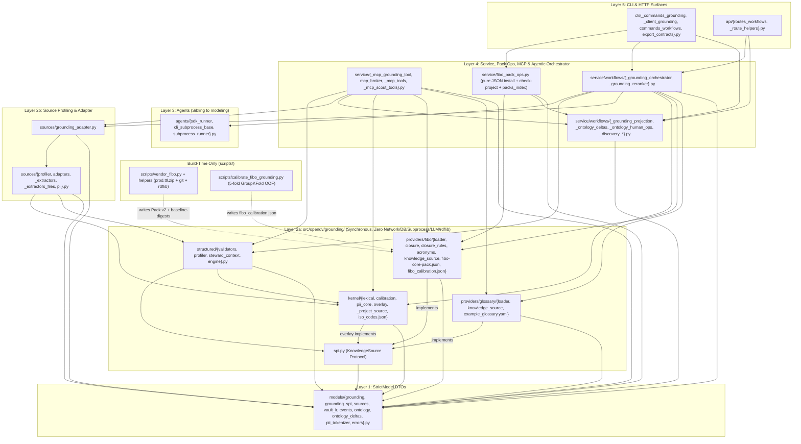
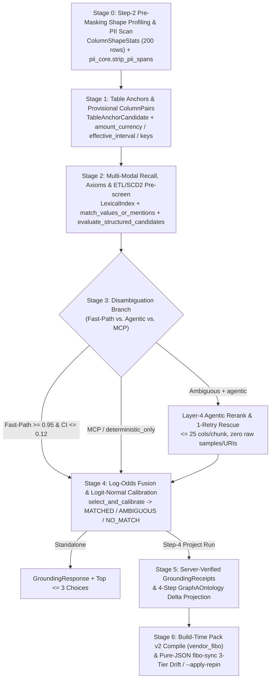

# Generic Two-Module Ontology Grounding Engine, FIBO Pack v2 & OSS FIBO Sync

*   **Author:** Eterna2
*   **Status:** Implemented (Milestones 1–4, Rebased on `main` `b25d9d9`, Non-Live Suite Verified)
*   **Date:** 2026-11-27
*   **Component README:** [`docs/components/grounding/README.md`](../components/grounding/README.md) · **User Guide:** [`docs/components/grounding/user-guide.md`](../components/grounding/user-guide.md) · **Contributor Guide:** [`docs/components/grounding/contributor-guide.md`](../components/grounding/contributor-guide.md) · **CLI Reference:** [`docs/16-cli-reference.md`](../16-cli-reference.md)

--------------------------------------------------------------------------------

## Overview

`open-dv` V2 constructs a conceptual domain ontology (`GraphAOntology`) in Steps 4–5 before synthesizing, verifying, and emitting five-zone (`Z0`–`Z4`) Data Vault 2.0 (`DV 2.0`) schemas across 11 target engines in Steps 6–7. Historically, `open-dv`'s ontology grounding (`src/opendv/sources/fibo/` and `src/opendv/service/bm25_matcher.py`) operated as a single-string lexical matcher over FIBO classes alone—dropping 999 extracted properties, almost all synonyms and OMG Commons (`cmns-*`) axioms, column data types and value shapes, sibling-table context, confidence calibration, and upstream FIBO sync.

This design replaces that legacy lexical matcher with an IO-abstracted **two-module architecture**:

1.  **Module 1A (`src/opendv/grounding/structured/` and `kernel/`):** A synchronous, deterministic neuro-symbolic structured column grounding engine paired with a Layer-4 agentic-by-default orchestrator (`service/workflows/_grounding_orchestrator.py`). It emits up to $\min(3, k_{90})$ `CandidateMapping` choices, closed-form Logit-Normal confidence intervals, typed `NO_MATCH` triage, reconciled `TableAnchorCandidate` partitions, and `ColumnPair` signals over in-memory `StrictModel` (forbid-extra Pydantic V2 base model) DTOs (`GroundingRequest` -> `GroundingResponse`).
2.  **Module 2 (`KnowledgeSource` SPI, `providers/{fibo, glossary}/`, `kernel/overlay.py`):** A pluggable synchronous knowledge-source protocol supporting an upgraded **FIBO Pack v2** (`2.0.0`, `master_2026Q3`: `2,240` classes, `767` properties, `942` individuals across configured modules `BE, CAE, DER, FBC, FND, IND, LOAN, MD, SEC`, local `cmns-*` axioms, single-copy restrictions with target fillers, curated individuals, and deprecation bridging), a configurable **YAML glossary** provider (`GlossaryKnowledgeSource`), and an in-memory **project overlay** (`OverlayKnowledgeSource` + `ProjectGraphASource`) for multi-wave continuity (`SCEN-09`).

Surrounding this core are build-time **OSS FIBO Sync** (`scripts/vendor_fibo*.py`, zero `rdflib` inside `src/opendv/`), pure-JSON runtime pack verification and 3-tier project drift auditing (`service/fibo_pack_ops.py`), pre-masking Step-2 `ColumnShapeStats` extraction across all source connectors, tamper-evident `GroundingReceipt` verification (`SCEN-07`), and unified CLI (`61` subcommands across `12` groups), REST (`72` OpenAPI operations including `POST /api/v1/ontology/ground`), and synchronous Step-4 MCP (`ground_columns`) interfaces.

### Domain & Grounding Glossary

| Term / Registry | Meaning in `open-dv` V2 |
| :--- | :--- |
| **Grounding Paths & Concept Memory** | `Path A` (`A1`: `skos:exactMatch`, `A2`: `skos:closeMatch` with Steward review) binds columns and concepts to reference standards (`external_mappings`); `Path B1` preserves domain concepts absent from reference ontologies (`out_of_vocabulary_domain`). Step-4 discovery uses a read-only `scout` agent and `coordinator` (`@ontology-first-mate`) proposing `OntologyDelta`s plus `ConceptMemorySpec` directives (`PINNED` boosts/preserves `origin_kind="reference_standard"`; `MUTED` suppresses rejected candidates). `opendv ontology fibo-qa` serves read-only Q&A atop `FiboPackQueryAdapter`. |
| **Evolution Scenarios (`SCEN-01`–`SCEN-09`)** | `Wave-1` locks deployed bindings (`EvolutionLockSpec`); `Wave-2` runs additive evolution: `SCEN-01` (exact match new source), `SCEN-02` (`closeMatch` steward confirmation/downgrade), `SCEN-03` (`Path B1` domain concept), `SCEN-04` (planned doc-only concept with `table_bindings=[]`), `SCEN-05` (additive attribute), `SCEN-06` (ambiguous hold resolution), `SCEN-07` (receipt provenance anti-tampering), `SCEN-08` (locked-key/link protection), and `SCEN-09` (multi-wave `OverlayKnowledgeSource`). |
| **FIBO Modules & 9 Archetypes** | Modules: `BE`, `CAE`, `DER`, `FBC`, `FND`, `IND`, `LOAN`, `MD`, `SEC` (`8` populated in `master_2026Q3`: `BE, CAE, DER, FBC, FND, IND, LOAN, SEC`). Archetypes: `identifier`, `code_classifier`, `temporal`, `quantity_measure`, `value_object`, `party_role`, `event_occurrence`, `agreement`, `entity`. |
| **DV 2.0 & Verifier Cross-Refs** | `BKCC` (3-tier key authority), `sal_*` (Same-As Link), `hal_*` (Hierarchical Link), `lnk_*` (`UoW` Link), `t_lnk_*` (Transactional Link), `sat_*` / `sat_*_pii` / `mas_*` (`CDK`) / `esat_*`, `AP-09`/`DV-COL-008` (no `applied_dts` in `hash_diff`), `AP-11` (duplicate Hub splits), `AP-12`/`AP-15`/`ONT-AP-002` (reference-code/literal Hub misuse), `ONT-AP-001` (god-table cloning), `ONT-AP-003` (multiple unlinked BKs), `ONT-AP-005` (`PII_ISOLATION` missing), `DV-COL-001` (100% triage), `DV-COL-002` (keyless Hub), `DV-COL-011` (`applied_dts`), `DV-COL-013` (`TIER_1` `bkcc='GLOBAL'`), `DV-STR-004` (role FK uniqueness), `DV-STR-015` (ordered `sal_*`), `DV-AP-004` (lookup-as-Hub), `DV-AP-007` (events require `t_lnk_*`), `DV-EVO-003` (locked Hub/Link immutability), `TMP-03` (unresolved FK stub), `REQ-45` (multi-concept table splitting). |
| **Platform Gates & Helpers** | `AgentHarnessPort`, `BrokerBudgetTracker`, `V2_LAYER_BANS`, `D16` (`< 5,000` `cl100k_base` tokens/module), `D28` (zero silent synthetic fallbacks), `T14` (hardening AST checks), `contains_forbidden_jargon()`, `SOURCE_PREFIX_RE`, and `GROUNDING_MIN_CONFIDENCE` (`0.6500`). |

--------------------------------------------------------------------------------

## The Problem

Empirical analysis identified five structural gaps in legacy Step-4 grounding:

1.  **Extracted FIBO Properties & Reified `ObjectProperty` Ranges Were Ignored:**
    Legacy `fibo-core-pack.json` (`master_2024Q4`, 6 modules: `BE`, `FBC`, `FND`, `IND`, `LOAN`, `SEC`) contained `2,206` classes and `999` properties (mostly reified value objects such as `ExplicitDate`, `MonetaryAmount`, `EntityLegalForm`, and `ConventionalStreetAddress`), yet `concepts_from_fibo_loader()` indexed only classes, `SubclassClosureResolver` traversed only `sub_class_of`, and `ConceptAttribute`, `OntologyRelationship`, and `OntologyEnumeration` lacked fields to retain grounded property URIs or role bindings (`role_uri`, `played_by_uri`).
2.  **Near-Zero Synonyms and Missing OMG Commons (`cmns-*`) Axioms:**
    Legacy `scripts/vendor_fibo_extract.py` skipped external `cmns-*` files and read only `skos:altLabel` (`1/2,206` classes and `0/999` properties with synonyms; `406/999` properties missing `domain`), omitting `cmns-av:synonym`/`abbreviation`, `owl:Restriction` fillers and cardinality, `owl:inverseOf`, `owl:InverseFunctionalProperty`, `owl:disjointWith`, `cmns-rlcmp:isPlayedBy`, `cmns-dsg:denotes`, curated `owl:NamedIndividual`s, and `owl:deprecated`/`dct:isReplacedBy`.
3.  **Single-String Lexical Bias, Score Clobbering & Coupled Acronyms:**
    `Bm25ConceptMatcher` accepted only `query: str`—ignoring SQL/logical types, value checksums/shapes, `fk_ref`/`pk_ord`, sibling columns, and steward prose—while `_ontology_deltas.py` and `_discovery_ontology.py` overwrote `ExternalMapping.confidence` via single-string `rescore_mapping()`. `FINANCIAL_ACRONYMS` (`"sec"`) lived inside the generic tokenizer.
4.  **No Probability Calibration, Confidence Intervals, Mass Cutoff, or Typed Abstention:**
    Callers received raw heuristic BM25 scores without a null-match hypothesis ($\varnothing$), `[lower, upper]` CI bounds, $\min(3, k_{90})$ candidate truncation, or typed `no_match_category` separating `Path B1` domain concepts from technical surrogates and audit metadata.
5.  **Hardcoded Stale FIBO Pin & Pre-Truncated Step-2 Profiling:**
    `master_2024Q4` / `CANONICAL_FIBO_CORE_SHA256` was duplicated with no upstream sync or multi-wave drift auditing. Step 2 truncated `sample_values` to $\le 5$ rows and masked PII before capturing shape/checksum statistics, while `5` of `6` connectors emitted `fk_ref=None` and `4` of `6` emitted `is_pk=False`.

--------------------------------------------------------------------------------

## Goals

*   **Decoupled Synchronous Two-Module Grounding Core (`src/opendv/grounding/`):** Separate modality-neutral runtime kernel primitives (`kernel/`, reusable for planned Module 1B) and tabular structured inference (`structured/`) from static reference backends (`providers/fibo/` JSON, `providers/glossary/` YAML) and Step-2 profiling (`sources/grounding_adapter.py`) under AST layer bans and `< 5,000`-token module caps (`D16`).
*   **Layer-4 Agentic-by-Default Orchestration with Calibrated Logit-Normal CIs:** Keep Layer-2a `grounding/` 100% synchronous and deterministic while Layer 4 orchestrates gated symbolic fast-paths, table-chunked `RerankFn` turns (zero raw sample values, strict raw-PII stripping/suppression, bounded 1-retry rescue), explicit `mode="deterministic_only"` (`skip_reason` required), Logit-Normal $[L_i, U_i]$ CIs, $\min(3, k_{90})$ selection, $L_1 \ge 0.45$ + $n_{\text{eff}} > 0$ gating, and typed `no_match_category` triage.
*   **FIBO Pack v2 (`2.0.0`), Build-Time Sync & Zero-`rdflib` Runtime Drift Ops:** Upgrade bundled compilation in `scripts/vendor_fibo*.py` (zero `rdflib` inside `src/opendv/`) to resolve local `cmns-*` axioms, single-copy restrictions, 9-archetype priority classification, allowlisted individuals, and deprecation bridging (`replaces_uris`), paired with pure-JSON installation and 3-tier `--check-project [--apply-repin]` drift auditing (`service/fibo_pack_ops.py`).
*   **Provenance-Preserving Step 4–5 Integration & Stratified M3 Calibration:** Compute pre-masking `ColumnShapeStats` once inside Step 2 (zero double-reads), project classes, properties, role links, alternative/composite keys, junction payloads, and enumerations into `GraphAOntology` (`SCEN-01`–`SCEN-09`), enforce server-minted `GroundingReceipt` verification (blocking `.opendv.zip` receipt laundering without breaking valid exported projects), and calibrate 4 low-DOF scalars via 5-fold table-grouped `GroupKFold` (`130` dev / `60` held-out).
*   **Unified CLI, REST, Step-4 MCP & Contract Parity:** Expose `opendv ontology ground` (`POST /api/v1/ontology/ground`), `opendv ontology fibo-sync`, and synchronous Step-4 MCP `ground_columns` (`<= 64 KB`), and maintain contract parity across `schemas/v2/` (`61` CLI subcommands, `72` OpenAPI operations, `36` `OntologyDelta`s) and `docs/16-cli-reference.md`.

--------------------------------------------------------------------------------

## Non-Goals

*   **Module 1B (`src/opendv/grounding/unstructured/`):** Document/PDF unstructured grounding will build later atop `KnowledgeSource` and `kernel/` (no empty `unstructured/` folder is created yet).
*   **Step 6 DV 2.0 Synthesis Prompt / Turtle Export Expansion:** Beyond aligning `cusip`/`mic` key-tier hints in `_l1_rules_alg.py` and renaming `_v6b_vault_ap.py`'s business-ID exemption set (`_KNOWN_STANDARD_ENTITY_IDS`), downstream Turtle export additions for new optional `GraphAOntology` fields remain deferred.
*   **Full OWL 2 DL Theorem Proving & Bulk `ISO3166-2`:** No `HermiT`/`Pellet` reasoning, no remote network `owl:imports` during compilation, and no bulk `ISO3166-2` sub-national subdivision extraction.
*   **Pack Pinning Inside `.opendv.zip` / `ProjectSettingsSnapshot` & HTTP `fibo-sync` / UI Panels:** Custom pack selection uses `--fibo-pack` / `OPENDV_FIBO_PACK_PATH` plus local `fibo-sync --check-project`; UI forms and HTTP `fibo-sync` endpoints remain out of scope (`fibo-sync` rejects `--api-url`).
*   **Per-File `do_not_send_to_agent` Legacy Flags:** Remain retired per V2 clean-sheet privacy rules.

--------------------------------------------------------------------------------

## Open Questions

None.

--------------------------------------------------------------------------------

## Critical User Journeys (CUJs)

### CUJ 1: Agentic-by-Default Column Grounding with Privacy & Fast-Path Guards

*   **Given:** A user invokes standalone grounding (`opendv ontology ground` or `POST /api/v1/ontology/ground`) on tables containing standardized identifiers (`cusip`, `custodian_lei`), shorthand columns (`maturity_ext_flg`, `cust_nm_full`), externally pre-masked PII lacking Step-2 `precomputed_shape` ($n_{\text{eff}} = 0$), and ETL metadata (`etl_run_digest`), with an active LLM harness.
*   **When:** Stage 0 scans PII and reuses Step-2 `ColumnShapeStats` (or profiles in-memory literals, stripping raw PII from prose); Stages 1–2 compute symbolic scores (`ground_symbolic`); and Layer-4 `_grounding_orchestrator.py` bypasses the LLM on gated fast-paths while batching ambiguous columns in bounded `<= 25`-col chunks (integer indices, zero raw sample strings) plus at most one `suggested_search_terms` rescue pass.
*   **Then:** Qualified fast-path columns match deterministically; shorthand columns resolve via table-batched turns; externally pre-masked $n_{\text{eff}} = 0$ columns receive widened CIs (`review_reason="unverified_masked_values"`) blocking auto-promotion; semantic PII inherits `pii_category_hint`; and `etl_run_digest` abstains as `NO_MATCH(system_audit_metadata)`.

### CUJ 2: Step 4–5 Projection & Multi-Wave Evolution Into DV 2.0 `GraphAOntology` (`SCEN-01`–`SCEN-09`)

*   **Given:** A `Wave-1` workspace executes Step-4 ontology discovery (`@ontology-first-mate`) followed by a `Wave-2` additive run via `OverlayKnowledgeSource` (`[ProjectGraphASource, FiboKnowledgeSource]`) containing committed `Path B1` concepts, `PINNED`/`MUTED` concept memory, and an upgraded FIBO URI.
*   **When:** `@ontology-first-mate` calls synchronous Step-4 MCP `ground_columns` ($\le 64\text{ KB}$, executing `engine.ground_symbolic()` + `engine.finalize()` with zero nested LLM turns), which mints server `GroundingReceipt` rows in `project.sqlite` and partitions `suggested_deltas`. Coordinator stages deltas via `propose_ontology_delta`, and Step 5 validates each `grounding_receipt_id` (`target_kind`, `table_id`, `table_bindings`, `schema_fingerprint`) before OCC commit:
    *   Reified value-object, `temporal`, and `quantity_measure` ranges route to `AddAttribute` or `AddEnumeration` instead of spurious Links (`AP-15` / `ONT-AP-002`).
    *   Undeclared FKs (`fk_ref=None`), hierarchical self-references (`parent_lei` -> `hal_*`), immutable events (`t_lnk_*`), and mandatory co-occurring role LEIs (`UoW lnk_*`) emit `AddRelationship` with role, player, source-table, anchor, and `link_attributes` metadata.
    *   Alternative keys (`isin` + `cusip`) elect the highest-authority primary BK (`is_business_key=True`), emit ordered `KeyAuthorityPattern`s, keep single-table secondaries in `sat_*`, and emit `sal_*` strictly across cross-wave/cross-source/crosswalk joins without mutating locked Hub BKs (`DV-EVO-003`).
*   **Then:** Multi-table, role-playing, PII-isolated, and multi-wave `GraphAOntology` models commit without `AP-11` duplicates, `DV-COL-002` keyless Hubs, or `DV-EVO-003` lock regressions.

### CUJ 3: Domain-Neutral Glossary Grounding (`GlossaryKnowledgeSource`)

*   **Given:** A SaaS analytics workspace provides [`example_glossary.yaml`](../../src/opendv/grounding/providers/glossary/example_glossary.yaml) (flat or structured with `kind`, `domain_entity`, `target_entity`, `identifies`, `identifier_scope`, `pii_category_hint`, `pattern`, `allowed_values`) and grounds `billing_records` columns (`invoice_id`, `customer_id`, `order_total_amount`, `iso_currency_code`, `subscription_status`, `etl_run_digest`).
*   **When:** `ColumnGroundingEngine` runs against `GlossaryKnowledgeSource` without financial checksum heuristics.
*   **Then:** Modality completeness $\rho_{\text{mod}}$ adapts to active applicable channels, terms match with calibrated Logit-Normal CIs and `skos:exactMatch`/`skos:closeMatch` predicates, flat or structured glossaries project cleanly into `GraphAOntology`, and `etl_run_digest` triages as `NO_MATCH(system_audit_metadata)`.

### CUJ 4: Build-Time FIBO Compilation, Runtime Pack Verification & 3-Tier Project Drift Audit

*   **Given:** Maintainers compile EDM Council FIBO into Pack v2 JSON using `scripts/vendor_fibo.py` (using dev-only `rdflib>=7.0.0`, hardened archive/XML security, and HTTPS `prod.ttl.zip`), or operators install a release pack and check projects locally with `opendv ontology fibo-sync`.
*   **When:** `service/fibo_pack_ops.py` verifies Pack v2 schema, JCS SHA-256 integrity, and the `fibo-<tag>-<sha8>.json` suffix, atomically installs into `<OS_USER_STATE>/opendv/packs/fibo/` (`packs_index.json`), and executes `--check-project <id> [--apply-repin]`.
*   **Then:** `deprecated_with_replacement` emits safe upgrade deltas (`RepinExternalMapping`, `UpdateAttributeMetadata`, `UpdateRelationshipMetadata`, `UpdateEnumerationMetadata`) preserving server-verified `max(prior_receipt.confidence, lexical_score)` solely on matching `(old_standard_uri, table_id, schema_fingerprint)` receipts with `table_bindings`, `removed_or_split` alerts stewards, and `pack_sha256_mismatch` warns without clobbering project history.

### CUJ 5: Contributor Architecture, Token-Budget (`D16`) & Contract Parity Enforcement

*   **Given:** A contributor modifies `src/opendv/grounding/`, `src/opendv/service/`, CLI routes, or `ErrorCode` descriptions.
*   **When:** They run `tests/architecture/`, `tests/docs/`, `export_contracts --check`, `generate_cli_reference.py`, `check_error_codes.py`, `ruff`, and `mypy`.
*   **Then:** `V2_LAYER_BANS` confirms zero `rdflib` inside `src/opendv/`, `yaml` restricted exclusively to `providers/glossary/loader.py`, stdlib network/subprocess bans across `grounding/`, every module `< 5,000` tokens (`D16`), zero clone violations, and full `61` CLI / `72` HTTP / `36` delta contract parity.

--------------------------------------------------------------------------------

## Technical Plan (Architecture)

### 1. System Architecture, Two-Path Acyclic DAG & Layer Boundaries

`open-dv`'s module dependencies point strictly downward along a 5-layer acyclic DAG checked statically by [`tests/architecture/test_import_contracts.py`](../../tests/architecture/test_import_contracts.py), isolating build-time OWL parsing in `scripts/` and keeping Layer-2a `src/opendv/grounding/` synchronous and I/O-free:

#### Layering & AST Enforcement Summary

*   **Synchronous Layer-2a `src/opendv/grounding/`:** Free of database, source-connector, network (both third-party HTTP libs and stdlib `urllib`/`http`/`socket`/`subprocess`), LLM SDK, `agents`, `modeling`, `service`, `api`, `cli`, `verifier`, and `rdflib` imports.
*   **Modality-Neutral `kernel/` vs. Tabular `structured/`:** `kernel/` (`lexical`, `calibration`, `pii_core`, `overlay`, `_project_source`, `iso_codes.json`) depends only on Python stdlib, `opendv.models`, and `grounding.spi` (breaking cycles by placing `CalibrationParams` in `models/grounding_spi.py`), preparing shared primitives for planned Module 1B (`unstructured/`). `structured/` (`validators`, `profiler`, `steward_context`, `engine`) depends on `kernel/` and `spi.py`; neither `kernel/` nor `structured/` imports `grounding/providers/`. Financial checksum interpretation runs inside `FiboKnowledgeSource.match_values_or_mentions()`, keeping `structured/` domain-neutral.
*   **Layer-4 Filesystem/Index Isolation vs. Layer-2a Pack Loading:** Layer-2a `providers/fibo/loader.py` accepts verified `pack_path`/`expected_sha256` or pre-read bytes, while Layer-4 `service/fibo_pack_ops.py` owns `<OS_USER_STATE>` `packs_index.json`, owner-only ACLs, and `os_platform.py` + `zip_guard.py` UNC/ADS/symlink/`safe_open_no_follow(..., stop_roots=[packs_dir])` path containment.
*   **`yaml` & `rdflib` Isolation & Type Mapping Unification:** `yaml` (`pyyaml`, `AliasNode`-free `SafeLoader`) is permitted exclusively in `grounding/providers/glossary/loader.py` via `PER_FILE_IMPORT_EXCEPTIONS` in `tests/architecture/test_import_contracts.py` (banned everywhere else in `grounding/`). `rdflib` stays banned across the entire `src/opendv/` runtime tree—confined exclusively to `scripts/vendor_fibo*.py`. `opendv.sources -> opendv.grounding` remains allowed (`models`, `verifier`, `storage`, `agents`, `modeling`, `api`, `cli` ban `opendv.grounding`). `map_sql_to_portable_type` lives in Layer-1 `models/vault_ir.py`, preserves canonical `PortableLogicalType` literals before SQL parsing, and provides single precision-safe (`DECIMAL(38,10)`) normalization across Steps 4 and 6.

---

### 1.5 End-to-End Stage-by-Stage Execution Walkthrough (Stages 0–6)

*   **Stage 0 (`sources/profiler.py`, `grounding/structured/profiler.py`, `grounding/kernel/pii_core.py`):** Step-2 adapters extract up to `200` `shape_samples` per column before masking (zero double-reads on DB/files), computing `ColumnShapeStats` (`structural_patterns`, strict code-token `observed_enum_values`, `surrogate_kind`, canonical sentinels, and `pii_suppressed=True` clearing min/max on PII). Ad-hoc requests pass through `steward_context.profile_column_evidence()` and `pii_core.strip_pii_spans()`.
*   **Stage 1 (`structured/engine.py`, `structured/steward_context.py`):** Recalls `TableAnchorCandidate` hypotheses when `source.metadata.anchor_entry_kinds` is non-empty (filtering across entity/agreement/event/role archetypes uniformly across FIBO and structured glossaries) and detects provisional `paired_columns`.
*   **Stage 2 (`kernel/lexical.py`, `providers/{fibo,glossary}/knowledge_source.py`):** Pre-screens unambiguous ETL/SCD2 metadata columns (`system_audit_metadata`), expands context-guarded query tokens (`should_expand_sec`), recalls lexical + checksum/value/individual hits, runs `evaluate_structured_candidates` (reified range checks, `inverse_of` direction reciprocity, ancestor-closed `disjoint_with`, functional keys, and hard range vetoes), and reconciles final `paired_columns` and anchor ownership scores.
*   **Stage 3 (`_grounding_orchestrator.py`, `_grounding_reranker.py`, `_mcp_grounding_tool.py`):** Evaluates `check_fast_path_eligible`; routes remaining columns in standalone `agentic` mode through PII-scanned, nonce-delimited `RerankColumnPacket` batches (`<= 25` cols/chunk, forced structured output on `SdkHarnessRunner`/`SubprocessHarnessRunner`, max 1 `suggested_search_terms` rescue pass); or runs synchronous `finalize(..., rerank_results=None)` under MCP `ground_columns` (`<= 64 KB` cascade).
*   **Stage 4 (`kernel/calibration.py`):** Evaluates per-candidate observed/active modalities $\mathcal{M}_{\text{obs}}(x) \cap \mathcal{M}_{\text{active}}(c_i)$, computes softmax probabilities with null class $P(\varnothing)$ and Logit-Normal $[L_i, U_i]$ CIs, selects $\min(\text{max\_choices}, k_{90})$, assigns `MATCHED` / `AMBIGUOUS` / `NO_MATCH`, determines `skos:exactMatch` / `skos:closeMatch` / `skos:relatedMatch`, and finalizes `AND`-gated `technical_surrogate` triage.
*   **Stage 5 (`_mcp_grounding_tool.py`, `_grounding_projection.py`, `_ontology_deltas.py`):** Mints `server_verified` `GroundingReceipt` rows in `project.sqlite` for `reference_standard` `exactMatch`/`closeMatch` anchors and `MATCHED` columns, executes the 4-step deterministic projection sequence (`Phase A` triage -> `Row 2` table anchors -> `Row 9 + Phase B` columns -> coalesced `SetConceptGovernanceTags`), and enforces receipt/scope/lock invariants on OCC commit.
*   **Stage 6 (`scripts/vendor_fibo*.py`, `service/fibo_pack_ops.py`):** Compiles upstream `prod.ttl.zip` at build time into Pack v2 JSON (`baseline-digests.json`), and at runtime installs verified packs atomically into `<OS_USER_STATE>/opendv/packs/fibo/` and executes 3-tier `--check-project [--apply-repin]` drift audits without `rdflib`.

---

### 2. Data Contracts, Synchronous SPI & Layer-4 Agentic Orchestration

*   **Layer-1 Pure DTOs (`src/opendv/models/`):**
    *   **Profiles & Receipts:** `models/sources.py` adds `SurrogateKind` and `ColumnShapeStats` (with `pii_suppressed`, `detected_sentinels`, and strict code-token `observed_enum_values`) on `ColumnProfile.shape_stats`. `models/events.py` adds `"grounding_receipt"` (`VALID_RECORD_KINDS` in `_state_ddl.py`) and `GroundingReceipt(StrictModel)` persisted via `ProjectStateManager.append_event_or_receipt` / `list_events_or_receipts`.
    *   **Ontology Additive Fields & Metadata Repin Ops:** `models/ontology.py` adds `ConceptAttribute.standard_property_uri`, `ExternalMapping.grounding_receipt_id`, `OntologyRelationship.{standard_property_uri, role_uri, played_by_uri, source_table_id, source_col_name, target_col_name, source_anchor_col_name, link_attributes}`, and `OntologyEnumeration.standard_uri`. `models/ontology_deltas.py` updates `UpdateAttributeMetadata`, `RepinExternalMapping.{replaced_standard_uri, grounding_receipt_id}`, `AddAttribute`, `AddRelationship`, `AddEnumeration`, and adds `UpdateRelationshipMetadata` + `UpdateEnumerationMetadata` (`HUMAN_ONLY_OPS` = `19`, total `OntologyDelta` = `36`).
    *   **Public & SPI DTOs (`models/grounding.py`, `models/grounding_spi.py`):** Public API/CLI DTOs (`GroundingRequest` capped at `50` tables / `500` cols, `OntologyGroundReq` XOR validator, `GroundingResponse`, `FiboSyncReq`/`FiboSyncResp`) live in `models/grounding.py`, while `10` internal SPI/rerank DTOs (`CalibrationParams`, `KnowledgeSourceMetadata`, `KnowledgeItem`, `RecallHit`, `TableReasoningContext`, `BackendReasoningResult`, `RerankCandidateSummary`, `RerankColumnPacket`, `TableRerankAssignment`, `TableRerankResult`) live in `models/grounding_spi.py` (excluded from `models/__init__.py` for `D16`). `TableRerankResult.model_json_schema()` emits an explicit `anyOf` schema separating selected vs abstained assignments.
*   **Synchronous `KnowledgeSource` Protocol & `OverlayKnowledgeSource`:**
    *   `grounding/spi.py` defines `KnowledgeSource` (`metadata` + `calibration_params` properties and 7 synchronous methods).
    *   `grounding/kernel/_project_source.py` + `overlay.py` provide `ProjectGraphASource` (indexing committed concepts including `SCEN-04` planned concepts, attributes, enumerations, relationships, `external_mappings[*].standard_uri`, `PINNED` concept memory preserving `origin_kind="reference_standard"` on uncommitted FIBO URIs, and free-text `steward_answers`) and `OverlayKnowledgeSource` (folding Wave-1 items/subclasses, filtering `MUTED` entries, and bypassing under `full_rebuild`).
*   **Layer-4 Agentic Orchestrator (`_grounding_orchestrator.py` + `_grounding_reranker.py`):**
    *   Enforces server-side caps, bounded concurrency (`Semaphore(4)`), and `HarnessBudget`; eagerly loads `SdkHarnessRunner` SDK modules in `mode="agentic"`; runs `engine.ground_symbolic()` synchronously; bypasses qualified fast-path columns; executes forced-tool (`tools == []`) / `--json-schema` batches (`<= 25` cols); performs at most 1 bounded `suggested_search_terms` rescue pass; and finalizes via `engine.finalize()`.

---

### 3. Inference Pipeline, Calibration Equations, Selection Gates & Error Contracts

#### Modality-Aware Log-Odds Fusion & Logit-Normal CI Equations (`kernel/calibration.py`)

*   **Channels $\phi_m(c_i, x) \in [-1, 1]$:**
    *   `lex`: $\phi_{\text{lex}}(c_i) = 2 \cdot s_{\text{lex}}(c_i) - 1$ (`hit_gate_cap = 0.6400` when definition-only without label/synonym token overlap).
    *   `surface`: `+1.0` on passing checksum or exact individual/ISO/`allowed_values` match; `+0.6` on checksum-less pattern (`SWIFT BIC`, YAML `pattern`) with token alignment; `-0.8` on format contradiction; `0.0` when `"surface" in` $\mathcal{M}_{\text{obs}}(x)$ and candidate has no validator.
    *   `shape_range`: `+1.0` exact declared+shape+reified range match; `+0.2` generic string fallback; `-0.9` soft range conflict; `hard_veto=True` excludes candidate before softmax.
    *   `anchor`: $\phi_{\text{anchor}}(c_i) = \operatorname{clip}(\text{base\_anchor} + \text{inverse\_direction\_score}, -1.0, 1.0)$ where `base_anchor` gives `+1.0` on top anchor alignment and `-0.7` on `rdfs:domain` `disjoint_with` conflict (skipped for `identified_entity_uri` on FKs), folded with `inverse_direction_score` (`+0.3` / `-0.4` / `0.0`).
    *   `agent`: Under `abstain=True`, $\phi_{\text{agent}}(c_i) = -0.5 \cdot \text{confidence}$ and $s_{\varnothing,\text{abstain}} = w_{\text{agent}}(0.5 + \text{confidence})$; else $\phi_{\text{agent}}(c_{\text{idx}}) = +\text{confidence}$, $\phi_{\text{agent}}(c_j) = -\text{confidence}$, and $s_{\varnothing,\text{abstain}} = 0$.
*   **Observed vs Candidate-Active Modalities ($\mathcal{M}_{\text{obs}}(x)$ vs $\mathcal{M}_{\text{active}}(c_i)$):**
    *   $\mathcal{M}_{\text{obs}}(x)$ includes `"lex"`, `"surface"` ($n_{\text{eff}} > 0$ and validator/pattern exists), `"shape_range"`, `"anchor"` (`bool(anchor_entry_kinds)` and `enable_table_context` and top anchor present), and `"agent"` (only when valid rerank assignment exists).
    *   $\mathcal{M}_{\text{active}}(c_i)$ includes `"lex"`, `"shape_range"`, applicable `"surface"`, `"anchor"`, and `"agent"` (only when rerank ran on non-fast-pathed column in `agentic` mode — never during `ground_symbolic`, un-reranked MCP `symbolic_only`, or `deterministic_only`).
*   **Softmax, Disagreement & Uncertainty:**
    $$z_i = \beta_0 + \sum_{m \in \mathcal{M}_{\text{obs}}(x)} w_m \phi_m(c_i, x), \qquad s_\varnothing = s_{\varnothing,\text{base}} + \gamma_\varnothing \sum_{m \in \mathcal{M}_{\text{obs}}(x)} w_m + s_{\varnothing,\text{abstain}}$$
    $$\rho_{\text{mod}}(c_i) = \frac{|\mathcal{M}_{\text{active}}(c_i) \cap \mathcal{M}_{\text{obs}}(x)|}{\max(1, |\mathcal{M}_{\text{active}}(c_i)|)}, \qquad n_{\text{eff}}^{\text{cap}} = \min(200, n_{\text{eff}})$$
    $$\sigma_{\text{eff}}(c_i) = \sigma_{\text{base}} + \frac{\alpha_n}{\sqrt{n_{\text{eff}}^{\text{cap}} + 1}} + \alpha_{\text{mod}}(1 - \rho_{\text{mod}}(c_i)) + \alpha_{\text{disagree}} \cdot \sigma_{\text{disagree}}(c_i)$$
    where $\sigma_{\text{disagree}}$ computes population standard deviation over distinct active observed channels excluding neutral `phi_anchor == 0.0` (`0.0` if $< 2$ channels).
*   **Logit-Normal CIs & Gates:** Bounds clamp at $\epsilon = 10^{-6}$ via `statistics.NormalDist().inv_cdf((1 + ci_level)/2)`:
    $$L_i = \min\big(p_i, \sigma(\operatorname{logit}(p_i^{\text{clamp}}) - c_{\text{cal}} z_{\text{level}} \sigma_{\text{eff}}(c_i))\big), \qquad U_i = \max\big(p_i, \sigma(\operatorname{logit}(p_i^{\text{clamp}}) + c_{\text{cal}} z_{\text{level}} \sigma_{\text{eff}}(c_i))\big)$$
    Fast-path requires $p_{\text{sym}} \ge 0.95$, $U_1 - L_1 \le 0.12$, $\sigma_{\text{eff}} \le 0.65$, $\sigma_{\text{disagree}} \le 0.25$, $0$ vetoes, and checksum/corroboration (standalone checksum-less `SWIFT BIC` stays out of fast-path). `MATCHED` requires $k^* = 1$ (after $\min(\text{max\_choices}, k_{90})$ + `0.03` tail prune), $P(\varnothing) < 0.25$, $p_1 \ge 0.65$, $L_1 \ge 0.45$, and $n_{\text{eff}} > 0$.

#### Calibration Defaults, Verified OOF Fit & Held-Out Benchmark Results

*   **Analytic Defaults (`CalibrationParams.analytic_defaults()`):** `channel_weights={"lex": 2.2, "surface": 2.4, "shape_range": 1.8, "anchor": 1.1, "agent": 2.0}`, `beta_0=-1.2`, `T=1.0`, `s_null_base=0.0`, `gamma_null=0.15`, `sigma_base=0.25`, `alpha_n=0.85`, `alpha_mod=0.75`, `alpha_disagree=1.10`, `c_cal=1.0`, `fast_path_min_prob=0.95`, `fast_path_max_ci_width=0.12`, `fast_path_max_eff_sigma=0.65`, `fast_path_max_disagree=0.25`, `min_top1_probability=0.20`, `matched_min_top1_probability=0.65`, `matched_min_lower_bound=0.45`, `ambiguous_null_threshold=0.25`, `min_tail_probability=0.03`, `max_effective_sample_count=200`.
*   **M3 Calibrated Fit (`scripts/calibrate_fibo_grounding.py --verify-heldout`, `fibo_stratified_benchmark_v1.json` = `190` cols, `split_seed=20261126`):** Fits 4 low-DOF scalars (`T=0.5`, `s_null_base=-1.22`, `gamma_null=0.1`, `c_cal=2.95`) over 5 table-grouped `GroupKFold` splits (`n_dev=130`, `n_dev_views=194` with 25% shape dropout and 25% empty-anchor dropout) and verifies on `n_heldout=60` (`n_positive=52`):

| Held-Out Metric / Stratum | Observed Result (`--verify-heldout`) | Gate Bound |
| :--- | :--- | :--- |
| **`top1_acc` / `top3_recall` / `overall_acc`** | `0.9615` / `0.9808` / `0.95` | `top1_acc >= 0.80`, `top3_recall >= 0.92` |
| **`path_b1_f1` / `no_match_f1`** | `0.8571` / `0.875` | `path_b1_f1 >= 0.80` |
| **`abstain_ECE` / `ci90_coverage` / `oof_ci90_coverage`** | `0.0332` / `0.931` / `0.8539` | `ECE <= 0.08`, `ci90 in [0.82, 0.96]` |
| **`cusip_fast_path_ok` / `starter_packs_ok`** | `true` / `true` | Both `true` |
| **Per-Stratum Accuracy (`n` / 95% binomial HW)** | `FDIC`: `1.0` (`n=9`), `FRED/ECB`: `0.8889` (`n=9`), `GLEIF`: `0.8889` (`n=9`), `ISDA/OTC`: `1.0` (`n=9`), `OpenFIGI`: `1.0` (`n=8`), `SEC EDGAR 13F/XBRL`: `1.0` (`n=8`), `NO_MATCH`: `0.875` (`n=8`) | Reported with exact `~0.20–0.23` binomial CI half-widths |

#### Relevant Subset of Closed 34-Code `ErrorCode` Mapping (`src/opendv/models/errors.py`)

| Condition | `ErrorCode` | HTTP / Exit |
| :--- | :--- | :--- |
| `mode="agentic"` without configured harness | `AGENT_NOT_CONFIGURED` | 422 / Exit 2 |
| Missing CLI binary or optional extra (`databricks`, `ocr`, `sdk`) | `DRIVER_MISSING` | 422 / Exit 2 |
| `mode="deterministic_only"` blank `skip_reason`, invalid YAML regex, BOM/bad JSON, `--api-url` on `fibo-sync`, UNC/ADS/symlink asset path | `SYNTAX_INVALID_ARGUMENT` | 400 / Exit 2 |
| Non-null path on remote HTTP request or path outside containment roots on `POST /api/v1/ontology/ground` | `LOOPBACK_ORIGIN_FORBIDDEN` | 403 / Exit 2 |
| Missing custom pack or missing project/table/glossary file | `RESOURCE_NOT_FOUND` | 404 / Exit 2 |
| `<MASKED_PII>` or `[REDACTED_*]` placeholder leak into LLM prompt | `REDACTED_PLACEHOLDER_LEAK` | 422 / Exit 2 |
| Invalid/unsafe zip or tar archive member (`scripts/vendor_fibo*.py` -> `ArchiveSecurityError`) | `ARCHIVE_SECURITY_VIOLATION` | 422 / Exit 2 |
| Tampered/mismatched `grounding_receipt_id`, `imported_unverified` receipt reuse, or locked evolution breach | `ONT_EVO_CONTRACT_VIOLATION` | 422 / Exit 2 |
| Step-4 MCP `BrokerBudgetTracker` budget exhaustion | `UNCERTIFIED_DRAFT` | 202 / Exit 5 |
| `RerankFn` timeout, API limit, malformed JSON, or invalid candidate index | `AGENT_EXECUTION_FAILED` | 502 / Exit 1 |
| Corrupt Pack v2 JSON / SHA-256 mismatch / failed archive extract | `REFERENCE_PACK_INTEGRITY_FAILURE` | 500 / Exit 1 |
| `--update-repo` broken `starter_packs/` URI or pack budget fail | `VERIFICATION_GATE_FAILED` | 422 / Exit 2 |

---

### 4. Step 4–5 Projection (`GraphAOntology`) & `GroundingReceipt` Security (`SCEN-01`–`SCEN-09`)

Step-4 projection (`src/opendv/service/workflows/_grounding_projection.py`: `project_grounding_to_deltas`) evaluates `GroundingResponse` in an explicit **4-step deterministic sequence** so `NO_MATCH`/`AMBIGUOUS`/`skos:relatedMatch` columns never auto-commit into `Path A` and table concepts ($A$) always exist before column deltas emit:

1.  **Phase A column triage:** Bucket Row 10 (`technical_surrogate | system_audit_metadata`), Row 8 (`AMBIGUOUS | insufficient_evidence | below_threshold`), and Row 9 (`out_of_vocabulary_domain | skos:relatedMatch`) without emitting deltas yet.
2.  **Row 2 table-anchor resolution (`TableAnchorCandidate` & structural guards):** Evaluate Hub-less junctions (`t_lnk_*` / `hal_*`), `MAS` child tables (`1` FK + `CDK`), unambiguous `played_by_uri` role folding, standalone `AP-12` reference tables -> `AddEnumeration`, `project_graph_a` `EXTENDS` (`>= 0.6500`), `reference_standard` `Path A` coalesced `AddConcept`, or table-derived `Path B1` empirical `AddConcept` (`SOURCE_PREFIX_RE` stripped, PK or unique non-null non-PII non-surrogate fallback else Row-8 Hold).
3.  **Row 9 + Phase B column delta emission (Rows 1, 3–7):**
    *   **Row 1 (`project_graph_a` same-concept extension):** Single deduplicated key/anchor `AddTableBinding` and non-identifier attributes; FKs/enums/relationships fall through cleanly.
    *   **Row 3 (`identifier` + PII Guard + Ownership Guard):** PII-tagged keys isolate via `"PII_ISOLATION"` onto `sat_*_pii`; own BKs establish 3-Tier `SetConceptKeyAuthority` (`TIER_1` `LEI > ISIN > FIGI > BIC > MIC > IBAN`, `TIER_2` `CUSIP/CIK/SEDOL/ABA`, `TIER_3` local) and respect `locked_hub_bks` (`DV-EVO-003`); foreign FKs & roles unify under Link FK `AddRelationship` (`UoW` Fréchet $U_{nn} \ge 0.95$, `hal_*`, companion links on `locked_links`, `TMP-03` stubs).
    *   **Row 4 (`code_classifier` / `enumeration` / categorical `individual_lifted`):** Coalesces `enum_uri = urn:opendv:enum:<slug>` via `AddEnumerationCode` (existing) or `AddEnumeration` + attribute.
    *   **Row 5 (`datatype_property` / value objects / non-identifier `MATCHED` $E == A$ / target-less `object_property`):** `AddAttribute` (`standard_property_uri`), skipping duplicate `(concept_uri, attr.name)` or updating metadata.
    *   **Row 6 (`object_property` / `party_role` / entity archetype $\neq A$):** `AddRelationship` populating `standard_property_uri`, `role_uri`, `played_by_uri` / `target_concept_uri`, source table/column metadata.
    *   **Row 7 (Catch-all):** Handles flat glossaries and uncategorized columns with 100% column triage.
4.  **Final coalesced `SetConceptGovernanceTags`:** Merges constraints seeded from `existing_ontology` (preserving `"PII_ISOLATION"` / Wave-1 constraints, flat `"table_id:col_a:col_b"` pair encodings, surrogates, and metadata exclusions).

`compile_and_apply_deltas` and `rescore_mapping` verify server-minted `GroundingReceipt` tuples post-batch and block any `imported_unverified` `.opendv.zip` receipt mutation while leaving unchanged imported base mappings intact across unrelated YAML edits (`SCEN-07`).

---

### 5. FIBO Pack v2 (`2.0.0`), `FiboKnowledgeSource`, `GlossaryKnowledgeSource` & Sync

*   **FIBO Pack v2 (`pack_schema_version: "2.0.0"`, `master_2026Q3`, `2d73435a...`):**
    *   **Classes (`2,240`), Properties (`767`), Individuals (`942`), Size (`3,201,775` bytes; `sha256: 68a3a1cd8fc1254a1d5ecdeb3d6ae4f71a39d4c9a7943a44653590be702eab5d`):** Canonical JCS bytes with zero trailing newline so raw file SHA-256 equals JCS SHA-256.
    *   Compiles local `cmns-*` axioms (`is_played_by`, `identified_entity_uris`, `owl:unionOf`, `owl:intersectionOf`, `owl:onClass`, `owl:someValuesFrom`/`owl:allValuesFrom`), inherits across `sub_class_of` with minimal taxonomic leaf reduction, enforces 9-archetype priority classification and 17-ancestor `FIBO_PII_MAP`, curates allowlisted individuals (without duplicating `kernel/iso_codes.json` ISO Currency/Country rows), and maintains deprecation `replaces_uris`.
    *   Build-time `scripts/vendor_fibo*.py` enforces archive security (HTTPS SSRF check on `prod.ttl.zip`, directory traversal/symlink/reparse/ADS/reserved name checks before `zip_guard.validate_archive_member()`, raw-byte BOM/`b"\x00"`/`DOCTYPE`/`ENTITY` rejection on `.rdf`/`.owl`, `TarInfo` stream bomb caps, portable `git` hardening) and `--update-repo` starter-pack Path A verification ($\ge 0.6500$) + `4 MB / 18 MB / 70 ms` ceilings before regenerating `schemas/v2/baseline-digests.json`.
*   **`FiboKnowledgeSource` & `GlossaryKnowledgeSource`:**
    *   `SubclassClosureResolver` separates taxonomic closures from inherited `resolve_role_players()`. `FiboKnowledgeSource` evaluates domain/range reciprocity (`inverse_of`), `disjoint_with`, functional key signals, categorical-only `individual_lifted` compatibility, financial checksums inside `match_values_or_mentions`, class-scoped IDF stats, and `"sec"` context triggers (`acronyms.py`).
    *   `GlossaryKnowledgeSource` loads YAML dictionaries (`<= 2 MB`, `AliasNode`-free `SafeLoader`, ReDoS regex guard, pre-read `glossary_bytes` support), maps `kind -> (entry_kind, archetype)`, sets `anchor_entry_kinds = {"glossary_term"}` solely when entity/event terms exist (`frozenset()` on flat glossaries), and scores `pattern` / `allowed_values`.

--------------------------------------------------------------------------------

## Alternatives Considered

| Dimension | Rejected Alternative | Concrete Trade-Off & Chosen Design |
| :--- | :--- | :--- |
| **Execution Architecture** | Async LLM loop inside Layer-2a `grounding/` OR pure rules/BM25 | Pure rules miss shorthand (`maturity_ext_flg`); embedding `RerankFn` in Layer 2a forces `skip_reason` workarounds inside Step 4. Chosen: 100% synchronous Layer-2a `grounding/` paired with Layer-4 agentic-by-default `_grounding_orchestrator.py`. |
| **Stage-2 Recall & Rerank** | Pure BM25 shortlist OR dense vector embeddings OR free-form LLM URI output | Dense embeddings add heavy weight/GPU/index dependencies before lexical + 1-retry rescue is needed; free-form LLMs hallucinate URIs. Chosen: `LexicalIndex` + validators + integer indices + 1-retry `suggested_search_terms`. |
| **Pack Compilation Boundary** | Runtime `rdflib` compiler inside `src/opendv/service/` | Pulls `rdflib`/XML parsing, `git`, and archive extraction into runtime wheels. Chosen: build-time `scripts/vendor_fibo*.py` + pure-JSON runtime `service/fibo_pack_ops.py`. |
| **Granularity & Knowledge SPI** | Column-only matching, rigid 1-table entity, or FIBO-only SPI (no glossary) | Column-only breaks multi-concept tables (`REQ-45`); FIBO-only excludes custom glossaries. Chosen: anchor-ownership partitions + `OverlayKnowledgeSource` + `GlossaryKnowledgeSource`. |
| **Uncertainty & Calibration** | Beta CDF, split conformal sets, or uncalibrated heuristic ratios | Split conformal needs larger holdouts per class; uncalibrated ratios hide $n_{\text{eff}} = 0$ uncertainty. Chosen: stdlib closed-form Logit-Normal CIs + 4-scalar stdlib table-grouped OOF calibration. |
| **Step-2 Profiling & Privacy** | Double-reading sources, emitting `[REDACTED_PII]` placeholders, or per-file `do_not_send_to_agent` | Re-opening DB/files slows Step 2; `[REDACTED_PII]` triggers existing `_REDACTED_LEAK_RE` 422 guards; per-file flags contradict V2 privacy rules. Chosen: single-pass pre-masking `ColumnShapeStats`, raw-PII stripping, request-level `deterministic_only`, and `sat_*_pii`. |

--------------------------------------------------------------------------------

## Risks & Mitigations

| Risk / Limit | Impact | Mitigation |
| :--- | :--- | :--- |
| **Pack v2 Size, RAM & Load Speed** | `9` modules + `cmns-*` + restrictions + individuals can exceed `4 MB / 18 MB / 70 ms`. | Single-copy restriction targets, ISO deduplication via `iso_codes.json`, categorical allowlists ($\le 2,500$ individuals), explicit pack budget & baseline checks (`3.05 MB` actual). |
| **Archive, XML, REST & YAML Security** | Tar bombs, SSRF, XML XXE, UNC/NTLM leaks, symlink escapes, or YAML alias/ReDoS DoS. | HTTPS SSRF check on `prod.ttl.zip`, raw-byte `DOCTYPE`/`ENTITY` rejector, `zip_guard.py`, `TarInfo` stream caps, loopback `enforce_grounding_asset_path` + `safe_open_no_follow`, `<= 2 MB` alias-free `SafeLoader`, ReDoS validator. |
| **Prompt Injection, Wide Batch & Receipt Spoofing** | Wide-table prompts overflow output cap; injection hijacks batch; receipts laundered across `.opendv.zip`. | `<= 25` cols/chunk, nonce-escaped delimiters, zero `sample_values`/`observed_enum_values`/URIs, forced-tool JSON schema, server-Profile-only receipt minting, `.opendv.zip` `imported_unverified` isolation, `<= 64 KB` MCP cascade. |
| **PII & Free-Text MNPI Scope** | Regex/entropy scanners cannot detect unflagged free-text deal names inside prose. | Strict code-token allowlist on `observed_enum_values`, field-level `detect_pii_in_value()` + `_REDACTED_LEAK_RE` gate, 17-ancestor `FIBO_PII_MAP`, explicit `deterministic_only` mode. |
| **Calibration Leakage / Small-Stratum Variance** | Sibling correlation skews OOF fit; small 8–9 col strata widen binomial CIs (`±20%`). | Table-grouped 5-fold `GroupKFold`, 4 low-DOF scalars, 25% modality dropout, $n_{\text{eff}}^{\text{cap}} = 200$, $n_{\text{eff}} > 0$ + $\sigma_{\text{eff}} \le 0.65$ gates, explicit binomial HW reporting. |
| **Module Token Cap (`D16` `< 5,000`) & `T14`** | Cross-cutting modules risk breaching `5,000` tokens or using unallowlisted path helpers. | Cohesive module splits (`models/grounding_spi.py`, `_grounding_{orchestrator,reranker,projection}.py`, `fibo_pack_ops.py`, `_mcp_grounding_tool.py`, `_commands_grounding.py`) checked continuously by CI `tests/architecture/`. |
