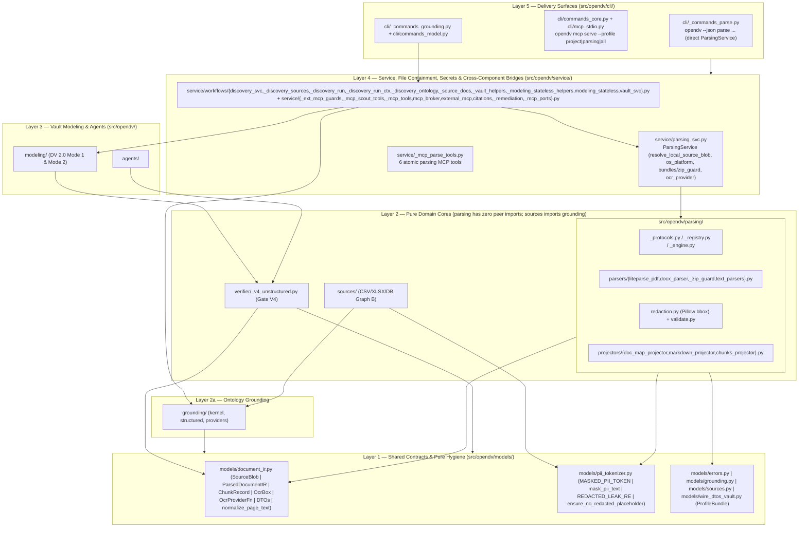

# Pluggable Unstructured Data Ingestion & Parsing Engine (`opendv.parsing`)

* **Author:** Eterna2
* **Status:** Proposed (Rebased on `origin/main @ 67d2cdd` — Round-2 EGM Reviewed & Simplified)
* **Worktree / Branch:** `worktrees/unstructured-parsing` (`feat/unstructured-parsing` rebased on `origin/main @ 67d2cdd`)
* **Date:** 2026-11-27

--------------------------------------------------------------------------------

## Overview

`open-dv` V2 ingests operational databases, tabular files, and unstructured enterprise documents (PDFs, Word documents, Markdown, and domain notes) across Steps 2–7 to ground entities in `opendv.grounding` (`GraphAOntology` in Steps 4–5) and generate/verify five-zone (`Z0`–`Z4`) Data Vault 2.0 (`DV 2.0`) models in `opendv.modeling` (Steps 6–7). Today, unstructured parsing lives inside a single project-coupled helper (`src/opendv/sources/document_map.py:DocumentMapBuilder`) backed by `pypdf`, `pypdfium2`, and `python-docx`. That helper reads only local paths or full in-memory byte buffers, loses layout structure and `.docx` reading order, duplicates PDF rendering and OCR redaction logic in `src/opendv/service/_ext_mcp_guards.py` (while swallowing OCR exceptions), re-parses full PDFs across Step 3b/4 reads, blocks unstructured files (`DOC_SOURCE_KINDS`) in stateless `opendv model profile`, and provides no structured chunk/context extraction for `opendv.grounding`.

This specification replaces `DocumentMapBuilder`, `pypdf` (from runtime dependencies and `src/opendv/`), and `pypdfium2` with a reusable internal ingestion and structural-parsing component matching sibling components (`HarnessService`, `SettingsService`, `opendv.grounding`, and `opendv.modeling`). To satisfy `open-dv`'s strict DAG without duplicating filesystem containment, secret lookup, or security guards, workspace/file I/O, path containment (`os_platform.py`, `src/opendv/service/bundles/zip_guard.py`), and optional OCR provider wiring stay in **Layer 4 (`src/opendv/service/parsing_svc.py`)**, while **Layer 2 (`src/opendv/parsing/`)** stays pure over validated local `Path` / `SourceBlob` handles (`pdf`, `docx`, `md`, `txt`) → `ParsedDocumentIR` and deterministic projections (`DocumentMap`, Markdown, streaming JSONL `chunks`). Pure-stdlib text normalization, SHA-256 hashing, `OcrBox` / `OcrProviderFn` contracts, and scan-density predicates move into **Layer 1 (`src/opendv/models/document_ir.py`)**, reusing `src/opendv/models/pii_tokenizer.py` already on `origin/main @ 67d2cdd`. Layer-4 bridges wire `ParsingService` into both **`opendv.grounding`** (compact `strip_pii_spans`-sanitized document summary notes from attached `DOC_SOURCE_KINDS` via `DiscoveryService.ground_ontology()`, `--doc` notes on `--input` CLI runs, and the locked DuckDB-safe `ChunkRecord` substrate for Module 1B, deferring PDF/DOCX table grounding to Module 1B + Stage-2 `structured_tables`) and **`opendv.modeling`** (unblocking `DOC_SOURCE_KINDS` in `opendv model profile` via `ProfileBundle.document_maps` only, feeding `VerifierContext.document_maps` for offline Gate `V4` checks without raw PII leakage or `business_context_hints` collision). `Pillow>=10.0.0` moves to core `dependencies` to decode `liteparse` PNG screenshots and render bounding-box PII blackout without duplicating pixel loops.

Scope is strictly **local ingestion, format parsing, layout/structural extraction, PII redaction overlays, deterministic projection into downstream IRs, and Stage-1 Layer-4 integration bridges to `opendv.grounding` and `opendv.modeling`**. Semantic ontology extraction itself remains in Step 4 `@ontology-first-mate` and planned Module 1B `src/opendv/grounding/unstructured/`. Because `open-dv` V2 is pre-release, no backward-compatibility shims for `DocumentMapBuilder`, runtime `pypdf`, `pypdfium2`, or prior `pypdf` digests are retained (keeping `pypdf>=5.0.0` solely in `[dependency-groups].dev` for `scripts/build_v2_uat_fixtures.py`).

### Key Terms & Conventions

| Term | Definition in `open-dv` V2 & `opendv.parsing` |
| :--- | :--- |
| **`open-dv` Pipeline (`Steps 1–7`, `Z0–Z4`)** | Step 1 (Project Scope/Seed), Steps 2–3 (Source attach/profile into `SourceProfile` **`Graph B`** & Step 3b `DocumentMap`/`PageTextView`), Steps 4–5 (conceptual `GraphAOntology` synthesis via `opendv.grounding` + `@ontology-first-mate`), and Steps 6–7 (`Z0`–`Z4` Data Vault 2.0 modeling/verification via `opendv.modeling` + `@ship-vault`, critics `V1`–`V8`, and target emission). `DOC_SOURCE_KINDS = frozenset({"pdf", "markdown", "docx", "domain_note"})`. |
| **Grounding & Modeling Context Terms** | **Module 1A (`src/opendv/grounding/{kernel,structured,providers}/`, Layer 2a):** Synchronous FIBO Pack v2 (`2,240` classes) + YAML glossary column grounding (`ColumnGroundingEngine`, `GroundingRequest` caps: `50` tables / `500` cols / `20` notes). **Module 1B (`src/opendv/grounding/unstructured/`):** Deferred Stage-2 unstructured NLP/mention grounding engine consuming `ChunkRecord` JSONL. **`AgentHarnessPort` / `agy`:** Internal LLM execution port and default CLI agent (`provider="agy"`). **`BrokerBudgetTracker`:** Step-4 MCP byte/call guard (`max_tool_payload_bytes = 65_536`). **`ocria-nano`:** Optional OCR download disabled (`ocr_enabled=False`) inside `liteparse`. |
| **`DocumentMap`, `.opendv.zip` vs. `.core.opendv.zip`** | Lightweight project metadata persisted in `project.sqlite` (`format: "pdf" \| "markdown" \| "docx" \| "domain_note"`, `OutlineNode`, `PageMapSpec[]` with masked `heading_preview` and `table_headers`, excluding raw page text). `.opendv.zip` bundles full project state; default `.core.opendv.zip` omits source binaries (`METADATA_ONLY_BINARY_ABSENT` / `SOURCE_BINARY_ABSENT` on raw re-parse). |
| **`SourceBlob`** | Context-managed handle (`uri_sanitized`, `binary_sha256`, `byte_size`, `content_type`, `filename_hint`, `path: Path`, `is_spooled_temp: bool`) avoiding `250 MiB` raw-buffer duplication in Python heap when reading local files or uploaded bytes (`from_bytes` spool deleted in `__exit__` and partial-write `try/except`). |
| **`ParsedDocumentIR` & `ChunkRecord`** | Canonical Layer-1 (`StrictModel`, `extra="forbid"`) output emitted by all `FormatParser` adapters. Separates immutable raw `pages[]` (`PageSlice`) from structural overlays (`outline[]` of `DocumentOutlineNode`, ordered `blocks[]` of `DocumentBlock`) and `ParseProvenance`. `ChunkRecord` is the flat DuckDB-safe JSONL projection contract emitted by `ChunksProjector`. |
| **`PageSlice` & `PageSpan`** | Addressable text slice in `ParsedDocumentIR.pages[]` (`slice_kind: "physical_page" \| "virtual_section_page"`, 1-based `page_number`, `renderable: bool`). `PageSpan` stores 1-based `page_number` plus paired optional 0-based `[char_start, char_end)` (`(char_start is None) == (char_end is None)`) and optional `NormalizedBBox`. |
| **`LOCAL_HUMAN_IO` vs. `MODEL_EGRESS`** | Sink trust classes governing `redaction: RedactionMode` (`"off" \| "on"`). `LOCAL_HUMAN_IO` (Python library and local CLI) defaults to `redaction="off"` (`--redact` opt-in). `MODEL_EGRESS` (`open-dv` Steps 3–4, grounding/modeling bridges, and inbound MCP `parsing` profile) defaults to `redaction="on"` across outbound views/projections and image redaction (`approve_scan` applies solely to unredacted `LOCAL_HUMAN_IO` / `--allow-unredacted` viewing). |
| **Mode 1 vs. Mode 2 & Status Notation** | **Mode 1:** Deterministic zero-internal-LLM parsing, `--pages` extraction, rendering, validation, JSONL projection, and `opendv model verify` driven by external agents. **Mode 2:** Managed CEGAR modeling (`opendv vault build` / `opendv model run`). Parenthetical pairs such as `(`2` / `422`)` denote `(CliExitCode / HTTP Status)` from `src/opendv/models/errors.py`. |
| **Rules `U1–U4` & Gate `V4` (`Alg A.9b`)** | DV 2.0 unstructured invariants (`docs/04-unstructured-and-multimodal-dv2.md`): `U1` (binary assets hashed & referenced, never raw blobs in tables/IR), `U2` (extraction provenance via `ParseProvenance`), `U3` (raw text separate from probabilistic AI interpretations), `U4` (zero raw binary/vector blobs in IR/SQLite), and Gate `V4` / `Alg A.9b` (`norm_page[char_start:char_end] == norm_quote`, `occurrence`, `canonical_text_sha256`, and zero `<MASKED_PII>` / `[REDACTED_*]` leaks via `REDACTED_PLACEHOLDER_LEAK`). |
| **JCS, Tier-1, `ProblemDetails` & `D16`** | **JCS:** RFC 8785 canonical JSON requiring quantized `[0.0, 1.0]` floats. **Tier-1:** fast offline `importlib.util.find_spec` / `shutil.which` driver check. **`ProblemDetails`:** RFC 9457 error JSON on HTTP `:8420`, CLI `--json`, and MCP `ToolError`. **`D16` & `C7` & `REQ-DOC-01`:** Every `.py` module under `src/opendv/` stays `< 5,000` `cl100k_base` tokens; `C7` bans dynamic `entry_points`; `REQ-DOC-01` (`ACTIVE_V2_DOCS` / `ACTIVE_SNIPPET_DOCS`) enforces paired component docs (`Layer 1 models`, `Layer 2a grounding`, `Layer 2 sources/verifier/storage/parsing`, `Layer 3 agents/modeling`, `Layer 4 service`, `Layer 5 api/cli`). |
| **Empirical Spike 0** | Windows Python 3.12 probing run on `liteparse==2.21.2` over real `open-dv` fixtures (`am_custody_and_voting_guide.pdf` 6p `7.8 ms`, `institutional_scanned_schedule_ocr_test.pdf` 2p `21.6 ms`, `enterprise_msa_addendum_2026.pdf` 2p `7.6 ms`, plus `/Rotate 90`, locked, and `corrupt_document.pdf`). Derived scanned predicate `(non_ws_chars < 50 and image_block_count >= 1) or non_ws_chars < 15` and verified top-left auto-rotated coordinates + `extract_screenshots=True` byte rendering. |

## The Problem

Codebase inspection of `origin/main` (`67d2cdd`) across `src/opendv/sources/document_map.py`, `src/opendv/service/{_ext_mcp_guards,_mcp_scout_tools,_mcp_tools,external_mcp,citations,_remediation}.py`, `src/opendv/service/workflows/{_discovery_sources,_source_docs,_discovery_run_ctx,_vault_helpers,modeling_stateless,_grounding_orchestrator,discovery_svc}.py`, `src/opendv/grounding/kernel/pii_core.py`, and `src/opendv/verifier/_v4_unstructured.py` identified six concrete defects:

1. **Flat Text Extraction & Broken Document Layout:** `DocumentMapBuilder` uses `pypdf.PdfReader.extract_text()` with heuristic regex guesses for headings and table headers—losing spatial layout, multi-column reading order, bounding boxes, and table cell structure. On `.docx` files (`document_map.py:452-470`), it collapses the entire document into `page_number=1` and iterates all `doc.paragraphs` before all `doc.tables`, scrambling reading order and overflowing `64 KiB` (`BrokerBudgetTracker.max_tool_payload_bytes`), with zero decompression-bomb guard ahead of `python-docx`.
2. **Duplicated PDF Rendering, Normalization, `REDACTED_LEAK_RE` & Silent OCR Swallowing:** PDF rendering and Tesseract OCR are duplicated between `document_map.py:_try_ocr_pdf_page` and `_ext_mcp_guards.py:run_ocr_on_pdf_bytes` (which imports `pypdfium2` directly in Layer 4 and silently swallows `(ImportError, OSError, RuntimeError, ValueError, TypeError)` into empty text at `L289`; `_ext_mcp_guards.py:17,162`, `external_mcp.py:12,81,148,253`, and `test_mcp_broker_and_external.py:15` also import nonexistent `httpx2`). Meanwhile, `normalize_page_text()` and `compute_canonical_text_sha256()` are duplicated between `sources/document_map.py` and `verifier/_v4_unstructured.py`, `REDACTED_LEAK_RE` is duplicated across `grounding/kernel/pii_core.py:38`, `_v4_unstructured.py:27`, and `_mcp_tools.py:59`, and `_mcp_ports.py` hand-codes byte-loop RGBA PNG encoders.
3. **Full-Document Re-Parsing Without Page-Window Pushdown or Streaming:** `DocumentMapBuilder` re-parses full PDFs in memory even when Step 3b/4 callers inspect 2–5 pages, and provides no streaming chunk projection for multi-hundred-page filings.
4. **Disconnected From `opendv.grounding`, `opendv.modeling` & Standalone Callers:** Unstructured parsing is locked to `project.sqlite` Steps 2–4: `modeling_stateless.py:profile_sources_stateless()` explicitly rejects `DOC_SOURCE_KINDS` (`SYNTAX_INVALID_ARGUMENT`), `opendv.grounding` cannot ingest attached document summaries or `--doc` domain notes, and standalone Python/CLI/MCP callers cannot extract layout IRs or stream JSONL chunks without `.opendv/project.sqlite`.
5. **PII Redaction Offset-Drift Hazard (`MODEL_EGRESS`):** Replacing PII in-place before storing page text breaks Gate V4 (`Alg A.9b`) verification in `citations.py` (`resolve_citation` searches raw `norm_page` by `verbatim_quote` + `occurrence` and rejects `<MASKED_PII>`). Keeping raw normalized page text immutable inside `ParsedDocumentIR` (and producing redacted copies/projections only at egress) avoids index-translation layers.
6. **Hardcoded Error Remediation & Missing Parse Provenance:** `build_remediation(ErrorCode.DRIVER_MISSING)` in `src/opendv/service/_remediation.py:97-107` hardcodes Databricks installation instructions when `provider is None`, and unstructured parsing produces no structured provenance/telemetry envelope (`parser_id`, `parser_version`, `source_uri_sanitized`, per-page timing, OCR counts, or `ParseWarning` diagnostics).

--------------------------------------------------------------------------------

## Goals

* **Canonical Layer-1 Document IR & Reuse of Existing `models/pii_tokenizer.py`:**
  * Define `ParsedDocumentIR` (`StrictModel`, `extra="forbid"`) and `ChunkRecord` in `src/opendv/models/document_ir.py` separating immutable raw `pages[]` (`PageSlice` with `canonical_text`, `canonical_text_sha256`, `binary_sha256`, zero binary/vector blobs) from document-scoped `outline[]` (`DocumentOutlineNode`, avoiding `sources.OutlineNode` collision), ordered `blocks[]` (`heading|paragraph|list|table|figure` with `PageSpan[]` and clamped `[0.0, 1.0]` `NormalizedBBox`), and `ParseProvenance`, leaving `DoctorResponse` (`wire_dtos_readiness.py`) and `schemas/v2/openapi.json` untouched.
  * Consolidate pure-stdlib `normalize_page_text()`, `compute_canonical_text_sha256()`, `is_page_scanned_or_low_density(non_ws_chars: int, image_xobjects: int) -> bool`, `OcrBox`, `OcrProviderFn`, and `DocumentFormat` into `src/opendv/models/document_ir.py`, and consolidate `REDACTED_LEAK_RE` + `ensure_no_redacted_placeholder(text: str, *, context: str = "Payload")` into existing `src/opendv/models/pii_tokenizer.py` (`MASKED_PII_TOKEN`, `mask_pii_text`).
  * Extend `ProfileBundle` (`src/opendv/models/wire_dtos_vault.py`) with `document_maps: list[DocumentMap] = Field(default_factory=list)` only (omitting `page_text_views`, raw `parsed_doc_pages`, and `document_excerpts` so `profile_bundle.json` stays PII-free and Gate `V4`-compatible).
  * Keep `pypdf>=5.0.0` solely in `[dependency-groups].dev` for `scripts/build_v2_uat_fixtures.py` while removing `pypdf` and `pypdfium2` from runtime `dependencies` and all `src/opendv/` source files.
  * Lock byte-identical cross-OS `canonical_text_sha256` verification over embedded-font fixtures between `windows-latest` and `ubuntu-latest` as a **Phase 5** CI gate (once `liteparse_pdf.py` and the parity suite land).
* **Pure Layer-2 Parsing Core (`src/opendv/parsing/`):** Enforce downward-only Layer-1 imports in `V2_LAYER_BANS` and `< 5,000` `cl100k_base` tokens per `.py` module (`D16`):
  * **`FormatParser` Protocol:** Default `liteparse` (`>=2.21.2,<2.22`, Apache-2.0, `quiet=True`, `ocr_enabled=False`, `keep_headers_footers=True`, `extract_blocks=True`, `include_complexity=True`, reading `SourceBlob.path`, pushing `opts.pages` down via `target_pages`, passing `dpi=opts.dpi`, and enabling `emit_word_boxes=True` when `redaction="on"` during `render_page`, never pulling `ocria-nano`) for PDF; Layer-2 `BoundedZipReader` (reusing pure stdlib archive checks shared with `bundles/zip_guard`) + `python-docx` in DOM order (`<w:p>`, `<w:tbl>`, `<w:sdt>`, preserving rectangular column widths for `gridSpan`/`vMerge` cells) for `.docx`; stdlib parsers for `.md` and `.txt` (emitting 1 empty `PageSlice` for 0-byte files).
  * **Core `Pillow>=10.0.0` + Optional `[ocr]` (`pytesseract`):** `FormatParser.render_page` returns an internal Layer-2 `RenderedPageBuffer` carrying PNG bytes and normalized `[0.0, 1.0]` word boxes so `redaction.py` aligns pre-masked character spans `[start, end)` to scaled word-box coordinates (with fail-closed protection if PII text fails box alignment) and draws opaque black rectangles via `PIL.ImageDraw`. Keep `pytesseract` optional inside `opendv[ocr]`; scanned pages without `[ocr]` or injected `OcrProviderFn` fail closed under `MODEL_EGRESS` (`UNREDACTED_SCAN_BLOCKED` / `DRIVER_MISSING`).
  * **`IRProjector` Protocol & Non-Destructive `MODEL_EGRESS` Masking:** Keep internal `ParsedDocumentIR` raw for `citations.py` / Gate `V4`; return a redacted IR copy (with recomputed page hashes and `provenance.redacted=True`) when `parse_document(..., redaction="on")` is called over `MODEL_EGRESS`, and apply `mask_pii_text()` across outbound `DocumentMapProjector` (`DocumentMap` headings/tables + `PageTextView.masked_text`), `MarkdownProjector`, and `ChunksProjector` (uniform-key `ChunkRecord` JSON and streaming JSONL for DuckDB `read_ndjson`/Parquet).
* **Layer-4 `ParsingService`, Steps 2–4 Cutover, & Stage-1 `grounding` / `modeling` Unstructured Support:**
  * Mirror `HarnessService`/`SettingsService` standalone construction (zero required `ProjectStateManager`), wire `OpenDVService.parsing`, place local `resolve_local_source_blob()` directly inside `src/opendv/service/parsing_svc.py` reusing `zip_guard.reject_symlinks_on_path_and_ancestors` **before** `os_platform.validate_workspace_containment` + `safe_open_no_follow` (`<= 250 MiB`), and handle per-run Step-4 caching via existing `ctx.parsed_pages` + `--pages` pushdown (`dict[int, str]` keyed by `PageSlice.page_number`).
  * Retire `DocumentMapBuilder`, runtime `pypdf`, and `pypdfium2` across all existing callers (`_ext_mcp_guards.py`, `external_mcp.py`, `_mcp_scout_tools.py`, `_mcp_tools.py`, `_source_docs.py`, `_discovery_sources.py` using `SourceBlob.from_path(dest)`, `_discovery_run.py`, `_discovery_run_ctx.py`, `_discovery_ontology.py`, `_v4_unstructured.py`, `citations.py`, and `_vault_helpers.py`), preserving `OcrProviderFn` and `OcrPageReceipt`.
  * **Stage-1 Unstructured Support in `opendv.grounding`:** Inject compact, placeholder-free (`strip_pii_spans`, zero `<MASKED_PII>`) outline/header summary notes from project-attached `DOC_SOURCE_KINDS` inside **`DiscoveryService.ground_ontology()`** (`discovery_svc.py:398-422`, with offline `DocumentMap` fallback when `METADATA_ONLY_BINARY_ABSENT`), restrict `--doc` on `opendv ontology ground` strictly to `--input` runs (`global_steward_notes` only, zero `openapi.json` churn), and lock the uniform DuckDB-safe `ChunkRecord` schema (`ChunksProjector`) for planned Module 1B (`src/opendv/grounding/unstructured/`).
  * **Stage-1 Unstructured Support in `opendv.modeling`:** Unblock `DOC_SOURCE_KINDS` in `modeling_stateless.py:profile_sources_stateless()` via `ParsingService` (`DocumentMapProjector`, `MODEL_EGRESS`) into `ProfileBundle.document_maps`; merge `ProfileBundle.document_maps` non-destructively into existing `VerifierContext` (`verifier/ports.py:68-70` unmodified) inside **both** `merge_profile_bundle()` and `run_model_stateless()`'s direct `DVModelingRequest` branch so Mode-1 `opendv model verify` runs Gate `V4` offline digest/bounds checks; and wire Mode-2 managed `_vault_helpers.py:load_verifier_inputs` through `ParsingService` (`redaction="off"`, keyed by `PageSlice.page_number`, falling back to `metadata_only_binary_absent=True` on `SOURCE_BINARY_ABSENT`) while leaving `DVModelingRequest.business_context_hints` strictly for user-authored exception directives.
* **Stateless CLI, Unified Inbound MCP, Paired Component Docs & Live `agy` UAT:**
  * Expose local-only (`(None, None)` in `_CLI_HTTP_ROUTES`, calling `ParsingService` directly with zero `.opendv/` writes) `uv run opendv --json parse {spec, inspect, extract, render-page, validate, export}` (`12 -> 13` CLI top groups, `61 -> 67` subcommands).
  * Unify inbound stdio MCP under `opendv mcp serve --profile project|parsing|all` (default `project` preserving `17`-tool behavior; `parsing` adds `6` zero-LLM tools with `MODEL_EGRESS` defaults).
  * Ship `.agents/skills/opendv-parsing/SKILL.md` and paired component docs `docs/components/parsing/{README.md,user-guide.md,contributor-guide.md}` (registered in `ACTIVE_V2_DOCS` and `ACTIVE_SNIPPET_DOCS`), regenerate `schemas/v2/cli-spec.json` and `docs/16-cli-reference.md`, sync `AGENTS.md` / `README.md`, and add an opt-in live `agy` real-data UAT suite (`tests/parsing/test_live_agy_uat.py`) in Phase 5.

--------------------------------------------------------------------------------

## Non-Goals

* **Remote Stores (`HttpObjectStore`, `S3ObjectStore` / `opendv[s3]`, `sniff.py`) & Standalone Raster Ingestion (`RasterImageParser`):** Deferred to Stage 2 so Stage 1 ships zero external network/SSRF/IMDS attack surface, zero `s3fs`/`fsspec` dependencies, and keeps `SourceKind`, `VALID_SOURCE_KINDS`, `DocumentMap.format`, `openapi.json`, and inbound MCP free of remote fetch paths.
* **Stage-1 PDF/DOCX Embedded-Table Grounding (`_grounding_unstructured_bridge.py`) & `DVModelingRequest.document_excerpts` Prompt Injection:** Coercing `DocumentBlock(kind="table")` into Module 1A `TableEvidence` before `SourceProfile` (`Graph B`) exists causes pre-masking $n_{\text{eff}}=0$ calibration loss, `<MASKED_PII>` reranker crashes, `50`-table cap collisions, and dangling `GraphAOntology.table_bindings` (`DV-COL-001` / `ANTI_SILO_VIOLATION`). Likewise, forwarding `document_excerpts` into `ProfileBundle.parsed_doc_pages` or `DVModelingRequest.business_context_hints` risks PII leakage, Gate `V4` offset failures, `1,500`-token overflows, and `V7`/`V8` exception-authority leakage. Both are deferred to Module 1B + Stage-2 `structured_tables` / a dedicated non-waiver modeling context field.
* **Bidirectional PII `OffsetMap` & `RedactionSpan` Overlay:** Omitted in Stage 1 because `citations.py` searches raw normalized text via `verbatim_quote` + `occurrence`, removing regex-overlap and UTF-16 host offset translation risk.
* **Persistent Disk Cache (`parse_cache.sqlite` / `ParseCacheStore` / `500 MiB` LRU) & `ProcessPoolExecutor` `parse_batch`:** Deferred until production benchmarks demonstrate `--pages` pushdown (`7.6–21.6 ms` across 2–6 page Spike 0 fixtures) + Step-4 `ctx.parsed_pages` memoization are insufficient, avoiding SQLite WAL contention and Windows `spawn`/spool-cleanup complexity.
* **Three-Tier `detail_level` (`"fast" | "standard" | "full"`):** Omitted in Stage 1 because disabling `extract_blocks` under `detail_level="fast"` breaks scanned-page classification (`image_block_count >= 1`). `LiteParse` always populates complexity/block metadata and enables `emit_word_boxes=True` on `render_page` under `redaction="on"`.
* **Stage-2 Managed Structuring Agent (`opendv parse run` / `OverlayPatch` / `--overlay` / Mode 2), `SyntacticCrossRef`, `.html` (`HtmlParser`), Outbound External MCP Adapters, & Full Module 1B `UnstructuredGroundingEngine`:** Deferred to Stage 2 so Stage 1 ships ingestion/parsing + Layer-4 bridges into existing `opendv.grounding` and `opendv.modeling` without implementing Module 1B's full NLP/mention grounding engine (`src/opendv/grounding/unstructured/`).
* **Modifying `DoctorResponse` (`DoctorResponse.parsing`), `schemas/v2/openapi.json`, `verifier/ports.py`, or `web/` UI:** Driver readiness lives in `opendv --json parse spec`, avoiding OpenAPI and frontend generated type churn.
* **Tabular `.csv` / `.xlsx` Profiling & Full OOXML Extensions (Headers/Footers/Footnotes/Revisions):** Structured `.csv` (DuckDB) and tabular `.xlsx`/`.xlsm` (`openpyxl`) remain permanently in `src/opendv/sources/` (`SourceProfile`); narrative `.xlsx` layout parsing, relational `TableProfile` table projection, and extended OOXML note/revision traversal remain Stage-2+ extensions.
* **Semantic Ontology Entity Resolution Inside `src/opendv/parsing/`, Separate PyPI Package (`packages/opendv-parsing`), Legacy `DocumentMapBuilder`/Runtime `pypdf`/`pypdfium2` Shims, Raw Blobs/Vectors in SQLite/IR (`Rules U1/U4`), `ocria-nano` Auto-Downloads, LibreOffice `.docx` Conversion, or `entry_points` Plugins:** Explicitly excluded.

--------------------------------------------------------------------------------

## Open Questions

None. All open questions from brainstorming, Spike 0, high-volume scoping, and Round-1/Round-2 EGM reviews against `origin/main @ 67d2cdd` are resolved.

--------------------------------------------------------------------------------

## Critical User Journeys (CUJs)

### CUJ 1: External Coding Agent Parses, Visually Inspects, Validates & Streams Exports Statelessly (CLI + Skill, Mode 1)

* **Given:** A developer or external coding agent works in a repository containing `.agents/skills/opendv-parsing/SKILL.md` and a 500-page financial PDF (including a complex chart on page 4) with zero `.opendv/` project state and zero internal LLM API keys.
* **When:** The caller runs:
  1. `uv run opendv --json parse spec` to inspect IR schemas, projectors, and Tier-1 installed drivers;
  2. `uv run opendv --json parse inspect report.pdf` for page count (`> max_pages` allowed during `inspect` metadata scan) and scanned-page classification;
  3. `uv run opendv --json parse extract report.pdf --pages 1-5 --out base_ir.json` (path-backed `SourceBlob`, `--pages` pushed down to `LiteParse`, unredacted under `LOCAL_HUMAN_IO` unless `--redact` is passed);
  4. `uv run opendv --json parse render-page report.pdf --page 4 --out page4.png` (using core `Pillow` + `liteparse` screenshots; if `--redact` is passed on a scanned page, requires `--ocr` and `[ocr]`, whereas `--approve-scan` applies only to unredacted `LOCAL_HUMAN_IO` viewing);
  5. `uv run opendv --json parse validate base_ir.json`; and
  6. `uv run opendv --json parse export base_ir.json --target chunks --format jsonl --out chunks.jsonl`.
* **Then:** `opendv` invokes stateless `ParsingService` directly (never `CliClient`/`OpenDVService`), performs zero `.opendv/` SQLite initialization, parses only pages 1–5 (`emit_word_boxes=False`), validates IR digests/spans/structure returning structured `ValidationDiagnostic[]` via `CliHandledError` (`0` valid, `2` invalid), and streams `chunks.jsonl` line-by-line with uniform `ChunkRecord` keys ready for DuckDB `read_ndjson`.

### CUJ 2: MCP-Only External Host Calls `opendv mcp serve --profile parsing` With `MODEL_EGRESS` Fail-Closed Guards

* **Given:** An external MCP host launches `uv run opendv mcp serve --profile parsing --allow-root /workspace/docs` (without `--project` or `--allow-unredacted`) against a local PDF containing PII on page 2 and a scanned page 4.
* **When:** The host invokes `parse_spec`, `parse_inspect`, `parse_extract(uri="/workspace/docs/filing.pdf", pages="1-3")`, `parse_render_page(uri="/workspace/docs/filing.pdf", page_number=4, approve_scan=False | True)`, `parse_validate_ir(ir=...|ir_path=...)`, and `parse_export_ir(ir=...|ir_path=..., target="markdown")`.
* **Then:** The server exposes strictly the 6 zero-LLM parsing tools without `project.sqlite`; enforces `--allow-root` local containment (rejecting non-file schemes); `parse_extract` returns a redacted `ParsedDocumentIR` copy (`provenance.redacted=True`, `canonical_text_sha256` recomputed over redacted text without mutating internal raw parses); `parse_render_page` runs `LiteParse(emit_word_boxes=True, dpi=opts.dpi)` + core `Pillow` blackout on digital text pages and fails closed under `MODEL_EGRESS` on scanned pages missing `ocr_provider` / `[ocr]` (`DRIVER_MISSING(extra_name="ocr")` if `ocr=True`, else `UNREDACTED_SCAN_BLOCKED`, regardless of `approve_scan` unless `--allow-unredacted` is set); writes oversized payloads atomically to owner-only `--spill-dir` (defaulting to `<OS_USER_STATE>/parse_spill/<uuid>.<ext>` outside `--allow-root` so read-only mounts and git trees stay untouched) returning a `SpilloverRef` JSON envelope; and preserves identical 17-tool behavior for `opendv mcp serve --project <id>` (`--profile project` default).

### CUJ 3: Python Library Caller Composes Custom Pure SPI Plugins Without `project.sqlite`

* **Given:** A Python pipeline imports `opendv.models.document_ir` (Layer 1), `opendv.parsing` (Layer 2), or `opendv.service.parsing_svc.ParsingService` (Layer 4) without instantiating `ProjectStateManager`, passing custom `FormatParser` or `IRProjector` plugins via `ParsingRegistry`.
* **When:** The caller parses validated local `Path` / `SourceBlob` inputs across multi-document loops using `ParseOptions.pages` windows, toggles `SinkClass.LOCAL_HUMAN_IO` vs. `SinkClass.MODEL_EGRESS`, validates IR integrity, and streams `ChunkRecord` JSONL into DuckDB.
* **Then:** Zero `project.sqlite` initialization occurs; Layer-2 parsing runs free of `service/`/`sources/`/`grounding/`/`modeling/` imports; stateless `(path, page_range) -> IR/JSONL` work composes safely per `SourceBlob` handle; and `ParseProvenance` records parser version, timing, and structured `ParseWarning[]`.

### CUJ 4: `open-dv` Steps 2–4 Cutover, DOM-Ordered `.docx`, Scanned Page Gate & Offline `.core.opendv.zip`

* **Given:** An `open-dv` project attaches `am_custody_and_voting_guide.pdf` (mixed digital + scanned pages) and an enterprise `.docx` specification containing interleaved headings, `<w:sdt>` controls, and merged tables (`gridSpan`/`vMerge`), reads pages in Step 3b/4, and exports/imports `.core.opendv.zip` offline without source binaries.
* **When:** `DiscoveryService` -> `ParsingService` attaches the files, Step 3b/4 calls `get_document_pages`, `scout_read_document_pages` (reusing `ctx.parsed_pages` in-run cache with `PageSlice.page_number` keying), `scout_view_page_image` (`dpi` bounded at `108` default / Pillow-downscaled for `64 KiB` broker payloads, `ocr_provider` + `OcrPageReceipt`), Step 5/6 runs `citations.resolve_citation` (`verbatim_quote` + `occurrence`) + Gate V4 (`_v4_unstructured.py`), and `.core.opendv.zip` round-trips offline.
* **Then:** `liteparse` (`ocr_enabled=False`, `quiet=True`, `extract_blocks=True`) classifies digital vs. scanned pages per the Spike 0 density predicate; `.docx` preserves DOM reading order with rectangular merged-cell grids and masks element/document text before `24,000`-char slice splitting; `project.sqlite` / `.core.opendv.zip` persists only `DocumentMap` (`SOURCE_BINARY_ABSENT` on raw re-parse when binaries are missing, with graceful `DocumentMap` metadata fallback in Steps 4 & 6); and Step-4 citations pass Gate V4 with zero `REDACTED_PLACEHOLDER_LEAK` or `SPAN_HALLUCINATION` errors.

### CUJ 5: Security Boundaries — Containment, Symlinks, Chained URIs & `.docx` Zip-Bomb Defense

* **Given:** A caller passes a chained URI (`file::https://...`), a path traversal / UNC (`\\server\share`) / Windows ADS (`file.pdf:stream`) / symlink / out-of-root local path, an uploaded buffer exceeding `250 MiB`, or a crafted high-ratio `.docx` zip bomb (or LibreOffice `.docx` containing valid `info.is_dir()` entries).
* **When:** `ParsingService` (`resolve_local_source_blob`) and `DocxParser` (`BoundedZipReader`) validate each input.
* **Then:** Chained `::`, non-empty `file://` `netloc`, and non-file schemes fail with `SYNTAX_INVALID_ARGUMENT` (`2` / `400`); traversal, UNC, ADS `:`, symlink, reparse-point, XML `DOCTYPE`/`ENTITY`, and `--allow-root` violations map to `ARCHIVE_SECURITY_VIOLATION` (`2` / `422`); streamed `.docx` decompression exceeding `500` entries, `250 MiB` actual inflated bytes, or `100.0` ratio above `1 MiB` aborts before XML expansion with `ARCHIVE_SIZE_LIMIT_EXCEEDED` (`2` / `413`); valid `info.is_dir()` `.docx` archives succeed; and `source_uri_sanitized` strips any userinfo/query parameters.

### CUJ 6: Fail-Loud Edge Cases — Encrypted/Corrupt Files, Non-Visual Render Targets, Missing `[ocr]`, Timeouts & Pixel Bombs

* **Given:** A caller supplies (a) a password-locked PDF/OLE2 encrypted `.docx` or corrupt PDF bytes, (b) `parse render-page` on a `.docx`/`.md`/`.txt` file or out-of-range `--page 99`, (c) `--ocr` (`ocr=True`) when optional `pytesseract` (`[ocr]`) is not installed, or (d) a pathological PDF exceeding `max_pages` / `timeout_ms` / pre-render pixel bounds.
* **When:** `ParsingService` or CLI/MCP executes each request.
* **Then:** Locked PDFs, OLE2 encrypted `.docx` (`BadZipFile`), or corrupt PDFs fail with `VERIFICATION_GATE_FAILED` (`2` / `422`) without silent blank pages; non-renderable formats or out-of-bounds `--page` fail with `SYNTAX_INVALID_ARGUMENT` (`2` / `400`); `--ocr` without `[ocr]` fails with `DRIVER_MISSING` (`2` / `422`, emitting `uv sync --extra ocr` plus `actor="human"` system Tesseract instructions when `pytesseract` is installed without `tesseract` on `PATH`); and bounded limits abort before RAM/CPU exhaustion (`ARCHIVE_SIZE_LIMIT_EXCEEDED` `2` / `413` on size/pages/pixels; `INTERNAL_SERVER_ERROR` `1` / `500` on execution timeout).

### CUJ 7: Contributor Verifies DAG, `D16` Token Caps, Closed `34` Error Codes & Cross-OS Hash Parity

* **Given:** A contributor modifies `src/opendv/models/`, `src/opendv/parsing/`, `src/opendv/service/`, or `src/opendv/cli/`.
* **When:** CI runs `pytest tests/architecture/ tests/docs/`, `python -m opendv.cli.export_contracts --check`, `scripts/check_error_codes.py`, `ruff check`, `mypy src`, and the Windows (`windows-latest`) vs. Linux (`ubuntu-latest`) `liteparse` fixture suite (`Phase 5`).
* **Then:** `V2_LAYER_BANS` confirms zero forbidden Layer-2 or upward imports inside `src/opendv/parsing/` and bans `"liteparse"` alongside `"pypdf"`/`"pypdfium2"` in forbidden layers; `test_source_adapters_contract.py` allows `src/opendv/parsing/` alongside `src/opendv/sources/` while blocking `.pdf` AST comparisons outside those two packages; every `.py` module stays `< 5,000` `cl100k_base` tokens (`D16`); `check_error_codes.py` passes with exact `34` codes; `schemas/v2/cli-spec.json` and `docs/16-cli-reference.md` match zero-diff while `openapi.json` stays untouched; `mypy src` (`strict = true`) passes; and identical `canonical_text_sha256` hashes hold byte-for-byte across `windows-latest` and `ubuntu-latest`.

### CUJ 8: Unstructured Support in `opendv.grounding`, `opendv.modeling`, & Live `agy` Real-Data UAT

* **Given:** A user or live `agy` harness runs (a) `opendv ontology ground --project <id>` attaching `am_custody_and_voting_guide.pdf` (plus standalone `--input req.json --doc fdic_section3_2_loans_credit_risk.pdf` domain notes), (b) stateless `opendv model profile --source ...` + `opendv model verify` + `opendv model run` attaching `am_custody_and_voting_guide.pdf` alongside `am_sec_treasury_ibor.sqlite`, or (c) live `agy` CLI Skill + MCP execution over real PDFs (`test_live_agy_uat.py`).
* **When:** `DiscoveryService.ground_ontology()` / `_commands_grounding.py` invoke `ParsingService` to inject bounded `strip_pii_spans`-sanitized summary notes into `GroundingRequest.global_steward_notes` (zero `<MASKED_PII>`), `modeling_stateless.py` populates `ProfileBundle.document_maps` into `VerifierContext.document_maps` for offline Gate `V4`, `_vault_helpers.py` hydrates Gate `V4` on Mode-2 managed runs, and `test_live_agy_uat.py` runs live `agy` under `setup_isolated_env(..., preserve_live_auth=True)`.
* **Then:** Grounding uses attached/domain document summary notes without `REDACTED_PLACEHOLDER_LEAK` or `OntologyGroundReq` XOR conflicts (rejecting `--project --doc` with `SYNTAX_INVALID_ARGUMENT`); `opendv model profile` accepts `DOC_SOURCE_KINDS` without crashing on scanned pages or leaking raw PII; `opendv model verify` enforces Gate `V4` offline digest/bounds checks; and live `agy` completes both standalone Skill/MCP parsing and integrated discovery->grounding->vault verification over real datasets.

--------------------------------------------------------------------------------

## Technical Plan (Architecture)

### 1. System Architecture & DAG Boundaries

#### 1.1 Project-Wide Principle: Relationship to Structured Data (`src/opendv/sources/`)

* **Core Project Principle:** `src/opendv/sources/` (`sqlite`, `duckdb`, `parquet`, `csv`, `xlsx`, `databricks_uc` → Graph B `SourceProfile`) and `src/opendv/parsing/` (`pdf`, `docx`, `md`, `txt` → `ParsedDocumentIR`) remain strict Layer-2 peers with **zero cross-imports**, routed upward in Layer 4 (`DiscoveryService`, `modeling_stateless`) by `SourceKind`. Pure-stdlib primitives (`normalize_page_text`, `compute_canonical_text_sha256`, `is_page_scanned_or_low_density`, `SourceBlob`, `OcrBox`, `OcrProviderFn` in `models/document_ir.py`; PII regexes/maskers in existing `models/pii_tokenizer.py`) live in Layer 1 (`models/`), while filesystem containment (`os_platform`, `bundles/zip_guard`) and secret lookup (`KeyringSecretStore`) stay in Layer 4 (`service/`). Tabular `.csv` (DuckDB) and tabular `.xlsx` (`openpyxl`) remain permanently in `src/opendv/sources/`.
* **Future Extension Boundary:** As recorded in `## Non-Goals`, semi-structured financial-model Excel workbooks (`XlsxDocumentParser`), projecting extracted `DocumentBlock(kind="table")` blocks into a relational `TableProfile`/Parquet structured data IR (`IRProjector("structured_tables")`), and Module 1B unstructured table/mention grounding are deferred to Stage 2+.

#### 1.2 Architecture Guardrails Satisfied (`tests/architecture/`)

1. **Zero Layer-2 Peer or Upward Imports:** Register `"src/opendv/parsing"` as `required=True` in `V2_LAYER_BANS` (`test_import_contracts.py`) banning `"opendv.sources"`, `"opendv.grounding"`, `"opendv.verifier"`, `"opendv.storage"`, `"opendv.agents"`, `"opendv.modeling"`, `"opendv.service"`, `"opendv.api"`, `"opendv.cli"`, `"typer"`, `"fastapi"`, `"starlette"`, `"mcp"`, `"httpx"`, `"s3fs"`, `"fsspec"`, `"keyring"`, `"duckdb"`, `"sqlglot"`, `"pyarrow"`, `"openpyxl"`, `"rdflib"`, `"anthropic"`, `"google"`, `"subprocess"`, and `"yaml"` (plus `"opendv_*"`). Add `"opendv.parsing"` to `banned` sets of `models`, `grounding`, `sources`, `verifier`, `storage`, `agents`, `modeling`, `api`, and `cli`. Keep `"pypdf"` and `"pypdfium2"` in those banned sets AND add `"liteparse"` to `banned` sets of `models`, `grounding`, `sources`, `verifier`, `storage`, `agents`, `modeling`, `api`, and `cli`. Create `src/opendv/parsing/__init__.py` in Phase 1 so `required=True` passes immediately.
2. **AST & Hardening Guards (`test_source_adapters_contract.py`, `test_hardening_t14.py`, `test_mock_guards.py`, `test_no_hardcoded_literals.py`, `test_ci_and_wheel_packaging.py`):**
   * Exempt `src/opendv/parsing/` alongside `src/opendv/sources/` in `test_source_adapters_contract.py`, and keep all Layer-4/5 callers (`parsing_svc.py`, `_ext_mcp_guards.py`, `_commands_parse.py`, `_commands_grounding.py`, `modeling_stateless.py`) free of direct `ast.Compare` checks against `".pdf"` (route via `DocumentFormat` / `DOC_SOURCE_KINDS` / `parsing/` format sniffing).
   * Zero `.expanduser()` outside `ALLOWLISTED_EXPANDER_MODULES`, zero hardcoded `"127.0.0.1"` / `"localhost"` / `"/tmp"` / `"docs/"` / `"examples/"` / `"https://..."` literals even in CLI help strings/docstrings (`_commands_parse.py`), zero `# noqa: BLE001`, zero banned mock identifiers, zero `pytest.skip` calls in non-live CI (`-rs`), zero module-level `UPPERCASE` constant names containing `"THRESHOLD"` or `"MAGIC"`, and zero new `OPENDV_*` environment variables (preserving `.env.example` parity under `test_env_example_parity_with_src_opendv`).

--------------------------------------------------------------------------------

### 2. Layer-1 Data Contracts & Shared Primitives (`src/opendv/models/`)

All models subclass `StrictModel` (`extra="forbid"`) enforcing Rules `U1` and `U4` (zero raw binary bytes, pixel arrays, or vector embeddings in JSON IR).

#### 2.1 Enumerations, Substrate, Overlays & Service DTOs (`src/opendv/models/document_ir.py` & `wire_dtos_vault.py`)

| Symbol | Exact Fields / Signature & Invariants |
| :--- | :--- |
| **Module Type Aliases** | Module-level `Literal` aliases (`SinkClass`: `"LOCAL_HUMAN_IO" \| "MODEL_EGRESS"`; `RedactionMode`: `"off" \| "on"`; `SliceKind`: `"physical_page" \| "virtual_section_page"`; `BlockKind`: `"heading" \| "paragraph" \| "list" \| "table" \| "figure"`; `TargetProjection`: `"document_map" \| "markdown" \| "chunks"`; `OutputFormat`: `"json" \| "jsonl"`; `DocumentFormat`: `"pdf" \| "markdown" \| "docx" \| "domain_note"`). File extension mapping: `.pdf -> "pdf"`, `.docx -> "docx"`, `.md/.markdown -> "markdown"`, `.txt -> "domain_note"`. |
| **`SourceBlob`** | `uri_sanitized: str`, `binary_sha256: str`, `byte_size: int`, `content_type: str \| None`, `filename_hint: str \| None`, `path: Path`, `is_spooled_temp: bool = False`. Context manager cleans temp spool in `__exit__`; `SourceBlob.from_path(path: Path, ...)` wraps an already-written validated file without copying; `SourceBlob.from_bytes(content: bytes, *, filename_hint: str \| None = None, content_type: str \| None = None, max_bytes: int = 262_144_000)` enforces `max_bytes`, computes SHA-256, and writes a closed `delete=False` temp spool (`WinError 32`-safe) with `try/except` partial-write unlink cleanup. |
| **`NormalizedBBox`** | `x0, y0, x1, y1: float` clamped to `[0.0, 1.0]` (`x0 <= x1`, `y0 <= y1`) and quantized to 6 decimal places for RFC 8785 JCS determinism (`width_pt > 0`, `height_pt > 0` checked before dividing). |
| **`OcrBox` & `OcrProviderFn`** | `OcrBox(x0: int, y0: int, x1: int, y1: int, text: str)` and `OcrProviderFn = Callable[[bytes, int], tuple[list[OcrBox], str]]` defined in Layer-1 `models/document_ir.py` (re-exported from `service/_mcp_ports.py` so Layer 2 has zero Layer-4 imports). |
| **`PageSpan`** | `page_number: int` (`>= 1`, 1-based), `char_start: int \| None` (`>= 0`, 0-based), `char_end: int \| None` (`>= char_start`), `bbox: NormalizedBBox \| None`. `@model_validator` enforces `(char_start is None) == (char_end is None)`. Multi-column/table blocks where block text differs from flat `canonical_text` set `char_start = char_end = None` with `bbox`. |
| **`PageSlice`** | `page_number: int` (`>= 1`), `slice_kind: SliceKind`, `renderable: bool`, `canonical_text: str`, `canonical_text_sha256: str`, `raw_text_length: int`, `non_ws_chars: int`, `image_block_count: int`, `needs_ocr: bool`, `extracted_via: Literal["native_text", "layout_text", "ocr_text", "empty"]`, `width_pt: float \| None`, `height_pt: float \| None`, `rotation_deg: Literal[0, 90, 180, 270] \| None`. |
| **`DocumentOutlineNode`** | `node_id: str`, `title: str`, `level: int` (`1..6`), `start_page: int`, `end_page: int`, `block_id: str \| None`, `children: list[DocumentOutlineNode]`. Named distinctly from `models/sources.py:OutlineNode`. |
| **`DocumentBlock`** | `block_id: str`, `kind: BlockKind`, `reading_order: int`, `spans: list[PageSpan]` (`min_length=1`), `heading_level: int \| None`, `text: str`, `list_ordered: bool \| None`, `table_headers: list[str] \| None`, `table_rows: list[list[str]] \| None`, `caption: str \| None`. |
| **`ChunkRecord`** | Uniform DuckDB-safe JSONL substrate for Module 1B (`ChunksProjector`): `chunk_id: str`, `doc_sha256: str`, `format_id: DocumentFormat`, `page_number: int` (`>= 1`), `slice_kind: SliceKind`, `canonical_text_sha256: str`, `heading_path: list[str]`, `block_id: str`, `block_kind: BlockKind`, `reading_order: int`, `text: str`, `char_start: int \| None`, `char_end: int \| None`, `bbox_json: str \| None` (JCS-serialized `NormalizedBBox`), `table_json: str \| None` (JCS-serialized `{"headers": [...], "rows": [...]}` so DuckDB `read_ndjson` never sees polymorphic null/list types across sample windows), `redacted: bool`. |
| **`ParseWarning` & `ValidationDiagnostic`** | `ParseWarning(code: str, message: str, page_number: int \| None, json_pointer: str \| None)`; `ValidationDiagnostic(severity: Literal["error", "warning"], code: str, json_pointer: str, message: str, suggested_fix: str \| None)`. |
| **`ParseProvenance`** | `parser_id: str`, `parser_version: str`, `ir_schema_version: Literal["1.0"] = "1.0"`, `normalizer_version: Literal["1.0"] = "1.0"`, `source_uri_sanitized: str`, `binary_sha256: str`, `detected_mime: str \| None`, `format_id: DocumentFormat`, `page_count: int`, `ocr_pages_detected: int`, `redacted: bool`, `sink_class: SinkClass`, `elapsed_ms: int`, `warnings: list[ParseWarning]`. |
| **`ParsedDocumentIR`** | `provenance: ParseProvenance`, `pages: list[PageSlice]`, `outline: list[DocumentOutlineNode]`, `blocks: list[DocumentBlock]`. Returned directly by `parse_document` (`provenance.redacted` records redaction status; no wrapper `ParseExecutionResult`). |
| **`ParseOptions`** | `pages: list[int] \| None = None`, `max_pages: int = 1000`, `timeout_ms: int = 30000`, `ocr: bool = False`, `emit_word_boxes: bool = False`, `dpi: int = 150`. |
| **`InspectResult`** | `source_uri_sanitized: str`, `binary_sha256: str`, `byte_size: int`, `format_id: DocumentFormat`, `page_count: int`, `scanned_pages: list[int]`, `digital_pages: list[int]`, `renderable: bool`, `warnings: list[ParseWarning]`. |
| **`RenderPageResult` & `SpilloverRef`** | `RenderPageResult(page_number: int, width: int, height: int, dpi: int, ocr_used: bool, redacted: bool, ocr_boxes_applied: int, output_path: str \| None = None, png_b64: str \| None = None, spillover: SpilloverRef \| None = None)` — stores zero raw `bytes` in Layer-1 JSON DTOs (`U1`/`U4`); `SpilloverRef(spilled: Literal[True] = True, spill_path: str, byte_size: int, sha256: str, format: OutputFormat \| Literal["png"])`. |
| **`ParsingCapabilitiesSnapshot` & `ParseSpecResponse`** | `ParsingCapabilitiesSnapshot(liteparse_version: str \| None, docx_available: bool, pillow_version: str \| None, pytesseract_available: bool, tesseract_binary: str \| None)`; `ParseSpecResponse(schemas: dict[str, Any], formats: list[DocumentFormat], projectors: list[TargetProjection], capabilities: ParsingCapabilitiesSnapshot)`. |
| **`ProfileBundle` (`models/wire_dtos_vault.py`)** | Extend existing DTO solely with `document_maps: list[DocumentMap] = Field(default_factory=list)`. Reuses existing `DocumentMap` and `PageTextView(doc_id, page_number, masked_text, is_scanned, scan_approved)` in `models/sources.py:295-313` and unmodified `VerifierContext` (`document_maps`, `page_text_views`, `parsed_doc_pages`) in `verifier/ports.py:68-70`. |

#### 2.2 Shared Normalization, Existing `models/pii_tokenizer.py` & `MODEL_EGRESS` Redaction

* **Shared Normalization (`src/opendv/models/document_ir.py`):** Hosts `normalize_page_text(text: str) -> str` (`\r\n|\r -> \n`, `[ \t]+ -> ' '`), `compute_canonical_text_sha256(text: str) -> str` (UTF-8 SHA-256 of normalized text), and `is_page_scanned_or_low_density(non_ws_chars: int, image_xobjects: int) -> bool` (`(non_ws_chars < 50 and image_xobjects >= 1) or non_ws_chars < 15`, preserving existing `sources/document_map.py:41-43` and `test_adapters_and_document_map.py:410-413` contract). `verifier/_v4_unstructured.py` and `service/citations.py` import directly from `opendv.models.document_ir` (with `_v4_unstructured.__all__` keeping re-exports for `verifier/__init__.py`).
* **Reuse Existing `src/opendv/models/pii_tokenizer.py`:** Consolidate `REDACTED_LEAK_RE` and `ensure_no_redacted_placeholder(text: str, *, context: str = "Payload")` (duplicated across `src/opendv/grounding/kernel/pii_core.py:38`, `_v4_unstructured.py:27`, and `_mcp_tools.py:59`) into `src/opendv/models/pii_tokenizer.py` alongside `MASKED_PII_TOKEN` and `mask_pii_text(text)`, and re-export from `pii_core.py` and `_v4_unstructured.py`.
* **Raw Internal IR vs. Redacted Egress IR / Projections:**
  * Internal `open-dv` callers (`redaction="off"`, `citations.py`, Gate `V4`) retain raw normalized `ParsedDocumentIR` so verbatim quotes (`norm_page[char_start:char_end] == norm_quote`) and raw `canonical_text_sha256` remain exact.
  * When `parse_document(..., redaction="on")` is called (`MODEL_EGRESS`, MCP `parse_extract`, or CLI `parse extract --redact`), `ParsingService` / `ParsingEngine` returns a **redacted copy** of `ParsedDocumentIR` (`provenance.redacted=True`, `mask_pii_text()` applied across `pages[].canonical_text`, `blocks[]`, and `outline[]`, with `canonical_text_sha256` recomputed on the redacted `PageSlice` text and span offsets invalidated where text lengths changed) so exported JSON IRs stay self-consistent under `parse validate` without exposing raw PII.
  * Projectors (`DocumentMapProjector`, `MarkdownProjector`, `ChunksProjector`) accept any `ParsedDocumentIR` and apply `mask_pii_text()` across outbound text/table/heading fields whenever `redaction="on"`.
* **Cross-OS Determinism Check:** Windows (`windows-latest`) vs. Linux (`ubuntu-latest`) byte-identical `canonical_text_sha256` verification over embedded-font fixtures runs as a mandatory **Phase 5** CI check (`tests/parsing/test_format_parsers_and_hash_parity.py`).

#### 2.3 Closed 34-Code `ErrorCode` Mapping & Parameterized Remediation

Authoritative CLI exit codes and HTTP statuses from `src/opendv/models/errors.py:155–310`:

| Failure Condition | Reused `ErrorCode` | `CliExitCode` | HTTP Status | Remediation / Behavior |
| :--- | :--- | :--- | :--- | :--- |
| Bad flag, `--pages`, out-of-range `--page`, non-`file://` URI, non-empty `netloc`, chained `::`, non-renderable `render-page`, `--api-url` on `parse`, `--project --doc` / standalone `--doc` on `ontology ground`, `--project` with `--profile parsing`, `--json --format jsonl` without `--out` | `SYNTAX_INVALID_ARGUMENT` | `2` (`VALIDATION_ERROR`) | `400` | Explicit argument hint; zero partial fallback. |
| Unsupported binary/extension (`format_id` outside `pdf`/`docx`/`md`/`txt`) | `UNSUPPORTED_MEDIA_TYPE` | `2` (`VALIDATION_ERROR`) | `415` | Lists supported Stage-1 formats. |
| `--ocr` requested when `pytesseract` / `tesseract` binary is missing | `DRIVER_MISSING` | `2` (`VALIDATION_ERROR`) | `422` | `build_remediation(ErrorCode.DRIVER_MISSING, extra_name="ocr")`; emits `actor="human"` system Tesseract install action when `pytesseract_available=True` and `tesseract_binary is None`. |
| Local file or `ir.json` not found | `RESOURCE_NOT_FOUND` | `3` (`NOT_FOUND`) | `404` | Structured path/ID error (matches `errors.py` `NOT_FOUND`). |
| Offline `.core.opendv.zip` missing binary on raw re-parse | `SOURCE_BINARY_ABSENT` | `4` (`CONFLICT_OR_LOCKED`) | `409` | Directs user to CLI `reattach-source`; Steps 4/6 fall back to `DocumentMap` when appropriate. |
| Scanned PDF w/ `redaction="on"` & missing `ocr_provider`/`[ocr]`, unapproved `LOCAL_HUMAN_IO` scan, or fail-closed PII box alignment miss | `UNREDACTED_SCAN_BLOCKED` | `2` (`VALIDATION_ERROR`) | `422` | Requires `[ocr]` / `ocr_provider` under `MODEL_EGRESS` or `--approve-scan` on `LOCAL_HUMAN_IO`. |
| Downstream citation quote, `V4` raw satellite, or grounding rerank leak of `<MASKED_PII>` / `[REDACTED_*]` | `REDACTED_PLACEHOLDER_LEAK` | `2` (`VALIDATION_ERROR`) | `422` | Enforced in `citations.py`, Gate `V4`, and grounding rerankers (never run on masked `parsing/` exports). |
| `parse validate` digest/span failure; encrypted/corrupt PDF or OLE2 encrypted `.docx` | `VERIFICATION_GATE_FAILED` | `2` (`VALIDATION_ERROR`) | `422` | Emits `ValidationDiagnostic[]` (CLI via `CliHandledError(..., data=result)`). |
| Traversal, `..`, UNC (`\\server\share`), ADS `:`, symlink, `--allow-root` escape, `.docx` symlink, XML `DOCTYPE`/`ENTITY` | `ARCHIVE_SECURITY_VIOLATION` | `2` (`VALIDATION_ERROR`) | `422` | Mapped from `os_platform` / `bundles/zip_guard` security checks and XML bomb guard. |
| Payload > `250 MiB` (`262,144,000 bytes`), `.docx` zip-bomb ratio/entry cap, `max_pages`, excessive render pixels | `ARCHIVE_SIZE_LIMIT_EXCEEDED` | `2` (`VALIDATION_ERROR`) | `413` | Aborts before RAM exhaustion. |
| Hard `timeout_ms` exceeded during parse | `INTERNAL_SERVER_ERROR` | `1` (`EXECUTION_ERROR`) | `500` | Reports explicit parse timeout error. |

--------------------------------------------------------------------------------

### 3. Layer-2 Pure Parsing Core (`src/opendv/parsing/`)

#### 3.1 Static Protocols, Internal Render Buffer & Engine (`_protocols.py`, `_registry.py`, `_engine.py`)

No `entry_points` discovery (`C7`). Python callers pass explicit `ParsingRegistry` instances:

| Component | Signature & Contract | Stage-1 Builtins / Methods |
| :--- | :--- | :--- |
| **`FormatParser`** | `parser_id: str`, `parser_version: str`, `supports_render: bool`; `inspect(blob: SourceBlob, opts: ParseOptions) -> InspectResult`; `parse(blob: SourceBlob, opts: ParseOptions) -> ParsedDocumentIR`; `render_page(blob: SourceBlob, page_number: int, opts: ParseOptions) -> RenderedPageBuffer` | `LiteParsePdfParser` (`pdf`), `DocxParser` (`docx`), `MarkdownTextParser` (`md`, `txt`). `RenderedPageBuffer` is an internal frozen dataclass holding `png_bytes`, `width_px`, `height_px`, `dpi`, and `word_boxes: tuple[NormalizedWordBox, ...]` (`bbox: NormalizedBBox`, `text: str`). |
| **`IRProjector`** | `target_id: TargetProjection`; `project(ir: ParsedDocumentIR, *, redaction: RedactionMode = "off", doc_id: str \| None = None, filename: str \| None = None, approved_scan_pages: Sequence[int] = ()) -> dict[str, Any] \| list[ChunkRecord] \| str`; `stream_jsonl(ir: ParsedDocumentIR, *, redaction: RedactionMode = "off") -> Iterator[str]` | `DocumentMapProjector` (`document_map` -> `{"document_map": DocumentMap, "page_text_views": list[PageTextView]}`), `MarkdownProjector` (`markdown` -> `str`), `ChunksProjector` (`chunks` -> `list[ChunkRecord]` / JSONL iterator). |
| **`ParsingEngine` (`_engine.py`)** | `inspect(...)`, `parse(..., redaction: RedactionMode = "off") -> ParsedDocumentIR` (applies non-destructive copy when `redaction="on"`), `render_page(..., redaction: RedactionMode = "off", approve_scan: bool = False, ocr_provider: OcrProviderFn \| None = None) -> tuple[bytes, RenderPageResult]` (sets `opts.emit_word_boxes = (redaction == "on")`), `validate(ir: ParsedDocumentIR) -> list[ValidationDiagnostic]`, `project(...)`, `stream_jsonl(...)`, plus `parse_page_range_spec(spec: str) -> list[int]`. | Executes `redaction.py` and `validate.py` directly inside Layer 2. |

#### 3.2 Pure Format Adapters & Redaction (`src/opendv/parsing/parsers/`, `redaction.py`)

* **`LiteParsePdfParser` (`liteparse>=2.21.2,<2.22`, pinned in `uv.lock`, Apache-2.0):**
  * Runs over `blob.path` (`quiet=True`, `ocr_enabled=False`, `keep_headers_footers=True`, `extract_blocks=True`, `include_complexity=True`, `parse_timeout=max(1, opts.timeout_ms // 1000)` with bounded subprocess `pool_size=1` when `timeout_ms` enforcement is required since `liteparse` `pool_size=0` ignores `parse_timeout`; `opts.timeout_ms < 1000` rejected cleanly or documented as `>= 1000 ms`), never pulling `ocria-nano`. Sets `emit_word_boxes=opts.emit_word_boxes`.
  * `inspect` classifies digital vs. scanned pages via `is_page_scanned_or_low_density(non_ws_chars, image_block_count)` and reports `page_count` without blocking on `max_pages` (`1000`), while `extract` enforces `opts.max_pages` against `len(requested_pages)`. Validates `opts.pages` against `total_pages` (preserving 1-based physical `page_number`), guards `/Rotate 90/180/270` viewport dimensions (`width_pt > 0`, `height_pt > 0`), clamps `NormalizedBBox` into `[0.0, 1.0]`, builds `DocumentOutlineNode[]` from heading blocks/structure tree, and maps password-locked (`"password required"`) or malformed PDFs to `VERIFICATION_GATE_FAILED` (`2` / `422`).
  * `render_page` caps `opts.dpi <= 300`, performs a `LiteParse(extract_screenshots=False, target_pages=str(page_number))` metadata preflight to verify pre-render pixel budget `width_pt * height_pt * (dpi / 72)^2 <= 40_000_000` BEFORE rendering, then invokes `LiteParse(extract_screenshots=True, dpi=opts.dpi, target_pages=str(page_number))` (using Pillow L/palette quantization & downscaling when bounded to `64 KiB` scout payloads). Converts 72-DPI PDF-point `TextItem.words` boxes using `width_pt`/`height_pt` (after `/CropBox` & `/Rotate` handling) into normalized `[0.0, 1.0]` `NormalizedWordBox` entries inside `RenderedPageBuffer`.
* **PII Bounding-Box Redaction & Optional `[ocr]` (`src/opendv/parsing/redaction.py`):**
  * **Span-Based Word-Box Alignment:** On pages with native text and `redaction="on"`, runs PII regex/Luhn/ABA/entropy detection over raw page text to record character spans `[start, end)` (handling multi-word PII such as `RE_PHONE` and `RE_CC_PAN`, context-gated `RE_ABA_DIGITS`, and punctuation-attached tokens) and maps every overlapping `NormalizedWordBox` (scaled by `(img.width, img.height)` with `2`-pixel padding) to opaque black rectangles via core `Pillow` (`PIL.ImageDraw.Draw(img).rectangle(...)`). If `mask_pii_text(page_text) != page_text` yet zero word boxes match, fails closed with `UNREDACTED_SCAN_BLOCKED`.
  * **OCR & Scan Gating:** When `needs_ocr=True`, `LiteParse(ocr_enabled=False)` emits zero native word boxes. Under `redaction="on"` (`MODEL_EGRESS`), pixel blackout + OCR text extraction require either `ParsingEngine`-injected `ocr_provider: OcrProviderFn` or optional `[ocr]` (`pytesseract` + `tesseract` binary); when neither exists, fails closed with `DRIVER_MISSING(extra_name="ocr")` if `opts.ocr=True` else `UNREDACTED_SCAN_BLOCKED` (`approve_scan=True` does **not** bypass `MODEL_EGRESS` redaction, applying only to unredacted `LOCAL_HUMAN_IO` / `--allow-unredacted` viewing).
* **`DocxParser` (`_zip_guard.py` + `python-docx`):**
  * Pure Layer-2 `BoundedZipReader` (`src/opendv/parsing/parsers/_zip_guard.py`) shares stdlib archive member rules with `src/opendv/service/bundles/zip_guard.py` (permitting valid `info.is_dir()` entries, guarding traversal/symlink/reparse/ADS/reserved names), validates `compress_size` and streams decompressed chunks directly to abort mid-stream on `<= 500` entries, `<= 250 MiB` inflated bytes, or `<= 100.0` ratio above `1 MiB` BEFORE XML expansion, rejects XML `DOCTYPE`/`ENTITY` declarations in OOXML parts, and maps OLE2 encrypted `.docx` `BadZipFile` errors to `VERIFICATION_GATE_FAILED` (`2` / `422`).
  * Walks `doc.element.body` children in DOM order (`CT_P`, `CT_Tbl`, `<w:sdt>/<w:sdtContent>`, nested `cell.tables`), preserving rectangular row column counts across merged `gridSpan`/`vMerge` cells so Markdown tables do not shift columns. Under `MODEL_EGRESS`, masks full unsplit paragraph/table text BEFORE partitioning into `<= 24,000`-char `virtual_section_page` slices (`renderable=False`) so PII cannot span a slice boundary.
* **`MarkdownTextParser` (stdlib):** Masks unsplit document text BEFORE `<= 24,000`-char slice splitting under `MODEL_EGRESS`, and emits at least one empty `PageSlice(page_number=1, slice_kind="virtual_section_page", renderable=False, extracted_via="empty")` for 0-byte `.md`/`.txt` files (`DocumentMap.page_count >= 1`).

#### 3.3 Integrity Validation & Projectors (`validate.py`, `parsing/projectors/`)

* **`validate.py`:** Recomputes `canonical_text_sha256` against every `PageSlice`, validates `PageSpan` (`(char_start is None) == (char_end is None)` and `0 <= char_start <= char_end <= len(canonical_text)` when set), checks `block_id` / `DocumentOutlineNode` consistency. Does **not** call `ensure_no_redacted_placeholder` (which belongs strictly to downstream `citations.py`, Gate `V4`, and grounding rerankers).
* **`DocumentMapProjector`:** Produces `{"document_map": DocumentMap, "page_text_views": list[PageTextView]}`. Under `redaction="on"`, applies `mask_pii_text()` to `PageTextView.masked_text`, `PageMapSpec.heading_preview`, `PageMapSpec.table_headers`, and `OutlineNode.title` while keeping `PageMapSpec.canonical_text_sha256` grounded to raw `PageSlice.canonical_text_sha256`.
* **`MarkdownProjector` & `ChunksProjector`:** Deterministic Markdown (`GFM` tables + headings) and heading-scoped `ChunkRecord` blocks (`<= 4,000` chars per chunk; `stream_jsonl()` yields `ChunkRecord.model_dump_json()` without `exclude_none=True` so DuckDB `read_ndjson`/Parquet schemas stay fixed across all chunks).

--------------------------------------------------------------------------------

### 4. Layer-4 `ParsingService`, Local Guarded I/O & Steps 2–4 Cutover

#### 4.1 Stateless `ParsingService` & Local Containment (`src/opendv/service/parsing_svc.py`)

`ParsingService(workspace_root: Path | None = None, allowed_roots: Sequence[Path] | None = None, registry: ParsingRegistry | None = None, ocr_provider: OcrProviderFn | None = None)` mirrors `HarnessService`/`SettingsService` with zero `ProjectStateManager` dependency, wired onto `OpenDVService.parsing`:

* **`resolve_local_source_blob()` (inside `parsing_svc.py`, no separate `_file_store.py`):**
  1. Rejects chained `::` schemes (`SYNTAX_INVALID_ARGUMENT`).
  2. Handles Windows drive-letter paths (`^[A-Za-z]:[\\/]`) BEFORE `urllib.parse.urlparse()` so `C:\...` is never misparsed as scheme `"c"`.
  3. Parses `file://` URIs via `urllib.request.url2pathname(unquote(parsed.path))`, stripping the leading slash on Windows `file:///C:/...` and rejecting non-empty `parsed.netloc` without `"localhost"` literals (`SYNTAX_INVALID_ARGUMENT`).
  4. Runs `zip_guard.reject_symlinks_on_path_and_ancestors` (`src/opendv/service/bundles/zip_guard.py`) on the unresolved path **before** `os_platform.validate_workspace_containment` (`--allow-root` assumes trusted local filesystems between `safe_open_no_follow` and parser `Path` reopen), mapping security escapes (traversal, UNC, ADS `:`, symlinks, `--allow-root` escapes) to `ARCHIVE_SECURITY_VIOLATION` (`422`) and syntax/reserved-device errors to `SYNTAX_INVALID_ARGUMENT` (`400`).
  5. Opens via `zip_guard.safe_open_no_follow` + incremental SHA-256 + `<= 250 MiB` cap into a path-backed `SourceBlob`.
* **Service Methods:** `get_spec() -> ParseSpecResponse`, `inspect_document(...) -> InspectResult`, `parse_document(..., sink_class=..., redaction=..., approve_scan=..., options=...) -> ParsedDocumentIR`, `export_ir(ir, *, target, sink_class=..., redaction=...)`, `stream_export(ir, *, target="chunks", sink_class=..., redaction=...) -> Iterator[str]` (wrapping `ChunksProjector.stream_jsonl`), `render_document_page(..., page_number, sink_class=..., redaction=..., approve_scan=..., approved_scan_pages=..., ocr_boxes=..., options=...) -> tuple[bytes, RenderPageResult]`, `validate_ir(ir) -> list[ValidationDiagnostic]`, and `get_capabilities() -> ParsingCapabilitiesSnapshot`.

#### 4.2 Complete Retirement & Intermediate Caller Cutover

1. **Delete `src/opendv/sources/document_map.py`** and update `src/opendv/sources/__init__.py`: import and re-export `DocumentFormat`, `normalize_page_text`, `compute_canonical_text_sha256`, `is_page_scanned_or_low_density` from `opendv.models.document_ir`, and remove `DocumentMapBuilder`.
2. **`src/opendv/service/{_mcp_ports,_ext_mcp_guards,external_mcp,_mcp_tools}.py`:**
   * Re-export `OcrBox` and `OcrProviderFn` in `_mcp_ports.py` from `opendv.models.document_ir`; back PNG redaction with core Pillow (`parsing.redaction.redact_png_boxes`), checking whether any tests import `encode_rgba_png` / `redact_rgba_boxes` directly before removing legacy byte loops.
   * Migrate `httpx2` -> `httpx` across `_ext_mcp_guards.py:17, 162`, `external_mcp.py:12, 81, 148, 253`, and `tests/service/test_mcp_broker_and_external.py:15`.
   * Remove direct `pypdfium2`, `DocumentMapBuilder`, and silent `except` swallowing in `_ext_mcp_guards.py`, delegating `run_ocr_on_pdf_bytes` rasterization through `ParsingService` + `SourceBlob.from_bytes` while preserving `ocr_provider`, `allow_unredacted_external_ocr`, `OcrBox` extraction, and `dpi` (`108` default / `150` ceiling within `64 KiB`).
   * Consolidate `_mcp_tools.py:59` `_REDACTED_LEAK_RE` onto `opendv.models.pii_tokenizer.REDACTED_LEAK_RE`.
3. **`src/opendv/service/{_mcp_scout_tools,mcp_broker}.py`:** Add optional `parsing_service: ParsingService | None = None` defaults on `BrokerToolContext` / `JobMcpBroker` (preserving existing unit-test constructors); preserve `OcrPageReceipt` on `scout_view_page_image` (`_mcp_scout_tools.py:11`), `scout_read_document_pages` scan behavior (returning `""` on unapproved scanned pages), and `ctx.parsed_pages` keyed by `(doc_id, page_number)` so partial windows do not poison full-doc cache.
4. **Workflows (`discovery_svc.py`, `_discovery_sources.py`, `_discovery_run.py`, `_discovery_run_ctx.py`, `_discovery_ontology.py`, `_source_docs.py`, `_vault_helpers.py`):** Thread optional `parsing_service: ParsingService | None = None` across all workflow callers; use `SourceBlob.from_path(dest)` in `_discovery_sources.py:upload_source` (avoiding redundant temp copies); update Step-3b/4/6 page loaders (`_source_docs.py`, `_discovery_run_ctx.py`, `_vault_helpers.py:load_verifier_inputs`) to map `PageSlice.page_number` (`dict[int, str]`) instead of `enumerate(pages)` offsets; and preserve `SOURCE_BINARY_ABSENT` + offline `DocumentMap` fallback on `.core.opendv.zip` imports.
5. **Verification & Remediation (`verifier/_v4_unstructured.py`, `verifier/__init__.py`, `citations.py`, `_remediation.py`):** Import normalization/SHA/`REDACTED_LEAK_RE`/`ensure_no_redacted_placeholder` helpers from `opendv.models.{document_ir,pii_tokenizer}` (retaining `_v4_unstructured.__all__` re-exports); add `extra_name: str = "databricks"` default on `build_remediation(ErrorCode.DRIVER_MISSING, ...)` plus human Tesseract installation guidance when `pytesseract` is installed without the system binary.

--------------------------------------------------------------------------------

### 5. Layer-5 Stateless CLI, Unified Inbound MCP, Paired Docs & Contracts

#### 5.1 Stateless CLI (`src/opendv/cli/_commands_parse.py`)

Adds `"parse"` as the **13th** top-level Typer entry on `src/opendv/cli/main.py` (`top_groups: 12 -> 13`, `subcommands: 61 -> 67`; `main.py:1,47` docstrings updated `"13 Open-DV CLI entries (11 groups + 2 commands)"`), registered `(None, None)` in `_CLI_HTTP_ROUTES`. Commands instantiate `ParsingService` lazily inside each handler (never `CliClient`/`OpenDVService`, zero `.opendv/` disk writes), contain zero `.expanduser()` or hardcoded `"examples/"`/`"docs/"` strings in docstrings, and reject `--api-url` with `SYNTAX_INVALID_ARGUMENT` (`2`):

* `opendv --json parse spec`: Returns `ParseSpecResponse`.
* `opendv --json parse inspect <path> [--allow-root DIR] [--max-pages N] [--timeout-ms MS]`: Returns `InspectResult`.
* `opendv --json parse extract <path> [--pages 1-5,8] [--redact] [--ocr] [--out FILE] [--allow-root DIR] [--max-pages N] [--timeout-ms MS]`: Defaults `redaction="off"`; `--redact` returns redacted IR copy; when `--out FILE` is given, writes JSON file atomically and emits summary metadata to `CliEnvelope` stdout.
* `opendv --json parse render-page <path> --page <1-based> [--dpi 150] [--redact] [--ocr] [--approve-scan] [--out FILE.png] [--allow-root DIR]`: Uses core `Pillow` (+ blackout when `--redact`), failing closed (`UNREDACTED_SCAN_BLOCKED`) on unapproved scans (`LOCAL_HUMAN_IO`) or missing `[ocr]` (`MODEL_EGRESS`); writes `--out FILE.png` and sets `RenderPageResult.output_path` (or `png_b64` when `--out` is omitted).
* `opendv --json parse validate <ir.json> [--out FILE.json]`: Returns `CliExitCode.OK (0)` via `render_success`, or raises `CliHandledError(OpenDVError(..., error_code=ErrorCode.VERIFICATION_GATE_FAILED), data=result)` (`exit 2`, writing `--out` if requested).
* `opendv --json parse export <ir.json> --target <document_map|markdown|chunks> [--format json|jsonl] [--redact] [--out FILE]`: Streams JSONL to `--out FILE` returning metadata JSON to `CliEnvelope`; fails with `SYNTAX_INVALID_ARGUMENT` (`2`) if `--json --format jsonl` omits `--out`.

#### 5.2 Unified Inbound MCP (`opendv mcp serve --profile project|parsing|all`)

Extends `commands_core.py:mcp_serve` and `cli/mcp_stdio.py` (`service/_mcp_parse_tools.py`):

* **`--profile project|parsing|all`:** Default `"project"` preserves the exact `17` tools (`--allow-root` / `--allow-unredacted` / `--max-inline-bytes: int | None = None` / `--spill-dir` rejected with `SYNTAX_INVALID_ARGUMENT` under `--profile project`). `--profile parsing` rejects `--project` (`SYNTAX_INVALID_ARGUMENT`) and serves `6` zero-LLM tools (`parse_spec`, `parse_inspect`, `parse_extract`, `parse_render_page`, `parse_validate_ir`, `parse_export_ir`). `--profile all` requires `--project` and serves `23` tools.
* **Operator Flags & Safe Spillover:** `--allow-root` (default `[cwd]`), `--allow-unredacted` (`False`), `--max-inline-bytes: int | None = None` (default `65536`), and `--spill-dir` (defaulting to owner-only `resolve_user_state_dir() / "parse_spill"`, keeping read-only mounts and git working trees untouched). Oversized inline responses short-circuit iterators, write atomically with owner-only ACLs to `<spill_dir>/<uuid>.<ext>`, and return `SpilloverRef`.
* **Exact 6-Tool MCP Contracts:** `parse_spec()`, `parse_inspect(uri)`, `parse_extract(uri, pages=None, redact=True, ocr=False)`, `parse_render_page(uri, page_number, dpi=150, ocr=False, approve_scan=False)` (returning `RenderPageResult` w/ `png_b64` or `SpilloverRef`), `parse_validate_ir(ir=None, ir_path=None)`, and `parse_export_ir(target, ir=None, ir_path=None, format="json", redact=True)`.

#### 5.3 Skill, Paired Component Docs (`REQ-DOC-01`) & Contract Synchronization

Create `.agents/skills/opendv-parsing/SKILL.md` and paired component docs `docs/components/parsing/{README.md,user-guide.md,contributor-guide.md}` (documenting PII regex limits in `user-guide.md` and ensuring all Python fenced blocks compile under `test_all_docs_python_blocks_compile`), register all four files in `ACTIVE_V2_DOCS` (`tests/docs/test_m5_phase1_to_4_doc_sync.py`) and `ACTIVE_SNIPPET_DOCS` (`tests/docs/test_doc_code_snippets.py`), regenerate `schemas/v2/cli-spec.json` and `docs/16-cli-reference.md`, and update `AGENTS.md:49,86-98` (`61 -> 67`, `12 -> 13`, add `src/opendv/parsing/` Layer-2 row, remove `pypdf` under `sources/`), `README.md:50`, `CLAUDE.md`, and `docs/designs/SITEMAP.md` without touching `schemas/v2/openapi.json`.

--------------------------------------------------------------------------------

### 6. Stage-1 Integration With `opendv.grounding` & `opendv.modeling`

All cross-component integration runs in **Layer 4 (`src/opendv/service/`)** using **Layer-1 (`models/`)** DTOs so Layer-2 `parsing/` and `grounding/` keep zero peer imports and Layer-3 `modeling/` stays free of `parsing/`/`sources/` imports:

#### 6.1 Ontology Grounding (`src/opendv/grounding/` — Unstructured Support)

1. **Project-Attached Unstructured Context (`service/workflows/discovery_svc.py:ground_ontology`):** When grounding a `--project <id>` (`discovery_svc.py:398-422`, with Step-4 interactive agents continuing via `_mcp_grounding_tool.py` and `scout_read_document_pages`), `DiscoveryService.ground_ontology()` inspects attached `DOC_SOURCE_KINDS` via `ParsingService` (`redaction="off"` internal read -> `pii_core.strip_pii_spans` to strip raw PII without emitting `<MASKED_PII>` so `_grounding_reranker.py` never hits `REDACTED_PLACEHOLDER_LEAK`), falling back gracefully to persisted `DocumentMap` (`outline` + `PageMapSpec.heading_preview`/`table_headers`) when `SourceStatus == "METADATA_ONLY_BINARY_ABSENT"`. Injects at most `5` compact document summary notes (`<= 1,500` chars each, leaving headroom under `GroundingRequest.global_steward_notes` `max_length=20`, `_MAX_NOTE_CHARS=4000`) into `source_profiles_to_grounding_request(...)`.
2. **Restricted `--input --doc` CLI Support (`cli/_commands_grounding.py`):** Extend `opendv ontology ground` with repeatable `--doc <pdf|docx|md|txt>` strictly alongside `--input <req.json>` (injecting `strip_pii_spans`-sanitized summary notes within remaining `global_steward_notes` slots, zero `TableEvidence`, zero `OntologyGroundReq` / `openapi.json` churn). Explicitly reject `--project <id> --doc` (violates `OntologyGroundReq` XOR and should be attached via `opendv source attach`) and standalone `--doc` (without `--input` or `--project`) with `SYNTAX_INVALID_ARGUMENT` (`2`).
3. **Module 1B Evidence Substrate (`src/opendv/grounding/unstructured/`):** Lock `ParsedDocumentIR` + `ChunksProjector` (`ChunkRecord` §2.1) as the deterministic zero-parsing-logic input contract for Stage-2 Module 1B (`UnstructuredGroundingEngine` + `IRProjector("structured_tables")` + `SCEN-04` / `SourceProfile` alignment).

#### 6.2 Data Vault 2.0 Modeling (`src/opendv/modeling/` — Unstructured Support)

1. **Unblock `DOC_SOURCE_KINDS` in `opendv model profile` (`modeling_stateless.py:profile_sources_stateless`, `wire_dtos_vault.py`):** Remove the `if kind in DOC_SOURCE_KINDS: raise OpenDVError(...)` rejection (`modeling_stateless.py:124-130`) and route local `.pdf`, `.docx`, `.md`, and `.txt` sources via `ParsingService` (`DocumentMapProjector`, `MODEL_EGRESS`, forwarding `allowed_roots` containment) into **`ProfileBundle.document_maps` only** (zero empty `SourceProfile` entries, zero raw `parsed_doc_pages`, zero `document_excerpts`). Scanned PDF pages without OCR are recorded as `PageMapSpec(is_scanned_or_low_density=True)` without crashing `opendv model profile`.
2. **Mode-1 Gate `V4` Wiring (`_modeling_stateless_helpers.py:merge_profile_bundle`, `modeling_stateless.py:run_model_stateless`):** Update **both** `merge_profile_bundle()` (`_modeling_stateless_helpers.py:116-129`) AND `run_model_stateless()`'s `isinstance(request_data, DVModelingRequest)` branch (`modeling_stateless.py:380-392`) to non-destructively merge `bundle.document_maps` into existing `verifier_ctx.document_maps` (preserving user-supplied `ocr_receipts`, `mcp_receipts`, and `parsed_doc_pages` on unmodified `verifier/ports.py:VerifierContext`). Mode-1 `opendv model verify` executes Gate `V4`'s offline `DocumentMap` canonical SHA-256 + `char_count` checks (`_v4_unstructured.py:216-243`) without exposing raw PDFs in `profile_bundle.json`.
3. **Mode-2 Managed Gate `V4` & Governance Separation (`service/workflows/_vault_helpers.py`):** Update `load_verifier_inputs` (`_vault_helpers.py:101-201`) to populate `VerifierContext.{document_maps, parsed_doc_pages}` via `ParsingService` (`redaction="off"`, keyed by `PageSlice.page_number`, setting `metadata_only_binary_absent=True` on `SOURCE_BINARY_ABSENT`). Keep `DVModelingRequest.business_context_hints` (`<= 1,500` tokens / `12,000` chars) strictly reserved for user-authored exception directives so passive PDF text never suppresses `V7`/`V8` semantic rules.

--------------------------------------------------------------------------------

## Alternatives Considered

| Topic | Rejected Option | Concrete Trade-Off & Chosen Design |
| :--- | :--- | :--- |
| **1. External MCP Wrapper vs. Internal `liteparse` Core** | Exclusive external MCP wrapper | Requires an external daemon/runtime outside air-gapped CI. Chosen: internal `FormatParser` over `liteparse`; outbound external MCP adapters stay in Stage 2. |
| **2. PDF Engine Selection** | `pymupdf`, `pdfplumber`/`pdfminer.six`, or `docling` vs. `liteparse` (`>=2.21.2,<2.22`) | `pymupdf` carries AGPL licensing conflicts; `pdfplumber`/`pdfminer.six` uses pure-Python stream decoding rather than native Rust/PDFium bindings; in-process `docling` requires ML/Torch runtime dependencies. `liteparse` is Apache-2.0, zero Python runtime deps, `py.typed`, `7.6–21.6 ms` on Spike 0 2–6p fixtures, with viewport rotation and PNG screenshots. |
| **3. Package Boundary** | Separate `packages/opendv-parsing` PyPI distribution | Splits lockfiles and version resolution. Chosen: internal `src/opendv/parsing/` + Layer-4 `ParsingService` matching `HarnessService`, `SettingsService`, `opendv.grounding`, and `opendv.modeling`. |
| **4. Stage-1 `opendv.grounding` Scope (`_grounding_unstructured_bridge.py` + `--project --doc` vs. Summary Notes + Locked `ChunkRecord`)** | Lowering `DocumentBlock(kind="table")` to `TableEvidence` in Stage 1 (`_grounding_unstructured_bridge.py`) and allowing `--project --doc` CLI injection | Breaks `OntologyGroundReq` XOR (`grounding.py:173-175`), misses `ProjectStateManager` in `_grounding_orchestrator.py`, destroys `ColumnShapeStats` ($n_{\text{eff}}=0$) + triggers `REDACTED_PLACEHOLDER_LEAK` on `<MASKED_PII>`, overflows `50`-table/`500`-col caps, and creates dangling `GraphAOntology.table_bindings` without `SourceProfile` (`DV-COL-001`). Chosen: compact `strip_pii_spans` project notes in `DiscoveryService.ground_ontology()`, `--input --doc` notes only, and locked `ChunkRecord` substrate for Module 1B + Stage-2 `structured_tables`. |
| **5. Stage-1 `opendv.modeling` `ProfileBundle` Scope** | Putting `parsed_doc_pages`, `page_text_views`, and `document_excerpts` into `ProfileBundle` and `business_context_hints` | Raw `parsed_doc_pages` leaks PII into `profile_bundle.json`, while `<MASKED_PII>` breaks Gate `V4` (`SPAN_HALLUCINATION`/`REDACTED_PLACEHOLDER_LEAK`); appending `document_excerpts` into `business_context_hints` overflows `1,500` tokens and grants passive PDF prose `V7`/`V8` penalty-suppression authority. Chosen: `ProfileBundle.document_maps` only + `VerifierContext.document_maps` offline `V4` checks. |
| **6. Dual Engines vs. Pre-Release Replacement** | Retaining `DocumentMapBuilder`, runtime `pypdf`, and `pypdfium2` behind shims | Dual PDF engines double binary dependency size, diverge on text normalization/offsets (`citations.py` / `V4`), and retain silent OCR swallowing in `_ext_mcp_guards.py`. Chosen: single `opendv.parsing` core (`pypdf` restricted strictly to `dev` test fixture generation). |
| **7. `.docx` Extraction** | `liteparse` Office conversion | `liteparse` shells out to LibreOffice on `PATH` (absent in standard CI). Chosen: `BoundedZipReader` + minimal DOM-order `python-docx` preserving rectangular merged tables. |
| **8. Containment & Remote Stores** | Layer-2 `ObjectStore` + `HttpObjectStore`/`S3ObjectStore` or separate `_file_store.py` | Lifting OS containment into Layer 1 violates layer purity, while duplicating `os_platform` + `bundles/zip_guard` in `_file_store.py` triggers clone/maintenance drift. Chosen: `resolve_local_source_blob()` in Layer-4 `parsing_svc.py`; remote stores deferred to Stage 2. |
| **9. PII Redaction Model** | In-place raw mutation, bidirectional `OffsetMap`, or running `REDACTED_PLACEHOLDER_LEAK` on masked exports | Mutating raw text breaks Gate `V4`; `OffsetMap` adds UTF-16 translation complexity unnecessary when `citations.py` searches raw text; checking `<MASKED_PII>` on `mask_pii_text()` exports is self-contradictory. Chosen: immutable internal raw IR, redacted copy on `parse_document(..., redaction="on")`, and leak checks scoped to downstream raw/rerank boundaries. |
| **10. Caching, Core `Pillow`, & Scope Cuts** | Disk `parse_cache.sqlite` / `ProcessPoolExecutor` / optional `Pillow` / `detail_level` tiers | Avoids SQLite WAL contention, Windows `spawn` hazards, duplicate pixel loops in `_mcp_ports.py`, and scan-detection bypasses in Stage 1. |

--------------------------------------------------------------------------------

## Non-Functional Requirements & Risk Mitigations

### Performance, Scalability & Cross-OS Determinism

* **Spike 0 Measured Latency & Target Envelopes:** In Spike 0 (Windows Python 3.12, `liteparse==2.21.2`), 2–6 page `open-dv` fixtures parsed in `7.6–21.6 ms` (`am_custody_and_voting_guide.pdf` 6p: `7.8 ms`). Page windowing (`--pages` pushed into `LiteParse`) restricts per-call PDF work to requested pages, path-backed `SourceBlob` avoids duplicating `250 MiB` input buffers in Python heap, and `chunks` `--format jsonl` streams incremental JSONL records from the materialized `ParsedDocumentIR` window without building a combined output array.
* **Hard Input & Resource Ceilings:** Local file reads and `from_bytes` spools cap at `250 MiB` (`262,144,000 bytes`); `BoundedZipReader` enforces `<= 500` entries, `<= 250 MiB` actual inflated bytes, `<= 100.0` compression ratio above `1 MiB`, and zero XML `DOCTYPE`/`ENTITY`; `LiteParse` enforces `max_pages` (`1000` in `extract`) and `parse_timeout` (`timeout_ms >= 1000` with bounded `pool_size=1`); `render_page` caps `dpi <= 300` and pre-render pixel budget `<= 40_000_000` pixels; virtual `.docx`/`.md`/`.txt` slices cap at `<= 24,000` chars (`BrokerBudgetTracker.max_tool_payload_bytes = 64 KiB`).
* **Deterministic Cross-OS Hash Parity:** `normalize_page_text()` + `compute_canonical_text_sha256()` live in Layer-1 `src/opendv/models/document_ir.py`; `windows-latest` vs. `ubuntu-latest` byte-identical `canonical_text_sha256` verification over embedded-font fixtures is a mandatory **Phase 5** CI gate.

### Security & Trust-Boundary Controls

* **Sink Isolation:** `LOCAL_HUMAN_IO` defaults `redaction="off"`; `MODEL_EGRESS` defaults `redaction="on"` across all views, redacted IR exports, projections, image blackout (span-mapped word boxes with fail-closed error on alignment miss), and grounding/modeling bridges, requiring `ocr_provider` or `[ocr]` for scanned pages (`approve_scan=True` applies only to unredacted `LOCAL_HUMAN_IO` or explicit inbound MCP `--allow-unredacted`).
* **Local Filesystem Limits (`parsing_svc.py:resolve_local_source_blob`):** Sequential containment checks handle Windows drive letters before `urlparse`, run `reject_symlinks_on_path_and_ancestors` BEFORE `validate_workspace_containment`, reject UNC paths, ADS `:`, symlinks/reparse points, and chained `::` schemes, and write MCP spillover files strictly inside owner-only `--spill-dir` (outside git/read-only `--allow-root` directories).

### Key Risks & Mitigations

| Risk | Likelihood / Impact | Mitigation |
| :--- | :--- | :--- |
| Cross-OS non-embedded PDF font fallback or Unicode normalization alters `liteparse` spacing between Windows and Linux | Medium / High | Lock `liteparse>=2.21.2,<2.22` + `uv.lock` pin; validate embedded-font CI parity fixtures across `windows-latest` & `ubuntu-latest` in Phase 5. |
| PII regex false negatives (`MODEL_EGRESS`), multi-token word-box mismatch, or unrendered scan regions | Medium / High | Pre-masked span-to-box alignment + fail-closed `UNREDACTED_SCAN_BLOCKED` on unaligned PII or OCR-less scans; document regex limitations explicitly in `docs/components/parsing/user-guide.md`. |
| Single-doc in-process native (`liteparse` / `Pillow`) OOM/hang or XML bomb | Low / High | Enforce `250 MiB` byte limit, `max_pages`, `parse_timeout` (`pool_size=1`), pre-render `<= 40 MP` check, `BoundedZipReader` stream cap, and XML `DOCTYPE`/`ENTITY` rejection. |
| Cross-component drift or `D16` (`< 5,000` tokens/module) across modified Layer-4/5 files | Medium / High | Keep `ProfileBundle` limited to `document_maps` and grounding to summary notes; exclude bulk `document_ir.py` DTOs from `models/__init__.py` (matching `grounding_spi.py`); keep CI `tests/architecture/` green across all phases. |
| MCP `--profile parsing` or `cli-spec` changes break existing 17-tool callers or parity tests | Low / High | Keep `--profile project` (`17` tools) default; reject parsing-only flags under `--profile project`; update `top_groups` (`12 -> 13`), `subcommands` (`61 -> 67`), `ACTIVE_V2_DOCS`, `ACTIVE_SNIPPET_DOCS`, and run `export_contracts --check` in CI. |

--------------------------------------------------------------------------------

## Detailed Implementation Plan

Stage-1 work lands across five dependency-ordered phases (`< 5,000` `cl100k_base` tokens per `.py` module, `D16`), with explicit `Create` / `Modify` / `Delete` operations per file:

### Phase 1: Packaging, Pure Layer-1 Contracts & Architecture Guards

1. **`Modify` `pyproject.toml` & `uv.lock`:** Remove `pypdfium2>=4.30.0` completely, move `pypdf>=5.0.0` from core `dependencies` into `[dependency-groups].dev` (preserving `scripts/build_v2_uat_fixtures.py`), add `liteparse>=2.21.2,<2.22`, move `Pillow>=10.0.0` from `[ocr]` to core `dependencies`, keep `ocr = ["pytesseract>=0.3.13"]`, add `[[tool.mypy.overrides]]` (`ignore_missing_imports = true`) for `liteparse`, `pytesseract`, `docx`, `docx.*`, `PIL`, and `PIL.*`, and regenerate `uv.lock`.
2. **`Create` `src/opendv/models/document_ir.py`; `Modify` `src/opendv/models/{pii_tokenizer,wire_dtos_vault,__init__}.py` & `src/opendv/grounding/kernel/pii_core.py`:**
   * `src/opendv/models/document_ir.py`: Define module-level type aliases (`SinkClass`, `RedactionMode`, `SliceKind`, `BlockKind`, `TargetProjection`, `OutputFormat`, `DocumentFormat`, `DOC_SOURCE_KINDS`), `SourceBlob` (including `from_path` and `from_bytes` with `max_bytes` + partial-write cleanup), `NormalizedBBox`, `OcrBox`, `OcrProviderFn`, `PageSpan` (`(char_start is None) == (char_end is None)`), `PageSlice`, `DocumentOutlineNode`, `DocumentBlock`, `ChunkRecord`, `ParseWarning`, `ValidationDiagnostic`, `ParseProvenance`, `ParsedDocumentIR`, `ParseOptions`, `InspectResult`, `SpilloverRef`, `RenderPageResult` (no raw `bytes`), `ParsingCapabilitiesSnapshot`, `ParseSpecResponse`, plus consolidated `normalize_page_text()`, `compute_canonical_text_sha256()`, and `is_page_scanned_or_low_density(non_ws_chars: int, image_xobjects: int) -> bool`. Keep `wire_dtos_readiness.py` (`DoctorResponse`) and `schemas/v2/openapi.json` untouched.
   * `src/opendv/models/pii_tokenizer.py` & `src/opendv/grounding/kernel/pii_core.py`: Consolidate `REDACTED_LEAK_RE` and `ensure_no_redacted_placeholder(text: str, *, context: str = "Payload")` into `src/opendv/models/pii_tokenizer.py`, and re-export from `src/opendv/grounding/kernel/pii_core.py` (`L38`).
   * `src/opendv/models/wire_dtos_vault.py`: Extend `ProfileBundle` solely with `document_maps: list[DocumentMap] = Field(default_factory=list)`.
   * `src/opendv/models/__init__.py`: Export compatibility symbols (`DocumentFormat`, `ChunkRecord`, `ParsedDocumentIR`, `SourceBlob`, `normalize_page_text`, `compute_canonical_text_sha256`, `is_page_scanned_or_low_density`, `ensure_no_redacted_placeholder`) without bulk-exporting internal IR DTOs (protecting the 677-line `D16` budget, matching `grounding_spi.py`).
3. **`Create` placeholder `src/opendv/parsing/__init__.py`; `Modify` `tests/architecture/{test_import_contracts,test_source_adapters_contract,test_clone_detection}.py`:**
   * Register `"src/opendv/parsing"` as a required Layer-2 package in `V2_LAYER_BANS` using exact `"opendv.*"` prefixes (banning `"opendv.sources"`, `"opendv.grounding"`, `"opendv.verifier"`, `"opendv.storage"`, `"opendv.agents"`, `"opendv.modeling"`, `"opendv.service"`, `"opendv.api"`, `"opendv.cli"`, `"typer"`, `"fastapi"`, `"starlette"`, `"mcp"`, `"httpx"`, `"s3fs"`, `"fsspec"`, `"keyring"`, `"duckdb"`, `"sqlglot"`, `"pyarrow"`, `"openpyxl"`, `"rdflib"`, `"anthropic"`, `"google"`, `"subprocess"`, `"yaml"`, `"opendv_*"`). Add `"opendv.parsing"` to `banned` sets of `models`, `grounding`, `sources`, `verifier`, `storage`, `agents`, `modeling`, `api`, and `cli`. Keep `"pypdf"` & `"pypdfium2"` in those banned sets AND add `"liteparse"` alongside them across all banned sets (`models` through `cli`).
   * Exempt `src/opendv/parsing/` in `test_source_adapters_contract.py`, register `"src/opendv/parsing"` in `test_clone_detection.py`, and introduce zero new `OPENDV_*` env vars so `test_env_example_parity_with_src_opendv` stays green.

### Phase 2: Pure Layer-2 Parsing Core (`src/opendv/parsing/`)

1. **`Create` `src/opendv/parsing/{_protocols,_registry,_engine}.py` & `Modify` `src/opendv/parsing/__init__.py`:** Define `FormatParser` (`render_page -> RenderedPageBuffer`), `IRProjector`, `NormalizedWordBox`, `RenderedPageBuffer`, `ParsingRegistry`, and `ParsingEngine` (`inspect`, `parse`, `render_page`, `validate`, `project`, `stream_jsonl`, `parse_page_range_spec`).
2. **`Create` `src/opendv/parsing/parsers/{__init__,liteparse_pdf,docx_parser,_zip_guard,text_parsers}.py`:**
   * `src/opendv/parsing/parsers/liteparse_pdf.py`: `LiteParse` on `blob.path` (`quiet=True`, `ocr_enabled=False`, `keep_headers_footers=True`, `extract_blocks=True`, `include_complexity=True`, `parse_timeout` with `pool_size=1` enforcement), `opts.pages` `target_pages` validation & pushdown (1-based `page_number`), `/Rotate` viewport guards (`> 0`), `[0.0, 1.0]` clamped `NormalizedBBox`, `is_page_scanned_or_low_density()`, synthesized `DocumentOutlineNode[]`, `VERIFICATION_GATE_FAILED` on encrypted/corrupt PDFs, metadata preflight before `<= 40_000_000`-pixel cap, `dpi=opts.dpi` (`<= 300`) screenshot rendering, and 72-DPI point -> `[0.0, 1.0]` `NormalizedWordBox` extraction.
   * `src/opendv/parsing/parsers/{_zip_guard,docx_parser}.py`: Pure Layer-2 `BoundedZipReader` permitting `info.is_dir()` entries, checking traversal/symlink/reparse/ADS/reserved names (shared pure logic with `bundles/zip_guard`), streaming inflated bytes (`<= 500` entries, `<= 250 MiB`, `100.0` ratio above `1 MiB`), and rejecting XML `DOCTYPE`/`ENTITY` + mapping OLE2 `BadZipFile` to `VERIFICATION_GATE_FAILED`; DOM-order `<w:p>` / `<w:tbl>` / `<w:sdt>` / nested table walk preserving rectangular merged-cell widths (`gridSpan`/`vMerge`), masking full element text before `<= 24,000`-char slice splitting (`renderable=False`).
   * `src/opendv/parsing/parsers/text_parsers.py`: Stdlib `.md`/`.txt` parser masking full text before `<= 24,000`-char slicing (`renderable=False`), emitting 1 empty `PageSlice` on 0-byte files. (Ensure no constant names contain `THRESHOLD`/`MAGIC` across all new files per `test_no_hardcoded_literals.py`.)
3. **`Create` `src/opendv/parsing/{redaction,validate}.py` & `src/opendv/parsing/projectors/{__init__,doc_map_projector,markdown_projector,chunks_projector}.py`:**
   * `src/opendv/parsing/redaction.py`: Pre-masked PII character-span `[start, end)` detection mapped to overlapping `NormalizedWordBox` entries scaled to `(img.width, img.height)` (`+2px` padding) with `PIL.ImageDraw` blackout (`redact_png_boxes`, replacing `_mcp_ports.py` byte loops in Phase 3), fail-closed `UNREDACTED_SCAN_BLOCKED` on unaligned PII spans, and optional `[ocr]` `pytesseract` invoked only when `opts.ocr=True` / `MODEL_EGRESS` scan blackout has no injected `OcrProviderFn`.
   * `src/opendv/parsing/validate.py`: Structural integrity checks (`canonical_text_sha256`, `PageSpan` bounds + paired nullability, `block_id` / `DocumentOutlineNode` consistency; zero `ensure_no_redacted_placeholder` calls on masked IRs).
   * `src/opendv/parsing/projectors/`: Apply `mask_pii_text()` across all three projectors when `redaction="on"` (`doc_map_projector.py` masks `PageTextView.masked_text`, `PageMapSpec.{heading_preview, table_headers}`, and `OutlineNode.title` while preserving raw `canonical_text_sha256`; `markdown_projector.py` renders reading-order GFM Markdown; `chunks_projector.py` emits uniform-key `ChunkRecord` JSON / `stream_jsonl()` without `exclude_none=True`).

### Phase 3: Layer-4 `ParsingService`, Steps 2–4 Cutover & Stage-1 Bridges

1. **`Create` `src/opendv/service/parsing_svc.py`; `Modify` `src/opendv/service/{__init__,app_service}.py`:**
   * Implement `resolve_local_source_blob()` (chained `::` rejection, Windows `^[A-Za-z]:[\\/]` handling before `urlparse`, `url2pathname` empty-`netloc` `file://` check with no `"localhost"` literal, `src/opendv/service/bundles/zip_guard.py:reject_symlinks_on_path_and_ancestors` BEFORE `os_platform.validate_workspace_containment`, `400` vs. `422` mapping, and `safe_open_no_follow` + `<= 250 MiB` `SourceBlob`) and `ParsingService` (`get_spec`, `inspect_document`, `parse_document`, `export_ir`, `stream_export`, `render_document_page`, `validate_ir`, `get_capabilities`) wired onto `OpenDVService.parsing` and exported in `src/opendv/service/__init__.py`.
2. **`Delete` `src/opendv/sources/document_map.py`; `Modify` `src/opendv/sources/__init__.py`:** Remove `DocumentMapBuilder` and re-export `DocumentFormat`, `compute_canonical_text_sha256`, `is_page_scanned_or_low_density`, and `normalize_page_text` from `opendv.models.document_ir`.
3. **`Modify` `src/opendv/verifier/{_v4_unstructured,__init__}.py`, `src/opendv/service/{citations,_remediation,_mcp_ports,_ext_mcp_guards,external_mcp,_mcp_scout_tools,_mcp_tools,mcp_broker}.py`:**
   * `_v4_unstructured.py`, `__init__.py`, `citations.py`: Import normalization/hash/`REDACTED_LEAK_RE`/`ensure_no_redacted_placeholder` from `opendv.models.{document_ir,pii_tokenizer}` (preserving `_v4_unstructured.__all__`).
   * `_remediation.py`: Add `extra_name: str = "databricks"` default on `build_remediation(ErrorCode.DRIVER_MISSING, ...)` plus `actor="human"` system Tesseract instructions when `pytesseract` is present without the binary.
   * `_mcp_ports.py`, `_ext_mcp_guards.py`, `external_mcp.py`, `_mcp_tools.py`, `_mcp_scout_tools.py`, `mcp_broker.py`: Re-export `OcrBox`/`OcrProviderFn` in `_mcp_ports.py` from `models/document_ir.py`; migrate PNG loops to `parsing.redaction.redact_png_boxes`; fix `httpx2` -> `httpx` in `_ext_mcp_guards.py:17,162`, `external_mcp.py:12,81,148,253`, and `test_mcp_broker_and_external.py:15`; delegate `_ext_mcp_guards.py:run_ocr_on_pdf_bytes` via `ParsingService` + `SourceBlob.from_bytes` removing `pypdfium2`, `DocumentMapBuilder`, and silent exception swallowing; consolidate `_mcp_tools.py:59` `_REDACTED_LEAK_RE` onto `models/pii_tokenizer.py`; inject optional `parsing_service: ParsingService | None = None` on `BrokerToolContext`/`JobMcpBroker`; preserve `OcrPageReceipt` on `scout_view_page_image` (`108` DPI scout default within `64 KiB`), `scout_read_document_pages` scan behavior, and `(doc_id, page_number)` `ctx.parsed_pages` keying.
4. **`Modify` `src/opendv/service/workflows/{discovery_svc,_discovery_sources,_discovery_run,_discovery_run_ctx,_discovery_ontology,_source_docs,_vault_helpers,_modeling_stateless_helpers,modeling_stateless}.py`:** *(keep `src/opendv/verifier/ports.py` unmodified)*
   * Thread optional `parsing_service: ParsingService | None = None` across all Step 2–4 & Step 6 loaders; use `SourceBlob.from_path(dest)` in `_discovery_sources.py:upload_source`; update `_source_docs.py`, `_discovery_run_ctx.py`, and `_vault_helpers.py:load_verifier_inputs` to key pages by `PageSlice.page_number` (`dict[int, str]`); preserve `SOURCE_BINARY_ABSENT` + offline `DocumentMap` fallback on `.core.opendv.zip`.
   * `discovery_svc.py:ground_ontology()` (`L398-422`): Inject at most `5` compact `strip_pii_spans`-sanitized document summary notes (`<= 1,500` chars each) from attached `DOC_SOURCE_KINDS` into `GroundingRequest.global_steward_notes` (falling back to persisted `DocumentMap` when `METADATA_ONLY_BINARY_ABSENT`).
   * `modeling_stateless.py:profile_sources_stateless()`: Unblock `DOC_SOURCE_KINDS` via `ParsingService` (`DocumentMapProjector`, `MODEL_EGRESS`, forwarding `allowed_roots`) into `ProfileBundle.document_maps` only.
   * `_modeling_stateless_helpers.py:merge_profile_bundle()` & `modeling_stateless.py:run_model_stateless()`: Non-destructively merge `bundle.document_maps` into `verifier_ctx.document_maps` across both raw dict and `DVModelingRequest` (`L380-392`) branches for Mode-1 offline Gate `V4` verification, leaving `business_context_hints` untouched.

### Phase 4: Layer-5 Stateless CLI, Unified Inbound MCP, Skill & Paired Docs

1. **`Create` `src/opendv/cli/_commands_parse.py`; `Modify` `src/opendv/cli/{main,export_contracts,_commands_grounding,commands_model}.py`:** Wire `parse` (`spec`, `inspect`, `extract`, `render-page`, `validate`, `export`) lazily calling `ParsingService` directly (zero `CliClient`/`OpenDVService`, `--api-url` rejected with `SYNTAX_INVALID_ARGUMENT`, `CliHandledError` with `VERIFICATION_GATE_FAILED` on `validate` failure, `--out` / `png_b64` semantics, zero `.expanduser()` or hardcoded `"examples/"` in docstrings); register `(None, None)` in `_CLI_HTTP_ROUTES`; add repeatable `--doc` to `_commands_grounding.py` restricted strictly to `--input` runs (`strip_pii_spans` summary notes into `global_steward_notes`, rejecting `--project --doc` and standalone `--doc` with `SYNTAX_INVALID_ARGUMENT`); update `commands_model.py:model_profile` plain summary to print `document_maps` count (JSON mode already outputs full `ProfileBundle`); update `main.py:1,47` docstrings (`13` entries = `11` groups + `2` commands).
2. **`Create` `src/opendv/service/_mcp_parse_tools.py`; `Modify` `src/opendv/cli/{commands_core,mcp_stdio}.py`:** Add `--profile project|parsing|all`, `--allow-root`, `--allow-unredacted`, `--max-inline-bytes: int | None = None`, and `--spill-dir` (defaulting to owner-only `<OS_USER_STATE>/parse_spill`, rejecting `--project` under `--profile parsing` and rejecting parsing-only flags under `--profile project`), serving the `6` typed parsing tools while keeping `--profile project` (`17` tools) unchanged.
3. **`Create` `.agents/skills/opendv-parsing/SKILL.md` & `docs/components/parsing/{README,user-guide,contributor-guide}.md`; `Modify` `schemas/v2/cli-spec.json`, `docs/16-cli-reference.md`, `README.md`, `AGENTS.md`, `CLAUDE.md`, `docs/designs/SITEMAP.md`:** Regenerate CLI contracts (`export_contracts`, `scripts/generate_cli_reference.py`), update `AGENTS.md:49,86-98` (`61 -> 67`, `12 -> 13`, add `src/opendv/parsing/` Layer-2 row, remove `pypdf` under `sources/`), `README.md:50`, and `CLAUDE.md`, and keep `openapi.json` unchanged.

### Phase 5: Parsing Test Suites, Live `agy` UAT & Cross-OS Verification

1. **`Create` `tests/parsing/{__init__,test_local_source_containment,test_format_parsers_and_hash_parity,test_redaction_and_ocr,test_cli_and_mcp_parsing,test_grounding_and_modeling_integration,test_live_agy_uat}.py`:**
   * `test_local_source_containment.py`: Windows drive-letter `C:\...` before `urlparse`, containment escapes / UNC / ADS / symlinks -> `ARCHIVE_SECURITY_VIOLATION`, `::` chained URIs / non-empty `netloc` -> `SYNTAX_INVALID_ARGUMENT`, `250 MiB` cap, and `from_bytes` partial-write & exit cleanup (`WinError 32`-free).
   * `test_format_parsers_and_hash_parity.py`: Pinned `canonical_text_sha256` embedded-font fixtures verified byte-identically across `windows-latest` & `ubuntu-latest`, `/Rotate 90`, scanned classification (`image_block_count` always active), `--pages` out-of-bounds, encrypted/corrupt PDF + OLE2 encrypted `.docx` (`VERIFICATION_GATE_FAILED`), `BoundedZipReader` (`info.is_dir()`, streaming inflated cap, XML `DOCTYPE`/`ENTITY` rejection), `.docx` DOM order + rectangular `gridSpan`/`vMerge` tables + mask-before-`24,000`-char slicing, 0-byte `.md`/`.txt` empty slice, and `max_pages`/`parse_timeout`/pixel caps.
   * `test_redaction_and_ocr.py`: `MODEL_EGRESS` redacted IR copy vs. raw internal `ParsedDocumentIR` (plus raw `[REDACTED_` PDF non-regression), pre-masked span-to-word-box alignment (multi-word `RE_PHONE`/`RE_CC_PAN` + fail-closed error when unaligned), `OcrProviderFn` injection & mocked missing `pytesseract`/`tesseract` (`DRIVER_MISSING(extra_name="ocr")` + `actor="human"` action) with **zero `pytest.skip` calls**, and `UNREDACTED_SCAN_BLOCKED`.
   * `test_cli_and_mcp_parsing.py`: CUJ 1 CLI flow (zero `.opendv/` writes, `--api-url` rejection, `--format jsonl --out` uniform `ChunkRecord` DuckDB `read_ndjson` ingest), CUJ 2 MCP (`--profile parsing` `6` tools + `--project` rejection, `--profile project` `17` tools, `--profile all` `23` tools, `--allow-root`, `--allow-unredacted`, `--spill-dir` `SpilloverRef`), and CUJ 3 custom SPI injection.
   * `test_grounding_and_modeling_integration.py`: Deterministic verification of `DiscoveryService.ground_ontology()` (`--project` attached `DOC_SOURCE_KINDS` + offline `.core.opendv.zip` `DocumentMap` fallback), `--input --doc` summary notes + `--project --doc` rejection (`SYNTAX_INVALID_ARGUMENT`), and `opendv model profile` + `opendv model verify` + `opendv model run` Gate `V4` over `DOC_SOURCE_KINDS` (`CUJ 8`).
   * `test_live_agy_uat.py` (`@pytest.mark.live_provider`, default `provider="agy"`): Opt-in real-data E2E suite mirroring `tests/parity/test_v2_live_providers.py` (`setup_isolated_env(..., preserve_live_auth=True)`, asserting host `~/.opendv` unmodified) testing (1) live `agy` Step 4–7 workflow attaching `data/public_am/am_custody_and_voting_guide.pdf` + a generated `python-docx` specification + `data/public_am/am_sec_treasury_ibor.sqlite` across `scout_read_document_pages`, `UNREDACTED_SCAN_BLOCKED` -> `--approve-scan` (`approve_scan=True`), `citations.resolve_citation`, project-bound `opendv.grounding`, and `opendv.modeling` Gate `V4`; and (2) live standalone `agy` using `.agents/skills/opendv-parsing/SKILL.md` + `opendv --json parse ...` + `opendv mcp serve --profile parsing` on `examples/sample_pdfs/fdic_section3_2_loans_credit_risk.pdf` and `examples/sample_pdfs/institutional_scanned_schedule_ocr_test.pdf`.
2. **`Modify` Existing Test Files:**
   * `tests/sources/test_adapters_and_document_map.py`: Switch `DocumentMapBuilder` tests to `ParsingService` / `DocumentMapProjector`; keep `is_page_scanned_or_low_density(int, int)` assertions.
   * `tests/sources/test_v2_uat_fixtures.py`: Verify `liteparse==2.21.2` outline/table counts against `am_custody_and_voting_guide.pdf` while keeping `build_all_v2_uat_fixtures` passing (`pypdf` in `dev`).
   * `tests/service/test_bm25_grounding_citations.py`: Update pinned `liteparse==2.21.2` page character offsets on `am_custody_and_voting_guide.pdf`.
   * `tests/service/test_mcp_broker_and_external.py`: Update `httpx2` -> `httpx` and verify optional `parsing_service=None` defaults on `BrokerToolContext` / `JobMcpBroker`.
   * `tests/verifier/test_l1_codemods_and_v1_v5.py`: Remove `DocumentMapBuilder` imports; verify `ProfileBundle.document_maps` offline Gate `V4` path.
   * `tests/cli/test_cli_exit_codes_and_mcp_stdio.py`: Update `top_groups` (`add "parse"`, `12 -> 13`), subcommands (`61 -> 67`), `--profile project` (`17`), `--profile parsing` (`6`), and `--profile all` (`23`).
   * `tests/parity/test_v2_cli_api_parity.py`: Keep `am_core_bundle.core.opendv.zip` metadata-only parity checks passing alongside offline `DocumentMap` fallback.
   * `tests/docs/test_m5_phase1_to_4_doc_sync.py` & `tests/docs/test_doc_code_snippets.py`: Register `docs/designs/unstructured-parsing-engine.md`, `.agents/skills/opendv-parsing/SKILL.md`, and `docs/components/parsing/{README,user-guide,contributor-guide}.md` in `ACTIVE_V2_DOCS` and `ACTIVE_SNIPPET_DOCS`.
3. **Verification Commands (Deterministic CI Gate Across Both `ubuntu-latest` and `windows-latest`, Plus Opt-In Local Live `agy` UAT):**
   * `uv lock --check`
   * `uv run pytest tests/architecture/ tests/parsing/ tests/sources/ tests/grounding/ tests/modeling/ tests/service/ tests/verifier/ tests/cli/ tests/parity/ tests/docs/ -m "not live_provider" -rs` *(zero skips permitted)*
   * `uv run python -m opendv.cli.export_contracts --check`
   * `uv run python scripts/check_error_codes.py --catalog schemas/v2/error-codes.json --baselines schemas/v2/baseline-digests.json --check-ast`
   * `uv run ruff check src tests scripts`
   * `uv run mypy src tests/helpers`
   * Wheel smoke test — `ubuntu-latest` (POSIX): `uv build --wheel --out-dir dist && uv venv .smoke_venv --python 3.12 && uv pip install --python .smoke_venv dist/opendv-*.whl && .smoke_venv/bin/opendv --json parse spec && .smoke_venv/bin/opendv mcp serve --help`
   * Wheel smoke test — `windows-latest` (PowerShell): `uv build --wheel --out-dir dist; uv venv .smoke_venv --python 3.12; uv pip install --python .smoke_venv (Get-Item dist\opendv-*.whl).FullName; .\.smoke_venv\Scripts\opendv.exe --json parse spec; .\.smoke_venv\Scripts\opendv.exe mcp serve --help`
   * `uv run pytest -m live_provider tests/parsing/test_live_agy_uat.py -v` *(opt-in local real-data `agy` harness UAT; excluded from air-gapped CI)*
