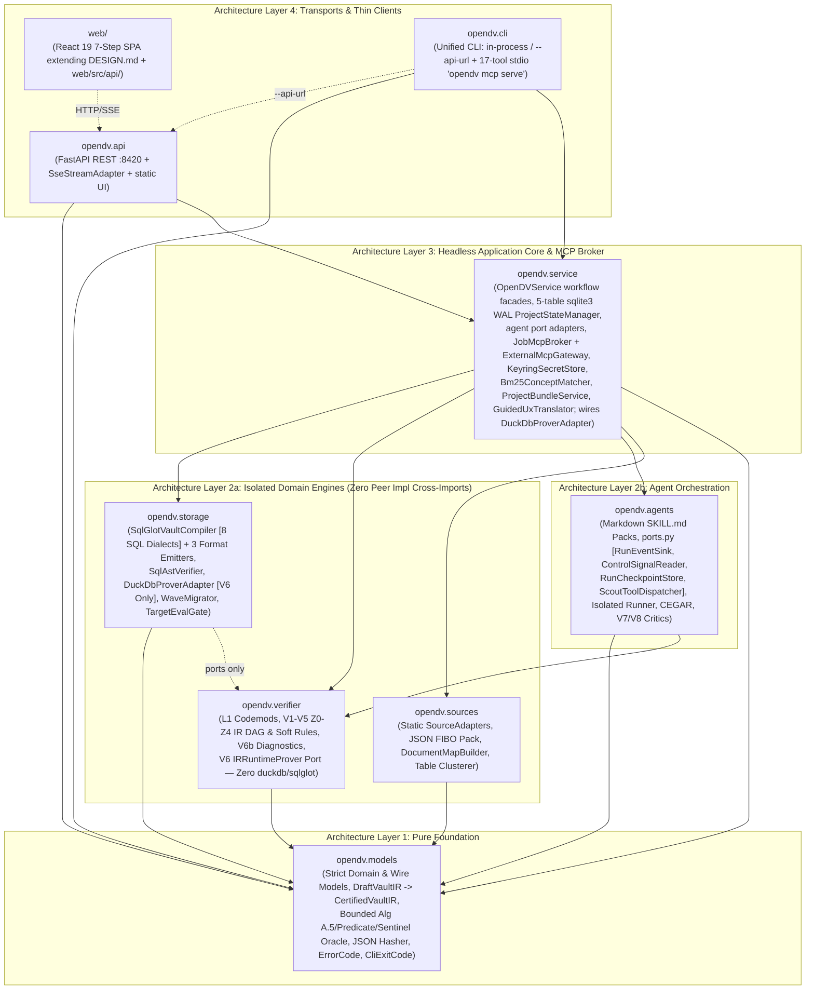
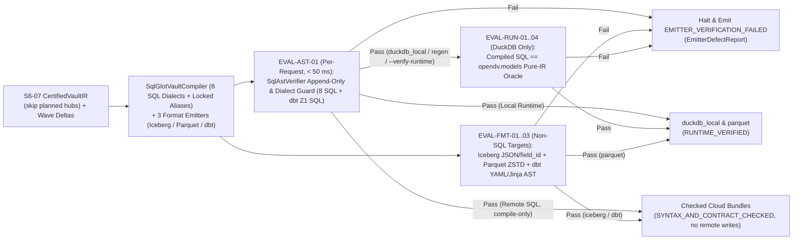

# Open-DV V2: Project-Scoped Ontology Studio & Schema-Validated Data Vault 2.0 Platform

*   **Author:** Eterna2
*   **Status:** Approved
*   **Date:** 2026-11-22

---

## Overview

Open-DV V2 turns operational databases, analytical files, policy documents, and domain notes into schema-validated and DuckDB-checked **5-Zone Data Vault 2.0 (`Z0–Z4`)** data warehouses matching [`DESIGN.md`](../../DESIGN.md): `Z0` Bronze Seeds & Reference Tables (`ref_*` plus Dual Zero `-1`/`-2` and Ghost sentinel records), `Z1` Hashed Staging Views (`staging.stg_*`), `Z2` Insert-Only Raw Vault (`raw_vault.hub_*` Hubs, `lnk_*` Links, `t_lnk_*` non-historized Transactional Links, `sat_*` Satellites, `mas_*` Multi-Active Satellites, `esat_*` Raw Link Effectivity Satellites, `sat_*_ext_v*` companion extensions, `sat_*_pii`), `Z3` Sparse Business Vault (`business_vault.sal_*` Same-As Links, `esat_sal_*` Same-As Effectivity Satellites, `pit_*` Point-in-Time tables, `brg_*` Bridge tables), and `Z4` Information Mart (`information_mart.vw_*_current` views). Each project evolves across additive waves (`Wave 1 -> Wave 2 -> ... -> Wave N`) without rewriting locked Raw Vault tables. One Python package (`opendv`), one React 19 Web Workbench (`127.0.0.1:8420`), one unified CLI (`opendv` in-process or `--api-url`), and one `stdio` MCP server (`opendv mcp serve`) run natively on **Windows and Linux** alongside the standalone GitHub Pages documentation site (`apps/opendv-website`).

**Existing V1 Baseline & Replacement Boundary:** V1 split a session-scoped Ontology Studio (`/sessions`, 800-character `/parse` chunking, `.odvstudio.zip`) from a separate 8-stage DV pipeline (`final_four_zone.sql`) across 11 sub-packages (`packages/opendv-*`) plus 4 runtime V1 apps (`apps/*` excluding `apps/opendv-website`), dual CLIs (`opendv` plus Bun `opendvctl`), custom OS file locks, and browser cookie secret storage. Open-DV V2 is a clean-sheet replacement (no automatic V1 session migration) centered on project-isolated workspaces rooted at `OPENDV_HOME` (`<cwd>/.opendv/` default), while security-sensitive workspace defaults and trust records stay in OS user state (`$XDG_STATE_HOME/opendv/` or `%LOCALAPPDATA%\opendv\`) outside repositories.

Instead of asking language models to write raw SQL, Open-DV V2 separates business discovery, logical schema validation, and deterministic compilation across a **7-step workflow**:

1. **Steps 1–3 (Deterministic Scope, Ingestion & Lazy Preview):** Users create an isolated **Project** and attach databases, analytical files, and documents with zero LLM calls and no async parse queues. Credentials store in workspace-scoped OS keyrings or owner-restricted user credential files that override ambient environment variables (no workspace secrets on disk). Step 2 builds page and table outlines synchronously and clusters `200+`-table catalogs deterministically (`10–25` tables/cluster), while Step 3 browses tables (`Step 3a`) and document pages (`Step 3b`) lazily.
2. **Steps 4–5 (Brokered MCP Discovery & Bidirectional Authoring):** `OpenDVService` starts a role-scoped loopback MCP broker (`coord` vs. read-only `scout` endpoints). The coordinator (`@ontology-first-mate`) delegates via `dispatch_scout(scout_kind, target_ids)` with no raw evidence tools or CLI `invoke_subagent`/`Agent` flags, while `JobMcpBroker` runs isolated scout subprocesses (`OPENDV_MCP_SCOUT_TOKEN` only, `--tools "" --strict-mcp-config`) or `sdk_runner` tasks. Scouts inspect masked column samples, redacted page spans, and OCR-masked scanned rasters (gated by server-side Steward scan approval), calling user-state external MCP servers solely through an authenticated PII-scrubbing proxy (`ExternalMcpGateway`) that records cryptographic receipts. `OpenDVService` and the coordinator ground business concepts against precompiled Financial Industry Business Ontology JSON (`FIBO`, `Path A`) via `Bm25ConceptMatcher` or cite physical source metadata (`Graph B`), document spans, or proxy receipts (`Path B`), checkpoint on human clarifications, and hand off to Step 5's `4-Mode` Ontology Explorer (`1: Canvas Graph & Inspector`, `2: Catalog & Key Authority`, `3: Bidirectional YAML CST Editor`, `4: Version Diff & ONT-AP Resolver`).
3. **Step 6 (Zero-SQL Synthesis, Behavioral Checks & Horizon Review):** Agents synthesize a strict storage-neutral draft model (`S6-02`) enriched by zero-token `L1` codemods (`S6-03`) and cluster-sharded scaffolding on large catalogs. Loop `L2` (`S6-04`) validates structural DAG rules (`V1–V5`), unstructured provenance (`Alg A.9b`), runtime invariants (`15/15` dynamic Data Vault rules plus SQL AST checks, `V6`) in `:memory:` DuckDB *before* locking evolution contracts, anti-pattern checks (`V6b`), and independent semantic scoring (`V7`). Human loop `L3` (`S6-05`) pauses on Steward clarifications and re-verifies; future-wave review (`V8`, `S6-06`) applies deterministic hardenings first and caps warm repairs at `<= 1` while preserving converged IR and Steward decisions. Step 6 seals the Wave schema and immutable evolution locks (`S6-07`) without mutating committed `Graph A` (alignment suggestions save solely as Steward proposals). Primary UI copy defaults to plain-English **`Guided`** mode rendered deterministically by `GuidedUxTranslator`, blocking forbidden compiler codes on Step 6 `Guided` cards/headlines and Step 4 Hold prompts.
4. **Step 7 & Portability (11-Target Compilers, Eval Gates & `.opendv.zip`):** Step 7 compiles certified schemas deterministically across **11 targets** (`8` SQL warehouse dialects from one shared AST compiler plus `3` format emitters for Apache Iceberg, Apache Parquet, and `dbt`) into additive wave migrations (`V002..V00N`) or cumulative regenerations (`Waves 1..N`). Every emission passes deterministic compiler AST or format checks (plus DuckDB differential equivalence against the pure reference kernel in `opendv.models` for `duckdb_local`, full regenerations, `--verify-runtime`, and CI), halting on failure with structured defect reports instead of LLM SQL patching. Local execution loads real attached rows (zero synthetic business rows; zero remote cloud writes), and projects export and import across OSes via `.opendv.zip` archives with extraction-safety and SHA-256 content checks.

---

## The Problem

Enterprise data engineering teams face five failure modes when building and evolving analytical warehouses across ongoing source waves:

1. **LLM-written SQL corrupts historical data warehouses:** Asking an LLM to generate or alter Data Vault SQL directly produces silent hash collisions (null-delimiter shifts, stripped leading zeros, character-vs-byte length bugs), cross-system business key collisions (`CRM` account `1001` merged without Business Key Collision Code [`BKCC`] scoping against Investment Book of Record [`IBOR`] account `1001`), flip-flopping multi-source satellites, and destructive `DROP` or `ALTER` statements that invalidate historical audit trails across waves.
2. **Fixed-window chunking and prompt token limits drop enterprise evidence:** Splitting PDFs into fixed 800-character chunks breaks tables and rule clauses mid-sentence, stalls Step 2 behind async parse queues, truncates large schemas or multi-page documents once prompts hit token limits, and blocks external MCP document processors—while unmasked sample rows, documents, or raster scans risk exposing `PII` to model prompts.
3. **Early-wave validation misses later-wave breaking schema changes:** A model can pass Wave-1 static and grain checks yet lock in a fragile design—such as using a mutable trading ticker as a Hub key when an immutable ISIN is present, sizing share quantities as 32-bit integers before institutional omnibus feeds arrive, or omitting child dependent keys (`CDK`) needed for allocated fills. Without bounded future-wave analysis, teams hit lock-in failures after production history accumulates across `Wave 2..N`.
4. **Compiler jargon blocks business stewards from making modeling decisions:** Data Vault synthesis encounters business choices that automation cannot guess (choosing between two candidate natural keys or scoping an identifier globally vs. locally). Exposing raw verifier codes (`DV-DYN-004`) or internal Data Vault terms (`BKCC`, `hash_diff`) without sample rows, plain-English explanations, or lock-in vs. reversible impact labels pushes stewards to accept unreviewed defaults or skip review.
5. **Lock-before-proof workflows and duplicate infrastructure degrade multi-target reliability:** Separating runtime checks from Step 6 locks invalid schemas before Step 7 tests replay and temporal behavior, while maintaining duplicate IR models, custom OS file locks, browser-only secret cookies, and separate SQL templates degrades cross-OS reliability and lets external MCP calls bypass citation and PII safeguards.

---

## Goals

Eight release-gated goals (`G-01`..`G-08`) define V2 completion and exit criteria, reconciling active requirements (`65` active `REQ-*` IDs from `REQ-01..REQ-68` after retiring `REQ-17`, `REQ-18`, and `REQ-24`, plus removing `LOCAL_ONLY`), `48` root-cause observations, `20` grounding/modeling/ops scenarios, `12` adversarial Data Vault traps, `6` `GRILL-01..06` architectural rulings, and `89` end-to-end UAT checks:

*   **`G-01` — Evergreen Per-Project Isolation & Synchronized State (`Wave 1 -> ... -> Wave N`):** Isolate sources, `Graph A` ontology versions, certified wave schemas, and append-only audit history per project inside `project.sqlite` (`Authoritative Project State`), strictly separated from regenerable `targets/<target_id>/` (`Disposable Target Outputs`). Engage `evolution_locks` on Step 6 certification (including monotonic Iceberg field-ID high-water marks and companion satellite epochs `v2..vN`), enforce them across Steps 4–6 (`FR-DOM-06`: zero autonomous Step 6 writes to committed `Graph A`), persist confirmed horizon choices, and prevent cross-project bleed.
*   **`G-02` — Zero-LLM Ingestion, Synchronous Page Maps, Table Clustering & Override Secrets:** Profile files and databases locally with zero LLM calls and no async parse queue. Build document page/table outlines synchronously, cluster `200+`-table catalogs deterministically (`10–25` tables/cluster) with reversible `Pin`/`Mute`/`Unset` curation, and serve Step 3a catalog trees under target latency budgets (`< 300 ms` below `500` tables). Resolve secrets from workspace-scoped OS keyrings or pinned owner-restricted user credential files **before** ambient environment variables (`REQ-20`, identical across `:8420`, `opendv`, and MCP workers), enforcing `<= 5` sample values (`"<MASKED_PII>"` on PII match).
*   **`G-03` — Brokered MCP, Isolated External Proxy & Isolated Discovery Subagents:** Delegate discovery scouts via `dispatch_scout` over a service-owned loopback MCP broker (`coord` vs. read-only `scout` subprocesses/SDK tasks, with zero raw evidence tools or `invoke_subagent`/`Agent` flags on `/coord`). Route external MCP calls exclusively in Step 4 through an authenticated PII-scrubbing proxy (`SHA-256` + excerpt receipts saved for inspectable exports), checkpoint cluster/page watermarks, drain before clarification holds, score concepts via `ADR-008` symmetric BM25 self-scoring (`>= 0.6500`, `0.6400` definition-only cap) across `Path A1`/`A2`/`B1`/`B2`, and preserve SQL types, `Key Authority Levels 1–3`, enums, and PII tags across Step 5's `4-Mode` Explorer.
*   **`G-04` — Unified Zero-SQL DV 2.0 Synthesis, `15/15` `DV-DYN` + `Alg A.9b` Checks & 12-Trap Coverage:** Inject baseline `column_triage` (`UNRESOLVED` default) in `S6-03` `L1` and shard `@ship-vault` (`S6-02`) along Step 4 clusters on large catalogs (`> 40` tables); enrich `DraftVaultIR` via `L1` (`Alg A.1–A.4, A.9a` covering `hub_document`, approved unstructured extraction links, planned ontology hubs `REQ-47`, and `information_mart.*` views). Validate `V1–V5` (`DV-STR-001..015` DAG topology, `V4 Alg A.9b`, `DV-COL-*` triage completeness, `V5 DV-AP-010` IR soft rules), `V6b` anti-patterns, `V7` semantic scoring, and all `15/15` `DV-DYN` runtime checks plus `Alg A.6` SQL purity in `:memory:` DuckDB (`V6`) *before* sealing evolution locks across all `12` traps (`TRAP-01..12`) and `BUG-01..08`, enforcing `fast`/`balanced`/`strict`/`symbolic_only` policies above a non-bypassable `V1–V6` floor.
*   **`G-05` — Bounded Frontier Horizon Stress Critic (`V8`):** After `V1–V6` pass (`1-click` in `fast`) and `V7` passes (`auto` in `balanced`/`strict`), run `@dv-horizon-critic` on `FRONTIER_CRITIC` over future-wave breaking scenarios (`BRK-01..08`, filtering items absorbed natively by DV 2.0). Apply deterministic technical hardenings via `Bucket A` `L1` operators straight into `L1 -> L2` verification without re-running `@ship-vault` unless `V1–V7` fail (`<= 1` warm repair and at most one `V8` re-score, preserving converged IR, `evolution_locks`, Steward rulings, and waivers), pause immediately (`0` retries) on business choices (`Bucket B`), fast-path Horizon Resilience Score `>= 85/100`, enforce monotonic ratchet guards, and save Steward choices in `horizon_assumptions`.
*   **`G-06` — Plain-English `Guided` Default UX with 1-Click `Architect Observatory`:** Keep structural verdict acceptance decoupled from copy lint and render routine `Guided` copy deterministically inside `GuidedUxTranslator` (`4` milestones: `Scope & Map`, `Discovery & Ontology`, `Vault Synthesis & Proof`, `Target Build`; `"Why Does This Table Exist?"` drawers; 2-row `Lock-In` vs. `Flexible` Decision Cards; and Readiness Briefs, blocking `FORBIDDEN_GUIDED_JARGON` tokens on primary Step 6 `Guided` cards/headlines and Step 4 Hold prompts). Pair the header `Budget Meter` (turns, tokens, seconds) with 1-click `Architect Observatory` across `1440x920`, `1024x768`, and `390x844` viewports (`0` horizontal overflow, `0` console errors).
*   **`G-07` — Shared AST SQL Compiler + 3 Format Emitters (`11` Targets) & Non-Circular Checks:** Compile certified schemas deterministically across `8` SQL warehouse dialects (`2` core — `duckdb_local`, `databricks_uc` — plus `6` `REQ-65`: `snowflake`, `postgres`, `bigquery`, `sqlserver_fabric`, plus `redshift` and `clickhouse` with deduplicated anti-join batches) and `3` format emitters (Apache Iceberg, Apache Parquet, `dbt` `AutomateDV`). Gate every emission with fast per-target AST/format checks (plus DuckDB differential checks against `opendv.models`'s pure reference oracle for local execution, full regenerations, `--verify-runtime`, and CI), halting on failure with structured defect reports (zero LLM SQL patches) and loading real attached rows locally (zero synthetic business rows; zero remote writes).
*   **`G-08` — Cross-OS Windows & Linux Parity, `.opendv.zip` Portability (`Core` Default) & UAT Exit Criteria:** Support **Windows and Linux** with parity across SQLite WAL concurrency (zero custom OS file locks), workspace-scoped credential resolution, OS user-state security settings, allowlisted subprocess cleanup, POSIX path manifests, and dual-OS CI (`ubuntu-latest` + `windows-latest`). Export/import projects across waves via `.opendv.zip` (`~15–50 KB` typical core state on small/medium projects [`<= 40` tables / `<= 600` columns], scaling linearly, or opt-in full demo `<= 250 MB`; no secrets) with extraction safety and SHA-256 integrity checks. Target `89/89` Playwright UI UAT on `:8420` plus CLI/MCP transport parity across `opendv` and `opendv mcp serve`, gated by live `agy` and `claude-cli` UAT and a `Phase V2-5` midpoint check-in (`GRILL-06`).

### Master Goal-to-Requirement, Scenario, Trap & UAT Tracking Ledger

| Goal ID | Consolidations | Workstreams | Active `REQ-*` IDs (`65` Active; `REQ-17/18/24` Retired) | Addressed `OBS-*` (`48`) | Scenarios, Traps & Decisions (`20` + `12` + `6 GRILL`) | Verification `UAT-*` (`89` Target Checks) |
| :--- | :--- | :--- | :--- | :--- | :--- | :--- |
| **`G-01`** | `C4` | `WS-01` | `REQ-06, 08, 55, 64 (Project/Target)` | `OBS-04, 05, 39, 45 (Project/Target)` | `GRILL-05` | `UAT-NAV-01..02`, `UAT-S1-06..07`, `UAT-S6-10`, `UAT-S7-01` |
| **`G-02`** | `C3` | `WS-03, 04, 05` | `REQ-01..05, 09..11, 13..16, 19..23, 25..26, 28, 35 (p1), 43` | `OBS-01..03, 06..16, 18 (p1), 22` | `SCEN-08`, `OPS-03` | `UAT-S1-01..05`, `UAT-S2-01..15`, `UAT-S3-01..04`, `UAT-SET-01..05` |
| **`G-03`** | `C7` | `WS-06, 07, 08` | `REQ-12, 27, 29..31, 35 (p2), 36..41, 48, 53..54` | `OBS-17, 18 (p2), 19..21, 23..27, 32..34, 37..38, 42 (p1)` | `SCEN-01..07, 09`, `OPS-04` | `UAT-S4-01..13`, `UAT-SCEN-01..09`, `UAT-S5-01..05`, `UAT-AGT-02` |
| **`G-04`** | `C5` | `WS-09` | `REQ-44..47, 49..52, 58, 60, 62` | `OBS-28..31, 35..36, 42 (p2), 43` | `MOD-02..03, 06..07`, `TRAP-01..12` | `UAT-S6-01..09, 13, 15`, `UAT-FIX-01..02` |
| **`G-05`** | `—` | `WS-09` | `REQ-66` | `OBS-46` | `MOD-05`, `GRILL-03` | `UAT-S6-18` |
| **`G-06`** | `—` | `WS-10` | `REQ-56..57, 59, 61, 67` | `OBS-40..41, 47` | `MOD-01, 04` | `UAT-S6-11..12, 14, 16, 19` |
| **`G-07`** | `C6` | `WS-11` | `REQ-63, 64 (Step 7), 65` | `OBS-44, 45 (Step 7)` | `GRILL-01, 02` | `UAT-S6-17`, `UAT-S7-02..03` |
| **`G-08`** | `C1, C2` | `WS-02, 11` | `REQ-07, 32..34, 42, 68` | `OBS-48` | `OPS-01..02`, `GRILL-04, 06` | `UAT-NAV-03`, `UAT-WEB-01..02`, `UAT-AGT-01` |

*Legend — Architecture Consolidations (`C1–C7`, distinct from `UAT-S1..S7`) & Companion Citations:* `C1` = single `opendv` CLI + OpenAPI TS client (retiring `opendvctl`); `C2` = single `src/opendv/` package + `web/` SPA (retiring `11` sub-packages + `4` runtime V1 apps); `C3` = workspace-scoped `KeyringSecretStore`; `C4` = 5-table SQLite WAL store + on-demand exports; `C5` = unified `DraftVaultIR -> CertifiedVaultIR` (`VaultSchemaIR v2.0`); `C6` = shared `SqlGlotVaultCompiler` + `3` format emitters; `C7` = canonical Markdown `SKILL.md` packs + brokered/proxied Step 4 MCP. Companion definitions under [Additional Resources](#additional-resources): `GRILL-01..06` ([`docs/33 §1.4`](../../docs/33-v2-phased-implementation-and-real-data-uat-plan.md#L61-L67); `GRILL-04` keeps historical `LOCAL_ONLY` text in `docs/33` while V2 retires `LOCAL_ONLY`), `REQ-*`/`OBS-*`/`UAT-*` ([`docs/31`](../../docs/31-v2-e2e-requirements-gaps-and-uat-spec.md)), `SCEN-*` ([`docs/29`](../../docs/29-discovery-grounding-and-evolution-scenarios.md)), `MOD-*`/`OPS-*` ([`docs/32`](../../docs/32-v2-user-experience-and-scenario-guide.md)), `TRAP-*` ([`docs/30`](../../docs/30-enterprise-dv2-modeling-and-loop-engineering.md)), `BUG-01..08` ([`docs/14`](../../docs/14-end-to-end-consistency-and-scenarios-audit.md)), `D16` (`< 5,000` `cl100k_base` tokens/file) ([`AGENTS.md`](../../AGENTS.md)), `D18` (loopback open access) ([`docs/27`](../../docs/27-unified-ontology-pipeline-requirements-and-uat.md), [`docs/28`](../../docs/28-unified-ontology-pipeline-design-and-plan.md)), and `REQ-CORE-01` ([`AGENTS.md`](../../AGENTS.md)).

---

## Non-Goals

*   **V1 Shims & Consolidation Retirements (`GRILL-05`; `C1–C7` Consolidations):** Retires V1 `--session` / `/sessions` aliases (`--project` and `/api/v1/projects/{project_id}` only), V1 `CanonicalIR` and `NoMistakeDataVault2ContractV5` (unified under `C5` into `DraftVaultIR -> CertifiedVaultIR`, where `CertifiedVaultIR` is `VaultSchemaIR v2.0`, superseding `UniversalVaultSchemaIR v2.0` in [`AGENTS.md`](../../AGENTS.md#L7), [`CLAUDE.md`](../../CLAUDE.md#L14), and `docs/30–32`), `@toon_v1` directives (`C5`), `opendvctl` Bun binaries + V1 `schemas/cli-spec.json` + `opendv-protocol-ts` (`C1`), 11 V1 sub-packages + 4 runtime V1 apps (`C2`), `.odv_workspace_secret` + HKDF + `CookieSecretVault` (`C3` — keeping OS owner-SID ACLs on headless `user_state_file`), symmetric HMAC `IMPORT_REANCHOR` + frozen V1 JCS SHA-256 test pins (`ADR-005`) + `cas/` hex stores (`C4`), `entry_points` hot-reload + dual XML/Markdown prompt renderers (`C7`), 8 separate SQL template emitters (`C6`), `opendv ontology studio promote`, `.odvstudio.zip`, and 800-character `/parse` chunking.
*   **Autonomous `Graph A` Mutations (`FR-DOM-06`):** Step 6 never commits ontology deltas autonomously onto committed `Graph A`; alignment suggestions remain uncommitted Steward proposals in `revisions`.
*   **Per-File `LOCAL_ONLY` Attachment Mode (Retired):** Retires `do_not_send_to_agent` / `LOCAL_ONLY` flags, offline extractors, `ExcludedSourceTombstone` placeholders, and `422` export overrides in favor of `<MASKED_PII>` redaction, workspace-scoped `KeyringSecretStore`, and explicit operator non-attachment rules for contextual textual Material Non-Public Information (`MNPI`).
*   **Remote Cloud Warehouse Execution (`GRILL-02`):** Live DDL/DML/data loading executes strictly on local `duckdb_local` and local ZSTD `Parquet`; remote cloud warehouses receive checked scripts/bundles only (zero remote writes).
*   **Synthetic Business Row Fabrication (`GRILL-01`):** When raw binaries are absent (`METADATA_ONLY_BINARY_ABSENT`), Step 7 creates schemas and `-1`/`-2` Zero/Ghost sentinel records only (zero synthetic business rows; Step 6 `:memory:` edge perturbations stay strictly ephemeral inside verification batches).
*   **LLM-Authored or LLM-Patched SQL (`OBJ-01`):** Agents emit `DraftVaultIR` only; deterministic compilers generate all SQL, and Step 7 failures emit `EMITTER_VERIFICATION_FAILED` defect reports rather than AI SQL patches.
*   **Loopback Login Gates (`D18`) or Heuristic Synthesis (`ADR-002` Retired):** Loopback `127.0.0.1:8420` runs without login screens (non-loopback fails closed per [Technical Plan §3](#3-loopback-access-control-d18-workspace-scoped-keyringsecretstore-and-3-tab-settings-hub-c3-c7) unless `--allow-remote-unauthenticated`), and `--mode deterministic` heuristic synthesis is retired across UI, API, and CLI.

---

## Open Questions

*   None currently open.

---

## Critical User Journeys (CUJs)

### CUJ 1: Cold-Start Multi-Modal Discovery to Schema-Validated Vault and DuckDB Query (Steps 1–7)

*   **Given**: A workspace at `<OPENDV_HOME>` on `http://127.0.0.1:8420` with live `agy` or `claude-cli` credentials, an external OCR/table MCP server registered in OS user state (opted into document access for that server), and Asset Management sources (`am_sec_treasury_ibor.sqlite`, 31-column `am_esg_stewardship_proxy.parquet` with PII columns, `am_stewardship_domain_notes.md`, and 6-page `am_custody_and_voting_guide.pdf` with 1 embedded table and 1 scanned page).
*   **When**: The user creates Project `am-ibor-2026` (`asset_management`), attaches files and an inline note, inspects clustered tables (`Step 3a`) and document outlines (`Step 3b`), pins/mutes terms, approves scanned page inspection, runs Step 4 Discovery (answering 1 `HOLD_CHECKPOINTED` clarification and reviewing 1 `skos:closeMatch`), edits `ontology.yaml` before committing `v1.0.0`, runs Step 6, and compiles + loads real rows + runs `SELECT` queries in Step 7 (`duckdb_local`).
*   **Then**:
    *   Step 2 profiles sources and indexes `document_map` metadata synchronously into `project.sqlite` (zero LLM calls and no async parse queues).
    *   Step 4 runs host CLIs inside an isolated empty directory: `@ontology-first-mate` uses `OPENDV_MCP_COORD_TOKEN` (`dispatch_scout`, zero raw evidence tools, no `invoke_subagent`/`Agent` flags), while `JobMcpBroker` dispatches scouts (`OPENDV_MCP_SCOUT_TOKEN` only, `--tools "" --strict-mcp-config`) inspecting clustered tables, masked page spans, stateless quote offsets, server-gated `view_page_image` (`OcrPageReceipt`), and opt-in `ExternalMcpGateway` receipts.
    *   Step 5 (`4-Mode` Explorer) preserves SQL types, key tiers, enums, and PII tags without mutating locked concepts.
    *   Step 6 decomposes the 31-column feed into `4` Hubs + `sat_proxy_ballot_pii`, validates `V1–V5` (`DV-STR-001..015`, `Alg A.9b`, `DV-AP-010`) inside `opendv.verifier` plus `V6` (`15/15` `DV-DYN`, `Alg A.6`) via `DuckDbProverAdapter` *before* sealing `evolution_locks`, leaving committed `Graph A` untouched.
    *   Step 7 passes `TargetEvalGate`, coordinates `demo_vault.duckdb` access via `project.sqlite` `leases`, loads real rows, and executes AST-checked read-only `SELECT` queries (`enable_external_access=false`, `lock_configuration=true`, AST I/O function denylist).

### CUJ 2: Business Steward Resolving Traps, Anti-Patterns and Horizon Stress in Guided Mode (Step 6)

*   **Given**: A Project loaded with overlapping account keys from CRM and IBOR feeds, multi-active shareholder ballots, snapshot timestamp churn, changing manager assignments, early-arriving/bi-temporal feeds, competing natural keys (`uti` vs. `isda`), and a future-wave equity security ticker (`ticker` vs. immutable `isin`).
*   **When**: The steward runs Step 6 in default `Guided` mode (`Balanced`), answers plain-English Decision Cards (`Lock-In` vs. `Flexible`) on Steward Holds, reviews future-wave readiness warnings, and then opens the `Architect Observatory`.
*   **Then**:
    *   Primary `Guided` cards, milestone headlines, and readiness briefs render deterministically via `GuidedUxTranslator` with zero forbidden compiler jargon (`FORBIDDEN_GUIDED_JARGON` tokens on Step 6 `Guided` UI and Step 4 Hold prompts fall back to plain-English templates without dropping verdicts).
    *   `DuckDbProverAdapter` verifies duplicate-key system scoping, multi-active ballot grains, timestamp churn, manager reassignment effectivity, early-arriving stubs, and bi-temporal restatements before sealing locks.
    *   Horizon analysis applies automated structural fixes first and pauses immediately (`0` retries) on irreversible business choices, persisting confirmed choices in `horizon_assumptions` alongside uncommitted ontology alignment proposals (`Graph A` stays untouched).
    *   *Architect Observatory:* Displays the Step 6 attempt storyboard (`S6-01` Preflight -> `S6-07` Seal), energy curve `E(IR_k)` across `DS-CEGAR-12TRAP` and `DS-HORIZON-SEC`, `BKCC` scoping, `mas_*`/`esat_*`/`applied_dts` diagnostics, masked DuckDB counterexamples, Horizon Resilience Score (`>= 85/100`), and `1`-cap `V8 Bucket A` verification pass.

### CUJ 3: Evergreen Multi-Wave Schema Evolution and Incremental Parity (Wave 1 to Wave N)

*   **Given**: An evergreen Project `am-ibor-2026` with certified `Wave 1..K` history and `demo_vault.duckdb`.
*   **When**: Across `Wave 2..N`, the team attaches drifting feeds (`wave2_eu_custody_lei_and_drift.parquet`, `wave2_bitemporal_nav_restatements.csv`), runs Step 4 (`incremental_new` -> `v1.N.0`), certifies Wave `N` in Step 6, and executes Step 7 `Incremental Migration (V00N)` plus `[Reset & Test Full Regen]`.
*   **Then**:
    *   Steps 4–5 read `evolution_locks` alongside committed `Graph A` and block deletion of any locked Hub (`ONT_EVO_CONTRACT_VIOLATION`).
    *   Step 6 preserves all locked Hub key signatures and Raw Vault `hash_diff` columns while appending companion `sat_*_ext_vN` (`v2..vN`) and `sal_*` crosswalks, recording optional ontology alignment suggestions solely as uncommitted Steward proposals in `revisions`.
    *   Step 7 `V00N` passes `TargetEvalGate` (exact column parity with `full_schema_wN.sql` including regenerated `pit_*` / `brg_*` / views), emits zero destructive Raw Vault DDL, and retains historical rows.

### CUJ 4: Cross-OS (Windows and Linux) .opendv.zip Portability and METADATA_ONLY_BINARY_ABSENT Recovery

*   **Given**: Project `am-ibor-2026` on Host A has `DATABRICKS_TOKEN` saved in workspace-scoped `KeyringSecretStore` and certified multi-wave artifacts including `external_mcp_receipts`.
*   **When**: User A downloads `.core.opendv.zip` (default) and opt-in `.full_demo.opendv.zip`, and User B on the opposite OS tests corrupted, Zip-Slip, symlink, and case-colliding archives, imports `.core.opendv.zip` (`conflict=rename`), and imports `.full_demo.opendv.zip`.
*   **Then**:
    *   Archives enforce `PurePosixPath` entries, unkeyed `SHA-256` `manifest.json` integrity checks, on-demand `profile.json` masked samples (`<= 5`/table), `external_mcp_receipts.jsonl`, `ocr_receipts.jsonl`, and `vault_waivers.json` in `core_project_state` (zero secrets). Malformed or hash-mismatched zips fail closed with zero extracted files.
    *   `.core.opendv.zip` hydrates `project.sqlite` and reports `METADATA_ONLY_BINARY_ABSENT` in `ImportReadinessReport.readiness_flags`. Offline mode still runs `Step 3a` catalog and `TablePreviewPage` browsing (falling back to cached `<= 5` `SourceProfile` sample rows), Step 6 DuckDB invariant checks + stored-digest `V4` span verification (against persisted `canonical_text_sha256`, `OcrPageReceipt`, and `ExternalMcpReceipt` digests), receipt inspection, and zero-row Step 7 DDL compilation; raw `Step 3b` / Step 4 page reading and raw-file `Alg A.9b` re-checks prompt to re-attach source files (and `NEEDS_LOCAL_SECRET_BINDING` prompts for Databricks secrets).
    *   `.full_demo.opendv.zip` preserves byte-identical canonical JSON digests and normalized text spans plus immediate Step 7 DuckDB regeneration across OSes.

### CUJ 5: Headless Cross-Platform CLI (in-process & --api-url) and IDE Agent Parity (opendv, opendv mcp serve)

*   **Given**: A developer or CI runner on Linux or Windows using `opendv` in-process, `opendv --api-url http://127.0.0.1:8420`, or an external IDE connected to `opendv mcp serve --transport stdio --project <id>`.
*   **When**: They run project init, source attach, `ontology construct`, `vault build`, `storage compile|migrate`, and `project export|import`.
*   **Then**:
    *   `in-process` CLI runs invoke `OpenDVService` directly without `:8420`. Under `:8420`, `OpenDVService` (`Layer 3`) reads cross-process `control_signal` rows from `project.sqlite` and serves `SseStreamAdapter` (`Layer 4`) by tailing persisted `runs/<run_id>.jsonl` (ignoring incomplete trailing JSONL frames), while `stdio` `opendv mcp serve` binds `17` `OpenDVService` lifecycle tools directly against `project.sqlite` (spawning its own `JobMcpBroker` on Step 4 tools).
    *   Both CLI modes return matching JSON payloads and exit codes ([Technical Plan §8](#8-unified-transport-parity-rest-sse-cli-and-mcp-c1)), resolve OS CLI shims without shell invocation, coordinate concurrent metadata and DuckDB writes via `project.sqlite` WAL `leases` (zero zombie `409` states) and short-lived DuckDB handles, drain and terminate child process trees on cancel/timeout/hold, and produce identical canonical artifact digests across Linux and Windows.

---

## Technical Plan (Architecture)

### 1. Two-Manifest Runtime Topology, Shared IR Kernel and Layer Boundaries (C1, C2, C5)

Open-DV V2 uses **two core runtime build manifests** (`pyproject.toml` for one Python package `src/opendv/` plus `web/package.json` for the React 19 Workbench) alongside the standalone static GitHub Pages docs site (`apps/opendv-website`, `REQ-33/34`). Every Python and handwritten TypeScript source file stays `< 5,000` `cl100k_base` tokens (`D16`, `<= 4,300` authoring target), application orchestration and MCP brokerage live in `opendv.service` (`REQ-CORE-01`), and an AST import-boundary test enforces an acyclic four-layer DAG (`Layer 1` -> `Layer 2a` -> `Layer 2b` -> `Layer 3` -> `Layer 4`) with zero `Layer 2a` peer cross-imports (except `opendv.storage` -> `opendv.verifier.ports`) so `opendv.verifier` stays free of `duckdb` and `sqlglot`:



| Module / Directory (Submodules `<= 4,300` Tokens) | Responsibility | Allowed Internal Imports (AST-Enforced) |
| :--- | :--- | :--- |
| `src/opendv/models/` | Strict (`extra="forbid"`) domain/wire models (`GraphAOntology`, `34`-op `OntologyDelta`, `DraftVaultIR` -> `CertifiedVaultIR` [`VaultSchemaIR v2.0`, superseding `UniversalVaultSchemaIR v2.0`], `SchemaWaveDelta`, `ProjectState`, `ExternalMcpServerSpec`, `EmitterDefectReport`, `VerifierDiagnostic`), bounded pure-Python IR Reference Oracle (`ir_kernel.py`: `Alg A.5`, `-1`/`-2` sentinels, `SeedRecordsSpec`, `PredicateNode` evaluation only — zero SQL compilation or semantic checks), `json_hasher.py` (`dumps_jcs_bytes`, RFC 8785), `ErrorCode`, `CliExitCode`, and `ModelTier`. | Python stdlib + Pydantic v2 only. |
| `src/opendv/sources/` | Static `SOURCE_ADAPTERS` (`sqlite`, `duckdb`, `parquet`, `csv`, `xlsx`, `databricks_uc`), precompiled JSON FIBO pack (zero runtime `rdflib`), `Graph B` schema profiler (`<= 5` sample rows, `<MASKED_PII>` on PII match), `DocumentMapBuilder` (PDF/OCR, DOCX, Markdown), PII detector, and deterministic Table Clusterer (`10–25` tables/cluster). | `opendv.models`. |
| `src/opendv/verifier/` | Zero-token `L1` codemods (`Alg A.1–A.4, A.9a`, baseline `UNRESOLVED` `column_triage` in `S6-03`, `BucketAOperator`) and `V1–V5` symbolic gates (`DV-STR-001..015` Zone DAG via `networkx`, `DV-COL-*` completeness, `Alg A.5` injectivity, Zero/Ghost, `Alg A.9b` + stored-digest/OCR receipts, `evolution_locks` parity, `DV-AP-010` IR soft rules — zero SQL parsing), `ports.py` (`IRRuntimeProver`, `IRProverReport`), and `V6b` diagnostics. | `opendv.models`, `networkx` (no `duckdb`, `sqlglot`, or `opendv.storage` imports). |
| `src/opendv/agents/` | Canonical Markdown `SKILL.md` packs (+ trusted OS-approved workspace overrides), `ports.py` (`RunEventSink`, `ControlSignalReader`, `RunCheckpointStore`, `ScoutToolDispatcher`), isolated empty-tempdir host CLI & bare-SDK launchers, cluster-sharded Step 6 CEGAR controller, `V7` `@dv-semantic-critic`, and `V8` `@dv-horizon-critic`. | `opendv.models`, `opendv.verifier`. |
| `src/opendv/storage/` | Submodules `sql_compiler/` (`SqlGlotVaultCompiler` across `8` SQL dialects + deterministic locked physical aliases, `WaveMigrator`), `prover/` (`DuckDbProverAdapter` implementing `V6` `15/15` `DV-DYN` + `Alg A.6` + `DV-AP-011`), `emitters/` (`iceberg`, `parquet`, `dbt`), `SqlAstVerifier` (`Alg A.6` in `V6` + append-only/dialect checks in `EVAL-AST-01`), read-only query guard, `TargetEvalGate`, and `EmitterDefectReporter`. | `opendv.models`, `opendv.verifier.ports`, `duckdb`, `pyarrow`, `sqlglot`, `pyyaml`, `jinja2`. |
| `src/opendv/service/` | Workflow facades wired by `OpenDVService`, `ProjectStateManager` (5-table `sqlite3` WAL store + JSONL event tailing), agent port implementations, `Bm25ConceptMatcher`, citation + `OcrPageReceipt` resolver, role-scoped Step 4 `JobMcpBroker` + `ExternalMcpGateway`, workspace-scoped `KeyringSecretStore`, `bundles/` (`.opendv.zip`), `.ttl` exporter, and deterministic `GuidedUxTranslator`. | `opendv.{models, sources, verifier, agents, storage}`. |
| `src/opendv/api/` & `src/opendv/cli/` | Thin Layer 4 transports: FastAPI REST (`:8420` + loopback Host/Origin/Content-Type guards + packaged UI `static/` assets), `SseStreamAdapter` (streams `OpenDVService` JSONL tail), and unified Typer `opendv` CLI (`in-process`, `--api-url`, and `17`-tool `stdio` `opendv mcp serve`). | `opendv.service`, `opendv.models`. |
| `web/`, `apps/opendv-website/`, `tests/` *(Non-DAG)* | `web/` runtime React 19 SPA extending [`DESIGN.md`](../../DESIGN.md)'s `44px` stepper from 6 to 7 steps (`< 768px` stacked collapse, OpenAPI TS types, bundled `.woff2` fonts built to `src/opendv/api/static/`, plus `DV Schema Explorer` & `Run Explorer`); standalone static GitHub Pages site `apps/opendv-website/` (`REQ-33/34`); and standalone test suites `tests/` (kernel vectors, architecture/token budgets, `12`-Trap/`15`-`DV-DYN`/`11`-Target, Playwright UAT). | Standard web / test tooling (outside runtime Python DAG). |

---

### 2. Evergreen Project Storage Layout, 5-Table SQLite Authority and Archive Portability (C4)

Workspace project roots resolve via `OPENDV_HOME` (`<cwd>/.opendv/` default) after rejecting network/cross-OS WAL mounts (`SMB`, `NFS`, `WSL2 /mnt/`). User security state—`settings.json` (pinning `trusted_workspaces`, `secret_backend`, `secret_precedence`, `harness_provider`, `connection_profiles`, zero secrets), `mcp_servers.json`, and optional owner-ACL `user_state_file` credentials—resides outside cloned repositories in OS user state (`$XDG_STATE_HOME/opendv/` on Linux, `%LOCALAPPDATA%\opendv\` on Windows) so cloned workspaces can never self-authorize `.opendv/agents/*` overrides or flip security backends:

```text
<OS_USER_STATE>/opendv/                   # Out-of-repo user state ($XDG_STATE_HOME/opendv or %LOCALAPPDATA%\opendv)
├── settings.json                         # WorkspaceSettings + trusted_workspaces digests (0 secrets)
├── mcp_servers.json                      # Registered ExternalMcpServerSpec entries
└── secrets.json                          # Used only when secret_backend="user_state_file" (0600 / owner-SID ACL)

<OPENDV_HOME>/                            # Project workspace root (OPENDV_HOME or <cwd>/.opendv/; local FS checked)
└── projects/<project_id>/
    ├── project.sqlite                    # Sole authoritative Project State (5-table sqlite3 WAL store):
    │                                     #   projects, sources_and_tables, revisions (ontology_version, wave_ir,
    │                                     #   evolution_lock, horizon_assumption, concept_memory, staged_candidate,
    │                                     #   ontology_proposal, vault_waiver, ontology_waiver), events_and_receipts
    │                                     #   (audit_log, mcp_receipt, ocr_receipt, run_checkpoint, run_state,
    │                                     #   attempt_snapshot, control_signal), leases (active_job_lease, duckdb_write)
    ├── runs/<run_id>.jsonl               # Single-writer trace/SSE bridge log (tailed via OpenDVService/SSE)
    ├── sources/<source_id>/              # Uploaded raw source binaries only (metadata lives in project.sqlite)
    └── targets/<target_id>/              # Disposable Target Outputs (regenerable identically from project.sqlite)
        ├── target_manifest.json          # Compiled/materialized waves, verification_tier, certification_status, receipts
        ├── migrations/V001..V00N.sql     # Additive per-wave DDL/DML scripts (or target layout for iceberg/parquet/dbt)
        ├── full_schema_wN.sql            # Cumulative regeneration bundle (exact column parity with V001..V00N)
        └── demo_vault.duckdb             # Built-in local DuckDB database (duckdb_local only; short-lived handles)
```

*   **Single Authoritative SQLite WAL Store & On-Demand Exports:**
    *   Stdlib `sqlite3` in WAL mode (`busy_timeout` + retry) stores all live metadata inside **5 tables** (`projects`, `sources_and_tables`, `revisions`, `events_and_receipts`, `leases`) under `BEGIN IMMEDIATE` transactions. This eliminates custom OS file locks, startup disk-mirror reconciliation, and duplicate on-commit `profile.json`/`document_map.json`/`versions/`/`waves/` trees on disk.
    *   Readable JSON/YAML/SQL/Turtle snapshots materialize strictly on demand via CLI/API export and inside `.opendv.zip`.
    *   `leases` tracks both `active_job_lease:<project_id>` (released atomically on `HOLD_CHECKPOINTED`, `UNCERTIFIED_DRAFT`, `COMPLETED`, or `FAILED`) and `duckdb_write:<project_id>:<target_id>` using `(holder_run_id, holder_pid, process_start_ts, heartbeat_at)` with TTL/dead-PID reclamation (`0` zombie `409` locks); `demo_vault.duckdb` opens short-lived per-request handles (`read_only=True` with bounded busy retry for queries, serialized via `duckdb_write` lease for migrations).
*   **Evergreen `evolution_locks` Lifecycle:** Engaging on Step 6 certification, `evolution_locks` freeze Hub business-key signatures, Link key sets (`locked_links`), bound source column sets (`locked_source_columns`), Raw Vault `hash_diff` columns, deterministic locked `physical_aliases`, Iceberg `field_id_high_water_marks`, and companion satellite epochs (`v2..vN`) inside `revisions` (exempting `is_planned_concept=True` hubs until sources attach) so Steps 4–5 and `V8` enforce them without blocking additive evolution.
*   **Archive-Safe `.opendv.zip` (`ProjectBundle v2.0`, `core_project_state` Default):**
    *   **`core_project_state` (Default, `~15–50 KB` on small/medium projects [`<= 40` tables / `<= 600` columns], scaling linearly):** Materializes bounded portable JSON/JSONL files (1 file per revision/wave: `project.json`, `tables_index.json`, `profile.json`, `document_map.json`, `vault_waivers.json`, `external_mcp_receipts.jsonl`, `ocr_receipts.jsonl`, `audit.jsonl`, `versions/vX.Y.Z.json`, `waves/W00N.json`) and unkeyed `SHA-256` `manifest.json` (zero `.sqlite`/WAL files, zero secrets).
    *   **`full_demo` (Opt-in, `<= 250 MB`):** Adds `demo_vault.duckdb` + raw uploaded binaries stored uncompressed (`ZIP_STORED`); oversized payloads raise `ARCHIVE_SIZE_LIMIT_EXCEEDED`.
    *   **Cross-OS Import (`Windows <-> Linux`):** Enforces `PurePosixPath` entry checks (rejecting symlinks, NTFS reparse points, case collisions, reserved names, `ADS`, path traversal, `> 500` entries, ratio bombs, and `manifest.json` hash mismatches with zero extracted files), hydrates `project.sqlite` (`fail` | `rename` | `replace`), and returns `ImportReadinessReport` with non-exclusive `readiness_flags` (`READY_OFFLINE`, `NEEDS_LOCAL_SECRET_BINDING`, `METADATA_ONLY_BINARY_ABSENT`).

---

### 3. Loopback Access Control (D18), Workspace-Scoped KeyringSecretStore and 3-Tab Settings Hub (C3, C7)

*   **Loopback Access Control (`D18`):** `:8420` binds `127.0.0.1` / `::1` auth-free and checks `Host` DNS-rebinding (`exit 40` on non-loopback `--host` unless `--allow-remote-unauthenticated` permits the bound remote `Host`, enforces same-origin `Origin`, and restricts path inputs under `OPENDV_WORKSPACE_ROOTS`). Middleware forbids wildcard CORS (`Access-Control-Allow-Origin: *`), blocks cross-site `Sec-Fetch-Site` or foreign `Origin` headers, rejects HTML form MIME (`application/x-www-form-urlencoded`, `multipart/form-data`, `text/plain`) outside explicit multipart upload routes (`/projects/import`, `/sources/upload`, and `PATCH /projects/{id}/sources/{sid}`), and requires `Content-Type: application/json` whenever a `POST`/`PUT`/`PATCH` request carries `Content-Length > 0` (non-multipart `Content-Type` on `PATCH .../sources/{sid}` uses `application/json`), keeping `DELETE` and bodyless actions (such as `POST .../vault/verify`) valid while preserving CLI `--api-url` / `httpx` operation without browser headers.
*   **Workspace-Scoped `KeyringSecretStore` (`REQ-20` Override Precedence & Pinned Backends):** Keyring entries namespace by canonical resolved `OPENDV_HOME` digest so workspaces do not share credentials. OS user-state `settings.json` pins `secret_backend` (`keyring` — Windows Credential Manager / Linux Secret Service — vs. owner-ACL `user_state_file`), preventing headless vs. desktop D-Bus divergence and retiring `.odv_workspace_secret`, host-coupled HKDF encryption, and browser cookies. Lookup obeys strict precedence **`--env-first > OPENDV_SECRET_PRECEDENCE > ProjectSettingsSnapshot.secret_precedence > WorkspaceSettings.secret_precedence`**, defaulting to `store_first` (`user-saved store -> os.environ[KEY]`, `REQ-20`). External MCP credential injection binds strictly per `server_id` `secret_refs`.
*   **3-Tab Settings Hub (`/settings` & Header `Budget Meter`):** Tab 1 configures harness (`agy`, `claude-cli`, `claude`, `gemini`), `FRONTIER_CRITIC` (`V8` locked; `V7` overridable to `STANDARD_WORKER` unless `strict`), `HarnessBudget` (displayed live in the header `Budget Meter`: turns, tokens, `timeout_seconds`), `CegarPolicy`, and trusted workspace overrides; Tab 2 manages connection profiles and `KeyringSecretStore` (`OPS-03` inline recovery); Tab 3 shows adapter/emitter health, Markdown agent overrides, and user-state external MCP specs (with document-access and scout-call opt-in toggles).

---

### 4. Steps 1–3: Project Scope, Dynamic Connectors, Synchronous Page Map, Clustering and Lazy Navigator

*   **Step 1 (Scope & Baseline):** Validates `project_id` (excluding `"import"` and Windows reserved device names `con`, `prn`, `aux`, `nul`, `com1..9`, `lpt1..9`), initializes `Blank (v0.0.0)`, `Workspace Seed` (`domain_namespace`-scoped YAML/JSON seeds excluding `.git/`, `worktrees/`, `node_modules/`, `.venv/`), or `Starter Packs` (domain Hubs/Links plus shared `core_spine` entity backbone — Party, Instrument, Account, Position, Transaction), resumes projects, or imports `.opendv.zip`/`.yaml`/`.json` baselines (`.ttl` stays export-only in Step 5). `domain_namespace` scopes FIBO vertical priors and target namespaces.
*   **Step 2 (Sources & Synchronous Document Map):** Profiles connections locally (`ConnectorFieldSpec`, optional `selected_tables`, bounded `profile_timeout_seconds`) with zero LLM calls and no async parse queues. Threadpool-offloaded profiling (`<= 5` sample rows/column, `"<MASKED_PII>"` on PII match) and synchronous `DocumentMap` indexing (PDF outlines/headers/scanned flags via `pypdf`/`pypdfium2`, plus single-page `page_number=1` and `doc_id == source_id` indexing for `.docx`, Markdown, and domain notes) persist atomically inside `project.sqlite` `sources_and_tables`. Supports `Preview`, `Edit` (re-attachment checks `evolution_locks` compatibility), `Detach` (`409` if committed), and `METADATA_ONLY_BINARY_ABSENT` recovery.
*   **Step 3 (`Step 3a` Catalog/Clustering/Term Cloud & `Step 3b` Document Outline/Page Preview):** `Step 3a` serves row-free table trees from `project.sqlite` (`< 300 ms` target under `500` tables), fetches paged `<MASKED_PII>` previews on click (`TablePreviewPage`, falling back offline to cached `<= 5` `SourceProfile` sample rows under `METADATA_ONLY_BINARY_ABSENT`), renders concept Term Clouds with reversible `Pin`/`Mute`/`Unset` curation (`concept_memory`), clusters large catalogs deterministically (`10–25` tables/cluster via `125`-permutation MinHash + PK/FK similarity, collapsing shards), and badges Wave 2+ deltas (`NEW`, `UPDATED`, `Modeled in vX.Y.Z`). `Step 3b` serves document outlines and masked page text previews directly from `DocumentMap` / stored binaries.

---

### 5. Steps 4–5: Brokered Subagents, ExternalMcpGateway, 4-Path Grounding and 4-Mode Explorer (C7)

```mermaid
sequenceDiagram
    participant UI as "Step 4 Workbench / CLI"
    participant SVC as "OpenDVService / ProjectState (Layer 3)"
    participant BRK as "Layer 3 JobMcpBroker + ExternalMcpGateway"
    participant CORD as "@ontology-first-mate (/coord Token Only)"
    participant SUB as "Isolated Scouts (/scout Token Only)"
    participant MCP2 as "External MCP Servers (Step 4 Only)"

    UI->>SVC: POST /api/v1/projects/{id}/ontology/construct (or CLI in-process)
    SVC->>SVC: Claim active_job_lease (PID+TTL) in project.sqlite
    SVC->>BRK: Start JobMcpBroker (/coord + /scout tokens & Budget)
    SVC-->>UI: 202 RunStateResp
    SVC->>CORD: Spawn in isolated temp dir (allowlist: /coord MCP only, no FS/shell, no invoke_subagent/Agent)
    CORD->>BRK: dispatch_scout(scout_kind, target_ids)
    BRK->>SUB: Run isolated scout (--tools "" --strict-mcp-config or sdk_runner; OPENDV_MCP_SCOUT_TOKEN only)
    SUB->>BRK: Read-only scout tools (inspect_table_cluster/profile, read_document_pages, view_page_image)
    opt Registered External MCP Call (proxied when allow_scout_calls / allow_document_pages enabled)
        SUB->>BRK: call_external_mcp(server_id, tool, args_with_doc_page_handle)
        BRK->>BRK: Resolve handle & scrub outbound/inbound PII + inject secret_refs
        BRK->>MCP2: Execute external tool (allowlisted child env or SSRF-checked HTTP)
        MCP2-->>BRK: Raw response
        BRK->>SVC: Persist (receipt_id, content_sha256, masked_excerpt) in project.sqlite
        BRK-->>SUB: Masked excerpt + verified receipt_id
    end
    BRK-->>CORD: Masked ScoutDigest summary
    CORD->>BRK: search_concepts / search_fibo / propose_ontology_delta / ask_domain_clarification
    BRK->>SVC: Append runs/run_id.jsonl, HOLD_REQUESTED -> drain scouts -> HOLD_CHECKPOINTED + release lease
    BRK-->>CORD: HoldAck
```

*   **Role-Scoped `JobMcpBroker` & Isolated Dispatch (`Step 4`):**
    *   Every discovery run starts `JobMcpBroker` in `opendv.service` with two separate env tokens: `OPENDV_MCP_COORD_TOKEN` (`/mcp/<run_nonce>/coord`, **`5` coordinator tools**: `search_concepts`, `search_fibo`, `propose_ontology_delta`, `ask_domain_clarification`, `dispatch_scout(scout_kind, target_ids)`) and `OPENDV_MCP_SCOUT_TOKEN` (`/mcp/<run_nonce>/scout`, **`5` read-only evidence tools**).
    *   Coordinator CLI invocations receive zero raw evidence tools and zero `invoke_subagent` / `Agent` tools; `JobMcpBroker` executes `dispatch_scout` in isolated scout OS subprocesses (`--tools "" --strict-mcp-config`, `OPENDV_MCP_SCOUT_TOKEN` only) or `sdk_runner` tasks (`asyncio.gather`), owning `HarnessBudget` (`24` turns and `300,000` tokens default, plus broker call/byte caps), hold drain, and single-writer JSONL serialization so untrusted documents never reach write/grounding coordinator tools.
    *   `OpenDVService` (`Layer 3`) reads `control_signal` rows from `project.sqlite` while `SseStreamAdapter` (`Layer 4`) tails persisted `runs/<run_id>.jsonl` with `Last-Event-ID` parity across `:8420` and `in-process` CLI runs. Host CLIs (`agy`, `claude-cli`) spawn in an isolated empty temp dir with FS/shell tools disabled, receiving only `PATH`/`SYSTEMROOT`/`HOME`/`TMPDIR`/`LANG`, OS profile dirs, the active provider API key, and their single role token (`opendv doctor --check-agents` verifies flags and `${VAR}` MCP header interpolation).
*   **Stateless Span Resolution, `OcrPageReceipt` & `ExternalMcpGateway`:**
    *   `inspect_table_profile` returns `<= 5` sample values/column (`"<MASKED_PII>"` on PII match). Scouts emit `(doc_id, page_number, verbatim_quote, occurrence)` (rejecting `"<MASKED_PII>"` leaks), and `POST .../citations/resolve` + `Alg A.9b` resolve offsets against whitespace-normalized page text (`\r\n|\r -> \n`, `[ \t]+ -> ' '`) or persisted redacted OCR receipts (`OcrPageReceipt`).
    *   `view_page_image(doc_id, page_number)` and `ExternalMcpGateway` both enforce `is_scanned_or_low_density=True` and unconditional server-side `approved_scan_pages` in `project.sqlite` (`approve-scan`) rather than an LLM flag; `view_page_image` additionally requires `ocr_box_count >= 1` for LLM raster redaction, while `[ocr]`-absent setups may invoke external OCR servers only when `allow_document_pages=True`, `approved_scan_pages` covers the page, and `allow_unredacted_external_ocr=True` is recorded. `ExternalMcpGateway` (`allowed_stages: ["step4_discovery"]`) enforces `allow_scout_calls`, SSRF checks, allowlisted subprocess env construction, `doc_page` handle substitution, PII scrubbing, and persisted `(receipt_id, content_sha256, masked_excerpt)` receipts.
*   **Drain-on-Hold & Stateless Clarification Resume:**
    *   `ask_domain_clarification` checkpoints `in_run` state, `last_seq`, `HarnessBudget` counters, `active_ontology_rev_id`, `sources_fingerprint`, and pending questions in `project.sqlite`, sets `HOLD_REQUESTED` (rejecting new scout mutations), drains active scout calls, commits `HOLD_CHECKPOINTED` (`CliExitCode` `5`), releases `active_job_lease` atomically, and terminates child process trees. User-initiated `POST .../ontology/runs/{rid}/controls` `{ action: "pause" }` likewise drains active scouts cleanly into `HOLD_CHECKPOINTED` with `pending_questions: []` and releases `active_job_lease`. `POST .../ontology/runs/{rid}/answers` (including `HoldAnswersReq(answers={})` when resuming a `pause` checkpoint) reconciles answers and resumes scouts from `RunCheckpointRecord` in a fresh stateless turn (reusing no CLI `--conversation`/`--resume` handle across reaped processes).
*   **4-Layer Registry, Static FIBO Pack (`ADR-008`) & 4-Path Grounding (`SCEN-01..09`):**
    *   `search_concepts` queries committed `Graph A` + `evolution_locks`, live `in_run` symbols, `concept_memory`, and workspace seeds. Precompiled JSON FIBO (`fibo-core-pack.json`, zero runtime `rdflib` per `ADR-003`) scores queries via `Bm25ConceptMatcher` using `ADR-008` `Decimal(28)` symmetric self-score normalization (`min(1, Score(C, Q) / max(Score(C, C.name), Score(Q, Q)))`, `ROUND_HALF_EVEN`, `0.6400` definition-only cap, `>= 0.6500` threshold) into `Path A1` (`skos:exactMatch`, exact label/synonym match) or `Path A2` (`skos:closeMatch`).
    *   FIBO-matched concepts still require `Graph B` (`SourceProfile + TableIndexEntry + DocumentMap`) column, span, or receipt bindings to enter DV generation; empirical-only concepts form `Path B1`, and ungrounded candidates quarantine in `staged_candidates` (`Path B2`) until waived (`ontology_commit` `waive_quarantine=True` with rationale). `discovery_mode` selects `incremental_new` (uninspected clusters/pages), `incremental_reverify` (unlocked sources/pages), or `full_rebuild` (clears unlocked candidates/checkpoints while obeying `evolution_locks`).
*   **Step 5 `4-Mode` Ontology Explorer:** `(1) Canvas Graph & Inspector` (`@xyflow/react` + `elkjs`, `evolution_locks`, uncommitted `ontology_proposal` cards); `(2) Catalog & Key Authority` (Levels 1–3, blocking ungrounded keys); `(3) Bidirectional YAML CST Editor` (`3-state validity badge`, server-side `OntologyDelta` diffing + `base_revision_id` OCC); and `(4) Version Diff & ONT-AP Resolver` (`ONT-AP-001..005`).

---

### 6. Step 6: DraftVaultIR to CertifiedVaultIR, DuckDbProverAdapter and Horizon Critic (C5)

Step 6 executes a bounded CEGAR (`Counterexample-Guided Abstraction Refinement`) pipeline (`S6-01..S6-07`): `S6-01` Preflight Radar (locks, bindings, catalog size) -> `S6-02` `@ship-vault` authoring `DraftVaultIR` (pre-allocating shared Hub names from `Graph A` and sharding `DraftShardIR` by Step 4 `MinHash` clusters with deterministic cross-cluster Link merge when `table_count > 40`) -> `S6-03` Loop `L1` enrichment (`UNRESOLVED` `column_triage` default injection + `VaultSchemaIR v2.0` [`CertifiedVaultIR`]) -> `S6-04` Loop `L2` gates (`V1–V6b` + `V7` unified over compact 7-tuples and non-`L1` IR, with `S6-04 -> S6-02` repair loop) -> `[if Hold]` `S6-05` Loop `L3` Steward Holds -> `S6-06` `V8` Horizon Critic (`Bucket A` via `L1 -> L2`; `<= 1` warm `S6-02` restart on failure) -> `S6-07` Seal `CertifiedVaultIR` + `evolution_locks` (saving optional alignment hints in `ontology_proposal` `revisions`; zero autonomous `Graph A` commits):

*   **Two-Phase Strict IR (`opendv.models`, `extra="forbid"`):** `@ship-vault` emits `DraftVaultIR` (`DraftField`, `DraftSourceBinding`, `hub_*` including `hub_document` and `is_planned_concept=True` hubs [`REQ-47`, exempted from `business_keys`, `source_bindings`, `evolution_locks`, and Step 7 DDL until sources attach], `links`, `satellites`, `pending_clarifications`, key tiers, triage, and `AntiPatternJustification`). `S6-03` `L1` injects default `UNRESOLVED` `column_triage` rows for any omitted source columns (failing `DV-COL-001` until triaged) so `200+`-table `@ship-vault` outputs avoid token cliffs, then promotes `DraftVaultIR` into `CertifiedVaultIR` (`IRField.field_id`, `PortableLogicalType`, `HashRecipeSpec`, `PredicateNode` AST, `LoadSemanticsSpec`, and `Alg A.5` + `-1`/`-2` Zero + `1900-01-01T00:00:00Z` Ghost `SeedRecordsSpec`).
*   **Loop `L1` Deterministic Codemods (`0` LLM Tokens):** Enriches `DraftVaultIR -> CertifiedVaultIR` via `Alg A.1–A.4, A.9a` (`sat_*_ext_vN`, sparse FK split + `BKCC`, `ref_*` demotion, `mas_*`/`esat_*` injection, 3-axis source/PII/velocity satellite split, `APPROVED` unstructured link filter `BUG-03`, and `information_mart.*` `Z4` views).
*   **Loop `L2` Verification Gates (`V1–V5` Symbolic vs. `V6` Prover vs. `V6b`/`V7`):**
    *   **`V1–V5` Symbolic Gates (`opendv.verifier`, zero `duckdb`/`sqlglot`):** `V1` checks `DV-STR-001..015` `Z0..Z4` DAG topology via `networkx` plus `DV-COL-001` triage completeness; `V2` checks `Alg A.5` & `BKCC`; `V3` checks Zero/Ghost & temporal keys; `V4` (`Alg A.9b`) enforces no raw blob/vector satellites, mandatory `AI_PROVENANCE_SATELLITE`, normalized citation spans or stored-digest verification under `METADATA_ONLY_BINARY_ABSENT` (reading `OcrPageReceipt` and `ExternalMcpReceipt`), and `APPROVED` status; `V5` checks `evolution_locks` parity and **`DV-AP-010`** soft-rule purity directly on `StagingViewSpec` / `PredicateNode` IR (no SQL parsing).
    *   **`V6` Behavioral Checks via `DuckDbProverAdapter` (`target < 100 ms`/pass on `<= 40` tables / `<= 600` cols):** `DuckDbProverAdapter` implements `IRRuntimeProver` in `opendv.storage` with `enable_external_access=false`, `lock_configuration=true`, and memory/timeout caps, returning `IRProverReport(dyn_results, ast_violations, empirical_smells, counterexamples)` against `profile.json` samples (de-collided into `"<MASKED_PII_#1>"..`) plus ephemeral `:memory:` perturbations. `dyn_results` and `ast_violations` (`15/15` `DV-DYN-001..015` and `Alg A.6` SQL purity: no `SELECT *`, no Raw Vault aggregation/windowing, `OCTET_LENGTH` `BUG-01`, `APPROVED` `BUG-03`) feed `|V1..V6_fail|` *before* locking `evolution_locks`, while Batch-3 `empirical_smells` (`DV-AP-011` churn) feed waivable `|V6b_fail|`.
    *   **`V6b`, `V7`, Convergence & Waivers:** `V6b` flags residual `ONT-AP-001..005` / `DV-AP-001..012` smells (`ADVISORY` [`DV-AP-012`] and `V7`-accepted waivers excluded from `|V6b_fail|`). Isolated `@dv-semantic-critic` (`V7`, gated behind `|V1..V6_fail| == 0`, defaulting to `FRONTIER_CRITIC` per [docs/30](../../docs/30-enterprise-dv2-modeling-and-loop-engineering.md)) scores `0..100`; `200+`-table prompts pass schema-complete 7-tuples `(table_id, col_name, sql_type, pk_ord, fk_ref, null_ratio, pii_tag)` and non-`L1` entity specs. `CegarPolicy` configures `symbolic_only` (`K_max=0`, `1` turn, no `V7`/`E(IR_k)`), `fast` (`2` repairs, provisional early seal `CERTIFIED_FAST`/`V7_SKIPPED` once `|V1..V6_fail| == 0`, with explicit `controls` `{ action: "horizon-review" }` running `S6-06` `V8` in-place on Wave `N` against prior-wave `LOCK-W00(N-1)` to upgrade `CERTIFIED_FAST -> CERTIFIED` without incrementing `wave_number` or mutating `policy`), `balanced` (`4`, certifying at `|V1..V6_fail| == 0` and `v7 >= 90`), and `strict` (`6`, `v7 >= 95`, `|V6b_unwaived| == 0`, rejecting `accept-best` if unwaived or below floor); `SHA-256` cycle breaking halts on a second duplicate at `best_candidate`, while `POST .../vault/waivers` and `controls accept-best` handle Steward waivers (`>= 20` chars) and `UNCERTIFIED_DRAFT` (`Exit 5`).
*   **Loop `L3`, `V8` Horizon Critic & UI Surfaces:**
    *   `L3` (`S6-05`) checkpoints `HOLD_CHECKPOINTED` (`TRAP-12`) from `DraftVaultIR.pending_clarifications` and deterministic `V1–V6` key/grain ambiguity escalations (or with `pending_questions: []` when triggered by `POST .../runs/{rid}/controls` `{ action: "pause" }`), releases `active_job_lease` atomically, and resumes via `POST .../runs/{rid}/decisions` (including `HoldAnswersReq(answers={})` after user `pause`, without inflating `HarnessBudget`) into `L1`/`L2`.
    *   `V8` (`FRONTIER_CRITIC`) evaluates `BRK-01..08` against `evolution_locks` (and runs on demand via `controls` `{ action: "horizon-review" }` after a provisional `fast` `CERTIFIED_FAST` seal on Wave `N`): deterministic `Bucket A` `L1` operators mutate `DraftVaultIR` straight through `L1 -> L2` verification (rerouting locked `evolution_locks` edits onto `sal_*`/`sat_*_ext_vN` or escalating to `Bucket B`, enforcing `horizon_auto_steers_used <= 1` and at most one `V8` re-score on `S6-02` restart); `Bucket B` business choices pause immediately (`0` retries); Horizon Resilience Score `< 85/100` pauses for Steward `Accept` vs `Steer`; and `Bucket C` (`bucket_c_watchlist`, advisory non-blocking items) populates `GuidedRunView.readiness_brief.watchlist`.
    *   `web/` pairs default plain-English `Guided` views rendered deterministically by `GuidedUxTranslator` (`0` LLM tokens; blocking `FORBIDDEN_GUIDED_JARGON` on Steward Holds/cards) with 1-click `Architect Observatory`, `4-view DV Schema Explorer` (Zone Flow, Lineage Graph, DDL/Format Viewer, Diff/Locks), and `Run Explorer` (attempt/SSE ledger).

---

### 7. Step 7: SqlGlotVaultCompiler + 3 Format Emitters (11 Targets), TargetEvalGate and EMITTER_VERIFICATION_FAILED (C6)



*   **All `11` Deterministic Targets (`opendv.storage`):** One shared `SqlGlotVaultCompiler` (`sqlglot.exp` AST + `SqlDialectProfile` traits + deterministic locked aliases inside `EvolutionLockSpec`) excludes `is_planned_concept=True` hubs and compiles `8` SQL dialects (`2` core — `duckdb_local`, `databricks_uc` — plus `6` `REQ-65`: `snowflake`, `postgres`, `bigquery`, `sqlserver_fabric`, `redshift`, `clickhouse`). `3` format emitters generate `iceberg` (per-table `format-version: 2` metadata JSON + `wave_N_update_schema.json`), `parquet` (PyArrow ZSTD schemas + `latest/` Z3 `pit_*` + additive `wave=W00N/` partitions), and `dbt` (`datavault-uk/automate_dv` `0.11.x` `schema.yml` + pre-hashed `Z1` `.sql` models under `models/<zone>/` across `dbt_sql_dialect`). DuckDB/Parquet execution attaches local `sqlite`/`duckdb`/`csv`/`xlsx`/`parquet` inputs (zero synthetic business rows).
*   **Evergreen `V002..V00N` vs. `Full Regen` Parity:** `WaveMigrator` emits non-destructive `CREATE TABLE IF NOT EXISTS` for append tables (`Z2` Raw Vault, `sal_*`, `sat_*_ext_vN`), `EVO-04` non-destructive type-widening DDL (`ALTER TABLE ... ALTER COLUMN` per `docs/02` on supporting SQL dialects vs. companion `sat_*_ext_vN` on Parquet/ClickHouse), view replacement (`CREATE OR REPLACE VIEW` on DuckDB/Snowflake/Databricks/BigQuery/ClickHouse, `CREATE OR ALTER VIEW` on `tsql`, `DROP VIEW IF EXISTS ...; CREATE VIEW ...` on Postgres/Redshift for `Z1`/`Z4` views), and `Z3` `pit_*`/`brg_*` rebuild DDL (`CREATE OR REPLACE` on DuckDB/Snowflake/Databricks/BigQuery/ClickHouse; `DROP TABLE IF EXISTS + CREATE TABLE` strictly on `Z3` for Postgres/Redshift/T-SQL, preserving zero `DROP` on `Z2`), matching `full_schema_wN.sql` column-for-column.
*   **Fast Runtime `TargetEvalGate` vs. Non-Circular CI Suite:**
    *   `EVAL-AST-01` (`< 50 ms`/request, distinct from Step 6 `Alg A.6`): Runs `SqlAstVerifier` on emitted DDL/DML across all `8` SQL dialects and `dbt` pre-hashed `Z1` SQL, checking append-only Raw Vault immutability (`0` Raw Vault `DROP`/`TRUNCATE`/`UPDATE`/`DELETE`), rejecting `sqlglot` `exp.Command` parse fallbacks, and checking dialect hashing/dedup rules (`EVAL-AST-02..03` cross-dialect golden tests run in CI).
    *   `EVAL-RUN-01..04` (`duckdb_local`, `regenerate`, `storage compile --verify-runtime`, and CI): Executes DuckDB DDL/DML and checks replay idempotency, Zero/Ghost joins, bi-temporal `PIT` slices, and `V001..V00N == full_schema_wN.sql` non-circularly against `opendv.models`'s pure reference oracle.
    *   `EVAL-FMT-01..03` (Per Request): Checks per-table `iceberg` `v2` JSON and monotonic `field_id` uniqueness, reads back `parquet` ZSTD Ghost/Zero files via `pyarrow`, and checks `dbt` YAML + Jinja/SQLGlot AST offline (calling `dbt parse` optionally when `dbt-core` is installed).
    *   `target_manifest.json` records `last_compiled_wave`, `last_materialized_wave`, `verification_tier` (`RUNTIME_VERIFIED` for `duckdb_local` and `parquet`; `SYNTAX_AND_CONTRACT_CHECKED` for the `7` remote SQL targets, `iceberg`, and `dbt`), and `certification_status` (`CERTIFIED` | `CERTIFIED_FAST`). Failures abort with `EMITTER_VERIFICATION_FAILED` (`HTTP 500` / exit `50`). `demo_vault.duckdb` uses short-lived connections coordinated via `project.sqlite` `leases` (`duckdb_write:<project_id>:<target_id>`).

---

### 8. Unified Transport Parity: REST, SSE, CLI and MCP (C1)

Every Open-DV V2 workflow exposes one canonical semantics contract across `:8420` FastAPI REST/SSE, the unified Typer `opendv` CLI (`in-process` default or `--api-url`), and the `17`-tool `stdio` MCP server (`opendv mcp serve --transport stdio --project <id>`) — full field-level schemas, all endpoints/flags/tools, and the closed `34`-code `ErrorCode -> HTTP -> CliExitCode` mapping live canonically in [Detailed Implementation Plan §1](#1-domain-schemas-interface-contracts-dialect-profiles-and-runtime-rules):

*   **HTTP REST & SSE (`:8420` `/api/v1`):** JSON endpoints (`Content-Type: application/json` required when `Content-Length > 0` on `POST`/`PUT`/`PATCH`, with `multipart/form-data` binary upload routes on `/projects/import`, `/sources/upload`, and multipart `PATCH /projects/{id}/sources/{sid}`), `application/problem+json` `ProblemDetails` on errors, `202` `RunStateResp` for async discovery/Step 6 holds and runs (`GET .../runs`, `GET .../runs/{rid}/logs`, and `GET .../runs/{rid}` cover both `"step4"` and `"step6"` runs; `GET .../runs/{rid}` returns `200 RunStateResp`), and `SseStreamAdapter` serving `OpenDVService`'s tail of `runs/<run_id>.jsonl` (`Last-Event-ID` uniform across Step 4 and Step 6).
*   **Unified `opendv` CLI (`in-process` vs. `--api-url`):** Covers `serve`, `doctor`, `project`, `source`, `ontology`, `vault`, `storage`, `mcp`, `secrets`, `settings`, and `agents` subcommands with `--json` `CliEnvelope` output and exact `CliExitCode` parity (`0`, `1`, `2`, `3`, `4`, `5`, `40`, `50`).
*   **`17`-Tool `stdio` MCP Server (`opendv mcp serve`):** Binds directly to `OpenDVService` + `project.sqlite` for IDE agents (`project_get`, `source_list`, `evidence_tables_index`, `concept_memory_update`, `ontology_*` including `ontology_status` and `ontology_commit(..., waive_quarantine)`, `vault_*` including `vault_verify` and `vault_horizon` supporting `accept`/`steer`/`answer_hold`/`submit_waiver`/`control`, and `storage_*` including `compile`/`migrate`/`query`), spawning its own Step 4 `JobMcpBroker` when `ontology_construct`/`ontology_answer` execute.

---

### 9. Cross-Platform Windows and Linux Parity Contract

Open-DV V2 supports **Linux (`posix`)** and **Windows (`nt`)** with behavioral parity across one codebase:

| Subsystem | Linux | Windows | Shared Cross-OS Invariant |
| :--- | :--- | :--- | :--- |
| **1. Metadata Concurrency & SQLite Storage** | `sqlite3` WAL (`BEGIN IMMEDIATE`) in 5 coarse tables + atomic export writes (`fsync`). | `sqlite3` WAL (`BEGIN IMMEDIATE`) in 5 coarse tables + retry-safe atomic export writes. | Startup rejects unsafe SMB/NFS/WSL WAL mounts; zero custom OS file locks or startup disk mirrors; `/proc/<pid>/stat` (Linux) and Win32 `ctypes` `OpenProcess`/`GetProcessTimes` (`100ns` FILETIME, Windows) reclaim dead-PID `leases` (`active_job_lease` & `duckdb_write`). |
| **2. Workspace-Scoped Credential Storage** | Out-of-repo `<OS_USER_STATE>` pins OS Secret Service keyring or owner-only (`0600`) `$XDG_STATE_HOME/opendv/secrets.json`. | Out-of-repo `<OS_USER_STATE>` pins Windows Credential Manager or `%LOCALAPPDATA%\opendv\secrets.json` (owner-SID ACL). | Zero cross-`OPENDV_HOME` bleed and zero desktop/SSH backend divergence; `--env-first > OPENDV_SECRET_PRECEDENCE > Project > Workspace` (`store_first` `REQ-20` default); zero secrets in `OPENDV_HOME` or `.opendv.zip`. |
| **3. Tool-Sandboxed Subprocesses & Shims** | Direct exec (`no shell`), isolated empty temp dir, allowlisted child `env`, process-group drain. | `PATHEXT` `.cmd`/`.exe` exec (`no shell`), empty temp dir, allowlisted child `env`, Win32 Job Object drain. | Native FS/shell CLI tools disabled (`OPENDV_MCP_COORD_TOKEN` vs. isolated scout `OPENDV_MCP_SCOUT_TOKEN` + active provider key only); `HOLD_REQUESTED -> HOLD_CHECKPOINTED` drains scouts and releases lease before reaping; no shell injection or orphan trees. |
| **4. Paths, UTF-8 & Line Endings** | Native UTF-8 and POSIX `/` paths; normalizes `\r\n -> \n`. | Enforced UTF-8 file/stdio handling; normalizes `\r\n -> \n` (`BUG-04`). | Manifests/IR store relative `PurePosixPath`; canonical RFC 8785 `dumps_jcs_bytes` `SHA-256` hashes and normalized citation spans match across OSes. |
| **5. `.opendv.zip` Archive Safety** | Rejects symlinks plus Windows-unsafe names and case collisions on export & import. | Rejects NTFS reparse points, Alternate Data Streams (`ADS`), reserved names, case collisions, and symlinks. | `.opendv.zip` bundles (`core_project_state` includes `external_mcp_receipts.jsonl`, `ocr_receipts.jsonl`, `vault_waivers.json`, and 1-file-per-revision/wave snapshots) pass archive-safety and SHA-256 checks across OSes. |
| **6. Dual-OS CI Matrix** | GitHub Actions `ubuntu-latest` (`uv run pytest` + `web` build & Playwright UI suite). | GitHub Actions `windows-latest` (`uv run pytest` + `web` build & Playwright UI suite). | AST boundaries, `opendv.models` oracle & cross-dialect `Alg A.5` vectors, `15/15` `DV-DYN` + `12`-Trap suite, `11`-target `TargetEvalGate`, Wave `1..N` parity, cross-OS bundles, and CLI parity pass on both OSes. |

---

## Alternatives Considered

### Alternative A: Preserve V1 Compatibility Shims (`--session`, 8-Enum `PipelineStageId`, `CanonicalIR` v1, `graph_a.lock`, `.odvstudio.zip`)

*   **Pros**: Existing V1 CLI scripts, split session folders, and legacy V1 test assertions continue to run without updating paths or schemas.
*   **Cons**: Forces dual IR lowering (`CanonicalIR` alongside `VaultSchemaIR v2.0`), duplicate `/sessions` vs. `/projects` route trees, frozen V1 SHA-256 test pins (`ADR-005` Retired), and split session/platform state files.
*   **Reason for Rejection**: Eliminating V1 shims, split directories, and dual IR pipelines removes double maintenance across superseded V1 session aliases.

### Alternative B: Retain Dual-Mode Heuristic Synthesis (`--mode deterministic`) Alongside the AI Agent Pipeline (`ADR-002` Retired)

*   **Pros**: Allows offline rule-based ontology and Data Vault generation without configuring an LLM harness.
*   **Cons**: Doubles synthesis maintenance, emits heuristic schemas that diverge from agent-grounded models, and masks live-agent discovery failures behind keyless CI fallbacks.
*   **Reason for Rejection**: Standardizing on one AI-agent discovery and synthesis pipeline reserves deterministic Python strictly for profiling, page indexing, `L1`/`V1–V6b` verification, Step 7 compilation, and mocked-LLM unit test doubles.

### Alternative C: Fixed-Width 800-Character Document Chunking (`/parse` + `chunk_id`) & Per-File `LOCAL_ONLY` Attachment Flags

*   **Pros**: Pre-slices documents into uniform chunks and lets users attach files marked off-limits to AI prompts.
*   **Cons**: 800-character cuts split tables and policy clauses mid-sentence and stall Step 2 behind parse queues, while `LOCAL_ONLY` required parallel offline extractors, `ExcludedSourceTombstone` placeholders, and `422` export overrides for uninspected files.
*   **Reason for Rejection**: Synchronous page-level indexing (`document_map`) preserves document structure without async queues, while `<MASKED_PII>` redaction, OCR-gated raster scans, workspace-scoped `KeyringSecretStore`, and non-attachment guidance for contextual MNPI protect sensitive data without `LOCAL_ONLY` tombstones.

### Alternative D: Step 7 AI SQL Repair Loop, Minimal Step 6 Checks, or Direct DuckDB Imports in `opendv.verifier`

*   **Pros**: Letting an LLM patch broken dialect SQL in Step 7 can mask emitter gaps automatically, while skipping full Step 6 dynamic checks reduces Step 6 test setup.
*   **Cons**: Step 7 LLM SQL patching violates deterministic compilation (`OBJ-01`) and risks silent hash or destructive DDL regressions; minimal Step 6 checks or duplicating DuckDB DDL code inside `opendv.verifier` either duplicates engine logic or locks unverified IR flaws into `evolution_locks`.
*   **Reason for Rejection**: Wiring `DuckDbProverAdapter` (`SqlGlotVaultCompiler(dialect="duckdb")` + `SqlAstVerifier` in `opendv.storage`) behind `IRRuntimeProver` validates `V6` (`15/15` `DV-DYN` + `Alg A.6` + `DV-AP-011`) while keeping `V1` (`DV-STR`), `V4` (`Alg A.9b`), and `V5` (`DV-AP-010`) inside `opendv.verifier` *before* locking `evolution_locks`; Step 7 `EVAL-AST-01`/`EVAL-RUN` and CI check compiled SQL against `opendv.models`'s reference oracle and emit `EMITTER_VERIFICATION_FAILED` on emitter defects.

### Alternative E: Custom Cross-OS File-Lock Hierarchy (`0_lifecycle` + `L1..L5` `fcntl.flock` / `msvcrt.locking`) Over Plain JSON Files (`C4`)

*   **Pros**: Stores live mutable project metadata directly as plain `project.json` and `audit.jsonl` files on disk.
*   **Cons**: Rebuilds a custom transaction lock manager across Linux and Windows and introduces subprocess lock-holdover deadlocks (`OPS-04`).
*   **Reason for Rejection**: Python stdlib `sqlite3` in WAL mode delivers cross-process ACID serialization on Windows and Linux with zero custom OS lock code inside 5 coarse tables (with TTL+PID leases), while `.opendv.zip` and explicit exports materialize canonical JSON/JSONL snapshots on demand.

### Alternative F: 11-Package + 4-App Split Monorepo, Dual CLIs (`opendvctl`), Dual Step 6 IRs, `@toon_v1` DSL & 8 Separate SQL Emitters (`C1, C2, C5, C6`)

*   **Pros**: Produces zero-Python `opendvctl` binaries, pip-isolated subpackages, and standalone per-dialect string templates.
*   **Cons**: Duplicates models and CLI codegen, maintains two schema models plus `@toon_v1` and 8 dialect emitters, and splits closely coupled workflow modules across 15 V1 directories (`11` sub-packages + `4` runtime V1 apps).
*   **Reason for Rejection**: Consolidating into two core runtime manifests guarded by AST boundaries, one `opendv` CLI, `DraftVaultIR -> CertifiedVaultIR`, and one parameterized `SqlGlotVaultCompiler` delivers all `8` SQL dialects plus all `3` format emitters cleanly across a unified codebase.

### Alternative G: Browser `HttpOnly` Cookie Vault + `.odv_workspace_secret` DACLs + Symmetric HMAC `audit.jsonl` + `cas/` Store + `os.environ`-First Priority (`C3, C4`)

*   **Pros**: Avoids OS keyring libraries and content-addresses every JSON blob by hash.
*   **Cons**: Browser cookies cannot serve CLI/MCP runs and clear unexpectedly; `.odv_workspace_secret` DACLs and HMAC re-anchoring depend on host-specific keys; opaque `cas/` dirs complicate inspection; and `os.environ`-first shadows user Settings overrides (`REQ-20`).
*   **Reason for Rejection**: Workspace-scoped `KeyringSecretStore` (out-of-repo pinned `keyring` vs. owner-ACL `user_state_file`, resolving `--env-first > OPENDV_SECRET_PRECEDENCE > Project > Workspace` with `store_first` default), 5-table SQLite authority with on-demand exports, and unkeyed `SHA-256` `manifest.json` bundle checks simplify cross-OS operations without breaking Settings overrides.

### Alternative H: Python-Only Parallel Subprocess Fan-Out, Dual Tokens in One Child `env`, or Unsandboxed Host CLIs (`C7`)

*   **Pros**: Executes identically across bare SDK adapters without configuring host CLI tool sandboxes.
*   **Cons**: Letting an unsandboxed host CLI run in `<cwd>` exposes raw local files (`<MASKED_PII>` bypass, `<cwd>/.opendv/agents/*`), while placing both `OPENDV_MCP_COORD_TOKEN` and `OPENDV_MCP_SCOUT_TOKEN` (or `invoke_subagent`/`Agent` flags + raw evidence tools on `/coord`) in one host CLI process lets untrusted document text invoke coordinator write tools whenever per-subagent MCP isolation is absent.
*   **Reason for Rejection**: Running `@ontology-first-mate` in an isolated empty temp dir with `/coord` restricted to metadata + `dispatch_scout(scout_kind, target_ids)` (zero raw evidence tools and no `invoke_subagent`/`Agent` flags) and executing scouts inside service-dispatched subprocesses (`--tools "" --strict-mcp-config`, `OPENDV_MCP_SCOUT_TOKEN` only) or `sdk_runner` tasks enforces true privilege separation.

### Alternative I: Direct Unproxied External MCP Connections Inside Step 4 Agents (`C7`)

*   **Pros**: Lets LLM harnesses talk directly to third-party document/OCR MCP servers configured per user client.
*   **Cons**: Bypasses `KeyringSecretStore` secret scoping, bypasses outbound/inbound `<MASKED_PII>` redaction, skips explicit document-access consent, and leaves `ExternalMcpEvidenceRef` citations unverifiable offline.
*   **Reason for Rejection**: Proxying all Step 4 external MCP calls through out-of-repo user-state `ExternalMcpGateway` enforces uniform PII scrubbing, per-`server_id` credential/scout/document gating, `doc_page` handle resolution, allowlisted subprocess envs, and persisted `SHA-256` + excerpt receipts.

---

## Non-Functional Requirements

*   **Security & Privacy**:
    *   **Out-of-Repo Trust & Workspace Secret Isolation**: `WorkspaceSettings` (`trusted_workspaces`, `secret_backend`, `harness_provider`, `connection_profiles`, zero secrets) and `mcp_servers.json` live outside git clones in `<OS_USER_STATE>/opendv/`; repo `.opendv/agents/*` overrides require user-state `trusted_workspaces` digest approval (`--trust-workspace` / `settings trust-workspace` or Settings). Secrets obey `--env-first > OPENDV_SECRET_PRECEDENCE > Project > Workspace` (`store_first` default) with zero secrets in `<OPENDV_HOME>`, logs, SSE, `--mcp-config`, CLI argv, or `.opendv.zip`.
    *   **PII Containment & Role-Scoped MCP Proxy**: Host CLIs spawn in an isolated empty temp dir with FS/shell tools off, injected solely with the active provider key + OS profile dirs + single role token (`OPENDV_MCP_COORD_TOKEN` for coordinator vs. isolated `OPENDV_MCP_SCOUT_TOKEN` for scouts); `inspect_table_profile`, stateless citation checks, server-approved `view_page_image` (`is_scanned_or_low_density`, `OcrPageReceipt`), and `ExternalMcpGateway` (`allow_scout_calls`, `allow_document_pages`, `approved_scan_pages`, `allow_unredacted_external_ocr`, allowlisted child env, full SSRF CIDR checks, persisted receipts) enforce `<MASKED_PII>`; Step 6 isolates PII into `Z2` `sat_*_pii`.
    *   **Loopback, Archive & DuckDB Read-Only Guards**:
        *   `:8420` binds `127.0.0.1`/`::1` with `Host` checks (`exit 40` on non-loopback `--host` unless `--allow-remote-unauthenticated` permits the bound remote `Host`, enforces same-origin `Origin`, and restricts path inputs under `OPENDV_WORKSPACE_ROOTS`), zero wildcard CORS, cross-site `Sec-Fetch-Site` rejection, simple-form MIME blocking outside `/projects/import` and `/sources/upload`, and `Content-Type: application/json` whenever `POST`/`PUT`/`PATCH` carries `Content-Length > 0`.
        *   `.opendv.zip` and uploads enforce `<= 500` zip entries, `<= 250 MB` payload (`ZIP_STORED` `.duckdb`), `100:1` ratio limit, symlink/reparse/`ADS`/reserved-name/case-collision/traversal checks, and `manifest.json` `SHA-256` verification.
        *   Step 7 `storage/query` executes AST-checked read-only `SELECT`/`WITH` queries on `read_only=True` DuckDB connections with `enable_external_access=false`, `lock_configuration=true`, memory/timeout caps, and AST denylists blocking `read_*`, `glob`, `*_scan`, and `duckdb_secrets`.
*   **Performance, Latency & UI Responsiveness**:
    *   **Synchronous Indexing & Target SLOs**: Step 2 runs threadpool-offloaded profiling and synchronous page indexing (bounded timeouts; zero LLM calls and no async parse queues). Targets stay `< 300 ms` for Step 3 catalog trees (`< 500` tables), `< 5 ms` for SQLite WAL commits, `< 50 ms`/request for Step 7 `EVAL-AST-01`, and `< 250 ms`/request for local `EVAL-FMT` JSON/Parquet/Jinja checks (excluding external `dbt parse`).
    *   **Bounded Verification & Responsive UI**: Step 6 `L1` and `DuckDbProverAdapter` (`enable_external_access=false` + memory/timeout caps) target `< 100 ms`/pass on small/medium catalogs (`<= 40` tables / `<= 600` cols); `> 40`-table runs pre-allocate Hub names, shard `@ship-vault` by cluster with deterministic cross-cluster Link merge, and inject `UNRESOLVED` `column_triage` defaults in `S6-03` `L1`; `200+`-table critic/synthesis prompts pass compact 7-tuples and non-`L1` IR; `V8` caps warm restarts at `<= 1` (`0` retries on `Bucket B`); every `.py` and handwritten `web/src/` `.ts`/`.tsx` file stays under `< 5,000` `cl100k_base` tokens (`<= 4,300` target); `< 768px` viewports stack Step 5/6 panes into tabs/sheets with zero overflow across `1440x920`, `1024x768`, and `390x844`.
*   **Evergreen Evolution, Portability & Rollback**:
    *   **Non-Destructive Multi-Wave Target Contract**: Across `Wave 1..N`, `V00N` migrations emit zero `DROP` on locked Raw Vault tables, emit additive `EVO-04` widening (`ALTER TABLE ... ALTER COLUMN` on supporting SQL dialects or companion `sat_*_ext_vN`), and maintain exact column/type parity with `full_schema_wN.sql` (`EVAL-RUN-04`).
    *   **Deterministic Reset & Cross-OS Recovery**: Disposable `targets/<target_id>/` outputs regenerate identically from `project.sqlite` `revisions` without LLMs, and `.opendv.zip` preserves canonical digests and normalized spans across Windows and Linux.

---

## Risks, Limits & Mitigations

*   **Producer-Asserted Bundle Integrity & `500`-Entry Ceiling (`.opendv.zip`):** Unkeyed `SHA-256` `manifest.json` detects corruption and un-rehashed edits, not a malicious sender who alters `audit_log` or `external_mcp_receipts.jsonl` and recomputes `manifest.json`; long multi-wave exports also stay subject to the `<= 500` zip entry safety limit. **Mitigation:** Treat imported audit logs and receipts from untrusted peers as producer-asserted claims and verify digests out-of-band; `project.sqlite` avoids writing duplicate disk mirrors and packs 1 file per revision/wave (`core_project_state`).
*   **Plaintext `secrets.json` on Headless Linux Without Keyring:** When headless containers pin `user_state_file` without OS keyring daemons, credentials rest in `<OS_USER_STATE>/opendv/secrets.json` protected solely by OS owner-only ACLs (`0600` POSIX / owner-SID Windows ACLs). **Mitigation:** Use OS `keyring` on workstations or inject temporary secrets via environment variables (`--env-first`) in ephemeral CI runners.
*   **Remote `--allow-remote-unauthenticated` Exposure:** Binding `:8420` beyond loopback opens unauthenticated local network access to attached files and project runs. **Mitigation:** Reject non-loopback `--host` by default (`exit 40`), require explicit opt-in (`--allow-remote-unauthenticated`) plus same-origin `Origin`, and constrain filesystem import/attach paths to `OPENDV_WORKSPACE_ROOTS`.
*   **Pattern `<MASKED_PII>` Blind Spots, Contextual Textual MNPI & OCR Recall:** Regex/Luhn/entropy redaction cannot detect contextual Material Non-Public Information (bespoke deal limits, unredacted contractual clauses) in attached Markdown/DOCX/PDF text after retiring `LOCAL_ONLY`, and local OCR can miss noisy handwritten scans. **Mitigation:** Do not attach documents containing unpatternable contextual MNPI when configured with external hosted LLM providers; scanned `view_page_image` pages stay blocked until Steward-approved (`approve-scan` + `ocr_box_count >= 1` for LLM viewing), and external OCR server document access requires explicit opt-in (`allow_document_pages`, `approved_scan_pages`, and `allow_unredacted_external_ocr` when `[ocr]` is absent).
*   **Non-Executed Cloud Dialects (`SYNTAX_AND_CONTRACT_CHECKED`), Synapse & ClickHouse Limits:** Only `duckdb_local` and `parquet` execute live runtime loads (`EVAL-RUN`); the `7` remote SQL dialects plus `iceberg` and `dbt` are AST/format-checked only without remote execution. Azure Synapse limits `HASHBYTES` inputs to `8,000` bytes (standard SQL Server `VARCHAR(MAX)` avoids this), and ClickHouse `MergeTree` does not enforce PK uniqueness or multi-statement transactions. **Mitigation:** Schedule ClickHouse staging loads as single-writer intra-batch deduplicated anti-join batches (`join_use_nulls = 1`), re-run idempotent batches on failure, and validate cloud/Synapse DDL in target staging environments before production rollout.
*   **SQLite WAL Limits on Network or Cross-OS Mounts:** `sqlite3` WAL shared memory does not operate reliably over SMB, NFS, or WSL2 `/mnt/` bridges. **Mitigation:** Startup checks reject unsafe mount types (`UNSAFE_WAL_FILESYSTEM`) and direct the operator to point `OPENDV_HOME` to a local POSIX/NTFS volume.
*   **`200+`-Table Step 6 Context & `HarnessBudget` Ceilings:** Large catalogs can still exhaust turn, token, or wall-clock budgets during Step 4/Step 6 synthesis. **Mitigation:** Inject `UNRESOLVED` `column_triage` defaults in `S6-03` `L1`, shard `@ship-vault` along Step 4 `MinHash` clusters (`> 40` tables), compact critic prompts to 7-tuple signatures + non-`L1` IR, and exit at `HOLD_CHECKPOINTED` / `UNCERTIFIED_DRAFT` (`CliExitCode` `5`, releasing leases while preserving intermediate artifacts for `accept-best`, budget tuning, or resume).

---

## Additional Resources

*   **Foundation, Functional & DV 2.0 Core Specs**: [`AGENTS.md`](../../AGENTS.md) (`REQ-CORE-01`, `D16` `< 5,000` tokens), [`CLAUDE.md`](../../CLAUDE.md) (`VaultSchemaIR v2.0`), [`00-mission-vision-and-functional-requirements.md`](../../docs/00-mission-vision-and-functional-requirements.md) (`FR-DOM-*`, `OBJ-*`), [`01-core-modelling-spec.md`](../../docs/01-core-modelling-spec.md) (`Z0–Z4`, `DV-STR-*`, `DV-AP-*`), [`02-schema-stability-and-evolution.md`](../../docs/02-schema-stability-and-evolution.md) (`ONT-EVO`, `DV-EVO`, `EVO-04`), [`03-verification-and-agentic-architecture.md`](../../docs/03-verification-and-agentic-architecture.md) (`DV-DYN-001..015` active; V1 stage topology superseded), [`04-unstructured-and-multimodal-dv2.md`](../../docs/04-unstructured-and-multimodal-dv2.md) (`hub_document`, `UNSTRUCTURED_EXTRACTION_LINK`, `Alg A.9a/A.9b`, `TIER_U3`), [`05-elm-calculus-and-reference-algorithms.md`](../../docs/05-elm-calculus-and-reference-algorithms.md) (`Alg A.1–A.6`), [`07-end-to-end-private-equity-demo.md`](../../docs/07-end-to-end-private-equity-demo.md) (V1 Private Equity demo), [`14-end-to-end-consistency-and-scenarios-audit.md`](../../docs/14-end-to-end-consistency-and-scenarios-audit.md) (`BUG-01..08`), [`17-testing-scenarios-and-datasets.md`](../../docs/17-testing-scenarios-and-datasets.md) (V1 scenario catalog superseded by V2)
*   **V2 Scenarios, Modeling Loops, Requirements & ADRs**: [`27-unified-ontology-pipeline-requirements-and-uat.md`](../../docs/27-unified-ontology-pipeline-requirements-and-uat.md) (`D16`, `D18`), [`28-unified-ontology-pipeline-design-and-plan.md`](../../docs/28-unified-ontology-pipeline-design-and-plan.md) (`D18`), [`29-discovery-grounding-and-evolution-scenarios.md`](../../docs/29-discovery-grounding-and-evolution-scenarios.md) (`SCEN-01..09`), [`30-enterprise-dv2-modeling-and-loop-engineering.md`](../../docs/30-enterprise-dv2-modeling-and-loop-engineering.md) (`TRAP-01..12`, `ONT-AP-001..005`, `BRK-01..08`, `CegarPolicy`, `ModelTier`), [`31-v2-e2e-requirements-gaps-and-uat-spec.md`](../../docs/31-v2-e2e-requirements-gaps-and-uat-spec.md) (`REQ-01..68`, `OBS-01..48`, `WS-01..11`, `UAT-*`), [`32-v2-user-experience-and-scenario-guide.md`](../../docs/32-v2-user-experience-and-scenario-guide.md) (`Guided`, `MOD-*`, `OPS-*`, `DS-CEGAR-12TRAP`, `DS-HORIZON-SEC`), [`33-v2-phased-implementation-and-real-data-uat-plan.md`](../../docs/33-v2-phased-implementation-and-real-data-uat-plan.md) (`§1.4` `GRILL-01..06`, historical V1 plan elsewhere), [`ADR-002.md`](../../docs/design/ontology-studio/ADR-002.md) *(Retired)*, [`ADR-003.md`](../../docs/design/ontology-studio/ADR-003.md), [`ADR-004.md`](../../docs/design/ontology-studio/ADR-004.md) *(Superseded by static JSON FIBO pack)*, [`ADR-005.md`](../../docs/design/ontology-studio/ADR-005.md) *(Retired)*, [`ADR-006.md`](../../docs/design/ontology-studio/ADR-006.md), [`ADR-007.md`](../../docs/design/ontology-studio/ADR-007.md), [`ADR-008.md`](../../docs/design/ontology-studio/ADR-008.md), [`DESIGN.md`](../../DESIGN.md)

---

## Detailed Implementation Plan

### 1. Domain Schemas, Interface Contracts, Dialect Profiles and Runtime Rules

Every Python domain and wire model (`extra="forbid"`), closed enum, endpoint route, MCP/subprocess schema, threshold, and dialect mapping documented below is fixed at field level here and exported via `python -m opendv.cli.export_contracts` into `schemas/v2/` JSON Schemas:

#### A. Five-Table `project.sqlite` Schema (`WAL`, `synchronous=NORMAL`, `busy_timeout=5000`, `foreign_keys=ON`)

All `project_id` foreign keys enforce `REFERENCES projects(project_id) ON DELETE CASCADE`:

| Table Name | Exact Column Schema | Index & Concurrency Contract |
| :--- | :--- | :--- |
| `projects` | `project_id TEXT PK`, `domain_namespace TEXT NOT NULL`, `active_ontology_rev_id TEXT`, `active_wave_id TEXT`, `settings_snapshot_json TEXT NOT NULL`, `created_at TEXT NOT NULL`, `updated_at TEXT NOT NULL` | Enforces `^[a-z0-9][a-z0-9_-]{0,63}$` on `project_id` (excluding `"import"` and Windows reserved device names `con`, `prn`, `aux`, `nul`, `com1..9`, `lpt1..9`) and `^[a-z][a-z0-9_]{0,63}$` on `domain_namespace`. |
| `sources_and_tables` | `source_id TEXT PK`, `project_id TEXT NOT NULL REFERENCES projects(project_id) ON DELETE CASCADE`, `kind TEXT NOT NULL`, `uri_or_filename TEXT NOT NULL`, `binary_sha256 TEXT`, `connector_config_json TEXT NOT NULL`, `status TEXT NOT NULL`, `profile_json TEXT NOT NULL`, `document_map_json TEXT`, `tables_index_json TEXT NOT NULL`, `approved_scan_pages_json TEXT NOT NULL DEFAULT '[]'`, `attached_at TEXT NOT NULL` | Index `(project_id, status)`. `kind` enumerates `sqlite`, `duckdb`, `parquet`, `csv`, `xlsx`, `databricks_uc`, `pdf`, `markdown`, `docx`, `domain_note`. `status` enumerates `READY_OFFLINE`, `NEEDS_LOCAL_SECRET_BINDING`, `METADATA_ONLY_BINARY_ABSENT`. |
| `revisions` | `revision_id TEXT PK`, `project_id TEXT NOT NULL REFERENCES projects(project_id) ON DELETE CASCADE`, `rev_kind TEXT NOT NULL`, `rev_key TEXT NOT NULL`, `parent_rev_id TEXT`, `content_sha256 TEXT NOT NULL`, `payload_json TEXT NOT NULL`, `metadata_json TEXT NOT NULL`, `created_at TEXT NOT NULL` | Unique `(project_id, rev_kind, rev_key)`. `rev_kind` enumerates `ontology_version` (`v\d+\.\d+\.\d+`), `wave_ir` (`W\d{3}`), `evolution_lock` (`LOCK-W\d{3}`), `horizon_assumption` (`HOR-\d{4}`), `concept_memory` (`MEM-<slug>-<sha8>`), `staged_candidate` (`CAND-<slug>-<sha8>`), `ontology_proposal` (`PROP-<slug>-<sha8>`), `vault_waiver` (`WAIV-<sha8>`), and `ontology_waiver` (`ONTW-<sha8>`), where `<slug>` normalizes lowercase ASCII `[a-z0-9_-]{1,32}` and `<sha8>` is the 8-hex SHA-256 prefix of the canonical key. |
| `events_and_receipts` | `seq_id INTEGER PK AUTOINCREMENT`, `project_id TEXT NOT NULL REFERENCES projects(project_id) ON DELETE CASCADE`, `record_kind TEXT NOT NULL`, `run_id TEXT`, `payload_json TEXT NOT NULL`, `content_sha256 TEXT NOT NULL`, `created_at TEXT NOT NULL` | Index `(project_id, record_kind, run_id)`. `record_kind` enumerates `audit_log`, `mcp_receipt`, `ocr_receipt`, `run_checkpoint`, `run_state`, `attempt_snapshot`, `control_signal`. |
| `leases` | `lease_key TEXT PK`, `project_id TEXT NOT NULL REFERENCES projects(project_id) ON DELETE CASCADE`, `holder_run_id TEXT NOT NULL`, `holder_pid INTEGER NOT NULL`, `process_start_ts INTEGER NOT NULL`, `heartbeat_at TEXT NOT NULL`, `expires_at TEXT NOT NULL` | `active_job_lease:<project_id>` refreshes every `15s` (`45s` TTL, released atomically on `HOLD_CHECKPOINTED`/`UNCERTIFIED_DRAFT`/`COMPLETED`/`FAILED`) and `duckdb_write:<project_id>:<target_id>` (`30s` TTL) serialize writes inside `BEGIN IMMEDIATE`; Linux inspects `/proc/<pid>/stat` ticks and Windows uses `ctypes` `OpenProcess`/`GetProcessTimes` (`100ns` FILETIME) to reclaim dead `(holder_pid, process_start_ts)` leases. |

#### B. Config, SQLite JSON Models, Wire DTOs & LLM Model Lookup Matrix (`src/opendv/models/`, `extra="forbid"`)

*   **User State & Settings (`<OS_USER_STATE>/opendv/` vs. `projects.settings_snapshot_json`):**
    *   `WorkspaceSettings` (`<OS_USER_STATE>/opendv/settings.json`, zero secrets): `schema_version: Literal["2.0"] = "2.0"`, `secret_backend: Literal["keyring", "user_state_file"] = "keyring"` (or `"user_state_file"` when OS keyring is unavailable), `secret_precedence: Literal["store_first", "env_first"] = "store_first"`, `harness_provider: Literal["agy", "claude-cli", "claude", "gemini"] = "agy"`, `model_overrides: dict[str, str] = {}` (keyed by exact `agent_id` first, then `ModelTier` name `FRONTIER_CRITIC`/`STANDARD_WORKER`), `v7_critic_tier: Literal["FRONTIER_CRITIC", "STANDARD_WORKER"] = "FRONTIER_CRITIC"` (locked to `FRONTIER_CRITIC` when `cegar_policy == "strict"`), `cegar_policy: Literal["symbolic_only", "fast", "balanced", "strict"] = "balanced"`, `dbt_sql_dialect: Literal["duckdb", "databricks", "snowflake", "postgres", "bigquery", "tsql", "redshift", "clickhouse"] = "duckdb"`, `max_turns: int | None = None`, `max_tokens: int | None = None`, `timeout_seconds: int | None = None`, `connection_profiles: dict[str, ConnectorConfigPayload] = {}`, `trusted_workspaces: list[TrustedWorkspaceSpec(workspace_root: str, agent_pack_sha256: str, trusted_at: str)] = []`, `updated_at: str`. Runtime secret precedence evaluates `--env-first > OPENDV_SECRET_PRECEDENCE > ProjectSettingsSnapshot.secret_precedence > WorkspaceSettings.secret_precedence`; under `--allow-remote-unauthenticated`, `OPENDV_WORKSPACE_ROOTS` restricts permitted local import/attach directories.
    *   `ProjectSettingsSnapshot`: `harness_provider`, `v7_critic_tier`, `cegar_policy`, `dbt_sql_dialect`, `max_turns: int | None`, `max_tokens: int | None`, `timeout_seconds: int | None`, `secret_precedence`, `discovery_mode: Literal["incremental_new", "incremental_reverify", "full_rebuild"] = "incremental_new"` (`incremental_new` inspects uninspected clusters/pages only; `incremental_reverify` re-evaluates unlocked sources/pages; `full_rebuild` clears unlocked `staged_candidate` rows and checkpoints while enforcing `evolution_locks`).
    *   `ProjectState`: `project_id: str`, `domain_namespace: str`, `active_ontology_rev_id: str | None`, `active_wave_id: str | None`, `settings_snapshot: ProjectSettingsSnapshot`, `source_count: int`, `table_count: int`, `has_active_lease: bool`, `created_at: str`, `updated_at: str`. `ProjectSummary`: `project_id: str`, `domain_namespace: str`, `active_ontology_rev_id: str | None`, `active_wave_id: str | None`, `updated_at: str`.

*   **`(provider, ModelTier)` Default Matrix (`opendv/agents/`, `_AGY_ONLY_CLAUDE_MODEL_MAP` Retired per `REQ-41`):**

| `harness_provider` | `FRONTIER_CRITIC` Default | `STANDARD_WORKER` Default | Env Override Variables & Auth Key |
| :--- | :--- | :--- | :--- |
| `agy` | `gemini-4-argon-high` | `gemini-3.8-flash-high` | `OPENDV_AGY_HIGH_MODEL`, `OPENDV_AGY_FAST_MODEL`; uses Antigravity CLI session or `GEMINI_API_KEY` / `GOOGLE_API_KEY`. |
| `gemini` | `gemini-2.5-pro` | `gemini-2.5-flash` | `OPENDV_GEMINI_HIGH_MODEL`, `OPENDV_GEMINI_FAST_MODEL`; bare `google-genai` SDK using `GEMINI_API_KEY` / `GOOGLE_API_KEY`. |
| `claude-cli` | `claude-opus-4-6` | `claude-sonnet-4-6` | `OPENDV_CLAUDE_HIGH_MODEL`, `OPENDV_CLAUDE_FAST_MODEL`; uses `claude-cli` session or `ANTHROPIC_API_KEY`. |
| `claude` | `claude-opus-4-6` | `claude-sonnet-4-6` | `OPENDV_CLAUDE_HIGH_MODEL`, `OPENDV_CLAUDE_FAST_MODEL`; bare `anthropic` SDK using `ANTHROPIC_API_KEY`. |

*   **Sources, `Graph B` Projection & External MCP (`src/opendv/models/sources.py`):**
    *   `ConnectorFieldSpec`: `key: str`, `label: str`, `input_kind: Literal["text", "secret", "path", "select"]`, `required: bool`, `secret_ref: bool`, `options: list[str]`. `ConnectorAdapterSpec`: `adapter_id: str`, `display_name: str`, `fields: list[ConnectorFieldSpec]`. `SourceSummary`: `source_id: str`, `kind: str`, `uri_or_filename: str`, `status: Literal["READY_OFFLINE", "NEEDS_LOCAL_SECRET_BINDING", "METADATA_ONLY_BINARY_ABSENT"]`, `table_count: int`, `page_count: int | None`, `attached_at: str`, `locked_in_wave: str | None = None`, `connector_config: ConnectorConfigPayload | None = None` (with `locked_in_wave` set to `"LOCK-W00N"` whenever the source's structured bindings or `doc_citations` participate in sealed `evolution_locks`; `connector_config` exposes persisted non-sensitive `adapter_id`, `display_name`, `uri_or_path`, `options`, key-name `secret_refs`, `uploaded_relpath`, `selected_tables`, and `profile_timeout_seconds`; zero raw secret values).
    *   `ConnectorConfigPayload`: `adapter_id: str`, `display_name: str`, `uri_or_path: str = ""`, `options: dict[str, str | int | bool]`, `secret_refs: list[str]`, `uploaded_relpath: str | None = None`, `selected_tables: list[str] | None = None`, `profile_timeout_seconds: int = 30`.
    *   `Graph B` Physical Metadata Projection: Formalized as the composite of `SourceProfile` + `list[TableIndexEntry]` + `list[DocumentMap]` queried via Step 3/Step 4 tools.
    *   `SourceProfile`: `source_id: str`, `schema_fingerprint: str`, `table_count: int`, `tables: list[TableProfile(table_id: str, table_name: str, row_count_est: int, columns: list[ColumnProfile(col_name: str, sql_type: str, nullable: bool, is_pk: bool, pk_ord: int | None, fk_ref: str | None, null_ratio: float, distinct_count_est: int, pii_tags: list[str], sample_values: list[str | None])])]`, where `sample_values` holds at most `5` full-cell values (`"<MASKED_PII>"` on PII match).
    *   `TableIndexEntry`: `table_id: str`, `source_id: str`, `table_name: str`, `cluster_id: str`, `col_count: int`, `pii_col_count: int`, `pk_cols: list[str]`, `fk_refs: list[str]`, `badge: Literal["NEW", "UPDATED", "UNCHANGED"]`, `modeled_version: str | None`. `TablePreviewPage`: `table_id: str`, `source_id: str`, `columns: list[str]`, `rows: list[list[str | None]]`, `total_rows: int`.
    *   `DocumentMap`: `doc_id: str` (`== source_id`), `filename: str`, `format: Literal["pdf", "markdown", "docx", "domain_note"]`, `page_count: int` (`1` for `.docx`, `.md`, domain notes), `approved_scan_pages: list[int]`, `outline: list[OutlineNode(title: str, page_start: int, level: int)]`, `pages: list[PageMapSpec(page_number: int, char_count: int, has_images: bool, is_scanned_or_low_density: bool, ocr_box_count: int, table_headers: list[str], heading_preview: str, canonical_text_sha256: str)]`. `PageTextView`: `doc_id: str`, `page_number: int`, `masked_text: str`, `is_scanned: bool`, `scan_approved: bool`.
    *   `ExternalMcpServerSpec` (`<OS_USER_STATE>/opendv/mcp_servers.json`): `server_id: str` (`^[a-z0-9][a-z0-9_-]{0,63}$`), `transport: Literal["stdio", "streamable_http"]`, `command: list[str] | None`, `url: str | None`, `secret_refs: list[str]`, `allowed_stages: list[Literal["step4_discovery"]]`, `allow_scout_calls: bool = False`, `allow_document_pages: bool = False`, `timeout_seconds: int = 30`, `enabled: bool = True`.

*   **Revisions, Events, Receipts, Bundles & Targets (`src/opendv/models/`):**
    *   `RevisionMetadata`: `actor: Literal["human", "agent"]`, `reason: str`, `base_revision_id: str | None = None`, `is_waiver_signed: bool = False`, `waiver_rationale: str | None = None`.
    *   `revisions.payload_json` union: `GraphAOntology` (`ontology_version`), `CertifiedVaultIR` (`wave_ir`), `EvolutionLockSpec(wave_number: int, locked_hub_bks: dict[str, list[str]], locked_links: dict[str, list[str]], locked_source_columns: dict[str, list[str]], locked_sat_hash_diffs: dict[str, list[str]], physical_aliases: dict[str, str], iceberg_high_water_marks: dict[str, int], sat_epochs: dict[str, int])` (`evolution_lock`), `HorizonAssumptionSpec(assumption_id: str, brk_code: str, title: str, notes: str, steward_decision: Literal["ACCEPT", "STEER"], selected_option_ids: list[str], added_fields: list[str])` (`horizon_assumption`), `ConceptMemorySpec(term: str, state: Literal["PINNED", "MUTED", "UNSET"], concept_uri: str | None = None)` (`concept_memory`), `StagedCandidateSpec(candidate_id: str, concept_name: str, concept_uri: str, grounding_path: Literal["PATH_A1", "PATH_A2", "PATH_B1", "PATH_B2"], bm25_score: str | None, table_bindings: list[ConceptTableBinding], source_citations: list[DocumentCitationRef], mcp_evidence: list[ExternalMcpEvidenceRef], status: Literal["QUARANTINED", "WAIVED", "PROMOTED"], rationale: str | None)` (`staged_candidate`), `OntologyProposalSpec(proposal_id: str, wave_number: int, delta_ops: list[OntologyDelta], summary: str, status: Literal["PENDING_STEWARD", "DISMISSED", "COMMITTED"])` (`ontology_proposal`), `AntiPatternJustification` (`vault_waiver`), `OntologyWaiverSpec(waiver_id: str = "", rule_id: str, concept_uri: str, rationale: str, created_at: str = "")` (`ontology_waiver`; server stamps `waiver_id` `ONTW-<sha8>` and UTC ISO-8601 `created_at` on commit when omitted).
    *   `events_and_receipts.payload_json` union: `AuditLogRecord(event_type: str, actor: Literal["human", "agent", "system"], step: str, summary: str, details: dict[str, str | int | float | bool | None])` (`audit_log`), `ExternalMcpReceipt(receipt_id: str, server_id: str, tool_name: str, doc_id: str | None, page_number: int | None, args_sha256: str, content_sha256: str, masked_excerpt: str)` (`mcp_receipt`), `OcrPageReceipt(receipt_id: str, doc_id: str, page_number: int, ocr_text_masked: str, content_sha256: str, ocr_box_count: int)` (`ocr_receipt`), `RunCheckpointRecord(run_id: str, step: Literal["step4", "step6"], phase: str, status: Literal["HOLD_REQUESTED", "HOLD_CHECKPOINTED", "UNCERTIFIED_DRAFT"], last_seq: int, ontology_rev_id: str | None, sources_fingerprint: str, pending_questions: list[ClarificationQuestion | HorizonQuestion], budget_turns_used: int, budget_tokens_used: int, token_count_source: Literal["reported", "estimated"], resume_payload: dict[str, str | int | bool | list[str]])` (`run_checkpoint`), `RunStateResp` (`run_state`), `AttemptSnapshotSpec(attempt: int, ir_sha256: str, energy_e: int | None, v7_score: int | None, diagnostics: list[VerifierDiagnostic], draft_ir: DraftVaultIR, horizon_verdict: HorizonCriticVerdict | None = None)` (`attempt_snapshot`), `ControlSignalRecord(signal_id: str, run_id: str, action: Literal["pause", "hint", "accept-best", "raise-budget", "horizon-review"], hint: str | None, extra_turns: int | None, extra_tokens: int | None, extra_timeout_seconds: int | None, created_at: str)` (`control_signal`).
    *   Wire DTOs (`wire_dtos_discovery.py`, `wire_dtos_vault.py`, re-exported via `models/`):
        *   `HealthResp(status: Literal["ok"], version: str)` · `SecretSummary(key: str, present: bool, backend: Literal["keyring", "user_state_file", "env", "unset"])` · `ScanApprovalReq(page_numbers: list[int], rationale: str, allow_unredacted_external_ocr: bool = False)` · `ScoutDigest(scout_kind: Literal["table_cluster", "page_range"], target_id: str, candidate_concepts: list[str], key_columns: list[str], citations: list[DocumentCitationRef], mcp_receipt_ids: list[str], pii_columns: list[str])`
        *   `AgentPackSummary(agent_id: str, name: str, role: str, stage: Literal["step4", "step6"], source: Literal["builtin", "workspace_override"], sha256: str)` · `AgentPackDetail(summary: AgentPackSummary, markdown_body: str, model_tier: Literal["FRONTIER_CRITIC", "STANDARD_WORKER"], trusted: bool)`
        *   `WorkspaceSeedSummary(seed_id: str, domain_namespace: str, relpath: str, concept_count: int)` · `StarterPackSummary(pack_id: str, domain_namespace: str, title: str, hub_count: int)` · `StarterPackPreview(pack_id: str, ontology: GraphAOntology)`
        *   `FiboMatchSpec(concept_uri: str, label: str, parent_uri: str | None, normalized_score: str, raw_bm25: str, suggested_path: Literal["PATH_A1", "PATH_A2"], definition: str)` · `FiboQueryResp(matches: list[FiboMatchSpec])`
        *   `CitationSpanResp(char_start: int | None, char_end: int | None, matched: bool, resolved_sha256: str | None, source_kind: Literal["canonical_text", "ocr_receipt", "absent"])`
        *   `ValidationBumpSpec(current_version: str, next_version: str, bump_kind: Literal["NONE", "PATCH", "MINOR", "MAJOR"], breaking_reasons: list[str])` · `OntologyValidationResp(valid: bool, diagnostics: list[VerifierDiagnostic], proposed_bump: ValidationBumpSpec)` · `OntologyRevisionResp(revision_id: str, ontology_version: str, content_sha256: str, updated_at: str)` · `OntologyBundleResp(ontology: GraphAOntology, staged_candidates: list[StagedCandidateSpec], ontology_proposals: list[OntologyProposalSpec], evolution_locks: EvolutionLockSpec | None = None)`
        *   `RunStateResp(run_id: str, step: Literal["step4", "step6"], status: Literal["QUEUED", "RUNNING", "HOLD_REQUESTED", "HOLD_CHECKPOINTED", "UNCERTIFIED_DRAFT", "COMPLETED", "FAILED"], policy: Literal["symbolic_only", "fast", "balanced", "strict"] | None = None, phase: str, attempt: int, budget_turns_used: int, budget_tokens_used: int, elapsed_seconds: int = 0, effective_max_turns: int | None = None, effective_max_tokens: int | None = None, effective_timeout_seconds: int | None = None, pending_questions: list[ClarificationQuestion | HorizonQuestion], last_seq: int)` (`elapsed_seconds` and `effective_max_*` computed by `OpenDVService` from `run_state` + persisted `ControlSignalRecord` raises; unified async `202`, `GET .../runs`, and `GET .../runs/{rid}` `200` DTO) · `RunEventLogPage(events: list[RunStreamEvent], next_since_seq: int | None = None)`
        *   `ClarificationQuestion(question_id: str, concept_name: str, title: str, prompt: str, sample_rows: list[str], impact_if_locked: str, recommended_answer: str | None)` · `ClientAdditiveOp(op: OntologyDelta)` · `DeltaStageResp(staged_count: int, candidate_ids: list[str], diagnostics: list[VerifierDiagnostic])` · `HoldAck(run_id: str, checkpoint_seq: int, status: Literal["HOLD_CHECKPOINTED"], pending_question_ids: list[str])` · `ConceptSummary(concept_uri: str, concept_name: str, source_layer: Literal["committed_graph_a", "in_run", "concept_memory", "workspace_seed"], locked_in_vault: bool)`
        *   `HorizonOptionSpec(option_id: str, label: str, description: str, implications: str, operator_hint: str | None)` · `HorizonQuestion(question_id: str, brk_code: str, title: str, prompt: str, options: list[HorizonOptionSpec], impact_summary: str)` · `HorizonActionReq(action: Literal["accept", "steer"], answers: dict[str, str] = {}, notes: str = "", added_fields: list[str] = [])`
        *   `GuidedEntityCardSpec(entity_id: str, title: str, badge_label: str, summary: str, change_impact: Literal["FLEXIBLE", "LOCK_IN", "PRIVACY_ISOLATED", "COMPANION_TABLE", "BUSINESS_READY"])` · `GuidedTableExplainerSpec(business_purpose: str, history_protection: str, flexible_here: str, lock_in_contrast: str)` · `GuidedWaiverTargetSpec(waiver_id: str, rule_id: str, entity_name: str)` · `GuidedDecisionCard(card_id: str, source_step: Literal["step4", "step6_hold", "step6_v6b", "step6_horizon"], title: str, plain_summary: str, why_it_matters: str, lock_in_option_label: str, flexible_option_label: str, recommended_option_id: str, options: list[HorizonOptionSpec], sample_evidence: list[str])` · `GuidedReadinessBrief(wave_number: int, certification_label: Literal["UNCERTIFIED", "CERTIFIED_FAST", "CERTIFIED"], confidence_summary: str, plain_highlights: list[str], watchlist: list[str], blocked_reasons: list[str])` · `GuidedRunView(headline: str, milestone_index: int, steps_summary: list[str], decision_cards: list[GuidedDecisionCard], readiness_brief: GuidedReadinessBrief, ontology_rev_id: str | None = None, policy: Literal["symbolic_only", "fast", "balanced", "strict"] = "balanced", step4_run_id: str | None = None, entities: list[GuidedEntityCardSpec] = [], explainers: dict[str, GuidedTableExplainerSpec] = {}, v6b_waiver_targets: dict[str, GuidedWaiverTargetSpec] = {}, technical_drawer: dict[str, str | int | list[str]] = {})`
        *   `ArtifactFileSpec(relpath: str, kind: Literal["ddl", "dml", "manifest", "metadata", "parquet", "dbt"], size_bytes: int, sha256: str)` · `TargetBundleResp(target_id: str, manifest: TargetManifest, artifacts: list[ArtifactFileSpec])` · `MigrationApplyResp(target_id: str, wave_number: int, rows_loaded: int, verified: bool)` · `SqlQueryResult(columns: list[str], rows: list[list[str | int | float | bool | None]], row_count: int)`
    *   `ImportReadinessReport`: `project_id: str`, `resolved_conflict: Literal["none", "renamed", "replaced"]`, `readiness_flags: list[Literal["READY_OFFLINE", "NEEDS_LOCAL_SECRET_BINDING", "METADATA_ONLY_BINARY_ABSENT"]]`, `missing_secret_refs: list[str]`, `missing_source_ids: list[str]`, `unverified_receipt_ids: list[str]`, `audit_claim_notice: str`.
    *   `BundleManifest` (`manifest.json`): `bundle_version: Literal["2.0"]`, `mode: Literal["core_project_state", "full_demo"]`, `project_id: str`, `created_at: str`, `source_os: Literal["posix", "nt"]`, `entries: dict[str, BundleEntryDigest(sha256: str, uncompressed_bytes: int)]`. `BundleProjectSnapshot` (`project.json`): `project_id: str`, `domain_namespace: str`, `active_ontology_rev_id: str | None`, `active_wave_id: str | None`, `settings_snapshot: ProjectSettingsSnapshot`, `sources: list[SourceSummary]`, `revision_keys: list[str]` (1 file per revision under `versions/<rev>.json` and `waves/W00N.json`, alongside `external_mcp_receipts.jsonl`, `ocr_receipts.jsonl`, and `vault_waivers.json`).
    *   `TargetManifest` (`target_manifest.json`): `target_id: str`, `last_compiled_wave: int`, `last_materialized_wave: int | None`, `verification_tier: Literal["RUNTIME_VERIFIED", "SYNTAX_AND_CONTRACT_CHECKED"]`, `certification_status: Literal["CERTIFIED", "CERTIFIED_FAST"]`, `physical_aliases: dict[str, str]`, `eval_receipts: list[str]`, `generated_files: list[str]`.

#### C. Closed `ErrorCode` Catalog (`src/opendv/models/errors.py`, `34` Closed Codes) & `ProblemDetails`

(Adds `UNSUPPORTED_MEDIA_TYPE`, `REFERENCE_PACK_INTEGRITY_FAILURE`, and `REVISION_CONFLICT` for `OntologyCommitReq` OCC onto the prior 31-code set = **`34` closed `ErrorCode`s**.) HTTP errors return `application/problem+json` with `ProblemDetails` (`extra="forbid"`): `type: str` (`"urn:opendv:ok"` for `OK`; `"urn:opendv:error:<kebab-code>"` for all `33` errors), `title: str` (human title string, e.g. `"Resource Not Found"`), `status: int | None = None` (`int` on HTTP responses, `None` on CLI-only `REMOTE_BIND_UNAUTHENTICATED`), `detail: str`, `error_code: ErrorCode`, `category: Literal["Syntax","Preconditions","Resolution","Verification","Execution"]`, `waivable: bool`, `rationale_required: bool`, `instance: str | None`, `run_id: str | None`, `diagnostics: list[VerifierDiagnostic]`, `defect_report: EmitterDefectReport | None = None`. CLI `--json` returns `CliEnvelope(ok: bool, exit_code: int, error_code: ErrorCode | None, problem: ProblemDetails | None, data: dict | list | None)`. `schemas/v2/error-codes.json` exports rows `(code, category, http_status: int | None, exit_code, problem_title, problem_type_uri, waivable, rationale_required, description)`.

| `ErrorCode` (`category`) | HTTP | `CliExitCode` | Waivable (`rationale_required`) | Trigger Condition |
| :--- | :--- | :--- | :--- | :--- |
| `OK` (`Execution`) | `200` | `0` | `false` (`false`) | Request or command passed all gates (`problem_type_uri = "urn:opendv:ok"`). |
| `AGENT_EXECUTION_FAILED` (`Execution`) | `502` | `1` | `false` (`false`) | Host CLI or bare SDK subprocess crashed, timed out, or emitted invalid JSON. |
| `EXTERNAL_MCP_GATEWAY_ERROR` (`Execution`) | `502` | `1` | `false` (`false`) | `ExternalMcpGateway` subprocess crash, HTTP error, or `timeout_seconds` expiry. |
| `REFERENCE_PACK_INTEGRITY_FAILURE` (`Execution`) | `500` | `1` | `false` (`false`) | Bundled `fibo-core-pack.json` fails `schemas/v2/baseline-digests.json` verification (`ReferenceOntologyCorruptError`). |
| `INTERNAL_SERVER_ERROR` (`Execution`) | `500` | `1` | `false` (`false`) | Unhandled runtime I/O or subsystem failure inside `OpenDVService` or FastAPI. |
| `SYNTAX_INVALID_ARGUMENT` (`Syntax`) | `400` | `2` | `false` (`false`) | Pydantic `extra="forbid"` mismatch, invalid regex/SQL query, or client-sent server-only delta op. |
| `UNSUPPORTED_MEDIA_TYPE` (`Syntax`) | `415` | `2` | `false` (`false`) | `POST`/`PUT`/`PATCH` with `Content-Length > 0` omits `application/json` (outside `multipart/form-data` upload routes). |
| `UNSAFE_WAL_FILESYSTEM` (`Preconditions`) | `400` | `2` | `false` (`false`) | `OPENDV_HOME` resolves onto `nfs`/`cifs`/`smb`/`9p`/WSL2 `/mnt/` or `DRIVE_REMOTE`/`UNC`. |
| `DATABRICKS_SSRF_BLOCKED` (`Preconditions`) | `400` | `2` | `false` (`false`) | Databricks host (HTTPS-only without redirects) or HTTP external MCP host resolves to private/CGNAT/link-local SSRF CIDRs (`10.0.0.0/8`, `172.16.0.0/12`, `192.168.0.0/16`, `100.64.0.0/10`, `169.254.0.0/16`, `fc00::/7`, `fe80::/10`, plus `127.0.0.0/8`/`::1` on Databricks). |
| `UNTRUSTED_WORKSPACE_OVERRIDE` (`Preconditions`) | `403` | `2` | `true` (`false`; `--trust-workspace` / Settings) | Repo `<cwd>/.opendv/agents/*` exists without recorded digest in OS user-state `trusted_workspaces`. |
| `LOOPBACK_ORIGIN_FORBIDDEN` (`Preconditions`) | `403` | `2` | `false` (`false`) | Non-loopback `Host` (unless matching bound remote host under `--allow-remote-unauthenticated`), foreign `Origin`, or cross-site `Sec-Fetch-Site`. |
| `EXTERNAL_MCP_DOC_OPT_IN_REQUIRED` (`Preconditions`) | `403` | `2` | `true` (`false`; `/settings` Tab 3) | Step 4 calls external MCP with `doc_page` handle while `allow_document_pages=False` (or scout calls when `allow_scout_calls=False`). |
| `DRIVER_MISSING` (`Preconditions`) | `422` | `2` | `false` (`false`) | Optional extra (`databricks`, `ocr`, `sdk`) or host CLI executable missing. |
| `NEEDS_LOCAL_SECRET_BINDING` (`Preconditions`) | `422` | `2` | `false` (`false`) | Remote connector or enabled external MCP server lacks matching secret key in `KeyringSecretStore` / env. |
| `AGENT_NOT_CONFIGURED` (`Preconditions`) | `422` | `2` | `false` (`false`) | Active harness credential or CLI provider unconfigured during Step 4/6 run. |
| `UNREDACTED_SCAN_BLOCKED` (`Verification`) | `422` | `2` | `true` (`false`; `approve-scan`) | Scanned page lacks unconditional `approved_scan_pages` consent (plus `ocr_box_count >= 1` for LLM `view_page_image` or `allow_unredacted_external_ocr` when `[ocr]` is absent). |
| `REDACTED_PLACEHOLDER_LEAK` (`Verification`) | `422` | `2` | `false` (`false`) | Subagent quote or payload contains `<MASKED_PII>` or `[REDACTED_*]` placeholder. |
| `UNGROUNDED_CANDIDATE_QUARANTINED` (`Verification`) | `422` | `2` | `true` (`true`; `>= 20` chars via `ontology_commit` `waive_quarantine`) | Step 5 commit attempted with `Path B2` quarantined concept lacking Steward waiver. |
| `ONT_EVO_CONTRACT_VIOLATION` (`Verification`) | `422` | `2` | `false` (`false`) | Human or agent `OntologyDelta` violates committed `Graph A` / `evolution_locks` / `_DOps` boundary. |
| `VERIFICATION_GATE_FAILED` (`Verification`) | `422` | `2` | `false` (`false`) | Step 7 compile blocked on uncertified IR, `strict` `controls accept-best` fails floor/waiver check, or CLI `vault verify` fails (`POST .../vault/verify` returns `200 {passed: false}`). |
| `CITATION_SPAN_UNRESOLVED` (`Resolution`) | `422` | `2` | `false` (`false`) | Step 5 commit or Step 6 `V4` finds `occurrence` quote span unresolved in normalized page text or `OcrPageReceipt`. |
| `ARCHIVE_SECURITY_VIOLATION` (`Verification`) | `422` | `2` | `false` (`false`) | `.opendv.zip` symlink, reparse point, `ADS`, traversal, reserved name, case collision, count `> 500`, or ratio `> 100:1`. |
| `BUNDLE_HASH_MISMATCH` (`Verification`) | `422` | `2` | `false` (`false`) | Imported `.opendv.zip` `manifest.json` `SHA-256` mismatch against entry bytes. |
| `ARCHIVE_SIZE_LIMIT_EXCEEDED` (`Syntax`) | `413` | `2` | `false` (`false`) | Bundle export/import or `POST /api/v1/projects/{id}/sources/upload` exceeds `250 MB` (`262,144,000` bytes). |
| `RESOURCE_NOT_FOUND` (`Resolution`) | `404` | `3` | `false` (`false`) | Missing `project_id`, `source_id`, `run_id`, `target_id`, or `revision_id`. |
| `PROJECT_JOB_ACTIVE` (`Resolution`) | `409` | `4` | `false` (`false`) | `leases` holds unexpired live `active_job_lease:<project_id>`. |
| `SOURCE_COMMITTED_IN_VAULT` (`Resolution`) | `409` | `4` | `false` (`false`) | Attempted `DELETE .../sources/{sid}` or lock-breaking `PATCH` while source binds locked `evolution_locks`. |
| `PROJECT_ID_CONFLICT` (`Resolution`) | `409` | `4` | `false` (`false`) | Project init or bundle import with `conflict="fail"` collides with existing `project_id`. |
| `REVISION_CONFLICT` (`Resolution`) | `409` | `4` | `false` (`false`) | `OntologyCommitReq.base_revision_id` does not match project's current `active_ontology_rev_id` (optimistic concurrency failure). |
| `SOURCE_BINARY_ABSENT` (`Resolution`) | `409` | `4` | `false` (`false`) | Raw page read, raw-file span re-check, or DuckDB data load invoked on `METADATA_ONLY_BINARY_ABSENT` source. |
| `HOLD_CHECKPOINTED` (`Execution`) | `202` | `5` | `false` (`false`) | REST returns `202 RunStateResp` (`HOLD_CHECKPOINTED`, including user-initiated `pause` checkpoints with `pending_questions=[]`); CLI returns exit `5`. Resumed via `POST .../ontology/runs/{rid}/answers` or `POST .../runs/{rid}/decisions` (passing `HoldAnswersReq(answers={})` for `pause`). |
| `UNCERTIFIED_DRAFT` (`Execution`) | `202` | `5` | `false` (`false`) | REST returns `202 RunStateResp` (`UNCERTIFIED_DRAFT`) on `HarnessBudget` / `K_max` stop; CLI returns exit `5`. Resumed via `raise-budget` or `accept-best` (if `V1–V6` pass). |
| `REMOTE_BIND_UNAUTHENTICATED` (`Preconditions`) | `None` | `40` | `false` (`false`) | `opendv serve --host <non-loopback>` invoked without `--allow-remote-unauthenticated`. |
| `EMITTER_VERIFICATION_FAILED` (`Execution`) | `500` | `50` | `false` (`false`) | Step 7 `TargetEvalGate` (`EVAL-AST`/`EVAL-RUN`/`EVAL-FMT`) failed; sets `ProblemDetails.defect_report`. |

#### D. REST/SSE API (`/api/v1`), Unified `opendv` CLI, `17`-Tool `stdio` MCP, Broker/Gateway & Subprocess Dispatch

*   **REST Endpoints (`/api/v1`, returning `application/problem+json` `ProblemDetails` on `>= 400` errors):** `POST`/`PUT`/`PATCH` with `Content-Length > 0` require `Content-Type: application/json` (except `multipart/form-data` uploads on `/api/v1/projects/import`, `/api/v1/projects/{id}/sources/upload`, and multipart `PATCH /api/v1/projects/{id}/sources/{sid}`); `DELETE` and bodyless `POST` actions (such as `POST .../vault/verify`) accept empty bodies; non-loopback `Host`, foreign `Origin`, wildcard CORS, cross-site `Sec-Fetch-Site`, and HTML simple-form MIME outside multipart routes are blocked unless `--allow-remote-unauthenticated` permits the bound remote `Host`, enforces same-origin `Origin`, and restricts path inputs to `OPENDV_WORKSPACE_ROOTS`.

| Domain Group | Exact Method, Route & Payload Contract |
| :--- | :--- |
| **System, Secrets & MCP Registry** | `GET /health` (`-> HealthResp`) · `GET /settings` (`-> WorkspaceSettings`) · `PUT /settings` (`WorkspaceSettings -> WorkspaceSettings`) · `POST /secrets` (`SecretWriteReq(key, value) -> SecretSummary`) · `GET /secrets` (`-> list[SecretSummary]`) · `DELETE /secrets/{key}` (`-> 204`) · `GET /mcp/servers` (`-> list[ExternalMcpServerSpec]`) · `POST /mcp/servers` (`ExternalMcpServerSpec -> ExternalMcpServerSpec`) · `DELETE /mcp/servers/{server_id}` (`-> 204`) · `GET /agents` (`-> list[AgentPackSummary]`) · `GET /agents/{agent_id}` (`-> AgentPackDetail`) |
| **Projects, Seeds & Bundles** | `GET /projects` (`-> list[ProjectSummary]`) · `POST /projects` (`ProjectInitReq(project_id, domain_namespace, starter_pack_id\|workspace_seed_id\|baseline_content=None, baseline_format: "yaml"\|"json"="yaml") -> ProjectState`) · `GET /projects/{id}` (`-> ProjectState`) · `DELETE /projects/{id}` (`-> 204`) · `GET /projects/{id}/bundle` (`?mode=core_project_state\|full_demo -> application/zip`, `Content-Disposition: attachment; filename="<project_id>.{core,full_demo}.opendv.zip"`, `<= 500` entries, `<= 250 MB`) · `POST /projects/import` (`multipart/form-data` `file` + `conflict` + `trust_workspace` OR `application/json` `ProjectImportPathReq(bundle_path, conflict="fail", trust_workspace=False)` checked against `OPENDV_WORKSPACE_ROOTS` `-> ImportReadinessReport`) · `GET /workspace-seeds` (`?domain_namespace -> list[WorkspaceSeedSummary]`) · `GET /starter-packs` (`-> list[StarterPackSummary]`) · `GET /starter-packs/{pack_id}/preview` (`-> StarterPackPreview`) |
| **Sources & Evidence Navigator** | `GET /sources/adapters` (`-> list[ConnectorAdapterSpec]`) · `POST /sources/inspect` (`SourceInspectReq(kind, uri_or_path, options={}, secret_refs=[]) -> SourceProfile`) · `GET /projects/{id}/sources` (`-> list[SourceSummary]`) · `POST /projects/{id}/sources` (`SourceAttachReq(kind, uri_or_filename, options={}, secret_refs=[], selected_tables=None, profile_timeout_seconds=30) -> SourceSummary`) · `POST /projects/{id}/sources/upload` (`multipart file + kind -> SourceSummary`, `<= 250 MB` else `413 ARCHIVE_SIZE_LIMIT_EXCEEDED`) · `PATCH /projects/{id}/sources/{sid}` (`SourceReattachReq(uri_or_filename: str \| None = None, options: dict[str, str \| int \| bool] \| None = None, secret_refs: list[str] \| None = None, selected_tables: list[str] \| None = None)` [defaulting `None` fields to persisted `connector_config`] `OR multipart/form-data file [<= 250 MB] -> SourceSummary`, checks `evolution_locks` column compatibility) · `DELETE /projects/{id}/sources/{sid}` (`-> 204`) · `GET /projects/{id}/evidence/tables/index` (`-> list[TableIndexEntry]`) · `GET /projects/{id}/evidence/tables/{tid}` (`?offset=0&limit=50 -> TablePreviewPage`, offline sample fallback under `METADATA_ONLY_BINARY_ABSENT`) · `GET /projects/{id}/evidence/documents/map` (`-> list[DocumentMap]`) · `GET /projects/{id}/evidence/documents/{did}/pages` (`?page_start&page_end -> list[PageTextView]`) · `POST /projects/{id}/evidence/documents/{did}/approve-scan` (`ScanApprovalReq(page_numbers, rationale, allow_unredacted_external_ocr=False) -> DocumentMap`) · `GET /projects/{id}/evidence/concept-memory` (`-> list[ConceptMemorySpec]`) · `POST /projects/{id}/evidence/concept-memory` (`ConceptMemoryUpdate(term, state, concept_uri=None) -> ConceptMemorySpec`) |
| **Steps 4–5 Discovery & Ontology** | `GET /projects/{id}/ontology` (`-> OntologyBundleResp`) · `POST /projects/{id}/ontology/construct` (`OntologyConstructReq(discovery_mode="incremental_new", hint=None) -> RunStateResp` `202`) · `GET /projects/{id}/ontology/runs/{rid}` (`-> RunStateResp` `200`) · `GET /projects/{id}/ontology/runs/{rid}/events` (`SSE`, `Last-Event-ID`) · `POST /projects/{id}/ontology/runs/{rid}/controls` (`RunControlReq(action: "pause"\|"hint"\|"raise-budget", hint=None, extra_turns=None, extra_tokens=None, extra_timeout_seconds=None) -> RunStateResp` `200`, where `"pause"` checkpoints `HOLD_CHECKPOINTED` with `pending_questions=[]`) · `POST /projects/{id}/ontology/runs/{rid}/answers` (`HoldAnswersReq(answers: dict[str, str]) -> RunStateResp` `202`, accepting `{}` to resume a `pause` hold) · `POST /ontology/fibo-qa` & `POST /projects/{id}/ontology/fibo-qa` (`FiboQueryReq(query, domain_namespace=None, top_k=10) -> FiboQueryResp`) · `POST /projects/{id}/ontology/citations/resolve` (`CitationResolveReq(doc_id, page_number, verbatim_quote, occurrence=1, content_sha256=None) -> CitationSpanResp` `200`) · `POST /projects/{id}/ontology/validate` (`OntologyValidateReq(yaml_text=None, operations=None, base_revision_id=None) -> OntologyValidationResp`, XOR `yaml_text`/`operations`, server compiles & re-verifies BM25/hash) · `POST /projects/{id}/ontology/commit` (`OntologyCommitReq(yaml_text=None, operations=None, base_revision_id, rationale, waive_quarantine=False, ont_ap_waivers=[], grounding_waiver=None, committed_proposal_ids=[], dismissed_proposal_ids=[]) -> OntologyRevisionResp`, XOR `yaml_text`/`operations`, transitioning matched `OntologyProposalSpec` statuses to `"COMMITTED"`/`"DISMISSED"`, `len(rationale) >= 20` if `waive_quarantine=True`, `409 REVISION_CONFLICT` on stale `base_revision_id`) · `GET /projects/{id}/ontology/export` (`?format=yaml\|json\|ttl&include_staged=false -> file`) |
| **Steps 4–6 Runs & CEGAR Controls** *(plus Step 6 Waivers & Horizon)* | `GET /projects/{id}/runs` (`?step=step4\|step6 -> list[RunStateResp]`, newest-first across both Step 4 & Step 6) · `POST /projects/{id}/runs` (`VaultBuildReq(policy="balanced") -> RunStateResp` `202`) · `GET /projects/{id}/runs/{rid}` (`-> RunStateResp` `200`, Step 4 & Step 6) · `GET /projects/{id}/runs/{rid}/logs` (`-> RunEventLogPage`, paginated via `?since_seq=`/`?limit=` up to `next_since_seq=None` over `runs/<run_id>.jsonl` across Step 4 & Step 6) · `GET /projects/{id}/runs/{rid}/attempts` (`-> list[AttemptSnapshotSpec]`) · `GET /projects/{id}/runs/{rid}/events` (`SSE`, `Last-Event-ID`) · `POST /projects/{id}/runs/{rid}/controls` (`RunControlReq(action: "pause"\|"hint"\|"accept-best"\|"raise-budget"\|"horizon-review", hint=None, extra_turns=None, extra_tokens=None, extra_timeout_seconds=None) -> RunStateResp` `200`, where `"pause"` checkpoints `HOLD_CHECKPOINTED` with `pending_questions=[]`) · `POST /projects/{id}/runs/{rid}/decisions` (`HoldAnswersReq(answers: dict[str, str]) -> RunStateResp` `202`, accepting `{}` to resume a `pause` hold) · `POST /projects/{id}/runs/{rid}/horizon` (`HorizonActionReq(action: "accept"\|"steer", answers={}, notes="", added_fields=[]) -> RunStateResp` `202`) · `POST /projects/{id}/vault/waivers` (`WaiverSubmitReq(waiver_id, rule_id, entity_name, rationale: >= 20 chars) -> AntiPatternJustification`) · `GET /projects/{id}/runs/{rid}/guided-view` (`-> GuidedRunView`) · `GET /projects/{id}/vault/ir` (`-> CertifiedVaultIR`) · `POST /projects/{id}/vault/verify` (`bodyless -> VaultVerifyResp(passed: bool, diagnostics: list[VerifierDiagnostic])` `200`) |
| **Step 7 Compilers, Targets & Query** | `GET /projects/{id}/storage/targets` (`-> list[TargetManifest]`) · `GET /projects/{id}/receipts` (`-> list[ExternalMcpReceipt]`) · `POST /projects/{id}/storage/compile` (`StorageCompileReq(target_id, dbt_sql_dialect="duckdb", verify_runtime=False) -> TargetBundleResp \| list[TargetBundleResp]`) · `POST /projects/{id}/storage/migrate` (`StorageTargetReq(target_id) -> MigrationApplyResp`) · `POST /projects/{id}/storage/regenerate` (`StorageTargetReq(target_id) -> MigrationApplyResp`) · `POST /projects/{id}/storage/query` (`SqlQueryReq(sql, limit=1000) -> SqlQueryResult`, `read_only=True` DuckDB with `enable_external_access=false`, `lock_configuration=true`, memory/timeout caps, and AST denylist blocking `read_*`, `glob`, `*_scan`, `duckdb_secrets`, `INTO`, `PRAGMA`, `ATTACH`, `COPY`, `;`) |

*   **SSE Wire & `runs/<run_id>.jsonl` (`RunStreamEvent`):** `{seq: int (>= 1), run_id: str, ts: str (UTC ISO-8601), event_type, step: "step4"|"step6", payload}`. `OpenDVService` tails `runs/<run_id>.jsonl` uniformly for both `:8420` `SseStreamAdapter` and `in-process` CLI runs (ignoring trailing partial JSONL frames), replaying all `seq > int(Last-Event-ID)`. Payloads: `SESSION_START(provider, model_id)`, `STAGE_UPDATE(stage_id, attempt, energy_e, status)`, `ATTEMPT_SNAPSHOT(attempt, energy_e, ir_sha256, gate_summary)`, `GATE_CHECK_STREAM(gate_id, passed_count, total_count, diagnostics)`, `THOUGHT_DELTA(delta_text)`, `TEXT_DELTA(delta_text)`, `TOOL_CALL(tool_name, args_redacted)`, `TOOL_RESULT(tool_name, ok, summary)`, `HOLD_REQUESTED(pending_questions)`, `HOLD_CHECKPOINTED(checkpoint_sha256, pending_questions, last_seq)`, `RUN_COMPLETED(revision_id, completion_status: "COMPLETED"|"CERTIFIED"|"CERTIFIED_FAST")`, `RUN_FAILED(error_code, detail)`.

*   **Unified Typer `opendv` CLI (`src/opendv/cli/`):** Global `--api-url <url>`, `--json` (`CliEnvelope`), and `--env-first`:
    *   *Server & Settings:* `serve [--host 127.0.0.1 --port 8420 --allow-remote-unauthenticated --trust-workspace <dir>]` · `doctor [--check-agents] [--check-mcp]` · `settings show` · `settings set [--harness-provider <p>] [--cegar-policy <c>] [--secret-precedence <s_p>] [--secret-backend <s_b>]` · `settings trust-workspace --path <dir>` · `agents list|inspect <agent_id>` · `mcp list` · `mcp register --id <id> --transport stdio|streamable_http (--command <json> | --url <url>) [--secret-ref <k>] [--allow-scout-calls] [--allow-document-pages]` · `mcp remove --id <id>` · `mcp serve --transport stdio --project <id>` · `secrets set <key> (--stdin | --prompt)|list|delete <key>`.
    *   *Projects & Sources:* `project init --project <id> --namespace <ns> [--starter-pack <id> | --workspace-seed <id> | --baseline <file> --baseline-format yaml|json]` · `project list|show|delete --project <id>` · `project export --project <id> --out <zip> [--full-demo]` · `project import <zip> [--conflict fail|rename|replace] [--trust-workspace]` · `source adapters` · `source inspect --kind <k> --uri <u>` · `source list --project <id>` · `source attach --project <id> --kind <k> --uri <u> [--selected-tables <csv>] [--profile-timeout <s>]` · `source reattach --project <id> --source <sid> --uri <u> [--selected-tables <csv>]` · `source note --project <id> (--path <file> | --text <str>)` · `source approve-scan --project <id> --doc <did> --pages <csv> --rationale <text> [--allow-unredacted-external-ocr]` · `source detach --project <id> --source <sid>`.
    *   *Ontology, Vault & Storage:* `ontology construct --project <id> [--discovery-mode incremental_new|incremental_reverify|full_rebuild] [--hint <text>] [--wait]` · `ontology control --project <id> --run <rid> --action pause|hint|raise-budget [--hint <text>] [--extra-turns <n>] [--extra-tokens <n>] [--extra-timeout <s>]` · `ontology answer --project <id> --run <rid> --answers-json <file> [--wait]` · `ontology fibo-qa --query <q> [--project <id>] [--namespace <ns>] [--top-k 10]` · `ontology validate --project <id> --yaml <file> [--base-revision <id>]` · `ontology commit --project <id> --yaml <file> --base-revision <id> --rationale <text> [--waive-quarantine]` · `ontology export --project <id> --format yaml|json|ttl` · `vault build --project <id> [--policy balanced|strict|fast|symbolic_only] [--wait]` · `vault verify --project <id>` · `vault waive --project <id> --rule <rid> --entity <name> --rationale <text>` · `vault hold --project <id> --run <rid> --answers-json <file> [--wait]` · `vault control --project <id> --run <rid> --action pause|hint|accept-best|raise-budget|horizon-review [--hint <text>] [--extra-turns <n>] [--extra-tokens <n>] [--extra-timeout <s>]` · `vault horizon --project <id> --run <rid> --action accept|steer [--assumptions-json <file>]` · `vault logs --project <id> [--run <rid>]` *(Step 4 & Step 6 runs)* · `storage compile --project <id> --target <tid|all> [--dbt-dialect <d>] [--verify-runtime]` · `storage migrate --project <id> --target duckdb_local|parquet` · `storage regenerate --project <id> --target <tid|all>` · `storage query --project <id> --sql <stmt> [--limit 1000]`.

*   **Role-Scoped MCP Tools, `ExternalMcpGateway`, `IRRuntimeProver`, Agent Ports & `BucketAOperator`:**
    *   *Step 4 `JobMcpBroker` Endpoints (`<run_nonce>` = 128-bit `secrets.token_hex(16)`):*
        *   Coordinator endpoint `/mcp/<run_nonce>/coord` (`OPENDV_MCP_COORD_TOKEN`, **`5` tools**, zero raw evidence tools): `search_concepts(query, include_seeds=True) -> list[ConceptSummary]`, `search_fibo(query, domain_namespace, top_k=10) -> FiboQueryResp`, `propose_ontology_delta(ops: list[ClientAdditiveOp]) -> DeltaStageResp`, `ask_domain_clarification(questions: list[ClarificationQuestion]) -> HoldAck`, and `dispatch_scout(scout_kind: Literal["table_cluster", "page_range"], target_ids: list[str]) -> list[ScoutDigest]` (broker executes scouts in fresh isolated subprocesses or `sdk_runner` tasks with `OPENDV_MCP_SCOUT_TOKEN` only).
        *   Scout endpoint `/mcp/<run_nonce>/scout` (`OPENDV_MCP_SCOUT_TOKEN`, **`5` read-only evidence tools only**): `inspect_table_cluster(cluster_id) -> list[TableProfile]`, `inspect_table_profile(table_id) -> TableProfile`, `read_document_pages(doc_id, page_start, page_end) -> list[PageTextView]`, `view_page_image(doc_id, page_number) -> ImageOcrResult(redacted_png_b64: str|None, ocr_text: str, ocr_box_count: int, receipt_id: str|None, redaction_applied: bool)` (enforcing `is_scanned_or_low_density=True`, unconditional server-side `approved_scan_pages` in `project.sqlite`, and `ocr_box_count >= 1`, persisting `OcrPageReceipt`), and `call_external_mcp(server_id, tool_name, arguments) -> ExternalMcpToolResult(receipt_id, content_sha256, masked_excerpt)` (allowed when `allow_scout_calls=True`).
    *   *`ExternalMcpGateway` Handle & Security Rules:* Walks nested `dict`/`list` `arguments` to substitute `{"$opendv_handle": "doc_page", "doc_id": str, "page_number": int}` -> `{"doc_id": str, "page_number": int, "redacted_png_b64": str | None, "masked_text": str}` (enforcing `is_scanned_or_low_density=True`, unconditional `approved_scan_pages`, `allow_document_pages=True`, and `ocr_box_count >= 1` OR `allow_unredacted_external_ocr=True` when `[ocr]` is absent), scrubs outbound/inbound PII, injects `secret_refs` from `KeyringSecretStore`, permits `127.0.0.1`/`::1` sidecars while blocking private/CGNAT/link-local SSRF ranges without redirects, and spawns `stdio` child processes with an allowlisted env (`PATH`, `SYSTEMROOT`/`HOME`/`TMPDIR`, `LANG`, declared `secret_refs` only).
    *   *External `stdio` MCP (`opendv mcp serve --transport stdio --project <id>` — **`17` tools**):* `project_get() -> ProjectState`, `source_list() -> list[SourceSummary]`, `evidence_tables_index() -> list[TableIndexEntry]`, `concept_memory_update(term, state, concept_uri=None) -> ConceptMemorySpec`, `ontology_search(query) -> list[ConceptSummary]`, `ontology_construct(discovery_mode="incremental_new", hint=None) -> RunStateResp`, `ontology_status(run_id) -> RunStateResp`, `ontology_answer(run_id, answers) -> RunStateResp`, `ontology_validate(yaml_text=None, base_revision_id=None, operations=None) -> OntologyValidationResp`, `ontology_commit(yaml_text=None, base_revision_id=..., rationale=..., waive_quarantine=False, operations=None) -> OntologyRevisionResp`, `vault_build(policy="balanced") -> RunStateResp`, `vault_status(run_id) -> RunStateResp`, `vault_verify() -> VaultVerifyResp`, `vault_horizon(run_id, action: Literal["accept", "steer", "answer_hold", "submit_waiver", "control"], answers=None, notes="", added_fields=None, waiver=None, control=None) -> RunStateResp`, `storage_compile(target_id, dbt_sql_dialect="duckdb") -> TargetBundleResp | list[TargetBundleResp]`, `storage_migrate(target_id) -> MigrationApplyResp`, and `storage_query(sql, limit=1000) -> SqlQueryResult`.
    *   *Step 6 Ports, Agent Structured Output & `BucketAOperator` Schemas:* `IRRuntimeProver` (`src/opendv/verifier/ports.py`) returns `IRProverReport(dyn_results: dict[str, bool], ast_violations: list[VerifierDiagnostic], empirical_smells: list[VerifierDiagnostic], counterexamples: list[dict[str, str | int | float | None]])` implemented solely by `DuckDbProverAdapter` (`V6` only: `dyn_results`/`ast_violations` feed `|V1..V6_fail|` and `empirical_smells` [`DV-AP-011`] feed `|V6b_fail|`); `src/opendv/agents/ports.py` declares `RunEventSink`, `ControlSignalReader`, `RunCheckpointStore`, and `ScoutToolDispatcher`. Step 6 agents use zero MCP tools and return `DraftVaultIR`, `SemanticCriticVerdict(score: int, findings: list[str], accepted_waiver_ids: list[str])`, or `HorizonCriticVerdict(score: int, classification: "REASONABLY_STABLE"|"NEEDS_STEER"|"HUMAN_REVIEW_REQUIRED", absorbed_natively: list[str], bucket_a_ops: list[BucketAOperatorCall], bucket_b_questions: list[HorizonQuestion], bucket_c_watchlist: list[str])`. `BucketAOperatorCall(operator: BucketAOperator, target_hub: str | None = None, sat_name: str | None = None, table_id: str | None = None, source_column: str | None = None, params: dict[str, str])` mutates `DraftVaultIR` before `L1` (`horizon_auto_steers_used <= 1`; edits targeting locked `evolution_locks` entities reroute automatically to `sal_*`/`sat_*_ext_vN` or escalate to `Bucket B`):

| `BucketAOperator` | Target Locators & Action on `DraftVaultIR` | Exact Required & Optional `params` Keys (`dict[str, str]`) |
| :--- | :--- | :--- |
| `SET_BKCC` | `target_hub` (required), `table_id` (required), `source_column` (required); assigns Hub/Link collision scope | `bkcc_value` (str, required), `bkcc_col` (optional str) |
| `WIDEN_TYPE_TO_DECIMAL` | `sat_name` or `target_hub` (required), `source_column` (required); widens narrow numeric attribute to `DecimalType` | `target_column` (str, required), `precision` (int string `"1..38"`, default `"38"`), `scale` (int string `"0..18"`, default `"10"`) |
| `SPLIT_HIGH_FREQ_OR_PII_SAT` | `sat_name` (source sat, required), `target_hub` (required); splits columns into dedicated satellite (or companion `sat_*_ext_vN` if source sat is locked) | `new_sat_name` (str, required), `split_reason` (`"PII"` \| `"VELOCITY"`, required), `columns_csv` (str, required) |
| `PROMOTE_COLUMN_TO_HUB` | `sat_name` (source sat, required), `table_id` (required), `source_column` (required); promotes attribute to Hub + Link | `new_hub_name` (str, required), `new_link_name` (str, required), `key_tier` (`KeyTierEnum`, default `"TIER_2_ENTERPRISE_SOR"`) |
| `PROMOTE_HUB_BK_TO_IMMUTABLE` | `target_hub` (required; reroutes to `sal_*` + new Hub when locked), `table_id` (required), `source_column` (optional); replaces mutable Hub BK | `new_bk_col` (str, required), `source_id` (str, required), `demote_old_bk_to_sat` (`"true"` \| `"false"`, required) |
| `INJECT_MAS_CDK` | `sat_name` (required; adds companion `mas_*` when source sat is locked), `source_column` (required); sets `MAS` + CDK | `cdk_col` (str, required), `dedup_order_col` (optional str) |

*   **Host CLI Subprocess, Allowlisted Env, Stateless Hold Resume & Step 4 `HarnessBudget` (`src/opendv/agents/`):**
    *   *Subprocess Isolation (`subprocess_runner.py` reusing `cli_subprocess_base.py`):* Spawns inside `cwd=<empty_temp_dir>` on POSIX (`start_new_session=True`) and Windows (`CREATE_NEW_PROCESS_GROUP` + Job Object, `NoDefaultCurrentDirectoryInExePath=1`, unwrapping `claude.cmd` -> `claude.exe`) with a minimal allowlisted `env`: `PATH`, `SYSTEMROOT`/`HOME`/`TMPDIR`, `LANG`, OS profile dirs needed for host CLI sessions (`USERPROFILE`/`APPDATA`/`LOCALAPPDATA` on Windows, `XDG_CONFIG_HOME` on Linux), **solely the active provider's LLM API key** (`ANTHROPIC_API_KEY` for `claude-cli`, or `GEMINI_API_KEY`/`GOOGLE_API_KEY` for `agy` when resolved via `KeyringSecretStore` precedence), and single role token (`OPENDV_MCP_COORD_TOKEN` or scout `OPENDV_MCP_SCOUT_TOKEN` in Step 4; zero tokens in Step 6 — never inheriting ambient connector/unrelated secrets). `_MAX_CLI_FLAG_CHARS = 7500` applies unconditionally across Linux and Windows, piping oversized prompts/schemas over `stdin` or schema file paths.
    *   *Host Flags & Stateless Hold Resume:* **`agy`** runs `agy --input-format text --model <id> --output-format stream-json --disable-slash-commands --sandbox --allowed-tools "<Step 4: 'mcp__opendv_broker__*' | Step 6: ''>" [--mcp-config <broker_json_path> (Step 4 only)] [--json-schema <schema_file>]` (`agy_use_json_schema_flag=False` default; `doctor --check-agents` verifies flags and `${VAR}` MCP header interpolation, with zero `invoke_subagent`/`send_message` flags). **`claude-cli`** runs `claude -p --model <cli_id> --output-format stream-json --verbose --disable-slash-commands --effort <OPENDV_CLAUDE_EFFORT|low> --tools "" [--allowedTools "mcp__opendv_broker__*" (Step 4 only)] --mcp-config <broker_or_empty_mcp_json_path> --strict-mcp-config [--system-prompt <txt>] [--json-schema <schema_or_file>]` (`<empty_mcp_json_path>` = `{"mcpServers": {}}` on Step 6, zero `Agent` tools). Hold resume always starts a fresh stateless turn hydrated from `RunCheckpointRecord` (`--conversation`/`--resume` prohibited across reaped processes). `<broker_json_path>` binds `{"mcpServers": {"opendv_broker": {"type": "http", "url": "http://127.0.0.1:<port>/mcp/<run_nonce>/<coord|scout>", "headers": {"Authorization": "Bearer ${OPENDV_MCP_COORD_TOKEN}"}}}}` (substituting `OPENDV_MCP_SCOUT_TOKEN` on scout entries).
    *   *Bare SDK & Step 4 Budget:* `sdk_runner.py` (`claude` -> `anthropic`, `gemini` -> `google-genai`) binds only scout/coordinator Step 4 broker tools (`asyncio.gather` scouts) and `0` tools in Step 6, using `usage` (`token_count_source="reported"`) or runtime `tiktoken` `cl100k_base` (`"estimated"`). Step 4 enforces `HarnessBudget(max_turns=24, max_tokens=300000, timeout_seconds=600, max_broker_calls=200, max_tool_payload_bytes=65536)`.

#### E. IR Subtypes, `34`-Op `OntologyDelta`, `Algorithm A.5`, Deterministic Guards, `CegarPolicy` & `11`-Target Dialect Matrices

*   **Two-Phase IR Models (`src/opendv/models/vault_ir.py`, `vault_ir_certified.py`, `extra="forbid"`):**
    *   *`DraftVaultIR` Containers:* `ir_version: Literal["2.0"] = "2.0"`, `project_id: str`, `ontology_version: str`, `wave_number: int`, `hubs: list[DraftHubSpec]` (`hub_name`, `business_keys: list[BusinessKeyPart]`, `key_tier: KeyTierEnum`, `source_bindings: list[DraftSourceBinding]`, `attributes: list[DraftField]`, `is_planned_concept: bool = False`), `links: list[DraftLinkSpec]` (`link_name`, `link_kind: Literal["STANDARD","TRANSACTIONAL","SAME_AS","HIERARCHICAL","UNSTRUCTURED_EXTRACTION_LINK"]`, `participants: list[LinkParticipantSpec]`, `driving_hub: str | None = None`, `degenerate_keys: list[str] = []`, `source_bindings: list[DraftSourceBinding]`, `attributes: list[DraftField] = []`), `satellites: list[DraftSatelliteSpec]` (`sat_name`, `sat_kind: Literal["STANDARD","MAS","ESAT","PII","AI_PROVENANCE_SATELLITE","EXT"]`, `parent_name`, `source_bindings: list[DraftSourceBinding]`, `extends_sat_name: str | None = None`, `companion_epoch: int | None = None`, `is_bitemporal: bool = False`, `applied_dts_col: str | None = None`, `load_mode: Literal["INSERT_ONLY_DELTA","SNAPSHOT_DIFF","APPEND_WITH_EFFECTIVITY"] = "INSERT_ONLY_DELTA"`, `child_dependent_keys: list[str] = []`, `driving_keys: list[str] = []`, `immutable_payload_fields: list[str] = []`, `attributes: list[DraftField]`), `column_triage: list[ColumnTriageEntry] = []`, `justifications: list[AntiPatternJustification] = []`, `pending_clarifications: list[ClarificationQuestion] = []`.
    *   *`DraftShardIR` Merge (`table_count > 40`):* Before sharding, `OpenDVService` allocates canonical shared `HubSpec` names from committed `Graph A`; each `DraftShardIR(cluster_id, hubs, links, satellites, column_triage, pending_clarifications)` is synthesized over one cluster and deterministically merged by Hub/Link name (uniting `participants`, `source_bindings`, and de-duplicated `attributes`, with `L1` resolving conflicts before `S6-04`).
    *   *`CertifiedVaultIR` (`VaultSchemaIR v2.0`):* Promotes `DraftHubSpec` -> `CertifiedHubSpec` (+ `columns: list[IRField]` for `hk_*`/`bkcc`/`load_dts`/`rec_src`), `DraftLinkSpec` -> `CertifiedLinkSpec` (+ `columns: list[IRField]`), `DraftSatelliteSpec` -> `CertifiedSatelliteSpec` (+ `source_id`, `source_table_id`, `hash_recipe`, `load_semantics`, `columns: list[IRField]`), each carrying `zone_id ("Z0".."Z4")`, `hash_recipe: HashRecipeSpec | None = None`, `load_semantics: LoadSemanticsSpec | None = None`, and `physical_hints: PhysicalLayoutHints` (`None` allowed solely when `is_planned_concept=True`; required on all attached/physical entities), plus `bronze_tables: list[BronzeTableSpec(table_name, source_id, source_table_id, zone_id: "Z0", columns: list[IRField])]`, `staging_views: list[StagingViewSpec(view_name, source_id, source_table_id, zone_id: "Z1", col_lineage_mappings: dict[str, str], hash_recipes: list[HashRecipeSpec], projected_fields: list[IRField])]`, `seed_records: SeedRecordsSpec`, `reference_tables: list[RefTableSpec(ref_name, enum_uri, zone_id: "Z0", code_col, label_col, codes: dict[str, str])]`, `pit_bridges: list[PitBridgeSpec(object_name, object_kind: "PIT"|"BRIDGE", zone_id: "Z3", root_hub, target_satellites_or_links, grain_cols)]`, `information_marts: list[MartViewSpec(view_name, zone_id: "Z4", root_entity, joined_entities, columns: list[IRField], select_exprs: dict[str, str])]`, and `wave_delta: SchemaWaveDelta | None = None` (populated for `wave_number >= 2`). (`sat_kind="EXT"` replaces any separate `CompanionSatSpec` list.)
    *   *IR Nested Contracts:*
        *   `is_planned_concept=True` hubs carry `business_keys=[]`, `source_bindings=[]` and remain exempted from `DV-COL-002` (every non-planned Hub maps `>= 1` `BusinessKeyPart`), `DV-STR-013`, `DV-DYN-010`, `evolution_locks`, and physical Step 7 DDL until sources attach.
        *   `AI_PROVENANCE_SATELLITE` mandates V2 attributes `extractor_version (UTF8_STRING)`, `prompt_or_rule_id (UTF8_STRING)`, `confidence_score (DECIMAL(5,4))`, `review_status (UTF8_STRING)`, `citation_span (JSON_DOCUMENT)`, `source_doc_id (UTF8_STRING)` (superseding V1 `docs/04`/`docs/05` columns). `UNSTRUCTURED_EXTRACTION_LINK` binds `source_bindings` referencing attached unstructured document `doc_id == source_id` plus resolved `doc_citations` or `mcp_evidence` receipts.
        *   `DraftField(name: str, logical_type: PortableLogicalType, nullable: bool, is_pii: bool, classification_tag: str | None)` · `DraftSourceBinding(source_id, table_id, col_mappings: dict[str, str], doc_citations: list[DocumentCitationRef], mcp_evidence: list[ExternalMcpEvidenceRef])` · `LinkParticipantSpec(hub_name: str, role_name: str, fk_col_name: str, source_col_names: list[str])` · `ColumnTriageEntry(table_id: str, col_name: str, disposition: Literal["UNRESOLVED","MODELED","SYSTEM_METADATA","SYSTEM_SURROGATE_DROPPED","OMITTED_INTENTIONALLY"], target_ref: str | None, rationale: str)` (`UNRESOLVED` default injected during `S6-03` `L1` and failing `DV-COL-001`; `OMITTED_INTENTIONALLY` requires `len(rationale) >= 15`).
        *   `KeyTierEnum = Literal["TIER_1_GLOBAL_STANDARD", "TIER_2_ENTERPRISE_SOR", "TIER_3_LOCAL_SCOPED"]` · `BusinessKeyPart(table_id, col_name, source_id, key_tier, bkcc_value, bkcc_col: str | None)` · `SourceBindingSpec(source_id, table_id, col_mappings: dict[str, str], hash_recipe: HashRecipeSpec | None = None, load_semantics: LoadSemanticsSpec | None = None, doc_citations: list[DocumentCitationRef(doc_id, page_number, verbatim_quote, occurrence: int = 1, char_start: int | None, char_end: int | None, content_sha256: str | None = None)], mcp_evidence: list[ExternalMcpEvidenceRef(receipt_id, server_id, tool_name, content_sha256, masked_excerpt)])`.
        *   `IRField(field_id: int, name: str, logical_type: PortableLogicalType, nullable: bool, is_pii: bool, classification_tag: str | None)` · `HashRecipeSpec(target_col, recipe_kind: "HUB_HK"|"LINK_HK"|"SAT_HASH_DIFF", bkcc_literal: str | None, bkcc_col: str | None, source_columns: list[str], sort_alphabetically: bool, key_columns: list[str], unknown_predicate: PredicateNode | None, error_predicate: PredicateNode | None, is_optional_inapplicable: bool = False)` · `SeedRecordsSpec(unknown_hk_hex: str = "0"*64, error_hk_hex: str = "f"*64, ghost_hash_diff_hex: str = "0"*64, ghost_load_dts: str = "1900-01-01T00:00:00Z", ghost_rec_src: str = "SYSTEM_SEED", default_string: str = "UNKNOWN", default_num: int = -1, default_hash_input: str = "0")`.
        *   `LoadSemanticsSpec(source_table_id: str, filter_ast: PredicateNode | None = None, require_review_status: Literal["APPROVED"] | None = None, dedup_order_cols: list[str] = [])` · `PredicateNode = PredicateBranch(op: "AND"|"OR", children: list[PredicateNode]) | PredicateLeaf(op: "EQ"|"IS_NOT_NULL", column: str, literal: str | int | float | bool | None)` · `PhysicalLayoutHints(cluster_by_cols: list[str] = [], partition_grain: str | None = None, iceberg_tags: dict[str, str] = {})` · `AntiPatternJustification(waiver_id: str, rule_id: str, entity_name: str, rationale: str, actor: Literal["human","agent"], reviewed_by_v7: bool)` · `SchemaWaveDelta(from_wave: int, to_wave: int, added_entities: list[str], added_sat_extensions: list[str], locked_entities: list[str])` · `VerifierDiagnostic(gate: Literal["ONT","V1","V2","V3","V4","V5","V6","V6b","V7","V8"], rule_id: str, severity: Literal["BLOCKER","ERROR","WARN","ADVISORY"], entity_name: str, concept_uri: str | None = None, waivable: bool = False, suggested_waiver_id: str | None = None, message: str, counterexample_rows: list[dict[str, str | int | float | None]])` · `EmitterDefectReport(target_id, stage, rule_id, message, sql_or_artifact_snippet)`.

*   **`GraphAOntology`, `34`-Op `OntologyDelta`, FIBO Translation & `json_hasher` (`src/opendv/models/`, `src/opendv/sources/`):**
    *   *`GraphAOntology` (including V2 `vectors/genesis.json` shape):* `ontology_version: str`, `domain_namespace: str`, `concepts: list[CanonicalBusinessConcept(concept_uri, concept_name, description, parent_concept_uri, key_authority_tier: KeyTierEnum, key_authority_patterns: list[KeyAuthorityPattern(tier: KeyTierEnum, authority_name: str, column_patterns: list[str], bkcc_policy: str)] = [], bkcc_default: str | None, governance_tags: list[str] = [], governance_constraints: dict[str, str | list[str]] = {}, attributes: list[ConceptAttribute(name, logical_type: PortableLogicalType, sql_type_hint: str, nullable: bool, is_business_key: bool, is_pii: bool, pii_category: str | None, enum_uri: str | None)], synonyms: list[str], external_mappings: list[ExternalMapping(standard_uri, reference_pack_id, reference_pack_sha256, mapping_type: "skos:exactMatch"|"skos:closeMatch", confidence: Decimal)], table_bindings: list[ConceptTableBinding(source_id, table_id, col_name)], source_citations: list[DocumentCitationRef], mcp_evidence: list[ExternalMcpEvidenceRef])]`, `relationships: list[OntologyRelationship(relationship_uri: str, relationship_name: str, source_concept_uri: str, target_concept_uri: str, cardinality: Literal["ONE_TO_ONE","ONE_TO_MANY","MANY_TO_ONE","MANY_TO_MANY"], target_link: str, grain_semantics: str, description: str)]`, `enumerations: list[OntologyEnumeration(enum_uri, enumeration_name, target_reference_table, codes: dict[str, str], description)]` (`staged_candidate` rows live solely in `revisions`).
    *   *`OntologyDelta` (`34` Discriminated `PascalCase` `op_type` Ops + `GroundingWaiverMixin(low_confidence_grounding_waiver=False, grounding_rationale: str|None, low_confidence_waiver_concepts: list[str]|None, evidence_grounding: list[EvidenceGroundingApproval(concept_uri, rationale, source_refs: list[str])]|None)`):* **`16` `_AOps`** (`AddConcept`, `AddAttribute`, `AddRelationship`, `AddEnumeration`, `AddEnumerationCode`, `AddSynonym`, `AddExternalMapping`, `SetParentConcept`, `SetDescription`, `SetConceptKeyAuthority`, `SetConceptGovernanceTags`, `UpdateAttributeMetadata`, `AddTableBinding`, `AddSourceCitation`, `AddMcpEvidence`, `AddKeyAuthorityPattern` — rejected with `ONT_EVO_CONTRACT_VIOLATION` if modifying locked `evolution_locks` Hub BKs); **`17` human-only `_DOps`** (`ReparentConcept`, `ClearParentConcept`, `DeleteConcept`, `RenameConcept`, `RemoveAttribute`, `RemoveExternalMapping`, `RemoveSynonym`, `DeleteRelationship`, `DeleteEnumeration`, `RemoveEnumerationCode`, `ChangeDomainNamespace`, `ReviseDescription`, `RepinExternalMapping`, `RemoveTableBinding`, `RemoveSourceCitation`, `RemoveMcpEvidence`, `RemoveKeyAuthorityPattern` — rejected on automated agent requests with `ONT_EVO_CONTRACT_VIOLATION`); and **`1` strictly server-only op** (`RescoreExternalMapping` — rejected on client/agent requests with `SYNTAX_INVALID_ARGUMENT`).
    *   *FIBO `ADR-008` BM25 Normalization, Pack Translation & `jcs.py` Hash:* `Bm25ConceptMatcher` migrates `packages/opendv-service/src/opendv_service/ontology/matching/bm25.py` + `tokenization.py` (`k1=1.5, b=0.75, w_name=2.5, w_syn=2.0, w_def=1.0` under `Decimal(28)` with symmetric self-score normalization `min(1, Score(C, Q) / max(Score(C, C.name), Score(Q, Q)))`, `ROUND_HALF_EVEN` to `4` decimal places, and `0.6400` definition-only cap; `Path A1` `skos:exactMatch >= 0.6500` + exact label/synonym match; `Path A2` `skos:closeMatch >= 0.6500`), verified against `vectors/bm25.json`. `fibo/loader.py` translates V1 `opendv_contracts.spi.reference_ontology` schemas to V2 `FiboPackManifest` and checks single canonical `fibo-core-pack.json` against `schemas/v2/baseline-digests.json` (`REFERENCE_PACK_INTEGRITY_FAILURE` on mismatch); `starter_packs/` (`spine.py`, `presets.py`) maps V1 `asset_management/` packs into `GraphAOntology` (`core_spine` + domain verticals). `json_hasher.py` migrates `packages/opendv-contracts/src/opendv_contracts/jcs.py` (`dumps_jcs_bytes`: UTF-16BE key sorting, ECMAScript float formatting, `-0.0 -> 0`, `allow_nan=False`, hashed via `SHA-256`).

*   **Discriminated `PortableLogicalType` Union (`src/opendv/models/vault_ir.py`):** `FIXED_BINARY_32` (`FIXED_BINARY(32)`), `UTF8_STRING`, `INT32`, `INT64`, `DecimalType(kind="DECIMAL", precision: int [1..38], scale: int [0..precision])`, `DATE32`, `TIMESTAMP_UTC_US`, `BOOLEAN`, `JSON_DOCUMENT`, `ArrayType(kind="ARRAY", element_type: PortableLogicalType)`, `MapType(kind="MAP", key_type: PortableLogicalType, value_type: PortableLogicalType)`.

*   **`Algorithm A.5` Canonical Framing & Bounded `ir_kernel.py` (`docs/05` & Pure-IR Reference Oracle Parity; supersedes V1 `CHAR(64)` `hashing.py`):**
    *   `src/opendv/models/ir_kernel.py` is bounded strictly to pure `Alg A.5` key/hash formatting, `-1`/`-2` sentinel resolution, and `PredicateNode` filtering (never SQL compilation or semantic checks).
    *   String normalization applies `REPLACE(REPLACE(CAST(col AS <text>), <cr><lf>, <lf>), <cr>, <lf>)` (`\r\n|\r -> \n`), `TRIM`, `UPPER` for Hub/Link business keys (`is_business_key=True`) or case-preserved strings for Satellite `hash_diff` (`is_business_key=False`), then `NULLIF(..., '')`.
    *   Canonical SQL scalar expressions: **`BOOLEAN`** -> `'true'`/`'false'` (`CASE WHEN col THEN 'true' ELSE 'false' END`); **`DATE32`** -> `'YYYY-MM-DD'` (`TO_CHAR`/`STRFTIME`/`CONVERT(CHAR(10), col, 23)`/`FORMAT_DATE`); **`TIMESTAMP_UTC_US`** -> UTC `'YYYY-MM-DDTHH:MM:SS.ffffffZ'` (`TIMESTAMPTZ` / `DATETIMEOFFSET(6)` / `DateTime64(6, 'UTC')` normalized to UTC); **`DECIMAL(p,s)`** -> canonical fixed string stripping trailing fractional zeros and redundant `.` via `Decimal.normalize()` (with `-0 -> 0`; matching SQL `REGEXP_REPLACE`/trimmed `CAST` helper).
    *   Null/blank tokens evaluate to `'-1:^^'`; non-null tokens wrap uniformly via `COALESCE(CAST(<byte_len> AS <text>) || ':' || <nullif_expr>, '-1:^^')`. Short-circuit order: `-2 / error_predicate -> 0xff * 32`, `-1 / unknown_predicate -> 0x00 * 32`, `all non-bkcc BKs NULL -> 0xff * 32 (if is_optional_inapplicable) else 0x00 * 32`, else `SHA-256 -> FIXED_BINARY_32`. Prepend `<utf8_byte_len(UPPER(TRIM(bkcc)))>:<UPPER(TRIM(bkcc))>` per `KeyTierEnum` (`TIER_1 -> 'GLOBAL'`, `TIER_2 -> cleaned_override or 'GLOBAL'`, `TIER_3 -> mandatory bkcc`), sort Satellite attributes strictly lexicographically, and join parts with `'||'` before hashing; Ghost rows use `1900-01-01T00:00:00Z`.

*   **Seven Deterministic Guards & Constants (`opendv.{sources, verifier, agents, service}`):**
    1. *WAL Mount Guard (`service/state_store.py`):* Linux parses `/proc/mounts` longest prefix match and rejects `nfs`, `nfs4`, `cifs`, `smb`, `smb2`, `smb3`, `smbfs`, `9p`, `fuse.sshfs`, `fuse.rclone`, plus WSL2 `/mnt/[a-z]/` over `drvfs`/`9p`; Windows rejects UNC `\\` paths and `kernel32.GetDriveTypeW` `DRIVE_REMOTE=4` / `DRIVE_CDROM=5`. Both raise `UNSAFE_WAL_FILESYSTEM`.
    2. *Shared PII Catalog (`sources/pii.py`, `service/external_mcp.py`):* `RE_SSN` (`\b\d{3}-\d{2}-\d{4}\b`), `RE_EIN` (`\b\d{2}-\d{7}\b`), `RE_ABA` (routing context `(?i)\b(aba|routing|rtn)\b` within 32 chars of `\b\d{9}\b` validated via `[3,7,1]` Mod-10 checksum, excluding `1900*`/`2026*`/`0000*` synthetic seeds), `RE_EMAIL`, `RE_PHONE`, `RE_IBAN`, `RE_CC_PAN` (Luhn), `RE_HEX_64` (`\b[0-9a-fA-F]{64}\b`, exempting non-credential Open-DV HK/digest columns), plus Shannon entropy `>= 4.2` bits/char (`len >= 24`, exempting `snake_case`, `CamelCase`, `urn:`, `https?://`); column regex `(?i)(ssn|tin|ein|tax_id|passport|dob|birth|email|phone|mobile|address|street|zip|postal|salary|wage|iban|acct_num|account_number|beneficiary|holder_name)`.
    3. *Scanned Heuristic (`sources/document_map.py`):* `is_scanned_or_low_density = (non_ws_chars < 50 and image_xobjects >= 1) or (non_ws_chars < 15)`.
    4. *MinHash Clustering (`sources/clustering.py`):* Collapses `_[0-9]{4,8}$` sibling shards; hashes normalized `(col_name, sql_type)` bags with `125`-permutation MinHash (`25` LSH bands x `5` rows, similarity `>= 0.40`) + PK/FK edges; targets `10–25` tables/cluster (`1` cluster when `< 10` tables; splits components `> 25` on lowest-weight bridges).
    5. *`L1` Triage & `BucketAOperator`:* `S6-03` `L1` pre-scaffolds omitted `column_triage` (`UNRESOLVED`) and promotes `Draft*` -> `Certified*Spec`; `BucketAOperatorCall` edits apply directly to `DraftVaultIR` before `L1` (subject to `evolution_locks` rerouting).
    6. *Guided Jargon Filter (`service/guided_translator.py`):* `FORBIDDEN_GUIDED_JARGON = (?i)\b(DV-(?:STR|DYN|COL|AST|EVO|AP|G)-\d*|ONT-(?:AP|EVO)-\d+|ALG\.?\s*A\.[1-9][ab]?|EVAL-(?:AST|RUN|FMT)-\d+|(?:TRAP|BRK|KEY|TMP|INV|EVO)-\d+|BKCC|CDK|CEGAR|SQLGlot|Hash[\s_]*Diff|TIER_U3)\b`; routine progress headlines, table explainers, and readiness briefs generate deterministically in Python (`0` LLM tokens), while `L3`/`Bucket B` Steward prompts matching `FORBIDDEN_GUIDED_JARGON` fall back to plain-English templates (`step4_hold`, `step6_hold`, `step6_v6b_waiver`, `step6_v8_horizon`, `step6_readiness`).
    7. *`CegarPolicy` Accounting (`models/policy.py`):* `|V1..V6_fail|` (`V1–V5` + `IRProverReport.dyn_results`/`ast_violations`) and `|V6b_fail|` (`V6b` + `IRProverReport.empirical_smells`, excluding `ADVISORY` [`DV-AP-012`] and `V7`-accepted waivers) count **distinct failing rule/entity instances**, assigning `10 * |V6b_fail|` weight (`docs/30` draft `5` weight superseded).

*   **`CegarPolicy` & `HarnessBudget` Table (`src/opendv/models/policy.py`):**

| Policy Name | Max `L2` Repairs (`K_max`) | `V7` Score Floor (`ModelTier`) | `V8` Horizon (`BRK-01..08`, Resilience `>= 85/100`) | `HarnessBudget` (`Turns / Tokens / Seconds`) | Convergence Energy `E(IR_k)` & Certification Gate |
| :--- | :--- | :--- | :--- | :--- | :--- |
| `symbolic_only` | `0` | Off (skipped) | Off | `1` / `60,000` / `120s` | Single-pass `L1` + `V1–V6 == 0` (no iterative repair loop or `E(IR_k)` scoring) |
| `fast` | `2` | Off (`CERTIFIED_FAST` / `V7_SKIPPED`) | `1-click` `controls("horizon-review")` after `V1–V6` (upgrades Wave `N` `CERTIFIED_FAST -> CERTIFIED` in-place) | `24` / `250,000` / `600s` | `100 * \|V1..V6_fail\| + 10 * \|V6b_fail\|`; provisional early seal once `\|V1..V6_fail\| == 0`, upgradeable via `horizon-review` against `LOCK-W00(N-1)` |
| `balanced` | `4` | `>= 90` (`FRONTIER_CRITIC`, Settings override allowed; runs only when `\|V1..V6_fail\| == 0`) | `Auto` (`Bucket A` -> `L1->L2`; `<= 1` warm `S6-02` steer + single re-score) | `40` / `500,000` / `1,200s` | `100 * \|V1..V6_fail\| + 10 * \|V6b_fail\| + max(0, 90 - v7)`; certifies once `\|V1..V6_fail\| == 0` and `v7 >= 90`; repeat `SHA-256` halts on 2nd duplicate at `best_candidate` |
| `strict` | `6` | `>= 95` (`FRONTIER_CRITIC` locked; runs only when `\|V1..V6_fail\| == 0`) | `Auto` (`Bucket A` -> `L1->L2`; `<= 1` warm `S6-02` steer + single re-score) | `60` / `800,000` / `1,800s` | `100 * \|V1..V6_fail\| + 10 * \|V6b_fail\| + max(0, 95 - v7)`; requires `\|V6b_unwaived\| == 0` (rejects `accept-best` with `422 VERIFICATION_GATE_FAILED` if unwaived or `v7 < 95`) |

*   **11-Target Identifiers, Format Layouts & `11` Targets x `11` `PortableLogicalType` Matrix (`9` Grouped Type Columns, `src/opendv/storage/`):**
    *   *Deterministic Alias Truncation:* Names exceeding `Max Ident Bytes` truncate inside `SqlGlotVaultCompiler` at UTF-8 boundaries (`name.encode("utf-8")[:max_ident_bytes - 13].decode("utf-8", errors="ignore") + "_" + sha256(name)[:8]` plus optional `_01.._99` collision suffix), assigned deterministically in `(wave_number, zone_id, entity_name)` order and locked in `EvolutionLockSpec.physical_aliases` (echoed into `target_manifest.json`).
    *   *Format Emitter Paths (`targets/<target_id>/`):* **`iceberg`** excludes planned hubs and writes per-table `targets/iceberg/<zone>/<table>/metadata/v1..vN.metadata.json` (`format-version: 2`, preserving `field_id`) and `schema_ops/wave_N_update_schema.json` (`{wave_number, add_columns, widen_types, last_column_id}`); **`parquet`** writes `targets/parquet/schema_manifest.json`, append-only `targets/parquet/<zone>/<table>/wave=W00N/part-00000.zstd.parquet`, and `targets/parquet/z3_derived/<pit_or_brg>/latest/part-00000.zstd.parquet`; **`dbt`** pins `datavault-uk/automate_dv` (`0.11.x`) in `packages.yml`, emits pre-hashed `Alg A.5` `Z1` SQL and `Z2/Z3/Z4` models under `targets/dbt/models/<zone>/<model>.sql` plus versioned `schema.yml` lowered via `dbt_sql_dialect` (verified offline with `pyyaml`, `jinja2` syntax AST, and `sqlglot` checks on `Z1`).
    *   *AST Rejections, `EVO-04` Widening & `Z1/Z3/Z4` DDL:* `SqlAstVerifier` rejects `sqlglot.exp.Command` fallback nodes across every dialect; `WaveMigrator` excludes planned hubs, emits dialect-valid `EVO-04` type widening (`ALTER TABLE ... ALTER COLUMN` / `ALTER TABLE ... MODIFY COLUMN` per `docs/02` on supporting SQL dialects vs. companion `sat_*_ext_vN` on Parquet and ClickHouse), uses `DROP VIEW IF EXISTS ...; CREATE VIEW ...` for Postgres/Redshift `Z1`/`Z4` views (`CREATE OR REPLACE` on DuckDB/Snowflake/Databricks/BigQuery/ClickHouse; `CREATE OR ALTER VIEW` on `tsql`), `IF OBJECT_ID(...) IS NULL CREATE TABLE` (`sqlglot.exp.If`) for `tsql` append tables, `CREATE OR REPLACE` (`DuckDB/Snowflake/Databricks/BigQuery/ClickHouse`) or `DROP TABLE IF EXISTS + CREATE TABLE` (`Postgres/Redshift/T-SQL`) strictly on `Z3` `pit_*`/`brg_*`, and zero `DROP` on `Z2` Raw Vault.

| Target ID | Compilation Mode (`verification_tier`) | `sqlglot` Dialect / Format | Max Ident Bytes | Length-Prefix (`Alg A.5`) & `FIXED_BINARY_32` Digest SQL | Idempotent Load Pattern & Replay Rule |
| :--- | :--- | :--- | :--- | :--- | :--- |
| `duckdb_local` | `Local Runtime + DDL` (`RUNTIME_VERIFIED`) | `duckdb` | `255` | `COALESCE(CAST(OCTET_LENGTH(ENCODE(...)) AS VARCHAR) \|\| ':' \|\| NULLIF(..., ''), '-1:^^')`, `UNHEX(SHA256(...))` | `INSERT INTO ... SELECT ... WHERE NOT EXISTS` (atomic transaction) |
| `databricks_uc` | `Compiled DDL Bundle` (`SYNTAX_AND_CONTRACT_CHECKED`) | `databricks` | `255` | `COALESCE(CAST(OCTET_LENGTH(CAST(... AS STRING)) AS STRING) \|\| ':' \|\| NULLIF(..., ''), '-1:^^')`, `UNHEX(SHA2(..., 256))` | Delta `MERGE INTO ... WHEN NOT MATCHED THEN INSERT *` |
| `snowflake` | `Compiled DDL Bundle` (`SYNTAX_AND_CONTRACT_CHECKED`) | `snowflake` | `255` | `COALESCE(CAST(OCTET_LENGTH(CAST(... AS VARCHAR)) AS VARCHAR) \|\| ':' \|\| NULLIF(..., ''), '-1:^^')`, `SHA2_BINARY(...)` | `MERGE INTO ... WHEN NOT MATCHED THEN INSERT` |
| `postgres` | `Compiled DDL Bundle` (`SYNTAX_AND_CONTRACT_CHECKED`) | `postgres` | `63` | `COALESCE(CAST(OCTET_LENGTH(CAST(... AS TEXT)) AS TEXT) \|\| ':' \|\| NULLIF(..., ''), '-1:^^')`, `SHA256(CONVERT_TO(..., 'UTF8'))` | `ON CONFLICT (hk) DO NOTHING` (Hubs/Links); `ON CONFLICT (parent_hk, load_dts) DO NOTHING` with latest `hash_diff` filter (Sats) |
| `bigquery` | `Compiled DDL Bundle` (`SYNTAX_AND_CONTRACT_CHECKED`) | `bigquery` | `300` | `COALESCE(CONCAT(CAST(BYTE_LENGTH(CAST(... AS STRING)) AS STRING), ':', NULLIF(..., '')), '-1:^^')`, `SHA256(...)` | `MERGE ... WHEN NOT MATCHED THEN INSERT` |
| `sqlserver_fabric` | `Compiled DDL Bundle` (`SYNTAX_AND_CONTRACT_CHECKED`) | `tsql` | `128` | Uniform `VARCHAR(MAX) COLLATE Latin1_General_100_BIN2_UTF8` (`CHAR(13)+CHAR(10)`, `CHAR(13)`), `COALESCE(CAST(DATALENGTH(<norm>) AS VARCHAR(20)) + ':' + <norm>, '-1:^^')`, `CAST(HASHBYTES('SHA2_256', CAST(<concat_expr> AS VARCHAR(MAX)) COLLATE Latin1_General_100_BIN2_UTF8) AS BINARY(32))` (`8,000-byte` Synapse caveat) | `MERGE ... WITH (HOLDLOCK) WHEN NOT MATCHED THEN INSERT` |
| `redshift` | `Compiled DDL Bundle` (`SYNTAX_AND_CONTRACT_CHECKED`) | `redshift` | `127` | `COALESCE(CAST(OCTET_LENGTH(CAST(... AS VARCHAR(65535))) AS VARCHAR) \|\| ':' \|\| NULLIF(..., ''), '-1:^^')`, `FROM_HEX(SHA2(..., 256))` | Staging dedup + `INSERT ... LEFT ANTI JOIN` inside explicit transaction |
| `clickhouse` | `Compiled DDL Bundle` (`SYNTAX_AND_CONTRACT_CHECKED`) | `clickhouse` | `255` | `if(isNull(<norm>), '-1:^^', concat(toString(length(assumeNotNull(<norm>))), ':', assumeNotNull(<norm>)))` (`char(13)`), `SHA256(<concat_expr>)` | `MergeTree` + `ROW_NUMBER()` intra-batch dedup + `argMax` latest `hash_diff` `LEFT ANTI JOIN` (`join_use_nulls = 1`, single-writer) |
| `iceberg` | `Format Bundle` (`SYNTAX_AND_CONTRACT_CHECKED`) | Iceberg `v2` JSON + Arrow | `255` | Per-table `metadata/vN.metadata.json` (`FIXED_BINARY_32` -> `fixed[32]`, monotonic `field_id`) | Additive `wave_N_update_schema.json` ops (`0` ID reuse) |
| `parquet` | `Format Bundle` (`RUNTIME_VERIFIED`) | PyArrow `ZSTD` Parquet | `255` | Arrow binary schema + Ghost/Zero partitions (`FIXED_BINARY_32` -> `fixed_size_binary[32]`) | Append-only `wave=W00N/` + `z3_derived/<pit_or_brg>/latest/` |
| `dbt` | `Format Bundle` (`SYNTAX_AND_CONTRACT_CHECKED`) | `automate_dv 0.11.x` YAML + Jinja | `255` | Pre-hashed `Alg A.5` `Z1` SQL (`sqlglot`) + offline `pyyaml`/`jinja2` AST validation (`dbt parse` if CLI present) | Additive `models/<zone>/*.sql` + versioned `schema.yml` |

| Target ID | `FIXED_BINARY_32` (`FIXED_BINARY(32)`) | `UTF8_STRING` | `INT32` / `INT64` | `DECIMAL(p, s)` | `DATE32` | `TIMESTAMP_UTC_US` | `BOOLEAN` | `JSON_DOCUMENT` | `ARRAY<T>` / `MAP<K,V>` |
| :--- | :--- | :--- | :--- | :--- | :--- | :--- | :--- | :--- | :--- |
| `duckdb_local` | `BLOB` | `VARCHAR` | `INTEGER` / `BIGINT` | `DECIMAL(p,s)` | `DATE` | `TIMESTAMPTZ` | `BOOLEAN` | `JSON` | `T[]` / `MAP(K,V)` |
| `databricks_uc` | `BINARY` | `STRING` | `INT` / `BIGINT` | `DECIMAL(p,s)` | `DATE` | `TIMESTAMP_NTZ` | `BOOLEAN` | `STRING` | `ARRAY<T>` / `MAP<K,V>` |
| `snowflake` | `BINARY(32)` | `VARCHAR` | `NUMBER(10,0)` / `NUMBER(19,0)` | `NUMBER(p,s)` | `DATE` | `TIMESTAMP_TZ(6)` | `BOOLEAN` | `VARIANT` | `ARRAY` / `OBJECT` |
| `postgres` | `BYTEA` | `TEXT` | `INTEGER` / `BIGINT` | `NUMERIC(p,s)` | `DATE` | `TIMESTAMPTZ(6)` | `BOOLEAN` | `JSONB` | `T[]` / `JSONB` |
| `bigquery` | `BYTES` | `STRING` | `INT64` / `INT64` | `BIGNUMERIC(p,s)` | `DATE` | `TIMESTAMP` | `BOOL` | `JSON` | `ARRAY<T>` / `ARRAY<STRUCT<key K,value V>>` (nested `ARRAY<ARRAY>` / `MAP<K,ARRAY>` fallback to `JSON`) |
| `sqlserver_fabric` | `BINARY(32)` | `VARCHAR(MAX)` (`Latin1_General_100_BIN2_UTF8`) | `INT` / `BIGINT` | `DECIMAL(p,s)` | `DATE` | `DATETIMEOFFSET(6)` | `BIT` | `NVARCHAR(MAX)` (`ISJSON=1`) | `NVARCHAR(MAX)` (`ISJSON=1`) |
| `redshift` | `VARBYTE(32)` | `VARCHAR(65535)` | `INTEGER` / `BIGINT` | `DECIMAL(p,s)` | `DATE` | `TIMESTAMPTZ` | `BOOLEAN` | `SUPER` | `SUPER` |
| `clickhouse` | `FixedString(32)` | `String` | `Int32` / `Int64` | `Decimal(p,s)` | `Date32` | `DateTime64(6, 'UTC')` | `Bool` | `JSON` | `Array(T)` / `Map(K,V)` |
| `iceberg` | `fixed[32]` | `string` | `int` / `long` | `decimal(p,s)` | `date` | `timestamptz` | `boolean` | `string` | `list<T>` / `map<K,V>` |
| `parquet` | `fixed_size_binary[32]` | `string` | `int32` / `int64` | `decimal128(p,s)` | `date32` | `timestamp[us, tz=UTC]` | `bool` | `string` | `list<T>` / `map<K,V>` |
| `dbt` | `dbt_sql_dialect` hash (`BLOB`/`BINARY`/`BYTEA`...) | `dbt_sql_dialect` string | `dbt_sql_dialect` int / bigint | `DECIMAL(p,s)` / `NUMERIC(p,s)` | `DATE` | `dbt_sql_dialect` UTC timestamp | `dbt_sql_dialect` bool | `dbt_sql_dialect` json/string | `dbt_sql_dialect` array/json |

---

### 2. Incremental Implementation Phases and Build Checkpoints (Phase V2-1 to V2-9)

Legacy V1 `packages/*`, `apps/*`, root JS/Moon configs, `schemas/v1/`, V1 `pythonpath`, and V1 tests remain untouched during `Phase V2-1` through `Phase V2-7` so every phase checkpoint builds and passes `uv run pytest` without mid-migration import breakage; **`Phase V2-8` updates kept harnesses and docs first and then executes atomic V1 cutover deletion**:

1. **Phase V2-1 — V2 Packaging Setup, `opendv.models` Kernel & Active CI Guards:** Configure `src/opendv/` packaging in `pyproject.toml` (`[build-system]` using `hatchling`, `[tool.hatch.build.targets.wheel] packages = ["src/opendv"]`, `[tool.mypy]`, `mcp>=1.6.0` + runtime dependencies, tracked `src/opendv/api/static/.gitkeep`, and wheel `force-include` / `artifacts` for `src/opendv/api/static/`, `src/opendv/sources/fibo/fibo-core-pack.json`, and `schemas/v2/`), keeping `"src"` in `[tool.pytest.ini_options] pythonpath` and `[tool.ruff] src` while deferring `[project.scripts] opendv` swap until `V2-8` (use `python -m opendv.cli` in `V2-6..V2-7`). Implement `src/opendv/models/` (domain/wire IR models, `34`-op `OntologyDelta`, bounded pure-Python `Alg A.5` kernel in `ir_kernel.py`, `SeedRecordsSpec`, `PredicateNode` evaluator, `34`-code `ErrorCode`, `CliExitCode`, `ProblemDetails(status: int | None)`, `json_hasher.py` exposing `dumps_jcs_bytes`). Export `schemas/v2/error-codes.json` (`--baselines` & JSON schema definitions for `baseline-digests.json`, `bm25_fibo_v1.json`, and `cli-spec.json`) and update `scripts/check_error_codes.py` (`VALID_CATEGORIES`, `VALID_HTTP_STATUSES`, `VALID_EXIT_CODES`, `scan_python_ast`) plus parameterize `tests/architecture/{test_import_contracts,test_module_token_budget,test_error_mapping_table}.py` for `src/opendv/` (`Layer 2a`, `storage -> verifier.ports`, `0` `sqlglot`/`duckdb` in `opendv.verifier`, conditional `tests/helpers/` scan, `web/src/api/types.generated.ts`, `src/opendv/api/static/`, & `web/e2e/` [`"e2e"`] exemption, `http_status is None` for exit `40`). **Gate:** `uv run pytest tests/models/ tests/architecture/test_import_contracts.py tests/architecture/test_module_token_budget.py tests/architecture/test_error_mapping_table.py -q` exits `0`.
2. **Phase V2-2 — Ingestion, JSON FIBO Pack, Page Maps, Clustering & Fixture Generator (`opendv.sources`):** Implement the 6 static source adapters (`openpyxl` for `.xlsx`), migrate single canonical `fibo-core-pack.json`, `loader.py`, `closure.py`, newly split `closure_rules.py` (`< 5,000` tokens), and V2-native `starter_packs/` (`spine.py`, `presets.py`), atomically update `scripts/vendor_fibo.py` (`is_production_target()` checking `REPO_ROOT / "src" / "opendv"`) alongside `tests/scripts/test_vendor_fibo.py` (`opendv.models.json_hasher.dumps_jcs_bytes`, `_load_baseline_fibo_config`) and `schemas/v2/baseline-digests.json` (`REFERENCE_PACK_INTEGRITY_FAILURE` on mismatch), implement `DocumentMapBuilder` (`pypdf` + `pypdfium2` + optional `ocr`, setting `page_number=1` and `doc_id == source_id` for `.docx`/`.md`/notes), `pii.py`, PK/FK + `125`-permutation MinHash (`25 x 5`) clusterer, and add `scripts/build_v2_uat_fixtures.py` + `tests/fixtures/scale_200.py` (`220` tables across `11` clusters) generating `6` deterministic fixtures:
    *   `am_custody_and_voting_guide.pdf`: `6` pages (`p1` Title & Custody Scope; `p2` Proxy Policy Text; `p3` Embedded Vote Table `[ballot_id, issuer_cusip, vote_choice]`; `p4` Scanned Raster Schedule testing `view_page_image`/`approve-scan`; `p5` Proxy Exceptions with repeated header footer testing `occurrence=2`; `p6` Governance Appendix).
    *   `wave2_eu_custody_lei_and_drift.parquet`: `240` rows (`custody_acct_id, lei_code, isin, swift_bic, settlement_ccy, custodian_fee_bps, effective_dts`; `TRAP-01`/`TRAP-03`).
    *   `wave2_bitemporal_nav_restatements.csv`: `180` rows (`fund_code, share_class, as_of_date, applied_dts, nav_per_share, aum_usd, restatement_reason`; `BUG-05`/`TRAP-11`).
    *   `wave2_ambiguous_otc_collateral.csv`: `120` rows (`trade_id, uti_id, isda_master_id, counterparty_aba_raw` with `"ABA 021000021"`, `ticker, isin, pledge_amount`; `DS-HORIZON-SEC` + `RE_ABA` Mod-10).
    *   `ds_cegar_12trap.duckdb`: `6` tables (`trap_crm_accounts`, `trap_ibor_accounts`, `trap_ballots_mas`, `trap_snapshots_churn`, `trap_manager_eff`, `trap_early_trades`) populated to trigger `TRAP-01..12`.
    *   `prime_allocations_w2.csv`: `150` rows (`block_id, allocation_seq, fund_account, shares_allocated, avg_price_dec`; `INJECT_MAS_CDK` + `WIDEN_TYPE_TO_DECIMAL`).
    **Gate:** `uv run pytest tests/sources/ tests/scripts/test_vendor_fibo.py -q` exits `0`.
3. **Phase V2-3 — Zero-SQL IR Codemods & Symbolic/DAG Verifier (`opendv.verifier`):** Implement Loop `L1` (`Alg A.1–A.4, A.9a`, `S6-03` `UNRESOLVED` `column_triage` default injection, `BucketAOperator` locator & `evolution_locks` rerouting), `V1` storage-neutral `Z0..Z4` DAG checks (`DV-STR-001..015`, `DV-COL-001`), `V2–V5` (`Alg A.5`, Zero/Ghost, `Alg A.9b` + stored-digest/`OcrPageReceipt`/`ExternalMcpReceipt` checks, `evolution_locks` parity, IR `DV-AP-010`), `V6` `IRRuntimeProver` (`IRProverReport`) port, and `V6b` anti-pattern detectors (`0` `duckdb`/`sqlglot` imports). **Gate:** `uv run pytest tests/verifier/ tests/architecture/test_import_contracts.py -q` exits `0`.
4. **Phase V2-4 — Multi-Target Compilers, Unified SQL AST Verifier & `DuckDbProverAdapter` (`opendv.storage`):** Implement `SqlDialectProfile` (`11` targets x `11` `PortableLogicalType` variants), `sql_compiler/` (`8` SQL dialects with uniform `sqlserver_fabric` `VARCHAR(MAX) COLLATE Latin1_General_100_BIN2_UTF8` & `clickhouse` `if(isNull(...))`, Postgres/Redshift `DROP VIEW IF EXISTS + CREATE VIEW`, deterministic locked physical `13`-byte-reserved UTF-8 truncation, and `WaveMigrator` `EVO-04` widening), `SqlAstVerifier` (`exp.Command` rejection, `Alg A.6`, `EVAL-AST-01`), `prover/` (`DuckDbProverAdapter` with `enable_external_access=false` + `lock_configuration=true` implementing `V6` `IRProverReport`: `15/15` `DV-DYN` + `Alg A.6` -> `|V1..V6_fail|`, Batch-3 `DV-AP-011` -> `|V6b_fail|` in `:memory:` DuckDB), `emitters/` (`iceberg`, `parquet`, `dbt` `0.11.x` `models/<zone>/`), `eval_gate.py`, `local_runner.py`, and read-only DuckDB query guard. **Gate:** `uv run pytest tests/storage/ -q` (`EVAL-AST-02..03` cross-dialect vectors + `V001..V00N == full_schema_wN.sql`) exits `0`.
5. **Phase V2-5 *(Mid-Build Review Checkpoint)* — Agents (`opendv.agents`), Headless Core (`opendv.service`) & Test Helpers:** Author all 6 single-format Markdown `SKILL.md` packs + `ports.py`, `cli_subprocess_base.py` (`_MAX_CLI_FLAG_CHARS = 7500` cross-OS, active provider key + OS profile dirs + single role token), `subprocess_runner.py` (`agy`/`claude-cli`, Step 4 `dispatch_scout` isolated scout subprocesses & Step 6 `--strict-mcp-config`, stateless Hold resume), `sdk_runner.py`, cluster-sharded CEGAR + `V7`/`V8` critics (no `_AGY_ONLY_CLAUDE_MODEL_MAP`), `ProjectStateManager` (5-table `sqlite3` WAL + `ON DELETE CASCADE` + WAL mount & `leases` `active_job_lease`/`duckdb_write` reclamation), `KeyringSecretStore`, `Bm25ConceptMatcher` (`ADR-008` symmetric self-score normalization + `bm25_tokenizer.py` + `schemas/v2/matchers/bm25_fibo_v1.json`), `turtle_writer.py`, stateless citation/`OcrPageReceipt` resolver, role-scoped `JobMcpBroker` + `ExternalMcpGateway` (`approved_scan_pages`, `allow_unredacted_external_ocr`), `bundles/` (`ocr_receipts.jsonl`, `vault_waivers.json`, `readiness_flags`), `workflows/`, `guided_translator.py` (populating typed `GuidedRunView` `entities`, `4`-field `explainers`, `v6b_waiver_targets`, `ontology_rev_id`, `policy`, and `step4_run_id`), `OpenDVService` (JSONL tail + agent ports), and `tests/helpers/`. **Gate:** `uv run pytest tests/agents/ tests/service/ -q` exits `0`.
6. **Phase V2-6 — Thin Transports (`opendv.api`, `opendv.cli`), Parity & Schema Export:** Build `:8420` FastAPI router + loopback/`Origin`/`Content-Type` (`Content-Length > 0`) guards + `/projects/{id}/ontology/runs/{rid}/controls` + `/ontology/fibo-qa` (mounting `src/opendv/api/static/` conditionally when built SPA assets exist) + `SseStreamAdapter` (`OpenDVService` JSONL tail), unified Typer `opendv` CLI (`python -m opendv.cli` during `V2-6..V2-7`, `17`-tool `stdio` `mcp serve`, no `dbt_sql_dialect` in `VaultBuildReq`), `export_contracts`, `schemas/v2/` (`34` error codes, `RunStateResp` across `200`/`202`), `tests/golden_v2/am_core_bundle.core.opendv.zip`, and `tests/parity/`. **Gate:** `uv run pytest tests/api/ tests/cli/ tests/parity/test_v2_cli_api_parity.py tests/parity/test_v2_scenarios_registry.py -q` exits `0`.
7. **Phase V2-7 — React 19 `7-Step` Web Workbench (`web/`):** Vendor the `4` `.woff2` fonts into `web/public/fonts/`, configure OpenAPI TypeScript client (`web/src/api/openapi.ts` / `types.generated.ts`), CSS tokens from [`DESIGN.md`](../../DESIGN.md), Zustand store, `7-Step` stepper (`44px`), Steps 1–7 views, `DVSchemaExplorerPage`, `RunExplorerPage`, `Guided` Decision Cards + 1-click `Architect Observatory`, `4-Mode` Step 5 Explorer + YAML CST editor, 3-Tab `/settings`, `.opendv.zip` modal, `< 768px` collapse, and `build-static.ts` emitting bundled assets to `src/opendv/api/static/`; include handwritten `web/src/` `.ts`/`.tsx` files in `< 5,000`-token CI check (exempting `types.generated.ts`, `src/opendv/api/static/`, and `web/e2e/`). **Gate:** `bun install --cwd web && bun run --cwd web build && bun run --cwd web test` exits `0`.
8. **Phase V2-8 — Website Standalone Sync, Kept Test/Doc Updates & Atomic V1 Cutover Deletion:**
    *   *(a) Standalone Website (`apps/opendv-website/`):* Generate `apps/opendv-website/bun.lock`, inline `compilerOptions` in `tsconfig.json` (removing `../../tsconfig.base.json` and `.moon/cache/tsc`), update `package.json`, `.github/workflows/pages.yml`, V2 pages/diagrams/media/`tests/build.test.ts`, and screenshots.
    *   *(b) Kept Harness, Config & Doc Updates:* Update `tests/conftest.py`, all `12` retained `tests/architecture/*` suites, `tests/docs/`, `tests/parity/test_public_datasets_manifest.py`, `scripts/`, `DESIGN.md`, `AGENTS.md`, `CLAUDE.md`, `docs/29`–`docs/33`, `docs/00`–`docs/28`, `.agents/` skills/rules, `vectors/genesis.json`, root docs, `docs/16-cli-reference.md`, and `pyproject.toml` (swap `[project.scripts] opendv` to `opendv.cli.main:app`, drop `[tool.uv.workspace]` / `[tool.uv.sources]` & V1 `pythonpath`).
    *   *(c) Atomic V1 Cutover Deletion:* Delete all retired V1 `packages/*`, legacy `apps/*`, `apps/opendv-website/moon.yml`, root Bun/Moon/TS configs, `schemas/v1/`, obsolete scripts, V1 YAML/IR/ontology example files (including all `6` `examples/**/graph_a_ontology.yaml` files), `tests/parity/test_docs17_registry.py`, and all V1-only tests. **Gate:** `bun run --cwd apps/opendv-website build && bun test apps/opendv-website/tests && uv run pytest tests/docs/ tests/architecture/ -q` exits `0`.
9. **Phase V2-9 — Headless Dual-OS CI & Live-Agent `89`-Item UAT:** Execute `12`-Trap, `20`-Scenario, Cross-OS `.opendv.zip` round-trip, and `89/89` Playwright checks via `DeterministicMockHarness` on `ubuntu-latest` + `windows-latest` (`0` skips), plus manual credentialed `@pytest.mark.live_provider` UAT runs with live `agy` and `claude-cli` across `1440x920`, `1024x768`, and `390x844`. **Gate:** Headless dual-OS CI exits `0` (`0` skips) and `@pytest.mark.live_provider` UAT passes `89/89` (`GRILL-06`).

---

### 3. Exhaustive Repository File Manifest (`Create` | `Modify` | `Delete`)

Every affected repository path is listed individually below (`Modify` and `Delete` link existing files or retired directories; `Create` specifies exact target paths; baseline `data/public_am/` assets [`am_sec_treasury_ibor.sqlite`, `am_esg_stewardship_proxy.parquet`, `am_stewardship_domain_notes.md`, `fred_treasury_rates.csv`, `sec_13f_holdings.csv`, `sec_security_master.csv`], `vectors/bm25.json` [FIBO test vocabulary vector], `examples/sample_pdfs/` [`fdic_section3_2_loans_credit_risk.pdf`, `institutional_scanned_schedule_ocr_test.pdf`, `nyfed_sr506_repo_infrastructure.pdf`, `occ_comptrollers_handbook_rating_credit_risk.pdf`, `README.md`], and raw scenario CSV/PDF/TXT source fixtures remain unmodified on disk).

#### A. Root Configs, Scripts, Data Fixtures, Schemas, Docs, `.agents/`, Examples & Legacy Deletions

| Action | Repository Path | Purpose & Concrete Change Rationale |
| :--- | :--- | :--- |
| **`Modify`** | [`pyproject.toml`](../../pyproject.toml) · [`uv.lock`](../../uv.lock) | Add `[build-system]` (`hatchling`), `[tool.hatch.build.targets.wheel] packages = ["src/opendv"]`, staged `force-include` / `artifacts` (`src/opendv/api/static/`, `src/opendv/sources/fibo/fibo-core-pack.json`, `schemas/v2/`), and `[tool.mypy]`; consolidate runtime dependencies (`mcp>=1.6.0`, `duckdb`, `pyarrow`, `sqlglot`, `pydantic`, `pyyaml`, `jsonschema`, `fastapi`, `uvicorn`, `python-multipart`, `pypdf`, `networkx`, `httpx`, `openpyxl`, `tiktoken`, `jinja2`, `keyring`, `typer`, `python-docx`, `pypdfium2`), extras (`databricks = ["databricks-sql-connector>=3.0.0"]`, `sdk = ["anthropic", "google-genai"]`, `ocr = ["pytesseract", "Pillow"]`), dev dependencies (`pytest`, `pytest-asyncio`, `ruff`, `mypy`, `pylint`, `rdflib`, `types-PyYAML`); swap `[project.scripts] opendv` and drop `[tool.uv.workspace]` / `[tool.uv.sources]` & V1 `pythonpath` in `Phase V2-8`. |
| **`Modify`** | [`.env.example`](../../.env.example) · [`.gitignore`](../../.gitignore) · [`.gitattributes`](../../.gitattributes) | Align environment variables (`OPENDV_HOME`, `OPENDV_SECRET_PRECEDENCE`, `OPENDV_WORKSPACE_ROOTS`, `OPENDV_MCP_COORD_TOKEN`, `OPENDV_MCP_SCOUT_TOKEN`, `OPENDV_AGY_HIGH_MODEL`, `OPENDV_AGY_FAST_MODEL`, `OPENDV_GEMINI_HIGH_MODEL`, `OPENDV_GEMINI_FAST_MODEL`, `OPENDV_CLAUDE_HIGH_MODEL`, `OPENDV_CLAUDE_FAST_MODEL`); add `/web/dist/`, `/src/opendv/api/static/`, `!/src/opendv/api/static/.gitkeep`, `!data/public_am/am_sec_treasury_ibor.sqlite`, `!data/public_am/ds_cegar_12trap.duckdb`, and `!tests/golden_v2/am_core_bundle.core.opendv.zip` in `.gitignore`; update `.gitattributes` to remove `tests/golden/** text eol=lf` in `Phase V2-8` and keep LF JSON/YAML/SQL plus binary `.zip`/`.duckdb`/`.sqlite`/`.parquet`/`.pdf`. |
| **`Modify`** | [`.github/workflows/ci.yml`](../../.github/workflows/ci.yml) · [`.github/workflows/pages.yml`](../../.github/workflows/pages.yml) | Replace V1 `release-opendvctl`, root Bun monorepo, and V1 `export_openapi` with `ubuntu-latest` + `windows-latest` matrix running `ruff`, `mypy`, `pytest` (`0` skips, excluding `@pytest.mark.live_provider`), `export_contracts --check`, `scripts/check_error_codes.py`, `web/` build/test/Playwright; update `pages.yml` to standalone `bun install --cwd apps/opendv-website --frozen-lockfile`, `bun run --cwd apps/opendv-website typecheck`, `lint`, `build`, `bun test apps/opendv-website/tests`, and `test:e2e`. |
| **`Modify`** | [`start-server.ps1`](../../start-server.ps1) · [`start-server.cmd`](../../start-server.cmd) · [`README.md`](../../README.md) · [`AGENTS.md`](../../AGENTS.md) · [`CLAUDE.md`](../../CLAUDE.md) · [`DESIGN.md`](../../DESIGN.md) | Update launchers (`uv run opendv serve --port 8420`, stripping legacy `OPENDV_CONFIG=opendv.config.yaml` and `OPENDV_WORKSPACE_ROOT`); sync `AGENTS.md` §5, package map (`src/opendv/`), `VaultSchemaIR v2.0` supersession notes, `Budget Meter` (turns/tokens/seconds) copy in `DESIGN.md`, `7-Step` workbench layout, and unified `opendv` CLI usage in `Phase V2-8`. |
| **`Modify`** | [`docs/designs/v2-clean-sheet-architecture.md`](v2-clean-sheet-architecture.md) · [`docs/designs/SITEMAP.md`](SITEMAP.md) · [`docs/29-discovery-grounding-and-evolution-scenarios.md`](../../docs/29-discovery-grounding-and-evolution-scenarios.md) · [`docs/30-enterprise-dv2-modeling-and-loop-engineering.md`](../../docs/30-enterprise-dv2-modeling-and-loop-engineering.md) · [`docs/31-v2-e2e-requirements-gaps-and-uat-spec.md`](../../docs/31-v2-e2e-requirements-gaps-and-uat-spec.md) · [`docs/32-v2-user-experience-and-scenario-guide.md`](../../docs/32-v2-user-experience-and-scenario-guide.md) · [`docs/33-v2-phased-implementation-and-real-data-uat-plan.md`](../../docs/33-v2-phased-implementation-and-real-data-uat-plan.md) · [`docs/16-cli-reference.md`](../../docs/16-cli-reference.md) | Keep `SITEMAP.md` and `v2-clean-sheet-architecture.md` synchronized; align `docs/29`–`docs/32` to V2 `7-Step` UX, `Budget Meter`, `opendv` CLI, `VaultSchemaIR v2.0`, and retired `LOCAL_ONLY` / `opendvctl` / `/sessions` / `--mode deterministic`; stamp `docs/33` historical (preserving `§1.4`); regenerate `docs/16-cli-reference.md` from `schemas/v2/cli-spec.json`. |
| **`Modify`** | [`docs/00-mission-vision-and-functional-requirements.md`](../../docs/00-mission-vision-and-functional-requirements.md) · [`docs/01-core-modelling-spec.md`](../../docs/01-core-modelling-spec.md) · [`docs/02-schema-stability-and-evolution.md`](../../docs/02-schema-stability-and-evolution.md) · [`docs/03-verification-and-agentic-architecture.md`](../../docs/03-verification-and-agentic-architecture.md) · [`docs/04-unstructured-and-multimodal-dv2.md`](../../docs/04-unstructured-and-multimodal-dv2.md) · [`docs/05-elm-calculus-and-reference-algorithms.md`](../../docs/05-elm-calculus-and-reference-algorithms.md) · [`docs/06-explainability-and-observability-spec.md`](../../docs/06-explainability-and-observability-spec.md) · [`docs/07-end-to-end-private-equity-demo.md`](../../docs/07-end-to-end-private-equity-demo.md) · [`docs/08-platform-mvp-monorepo-and-api-spec.md`](../../docs/08-platform-mvp-monorepo-and-api-spec.md) · [`docs/09-agnostic-agent-harness-and-sdk-spec.md`](../../docs/09-agnostic-agent-harness-and-sdk-spec.md) · [`docs/11-agent-worker-implementation-plan.md`](../../docs/11-agent-worker-implementation-plan.md) · [`docs/12-agentic-pipeline-inputs-and-harness-guide.md`](../../docs/12-agentic-pipeline-inputs-and-harness-guide.md) · [`docs/12-unified-platform-web-and-cli-setup.md`](../../docs/12-unified-platform-web-and-cli-setup.md) · [`docs/13-real-agentic-pipeline-remediation-spec.md`](../../docs/13-real-agentic-pipeline-remediation-spec.md) · [`docs/14-end-to-end-consistency-and-scenarios-audit.md`](../../docs/14-end-to-end-consistency-and-scenarios-audit.md) | Add/verify V2 supersession headers and align active `FR-DOM`/`Z0–Z4`/`EVO-04`/`DV-DYN`/`Alg A.1–A.9b`/`BUG-01..08` notes (`docs/03` V1 stage topology, `docs/04` Flow B `(doc_id, page_number, char_start, char_end)` + V2 `AI_PROVENANCE_SATELLITE` columns, `docs/07` V1 demo banner) in `Phase V2-8`. |
| **`Modify`** | [`docs/15-end-to-end-pipeline-execution-and-interactive-spec.md`](../../docs/15-end-to-end-pipeline-execution-and-interactive-spec.md) · [`docs/16-human-and-agent-usage-guide.md`](../../docs/16-human-and-agent-usage-guide.md) · [`docs/17-testing-scenarios-and-datasets.md`](../../docs/17-testing-scenarios-and-datasets.md) · [`docs/18-implementation-plan-platform-parity-and-architecture.md`](../../docs/18-implementation-plan-platform-parity-and-architecture.md) · [`docs/19-ontology-studio-architecture.md`](../../docs/19-ontology-studio-architecture.md) · [`docs/20-ontology-studio-spec.md`](../../docs/20-ontology-studio-spec.md) · [`docs/21-ontology-studio-implementation-plan.md`](../../docs/21-ontology-studio-implementation-plan.md) · [`docs/22-ontology-studio-user-guide.md`](../../docs/22-ontology-studio-user-guide.md) · [`docs/23-ontology-studio-extension-guide.md`](../../docs/23-ontology-studio-extension-guide.md) · [`docs/24-ontology-studio-engineering-learnings.md`](../../docs/24-ontology-studio-engineering-learnings.md) · [`docs/25-data-driven-single-run-pipeline-design.md`](../../docs/25-data-driven-single-run-pipeline-design.md) · [`docs/26-data-driven-pipeline-team-implementation-plan.md`](../../docs/26-data-driven-pipeline-team-implementation-plan.md) · [`docs/27-unified-ontology-pipeline-requirements-and-uat.md`](../../docs/27-unified-ontology-pipeline-requirements-and-uat.md) · [`docs/28-unified-ontology-pipeline-design-and-plan.md`](../../docs/28-unified-ontology-pipeline-design-and-plan.md) | Add/verify V2 supersession headers (`docs/17` superseded by V2 scenario registry, `docs/18–26` superseded by clean-sheet `src/opendv/`, `docs/27–28` preserving `D16`/`D18`) in `Phase V2-8`. |
| **`Modify`** | [`.agents/rules/discovery-and-grounding-scenarios.md`](../../.agents/rules/discovery-and-grounding-scenarios.md) · [`.agents/rules/ontology-studio-learnings.md`](../../.agents/rules/ontology-studio-learnings.md) · [`.agents/skills/open-dv-elephant/SKILL.md`](../../.agents/skills/open-dv-elephant/SKILL.md) · [`.agents/skills/open-dv-workflow/SKILL.md`](../../.agents/skills/open-dv-workflow/SKILL.md) · [`.agents/skills/open-dv-workflow/references/multi_wave_contract_continuation.md`](../../.agents/skills/open-dv-workflow/references/multi_wave_contract_continuation.md) · [`.agents/skills/open-dv-workflow/references/opendv_qa_knowledge_index.md`](../../.agents/skills/open-dv-workflow/references/opendv_qa_knowledge_index.md) · [`.agents/skills/open-dv-workflow/references/ui_and_dual_cli_playbook.md`](../../.agents/skills/open-dv-workflow/references/ui_and_dual_cli_playbook.md) · [`.agents/skills/open-dv-workflow/scripts/opendv_api_client.py`](../../.agents/skills/open-dv-workflow/scripts/opendv_api_client.py) · [`.agents/skills/open-dv-workflow/scripts/opendv_stage_commands.py`](../../.agents/skills/open-dv-workflow/scripts/opendv_stage_commands.py) · [`.agents/skills/open-dv-workflow/scripts/opendv_workflow.py`](../../.agents/skills/open-dv-workflow/scripts/opendv_workflow.py) | Sync workspace rules, `open-dv-elephant` architecture map (`src/opendv/`, `web/`, `VaultSchemaIR v2.0`), and `open-dv-workflow` skills, playbooks, and API helper scripts (`/api/v1/projects`, `opendv` CLI, `Budget Meter`, `7-Step` UI) in `Phase V2-8`. |
| **`Modify`** | [`scripts/check_error_codes.py`](../../scripts/check_error_codes.py) · [`scripts/generate_cli_reference.py`](../../scripts/generate_cli_reference.py) · [`scripts/vendor_fibo.py`](../../scripts/vendor_fibo.py) · [`vectors/genesis.json`](../../vectors/genesis.json) | Update `check_error_codes.py` (`VALID_CATEGORIES` [`"Syntax"`], `VALID_HTTP_STATUSES` including `502` and `None`, `VALID_EXIT_CODES`, flat `waivable`/`rationale_required` keys, `schemas/v2/error-codes.json`, `--baselines`, AST `scan_python_ast` matching `OpenDVError`/`ErrorCode` across `src/opendv/`) in `V2-1`; move `vendor_fibo.py` (`is_production_target()` `REPO_ROOT / "src" / "opendv"`, `schemas/v2/baseline-digests.json`, `src/opendv/sources/fibo/`) into `V2-2`; retarget `generate_cli_reference.py` (`opendv.cli.export_contracts.generate_cli_reference_markdown`) and upgrade `vectors/genesis.json` to V2 `GraphAOntology` (`extra="forbid"`) in `V2-8`. |
| **`Modify`** | [`tests/fixtures/public_am/dataset_manifest.yaml`](../../tests/fixtures/public_am/dataset_manifest.yaml) · [`tests/fixtures/public_am/fetch_public_datasets.py`](../../tests/fixtures/public_am/fetch_public_datasets.py) · [`tests/parity/test_public_datasets_manifest.py`](../../tests/parity/test_public_datasets_manifest.py) | Update manifest digests and paths for retained `data/public_am/` assets plus new V2 multimodal and Wave 2 fixtures alongside `build_v2_uat_fixtures.py`, and retarget `test_public_datasets_manifest.py` imports to `opendv.sources` in `Phase V2-8` (retaining manifest test coverage). |
| **`Create`** | `scripts/build_v2_uat_fixtures.py` · `data/public_am/am_custody_and_voting_guide.pdf` · `data/public_am/wave2_eu_custody_lei_and_drift.parquet` · `data/public_am/wave2_bitemporal_nav_restatements.csv` · `data/public_am/wave2_ambiguous_otc_collateral.csv` · `data/public_am/ds_cegar_12trap.duckdb` · `data/public_am/prime_allocations_w2.csv` | Deterministic fixture generator (`Phase V2-2`) and generated 6-page PDF + Wave 2 / `DS-CEGAR-12TRAP` / `DS-HORIZON-SEC` (`CUJ 1–5`) UAT artifacts. |
| **`Create`** | `schemas/v2/openapi.json` · `schemas/v2/vault-schema-ir-v2.schema.json` · `schemas/v2/error-codes.json` · `schemas/v2/project-bundle-v2.schema.json` · `schemas/v2/baseline-digests.json` · `schemas/v2/cli-spec.json` · `schemas/v2/matchers/bm25_fibo_v1.json` · `examples/v2_asset_management/README.md` | Canonical V2 contracts (`error-codes.json` exported in `V2-1`; `baseline-digests.json` `{catalog_version, fibo_core_pack: {path, sha256, concept_count}, starter_packs}` in `V2-2`; `cli-spec.json` `{cli_version, root_command, global_options, subcommands}` & `bm25_fibo_v1.json` `{matcher_id, version, k1, b, weights, hit_gate_cap, grounding_threshold}` & `openapi.json` / `vault-schema-ir-v2` / `project-bundle-v2` in `V2-1..V2-6`; V2 Asset Management example). |
| **`Delete`** | `packages/opendv-contracts/` · `packages/opendv-cli-common/` · `packages/opendv-service/` · `packages/opendv-core/` · `packages/opendv-telemetry/` · `packages/opendv-axi-verifier/` · `packages/opendv-duckdb-sandbox/` · `packages/opendv-agent-harness/` · `packages/opendv-testkit/` · `packages/opendv-sources/` · `packages/opendv-protocol-ts/` | Retire all 11 V1 Python & TS sub-packages in `Phase V2-8` after helper migration into `src/opendv/`, `web/src/api/`, and `tests/helpers/`. |
| **`Delete`** | `apps/opendv-cli/` · `apps/opendv-platform-api/` · `apps/opendv-web-workbench/` · `apps/opendvctl/` | Retire the 4 runtime V1 apps (V1 CLI, API, V1 React workbench, and Bun `opendvctl` packager) in `Phase V2-8`. |
| **`Delete`** | `package.json` · `bun.lock` · `bunfig.toml` · `tsconfig.json` · `tsconfig.base.json` · `opendv.config.yaml` · `.prototools` · `.moon/` · `TEST_READY.md` · `data/public_am/am_restricted_client_override_local_only.md` | Retire root Moonrepo/Bun/TS configs, `opendv.config.yaml`, `LOCAL_ONLY` fixture, and `TEST_READY.md` in `Phase V2-8`. |
| **`Delete`** | `schemas/v1/` · `schemas/cli-spec.json` · `schemas/dv2-canonical-ir.schema.json` · `schemas/no-mistake-dv2-contract-v5.schema.json` · `schemas/openapi-v1.json` · `schemas/vault-blueprint-v1.schema.json` · `schemas/vault-observability-event.schema.json` · `scripts/audit_issue_tracker.py` · `scripts/close_wave3_issues.py` · `scripts/run_opus_critique.py` · `scripts/verify_adversarial_exports.py` | Retire V1 schemas, closed tracker scripts, and V1 `Graph A` `rdflib` parity verifier in `Phase V2-8`. |
| **`Delete`** | `examples/dv_model_contract.yaml` · `examples/private_equity/dv_pe_model_contract.yaml` · `examples/private_equity/pe_canonical_ir.json` · `examples/private_equity/pe_graph_a_ontology.yaml` · `examples/private_equity/pe_graph_b_profile.json` · `examples/pipeline_samples/global_commerce_vault/ontology/commerce_graph_a_ontology.yaml` · `examples/pipeline_samples/scenario_s2_issue39_bkcc/graph_a_ontology.yaml` · `examples/scenarios/issue_40_tier1_global_bkcc/graph_a_ontology.yaml` · `examples/scenarios/s3_unmapped_feed/graph_a_ontology.yaml` · `examples/scenarios/s9_multitenant/graph_a_ontology.yaml` · `examples/scenarios/uf2_renamed_column/graph_a_ontology.yaml` | Retire V1 PE IR/model contracts and all 7 V1 `graph_a_ontology.yaml` files (`key_authority_tiers` V1 schema) in `Phase V2-8`. |
| **`Delete`** | `examples/pipeline_samples/global_commerce_vault/harness_config.yaml` · `examples/pipeline_samples/global_commerce_vault/harness_config_agy.yaml` · `examples/pipeline_samples/global_commerce_vault/harness_config_antigravity.yaml` · `examples/pipeline_samples/global_commerce_vault/harness_config_claude.yaml` · `examples/pipeline_samples/global_commerce_vault/harness_config_claude_cli.yaml` · `examples/pipeline_samples/global_commerce_vault/pipeline_input.yaml` · `examples/pipeline_samples/global_commerce_vault/step_0_cold_start.yaml` · `examples/pipeline_samples/global_commerce_vault/step_1_incremental_billing.yaml` · `examples/pipeline_samples/global_commerce_vault/step_2_schema_drift.yaml` · `examples/pipeline_samples/global_commerce_vault/step_3_unstructured_msa.yaml` | Retire V1 `global_commerce_vault` harness and `step_0..3` configs in `Phase V2-8`. |
| **`Delete`** | `examples/pipeline_samples/global_commerce_vault/wave0_cold_start.yaml` · `examples/pipeline_samples/global_commerce_vault/wave1_incremental_billing.yaml` · `examples/pipeline_samples/global_commerce_vault/wave2_schema_drift.yaml` · `examples/pipeline_samples/global_commerce_vault/wave3_unstructured_msa.yaml` · `examples/pipeline_samples/scenario_s2_issue39_bkcc/dv_s2_issue39_contract.yaml` · `examples/scenarios/issue_34_bitemporal_s6/bitemporal_contract.yaml` · `examples/scenarios/issue_40_tier1_global_bkcc/contract_w0.yaml` · `examples/scenarios/issue_40_tier1_global_bkcc/contract_w1.yaml` · `examples/scenarios/s3_unmapped_feed/contract_s3.yaml` · `examples/scenarios/s7_multibyte_utf8/s7_multibyte_utf8_contract.yaml` · `examples/scenarios/s9_multitenant/contract_s9.yaml` · `examples/scenarios/uf2_renamed_column/contract_uf2.yaml` · `examples/scenarios/uf2_renamed_column/contract_w0.yaml` · `examples/scenarios/uf2_renamed_column/contract_w1.yaml` | Retire remaining V1 wave/scenario `v5.0` contracts in `Phase V2-8` while preserving underlying scenario CSV/PDF/TXT data fixtures. |

#### B. Unified Python Package (`src/opendv/` — `.py` Modules `<= 4,300` Authoring Target, `< 5,000` CI Ceiling; JSON Data Packs Excluded)

| Action | Repository Path | Purpose & Concrete Responsibility |
| :--- | :--- | :--- |
| **`Create`** | `src/opendv/__init__.py` · `src/opendv/py.typed` | Package root, version marker, PEP 561 typed marker. |
| **`Create`** | `src/opendv/models/__init__.py` · `src/opendv/models/errors.py` · `src/opendv/models/json_hasher.py` · `src/opendv/models/policy.py` | Closed `ErrorCode` (`34` codes) and `CliExitCode` (`0/1/2/3/4/5/40/50`) enums, `ProblemDetails` (`status: int \| None`, `defect_report`), RFC 8785 `dumps_jcs_bytes` (`allow_nan=False`, `-0.0 -> 0`) SHA-256 `json_hasher`, `CegarPolicy` / `HarnessBudget` / `ModelTier` definitions. |
| **`Create`** | `src/opendv/models/ontology.py` · `src/opendv/models/ontology_deltas.py` · `src/opendv/models/project.py` · `src/opendv/models/sources.py` · `src/opendv/models/events.py` · `src/opendv/models/wire_dtos_discovery.py` · `src/opendv/models/wire_dtos_vault.py` | Strict (`extra="forbid"`) Pydantic v2 models for `GraphAOntology`, `34`-op `OntologyDelta` (`16` `_AOps`, `17` human `_DOps`, `1` server op, `GroundingWaiverMixin`), `WorkspaceSettings`, `ProjectState`, SQLite JSON models, `SourceSummary`/`SourceProfile`/`DocumentMap`/`ExternalMcpServerSpec`, SSE `RunStreamEvent`, and pre-split `wire_dtos_discovery.py` + `wire_dtos_vault.py`. |
| **`Create`** | `src/opendv/models/vault_ir.py` · `src/opendv/models/vault_ir_certified.py` · `src/opendv/models/ir_kernel.py` · `src/opendv/models/diagnostics.py` | Decomposed `DraftVaultIR` (`DraftField`, `DraftSourceBinding`, `DraftShardIR`, `pending_clarifications`), enriched `CertifiedVaultIR` (`VaultSchemaIR v2.0`, `Z0–Z4`), `SchemaWaveDelta`, `PortableLogicalType` (`FIXED_BINARY_32`), bounded pure-Python `Alg A.5`/`PredicateNode`/`SeedRecordsSpec` oracle (`ir_kernel.py`), `-1`/`-2` sentinels, `VerifierDiagnostic`, and `EmitterDefectReport`. |
| **`Create`** | `src/opendv/sources/__init__.py` · `src/opendv/sources/adapters.py` · `src/opendv/sources/profiler.py` · `src/opendv/sources/document_map.py` | Static `SOURCE_ADAPTERS` registry (`sqlite`, `duckdb`, `parquet`, `csv`, `xlsx` via `openpyxl`, `databricks_uc`), bounded-timeout threadpool profiler (`<= 5` samples/column, `"<MASKED_PII>"` on PII match), and `DocumentMapBuilder` (`pypdf` + `pypdfium2` + optional OCR box evaluation; `page_number=1`, `doc_id == source_id` for `.docx`/`.md`/notes). |
| **`Create`** | `src/opendv/sources/pii.py` · `src/opendv/sources/clustering.py` · `src/opendv/sources/starter_packs/__init__.py` · `src/opendv/sources/starter_packs/spine.py` · `src/opendv/sources/starter_packs/presets.py` · `src/opendv/sources/fibo/__init__.py` · `src/opendv/sources/fibo/loader.py` · `src/opendv/sources/fibo/closure.py` · `src/opendv/sources/fibo/closure_rules.py` · `src/opendv/sources/fibo/fibo-core-pack.json` | Unified PII scanner (`RE_ABA` routing/Mod-10, `>= 4.2` entropy with URI & identifier exclusions, `RE_HEX_64`), `125`-permutation MinHash (`25 x 5`) table clusterer, decomposed `starter_packs/` (`core_spine` + V2-native presets), and single canonical static JSON FIBO pack (`loader.py` verifying `schemas/v2/baseline-digests.json`; `closure.py` + newly split `closure_rules.py` under `< 5,000` tokens). |
| **`Create`** | `src/opendv/verifier/__init__.py` · `src/opendv/verifier/l1_codemods.py` · `src/opendv/verifier/ports.py` | Deterministic `L1` IR codemods (`Alg A.1–A.4, A.9a`, `S6-03` `UNRESOLVED` `column_triage` default injection, `BucketAOperatorCall` locators & `evolution_locks` rerouting, `APPROVED` unstructured filter, `information_mart` views) and `IRRuntimeProver` (`IRProverReport`) protocol port. |
| **`Create`** | `src/opendv/verifier/v1_structure.py` · `src/opendv/verifier/v2_5_gates.py` · `src/opendv/verifier/v6b_antipatterns.py` | `V1` (`DV-STR-001..015` `Z0..Z4` DAG via `networkx`, `DV-COL-001`), `V2–V5` (`Alg A.5`, Zero/Ghost, `Alg A.9b` + stored-digest/`OcrPageReceipt`/`ExternalMcpReceipt` checks, `evolution_locks` parity, IR `DV-AP-010`), `V6b` (`ONT-AP-001..005`, `DV-AP-001..012`), and `V6` orchestrator (`0` `duckdb`/`sqlglot` imports). |
| **`Create`** | `src/opendv/storage/__init__.py` · `src/opendv/storage/dialects.py` · `src/opendv/storage/sql_ast_verifier.py` · `src/opendv/storage/eval_gate.py` · `src/opendv/storage/local_runner.py` | `SqlDialectProfile` (`11` targets x `11` type variants, ClickHouse `if(isNull(...))`, `sqlserver_fabric` `VARCHAR(MAX) COLLATE Latin1_General_100_BIN2_UTF8`, Redshift/Postgres/BigQuery scalar templates), `SqlAstVerifier` (`exp.Command` rejection, `Alg A.6`, `EVAL-AST-01`), `TargetEvalGate`, `EmitterDefectReporter`, and sandboxed read-only DuckDB query runner (`enable_external_access=false`, `lock_configuration=true`, I/O AST denylist). |
| **`Create`** | `src/opendv/storage/sql_compiler/__init__.py` · `src/opendv/storage/sql_compiler/compiler.py` · `src/opendv/storage/sql_compiler/ddl_builders.py` · `src/opendv/storage/sql_compiler/dml_builders.py` · `src/opendv/storage/sql_compiler/dialect_hashing.py` · `src/opendv/storage/sql_compiler/wave_migrator.py` | Parameterized `8`-dialect `SqlGlotVaultCompiler` (pre-split `ddl_builders.py` + `dml_builders.py`, `is_planned_concept=True` skip, uniform `Alg A.5` SQL dialect hashing, deterministic locked `13`-byte-reserved UTF-8 alias truncation, and `WaveMigrator` `EVO-04` widening + Postgres/Redshift `DROP VIEW IF EXISTS + CREATE VIEW`). |
| **`Create`** | `src/opendv/storage/prover/__init__.py` · `src/opendv/storage/prover/duckdb_prover.py` · `src/opendv/storage/prover/dyn_invariants.py` · `src/opendv/storage/prover/edge_batches.py` · `src/opendv/storage/emitters/__init__.py` · `src/opendv/storage/emitters/iceberg.py` · `src/opendv/storage/emitters/parquet.py` · `src/opendv/storage/emitters/dbt.py` | `DuckDbProverAdapter` (`V6` only via `verifier.ports`, `enable_external_access=false` + memory/timeout caps: `15/15` `DV-DYN` + `Alg A.6` + `DV-AP-011`, `<MASKED_PII_#i>` de-collision & ephemeral `:memory:` perturbations) and `3` format emitters (`iceberg` `v2` per-table metadata/ops, `parquet` ZSTD + `latest/` `pit_*`, `dbt` `datavault-uk/automate_dv` `0.11.x` `models/<zone>/` + offline AST). |
| **`Create`** | `src/opendv/agents/__init__.py` · `src/opendv/agents/ports.py` · `src/opendv/agents/pack_loader.py` · `src/opendv/agents/cli_subprocess_base.py` · `src/opendv/agents/subprocess_runner.py` · `src/opendv/agents/sdk_runner.py` · `src/opendv/agents/cegar_runner.py` · `src/opendv/agents/critics.py` | `ports.py` (`RunEventSink`, `ControlSignalReader`, `RunCheckpointStore`, `ScoutToolDispatcher`), single-format `SKILL.md` loader, shared `cli_subprocess_base.py` (`_MAX_CLI_FLAG_CHARS = 7500` cross-OS, active provider key + OS profile dirs + single role token), `subprocess_runner.py` (`agy`/`claude-cli`, `dispatch_scout` isolated scout subprocesses, Step 6 `--mcp-config <empty_mcp_json_path> --strict-mcp-config`, stateless Hold resume), `sdk_runner.py`, cluster-sharded CEGAR controller, and native-model `V7`/`V8` critics (`no` `_AGY_ONLY_CLAUDE_MODEL_MAP`). |
| **`Create`** | `src/opendv/agents/packs/ontology-first-mate/SKILL.md` · `src/opendv/agents/packs/table-cluster-scout/SKILL.md` · `src/opendv/agents/packs/page-range-scout/SKILL.md` · `src/opendv/agents/packs/ship-vault/SKILL.md` · `src/opendv/agents/packs/dv-semantic-critic/SKILL.md` · `src/opendv/agents/packs/dv-horizon-critic/SKILL.md` | Canonical single-format Markdown agent instruction packs (`6` files, zero XML/Markdown duplication). |
| **`Create`** | `src/opendv/service/__init__.py` · `src/opendv/service/os_platform.py` · `src/opendv/service/settings_store.py` · `src/opendv/service/state_store.py` · `src/opendv/service/secrets.py` · `src/opendv/service/bm25_tokenizer.py` · `src/opendv/service/bm25_matcher.py` · `src/opendv/service/turtle_writer.py` | Pre-split `os_platform.py` (WAL mount checks, Linux `/proc` + Win32 `ctypes` `leases` reclamation) + `settings_store.py` (`<OS_USER_STATE>` settings loader), 5-table `sqlite3` WAL `ProjectStateManager` (`ON DELETE CASCADE`, `active_job_lease` + `duckdb_write` leases), `KeyringSecretStore` (strict precedence chain), `ADR-008` symmetric self-score `Bm25ConceptMatcher` + `bm25_tokenizer.py`, and full-escaping zero-`rdflib` `.ttl` exporter. |
| **`Create`** | `src/opendv/service/bundles/__init__.py` · `src/opendv/service/bundles/zip_guard.py` · `src/opendv/service/bundles/exporter.py` · `src/opendv/service/bundles/importer.py` · `src/opendv/service/mcp_broker.py` · `src/opendv/service/external_mcp.py` · `src/opendv/service/guided_translator.py` · `src/opendv/service/app_service.py` · `src/opendv/service/workflows/__init__.py` · `src/opendv/service/workflows/projects_svc.py` · `src/opendv/service/workflows/discovery_svc.py` · `src/opendv/service/workflows/vault_svc.py` · `src/opendv/service/workflows/storage_svc.py` | Decomposed `.opendv.zip` guard/exporter/importer (`ocr_receipts.jsonl`, `vault_waivers.json`, `readiness_flags`), role-scoped `JobMcpBroker` (`/coord` `dispatch_scout` vs isolated `/scout`), `ExternalMcpGateway` (`approved_scan_pages`, `allow_unredacted_external_ocr`, nested handle substitution, full SSRF checks, receipts), stateless citation/`OcrPageReceipt` resolver, deterministic `GuidedUxTranslator`, and `OpenDVService(workspace_root: Path, state_dir: Path \| None = None, harness: AgentHarnessPort \| None = None)` (JSONL tail + agent ports + workflow facades). |
| **`Create`** | `src/opendv/api/__init__.py` · `src/opendv/api/static/.gitkeep` · `src/opendv/api/server.py` · `src/opendv/api/routes_projects.py` · `src/opendv/api/routes_workflows.py` · `src/opendv/api/sse.py` · `src/opendv/cli/__init__.py` · `src/opendv/cli/main.py` · `src/opendv/cli/commands_core.py` · `src/opendv/cli/commands_workflows.py` · `src/opendv/cli/mcp_stdio.py` · `src/opendv/cli/export_contracts.py` | `:8420` FastAPI router via `create_app(service: OpenDVService \| None = None)` + loopback/`Origin`/`Content-Type` (`Content-Length > 0` `415`, `multipart/form-data` uploads, Step 4 `/controls` & `/ontology/fibo-qa`, `api/static/` SPA mount) + `SseStreamAdapter` (`OpenDVService` JSONL tail); unified Typer `opendv` CLI; `17`-tool `stdio` MCP (`mcp_stdio.py`); and `export_contracts.py` (`--check` CI generator + `generate_cli_reference_markdown()`). |

#### C. React 19 Workbench (`web/`), Standalone Website (`apps/opendv-website/`) & Test Suites (`tests/`)

| Action | Repository Path | Purpose & Concrete Change Rationale |
| :--- | :--- | :--- |
| **`Create`** | `web/package.json` · `web/bun.lock` · `web/tsconfig.json` · `web/biome.json` · `web/index.html` · `web/playwright.config.ts` · `web/src/build-static.ts` · `web/src/styles/tokens.css` | Standalone React 19 + `react` + `react-dom` + `@xyflow/react` + `elkjs` + `yaml` + `zustand` manifest with devDependencies (`typescript`, `@types/react`, `@types/react-dom`, `@types/bun`, `openapi-typescript`, `@biomejs/biome`, `@playwright/test`, `happy-dom`); `build-static.ts` bundles SPA + `web/public/fonts/` into `src/opendv/api/static/`. |
| **`Create`** | `web/public/fonts/dm-sans-latin.woff2` · `web/public/fonts/instrument-serif-latin.woff2` · `web/public/fonts/instrument-serif-italic-latin.woff2` · `web/public/fonts/jetbrains-mono-latin.woff2` | Vendored typography assets copied into `web/` in `Phase V2-7` so standalone workbench builds remain self-contained without `apps/opendv-website/`. |
| **`Create`** | `web/src/api/openapi.ts` · `web/src/api/client.ts` · `web/src/api/types.generated.ts` · `web/src/store/projectStore.ts` · `web/src/App.tsx` · `web/src/main.tsx` | OpenAPI-generated TS client (`0` manual protocol packages; `types.generated.ts` excluded from module token cap), Zustand store, `54px` header with `Budget Meter` + `44px` `7-Step` stepper, Steps `1–7`, `DV Schema Explorer`, `Run Explorer`, and `/settings` routes. |
| **`Create`** | `web/src/pages/Step1Scope.tsx` · `web/src/pages/Step2Sources.tsx` · `web/src/pages/Step3Preview.tsx` · `web/src/pages/Step4Discovery.tsx` · `web/src/pages/Step5Explorer.tsx` · `web/src/pages/Step6Vault.tsx` · `web/src/pages/Step7Storage.tsx` · `web/src/pages/SettingsHub.tsx` · `web/src/pages/DVSchemaExplorerPage.tsx` · `web/src/pages/RunExplorerPage.tsx` | All 7 workflow views, 4-view DV Schema Explorer, Run Explorer, and 3-Tab Settings Hub (`< 768px` responsive collapse; all page modules kept `<= 4,300` tokens). |
| **`Create`** | `web/src/components/ExportImportModal.tsx` · `web/src/components/GuidedDecisionCard.tsx` · `web/src/components/GuidedReadinessBrief.tsx` · `web/src/components/ArchitectObservatory.tsx` · `web/src/components/YamlCstEditor.tsx` · `web/src/components/AgentIoDrawer.tsx` · `web/src/components/SettingsProviderTab.tsx` · `web/src/components/SettingsSecretsTab.tsx` · `web/src/components/SettingsMcpTab.tsx` · `web/src/components/BipartiteGraphCanvas.tsx` · `web/src/components/graphBuilders.ts` · `web/src/components/SourceRecoveryDialogs.tsx` · `web/src/components/CitationInspectorDrawer.tsx` · `web/src/components/AskFiboDrawer.tsx` · `web/src/components/RunControlDialog.tsx` · `web/src/components/Step5CatalogKeyTier.tsx` · `web/src/components/Step5DiffAntiPattern.tsx` | Pre-decomposed UI components (`49` `web/` `Create` files total): domain-neutral bipartite canvas (`BipartiteGraphCanvas.tsx` + pure `graphBuilders.ts`), extracted Step 2/4/5/6 dialog & drawer leaves (`SourceRecoveryDialogs.tsx`, `CitationInspectorDrawer.tsx`, `AskFiboDrawer.tsx`, `RunControlDialog.tsx`), Step 5 mode panels, `3` Settings tab panels, `Guided` default cards/brief, `1`-click `Architect Observatory`, YAML CST `3`-state editor, Agent I/O drawer, and `.opendv.zip` modal. |
| **`Create`** | `web/tests/store.test.ts` · `web/tests/guided_ui.test.ts` · `web/tests/yaml_cst.test.ts` · `web/e2e/uat_89.pw.ts` | Bun unit/DOM tests (`happy-dom`) plus `89`-item Playwright E2E + responsive `1440x920`, `1024x768`, `390x844` audit. |
| **`Modify`** | [`apps/opendv-website/tsconfig.json`](../../apps/opendv-website/tsconfig.json) · [`apps/opendv-website/package.json`](../../apps/opendv-website/package.json) · [`apps/opendv-website/tests/build.test.ts`](../../apps/opendv-website/tests/build.test.ts) | Inline standalone strict `compilerOptions` (`"target": "ES2022"`, `"module": "ESNext"`, `"moduleResolution": "bundler"`, `"lib": ["ES2022", "DOM", "DOM.Iterable"]`, `"types": ["bun"]`, `"jsx": "react-jsx"`, `"strict": true`, `"noUncheckedIndexedAccess": true`, `"exactOptionalPropertyTypes": true`, `"noImplicitOverride": true`, `"noFallthroughCasesInSwitch": true`, `"forceConsistentCasingInFileNames": true`, `"isolatedModules": true`, `"verbatimModuleSyntax": true`, `"skipLibCheck": true`, `"noEmit": true`, dropping `../../tsconfig.base.json`, `composite`, `declaration`, `declarationMap`, `sourceMap`, and `.moon/cache/tsc` `outDir`/`tsBuildInfoFile`) in `tsconfig.json`; update `package.json` scripts (`"lint": "bun x biome check src tests e2e"`, `"test": "bun test tests"`, `"typecheck": "tsc --noEmit"`, `"test:e2e": "bun x playwright test"`, `"build": "tsc --noEmit && bun run src/build.ts"`) & [`.github/workflows/pages.yml`](../../.github/workflows/pages.yml) (`L36` `bun x tsc -b --pretty` -> `bun run --cwd apps/opendv-website typecheck` and `--cwd apps/opendv-website --frozen-lockfile`); update `build.test.ts` (`UAT-WEB-01..02`: `12` `SHOT_SLUGS`, `source attach` / `ontology fibo-qa` / `storage query` / `vault logs` CLI tokens, `>= 17` `role="tabpanel"` & `15` static-SSG `hidden="until-found"` panels, `6-Step` -> `7-Step`, `Cost Meter` -> `Budget Meter`, `Session Logs` -> `Run Explorer`) in `Phase V2-8`. |
| **`Modify`** | [`apps/opendv-website/src/components/Layout.tsx`](../../apps/opendv-website/src/components/Layout.tsx) · [`apps/opendv-website/src/pages/HomePage.tsx`](../../apps/opendv-website/src/pages/HomePage.tsx) · [`apps/opendv-website/src/pages/TourPage.tsx`](../../apps/opendv-website/src/pages/TourPage.tsx) · [`apps/opendv-website/src/client/hydrate.ts`](../../apps/opendv-website/src/client/hydrate.ts) · [`apps/opendv-website/src/sections/HeroSection.tsx`](../../apps/opendv-website/src/sections/HeroSection.tsx) · [`apps/opendv-website/src/sections/QuickStartSection.tsx`](../../apps/opendv-website/src/sections/QuickStartSection.tsx) · [`apps/opendv-website/src/sections/VideoTourSection.tsx`](../../apps/opendv-website/src/sections/VideoTourSection.tsx) · [`apps/opendv-website/src/sections/WhyOpenDvSection.tsx`](../../apps/opendv-website/src/sections/WhyOpenDvSection.tsx) · [`apps/opendv-website/src/sections/WorkbenchShowcaseSection.tsx`](../../apps/opendv-website/src/sections/WorkbenchShowcaseSection.tsx) · [`apps/opendv-website/src/sections/EcosystemCliSection.tsx`](../../apps/opendv-website/src/sections/EcosystemCliSection.tsx) · [`apps/opendv-website/src/sections/HowItWorksSection.tsx`](../../apps/opendv-website/src/sections/HowItWorksSection.tsx) · [`apps/opendv-website/src/sections/VerifierDeepDiveSection.tsx`](../../apps/opendv-website/src/sections/VerifierDeepDiveSection.tsx) | Align website pages, client hydration (`FAULTS`, gate animations), and sections with V2 `7-Step` `Guided` Workbench, 11 targets, and unified `opendv` CLI (`REQ-33/34`). |
| **`Modify`** | [`apps/opendv-website/src/data/types.ts`](../../apps/opendv-website/src/data/types.ts) · [`apps/opendv-website/src/styles/diagrams.css`](../../apps/opendv-website/src/styles/diagrams.css) · [`apps/opendv-website/src/data/site-data.ts`](../../apps/opendv-website/src/data/site-data.ts) · [`apps/opendv-website/src/data/ecosystem-data.ts`](../../apps/opendv-website/src/data/ecosystem-data.ts) · [`apps/opendv-website/src/data/explorer-screens-data.ts`](../../apps/opendv-website/src/data/explorer-screens-data.ts) · [`apps/opendv-website/src/data/wizard-screens-data.ts`](../../apps/opendv-website/src/data/wizard-screens-data.ts) · [`apps/opendv-website/src/data/pipeline-data.ts`](../../apps/opendv-website/src/data/pipeline-data.ts) · [`apps/opendv-website/src/data/tour-data.ts`](../../apps/opendv-website/src/data/tour-data.ts) · [`apps/opendv-website/src/data/workbench-data.ts`](../../apps/opendv-website/src/data/workbench-data.ts) · [`apps/opendv-website/src/illustrations/InferenceMatrixDiagram.tsx`](../../apps/opendv-website/src/illustrations/InferenceMatrixDiagram.tsx) · [`apps/opendv-website/src/illustrations/SixGateVerifierDiagram.tsx`](../../apps/opendv-website/src/illustrations/SixGateVerifierDiagram.tsx) · [`apps/opendv-website/src/illustrations/VaultFirewallDiagram.tsx`](../../apps/opendv-website/src/illustrations/VaultFirewallDiagram.tsx) | Update V2 `WORKBENCH_SCREENS` (`step1-baseline`, `step2-sources`, `step3a-structured`, `step3b-parsed-chunks`, `step4a-discovery-hold`, `step4b-agent-discovery`, `step4c-citation-fibo`, `step5-ontology-explorer`, `step6-guided-vault`, `dv-schema-explorer`, `step7-storage-targets`, `run-explorer`), `5` `DIALECT_SNIPPETS` (`duckdb-sql`, `databricks-sql` [`USING DELTA`], `vault-ir-json` [`VaultSchemaIR v2.0`], `opendv-cli`, `loopback-guard`), `6` `VerifierGate` diagram IDs (`L1`, `V1_V5`, `V6`, `V6B`, `V7`, `V8`), `3` `FAULT_PRESETS` (`fault-bk-collision`, `fault-pii-split`, `fault-hub-edge`), `4` `INFERENCE_SCENARIOS` (`cold-start-w1`, `multi-source-bkcc`, `additive-ext-w2`, `horizon-steer`), matching `diagrams.css` attribute selectors, and SVG illustrations (`REQ-33/34`) in `Phase V2-8`. |
| **`Modify`** | [`apps/opendv-website/public/video/opendv-walkthrough-1080p60.mp4`](../../apps/opendv-website/public/video/opendv-walkthrough-1080p60.mp4) · [`apps/opendv-website/public/video/opendv-tour-poster.webp`](../../apps/opendv-website/public/video/opendv-tour-poster.webp) · [`apps/opendv-website/public/video/youtube-thumbnail-1280x720.png`](../../apps/opendv-website/public/video/youtube-thumbnail-1280x720.png) · [`apps/opendv-website/public/video/opendv-tour-en.srt`](../../apps/opendv-website/public/video/opendv-tour-en.srt) · [`apps/opendv-website/public/video/opendv-tour-en.vtt`](../../apps/opendv-website/public/video/opendv-tour-en.vtt) · [`apps/opendv-website/public/video/youtube-chapters.txt`](../../apps/opendv-website/public/video/youtube-chapters.txt) · [`apps/opendv-website/e2e/website.pw.ts`](../../apps/opendv-website/e2e/website.pw.ts) | Sync tour walkthrough video, poster/thumbnails, English subtitles/chapters, and `website.pw.ts` V2 selectors (`#wb-tab-run-explorer`, `#wb-panel-run-explorer`, `#dialect-tab-vault-ir-json`, `#dialect-tab-opendv-cli`, `[data-gate-select="V6"]`, `[data-fault-btn="fault-bk-collision"]`, `[data-scenario-tab="additive-ext-w2"]`, and `TourPage` `[data-transcript-filter]` `"horizon"`) in `Phase V2-8`. |
| **`Modify`** | [`apps/opendv-website/public/screenshots/shot-01-step1-baseline.png`](../../apps/opendv-website/public/screenshots/shot-01-step1-baseline.png) · [`apps/opendv-website/public/screenshots/shot-01-step1-baseline.webp`](../../apps/opendv-website/public/screenshots/shot-01-step1-baseline.webp) · [`apps/opendv-website/public/screenshots/shot-02-step2-sources.png`](../../apps/opendv-website/public/screenshots/shot-02-step2-sources.png) · [`apps/opendv-website/public/screenshots/shot-02-step2-sources.webp`](../../apps/opendv-website/public/screenshots/shot-02-step2-sources.webp) · [`apps/opendv-website/public/screenshots/shot-03a-structured-preview.png`](../../apps/opendv-website/public/screenshots/shot-03a-structured-preview.png) · [`apps/opendv-website/public/screenshots/shot-03a-structured-preview.webp`](../../apps/opendv-website/public/screenshots/shot-03a-structured-preview.webp) · [`apps/opendv-website/public/screenshots/shot-03b-parsed-chunks.png`](../../apps/opendv-website/public/screenshots/shot-03b-parsed-chunks.png) · [`apps/opendv-website/public/screenshots/shot-03b-parsed-chunks.webp`](../../apps/opendv-website/public/screenshots/shot-03b-parsed-chunks.webp) · [`apps/opendv-website/public/screenshots/shot-04a-agent-setup-gate.png`](../../apps/opendv-website/public/screenshots/shot-04a-agent-setup-gate.png) · [`apps/opendv-website/public/screenshots/shot-04a-agent-setup-gate.webp`](../../apps/opendv-website/public/screenshots/shot-04a-agent-setup-gate.webp) · [`apps/opendv-website/public/screenshots/shot-04b-agent-discovery.png`](../../apps/opendv-website/public/screenshots/shot-04b-agent-discovery.png) · [`apps/opendv-website/public/screenshots/shot-04b-agent-discovery.webp`](../../apps/opendv-website/public/screenshots/shot-04b-agent-discovery.webp) | Regenerate Steps 1–4 showcase captures (`shot-01` through `shot-04b`, `.png` + `.webp`) from the V2 `7-Step` workbench in `Phase V2-8`. |
| **`Modify`** | [`apps/opendv-website/public/screenshots/shot-04c-citation-fibo.png`](../../apps/opendv-website/public/screenshots/shot-04c-citation-fibo.png) · [`apps/opendv-website/public/screenshots/shot-04c-citation-fibo.webp`](../../apps/opendv-website/public/screenshots/shot-04c-citation-fibo.webp) · [`apps/opendv-website/public/screenshots/shot-05-diff-and-graph.png`](../../apps/opendv-website/public/screenshots/shot-05-diff-and-graph.png) · [`apps/opendv-website/public/screenshots/shot-05-diff-and-graph.webp`](../../apps/opendv-website/public/screenshots/shot-05-diff-and-graph.webp) · [`apps/opendv-website/public/screenshots/shot-06-pipeline-console.png`](../../apps/opendv-website/public/screenshots/shot-06-pipeline-console.png) · [`apps/opendv-website/public/screenshots/shot-06-pipeline-console.webp`](../../apps/opendv-website/public/screenshots/shot-06-pipeline-console.webp) · [`apps/opendv-website/public/screenshots/shot-06b-dv-schema-explorer.png`](../../apps/opendv-website/public/screenshots/shot-06b-dv-schema-explorer.png) · [`apps/opendv-website/public/screenshots/shot-06b-dv-schema-explorer.webp`](../../apps/opendv-website/public/screenshots/shot-06b-dv-schema-explorer.webp) · [`apps/opendv-website/public/screenshots/shot-06c-triage-wave-diff.png`](../../apps/opendv-website/public/screenshots/shot-06c-triage-wave-diff.png) · [`apps/opendv-website/public/screenshots/shot-06c-triage-wave-diff.webp`](../../apps/opendv-website/public/screenshots/shot-06c-triage-wave-diff.webp) · [`apps/opendv-website/public/screenshots/shot-07-session-logs.png`](../../apps/opendv-website/public/screenshots/shot-07-session-logs.png) · [`apps/opendv-website/public/screenshots/shot-07-session-logs.webp`](../../apps/opendv-website/public/screenshots/shot-07-session-logs.webp) | Regenerate Steps 4c–7 & Explorer showcase captures (`shot-04c` through `shot-07`, `.png` + `.webp`) from the V2 `7-Step` workbench in `Phase V2-8`. |
| **`Create`** | `apps/opendv-website/bun.lock` | Standalone Bun lockfile once root `bun.lock` retires in `Phase V2-8`. |
| **`Delete`** | `apps/opendv-website/moon.yml` | Remove Moonrepo task manifest on standalone cutover in `Phase V2-8`. |
| **`Modify`** | [`tests/conftest.py`](../../tests/conftest.py) · [`tests/scripts/test_vendor_fibo.py`](../../tests/scripts/test_vendor_fibo.py) · [`tests/docs/test_doc_code_snippets.py`](../../tests/docs/test_doc_code_snippets.py) · [`tests/docs/test_m5_phase1_to_4_doc_sync.py`](../../tests/docs/test_m5_phase1_to_4_doc_sync.py) | Update `test_vendor_fibo.py` (`opendv.models.json_hasher.dumps_jcs_bytes` & `schemas/v2/baseline-digests.json`) atomically in `Phase V2-2`; in `Phase V2-8`, remove V1 `packages/*/src` `sys.path`, `doc05_algos`, `doc06_algos`, `populated_pe_duckdb`, `golden_manager`, V1 schema constants, and `docs/07` extractors from `conftest.py`; scope `tests/docs/` checks to V2 `7-Step` UX, `Budget Meter`, `PROJECT_JOB_ACTIVE`, `README.md`, `AGENTS.md`, `CLAUDE.md`, `DESIGN.md`, `docs/16-cli-reference.md`, `docs/29`–`32`, `docs/designs/SITEMAP.md`, `docs/designs/v2-clean-sheet-architecture.md`, and V1 supersession headers. |
| **`Modify`** | [`tests/architecture/test_adapter_thinness.py`](../../tests/architecture/test_adapter_thinness.py) · [`tests/architecture/test_clone_detection.py`](../../tests/architecture/test_clone_detection.py) · [`tests/architecture/test_error_mapping_table.py`](../../tests/architecture/test_error_mapping_table.py) · [`tests/architecture/test_hardening_t14.py`](../../tests/architecture/test_hardening_t14.py) · [`tests/architecture/test_import_contracts.py`](../../tests/architecture/test_import_contracts.py) · [`tests/architecture/test_llm_seam_guard.py`](../../tests/architecture/test_llm_seam_guard.py) · [`tests/architecture/test_mock_guards.py`](../../tests/architecture/test_mock_guards.py) · [`tests/architecture/test_module_token_budget.py`](../../tests/architecture/test_module_token_budget.py) · [`tests/architecture/test_no_hardcoded_literals.py`](../../tests/architecture/test_no_hardcoded_literals.py) · [`tests/architecture/test_schema_sync.py`](../../tests/architecture/test_schema_sync.py) · [`tests/architecture/test_source_adapters_contract.py`](../../tests/architecture/test_source_adapters_contract.py) · [`tests/architecture/test_subprocess_isolation.py`](../../tests/architecture/test_subprocess_isolation.py) | Parameterize `test_import_contracts.py`, `test_module_token_budget.py` (`web/src/api/types.generated.ts`, `src/opendv/api/static/`, & `web/e2e/` [`"e2e"`] exempt; conditional `tests/helpers/` scan; `< 5,000` `cl100k_base` ceiling across `src/opendv/`, handwritten `web/src/` `.ts`/`.tsx`, `tests/conftest.py`, `tests/helpers/`), and `test_error_mapping_table.py` (`34` codes, allowing `http_status is None` for exit `40`) from `V2-1`, finishing cutover of all 12 retained architecture suites in `V2-8`: `ALLOWLISTED_BLE001_BOUNDARIES` & `127.0.0.1` broker bindings in `test_hardening_t14.py`; `EXACT_CONFIG_MODULE_ALLOWLIST` (`service/settings_store.py`) in `test_no_hardcoded_literals.py`; scoping `read_parquet`/`.parquet` checks away from `emitters/parquet.py` in `test_source_adapters_contract.py`; allowing `httpx` in CLI `--api-url` client in `test_subprocess_isolation.py`; checking `>= 2` thin `api/` routers in `test_adapter_thinness.py`; checking `opendv.agents` in `test_llm_seam_guard.py`; barring `DeterministicMockHarness` from production in `test_mock_guards.py`; and syncing `schemas/v2/` in `test_schema_sync.py`. |
| **`Delete`** | `tests/.opendv/` · `tests/golden/` · `tests/sandbox/` · `tests/e2e/ontology_studio/` · `tests/e2e/run_e2e_platform_server.py` · `tests/e2e/test_am_e2e_tier1_features.py` · `tests/e2e/test_am_e2e_tier2_boundaries.py` · `tests/e2e/test_am_e2e_tier3_pairwise.py` · `tests/e2e/test_am_e2e_tier4_scenarios.py` · `tests/e2e/test_browser_pipeline_builder.py` · `tests/e2e/test_challenger_e2e_stress.py` · `tests/e2e/test_challenger_f16_adversarial.py` | Retire V1 golden `CanonicalIR` fixtures (`MANIFEST.json`, `GT-01..06`, `ontology_studio`), V1 `.opendv/` state, and V1 sandbox/e2e runners in `Phase V2-8`. |
| **`Delete`** | `tests/scripts/test_audit_issue_tracker.py` · `tests/scripts/test_close_wave3_issues.py` · `tests/scripts/test_run_opus_critique.py` · `tests/architecture/test_legacy_removal_guards.py` · `tests/architecture/test_single_path_resolver.py` · `tests/architecture/test_single_run_purity_guard.py` · `tests/architecture/test_capability_registry.py` | Retire closed V1 script tests and obsolete V1-only architecture checks in `Phase V2-8`. |
| **`Delete`** | `tests/parity/derive_sources.py` · `tests/parity/golden.py` · `tests/parity/golden_fixtures.py` · `tests/parity/normalize.py` · `tests/parity/scenarios.py` · `tests/parity/transports.py` · `tests/parity/test_docs17_registry.py` · `tests/parity/test_golden.py` · `tests/parity/test_normalizer_mutation.py` · `tests/parity/test_ontology_seams_t17.py` | Retire V1 `tests/parity/` support helpers (`tests/parity/conftest.py` rewritten for V2 parity in `Phase V2-8`), golden/normalizer tests, and superseded `docs/17` registry test in `Phase V2-8`. |
| **`Delete`** | `tests/parity/test_asset_management_dual_cli_parity.py` · `tests/parity/test_challenger_5c_parity_stress.py` · `tests/parity/test_challenger_e2e_2_stress.py` · `tests/parity/test_challenger_m4_2_dual_cli_stress.py` · `tests/parity/test_ontology_studio_cli_parity.py` · `tests/parity/test_p6_adversarial_verification.py` · `tests/parity/test_p7_adversarial_t17.py` · `tests/parity/test_parity_scenarios.py` · `tests/parity/test_source_adapters_t16.py` · `tests/parity/test_track_c_3transport_parity.py` · `tests/parity/test_two_cli_parity.py` | Retire remaining 11 V1 `opendv_*` and `opendvctl` parity suites in `Phase V2-8` (retaining `test_public_datasets_manifest.py`). |
| **`Delete`** | `tests/test_agent_budget_hold.py` · `tests/test_agent_first_gate_strict.py` · `tests/test_agent_prompt_pii_masking.py` · `tests/test_beyond_fibo_agent_synthesis.py` · `tests/test_challenger_5b_security_stress.py` · `tests/test_challenger_5c_security_waiver_stress.py` · `tests/test_challenger_6_1_stress.py` · `tests/test_challenger_m1_1_empirical.py` · `tests/test_challenger_m1_2_empirical.py` · `tests/test_challenger_m1_3_stress.py` · `tests/test_challenger_m1_4_empirical.py` · `tests/test_challenger_m1_5_empirical.py` · `tests/test_challenger_m1_6_empirical.py` · `tests/test_challenger_m4_empirical.py` | Retire V1 root agent/challenger test suites importing deleted `opendv_*` sub-packages in `Phase V2-8`. |
| **`Delete`** | `tests/test_cherry_pick_and_breaking_opt_in.py` · `tests/test_citation_and_fibo_qa.py` · `tests/test_cli_open_serve.py` · `tests/test_connector_ingestion_and_preview.py` · `tests/test_databricks_and_duckdb_lowering.py` · `tests/test_drift_loopback_to_step4.py` · `tests/test_dv_modeling_and_ir_invariants.py` · `tests/test_dv_multiwave_evolution_invariants.py` · `tests/test_dv_satellite_splits_and_sal.py` · `tests/test_dv_schema_explorer_api.py` · `tests/test_dv_sparse_fk_and_links.py` · `tests/test_hashing_and_keys.py` · `tests/test_issue40_tier1_global_bkcc_e2e.py` · `tests/test_m2_wave4_remediations_part1.py` | Retire V1 root DV/connector/hashing/remediation test suites (`part 1`..`issue40`) in `Phase V2-8`. |
| **`Delete`** | `tests/test_m2_wave4_remediations_part2.py` · `tests/test_m2_wave4_remediations_part3.py` · `tests/test_m2_wave4_remediations_part4.py` · `tests/test_multimodal_and_duckdb_e2e.py` · `tests/test_observability_and_redaction.py` · `tests/test_open_access_studio_and_api.py` · `tests/test_p2_stress.py` · `tests/test_pipeline_7stage_contracts.py` · `tests/test_schemas_and_contracts.py` · `tests/test_session_agent_and_execution_logs.py` · `tests/test_session_import_and_packs.py` · `tests/test_session_job_concurrency.py` · `tests/test_verification_gates_and_codemods.py` | Retire remaining V1 root test suites (`part 2`..`verification_gates`) in `Phase V2-8`. |
| **`Create`** | `tests/helpers/__init__.py` · `tests/helpers/mock_harness.py` · `tests/helpers/secret_backends.py` · `tests/helpers/fake_external_mcp.py` · `tests/helpers/archive_builder.py` · `tests/fixtures/scale_200.py` | Shared test harness (`Phase V2-5`: migrated `RecordsSourceAdapter` & schema synthesizer from `opendv-testkit`, fake external MCP, keyring/ACL helpers, zip security injector) and `220`-table schema generator (`Phase V2-2`). |
| **`Create`** | `tests/models/test_alg_a5_vectors.py` · `tests/models/test_ir_models_and_json_hasher.py` · `tests/sources/test_adapters_and_document_map.py` · `tests/sources/test_clustering_and_pii.py` · `tests/verifier/test_l1_codemods_and_v1_v5.py` · `tests/verifier/test_v6b_antipatterns.py` | Unit tests for V2 `Alg A.5` (`TIER_2` override, scalar serialization), `Draft*`/`Certified*` IR & `34`-op `OntologyDelta` models, `SOURCE_ADAPTERS`, scanned PDF + `.docx`/`.md` `doc_id == source_id` rules, PII masking, `125`-permutation MinHash, `L1` codemods, `V1–V5` (`DV-STR`, `Alg A.9b`, IR `DV-AP-010`), and `V6b`. |
| **`Create`** | `tests/storage/test_11_target_eval_gate.py` · `tests/storage/test_duckdb_prover_15_dv_dyn.py` · `tests/storage/test_wave_evolution_and_sql_guard.py` | Cross-dialect `EVAL-AST-01..03`, `EVAL-RUN-01..04`, `EVAL-FMT-01..03`, `V6`-only `DuckDbProverAdapter` (`enable_external_access=false`, `15/15` `DV-DYN` + `Alg A.6` + Batch-3 `DV-AP-011` with `<MASKED_PII_#i>`), `V001..V00N == full_schema_wN.sql`, and read-only DuckDB query guard. |
| **`Create`** | `tests/agents/test_step4_tool_sandbox.py` · `tests/agents/test_cegar_v7_v8_horizon.py` · `tests/service/test_bm25_grounding_citations.py` · `tests/service/test_sqlite_wal_leases.py` · `tests/service/test_bundle_security_and_cross_os.py` · `tests/service/test_guided_translator_and_secrets.py` | Step 4 isolated `dispatch_scout` broker, `allow_scout_calls`, active provider key + single-role child env, Step 6 `--strict-mcp-config`, `approve-scan` + `OcrPageReceipt`, stateless Hold resume, CEGAR / `V7` / `V8` / `200+`-table signature completeness, `ADR-008` symmetric BM25 + `vectors/bm25.json` parity, WAL/Win32 `ctypes` `leases` reclamation (`active_job_lease` & `duckdb_write`), cross-OS `.opendv.zip` (`ocr_receipts.jsonl`, `vault_waivers.json`), and `GuidedUxTranslator` / secret precedence tests. |
| **`Create`** | `tests/api/test_loopback_http_and_sse.py` · `tests/cli/test_cli_exit_codes_and_mcp_stdio.py` · `tests/parity/test_v2_cli_api_parity.py` · `tests/parity/test_v2_scenarios_registry.py` · `tests/golden_v2/am_core_bundle.core.opendv.zip` · `tests/e2e/test_v2_traps_scenarios_uat.py` | HTTP loopback/`--allow-remote-unauthenticated`/`OPENDV_WORKSPACE_ROOTS`/`DELETE` & bodyless `verify`/`415`/`409 REVISION_CONFLICT`/`500` pack check/SSE replay, Typer CLI + `17`-tool `stdio` MCP parity, V2 scenario registry (`SCEN-01..09`, `TRAP-01..12`, `MOD-01..07`, `OPS-01..04`), golden bundle round-trip, and `@pytest.mark.live_provider` UAT suite. |

---

#### D. Unchanged Baseline Assets Preserved on Cutover (`No Modification Required`)

`data/public_am/am_sec_treasury_ibor.sqlite`, `data/public_am/am_esg_stewardship_proxy.parquet`, `data/public_am/am_stewardship_domain_notes.md`, `data/public_am/fred_treasury_rates.csv`, `data/public_am/sec_13f_holdings.csv`, `data/public_am/sec_security_master.csv`, `vectors/bm25.json`, `examples/sample_pdfs/fdic_section3_2_loans_credit_risk.pdf`, `examples/sample_pdfs/institutional_scanned_schedule_ocr_test.pdf`, `examples/sample_pdfs/nyfed_sr506_repo_infrastructure.pdf`, `examples/sample_pdfs/occ_comptrollers_handbook_rating_credit_risk.pdf`, `examples/sample_pdfs/README.md`, and raw scenario CSV/PDF/TXT source fixtures remain on disk without modification.

---

### 4. Shared Test Infrastructure and Concrete Verification Matrix

*   **Shared Test Infrastructure (`tests/conftest.py` & `tests/helpers/` — Enforced by `ruff`, `mypy`, and `< 5,000`-Token CI Checks):**
    *   `tests/conftest.py`: Wires `src/opendv/` imports, temporary `OPENDV_HOME` and `<OS_USER_STATE>` fixtures, `schemas/v2/` validators, and `data/public_am/` fixtures (removing all V1 `packages/*/src` `sys.path` entries, `doc05_algos`, `doc06_algos`, `populated_pe_duckdb`, `golden_manager`, and `docs/07` extractors in `Phase V2-8`). Standard CI excludes `@pytest.mark.live_provider` so headless CI runs deterministic mocks without skips while manual UAT exercises live `agy` / `claude-cli`.
    *   `tests/helpers/mock_harness.py` (`DeterministicMockHarness`): Consolidates `RecordsSourceAdapter` and `synthesize_minimal_schema_instance` from retired `opendv-testkit` alongside scripted coordinator/scout/critic sequences with hold, jargon-slip, and budget-exhaustion fault injection (barred from production execution via `test_mock_guards.py`).
    *   `tests/helpers/secret_backends.py` (`InMemoryKeyringBackend`, `OwnerAclStateHelper`), `tests/helpers/fake_external_mcp.py` (`LoopbackFakeExternalMcpServer` exposing `.start()`, `.stop()`, and `.server_spec()` returning a `mcp_servers.json`-compatible `ExternalMcpServerSpec` dict), and `tests/helpers/archive_builder.py` (`ArchiveFixtureBuilder`): Exercise secret precedence (`--env-first > OPENDV_SECRET_PRECEDENCE > Project > Workspace`), `0600` / owner-SID ACLs, nested `doc_page` handle resolution, per-server opt-in (`allow_scout_calls`, `allow_document_pages`, `allow_unredacted_external_ocr`), receipt `SHA-256`, Zip-Slip/symlink/reparse/`ADS`/case-collision/bomb rejection, and `0`-extracted-file import guarantees.
*   **Required Test Cases (`tests/` & `web/tests/` Traceability):**
    *   *Pure Kernel & `12` Retained Architecture Suites (`tests/models/`, `tests/architecture/`):* `test_alg_a5_vectors.py` checks multi-byte UTF-8, `CR/LF`, leading zeros, `NULLIF` blanks -> `-1:^^`, `-1`/`-2` sentinels, `TIER_1` `'GLOBAL'` / `TIER_2` override / `TIER_3` mandatory `bkcc`, canonical scalar formatting (`BOOLEAN`, `DATE32`, `TIMESTAMP_UTC_US`, `DECIMAL`), BK `UPPER` vs. case-preserved sorted `hash_diff` matching `EVAL-AST-03` across all `8` SQL dialects. `test_ir_models_and_json_hasher.py` checks `extra="forbid"`, `Draft*` vs. `Certified*`, `34`-op `OntologyDelta` permissions (`ONT_EVO_CONTRACT_VIOLATION` on human `_DOps` and locked Hub BKs; `SYNTAX_INVALID_ARGUMENT` on `RescoreExternalMapping`), `is_planned_concept` exemptions, and `dumps_jcs_bytes` RFC 8785 digests. All `12` parameterized `tests/architecture/` modules enforce zero `Layer 2a` peer implementation cross-imports (`storage -> verifier.ports` allowed), zero `sqlglot`/`duckdb` in `opendv.verifier`, `34` `ErrorCode`s (`http_status is None` for exit `40`), and `< 5,000` `cl100k_base` tokens across 100% of `src/opendv/` Python modules, handwritten `web/src/` `.ts`/`.tsx` files (excluding `types.generated.ts`, `src/opendv/api/static/`, and `web/e2e/`), `tests/conftest.py`, and `tests/helpers/` Python files.
    *   *Ingestion, Clustering, Grounding & Step 4 Security (`tests/sources/`, `tests/agents/`, `tests/service/`):* `test_adapters_and_document_map.py` validates `SOURCE_ADAPTERS`, `selected_tables` / `profile_timeout_seconds`, `<= 5` sample rows (`"<MASKED_PII>"` on PII match), `TablePreviewPage` offline fallback, `is_scanned_or_low_density`, `.docx`/`.md` `page_number=1` & `doc_id == source_id`, `< 300 ms` Step 3 `< 500`-table tree SLO, and reversible `Pin`/`Mute`/`Unset` `concept_memory`. `test_clustering_and_pii.py` checks `RE_ABA` routing/Mod-10 + seed exclusions, `>= 4.2` entropy (`snake_case`/`CamelCase`/URI exemptions), `RE_HEX_64`, and `125`-permutation (`25 x 5`) MinHash clustering (`_[0-9]{4,8}$` collapse). `test_step4_tool_sandbox.py` validates `/coord` (`5` tools, `dispatch_scout`, zero raw evidence tools, no `invoke_subagent`/`Agent` flags) vs. service-dispatched isolated `/scout` subprocesses/SDK tasks (`OPENDV_MCP_SCOUT_TOKEN` only), allowlisted child envs (`PATH`, `HOME`/`SYSTEMROOT`, OS profile dirs, active provider key, single role token), SSRF private/CGNAT/link-local blocks without redirects, Step 6 `claude-cli` `--mcp-config <empty_mcp_json_path> --strict-mcp-config`, empty-tempdir `agy`/`claude-cli` sandboxing (`_MAX_CLI_FLAG_CHARS = 7500`), quote rejection on `<MASKED_PII>`, `is_scanned_or_low_density` + `approve-scan` + `OcrPageReceipt`, `allow_scout_calls` / `EXTERNAL_MCP_DOC_OPT_IN_REQUIRED` / `allow_unredacted_external_ocr`, `UNTRUSTED_WORKSPACE_OVERRIDE`, and stateless `HOLD_REQUESTED -> HOLD_CHECKPOINTED` (plus `pause` `pending_questions=[]`) resume + lease release. `test_bm25_grounding_citations.py` verifies `ADR-008` symmetric self-score BM25 (`>= 0.6500`, `0.6400` cap, `vectors/bm25.json` parity, `Path A1/A2/B1/B2`), `occurrence=2` disambiguation, offline stored-digest `V4` validation vs. `SOURCE_BINARY_ABSENT`, `REVISION_CONFLICT` (`409` on stale `base_revision_id`), `yaml_text -> OntologyDelta` server compilation, server `concept_uri`/`waivable`/`suggested_waiver_id` diagnostics + server `ONTW-<sha8>` waiver stamping & `committed_proposal_ids`/`dismissed_proposal_ids` `OntologyProposalSpec` transitions on commit, and zero autonomous `Graph A` commits.
    *   *DV Verification, 12 Traps, `15/15` `DV-DYN` (`V6` Only) & Horizon (`tests/verifier/`, `tests/storage/test_duckdb_prover_15_dv_dyn.py`, `tests/agents/test_cegar_v7_v8_horizon.py`, `tests/e2e/test_v2_traps_scenarios_uat.py`):* `test_l1_codemods_and_v1_v5.py` and `test_v6b_antipatterns.py` verify `S6-03` `L1` `column_triage` default injection, `DraftShardIR` merge, `V1` `DV-STR-001..015` `Z0..Z4` DAG topology, `DV-COL-001..002`, `V4` `Alg A.9b` + V2 `AI_PROVENANCE_SATELLITE` + receipts, `V5` IR `DV-AP-010`, and `V6b` rules. `test_duckdb_prover_15_dv_dyn.py` tests `DuckDbProverAdapter` (`enable_external_access=false`, `V6` only): all `15` `DV-DYN-001..015` invariants + `Alg A.6` (`|V1..V6_fail|`), Batch-3 `DV-AP-011` (`|V6b_fail|`), and `<MASKED_PII_#i>` de-collision across `TRAP-01..12` on `ds_cegar_12trap.duckdb`. `test_cegar_v7_v8_horizon.py` and `test_v2_traps_scenarios_uat.py` check `E(IR_k)` (`10 * |V6b_fail|`, excluding `ADVISORY` & `V7`-accepted waivers), `fast` provisional `CERTIFIED_FAST` + `controls("horizon-review")` upgrade to `CERTIFIED` without wave bump, `strict` `controls accept-best` rejection when `|V6b_unwaived| > 0`, `symbolic_only` `1`-turn pass, `GuidedUxTranslator` fallback (`FORBIDDEN_GUIDED_JARGON`), `V8` `BucketAOperatorCall` locators & `evolution_locks` rerouting + `<= 1` warm restart & single re-score preserving locks/rulings, `SCEN-01..09`/`MOD-01..07`/`OPS-01..04`, and `scale_200.py` (`unaccounted_columns == 0`).
    *   *11-Target Compilers & Evergreen Parity (`tests/storage/test_11_target_eval_gate.py`, `tests/storage/test_wave_evolution_and_sql_guard.py`):* Asserts `EVAL-AST-01` (`< 50 ms`/request, `exp.Command` rejection), `EVAL-AST-02..03` across all `8` SQL dialects including `[:max_ident_bytes - 13]` UTF-8 truncation (`63`-byte Postgres, `127`-byte Redshift), `sqlserver_fabric` uniform `VARCHAR(MAX) COLLATE Latin1_General_100_BIN2_UTF8` + `CHAR(13)+CHAR(10)` + `BINARY(32)` `HASHBYTES` + `IF OBJECT_ID`, Redshift `SHA2`, ClickHouse `if(isNull(...))` + `SHA256()` + `argMax` anti-join, BigQuery nested `JSON` fallback, Postgres `ON CONFLICT (parent_hk, load_dts)`, Postgres/Redshift `DROP VIEW IF EXISTS + CREATE VIEW`, `WaveMigrator` `EVO-04` widening & `Z3` rebuild DDL without `Z2` drops, `is_planned_concept=True` exclusion, per-table `iceberg` `v2` paths, `parquet` `wave=W00N/` + `latest/`, `dbt` `automate_dv 0.11.x` `models/<zone>/` + offline AST, `EVAL-RUN-01..04` (`V001..V00N == full_schema_wN.sql`), `EMITTER_VERIFICATION_FAILED` exit `50`, and DuckDB `enable_external_access=false` + `lock_configuration=true` + I/O AST denylist under `storage/query`.
    *   *WAL, HTTP Security, `34`-Code CLI/MCP, Cross-OS Archive & Browser UAT (`tests/service/`, `tests/api/`, `tests/cli/`, `tests/parity/`, `web/`):* Tests out-of-repo `<OS_USER_STATE>` settings isolation, `ON DELETE CASCADE`, `OpenDVService` `control_signal` reads, `leases` (`active_job_lease` & `duckdb_write`) TTL + Linux `/proc` / Win32 `ctypes` reclamation, and `UNSAFE_WAL_FILESYSTEM`; loopback `Host` / `--allow-remote-unauthenticated` / `OPENDV_WORKSPACE_ROOTS` / `Origin` / `Sec-Fetch-Site` / `DELETE` & bodyless `verify` / multipart `PATCH .../sources/{sid}` / `415 UNSUPPORTED_MEDIA_TYPE` (`Content-Length > 0` + `multipart/form-data` upload exceptions) / `REFERENCE_PACK_INTEGRITY_FAILURE` / `GET /runs` (`step4` + `step6`) & `/logs` / `Last-Event-ID` SSE replay / `RUN_COMPLETED` / `ATTEMPT_SNAPSHOT` (`horizon_verdict`) / typed `GuidedRunView`; all `33` `ErrorCode` negative paths (`34` closed codes total) and `CliExitCode` (`0/1/2/3/4/5/40/50`) parity across `in-process`, `--api-url`, and `17`-tool `stdio` MCP (`test_v2_cli_api_parity.py`, `test_v2_scenarios_registry.py`); `tests/golden_v2/am_core_bundle.core.opendv.zip` Windows <-> Linux round-trip (`<= 500` entries, `<= 250 MB` limit, `external_mcp_receipts.jsonl`, `ocr_receipts.jsonl`, `vault_waivers.json`, `readiness_flags`); `web/tests/store.test.ts`, `web/tests/guided_ui.test.ts`, `web/tests/yaml_cst.test.ts`; and `web/e2e/uat_89.pw.ts` (`89/89` checks + `1440x920`, `1024x768`, `390x844` zero-overflow audit on `data/public_am/` fixtures across Linux and Windows).

---

*Drafted with EGM.*
