# Open-DV V2 Web Workbench: UI Mock-Up Specification & Frontend Architecture

*   **Author:** Eterna2
*   **Status:** Approved
*   **Date:** 2026-11-22
*   **Companion Specifications:** [`v2-clean-sheet-architecture.md`](v2-clean-sheet-architecture.md) · [`DESIGN.md`](../../DESIGN.md) · [`SITEMAP.md`](SITEMAP.md)

---

## Overview

The Open-DV (`Open Data Vault`) V2 Web Workbench is a project-scoped React 19 single-page application (SPA) to be built in [`Phase V2-7`](v2-clean-sheet-architecture.md#2-incremental-implementation-phases-and-build-checkpoints-phase-v2-1-to-v2-9) across the 7-step Data Vault 2.0 modeling lifecycle, served on loopback `http://127.0.0.1:8420` via FastAPI backed by [`OpenDVService`](v2-clean-sheet-architecture.md#1-two-manifest-runtime-topology-shared-ir-kernel-and-layer-boundaries-c1-c2-c5). Styled with the warm cream, coral, and obsidian design system of [`DESIGN.md`](../../DESIGN.md) and communicating with FastAPI solely over REST and resumable Server-Sent Events (SSE) endpoints, it replaces V1's split 6-step `/sessions` Studio and 8-stage pipeline UI with four top-level views:

1.  **`Project Workflow` (Steps 1–7):** Guides business stewards and data engineers end-to-end across project setup, ingestion, brokered discovery, ontology authoring, vault synthesis, and 11-target SQL compilation:
    *   **Steps 1–3 (Scope & Evidence):** Initializes projects and portable `.opendv.zip` archives (Step 1); attaches structured connectors or uploads PDF, Word (`.docx`), and Markdown documents with synchronous outline extraction and zero LLM calls (Step 2); and browses `MinHash`-clustered tables, reversible `ConceptMemory` curation tags (`Pin` / `Mute` / `Unset` priorities fed into Step 4 discovery), and scanned-page steward consent gates (Step 3a/3b).
    *   **Steps 4–5 (Discovery & Business Ontology):** Runs brokered read-only discovery scouts via `JobMcpBroker` (a service-owned `MCP` [`Model Context Protocol`] broker separating coordinator synthesis tools from read-only scout evidence tools) that pause on plain-English Clarification Holds alongside a collapsible `#181715` live trace drawer and slide-over Citation & Receipt drawer (Step 4). Hands off candidates into a 4-Mode Ontology Explorer supporting graph canvas inspection over a DAG dot-grid, 3-tier business key authority patterns (`KeyTierEnum`), comment-preserving YAML editing, and validation/anti-pattern waivers over `Graph A` (human-curated business ontology graph) grounded against `Graph B` (read-only physical source and document evidence projection surfaced inside Step 4 candidate and Step 5 concept inspectors rather than a separate canvas).
    *   **Steps 6–7 (Guided Vault Synthesis & 11-Target Compilation):** Defaults Step 6 vault synthesis to plain-English **`Guided`** mode with 1-click switch to **`Architect Observatory`**, followed by Abstract Syntax Tree (`AST`) and format-verified compilation across 11 targets (using `jinja2` for `dbt` [`data build tool`] `automate_dv` models), `TargetEvalGate` verification receipts, and a local read-only DuckDB query runner (Step 7).
2.  **`DV Schema Explorer` (4 Views + 5-Zone `Z0–Z4` Filter Bar):** Inspects the certified **5-Zone (`Z0–Z4`, where `Z4` is `information_mart`)** schema topology — `Z0` Bronze/Refs (`ref_*`, `-1` Unknown `0*64` / `-2` Error `f*64` Dual Zero Keys), `Z1` Hashed Staging (`stg_*`), `Z2` Raw Vault (`hub_*`, `lnk_*`, `sat_*` with `0*64` / `1900-01-01T00:00:00Z` Satellite Ghost Records), `Z3` Business Vault (`sal_*` Same-As Links, `pit_*` Point-in-Time, `brg_*` Bridge), and `Z4` Information Mart (`vw_*_current`) — across Zone Flow, Bipartite Graph (`Table 1`), read-only **IR & Target Manifests** (`CertifiedVaultIR` [`VaultSchemaIR v2.0`, the storage-neutral intermediate representation] & `TargetManifest` compilation receipt), and **`Wave Diff & Locks`** (`W001`, `W002`: additive extension satellites paired with immutable `evolution_locks` and mandatory `AI_PROVENANCE_SATELLITE` lineage satellites when unstructured extractions are present).
3.  **`Run Explorer` (`Last-Event-ID` Stream Ledger & 4 Deep Trace Tabs):** Replays and live-tails both Step 4 discovery and Step 6 synthesis ledgers (`RunStreamEvent`) from `GET /api/v1/projects/{id}/runs/{rid}/logs` and SSE across 4 named Deep Trace Tabs (`1 Event Payload & Prompts`, `2 Attempt IR & Gate Diffs`, `3 Broker, OCR & MCP Receipts`, `4 Redaction & Budget Telemetry`), scrubs Step 6 synthesis snapshots (`AttemptSnapshotSpec`) tracking convergence energy `E(IR_k)` (weighted verification failure penalty), and distinguishes external MCP tool receipts (`ExternalMcpReceipt`), redacted scan Optical Character Recognition (`OCR`) page receipts (`OcrPageReceipt`), and Step 7 compilation receipts (`TargetEvalGate`).
4.  **`Settings` (Out-of-Repo `<OS_USER_STATE>` Config):** Manages out-of-repo user configuration under `<OS_USER_STATE>/opendv/` (`%LOCALAPPDATA%\opendv\` on Windows; `$XDG_STATE_HOME/opendv/` on Linux) in a single-active-tab 3-tab panel covering:
    *   *Tab 1:* CLI harnesses and Software Development Kit (`SDK`) providers (`agy` [Antigravity CLI], `claude-cli`, `claude`, `gemini`), `ModelTier` (`FRONTIER_CRITIC` vs. `STANDARD_WORKER`), `HarnessBudget`, `CegarPolicy` (Counterexample-Guided Abstraction Refinement policy), and `trusted_workspaces` (SHA-256 allowlist approving repo `.opendv/agents/*`).
    *   *Tab 2:* `OPENDV_HOME` (resolved workspace root directory) vs. project-level `KeyringSecretStore` credentials and `connection_profiles` with inline `Test Connection`.
    *   *Tab 3:* Adapter health, all `6` built-in `SKILL.md` agent instruction packs (`ontology-first-mate` coordinator, `table-cluster-scout`, `page-range-scout`, `ship-vault` Step 6 DV synthesizer, `dv-semantic-critic`, `dv-horizon-critic`) plus workspace overrides, and Step 4 external MCP (`ExternalMcpServerSpec`) opt-in switches.

> [!NOTE]
> Embedded reference PNGs include engineer-facing specification badges (such as REST route paths, internal DTO names, and layout metrics) solely to document backend contracts; production UI views omit those reference annotations.

---

## The Problem

Legacy V1 UI surfaces and CLI/pipeline tools created five usability and correctness failures addressed by the clean-sheet V2 Web Workbench:

1.  **Split 6-Step `/sessions` Studio vs. 8-Stage Pipeline UX:** V1 separated 6-step `/sessions` ontology construction (`.odvstudio.zip`) from downstream 8-stage Data Vault generation (`CanonicalIR` v1, early `"4-Zone"` / `marts` labels). That split forced users across mismatched identifiers (`--session` vs. project IDs) and obscured the boundary between durable V1 JSON / content-addressed `cas/` artifacts vs. regenerable outputs — replaced in V2 by `project.sqlite` vs. disposable `targets/`.
2.  **Compiler Jargon Blocking Business Stewards:** V1 exposed raw verifier rule IDs and internal modeling acronyms directly inside clarification prompts and Step 6 decision cards. Lacking plain-English translations and concrete data samples, business stewards could not validate Business Key (`BK`) choices or privacy boundaries without engineering support.
3.  **Step 2 Parse Queues, `LOCAL_ONLY` Friction & Missing Scan Consent UI:** Fixed 800-character parse queues and premature whole-document Vision-Language Model (`VLM`) toggles (retired legacy `REQ-17/18/24` ingestion controls) stalled uploads and sliced tables mid-sentence, while per-file `LOCAL_ONLY` flags created `ExcludedSourceTombstone` markers (V1 placeholders replacing omitted confidential files) that yielded ungrounded exports without interactive page-level scan approval (`approve-scan`) or inline secret binding.
4.  **Inaccurate USD Cost Meters & Missing Mid-Run Controls on CLI Harnesses:** Subscription-backed CLI harnesses run against turn, token, and timeout budgets rather than per-token API invoices. V1's USD Cost Meter gave misleading estimates and lacked mid-run `Pause`, `Send Hint`, `Accept Best`, or `Raise Budget` controls tied to `HarnessBudget`.
5.  **Storage-Coupled Step 6 Without 11-Target Evaluation or Offline Bundle Clarity:** Coupling DuckDB emission inside modeling hid which warehouse targets are runtime-verified locally (`duckdb_local`, `parquet`) vs. syntax- and contract-checked (`snowflake`, `postgres`, `bigquery`, `sqlserver_fabric`, `redshift`, `clickhouse`, `databricks_uc` [Databricks Unity Catalog], `iceberg`, `dbt`), and omitted offline readiness flags when raw source binaries are absent (`METADATA_ONLY_BINARY_ABSENT`).

---

## Goals

Eight release-gated UI goals (`UI-G01`..`UI-G08`) translate the V2 platform architecture goals ([`G-01`..`G-08`](v2-clean-sheet-architecture.md#goals)) into verifiable frontend deliverables:

*   **`UI-G01` — Persistent 7-Step Chrome, Derived Header Status & Live `Budget Meter`:** Standardize the `54px` header, unclipped `44px` 7-step stepper, and `52px` action footer across workflow routes:
    *   The header renders the brand mark, 4 Top-Nav links, `Project Switcher`, `Export / Import`, derived `Readiness` pill (`<label> · <harness_provider>` on `>= 768px`, compact `<label>` below `768px`), live `Budget Meter` (`Turns · Tokens · Active Seconds` reading persisted `RunStateResp` elapsed seconds and raised ceilings across reloads, marking exceeded usage with `+`), and compact `Revision` pill (`"Genesis v0.0.0"` before commit, `<active_ontology_rev_id>` pre-wave, or `<active_ontology_rev_id> · W00N` once sealed).
    *   `Readiness` evaluates globally from hydrated project, run, and evidence state:
        *   **`Action Needed`:** Server health degrades, any attached source lacks local secrets or binary files, or the chronologically latest run across Step 4 and Step 6 has failed (ignoring failures superseded by a newer Step 5 ontology commit or newer run).
        *   **`Steward Review`:** Otherwise when an active current-revision run awaits clarification/approval (ignoring stale pre-Step-5-commit Step 6 holds), scanned pages remain unapproved, or non-session-hidden quarantined candidates or `PENDING_STEWARD` alignment proposals remain queued (persistently resolved on Step 5 commit).
        *   **`Ready`:** Otherwise.
*   **`UI-G02` — Zero-LLM Steps 1–3 with Target Sub-`300 ms` Cluster Tree & Scan Consent:** Support `Blank Genesis`, `Workspace Seed` (repo-local YAML/JSON baselines filtered by domain), and `Starter Pack` initialization (previewing shared cross-vertical backbone `core_spine` Hubs alongside vertical domain concepts initialized as planning stubs omitted from Step 7 DDL until attached), plus `.opendv.zip`/`.yaml`/`.json` import, `Delete Project` confirmation, 6 static structured source adapters, inline secret binding, `MinHash`-clustered Step 3a catalogs (`< 500` tables, `ConceptMemory` `Pin`/`Mute`/`Unset`), and intact Step 3b `DocumentMap` outlines with steward `approve-scan` consent.
*   **`UI-G03` — Brokered Step 4 Holds & 4-Mode Step 5 Explorer:** Provide plain-English hold cards paired with collapsible Obsidian (`#181715`) live broker traces, 4 grounding path badges ([`PATH_A1..PATH_B2`](v2-clean-sheet-architecture.md#5-steps-45-brokered-subagents-externalmcpgateway-4-path-grounding-and-4-mode-explorer-c7)), slide-over citation/receipt inspection drawers, DAG dot-grid canvas with uncommitted Step 6 ontology alignment proposals (`Hide in Session` or `Stage into Draft Ontology`), 3-tier business key authority patterns (`KeyTierEnum`), comment-preserving YAML editing with Optimistic Concurrency Control (`OCC`) pinning, and ontology anti-pattern (`ONT-AP-001..005`: structural rules checked before Step 6 covering `001` source clones, `002` lookup Hubs, `003` collision-prone BKs, `004` islands/starbursts, and `005` unclassified PII) / `grounding_waiver` / quarantine waiver flows.
*   **`UI-G04` — Plain-English `Guided` Default Paired with 1-Click `Architect Observatory`:**
    *   Render Step 6 in default `Guided` mode via server-driven `GuidedUxTranslator` (`4` project-wide milestones, `"Why Does This Table Exist?"` explainers, `GuidedDecisionCard` with stacked concrete evidence rows and `Lock-In` [permanent BK] vs. `Flexible` [additive attribute/satellite] choices, `GuidedReadinessBrief`, explicit launch/retry/certified `Verify Vault` [on-demand `V1–V6` regression re-check of a sealed `CertifiedVaultIR`] actions, and recovery from `UNCERTIFIED_DRAFT` [the budget- or repair-ceiling pause state holding the best uncertified draft]).
    *   Pair `Guided` with 1-click switch to `Architect Observatory` exposing [`S6-01..S6-07`](v2-clean-sheet-architecture.md#6-step-6-draftvaultir-to-certifiedvaultir-duckdbproveradapter-and-horizon-critic-c5) synthesis stages, [`E(IR_k)`](v2-clean-sheet-architecture.md#6-step-6-draftvaultir-to-certifiedvaultir-duckdbproveradapter-and-horizon-critic-c5) convergence energy curve, `V1–V8` verification gates (`V1–V5` symbolic/DAG checks, `V6` `:memory:` DuckDB `15/15` `DV-DYN` dynamic runtime SQL invariants, `V6b` schema anti-patterns, `V7` semantic critic meeting `v7_floor`, and `V8` `Horizon Critic` stress-testing future breaking scenarios), repair tiers (`L1` deterministic IR codemods, `L2` bounded `@ship-vault` AI repair turns up to `K_max`, `L3` human Steward holds), `Bucket A/B/C` horizon triage (auto-repair / steward escalation / advisory watchlist, filtering `ABSORBED_NATIVELY` scenarios already satisfied by the IR), and `evolution_locks`.
*   **`UI-G05` — Durable `project.sqlite` vs. 11-Target Step 7 & Sandboxed Query Runner:** Separate durable `project.sqlite` state from disposable target artifacts across all 11 targets (8 SQL dialects plus Apache Iceberg, Apache Parquet, and `dbt`), distinguish `Compile` (generating SQL/format bundles under `targets/<target_id>/`) from local `Migrate` (applying wave DDL + attached row loads onto `duckdb_local` or `parquet`), display `TargetEvalGate` receipts (`EVAL-AST-01` AST safety, `EVAL-RUN-01..04` DuckDB oracle parity comparing target rows/hashes against the pure-IR model, `EVAL-FMT-01..03` Iceberg/Parquet/dbt format checks), support `Reset & Test Full Regen` (verifying incremental migrations match full-schema regeneration identically), render `EMITTER_VERIFICATION_FAILED` defect diagnostics, and run AST-checked read-only DuckDB queries locally.
*   **`UI-G06` — 4-View 5-Zone Explorer, `Run Explorer` & Out-of-Repo `Settings`:** Deliver Top-Nav tabs 2–4 with `Z0–Z4` (`Z4` = `information_mart`) filter chips, gapless `Last-Event-ID` SSE timelines covering Step 4 and Step 6 runs, per-attempt snapshot diffs (`/attempts`), out-of-repo `<OS_USER_STATE>` visibility, provider/tier defaults, `KeyringSecretStore` & `connection_profiles`, `trusted_workspaces` inspection/revocation, and `ExternalMcpServerSpec` controls.
*   **`UI-G07` — Modern Web Standards, Responsive [`D26`](../../DESIGN.md#responsive-behavior-d26) *(V2 responsive UI design mandate)* & WCAG AA `>= 4.5:1`:** Enforce native top-layer `<dialog>` modals/drawers/mobile sheets without trapping `Esc` on dirty forms, distinct `<nav>` landmarks, radio `<fieldset>` groups, ARIA `tablist` view switchers, `@container`-responsive stacked tables preserving table ARIA semantics, `>= 40px` touch targets and view-only graph/SQL downgrade below `768px`, calibrated `>= 4.5:1` WCAG 2.1 AA ink/surface pairings and solid `2px` `:focus-visible` outlines, and zero horizontal overflow across `1440×920`, `1024×768`, and `390×844` (Playwright-gated in [`Phase V2-7`](v2-clean-sheet-architecture.md#2-incremental-implementation-phases-and-build-checkpoints-phase-v2-1-to-v2-9) and `Phase V2-9`).
*   **`UI-G08` — Thin Client Parity & `< 5,000`-Token Module Discipline:** Keep domain ontology diffing, Okapi Best Matching 25 (`BM25`) scoring, canonical JSON hashing (`RFC 8785` `JCS`), and semantic/anti-pattern waiver checks server-side (`REQ-CORE-01` thin-client architecture invariant) while keeping every handwritten frontend module below the `5,000`-token `cl100k_base` CI ceiling (`<= 4,300` authoring target, `D16` modular file-cap rule).

---

## Non-Goals

*   **Loopback Login Screens or Auth Modals ([`D18`](v2-clean-sheet-architecture.md#3-loopback-access-control-d18-workspace-scoped-keyringsecretstore-and-3-tab-settings-hub-c3-c7)):** `:8420` binds loopback auth-free with server-side `Host`/`Origin` validation; the frontend renders no login forms, local-token banners, or `#token=` URL parsing.
*   **Deterministic Heuristic Synthesis Toggles ([`D28`](v2-clean-sheet-architecture.md#non-goals)):** Discovery (`Step 4`) and Vault Synthesis (`Step 6`) remain AI-agent-driven; non-AI fallback toggles do not exist in UI or Settings (`symbolic_only` under `CegarPolicy` runs 1 AI `@ship-vault` turn plus deterministic `L1`/`V1–V6` checks with `K_max=0` and zero `V7` scoring, not a non-AI fallback).
*   **Per-File `LOCAL_ONLY` Toggles or Parse Chunk Queues ([`REQ-17/18/24`](v2-clean-sheet-architecture.md#goals) Retired):** Steps 2 and 3 omit `Do not send to agent` checkboxes, 800-character parse chunk queues, and whole-doc Vision-Language Model (`VLM`) toggles in favor of `<MASKED_PII>`, operator material non-public information (`MNPI`) warnings, synchronous outlines, and server-gated scan consent.
*   **Step 1 `.ttl` Import, Client Ontology Hashing, or Client Text Rewriting:** Turtle (`.ttl`) remains export-only in Step 5 because arbitrary RDF graphs are lossy relative to strict `Graph A` schema models; browser code never computes canonical `Graph A` JCS hashes, BM25 scores, server-stamped `ONTW-<sha8>` (Step 5 `ONT-AP-001..005` ontology waiver) or `WAIV-<sha8>` (Step 6 `V6b` `DV-AP-001..012` schema waiver) hashes, or YAML-to-`GraphAOntology` projections, and never rewrites server `GuidedUxTranslator` text.
*   **Raw SQL File Body Preview in Explorer or Remote Cloud Execution:** Raw compiled-file body reading and remote warehouse execution are out of scope; Step 7 and `DV Schema Explorer` View 3 inspect certified vault IR and compiled target artifact manifests (`TargetManifest` / `TargetBundleResp`) plus local paths, while live query execution runs strictly on local read-only `duckdb_local`.
*   **Full Graph Authoring or Ad-Hoc SQL Writing Below `768px` ([`D26`](../../DESIGN.md#responsive-behavior-d26)):** Mobile viewports (`< 768px`, demonstrated at `390×844` and Playwright-gated in `Phase V2-7` / `Phase V2-9`) downgrade graph authoring and ad-hoc SQL editors to stacked view-only inspection while preserving navigation, Clarification Holds, Decision Cards, Readiness Briefs, and status tracking.

---

## Open Questions

*   None currently open.

---

## Critical User Journeys (CUJs)

Each platform journey in [`v2-clean-sheet-architecture.md`](v2-clean-sheet-architecture.md#critical-user-journeys-cujs) maps to target release goals and workbench surfaces below:

| Platform CUJ | Architecture Goals ([`G-01`..`G-08`](v2-clean-sheet-architecture.md#goals)) | Workbench UI Goals | Primary UI Surfaces & Screens |
| :--- | :--- | :--- | :--- |
| **`CUJ 1`: Cold-Start Multi-Modal Discovery to Vault & DuckDB Query** | `G-01`, `G-02`, `G-03`, `G-04`, `G-05`, `G-06`, `G-07`, `G-08` | `UI-G01`, `UI-G02`, `UI-G03`, `UI-G04`, `UI-G05` | Steps `1–7` (`/projects/:id/step/1..7`; Screens `01`, `02`, `03a`, `03b`, `04a`, `04b`, `05a`, `05b`, `06a`, `07`) |
| **`CUJ 2`: Business Steward Resolving Traps & Horizon Stress (`Guided`)** | `G-04`, `G-05`, `G-06` | `UI-G04`, `UI-G07`, `UI-G08` | Step 6 `Guided` `⇄` `Observatory` (`06a`–`06d`), Responsive `11a` / `11b` |
| **`CUJ 3`: Evergreen Multi-Wave Evolution & Incremental Parity** | `G-01`, `G-03`, `G-04`, `G-07`, `G-08` | `UI-G03`, `UI-G04`, `UI-G05`, `UI-G06` | Step 2 `LOCK-W001`, Step 4–5 `evolution_locks` (`04b`, `05a`, `05b`), Step 6 `S6-07` (`06d`), Step 7 Regen (`07`), Explorer (`08`) |
| **`CUJ 4`: Cross-OS `.opendv.zip` Portability & Offline Recovery** | `G-02`, `G-04`, `G-07`, `G-08` | `UI-G01`, `UI-G02`, `UI-G05`, `UI-G06` | `ExportImportModal` (`01b`), Step 2 Re-attach (`02`), Step 3 offline fallback (`03a`/`03b`), Step 7 (`07`), `Settings` (`10`) |
| **`CUJ 5`: Headless CLI, SSE Ledger & Out-of-Repo Settings Parity** | `G-01`, `G-02`, `G-07`, `G-08` | `UI-G01`, `UI-G06`, `UI-G08` | `Run Explorer` (`09`, `/projects/:id/runs/:rid`), `Settings` (`10`, `/settings?tab=provider\|secrets\|mcp`) |

---

## Design System Alignment & V2 Extensions over `DESIGN.md`

The V2 Web Workbench inherits the warm editorial palette, self-hosted `.woff2` font stack, elevation hierarchy, and bipartite Data Vault grammar defined in [`DESIGN.md`](../../DESIGN.md), while specifying V2 WCAG 2.1 AA contrast calibrations for `Phase V2-7` that are scheduled for back-port into `DESIGN.md` in `Phase V2-8(b)`.

### Table 1 · Preserved Baseline from `DESIGN.md` v1.0.0

| Token Group | Baseline Values Preserved from `DESIGN.md` | Target Workbench Application |
| :--- | :--- | :--- |
| **Warm Polarity & Chrome Surfaces** | Canvas `#faf9f5` · Soft `#f5f0e8` · Card `#efe9de` · Selected `#e8e0d2` · Coral Brand Border/Underline `#cc785c` · Dark Chrome `#181715` / `#1f1e1b` / `#252320` (divider `#33312d`) · Ink `#141413` · Hairlines `#e6dfd8` / `#d5cdc2` | Alternating cream canvas (`#faf9f5`), grouping cards (`#efe9de`), selected coral-bordered cards (`#e8e0d2` + `1.5px #cc785c`), and obsidian chrome (`#181715`) for Hub nodes, YAML editor, query wells, and live agent traces. |
| **Self-Hosted `.woff2` Fonts** | `'Instrument Serif'` (`weight: 400` only, normal & italic, `-0.3px` to `-0.45px` tracking) · `'DM Sans'` (`400`/`500`/`600`) · `'JetBrains Mono'` (`400`–`700`) | Same-origin `/assets/fonts/` bundling (`font-display: swap`) with zero external CDN calls; monospace identifiers in labels and table headers preserve exact casing. |
| **5-Zone (`Z0–Z4`) & Bipartite Graph Grammar** | `Z0` Bronze/Refs (`ref_*`, `-1` Unknown `0*64` / `-2` Error `f*64` Dual Zero Keys · Satellite Ghost `0*64` `1900-01-01T00:00:00Z`) · `Z1` `staging.stg_*` · `Z2` `raw_vault` · `Z3` `business_vault` · `Z4` `information_mart.vw_*_current` · Hub `#181715` (`8px` radius) · Link/`SAL` pills (`18px–22px` border-radius; `0` `Hub->Hub`, `0` `Link->Link`, `0` backward `Z3 -> Z2` edges) · `sat_*_pii` Coral `#cc785c` · `pit_*`/`brg_*` Teal `#5db8a6` | Enforced across `DV Schema Explorer` (5-Zone Views 1–4) and Step 5 `Graph A` ontology canvas (`OntologyRelationship` pills over DAG dot-grid: `radial-gradient(#d5cdc2 1px, #f5f0e8 1px)` at `18px 18px`). |

### Table 2 · Clean-Sheet V2 UI Extensions & WCAG 2.1 AA Calibrations

| Surface / Token Extension | V1 Studio Baseline (`DESIGN.md` v1.0.0) | Clean-Sheet V2 Workbench Target Specification |
| :--- | :--- | :--- |
| **WCAG 2.1 AA Calibrated Ink & Accents** | Uncalibrated `--muted-soft` (`#8e8b82`), `#cc785c` primary links/buttons (`3.28:1` on `#ffffff`, `3.11:1` on `#faf9f5`), raw accent strokes used for light-surface text (`#5db8a6`, `#e8a55a`, `#d4a017`, `#5db872`, `#c64545`), and `0 0 0 3px rgba(204,120,92,0.15)` focus halo (`#f3e6de` over `#faf9f5`, `1.16:1`) | `--primary-active: #a9583e` (`5.06:1` with `#ffffff` button text, `4.80:1` on `#faf9f5` canvas, `4.66:1` on `#fdf4f0` `--pii-fill`), `--primary-ink: #8f442d` (`5.73:1` on `#efe9de` and `5.28:1` on `#e8e0d2` cream cards), `--muted: #57554f` (`7.07:1` on `#faf9f5`, `6.17:1` on `#efe9de`), `#141413` on `#cc785c`/`#5db872`, semantic light-surface inks calibrated in the companion static SSG marketing/documentation website (`apps/opendv-website/src/styles/tokens.css`: `--sal-ink: #145349`, `--sat-ink: #8a5112`, `--pii-ink: #a9583e` on `#fdf4f0` PII cards/pills, `--pass-ink: #1b5e2d`, `--danger-ink: #8c2323`), solid `2px` `:focus-visible` outline (`>= 3:1`), and `#181715`/`#faf9f5` `@xyflow/react` control + minimap contrast (`>= 4.5:1`). |
| **Top-Layer Dialog & Drawer Scales** | Fixed custom portal overlays and `10px`/`12px` panels | Native top-layer modal dialogs wrapping bordered panels for portable light-dismiss backdrop hit-testing, plus uniform cross-browser `min(716px, 92dvw) × 100svh` slide-over drawers and `100svh` mobile nav sheets (`backdrop rgba(20,20,19,0.28–0.34)`, `-12px 0 32px rgba(20,20,19,0.14)`). |
| **Frontend Package & Top-Nav Chrome (`54px`)** | Retired V1 monorepo packages (`apps/opendv-web-workbench`, `packages/opendv-protocol-ts`) · `Ontology & Pipeline` · `Session Logs` · USD `Cost Meter` | Standalone `web/` SPA (`Project Workflow` · `DV Schema Explorer` · `Run Explorer` · `Settings` · `Project Switcher` · `Export / Import` · `Readiness` pill · **`Budget Meter`** [`Turns · Tokens · Active Seconds`] · `Revision` pill). |
| **Workflow Stepper (`44px`) & Evidence** | 6 steps + async parse queues + `LOCAL_ONLY` flags + browser cookie secrets | 7-step track (`Scope & Seeds` -> `Sources & Map` -> `Preview & Curation` -> `Agent Discovery` -> `Ontology Explorer` -> `Vault Synthesis` -> `Storage & Targets`), synchronous outlines, `MinHash` clusters, reversible `ConceptMemory`, `approve-scan`, and inline secret binding. |
| **Step 6 & Step 7 Separation** | Technical CEGAR console default + DuckDB-coupled pipeline | Plain-English `Guided` default `⇄` 1-Click `Architect Observatory`; explicit `project.sqlite` vs. disposable `targets/<target_id>/` separation across 11 targets + local read-only DuckDB query runner. |

### Domain, Discovery & Synthesis Reference Glossary

Self-contained definitions for platform primitives referenced across Steps 1–7, `DV Schema Explorer`, `Run Explorer`, and `Settings`:

*   **Data Vault 2.0 & Evolution Primitives:**
    *   *Table Roles & Naming:* `hub_*` stores unique Business Keys (`BK`s); `lnk_*` / `t_lnk_*` (transactional non-historized links) join participating Hubs; `sat_*` tracks time-variant attributes with row change hashes (`hash_diff`); `mas_*` (Multi-Active Satellite) stores concurrent multi-row children under one parent `BK` via child dependent keys; `esat_*` (Effectivity Satellite) records active/expired link membership windows; `sat_*_pii` isolates sensitive personal attributes; `sat_*_ext_vN` appends additive wave columns beside locked `sat_*` tables; `AI_PROVENANCE_SATELLITE` records extractor version, rule ID, confidence, review status, and citation span on unstructured extractions; `ref_*` holds lookup enumerations; `sal_*` (Same-As Link) resolves equivalent BKs across systems; and `pit_*` (Point-in-Time) / `brg_*` (Bridge) pre-compute `Z3` Business Vault join indexes for `Z4` `information_mart` reporting views (`vw_*_current`).
    *   *Bipartite Topology & Sentinels:* Raw Vault enforces `0 Hub->Hub`, `0 Link->Link`, and `0 backward Z3 -> Z2` edges so hubs integrate solely through links and reporting/business structures never mutate raw historical tables. **Dual Zero Keys** (`-1` Unknown `0*64` hash, `-2` Error `f*64` hash) handle missing vs. invalid Hub/Link lookups, while **Satellite Ghost Records** (`0*64` `hash_diff`, `1900-01-01T00:00:00Z` `load_dts`) prevent inner/outer join row loss.
    *   *Multi-Wave Locks, Traps & Oracle Checks:* A `Wave` (`W001`, `W002` .. `W00N`) is an immutable schema release whose frozen Hub BKs, Link participants, Satellite `hash_diff` sets, `sat_epochs` (the latest companion-satellite wave epoch counter per base satellite), `iceberg_high_water_marks` (Iceberg monotonically increasing column `field_id` ceilings), and `physical_aliases` (deterministic dialect-truncated identifiers) persist in `evolution_locks` (`LOCK-W00N`). `"Traps"` (`TRAP-01..12`) denote recurring modeling failure modes (such as missing composite keys, unsplit PII, broken delta churn, or mutable BKs). `TargetManifest` records per-target compilation state and `generated_files`; Step 7 `"DuckDB oracle parity"` verifies compiled SQL outputs row-for-row and hash-for-hash against the pure-Python `opendv.models` reference hash/seed kernel.
*   **Brokered Discovery, Key Authority & Grounding (`Steps 4–5`):**
    *   *Coordinator vs. Scout Roles, `discovery_mode` & `view_page_image`:* In Step 4, the Coordinator (`@ontology-first-mate`) maintains global ontology hypotheses and clarification Holds using coordination tools only, while stateless read-only Scouts (`table-cluster-scout`, `page-range-scout`) run in isolated processes to inspect table profiles, page text, approved page images via `view_page_image`, or external `MCP` (`Model Context Protocol`) tools — ensuring untrusted source documents never mix directly with ontology commit authority. Launches choose `discovery_mode`: `incremental_new` (inspect newly attached or unmodeled clusters/pages), `incremental_reverify` (re-check unlocked sources/pages against `Graph A`), or `full_rebuild` (clear unlocked staged candidates and run checkpoints while preserving `ConceptMemory` and `evolution_locks`).
    *   *`KeyTierEnum`, `FIBO` & `SKOS` Grounding vs. Quarantine Waivers:* Business key authority classifies keys into `TIER_1_GLOBAL_STANDARD` (universal standards such as ISIN/LEI), `TIER_2_ENTERPRISE_SOR` (enterprise System of Record [`SOR`] keys disambiguated by a Business Key Collision Code [`BKCC`]), and `TIER_3_LOCAL_SCOPED` (source-local keys requiring mandatory `BKCC`). **`FIBO`** (**Financial Industry Business Ontology**, EDM Council's enterprise financial reference ontology bundled offline in `fibo-core-pack.json`) anchors standard semantic checks: Step 4 maps candidate concepts using W3C `SKOS` predicates onto `PATH_A1` (`skos:exactMatch` exact `FIBO` label/synonym match), `PATH_A2` (`skos:closeMatch` approximate `FIBO` match), `PATH_B1` (`"Beyond-FIBO"` domain or non-financial concepts grounded empirically in `Graph B` evidence), and `PATH_B2` (`QUARANTINED` ungrounded candidate). `grounding_waiver` documents optional evidence sign-off for low-confidence `PATH_A2`/`PATH_B1` concepts, whereas `waive_quarantine` (with `>= 20`-char rationale) explicitly overrides `PATH_B2` quarantine blocks at commit.
*   **Step 6 CEGAR Stages (`S6-01..S6-07`), Gates (`V1–V8`) & `CegarPolicy` Matrix:**
    *   *Stages:* `S6-01` Preflight & Locks Load -> `S6-02` `@ship-vault` Draft/Repair -> `S6-03` Deterministic `L1` Codemods & Column Triage -> `S6-04` Symbolic & Prover Verification (`V1–V6`/`V6b`) + Semantic Critic (`V7`, scoring `0–100` against `v7_floor`) -> `S6-05` Loop `L3` Steward Hold -> `S6-06` `V8` Frontier Horizon Critic (`BRK-01..08`, testing 8 future-wave schema/domain breaking scenarios — mutable BKs, new source columns, numeric scale overflow, PII/velocity splits, new `M:N` feeds, unmapped document clauses, multi-source BK collisions, and bi-temporal restatements — targeting Resilience `>= 85/100`) -> `S6-07` Lock Seal.
    *   *Gates, Energy & Warm Steer:* `V1` checks `Z0..Z4` bipartite DAG topology (`DV-STR-001..015`) and **`Column Triage` (`DV-COL-001`)** (requiring 100% of source columns to carry a disposition: modeled, system metadata, dropped surrogate, or intentional omission with `>= 15`-char rationale); `V2` checks **`Alg A.5`** ([`docs/05`](../05-elm-calculus-and-reference-algorithms.md) length-prefixed UTF-8 SHA-256 hash framing using `-1:^^` null tokens and `BKCC`) recipes; `V3` checks Dual Zero / Ghost & temporal keys; `V4` checks **`Alg A.9b`** ([`docs/05 §3.9`](../05-elm-calculus-and-reference-algorithms.md#39-algorithm-a9-zero-rehash-intra-source-schema-drift-codemod-a9a--gate-5-unstructured-verifier-a9b) / [`v2-clean-sheet-architecture.md#L284`](v2-clean-sheet-architecture.md#L284) unstructured citation spans), receipts, and mandatory `AI_PROVENANCE_SATELLITE`; `V5` checks `evolution_locks` parity and **`soft-rule purity` (`DV-AP-010`)** (verifying Raw Vault `Z1`/`Z2` staging/filter predicates remain strictly lossless without business aggregations); `V6` executes `15/15` `DV-DYN` dynamic runtime SQL invariants in `:memory:` DuckDB; `V6b` detects schema smells `DV-AP-001..012` (whose `Agent`/`Human` waivers [`WAIV-<sha8>`] must pass `V7` audit `reviewed_by_v7=true` to count as resolved). Convergence energy is `E(IR_k) = 100*|V1..V6_fail| + 10*|V6b_fail| + max(0, v7_floor - v7)`. On `V8` failure or `Bucket A` structural fixes, **`warm steer`** re-enters `S6-02` at most once carrying the current `DraftVaultIR` and `V8` diagnostics (`<= 1` outer iteration) rather than restarting from scratch.

| Policy Name | Max `L2` Repairs (`K_max`) | `V7` Floor (`ModelTier`) | `V8` Horizon Critic Behavior | `HarnessBudget` (`T / Tok / Sec`) | Step 6 Execution Semantics |
| :--- | :---: | :---: | :--- | :---: | :--- |
| **`Checks Only` (`symbolic_only`)** | `0` | Off (skipped) | Off | `1` / `60k` / `120s` | Single-turn `@ship-vault` IR synthesis + deterministic `L1` & `V1–V6` checks (zero `L2` repair retries, `V7`, or iterative `E(IR_k)`). |
| **`Quick` (`fast`)** | `2` | Off (`CERTIFIED_FAST`) | `1-click` `controls("horizon-review")` | `24` / `250k` / `600s` | Stops early on `\|V1..V6_fail\| == 0` (`V7 = "N/A"`, still scoring `100*\|V1..V6_fail\| + 10*\|V6b_fail\|`); `controls("horizon-review")` runs `V8` in-place on Wave `N`, upgrading `CERTIFIED_FAST -> CERTIFIED`. |
| **`Balanced` (`balanced`, default)** | `4` | `>= 90` (`FRONTIER_CRITIC`, overridable) | Auto (`Bucket A` -> `<= 1` warm steer) | `40` / `500k` / `1,200s` | Full CEGAR repair up to `K_max=4`, `V7 >= 90` semantic proof, and automatic `V8` stress check before `S6-07` seal. |
| **`Strict` (`strict`)** | `6` | `>= 95` (`FRONTIER_CRITIC` locked) | Auto (`Bucket A` -> `<= 1` warm steer) | `60` / `800k` / `1,800s` | Tightest gate (`v7 >= 95`, `\|V6b_unwaived\| == 0`); locks `v7_critic_tier` to `FRONTIER_CRITIC`; rejects `accept-best` with unwaived smells. |

---

## Information Architecture, URL Topology & State Authority

Every URL route and overlay maps directly to client History API navigation state and backend project resources without full-page reloads. Bare `/` routes to the most recently updated project—or renders Step 1 New Project on cold start with zero projects—while bare `/explorer` and `/runs` redirect (`replaceState`) to `/projects/:id/explorer` or `/projects/:id/runs` for the active or latest project (or `/` when `projects.length === 0`):

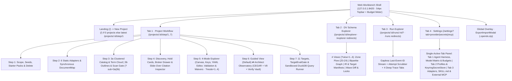

### Client/Server State Authority & Step 5 ⇄ Step 6 Lifecycle

1.  **Server-Authoritative Persistence (`project.sqlite` vs. Disposable `targets/` & `<OS_USER_STATE>/opendv/`):** Projects, attached sources (`ConnectorConfigPayload`), scan consents, cluster indexes, `ConceptMemory`, both Step 4 and Step 6 runs/logs (`GET .../runs`, `GET .../runs/{rid}/logs`), committed `Graph A` revisions, uncommitted Steward proposals (`PENDING_STEWARD`), Step 6 attempts/waivers/`CertifiedVaultIR`, and `evolution_locks` persist in `project.sqlite` ([`v2-clean-sheet-architecture.md §1.B`](v2-clean-sheet-architecture.md#b-config-sqlite-json-models-wire-dtos--llm-model-lookup-matrix-srcopendvmodels-extraforbid)). Compiled SQL/format bundles and `target_manifest.json` artifacts materialize separately inside disposable `targets/<target_id>/` directories.
2.  **Ephemeral Client Draft State & Project Switching:**
    *   *Dirty-Guarded Drafts:* Unsaved Step 5 ontology operations, YAML edits, or staged/dismissed proposal choices (`0` browser shadow ledgers for runs, waived cards, or connectors), uncommitted Step 4/6 hold/decision inputs and Step 5/6 waiver rationales (`dirtyFlags.{step5Waivers, step6Decisions}`), Step 2 secret inputs, Step 3b scan consents, and Settings form edits (excluding server-owned `trusted_workspaces` revocations) prompt before leaving the owning route, switching projects, navigating history, or reloading; discarding resets those dirty channels deterministically back to their synced baseline (exact slice names appear in [Detailed Implementation Plan §1](#1-target-web-repository-manifest-routing--token-budget-decomposition--4300-authoring-target--5000-ci-ceiling)).
    *   *Non-Prompting Ephemera:* Active sub-tabs, session-hidden Step 6 proposal IDs (which suppress the in-session `Steward Review` badge while keeping server `PENDING_STEWARD` intact until explicitly dismissed or committed per [`FR-DOM-06`](v2-clean-sheet-architecture.md#goals)), and post-import Step 2 missing-secret highlights do not trigger dirty prompts.
    *   *Project Switch & Post-Import Shell Hydration:* On `:id` route entry, initial `/settings` boot (hydrating the latest project when one exists), `Project Switcher` change (preserving `/projects/:newId/step/:n` [stripping `?run_id=`] and `/projects/:newId/explorer`, staying on `/settings`, and routing `/projects/:oldId/runs/:rid` to `/projects/:newId/runs`), or post-import navigation, the shell verifies the dirty guard, cancels any active SSE stream and in-flight hydration/verify requests, clears transient run/error/hidden-proposal flags (preserving imported missing-secret highlights when navigating from import), and hydrates sources, document maps, ontology state, and both Step 4 & Step 6 runs (keeping `CertifiedVaultIR` hydration lazy until entering Step 6, Step 7, or `DV Schema Explorer`) so header status stays current across reloads and CLI runs.
3.  **Step 5 Commit ⇄ Step 6 Invalidation, Step 7 Wave Lock & Proposal Flow:** Committing an ontology revision in Step 5 advances `active_ontology_rev_id` (and `ontology_version`), rendering prior-revision Step 6 holds stale relative to the committed ontology (falling back to certified-vs-ontology SemVer matching when no Step 6 run is loaded, keeping Observatory attempts/logs lazy) and offering **Start / Re-run Step 6 Vault Synthesis** rather than answering an outdated ontology. Step 6 never mutates committed `Graph A` directly, persisting alignment suggestions strictly as Step 5 Steward proposals (`FR-DOM-06`). Step 7 locks compilation and local migration whenever the newest current-revision Step 6 run is `FAILED` or non-terminal uncertified, or when explicit `Verify Vault` / Step 7 `compile` `422 VERIFICATION_GATE_FAILED` failed for that active wave until passing verification or a new Step 6 wave certification clears it (with no automatic background verify `POST` on page reload).

---

## Screen-by-Screen UX & Mock-Up Specification

All 20 reference mock-ups (`17` inline `1440×920` desktop views, `1` inline `1440×920` composite responsive matrix `11`, and `2` linked native `1024×768` / `390×844` views `11a`/`11b` in [`Table 3`](#table-3--responsive-comparison-views-d26)) illustrate the calibrated `DESIGN.md` palette plus V2 WCAG AA extensions using the Asset Management Investment Book of Record (`IBOR`) multi-wave scenario `am-ibor-2026` (evolving from Wave 1 `v1.0.0` `LOCK-W001` into Wave 2 `v1.1.0` `W002`). Across every screen header, the `Readiness` pill (`Action Needed` > `Steward Review` > `Ready`, appending `· <harness_provider>` on `>= 768px` and stripped `< 768px`) and compact `Revision` pill (`"Genesis v0.0.0"` -> `<active_ontology_rev_id>` -> `<active_ontology_rev_id> · W00N`) follow the global `UI-G01` rules.

### Tab 1 · Step 1 — Project Scope, Seeds & Starter Packs (`01`)

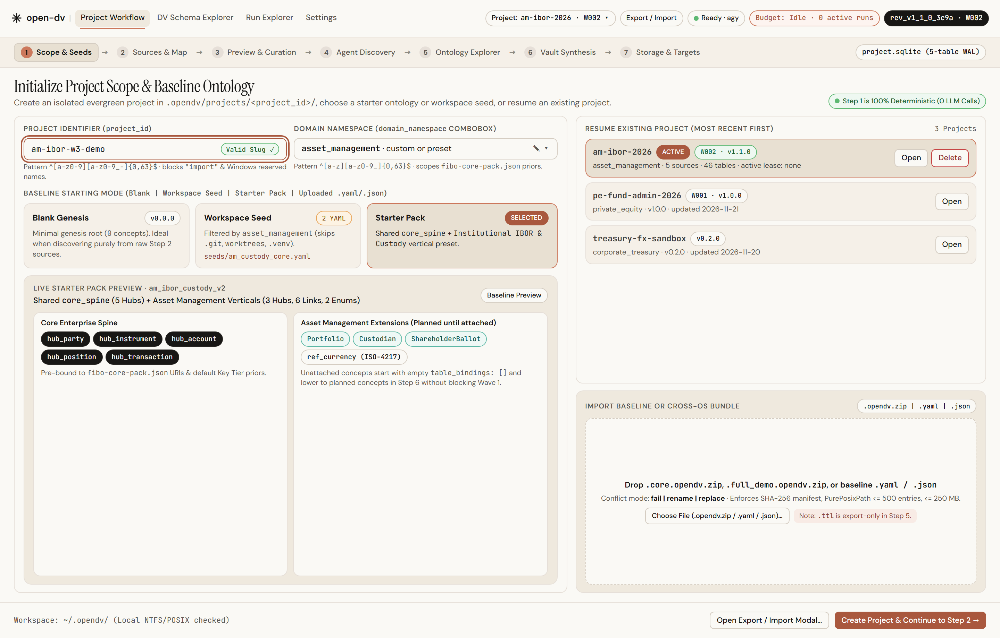

*   **Screen & Layout Role:** `58% / 42%` two-column workspace beneath the `44px` 7-step stepper; topbar `Budget Meter` displays any live lease-holding run (`QUEUED`/`RUNNING`/`HOLD_REQUESTED`) across all project routes (including `/step/1`), `Budget: Idle · 0 active runs` on landing `/` or Step 1 setup (`01`) when no run is live, `0/<step4 max>` on pre-run project Steps 2–3 (default `24t · 300k tok · 600s` in `02`/`03a`/`03b`), Step 4 run (or `0/<step4 max>`) on Step 4 and on Step 5 when Step 4 is newer than Step 6 (`05a`/`05b`), current-revision Step 6 run (or `0/<policy max>`) on Step 6, active/completed Step 6 (else Step 4) summary on Step 7 / Explorer / Run Explorer (`07`–`09`), and `Default: <max>` on `/settings` (`10`) (exact 8-step precedence in [`§1`](#1-target-web-repository-manifest-routing--token-budget-decomposition--4300-authoring-target--5000-ci-ceiling)).
*   **Primary Controls & Contracts:**
    *   *Project Identity & Baseline Modes (`Left Column`):* Live-validates `project_id` (slug rules blocking `"import"` and Windows reserved device names) and `domain_namespace` (`^[a-z][a-z0-9_]{0,63}$` editable combobox with preset suggestions). Supports `Blank Genesis (v0.0.0)`, `Workspace Seed` (scanning repo-local `.yaml`/`.json` baselines while ignoring `.git/`, `worktrees/`, `node_modules/`, `.venv/`), `Starter Pack` previewing shared `core_spine` Hubs alongside vertical concepts (`Portfolio`, `Custodian`, `ShareholderBallot` initialized as planned stubs omitted from Step 7 DDL until sources attach), and a 4th **`Uploaded Ontology Baseline`** mode activated when dropping `.yaml`/`.json` files (`baseline_format: "yaml" | "json"` and `baseline_content` passed to `POST /api/v1/projects`).
    *   *Resume List, Delete Action & Dropzone (`Right Column`):* Displays existing projects sorted by newest `updated_at`. Collapsed cards render `ProjectSummary` metadata (`project_id`, `domain_namespace`, active wave/revision, `updated_at` — avoiding N+1 per-card requests) with a uniform **`Open`** row action; selecting an active card hydrates full `ProjectState` (`source_count`, `table_count`, `has_active_lease`) and exposes a confirmation-gated `Delete Project` button (disabled while `has_active_lease` — `project.sqlite` active run lock — is `true`, and navigating to the next newest project or `/` after deleting the active project). Exported archives follow `<project_id>.core.opendv.zip` (`Core Project State`) vs. `<project_id>.full_demo.opendv.zip` (`Full Self-Contained Demo`); the dropzone pairs drag-and-drop with a keyboard-focusable file picker / **`Choose File`** control and branches by extension: `.opendv.zip` opens the Export/Import Bundle Modal pre-staged for import, `.yaml`/`.json` pre-fills `Uploaded Ontology Baseline`, and Turtle `.ttl` displays an export-only notice.

### Global Overlay — Export & Import Bundle Modal (`01b`)

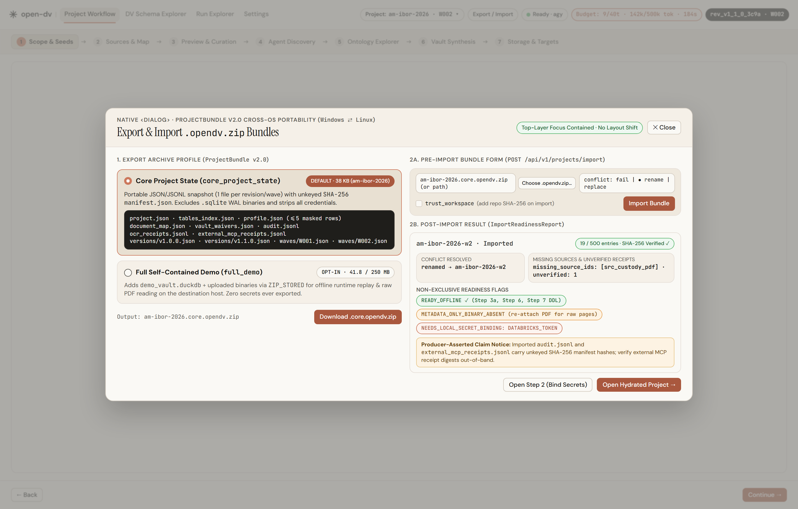

*   **Screen & Layout Role:** Top-layer modal dialog triggered from Header `Export / Import`, footer shortcut, or Step 1 `.opendv.zip` dropzone.
*   **Primary Controls & Contracts:**
    *   *Export Column (`1. Export Archive Profile`):* Defaults to **`Core Project State`** (`core_project_state` `<project_id>.core.opendv.zip`, `38 KB` for the `am-ibor-2026` Wave 2 reference bundle) packing portable per-revision/wave JSON/JSONL snapshots and an unkeyed SHA-256 `manifest.json` (zero `.sqlite` WAL binaries and zero credentials). Opt-in `Full Self-Contained Demo` (`full_demo` `<project_id>.full_demo.opendv.zip`) bundles `demo_vault.duckdb` (the local materialized DuckDB snapshot for attached sources) plus uploaded source binaries (`<= 250 MB` limit).
    *   *Import Column (`2A. Pre-Import Form -> 2B. Post-Import Report`):* Section `2A` accepts a `.opendv.zip` multipart upload via **`Choose .opendv.zip…`** (`file`, `conflict`, `trust_workspace`) or workspace-rooted server path (`ProjectImportPathReq` `bundle_path`), sets `conflict` (`fail` | `rename` | `replace`, auto-selecting `rename` on collisions) and optional `trust_workspace` (adds the active workspace repository's `.opendv/agents/*` SHA-256 digest to `trusted_workspaces`), prompts the dirty-navigation guard *before* submitting `POST /api/v1/projects/import` whenever `conflict="replace"` and an active project has dirty drafts (without client ZIP inspection; deferring local draft reset until `200 ImportReadinessReport` confirms `resolved_conflict === "replaced"` on the active `project_id`), refreshes `projectsSummary` (`GET /api/v1/projects`) on every `200` import, and displays all 7 returned `ImportReadinessReport` fields in Section `2B` (`project_id`, `resolved_conflict`, non-exclusive `readiness_flags` [`READY_OFFLINE`, `METADATA_ONLY_BINARY_ABSENT`, `NEEDS_LOCAL_SECRET_BINDING`], `missing_secret_refs`, `missing_source_ids`, `unverified_receipt_ids`, and `audit_claim_notice` stating that imported audit/receipt ledgers are producer-asserted). When `resolved_conflict === "replaced"` targets the active project, the client aborts SSE and re-hydrates the project shell immediately upon receiving `200 ImportReadinessReport` (preserving missing-secret highlights while keeping Step `2B` open until closed); **`Open Step 2 (Bind Secrets)`** and **`Open Hydrated Project →`** abort SSE, ensure hydration, and navigate accordingly.

### Tab 1 · Step 2 — Dynamic Connectors, Zero-LLM Profiling & Synchronous `DocumentMap` (`02`)

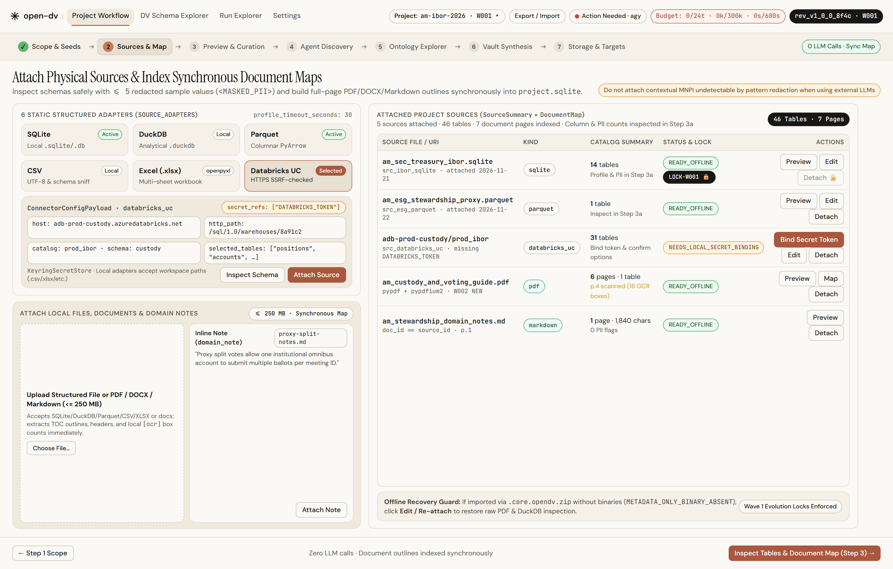

*   **Screen & Layout Role:** `48% / 52%` workspace enforcing zero LLM calls and synchronous document outline indexing on attach/upload.
*   **Primary Controls & Contracts:**
    *   *Structured Connectors & Databricks Inspection (`Left Column`):*
        *   Renders the 6 static adapters (`sqlite`, `duckdb`, `parquet`, `csv`, `xlsx`, and Server-Side Request Forgery [`SSRF`]-checked HTTPS `databricks_uc` with `host`, `http_path`, `catalog`, `schema`, `selected_tables`, `profile_timeout_seconds`, and `KeyringSecretStore` credential keys).
        *   Pre-attach `POST /api/v1/sources/inspect` (`SourceInspectReq`: `kind`, `uri_or_path`, scalar `options`, and key-name `secret_refs`) builds HTTPS Databricks URLs in `§1`, pre-checks `GET /api/v1/secrets` for required secret keys, and sends `secret_refs` and `selected_tables` on inspect, attach, and re-attach (`0` raw secret values in payloads).
    *   *Multipart Uploads & Inline Domain Notes (`Left Column`):*
        *   Accepts workspace paths across local adapters (including `.csv`/`.xlsx`) and **`<= 250 MB` multipart uploads (`POST /api/v1/projects/{id}/sources/upload`)** via `<input type="file">` / **`Choose File`** mapped deterministically across `12` supported file extensions to `8` file-backed `kind` values in [`§1`](#1-target-web-repository-manifest-routing--token-budget-decomposition--4300-authoring-target--5000-ci-ceiling).
        *   Its inline UTF-8 note composer submits `kind: "domain_note"` with a sanitized `<slug>.md` file (falling back to `"domain-note.md"` on empty input to create a 1-page note with `doc_id == source_id`), placed beneath an amber compliance banner warning stewards against attaching contextual `MNPI` when using hosted LLM providers.
    *   *Attached Sources Ledger & Lock-Safe Recovery (`Right Column`):*
        *   Hydrates sources, `DocumentMap` outlines, `connection_profiles`, and secrets on mount (with `0` Step 3 table-index, `/ontology`, or `/vault/ir` mount fetches). Derives source/table/page counts from `SourceSummary`, sums scanned OCR box counts across page maps (populated synchronously when optional Python `[ocr]` — `pytesseract` + `Pillow` — is installed), and renders `LOCK-W00N` badges + `Detach 🔒` guards directly from `SourceSummary.locked_in_wave` (`02` PNG retains **`Edit`** beside `Detach 🔒` on locked rows and **`Preview`** on `.md` rows).
        *   `Preview` previews up to `5` masked `<MASKED_PII>` rows lazily from persisted project evidence (`/evidence/tables/index` + `/evidence/tables/{tid}`, offline-safe under `METADATA_ONLY_BINARY_ABSENT` with zero un-scoped path probing or remote warehouse re-queries) or inspects cached `DocumentMap` outlines / routes to Step 3 for documents. **`Bind Secret Token`** and **`Edit` / `Re-attach`** dialogs prefill `uri_or_filename`, `options`, and `selected_tables` from persisted source metadata and let stewards toggle freely between workspace path/URI JSON and browser file re-upload (`PATCH /api/v1/projects/{id}/sources/{sid}`) regardless of original attachment method so locked `.core.opendv.zip` sources restore across hosts whether originally uploaded or attached by path. Applying a saved `ConnectorConfigPayload` profile copies saved fields (`uri_or_path -> uri_or_filename`, `options`, `secret_refs`) by value, while `SourceReattachReq` omits unchanged fields to preserve persisted config.

### Tab 1 · Step 3 — Clustered Catalog, Reversible Term Cloud (`3a`) & Outlines + Scan Gate (`3b`) (`03a`, `03b`)

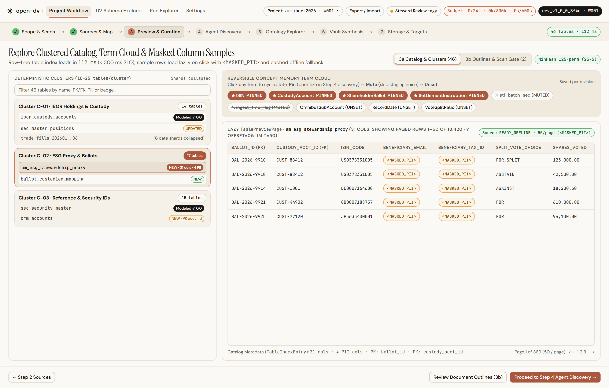

*   **Screen & Layout Role:** Full-width split beneath a segmented view-header switcher (`3a Catalog & Clusters (46)` | `3b Outlines & Scan Gate (2)`), keeping the 7 stepper items unclipped.
*   **`Step 3a` (`03a`):**
    *   *Row-Free `MinHash` Cluster Tree (`Left`):* Groups tables via `125`-permutation signature similarity (`>= 0.40`, `10–25` tables/cluster, PK/FK links, collapsing trailing `_YYYYMMDD` or `4–8`-digit numeric sibling shards per [`v2-clean-sheet-architecture.md §1.E`](v2-clean-sheet-architecture.md#e-ir-subtypes-34-op-ontologydelta-algorithm-a5-deterministic-guards-cegarpolicy--11-target-dialect-matrices)) with wave status badges (`NEW`, `UPDATED`, `UNCHANGED` + `modeled_version`) and cluster/table counts summing to the project total (`14 + 17 + 15 = 46`).
    *   *Reversible `ConceptMemory` Term Cloud (`Top Right`):* Merges saved curation records (`GET .../concept-memory`) with tokenized `TableIndexEntry` metadata (`table_name`, `pk_cols`, `fk_refs`) on mount with zero N+1 `/tables/{tid}` requests, lazily enriching terms when tables are inspected. Cycles each tag on click: `PINNED` (`#ffffff` white ink on `--primary-active` `#a9583e` [`5.06:1 >= 4.5:1` WCAG AA], boosting priority in Step 4 `search_concepts` — a broker discovery tool querying committed `Graph A`, live `in_run` discoveries, `ConceptMemory`, and seeds) -> `MUTED` (strikethrough, suppressing staging noise) -> `UNSET` (cream).
    *   *Lazy Paged `TablePreviewPage` (`Bottom Right`):* Loads paged rows (`50` rows/page, `offset` + `limit`) on table click alongside `pk_cols`, `fk_refs`, durable catalog `pii_col_count` (`4 PII cols` from `TableIndexEntry` across reloads — rather than unfetched `SourceProfile.pii_tags`), and `<MASKED_PII>` values. Matches `TableIndexEntry.source_id` / `TablePreviewPage.source_id` directly against `GET /api/v1/projects/{id}/sources` (`SourceSummary`) so Teal offline sample banners appear strictly on tables belonging to `METADATA_ONLY_BINARY_ABSENT` sources (zero false warnings on healthy `READY_OFFLINE` tables; truncated-sample sub-note shown whenever `total_rows > rows.length`).

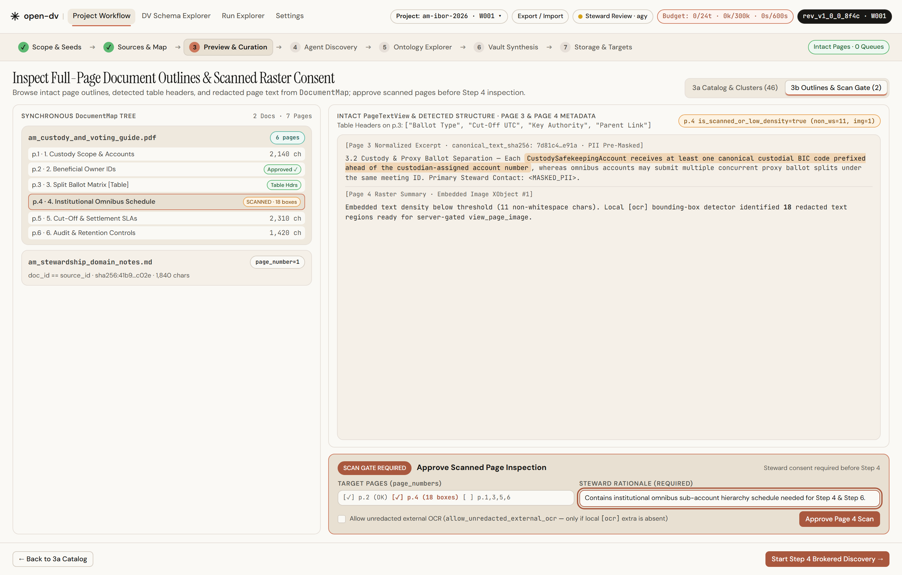

*   **`Step 3b` (`03b`):**
    *   *Synchronous `DocumentMap` Tree (`Left`):* Displays intact section outlines (`OutlineNode`), detected `table_headers`, character counts, SHA-256 text digests, already-approved page indicators (`p.2 · Approved ✓`), and amber `SCANNED · 18 boxes` badges.
    *   *Windowed `PageTextView` & `Approve Page <N> Scan` Gate (`Right`):*
        *   Loads full intact pages in a default `5`-page window (`?page_start&page_end`, `1..5` initially, zero fixed chunk splitting) with `<MASKED_PII>` masking, suppressing `/pages` fetches in favor of cached `DocumentMap` outlines when source availability is offline (`METADATA_ONLY_BINARY_ABSENT`).
        *   Selecting scanned pages opens the Coral-bordered consent card enforcing the two-gate scan model: Step 2's optional `[ocr]` extra detects and counts local OCR text bounding boxes at ingest (`ocr_box_count`, without redacting raster pixels in place), while Step 3b `approve-scan` merges selected `page_numbers` additively into `DocumentMap.approved_scan_pages` in `project.sqlite`, authorizing Step 4 `view_page_image` and preventing `422 UNREDACTED_SCAN_BLOCKED`. The card shows prior `approved_scan_pages`, checkbox-selectable target `page_numbers`, a required non-empty trimmed Steward `rationale`, local `[ocr]` box readiness (`ocr_box_count >= 1` vs. absent local `[ocr]`), and an optional unchecked `allow_unredacted_external_ocr` box (which, alongside Settings Tab 3 `allow_document_pages`, permits external MCP OCR when local `[ocr]` is absent) before clicking **`Approve Page <N> Scan`**.
        *   Scan consent form fields and dirty state stay keyed per document across `3a`/`3b` sub-tab switches until submitted or discarded.

### Tab 1 · Step 4 — Brokered Discovery, Plain-English Clarification Holds, Trace & Citation Drawers (`04a`, `04b`)

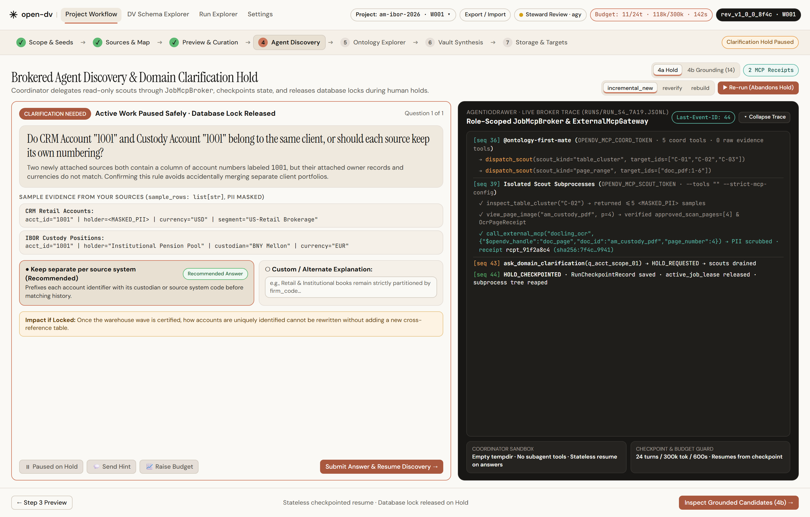

*   **Screen & Layout Role:** Active Step 4 run panel composes `4a Hold` (Clarification Hold + collapsible live trace drawer, `56% / 44%` split in `04a`) alongside a view-header toggle to `4b Grounding` (`StagedCandidateSpec` matrix + slide-over Citation & Receipt drawer in `04b`).
*   **Step 4 Live Discovery & Clarification Hold (`04a`):**
    *   *Mode, Launch, Pause/Resume & Receipt Count:* View header renders the `4a Hold` | `4b Grounding` toggle, the `discovery_mode` radio group (`incremental_new`, `incremental_reverify`, `full_rebuild` — abbreviated compactly as `reverify` | `rebuild` in `04a`), primary **`Start Discovery`** / **`Re-run (Abandons Hold)`** (confirming when replacing a checkpointed Hold), persisted external MCP receipt count, and run controls (**`Pause`** and **`Send Hint`** active on `QUEUED`/`RUNNING`; **`Raise Budget`** enabled on `QUEUED`, `RUNNING`, `HOLD_CHECKPOINTED`, and `UNCERTIFIED_DRAFT` alongside an `UNCERTIFIED_DRAFT` recovery banner offering **`Raise Budget`** or **`Re-run`**; all launch/control/resume actions locked on `HOLD_REQUESTED` with a `"Draining active work..."` indicator until `HOLD_CHECKPOINTED` releases child leases and exits processes). When user-initiated `Pause` checkpoints `HOLD_CHECKPOINTED` with zero pending clarification questions, the workspace shows **`▶ Resume Discovery →`**, posting an empty answer map to `POST .../ontology/runs/{rid}/answers` to resume from checkpoint without budget inflation. Hydrates active/latest Step 4 runs uniformly from `GET /api/v1/projects/{id}/runs?step=step4` (`?run_id=` URL override supported across both UI and CLI/MCP runs); `RUN_COMPLETED` re-hydrates `/ontology` and `/receipts`.
    *   *Plain-English Clarification Hold (`Left`):* Renders server-translated `ClarificationQuestion` cards (`title`, `prompt`, `impact_if_locked`, pre-selected `recommended_answer` or custom focus when `null`), formats pipe-delimited `sample_rows: string[]` (`<MASKED_PII>`) evidence blocks with vertical list fallback, provides sequential `Question 1 of N` navigation, and gates `Submit Answer & Resume Discovery →` on all `N` answers.
    *   *Collapsible Dark `#181715` Broker Trace Drawer (`Right`):* Includes **`▾ Collapse Trace`** beside `Last-Event-ID`, backfills historical Step 4 logs across reloads and CLI runs from `GET /api/v1/projects/{id}/runs/{rid}/logs`, and live-streams `RunStreamEvent` frames (`dispatch_scout`, PII-scrubbed MCP receipts `rcpt_91f2a8c4`, `HOLD_REQUESTED -> HOLD_CHECKPOINTED`).

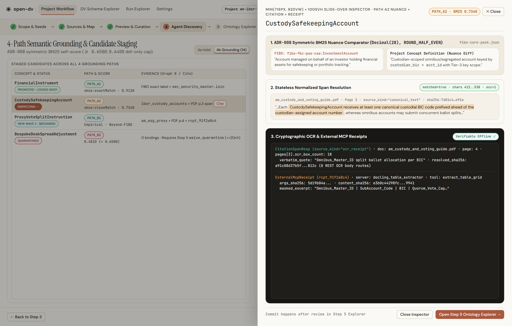

*   **4-Path Grounding Matrix & Slide-Over Citation Drawer (`04b`):**
    *   *Staged Candidates Table (`Left`):* Hydrated from `GET /api/v1/projects/{id}/ontology` (`staged_candidates`) and handing off into Step 5, distinguishing [`PATH_A1`](v2-clean-sheet-architecture.md#5-steps-45-brokered-subagents-externalmcpgateway-4-path-grounding-and-4-mode-explorer-c7) (`skos:exactMatch` against `FIBO`), `PATH_A2` (`skos:closeMatch`), `PATH_B1` (Empirical Beyond-FIBO with source/PDF/MCP bindings), and `PATH_B2` (`QUARANTINED`, waived in Step 5 Mode 4).
    *   *Slide-Over Citation Drawer (`Right`):* Opens via top-layer slide-over drawer (`Table 2` scale) with three sections:
        1.  *`FIBO` Alignment Summary:* Displays [`ADR-008`](../design/ontology-studio/ADR-008.md) (`BM25` Service Provider Interface [`SPI`]) comparison results via project-scoped `POST /api/v1/projects/{id}/ontology/fibo-qa` (no global topbar search widget exists; standalone `POST /api/v1/ontology/fibo-qa` in `Table 7` stays CLI/API parity only).
        2.  *Server-Indexed Quote Spans:* Applies `Alg A.9b` whitespace normalization ([`docs/05 §3.9`](../05-elm-calculus-and-reference-algorithms.md#39-algorithm-a9-zero-rehash-intra-source-schema-drift-codemod-a9a--gate-5-unstructured-verifier-a9b) / [`v2-clean-sheet-architecture.md#L284`](v2-clean-sheet-architecture.md#L284); exact regex & Unicode slicing specified in `§1`) across canonical text sources (`canonical_text` only), verifies slice equality against normalized `verbatim_quote`, and falls back to `occurrence`-indexed substring matching when `<MASKED_PII>` substitution shifts page character offsets, or renders cached `DocumentMap` / digest metadata on `METADATA_ONLY_BINARY_ABSENT` sources alongside `"absent"` / unresolved-span notices without synthetic offsets.
        3.  *Dark `#181715` Verification Cards:* Matches [`v2-clean-sheet-architecture.md §1.D`](v2-clean-sheet-architecture.md#d-restsse-api-apiv1-unified-opendv-cli-17-tool-stdio-mcp-brokergateway--subprocess-dispatch); because zero `/api/v1` endpoints return stored `OcrPageReceipt` (`ocr_text_masked`) payloads separately, scanned OCR citations render `source_kind`, `resolved_sha256`, quoted text, page `ocr_box_count`, and external MCP receipt digests (`GET /api/v1/projects/{id}/receipts`).

### Tab 1 · Step 5 — 4-Mode Ontology Explorer: Canvas Graph, Key Authority, YAML Editor & Validation/Waivers (`05a`, `05b`)

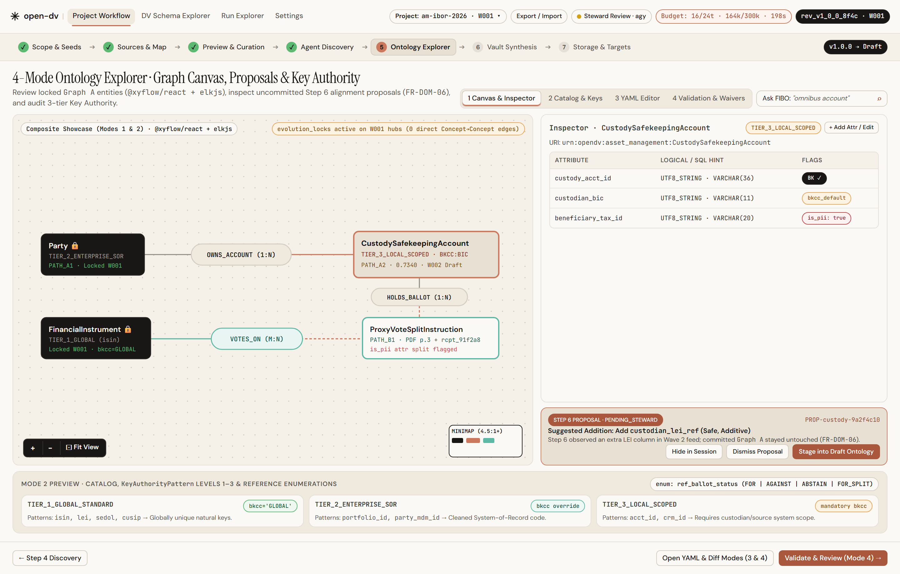

*   **Screen & Layout Role:** View header renders a single-active-panel ARIA `tablist` (`?mode=1|2|3|4`: `1 Canvas & Inspector`, `2 Catalog & Keys`, `3 YAML Editor`, `4 Validation & Waivers`) paired with the local BM25 `Ask FIBO` lookup drawer (`POST /api/v1/projects/{id}/ontology/fibo-qa`; clicking a match copies its IRI or, when not editing raw YAML, stages `AddConcept` or `SetDescription`). `Graph B` evidence (`table_bindings`, `source_citations`, `mcp_evidence`) renders inside Mode 1–2 concept inspectors rather than a separate canvas. Reference PNGs `05a` (`Modes 1 + 2`) and `05b` (`Modes 3 + 4`) composite two `?mode=` views for documentation; at runtime each `?mode=` tab mounts one active panel, while the shared `52px` footer shows **`Validate & Review (Mode 4) →`** on Modes 1–3 (`05a` PNG, running `/validate` and switching to Mode 4; Mode 3 also provides an inline editor **`Review in Mode 4 →`** trigger) and **`Validate & Commit v<next_version> →`** (`Validate & Commit v1.1.0 →` in `05b`) on Mode 4 once validated and `rationale` is populated.
*   **Mount Hydration & Mutually Exclusive Commit Paths (`Modes 1–4`):**
    *   On clean Step 5 mount, the workbench hydrates the active ontology revision (displaying `"Genesis v0.0.0"` when empty), locks, uncommitted Step 6 proposals, and both `export?format=yaml&include_staged=<has_staged>` (displaying uncommitted Step 4 candidates alongside committed `Graph A`, matching `05b` PNG) and `export?format=json&include_staged=true` whenever staged candidates exist (giving Mode 1 & Mode 2 uncommitted Step 4 attributes, key tiers, relationships, and enumerations shown in `05a` with zero client YAML->Graph parsing), pinning `base_revision_id` and preserving active drafts across Modes 1–4 and viewport resizes.
    *   Editing begins from a clear state (`baseWorkingOntology` & `baseYamlText` preserved across reloads/discards) and locks onto one mutually exclusive draft channel at a time (`"operations"` via Mode 1/2 edits or proposal staging vs. `"yaml_text"` via Mode 3 YAML edits). **`Dismiss Proposal`** tracks `dismissedProposalIds` orthogonally to `draftChannel` (`"clean" | "operations" | "yaml_text"`) so stewards can dismiss obsolete Step 6 proposals alongside Mode 3 YAML merges/splits in the same commit while keeping `dismissedProposalIds` inside the dirty-exit guard and discard reset. Because the browser performs **zero client YAML-to-`GraphAOntology` projection** (`REQ-CORE-01`), dirty raw YAML locks Modes 1, 2, proposal staging, and `Ask FIBO` writes until validated/committed or discarded, whereas staged structured operations render Mode 3 read-only with a banner to review/commit or discard pending changes first (and discarding restores `baseWorkingOntology`, `baseYamlText`, `pendingOps: []`, `committedProposalIds: []`, and `dismissedProposalIds: []` atomically).
*   **Modes 1 & 2 (`05a`):**
    *   *Mode 1 (`@xyflow/react` + `elkjs` Web Worker DAG dot-grid Canvas & Inspector):* Renders locked Wave 1 concepts (`#181715` + `LOCK-W001`), `PATH_A2` Amber nodes, `PATH_B1` Teal nodes, `OntologyRelationship` pills (`OWNS_ACCOUNT (1:N)`, `HOLDS_BALLOT (1:N)`, `VOTES_ON (M:N)` with `0` direct `Concept->Concept` edges), ellipsis-protected terminal IRI labels with full-IRI tooltips, WCAG AA `#181715` controls/minimap, `AddConcept` (`urn:opendv:${domain_namespace}:${ConceptName}` for newly authored concepts while preserving imported/FIBO URIs), `DeleteConcept`, `AddRelationship`/grain forms, attribute inspector (`sql_type_hint`, `PortableLogicalType`, `is_pii`, `+ Add Attr / Edit`), and uncommitted Step 6 **`OntologyProposalSpec` (`PROP-custody-9a2f4c10 · PENDING_STEWARD`)** cards (**`Stage into Draft Ontology`** appending `proposal.delta_ops` into `pendingOps` [`draftChannel = "operations"`] and `proposal_id` into `committedProposalIds`, channel-orthogonal persistent **`Dismiss Proposal`** tracked in `dismissedProposalIds` and Step 5 dirty state, or session-local **`Hide in Session`**). Large ontologies (`> 40` entities) default Mode 1 to 1-hop / source-filtered neighborhood focus with `"Show All Concepts"`.
    *   *Mode 2 (Catalog & Keys):* Organizes `KeyTierEnum` business key authority patterns (`BKCC` + `SOR` overrides) and reference enumerations (`ref_ballot_status`) through structured forms (`KeyTierEnum`, `BKCC`, `AddEnumeration`/`AddEnumerationCode`, `RenameConcept`, and unlocked deletes — multi-concept merges/splits edit declaratively in Mode 3 YAML for server `OntologyDelta` compilation). Declarative Mode 3 YAML edits `ontology.yaml`, compiled server-side across all `33` client-expressible `OntologyDelta` ops (`16` additive `_AOps` permitted for scouts and humans + `17` destructive/structural `_DOps` restricted exclusively to human commits per [`v2-clean-sheet-architecture.md §1.E`](v2-clean-sheet-architecture.md#e-ir-subtypes-34-op-ontologydelta-algorithm-a5-deterministic-guards-cegarpolicy--11-target-dialect-matrices)), while the `1` server-internal op (`RescoreExternalMapping`, recomputing stored BM25 scores on pack refresh; `33 + 1 = 34`) is never accepted from client requests.

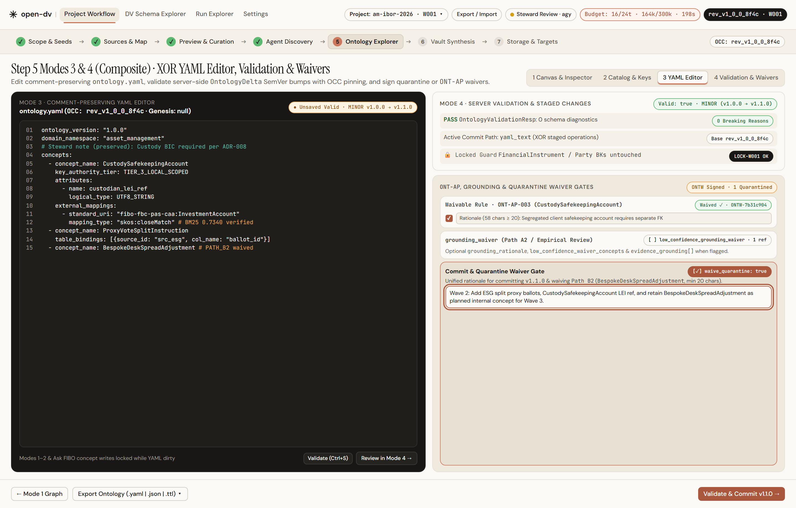

*   **Modes 3 & 4 (`05b`) — Exclusive Commit Path (`operations` vs. `yaml_text`):**
    *   *Mode 3 (`YAML Editor`):* Plain numbered monospace editor (no inline mirror diff gutters) running synchronous YAML Concrete Syntax Tree (`CST`) local syntax checks (`Line/Col`) while dispatching abort-guarded `POST /api/v1/projects/{id}/ontology/validate` calls on `Ctrl+S`, focus blur, or `>= 750 ms` idle; Mode 4 entry triggers `/validate` across clean, structured-operation, and YAML states. Displays **one** 3-State Validity Pill in the Mode 3 header (`Saved` | `Unsaved Valid · MINOR v1.0.0 -> v1.1.0` | `Invalid Line/Col`), pinned `base_revision_id` (`"Genesis v0.0.0"` when `null`), lock banner for Modes 1–2, and editor **`Review in Mode 4 →`** paired with the shared footer CTA **`Validate & Review (Mode 4) →`**.
    *   *Mode 4 (`Validation & Waivers`):*
        *   Displays authoritative server `OntologyValidationResp` (`valid`, diagnostics, SemVer `proposed_bump`), staged operation and proposal resolution summary (`committed_proposal_ids` / `dismissed_proposal_ids`), `evolution_locks` status (`422 ONT_EVO_CONTRACT_VIOLATION` on locked-Hub edits), and per-row `ONT-AP-001..005` waiver checkboxes + rationale inputs populated directly from server `VerifierDiagnostic` fields across both structured operations and YAML (`0` client `entity_name` reverse lookups or client `ONTW-<sha8>` SHA-256 synthesis; server stamps canonical `waiver_id` and UTC ISO `created_at` on commit).
        *   Separates `grounding_waiver` controls (`low_confidence_grounding_waiver`, `grounding_rationale`, `low_confidence_waiver_concepts`, `evidence_grounding`) from the unified `Commit & Quarantine Waiver Gate` rationale field paired with user-toggled `waive_quarantine` (`>= 20` characters required for `Path B2`), plus footer `.yaml` / `.json` / `.ttl` export. Clean state (`operations: []`) may submit **`Validate & Commit v<next_version> →`** to promote staged Step 4 candidates, Mode 4 proposal updates, or waivers; **`Validate & Commit v<next_version> →`** disables whenever `(1)` YAML CST has syntax errors, `(2)` `/validate` is in flight or unrun against `base_revision_id`, `(3)` any diagnostic has `severity === "BLOCKER" && !d.waivable` (or `ONT_EVO_*` lock violation), `(4)` commit `rationale.trim().length === 0` (or `< 20` when `waive_quarantine` is checked), or `(5)` any checked `ONT-AP-001..005` row has `< 20` rationale chars (or `low_confidence_grounding_waiver` lacks `grounding_rationale.trim()`, never auto-checking `waive_quarantine` on `422`), and post-commit re-hydrates `/projects/{id}`, `/ontology`, `/ontology/export`, `baseWorkingOntology`/`baseYamlText`, and `base_revision_id`.
        *   On `409 REVISION_CONFLICT` from clean, operations, or YAML channels, Step 5 loads the updated server revision, ontology bundle, and server YAML into isolated Mode 4 rebase review buffers (`conflictServerOntology`, `conflictServerYaml` in a read-only reference pane beside `<YamlCstEditor />`, preserving active local edits): `"operations"`/`"clean"` rebases promote `conflictServerOntology` & `conflictServerYaml` (re-fetching `export?format=json&include_staged=true` when `staged_candidates.length > 0`) while keeping `pendingOps` queued; confirming `"yaml_text"` rebase retains the operator-merged `yamlText` (offering an explicit secondary `"Overwrite Local YAML with Server Head"` action) while updating `ontologyBundle`, `workingOntology` (`include_staged=true` when staged candidates exist), and `base_revision_id`; and all channels run mandatory `POST .../ontology/validate` against server head before enabling commit (zero silent auto-replay).

### Tab 1 · Step 6 — Default `Guided` View vs. 1-Click `Architect Observatory` (`06a`–`06d`)

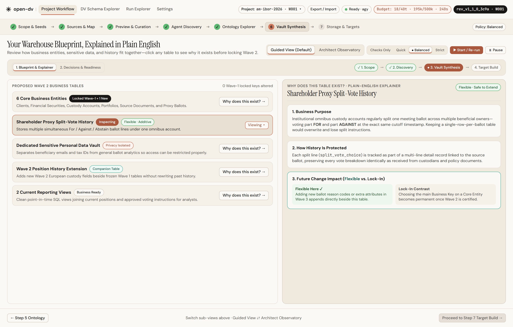

*   **Screen & Layout Role:** Defaults to **`Guided View (Default)`** (`~54% / 46%` milestone & explainer split in `06a`; Steward Decision Card & Readiness Brief in `06b`) with unified view-header controls, inline sub-view switching inside `.main` (`1. Blueprint & Explainer` | `2. Decisions & Readiness` in `Guided`; `CEGAR & Prover (S6-01..05)` | `V8 Horizon & Seal (S6-06..07)` in `Architect Observatory`), and a `52px` footer dedicated to `← Step 5 Ontology` and `Proceed to Step 7 Target Build →`.
*   **Step 6 Lifecycle Actions, Transitions & Hydration (`UI-G04`):**
    *   *Header Bar, Policy & `Quick` Horizon Upgrade:* In `Guided` mode, the view header shows `Guided View (Default)` | `Architect Observatory`, a policy radio selector (`Checks Only`, `Quick`, `Balanced` [default], `Strict`), and **`▶ Start / Re-run`** / **`⏸ Pause`** (with all launch, control, and resume triggers locked while draining `HOLD_REQUESTED` with `"Draining active work..."` until `HOLD_CHECKPOINTED` releases the lease). Once `V1–V6` pass on provisional `Quick` (`CERTIFIED_FAST` readiness status), `Quick` exposes 1-click **`Run Horizon Review`** (`POST /api/v1/projects/{id}/runs/{rid}/controls` `{ action: "horizon-review" }`) to upgrade Wave `N` `CERTIFIED_FAST -> CERTIFIED` in-place via `S6-06` `V8` without advancing `wave_number` or mutating policy.
    *   *Verification, Pause Resume & Uncertified Controls:* **`✓ Verify Vault`** (`POST /api/v1/projects/{id}/vault/verify` -> synchronous `200 VaultVerifyResp`, running an on-demand `V1–V6` regression re-check of a sealed `CertifiedVaultIR`) sits in the `Architect Observatory` header (`06c`/`06d`) and enables on certified waves (`CERTIFIED` / `CERTIFIED_FAST`, also inside `GuidedReadinessBrief`). When user-initiated **`⏸ Pause`** checkpoints `HOLD_CHECKPOINTED` with zero pending clarifications, Step 6 renders **`▶ Resume Synthesis →`** (`POST .../runs/{rid}/decisions` with empty answers) without inflating budgets. **`✓ Accept Best`** (enabled on `UNCERTIFIED_DRAFT` whenever `|V1..V6_fail| === 0`, additionally disabled client-side under `Strict` when `|V6b_unwaived| > 0` or `v7 < 95`) and **`📈 Raise Budget`** (enabled on `QUEUED`, `RUNNING`, `HOLD_CHECKPOINTED`, or `UNCERTIFIED_DRAFT`; disabled on `HOLD_REQUESTED`, `COMPLETED`, `FAILED`, or sealed `06d` PNG, opening a modal defaulting to `+4 turns / +100k tok / +300s`) surface inside the `UNCERTIFIED_DRAFT` bar, Readiness Brief, and `Architect Observatory`'s header alongside **`💬 Hint`**.
    *   *Mount Hydration & Step 7 Unlock Gating:* On mount, Step 6 hydrates `GET /api/v1/projects/{id}/runs?step=step6` (selecting any active non-terminal run first, else newest), `/guided-view`, `/ontology`, and — when an active wave exists — `/vault/ir`, syncing policy telemetry and checking ontology revision freshness while keeping `/attempts` and `/logs` lazy until switching to `Architect Observatory`. Milestone and completion transitions refresh `/runs/{rid}`, `/guided-view`, `/attempts` (when Observatory is mounted), `/projects/{id}`, `/vault/ir`, and `/ontology`, clearing any wave-scoped verify failure upon Step 6 certification (`RUN_COMPLETED`, `accept-best`, or `horizon-review`). Step 7 unlocks whenever a certified IR exists matching the active ontology revision, the newest current-revision Step 6 run is neither `FAILED` nor non-terminal uncertified, and wave verification has not failed for the current wave; direct navigation to `/projects/:id/step/7` shows targeted notices when pre-seal (linking Step 6), stale relative to Step 5 ontology commits, or blocked by a `FAILED` Step 6 run or failed `Verify Vault` / `422 VERIFICATION_GATE_FAILED` check. On imported `.core.opendv.zip` bundles with zero prior runs, `Guided` mode renders a static certified-IR status card (`CertifiedVaultIR` + `EvolutionLockSpec`) and unlocks Step 7 without synthesizing client `GuidedRunView` prose (`REQ-CORE-01`).
    *   *Server-Driven `Guided` Contracts:* Structured `GuidedRunView` payloads (`v2-clean-sheet-architecture.md §1.B`) populate Step 6 entities, plain-English explainers, Step 4 back-links, and Step 6 `V6b` waiver targets directly without pipe-delimited string parsing.
*   **Step 6 `Guided` — Milestones & `"Why Does This Table Exist?"` Explainer (`06a`):** Renders `4` server-generated milestones, entity cards, and the `"Why Does This Table Exist?"` explainer displaying all `4` explainer fields under `3` numbered sections (`1. Business Purpose`, `2. How History Is Protected`, `3. Future Change Impact [Flexible Here vs. Lock-In Contrast]`; inline on desktop and modal below `768px`) with zero compiler jargon.

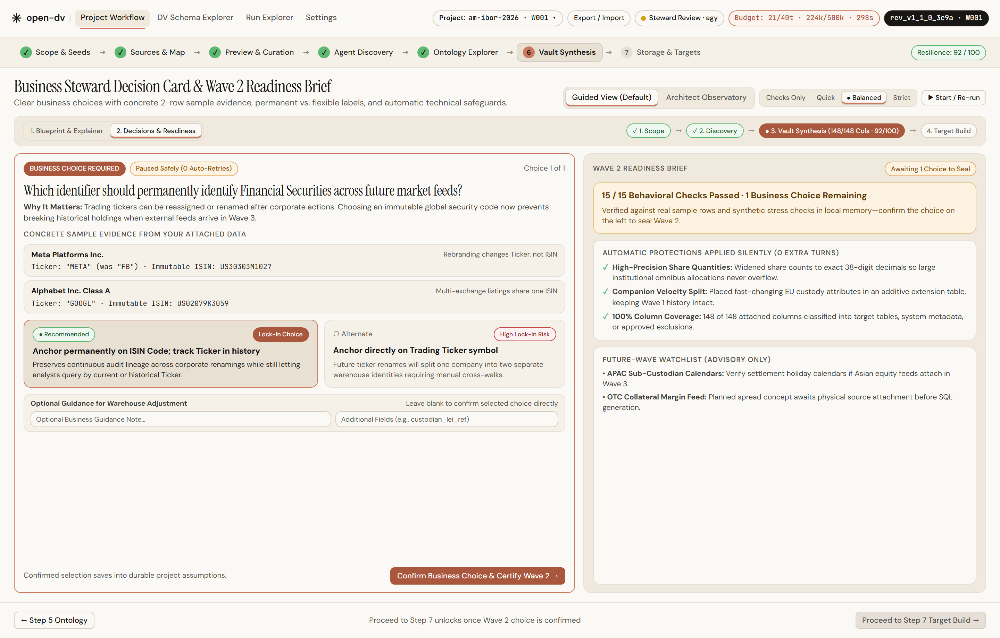

*   **Step 6 `Guided` — Steward Decision Card & Readiness Brief (`06b`):** Displays plain-English tradeoffs (`why_it_matters`, `Lock-In Choice` / `High Lock-In Risk` pills), stacked **`sample_evidence` rows**, Readiness highlights & advisory watchlist, and source-routed actions:
    *   `"step4"`: Renders **`Return to Step 4`** carrying the source Step 4 run ID so Step 4 holds resolve on Step 4.
    *   `"step6_hold"`: Collects selected options or non-empty custom text across pending hold cards (`1 of N`) and submits answers to `POST .../runs/{rid}/decisions`.
    *   `"step6_horizon"`: Persists `Bucket B` horizon escalations as `HOR-0001` `HorizonAssumptionSpec` rows; renders collapsible **`Optional Business Guidance Note`** + **`Additional Fields to Track`** (trimmed comma-separated `added_fields`) under the static primary CTA **`Confirm Business Choice & Certify Wave <N> →`** (`Confirm Business Choice & Certify Wave 2 →` in `06b`/`11a`; compact **`Confirm Business Choice →`** `< 768px` in `11b`), submitting `action: "accept"` solely when the recommended option stays selected and both optional inputs are blank, or `action: "steer"` whenever an alternate option is picked or guidance/fields are entered (always submitting `answers[card_id] = selectedOptionId`).
    *   `"step6_v6b"`: Opens a modal dialog pre-filled from server waiver targets (`0` client `WAIV-<sha8>` synthesis or conditional `/attempts` requests) requiring `>= 20` rationale chars for **`POST .../vault/waivers`** and `/guided-view` refresh. **`Ask AI to Refactor Instead`** invokes `hint` while `QUEUED`/`RUNNING`, `controls({ action: "hint", hint })` + `decisions({ answers: {} })` on `HOLD_CHECKPOINTED`, `RunControlDialog` `raise-budget` action carrying `hint` on `UNCERTIFIED_DRAFT`, or confirmation-gated **`Start / Re-run`** only on `COMPLETED`/`FAILED` (disabled while `HOLD_REQUESTED`).

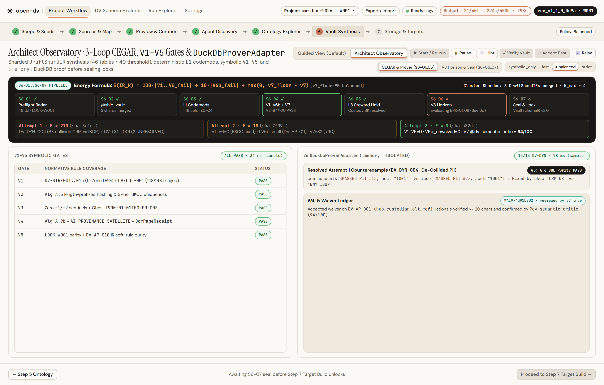

*   **Step 6 `1-Click Architect Observatory` — CEGAR & Prover (`06c`):** Surfaces `S6-01..S6-07` convergence trajectory (`Attempt 1 E=210 -> Attempt 2 E=18 (V7=82) -> Attempt 3 E=0, V7=94 PASS`, defined in the [`Domain, Discovery & Synthesis Reference Glossary`](#domain-discovery--synthesis-reference-glossary); `symbolic_only` skips `V7` [`"N/A"`] and iterative `E(IR_k)`, while `fast` skips `V7` [`"N/A"`] and auto `V8` while still scoring `E(IR_k) = 100*|V1..V6_fail| + 10*|V6b_fail|`). Displays symbolic `V1–V5` checks alongside `:memory:` DuckDB `V6` (`15/15` `DV-DYN`, de-collided `<MASKED_PII_#1>`/`#2` unique-violation counterexample pairs distinguishing masked records without leaking PII), repair tiers (`L1`, `L2`, `L3`), and `V6b` waivers (`WAIV-4d91b802 · reviewed_by_v7=true`) hydrated lazily from `/attempts` and `/logs` (keeping **`✓ Verify Vault`** disabled until `S6-07` seals).

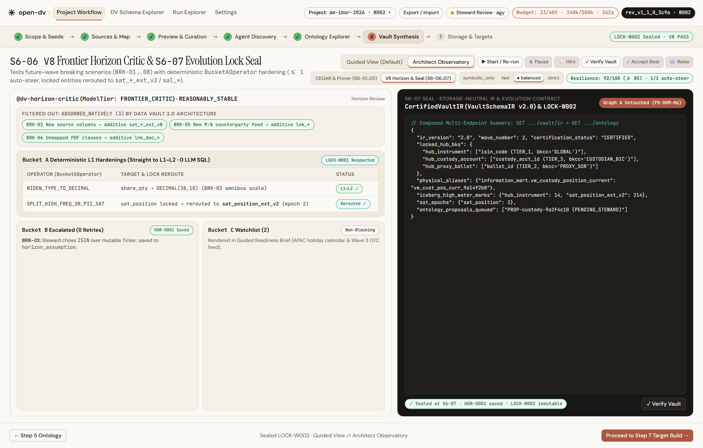

*   **Step 6 `Architect Observatory` — `S6-06 V8` Horizon Critic & `S6-07` Seal (`06d`):**
    *   Reads `HorizonCriticVerdict` directly from `AttemptSnapshotSpec.horizon_verdict` (`/attempts`, refreshed live on milestone/completion/horizon-review events and decoupled from `GuidedRunView`), rendering **`Resilience: 92/100 (>= 85) · 1/1 auto-steer`** (meaning the single allowed outer warm `S6-02` auto-steer iteration was consumed), `ABSORBED_NATIVELY` items, `Bucket A` deterministic `L1` repairs (`WIDEN_TYPE_TO_DECIMAL`, `SPLIT_HIGH_FREQ_OR_PII_SAT` rerouted to `sat_position_ext_v2`), `Bucket B` escalated `HOR-0001` card, and `Bucket C` non-blocking watchlist (`GuidedRunView.readiness_brief.watchlist`).
    *   Pairs header **`Verify Vault`** with the dark `S6-07` Seal panel (`GET .../vault/ir` + `GET .../ontology`) confirming `✓ Sealed at S6-07 · HOR-0001 saved · LOCK-W002 immutable` and untouched `Graph A` (`FR-DOM-06`), displaying global amber topbar status `Steward Review · agy` whenever pending proposals (`PROP-custody-9a2f4c10`) remain queued.

### Tab 1 · Step 7 — 11 Targets, `TargetEvalGate` & Sandboxed DuckDB Query Runner (`07`)

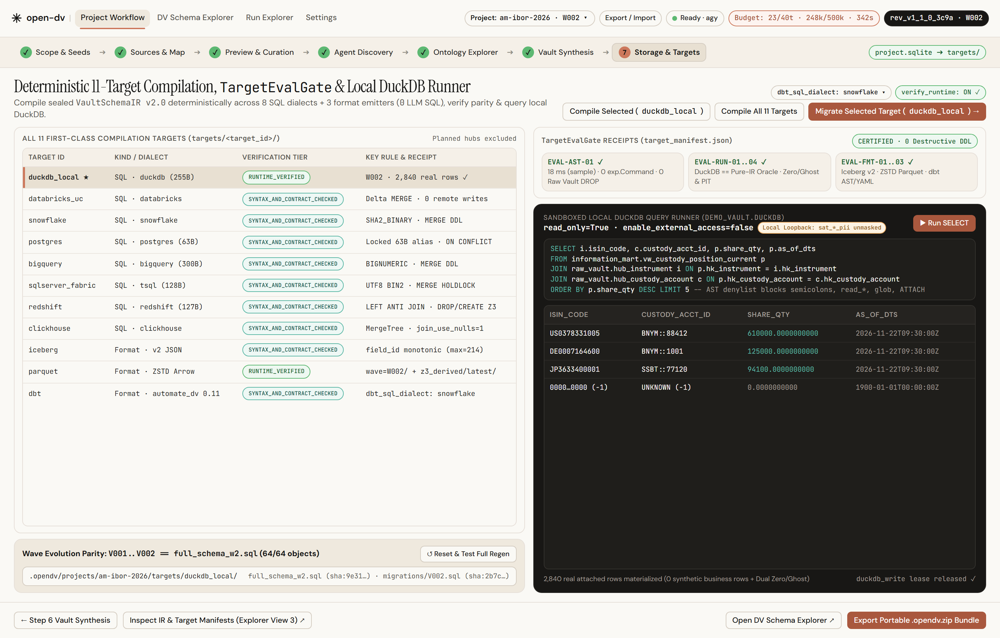

*   **Screen & Layout Role:** `52% / 48%` two-column workspace separating durable `project.sqlite` state from disposable target bundle outputs, excluding planned hubs (`table_bindings: []`, `is_planned_concept=true`) from emission.
*   **Primary Controls & Contracts:**
    *   *Static `11`-Target Catalog & Per-Target Recovery (`Left`):*
        *   Pre-populates all `11` targets (`"Not Compiled"` state) overlaid by `GET /api/v1/projects/{id}/storage/targets`: 8 SQL dialects (`duckdb_local` [`RUNTIME_VERIFIED`, `max ident 255 B`], `databricks_uc`, `snowflake`, `postgres` [`max ident 63 B`], `bigquery` [`max ident 300 B`], `sqlserver_fabric` [`max ident 128 B`, `Latin1_General_100_BIN2_UTF8`], `redshift` [`max ident 127 B`, `LEFT ANTI JOIN`], `clickhouse` [`MergeTree`, `join_use_nulls=1`]) plus 3 format emitters (`iceberg`, `parquet` [`RUNTIME_VERIFIED` `ZSTD`], `dbt` `automate_dv 0.11.x`), alongside `dbt_sql_dialect` and an opt-in `verify_runtime` checkbox (`default: false`, passed as `StorageCompileReq.verify_runtime` to run live `EVAL-RUN-01..04` DuckDB oracle verification during `compile`).
        *   Selected rows highlight `#e8e0d2` + `#cc785c` accent border and pair with header **`Compile Selected (<tid>)`**, **`Compile All 11 Targets`**, selection-scoped **`Migrate Selected Target (<tid>)`** (enabled for `duckdb_local` and `parquet`, disabled on compile-only targets), **`Reset & Test Full Regen`** (always executing against `duckdb_local` regardless of which target row is selected to verify `V001..V00N == full_schema_wN.sql`), footer **`Inspect IR & Target Manifests (Explorer View 3) ↗`** (`/projects/:id/explorer?view=3`) and **`Export Portable .opendv.zip Bundle`** (`07` PNG). On `500 EMITTER_VERIFICATION_FAILED`, renders per-target `defect_report.message` entries (`targetDefectsById`) inline so failed targets can be fixed or remaining individual targets compiled in continue-on-error mode via **`Compile Selected (<tid>)`** or **`Compile Remaining Targets Individually`**.
    *   *`TargetEvalGate` & Sandboxed Query Runner (`Right`):* Summarizes `EVAL-AST-01`, `EVAL-RUN-01..04`, and `EVAL-FMT-01..03` receipts above the `#181715` read-only DuckDB runner (disabled until `duckdb_local` is materialized), displaying a local loopback warning (`sat_*_pii` returns unmasked attached rows locally alongside `-1`/`-2` Dual Zero Keys and `1900-01-01T00:00:00Z` Satellite Ghost records) backed by the server AST denylist (`read_*`, `glob`, `*_scan`, `duckdb_secrets`, `INTO`, `PRAGMA`, `ATTACH`, `COPY`, `;`).

### Tab 2 — 4-View Data Vault Schema Explorer (`08`)

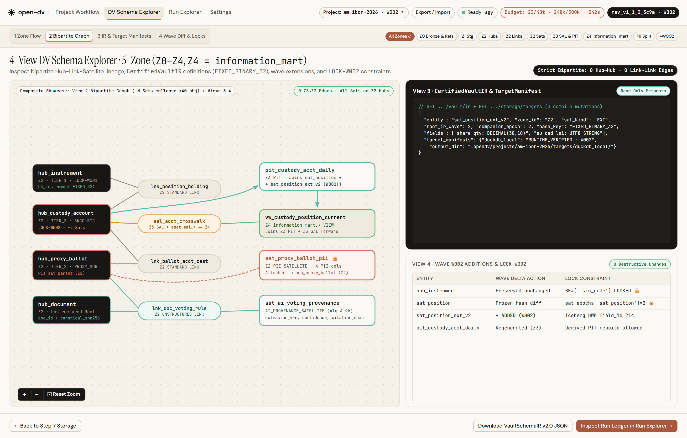

*   **Screen & Layout Role:** Top-Nav tab 2 renders a single-active-panel `?view=1|2|3|4` switcher (`1 Zone Flow`, `2 Bipartite Graph`, `3 IR & Target Manifests`, `4 Wave Diff & Locks`) and 10 single-select filter chips inside the explorer sub-bar (`08` PNG composites Views `2–4` for documentation).
*   **Views `1–4`, `10` Filter Predicates & `> 40`-Entity Scaling (`Read-Only`):**
    *   *Filter Chips (`10` Single-Select Predicates):* `All Zones` (unfiltered), `Z0 Bronze & Refs` (zone `Z0` covering `bronze_tables` and `reference_tables`), `Z1 Stg` (zone `Z1`), `Z2 Hubs` (`hub_*`), `Z2 Links` (`lnk_*`/`t_lnk_*`), `Z2 Sats` (`sat_*`/`mas_*`/`esat_*`), `Z3 SAL & PIT` (zone `Z3`), `Z4 information_mart` (zone `Z4`), `PII Split` (PII satellites + parent Hubs), and the Wave delta chip (`W001` in Wave 1; `+W00N` when `wave_number >= 2`, driven by `CertifiedVaultIR.wave_delta` [`SchemaWaveDelta`: matching Wave `N` `added_entities` — newly onboarded Hubs, Links, `SAL`s, PII/provenance Satellites — plus `added_sat_extensions` `EXT` satellites and parent Hubs] without false matches on Wave 1 `sat_epochs`). Schemas exceeding `40` objects default to `All Zones` with `+N Sats` badges collapsed per Hub.
    *   *Views `1–4`:*
        *   `View 1 (Zone Flow)` renders a responsive 5-column DOM lane grid (`Z0 -> Z4`).
        *   `View 2 (Bipartite Graph)` renders forward-only Hub -> Link/`SAL` -> Sat/`PIT` -> `Z4` lineage (`"Planned Stub (No DDL)"` on planned hubs with zero bindings, Coral `sat_proxy_ballot_pii` on `Z2` `hub_proxy_ballot`, forward `hub_custody_account -> pit_custody_acct_daily -> vw_custody_position_current` and `sal_acct_crosswalk -> vw_custody_position_current` paths, `sat_ai_voting_provenance` `AI_PROVENANCE_SATELLITE`, `0` `Hub->Hub`, `0` `Link->Link`, `0` `Z3 -> Z2` edges).
        *   `View 3` displays read-only `CertifiedVaultIR` (`"zone_id": "Z2"`) + `TargetManifest` metadata with zero compile calls or raw SQL reads; `View 4 (Wave Diff & Locks)` derives Wave `N` additions (`added_entities` + `added_sat_extensions` via `CertifiedVaultIR.wave_delta`), regenerated `Z3`/`Z4` views, and active `LOCK-W00N` constraints from `CertifiedVaultIR` + `evolution_locks`.

### Tab 3 — `Run Explorer` (`Last-Event-ID` SSE Ledger & Attempt Snapshots) (`09`)

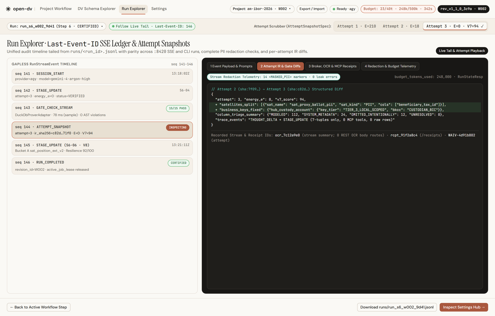

*   **Screen & Layout Role:** Top-Nav tab 3 split view (`40% / 60%`) pairing the chronological `RunStreamEvent` timeline (`seq 141..146`) with the `#181715` 4-tab trace inspector in isolated local inspection state (syncing active Step 4/6 `projectStore` state whenever `inspectedRun.run_id` matches the active workflow run, without overwriting active state when browsing other runs).
*   **4 Deep Trace Tabs & Stream Ledger (`run_s6_w002_9d41.jsonl`):**
    *   The explorer sub-bar lists both Step 4 and Step 6 runs uniformly from `GET /api/v1/projects/{id}/runs` (supporting direct CLI/MCP run URLs `/projects/:id/runs/:rid` via `GET .../runs/{rid}` and paginated `GET .../runs/{rid}/logs` with zero `sessionStorage` or `404` guessing; `/attempts` hydrates solely for Step 6 runs).
    *   Backfills paginated `/logs` first and opens SSE over the step-matching route (`/ontology/runs/{rid}/events` for Step 4, `/runs/{rid}/events` for Step 6) seeded with `Last-Event-ID = lastReceivedSeq` whenever non-terminal (closing on `COMPLETED`, `FAILED`, `HOLD_CHECKPOINTED`, or `UNCERTIFIED_DRAFT`), toggles `Follow Live Tail`, and scrubs `AttemptSnapshotSpec` (`Attempt 1 E=210 -> Attempt 2 E=18 (V7=82) -> Attempt 3 E=0, V7=94 PASS`, refreshing live on Step 6 attempts while mounted). Note Step 6 Horizon evaluation emits `STAGE_UPDATE` (`S6-06 · V8`) rather than MCP `TOOL_RESULT` frames since Step 6 agents run with zero MCP tools (`v2-clean-sheet-architecture.md` `L590`).
    *   Surfaces `<MASKED_PII>` telemetry counts, `RUN_FAILED(REDACTED_PLACEHOLDER_LEAK)` alerts, `budget_tokens_used`, linked external MCP digests (`rcpt_91f2a8c4`), `ocr_receipt` summary IDs (`ocr_7c12a9e0`), and waivers (`WAIV-4d91b802`) across **`1 Event Payload & Prompts`**, **`2 Attempt IR & Gate Diffs`**, **`3 Broker, OCR & MCP Receipts`**, and **`4 Redaction & Budget Telemetry`**, plus `.jsonl` trace export.

### Tab 4 — Out-of-Repo 3-Tab Settings Hub (`10`)

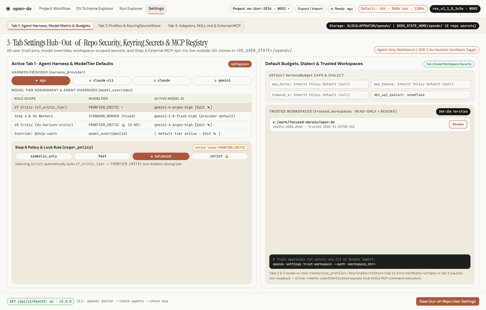

*   **Screen & Layout Role:** Top-Nav tab 4 single-active-tab panel (`Tab 1: Agent Harness, Model Matrix & Budgets`, `Tab 2: Profiles & KeyringSecretStore`, `Tab 3: Adapters, SKILL.md & External MCP`) mounting one tab panel at a time inside `<OS_USER_STATE>/opendv/` banners while preserving unsaved settings edits across sub-tabs with dirty-navigation exit protection (zero heuristic toggles per `D28`; Settings omits optional-extra badges since `/api/v1/health` reports server status and version only).
*   **Three Tabs:**
    *   *Tab 1 (Active in `10` — Agent Harness, Model Matrix & Budgets):*
        *   Edits `harness_provider` (`agy`, `claude-cli`, `claude`, `gemini`, prompting to clear provider-incompatible `model_overrides` when switching providers), `v7_critic_tier` (`FRONTIER_CRITIC` / `STANDARD_WORKER`), read-only `STANDARD_WORKER (fixed)` row for Step 4 & S6 workers, and `dv-horizon-critic` (`G-05`, whose **`FRONTIER_CRITIC` tier is locked** while its model ID remains customizable via `model_overrides["dv-horizon-critic"]` alongside `@ship-vault` and other `GET /api/v1/agents` entries).
        *   Configures `CegarPolicy` (`strict` locking `v7_critic_tier` to `FRONTIER_CRITIC`), `HarnessBudget` (`"Inherit Policy Default (null)"` placeholder when `null`) + `dbt_sql_dialect` via `PUT /api/v1/settings`, read-only `trusted_workspaces` inspection + immediate `Revoke` (kept synced outside editable settings form drafts so subsequent `Save` calls never re-trust revoked entries) paired with copyable `opendv settings trust-workspace --path <dir>`, and an `opendv doctor --check-agents --check-mcp` footer beside live `/api/v1/health`.
    *   *Tab 2 (`Profiles & KeyringSecretStore`):* Shows pinned `secret_backend` (`keyring` vs. owner-restricted `user_state_file`), edits `WorkspaceSettings.secret_precedence` (`"store_first" | "env_first"`, defaulting lookup order to `Project > Workspace > Environment` unless overridden via `OPENDV_SECRET_PRECEDENCE` or `--env-first`), shows `OPENDV_HOME` path SHA-256 keyring digest notice (preventing cross-workspace secret bleed), saved `connection_profiles` editor (`ConnectorConfigPayload` `Test Connection` -> `POST /api/v1/sources/inspect` with `/secrets` pre-check and `secret_refs` resolved by `KeyringSecretStore`), and write-only secret entry (`POST`/`DELETE /api/v1/secrets`, `GET` returning metadata only).
    *   *Tab 3 (`Adapters, SKILL.md & External MCP`):* Reviews the 6 `GET /api/v1/sources/adapters` specs alongside the 6 built-in/workspace `SKILL.md` agent packs (`GET /api/v1/agents*`), and manages out-of-repo Step 4 `ExternalMcpServerSpec` servers (`allowed_stages: ["step4_discovery"]`, `server_id` slug validation, `stdio` command argument array vs. `streamable_http` SSRF-checked URL, `allow_scout_calls`, `allow_document_pages`, `secret_refs`, `enabled`), noting non-loopback `--allow-remote-unauthenticated` remote code execution (`RCE`) risk for `stdio` commands.

### Responsive Breakpoints — Compact Desktop (`1024×768`) & Mobile Stacked (`390×844`) (`11`, `11a`, `11b`)

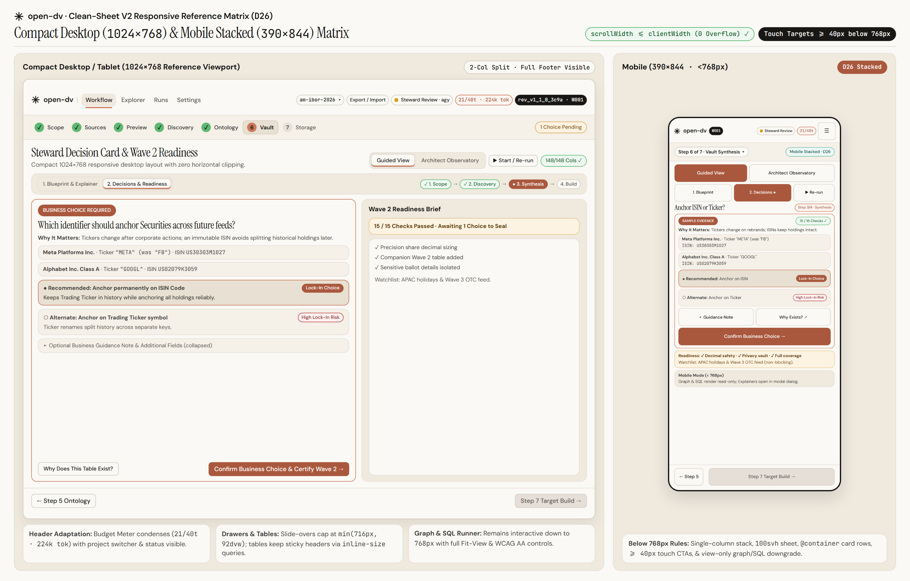

*   **Screen & Layout Role:** `11` pairs reference mock-up frames (Playwright-gated in `Phase V2-7` / `Phase V2-9`) at `1024×768` (`11a`) and `< 768px` mobile (`11b` at `390×844`) alongside breakpoint layout rules below.

#### Table 3 · Responsive Comparison Views (`D26`)

| Viewport Profile & Layout Rules (`D26`) | Rendered Artifact |
| :--- | :--- |
| **Compact Desktop / Tablet (`1024×768`)** — Condenses Top-Nav tab labels (`Workflow`, `Explorer`, `Runs`, `Settings`) and header budget (`21/40t · 224k tok`) plus compact stepper labels (`Scope..Storage`), preserves distinct Top-Nav and Stepper landmarks, retains shared `Guided View` / `Architect Observatory` view-header toggle + `1. Blueprint & Explainer \| 2. Decisions & Readiness` sub-tabs + compact `4`-milestone strip + primary `▶ Start / Re-run` (and `⏸ Pause` while active), renders `Why It Matters`, stacked `sample_evidence`, both radio options with `Lock-In Choice` / `High Lock-In Risk` pills, collapsed optional guidance trigger, `Why Does This Table Exist?` modal button, Readiness highlights/watchlist, and disabled `Step 7 Target Build →` while choice is pending. | [`11a_compact_desktop_1024x768.png`](../assets/v2-workbench/11a_compact_desktop_1024x768.png) |
| **Stacked Mobile (`390×844`, `< 768px`)** — Collapses topbar navigation, `Project Switcher`, and `Export / Import` into a `100svh` top-layer `<dialog>` drawer toggled by an `aria-expanded` `☰` button while keeping a compact status pill (`● Steward Review`) visible, condenses stepper into an `aria-expanded` `"Step 6 of 7 · Vault Synthesis ▾"` button opening a native `<dialog>` picker, preserves `1. Blueprint \| 2. Decisions` sub-tabs + compact `4`-milestone status pill + `>= 40px` `▶ Re-run` trigger (`⏸ Pause` while active), `Why It Matters`, `Lock-In Choice` / `High Lock-In Risk` tags, collapsed guidance trigger (`>= 40px`), Explainer `<dialog>` trigger (`>= 40px`), Readiness highlights/watchlist, `>= 40px` touch targets, disabled Step 7 CTA while pending, and view-only graph/SQL inspection with preserved store drafts across viewport resizes. | [`11b_mobile_stacked_390x844.png`](../assets/v2-workbench/11b_mobile_stacked_390x844.png) |

---

## Interaction Flows, Accessibility Contract & Traceability

### Key Runtime Interaction Flows

The browser streams Step 4 and Step 6 agent timelines over resumable HTTP streams carrying explicit `Last-Event-ID` headers across holds and reconnects, deduplicating incoming frames against client `lastReceivedSeq` (`0` on fresh mount or run switch) and reconciling `UNCERTIFIED_DRAFT` or EOF closures against `RunStateResp`:

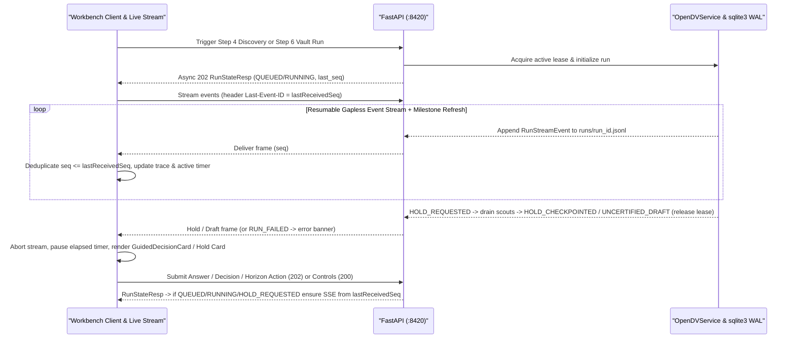

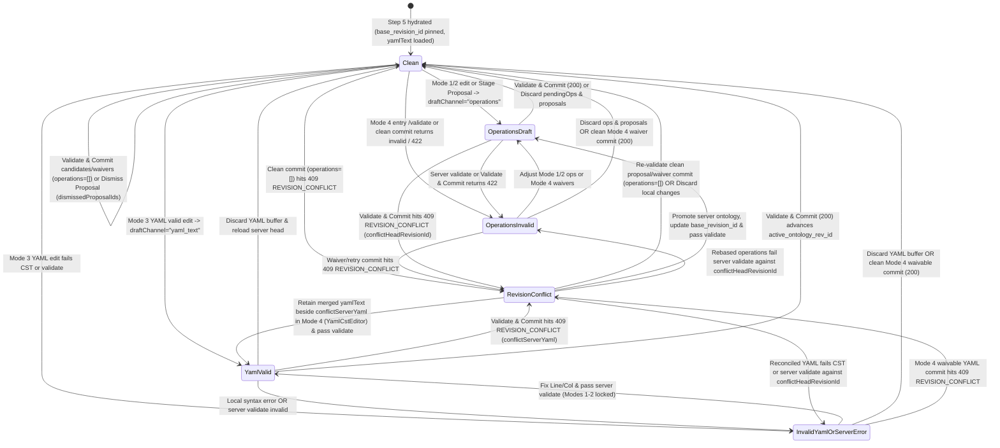

### Modern Web Standards & WCAG 2.1 AA Accessibility Primitives

1.  **Top-Layer `<dialog>` Overlays (`ExportImportModal`, Citation/Explainer Drawers & Mobile Nav Sheet):**
    *   Open every modal, slide-over drawer (`Table 2` scale), and mobile sheet through native modal `.showModal()` top-layer dialogs wrapping inner bordered panels so focus trapping, `inert` background behavior, portable backdrop hit-testing, and focus restoration work above the `54px` topbar and `52px` footer. Reset `returnValue` on every close.
    *   Read-only informational dialogs use light-dismiss (`closedby="any"` paired with backdrop target checks). Dirty confirmation forms allow keyboard close dismissal (`closedby="closerequest"`, never `"none"`), paired with `cancel` event interception (detailed in [Detailed Implementation Plan §1](#1-target-web-repository-manifest-routing--token-budget-decomposition--4300-authoring-target--5000-ci-ceiling)) to confirm unsaved discards without trapping `Esc` users or shifting destructive actions under the cursor.
    *   Contain scroll via backdrop overscroll containment on centered modals and fixed viewport units on `100svh` slide-over drawers (never mutating `html`/`body` overflow).
2.  **Distinct `<nav>` Landmarks, `<fieldset>` Radios & Standard ARIA `tablist` Switchers:**
    *   Separate Top-Nav `<nav aria-label="Primary Workbench Navigation">` (`4` views) from Stepper `<nav aria-label="Workflow Steps">` (`7` workflow steps) so screen-reader landmark navigation distinguishes page views from workflow steps.
    *   Use semantic `<fieldset><legend>` `<input type="radio">` controls for settings and decision options (`discovery_mode`, `CegarPolicy`, Step 4 Hold choices, Step 6 `GuidedDecisionCard` options).
    *   Use standard conditional React mounting inside `role="tablist"` switchers (`ArrowLeft`/`ArrowRight`/`Home`/`End` + roving `tabindex` + structural `2px`/`3px` underline surviving Forced Colors Mode) so hidden `@xyflow/react` canvases never mount into zero-size containers.
3.  **Accessible Scrollable Tables, Dirty Navigation Guard & WCAG AA Contrast:**
    *   Wrap wide data tables in keyboard-scrollable `tabindex="0"` regions (`sticky` headers, `<th scope="row">`) that preserve ARIA table roles when stacking into narrow cards below `600px`.
    *   Protect unsaved Step 5 edits (pending structured ops, proposal staging/dismissals, typed waiver rationales, or dirty YAML buffers), Step 2 secret inputs, Step 3b scan consents, unsubmitted Step 4/6 hold/decision/waiver inputs, and Settings edits across browser unload, History Back/Forward transitions, `Project Switcher` changes, and pathname exits leaving the owning route (`/projects/:id/step/2`, `/projects/:id/step/3`, `/projects/:id/step/4`, `/projects/:id/step/5`, `/projects/:id/step/6`, `/settings`) — exempting intra-route query parameter transitions (`?mode=1..4`, `?sub=3a|3b`, `?tab=provider|secrets|mcp`). Inside the desktop YAML editor, allow native `Tab` focus movement (never trapping focus inside `<textarea>`), intercept `Esc` without bubbling to parent overlays, and cancel pending validation timers upon explicit save, blur, or Mode 4 switches.
    *   Keep `1` centralized `polite` and `1` `assertive` live region outside `<dialog>` containers so status announcements remain audible when modal overlays mark background sections `inert`.

### Table 4 · UI Surface Traceability to Goals & Acceptance Matrix (`UAT-*`)

Scenario prefixes map checks across `UAT-*` ([`docs/31`](../31-v2-e2e-requirements-gaps-and-uat-spec.md)), `MOD-*` (modeling) / `OPS-*` (operational) scenarios ([`docs/32`](../32-v2-user-experience-and-scenario-guide.md)), and `UAT-SCEN-*` (`SCEN-01..09` in [`v2-clean-sheet-architecture.md`](v2-clean-sheet-architecture.md)). **`UI-G01`** persistent chrome, `Readiness` pill, and `Budget Meter` apply globally across every workflow and explorer screen below (and `UAT-WEB-01..02` static site checks are tracked in `Table 8` `Phase V2-8(a)`):

| Screen / Mock-Up | Goal IDs | Scenario Groups ([`docs/31`](../31-v2-e2e-requirements-gaps-and-uat-spec.md), [`docs/32`](../32-v2-user-experience-and-scenario-guide.md) & [`v2-clean-sheet-architecture.md`](v2-clean-sheet-architecture.md)) | Target Visual & Interactive Invariants |
| :--- | :--- | :--- | :--- |
| **`01`, `01b` (Step 1 + Global Modal)** | `UI-G01`, `UI-G02` | `UAT-NAV-01..03`, `UAT-S1-01..07`, `OPS-01`, `OPS-02` | Reserved ID/`"import"` rejection, `core_spine` preview (`table_bindings: []`), `Delete Project` confirmation modal & active-route cleanup, `ProjectSummary` vs. `ProjectState`, `.yaml`/`.json` baseline mode vs. `.ttl` export-only note, `Core Project State` vs. opt-in `full_demo`, pre-import form -> 7-field `ImportReadinessReport` (immediate re-hydration on `replace` overwrite). |
| **`02` (Step 2 Sources)** | `UI-G02` | `UAT-S2-01..15`, `OPS-03` | All 6 adapters (`databricks_uc` `http_path` + `catalog`/`schema` + `string[]` tables), zero LLM / parse queue banner, inline secret binding (`Bind Secret Token` with confirmed config -> `PATCH`), sanitized `<slug>.md` (`"domain-note.md"` with `kind: "domain_note"`), `Preview` via project evidence cache (`0` mount table-index calls), path/upload `Re-attach` toggle, `LOCK-W001` detach guard, contextual MNPI warning. |
| **`03a`, `03b` (Step 3 Preview)** | `UI-G02` | `UAT-S3-01..04` | Target `< 300 ms` `MinHash` cluster tree (`14 + 17 + 15 = 46`), Term Cloud Pin (`5.06:1` white-on-`#a9583e`)/Mute/Unset with zero N+1 fetches, tabular-only offline fallback notice (`<MASKED_PII>`), windowed `PageTextView` (`5` pages) & `Approve Page <N> Scan` consent (`allow_unredacted_external_ocr`). |
| **`04a`, `04b` (Step 4 Discovery)** | `UI-G03`, `UI-G08` | `UAT-S4-01..13`, `UAT-SCEN-01..09` | `discovery_mode` radio group, receipt counter, `Start`/`Re-run (Abandons Hold)`/`Pause`/`▶ Resume Discovery →` + `Send Hint`/`Raise Budget` modals (`Pause`/`Send Hint` on `QUEUED`/`RUNNING`; `Raise Budget` also enabled on `HOLD_CHECKPOINTED` & `UNCERTIFIED_DRAFT`; all locked during `HOLD_REQUESTED` drain), Plain-English Hold card (`recommended_answer` nullable fallback, piped/list `sample_rows`, all-`N` validation), collapsible `#181715` trace drawer, 4-path table + `<dialog>` citation/receipt inspector (`canonical_text`-scoped spans; metadata-only `ocr_receipt` scoping without separate REST OCR body route). |
| **`05a`, `05b` (Step 5 Explorer)** | `UI-G03`, `UI-G08` | `UAT-S5-01..05` | Single-tabpanel `?mode=1..4`, `@xyflow/react` + `elkjs` Web Worker canvas (`>= 4.5:1`) hydrated with staged JSON when candidates exist, uncommitted Step 6 proposal `Stage into Draft Ontology` / **`Dismiss Proposal`** / `Hide in Session` card, Tiers 1–3, mutually exclusive structured operations vs. YAML commit paths (zero browser YAML->Graph projection), single Mode 3 3-state pill + debounced validate, Mode 4 conflict rebase (promoting server ontology & reusing Mode 3 YAML editor) + re-validate, `ONT-AP-001..005` & `grounding_waiver` controls, explicit `waive_quarantine`. |
| **`06a`–`06d` (Step 6 Vault)** | `UI-G04`, `UI-G08` | `UAT-S6-01..19`, `UAT-FIX-01..02` *(deterministic Step 6 trap/regression checks)*, `MOD-01..07` | Synthesis launch (`Quick` `horizon-review` control upgrade, `Pause`/`▶ Resume Synthesis →`, `HOLD_REQUESTED` drain guard), certified `Verify Vault`, `UNCERTIFIED_DRAFT` bar, typed `Guided` model fields (`3` explainer headings wrapping `4` fields), Step 7 unlock + wave-keyed verify gate & `.core.opendv.zip` static banner, server-rendered `Guided` (`0` `FORBIDDEN_GUIDED_JARGON`), `Architect Observatory` (`S6-01..S6-07`, Horizon Critic verdict, `LOCK-W002`). |
| **`07` (Step 7 Targets & DuckDB)** | `UI-G05` | `UAT-S7-01..03`, `OPS-01`, `OPS-02` | Static 11-target overlay with selected `#e8e0d2` + `#cc785c` row, **`Compile Selected (<tid>)`** + **`Compile All 11 Targets`**, `TargetEvalGate`, `EMITTER_VERIFICATION_FAILED` recovery, `Reset & Test Full Regen`, **`Inspect IR & Target Manifests (Explorer View 3) ↗`**, **`Export Portable .opendv.zip Bundle`**, disabled pre-materialize SQL runner (`404`), loopback `sat_*_pii` warning. |
| **`08` (Tab 2 Explorer)** | `UI-G06` | `UAT-S6-10`, `UAT-S7-01` | 4-view 5-Zone Explorer (`View 1` DOM lane grid, `All Zones` / `Z0 Bronze & Refs`, collapsed `+N Sats > 40`, `hub_custody_account -> pit_custody_acct_daily -> vw_custody_position_current`, `0` Hub->Hub or `Z3 -> Z2` edges, read-only IR & manifests, `W001`/`+W00N` wave additions via `CertifiedVaultIR.wave_delta` & `evolution_locks`). |
| **`09` (Tab 3 `Run Explorer`)** | `UI-G06` | `UAT-S2-08`, `UAT-S4-03`, `UAT-S6-09`, `UAT-S6-11`, `UAT-S6-16`, `OPS-04` | Contiguous `Last-Event-ID` SSE timeline (routing `/ontology/runs/{rid}/events` on Step 4 vs. `/runs/{rid}/events` on Step 6; gating `/attempts` strictly on Step 6 runs) + paginated `/runs` & `/logs` covering both Step 4 & Step 6 runs (`0` `sessionStorage`), `AttemptSnapshotSpec` scrubber, `4` named Deep Trace Tabs, `<MASKED_PII>` telemetry, `/receipts`, `.jsonl` trace download. |
| **`10` (Tab 4 `Settings`)** | `UI-G06` | `UAT-SET-01..05`, `UAT-AGT-01..02` | Single-active-tab `<OS_USER_STATE>` Settings (unsaved form draft preservation across sub-tabs, read-only `STANDARD_WORKER`, locked `FRONTIER_CRITIC` `dv-horizon-critic`, `"Inherit Policy Default"` null `HarnessBudget`, `strict` tier lock, `Test Connection`, read-only `trusted_workspaces` + server-synced `Revoke` isolated from form drafts, remote `stdio` RCE warning). |
| **`11`, `11a`, `11b` (Responsive)** | `UI-G07` | `D26` Responsive Layout Gate | Demonstrated at `1440×920`, `1024×768`, and `390×844` (Playwright-gated in `Phase V2-7` / `Phase V2-9`): `0` horizontal overflow, `< 768px` native `<dialog>` sheets (`Step 6 of 7 · Vault Synthesis ▾`), `>= 40px` dual-radio cards, `Why It Matters` + guidance + Explainer `<dialog>` + Readiness highlights/watchlist parity, ARIA-preserved `@container` tables, view-only graph/SQL with preserved drafts across resize. |

---

## Alternatives Considered

### Alternative A: Separate Two Web Applications (`Steward Portal` vs. `Data Architect IDE`)
*   **Pros:** Allows separate chrome and component trees tailored to business analysts vs. warehouse engineers.
*   **Cons:** Duplicates project switching, source viewers, Hold forms, SSE streaming, and API clients while breaking URL sharing between a steward and a data engineer.
*   **Reason for Rejection:** One React 19 SPA with `Guided` mode as default paired with 1-click `Architect Observatory` shares one project/run store and URL scheme.

### Alternative B: Client-Side Graph Diffing, `Graph A` JCS Hashing, or Guided Text Sanitization in TypeScript
*   **Pros:** Enables offline YAML CST diffing (`34`-op classification), client YAML-to-`GraphAOntology` projection, and local regex rewriting without waiting for server calls.
*   **Cons:** Duplicates server ontology modeling (`REQ-CORE-01`), diverges from canonical `OntologyValidationResp`, risks corrupting English prompts via client regexes, and drifts from server `GuidedUxTranslator` and `dumps_jcs_bytes` (`RFC 8785` canonical JSON SHA-256 serializer).
*   **Reason for Rejection:** Canvas, Key Authority, and staged proposal actions append server `OntologyDelta` (`operations` path), raw Mode 3 YAML submits `yaml_text` to server validation/commit, dirty YAML locks Modes 1–2 without client projection, and Step 4/Step 6 guided text relies on server `GuidedUxTranslator` (`FORBIDDEN_GUIDED_JARGON` blocks internal compiler terms such as `Alg A.*`, `DV-STR-*`, `DV-AP-*`, `VaultSchemaIR`, `BKCC`, `SQLGlot`, `Hash_Diff`, and `CEGAR` from Steward cards via unit/E2E tests rather than client string rewriting).

### Alternative C: Third-Party Portal Modals, `window.EventSource`, Deferred Layout Tabs, & CSS-in-JS
*   **Pros:** Familiar React library wrappers for modals and runtime styles, and built-in browser SSE reconnection.
*   **Cons:** Native `window.EventSource` cannot send custom `Last-Event-ID` HTTP request headers on initial mount/reload or carry non-trivial abort controls; CSS-in-JS adds bundle weight; and hidden-until-found DOM tab attributes cause hidden React Flow canvases to mount with zero layout bounds.
*   **Reason for Rejection:** Native top-layer `<dialog>`, header-capable `fetch` SSE streaming, conditional React tab mounting, `@container` responsive tables, and one static CSS bundle remove portal wrappers and layout-measurement failures.

### Alternative D: Keep the V1 6-Step Wizard by Combining Step 6 Vault Synthesis and Step 7 Target Storage
*   **Pros:** Preserves the older 6-step bar width.
*   **Cons:** Conflates storage-neutral `CertifiedVaultIR` certification with disposable DDL/format compilation across 11 targets.
*   **Reason for Rejection:** A 7-step track makes the boundary between Step 6 IR certification and Step 7 target compilation explicit.

### Alternative E: Hand-Rolled SVG Graph Layout vs. `@xyflow/react` + `elkjs`
*   **Pros:** Zero external graph dependency.
*   **Cons:** Re-implementing orthogonal layered routing, zoom, pan, minimaps, and keyboard selection across large schemas introduces clipping and maintenance risk.
*   **Reason for Rejection:** Sharing one lazy-loaded `@xyflow/react` + `elkjs` Web Worker canvas ([`ADR-011`](../design/ontology-studio/ADR-011.md)) across Step 5 and `DV Schema Explorer` avoids duplicating graph-layout code and keeps bundle size bounded.

### Alternative F: Full CodeMirror 6 IDE Editor vs. Numbered `<textarea>` with Server Validation
*   **Pros:** CodeMirror 6 adds out-of-the-box autocomplete and syntax highlighting.
*   **Cons:** Adds multiple CodeMirror/Lezer packages outside the target manifest and complicates `Esc` focus release and token budgets.
*   **Reason for Rejection:** A numbered monospace `<textarea>` backed by local YAML syntax parsing, explicit server validation, and no overlay diff gutters simplifies keyboard exit and avoids extra CodeMirror packages.

---

## Non-Functional Requirements

*   **Visual Polarity & WCAG 2.1 AA Contrast:** Conform to [`Table 1`](#table-1--preserved-baseline-from-designmd-v100) and [`Table 2`](#table-2--clean-sheet-v2-ui-extensions--wcag-21-aa-calibrations) cream/coral/obsidian tokens (`>= 4.5:1` across all calibrated ink/surface pairings, semantic badge inks, and `@xyflow/react` controls/minimap), solid `2px` `:focus-visible` outlines (`>= 3:1`), and `Instrument Serif` restricted to `font-weight: 400`.
*   **Interactive Latency, Streaming & Memory Bounds:** Target row-free Step 3a catalog rendering `< 300 ms` below 500 tables on local SQLite WAL; keep live Step 5 YAML typing strictly on local CST syntax checks while guarding server `/validate` calls (`>= 750 ms` idle, `Ctrl+S`, `onBlur`, Mode 4 entry) with abort signals; bundle self-hosted `.woff2` fonts under `/assets/fonts/` with zero CDN calls; cap live SSE stream history at a 2,000-event ring buffer with animation-frame DOM batching, `O(1)` per-tick active elapsed updates, and stream abort cleanup on hold, completion, or project switch.
*   **Responsive Viewports & Zero Overflow ([`D26`](../../DESIGN.md#responsive-behavior-d26)):** Demonstrated at `1440×920`, `1024×768`, and `390×844` and Playwright-gated in `Phase V2-7` / `Phase V2-9` with `scrollWidth <= clientWidth` and zero bar child clipping. Below `768px`, buttons and touch targets expand to `>= 40px` height and graph/SQL authoring views unmount into static read-only inspection while preserving uncommitted drafts in client state.
*   **Frontend Module Token Cap ([`D16`](../../AGENTS.md)):** Every handwritten `.ts`/`.tsx` module in `web/src/` must stay below the `TOKEN_LIMIT = 5000` `cl100k_base` CI ceiling (`<= 4,300` authoring target checked by [`tests/architecture/test_module_token_budget.py`](../../tests/architecture/test_module_token_budget.py)); excluded build/test/E2E paths and per-module boundaries appear in [Detailed Implementation Plan §1](#1-target-web-repository-manifest-routing--token-budget-decomposition--4300-authoring-target--5000-ci-ceiling).

---

## Risks, Limits & Mitigations

*   **Very Large `200–500+`-Table Schemas in Step 5 Canvas & Explorer Graphs:** Simultaneous rendering of 500+ nodes drops frame rates and obscures graph topology. **Mitigation:** Group catalogs by `MinHash` cluster (`10–25` tables), default `DV Schema Explorer` `> 40`-object schemas to `All Zones` with collapsed per-Hub `+N Sats` badges and Step 5 Mode 1 to 1-hop / source-filtered neighborhoods, and offload layout to a same-origin `elkjs` Web Worker (`ADR-011`).
*   **Overloaded Multi-Dialog Pages Exceeding `< 5,000` Token Ceiling (`D16`):** Bundling duplicated `Ask FIBO`, run-control dialogs, source-inspection builders, and full graph projections inside page components risks breaching `TOKEN_LIMIT = 5000`. **Mitigation:** Pre-decompose all `49` `web/` modules in [Detailed Implementation Plan §1](#1-target-web-repository-manifest-routing--token-budget-decomposition--4300-authoring-target--5000-ci-ceiling): keep shared stateless API helpers separate from stateful store actions, isolate Step 2 dialogs, citation/FIBO drawers, and run-control dialogs into focused leaves, and decouple pure bipartite canvas rendering from Step 5 / Explorer graph mappers.
*   **Browser Support Gaps on Declarative Dialog Dismissal:** Safari lacks declarative `closedby` attribute support. **Mitigation:** Pair native `closedby` dismissal attributes with portable backdrop target detection plus `cancel` event interception on panel-wrapped `<dialog>` elements (as specified in [Detailed Implementation Plan §1](#1-target-web-repository-manifest-routing--token-budget-decomposition--4300-authoring-target--5000-ci-ceiling)), and keep drawer dimensions uniform cross-browser (`min(716px, 92dvw) × 100svh`).
*   **Uncurated LLM Output Containing Compiler Codes in Guided Views:** Prompt changes could emit blocked technical codes in `ClarificationQuestion` or `HorizonQuestion` payloads. **Mitigation:** Rely on authoritative server `GuidedUxTranslator` plain-English templates (`0` lossy browser text rewriting) and gate CI with unit and Playwright assertions checking `FORBIDDEN_GUIDED_JARGON`.
*   **Stale Browser Tabs Overwriting Newer Ontology Revisions or Reload Budget Drift:** Concurrent tabs or CLI commits can advance `active_ontology_rev_id` and reloads clear client-only state. **Mitigation:** Pin `base_revision_id` from loaded baselines (never overwritten by background polling while dirty), guard unload/Back-Forward/`Project Switcher`/step exits, route `409 REVISION_CONFLICT` into Mode 4 validation & steward review, persist `RunStateResp.{elapsed_seconds, effective_max_turns, effective_max_tokens, effective_timeout_seconds}` (`ControlSignalRecord` raises) in `project.sqlite` so reloads preserve raised ceilings and elapsed active time without browser shadow caches (`0` eager Step 6 `/logs` mount fetches), and mark counters exceeding active ceilings with `+` (e.g., `28/24t+`).
*   **Session-Local `Hide in Session` Proposal Hiding:** Because `Hide in Session` filters client rendering without mutating server `PENDING_STEWARD` (`FR-DOM-06`), reloading re-surfaces non-dismissed proposals. **Mitigation:** Offer **`Dismiss Proposal`** (persisted on Step 5 commit) alongside **`Hide in Session`**, whose button tooltip states explicitly: *"Hides from this browser session only; uncommitted proposals remain `PENDING_STEWARD` on the server and reappear after reload until staged or dismissed."*
*   **Security — Contextual MNPI, Archive Receipts & Remote `--allow-remote-unauthenticated`:**
    *   *Contextual MNPI & XSS:* Automated regex/Luhn redaction cannot catch contextual MNPI in free-form text, and unescaped strings could risk XSS. **Mitigation:** Display prominent Step 2 MNPI non-attachment warnings and rely solely on React JSX text escaping (`0` `dangerouslySetInnerHTML`).
    *   *Imported Receipts & Non-Loopback Binds:* Imported `.opendv.zip` ledgers carry unkeyed SHA-256 producer claims; non-loopback `opendv serve` binds fail closed (`exit 40`, `REMOTE_BIND_UNAUTHENTICATED`) unless `--allow-remote-unauthenticated` is explicitly supplied, in which case `stdio` `ExternalMcpServerSpec.command` processes become reachable over the bound interface; and local Step 7 `duckdb_local` queries return unmasked `sat_*_pii` rows. **Mitigation:** Surface producer-asserted warnings in the export/import modal, run `--allow-remote-unauthenticated` strictly on trusted isolated networks, surface an RCE warning on `Settings` Tab 3 whenever local `stdio` MCP commands are enabled, keep zero secrets/PII or run shadow caches in browser storage, and tag Step 7 SQL runner explicitly as loopback-local.

---

## Additional Resources

*   **Design Tokens & Architecture Specs:** [`DESIGN.md`](../../DESIGN.md) · [`v2-clean-sheet-architecture.md`](v2-clean-sheet-architecture.md) · [`SITEMAP.md`](SITEMAP.md)
*   **Workbench Hardening & Scenarios:** [`.agents/rules/ontology-studio-learnings.md`](../../.agents/rules/ontology-studio-learnings.md) · [`docs/29-discovery-grounding-and-evolution-scenarios.md`](../29-discovery-grounding-and-evolution-scenarios.md) · [`docs/30-enterprise-dv2-modeling-and-loop-engineering.md`](../30-enterprise-dv2-modeling-and-loop-engineering.md) · [`docs/31-v2-e2e-requirements-gaps-and-uat-spec.md`](../31-v2-e2e-requirements-gaps-and-uat-spec.md) · [`docs/32-v2-user-experience-and-scenario-guide.md`](../32-v2-user-experience-and-scenario-guide.md)
*   **Active ADRs & Contracts:** [`ADR-008.md`](../design/ontology-studio/ADR-008.md) (In-Memory Okapi BM25 Concept Matching SPI [`BM25 SPI`]) · [`ADR-011.md`](../design/ontology-studio/ADR-011.md) (React Flow + ELK) · [`ADR-013.md`](../design/ontology-studio/ADR-013.md) (`Last-Event-ID` SSE) · **EGM** (`Elephant-Goldfish Model` adversarial specification workflow)

---

## Detailed Implementation Plan

### 1. Target `web/` Repository Manifest, Routing & Token-Budget Decomposition (`<= 4,300` Authoring Target; `< 5,000` CI Ceiling)

The target `web/` file layout aligns with [`v2-clean-sheet-architecture.md §3.C`](v2-clean-sheet-architecture.md#c-react-19-workbench-web-standalone-website-appsopendv-website--test-suites-tests) (**`49` `Create` files total**: `45` app/config/font files + `4` test suites). Per [`tests/architecture/test_module_token_budget.py`](../../tests/architecture/test_module_token_budget.py) (updated in `Phase V2-1` and finalized in `Phase V2-8(b)` to exempt `"e2e"` alongside `"tests"`/`"fixtures"`), generated `web/src/api/types.generated.ts`, compiled `src/opendv/api/static/` bundles, `web/bun.lock`, `web/tests/*`, and `web/e2e/*` (`web/e2e/uat_89.pw.ts`) fall outside handwritten `web/src/` token ceiling checks (`tokens.css <= 4,300` serves as a style authoring guideline). Handwritten `.ts`/`.tsx` modules stay below `< 5,000` `cl100k_base` tokens (`<= 4,300` authoring target) via four structural boundaries:

*   **Native Modals & CSS:** Style `dialog:modal { padding: 0 }` wrapping inner `.dialog-panel` directly in `tokens.css`, running `onClick={(e) => { if (e.target === e.currentTarget && !dirty) close(); }}` (`closedby="any"` on read-only dialogs) and `{...({ closedby: "closerequest" } as Record<string, string>)}` (matching TypeScript `^5.8.0` DOM types) with `onCancel={(e) => { if (dirty) { e.preventDefault(); openDiscardConfirm(); } }}` on dirty forms, eliminating generic modal wrappers.
*   **Stateless vs. Stateful Separation:** Place stateless `buildSourceInspectReq` and `askFiboQuery` in `web/src/api/client.ts` and stateful `runControlAction` in `web/src/store/projectStore.ts`; keep `web/src/api/openapi.ts` restricted to route helpers, regex validators, and OpenAPI TypeScript aliases (`OntologyBundleResp.evolution_locks: EvolutionLockSpec | null`).
*   **Extracted Leaf Dialogs/Drawers:** Extract `SourceRecoveryDialogs.tsx`, `CitationInspectorDrawer.tsx`, `AskFiboDrawer.tsx`, and `RunControlDialog.tsx` within the `49`-file manifest.
*   **Pure Graph Modules:** Separate lazy-loaded `<BipartiteGraphCanvas />` (`elkjs/lib/elk-api.js` Web Worker per `ADR-011`) from pure domain mappers (`graphBuilders.ts`).

#### Client Routing, `/assets/*` Static Serving & Reload Persistence Contract

*   **Zero-Dependency History API Router (`App.tsx` + `projectStore.ts`):** Matches URL pathnames via `window.location.pathname` + `window.history.pushState` / `popstate`; requires FastAPI (`Phase V2-6`) to mount `/assets` -> `src/opendv/api/static/assets/` and serve `src/opendv/api/static/index.html` on `/` and non-`/api/` HTML navigation routes (`/projects/*`, `/explorer`, `/runs*`, `/settings`).
*   **Cold-Start, Bare Route & `Project Switcher` Routing:**
    *   `/`: Calls `GET /api/v1/projects`. If `projects.length === 0`, renders Step 1 New Project (`/`); if `>= 1`, navigates via `replaceState` to `/projects/${latest.project_id}/step/1`.
    *   `/explorer` and `/runs`: Redirect via `replaceState` to `/projects/${activeOrLatestProjectId}/explorer` or `/projects/${activeOrLatestProjectId}/runs`, or fall back via `replaceState` to `/` when `projects.length === 0`.
    *   `/settings`: On cold start (`activeProject === null`), fetches `GET /api/v1/projects` and runs `hydrateProjectShell(latest.project_id)` (which skips eager `GET .../vault/ir`, hydrating `vaultIr` lazily upon entering Step 6, Step 7, or `DV Schema Explorer`) if `projects.length >= 1` so topbar `Project Switcher`, `Readiness`, and `Revision` pills render live state.
    *   `Project Switcher`: Calls `hydrateProjectShell(newId)` and routes `/projects/:oldId/step/:n` (stripping `?run_id=`) -> `/projects/:newId/step/:n` preserving `?sub=`/`?mode=`; `/projects/:oldId/explorer` -> `/projects/:newId/explorer` preserving `?view=`; `/projects/:oldId/runs*` -> `/projects/:newId/runs`; `/settings*` stays on `/settings*` with active project context updated.
*   **Query-Param Deep-Links (`URLSearchParams`):** Error recovery links and tab switches sync sub-views across canonical routes (`/projects/:id/step/1..7`, `/projects/:id/step/3?sub=3a|3b`, `/projects/:id/step/4?run_id=<rid>`, `/projects/:id/step/5?mode=1|2|3|4`, `/projects/:id/explorer?view=1|2|3|4`, `/projects/:id/runs/:rid`, and `/settings?tab=provider|secrets|mcp`).
*   **Root-Relative `/assets/*` Serving (`web/src/build-static.ts`):** `web/index.html` and `build-static.ts` reference assets under `/assets/` (`/assets/main.js`, `/assets/chunk-*.js`, `/assets/tokens.css`, `/assets/elk-worker.js`, `/assets/fonts/*.woff2`) rather than relative to the active route. `build-static.ts` resolves `webRoot`/`repoRoot` paths absolutely (`0` CWD-relative strings), cleans stale outputs while preserving `.gitkeep`, invokes the `Bun.spawnSync` CLI bundler (avoiding Linux native-bundler JS API process aborts on code-split chunks documented in [`.agents/rules/ontology-studio-learnings.md#L44`](../../.agents/rules/ontology-studio-learnings.md#L44)), and copies static HTML, concatenated CSS, the ELK worker, and `.woff2` fonts per the exact script specification in [`Table 5`](#table-5--complete-web-repository-manifest-49-create-paths-aligned-with-v2-clean-sheet-architecturemd-3c) (`web/src/build-static.ts`). Both `Step5Explorer.tsx` and `DVSchemaExplorerPage.tsx` import `BipartiteGraphCanvas.tsx` via `React.lazy()`.
*   **Step 4 Reload Recovery:** Both Step 4 (`?run_id=` URL precedence) and `Run Explorer` hydrate Step 4 runs and paginated historical events (`RunEventLogPage`) uniformly from `GET /api/v1/projects/{id}/runs` (`?step=step4`), `GET /api/v1/projects/{id}/runs/{rid}`, and paginated `GET /api/v1/projects/{id}/runs/{rid}/logs` (`0` `sessionStorage`/`localStorage` run caches and `0` `404` probes).
*   **Dirty Navigation Guard:** Registers a `window` `beforeunload` listener and intercepts browser Back/Forward `popstate` transitions (restoring the current history entry and opening confirmation `<dialog>` whenever `ontologyState.draftChannel !== "clean"` [including non-empty `pendingOps`, `committedProposalIds`], non-empty `ontologyState.dismissedProposalIds`, `dirtyFlags.step2Secret`, `dirtyFlags.step3Scan`, `dirtyFlags.step5Waivers`, `dirtyFlags.step6Decisions` [including unsubmitted Step 4/6 hold/decision inputs and Step 5/6 waiver rationales], or editable `dirtyFlags.settings` [excluding server-owned `trusted_workspaces`] is true), pathname switches leaving the owning route (`/projects/:id/step/2`, `/projects/:id/step/3`, `/projects/:id/step/4`, `/projects/:id/step/5`, `/projects/:id/step/6`, `/settings`), conservative pre-`POST /api/v1/projects/import` prompts when `conflict === "replace" && activeProject !== null` (deferring local draft reset until `200 ImportReadinessReport` returns `resolved_conflict === "replaced" && report.project_id === activeProject.project_id`), and topbar `Project Switcher` changes — exempting intra-route query parameter transitions (`?mode=1..4`, `?sub=3a|3b`, `?tab=provider|secrets|mcp`). Confirming dirty-exit discard resets `ontologyState` (`draftChannel: "clean"`, `pendingOps: []`, `committedProposalIds: []`, `dismissedProposalIds: []`, `workingOntology: baseWorkingOntology`, `yamlText: baseYamlText`), `dirtyFlags` (`false`), `step3ScanDraft: {}`, and `settingsDraft` (preserving server-owned `settings.trusted_workspaces`).

#### SSE Stream Framing, `lastReceivedSeq` Deduplication & `Budget Meter` Reconciliation

*   **Incremental UTF-8 SSE Parser & Lazy Paginated `/logs` Replay (`client.ts`):** Migrates `SseStreamParser` from `packages/opendv-protocol-ts/src/utils/sse-parser.ts` (prior to `Phase V2-8(c)` deletion) to read `fetch()` `ReadableStream` via streaming UTF-8 decoding, split CRLF/LF frames, parse `id:` and multi-line `data:` lines into `RunStreamEvent`, and push batches via `requestAnimationFrame` into a `<= 2,000`-event ring buffer. Views rendering event timelines (Step 4 `AgentIoDrawer`, Step 6 `ArchitectObservatory`, and `RunExplorerPage`) backfill `RunEventLogPage` via paginated `GET /api/v1/projects/{id}/runs/{rid}/logs?since_seq=0` (`while (page.next_since_seq !== null)`) before opening SSE, setting `lastReceivedSeq` from the highest returned `events[].seq`; Step 6 `Guided` mode keeps `/logs` strictly un-fetched (`lastReceivedSeq = 0` on fresh UI-launched runs, seeded from `RunStateResp.last_seq` on reload). Skips opening SSE if `RunStateResp.status` is already terminal or paused (`COMPLETED`, `FAILED`, `HOLD_CHECKPOINTED`, `UNCERTIFIED_DRAFT`), while continuing SSE during `HOLD_REQUESTED`.
*   **Post-EOF Reconciliation & `HOLD_REQUESTED` Decision Tree:**
    *   `RUN_FAILED(error_code, detail)` constructs a synthetic `ProblemDetails` alert routed into [§2](#2-http-problemdetails-error--async-pause-handling-matrix-34-closed-errorcodes).
    *   `HOLD_REQUESTED` acts as an active-draining state: Step 4/6 run-action controls (`Pause`, `Hint`, `Raise Budget`, `Re-run`, `Resume`) disable with `"Draining active work..."` while SSE stays connected.
    *   On stream EOF without `RUN_COMPLETED` or `RUN_FAILED`, cancel any pending backoff timer inside `AbortController` teardown and execute one `GET /api/v1/projects/{id}/runs/{rid}` (valid for both Step 4 and Step 6 runs): halt SSE reconnects on `COMPLETED`, `FAILED`, `HOLD_CHECKPOINTED`, or `UNCERTIFIED_DRAFT`; otherwise reconnect with capped exponential backoff (`250 ms` -> `500 ms` -> `1,000 ms` -> `2,000 ms` -> `2,000 ms`, max `5` retries before displaying a disconnected banner with a manual **`Reconnect`** button).
    *   `POST .../controls` returns synchronous `200` `RunStateResp`: keep/open SSE only when status is `QUEUED`, `RUNNING`, or `HOLD_REQUESTED` (never tearing down an already-live SSE stream on `hint` or `raise-budget`); if synchronous `200` returns `HOLD_CHECKPOINTED` (`pause` checkpoints with `pending_questions: []` or `horizon-review`), `UNCERTIFIED_DRAFT`, or `COMPLETED`, abort active SSE, backfill `lastReceivedSeq < resp.last_seq` via `/logs` when trace/logs are mounted, pause the client `1s` tick, and refresh Step 6 `/guided-view` plus `/attempts` (if Observatory / Step 6 Run Explorer is mounted). `answers`, `decisions`, and `horizon` return `202` `RunStateResp`, reconnecting SSE when `QUEUED`/`RUNNING` (`HOLD_CHECKPOINTED` with `pending_questions: []` resumes via `HoldAnswersReq({ answers: {} })`).
*   **`Budget Meter` Precedence (`resolveEffectiveBudget`, 8-Step Route Order):**
    *   Resolves displayed telemetry in strict order: `1.` `/settings*` -> `Default: <max>`; `2.` any live lease-holding run (`QUEUED`, `RUNNING`, or `HOLD_REQUESTED`, preferring `activeStep6Run` if both exist) across all project routes (including `/step/1`); `3.` `/` or `/step/1` without a live run -> `Budget: Idle · 0 active runs`; `4.` `step2`–`step3` -> `0/<step4 max>` (`24` turns / `300,000` tokens / `600 s` base); `5.` `step4` -> `activeStep4Run` else `0/<step4 max>`; `6.` `step5` -> `activeStep4Run` when newer than `activeStep6Run` (matching `05a`/`05b`) else `0/<activeStep6Run?.policy ?? activeRunPolicy max>`; `7.` `step6` -> current-revision `activeStep6Run` else `0/<activeRunPolicy max>`; `8.` `step7`/`explorer`/`runs*` -> current-revision `activeStep6Run ?? activeStep4Run` including `COMPLETED` (matching `07`–`09`, zero older Step 6 shadowing over newer Step 4 telemetry) else `0/<activeRunPolicy max>`.
    *   Per-field persisted ceiling resolution reads `RunStateResp.effective_max_{turns,tokens,timeout_seconds} ?? project.settings_snapshot.<cap> ?? workspaceSettings.<cap> ?? policyOrStageDefault.<cap>` (`0` client budget extension map; UI-created projects initialize `settings_snapshot` caps to `null`, showing a `"Project Snapshot Override"` indicator when an imported/CLI project pins non-null snapshot caps, and appending `+` whenever active counters exceed resolved caps).
*   **Elapsed Telemetry & Post-Run Re-Hydration (`client.ts` + `projectStore.ts`):**
    *   `RunStateResp.elapsed_seconds` persists active elapsed seconds in `project.sqlite` across browser reloads, pauses, and CLI runs without eager Step 6 `/logs` fetches; while a run is `RUNNING` or `HOLD_REQUESTED`, `projectStore.ts` increments a single `1s` `O(1)` client tick synced to `RunStateResp.elapsed_seconds` (`STEP6` `RunExplorerPage` / trace drawers still load `/logs` on demand for timelines).
    *   Milestone frames (`STAGE_UPDATE`, `ATTEMPT_SNAPSHOT`, `HOLD_CHECKPOINTED`, `RUN_COMPLETED`) refresh `GET /api/v1/projects/{id}/runs/{rid}` (plus `/attempts` when `ArchitectObservatory` or Step 6 `RunExplorerPage` is mounted); `HOLD_CHECKPOINTED` / `UNCERTIFIED_DRAFT` also re-hydrates `/guided-view`.
    *   Step 6 `RUN_COMPLETED` / `accept-best` / `horizon-review` clears `failedVerifyWaveId = null` and re-hydrates `/projects/{id}`, `/vault/ir`, `/guided-view`, `/attempts` (if mounted), and `/ontology`; Step 4 `RUN_COMPLETED` re-hydrates `/ontology` and `/receipts` (`0` automatic `/step/7` reload `POST .../vault/verify`).

#### Table 5 · Complete `web/` Repository Manifest (`49` `Create` Paths Aligned with `v2-clean-sheet-architecture.md §3.C`)

| Action | Repository Path (`web/`) | Fixed Ownership & Public Interface Contract | Token Budget | Dependency & Cross-Screen Boundary |
| :--- | :--- | :--- | :--- | :--- |
| **`Create`** | `web/package.json` `web/bun.lock` `web/tsconfig.json` `web/biome.json` `web/index.html` `web/playwright.config.ts` | • **Manifest (`package.json`):** Bun + React 19 (`react: ^19.0.0`, `react-dom: ^19.0.0`, `@xyflow/react: ^12.12.1`, `elkjs: ^0.12.1`, `yaml: ^2.9.1`, `zustand: ^5.0.0`; devDependencies: `@biomejs/biome: ^1.9.4`, `typescript: ^5.8.0`, `@types/react: ^19.0.0`, `@types/react-dom: ^19.0.0`, `@types/bun: ^1.3.0`, `openapi-typescript: ^7.13.0`, `@playwright/test: ^1.65.1`, `happy-dom: ^15.11.7`); scripts `codegen`, `build` (`bun run src/build-static.ts`), `typecheck` (`tsc --noEmit`), `lint` (`biome check src tests e2e`), `test` (`bun test tests`), `test:e2e` (`bun x playwright test`). • **Lint/HTML/TS:** `web/biome.json` ignores `src/api/types.generated.ts` with recommended lint + Biome defaults; `web/index.html` sets light `color-scheme`, `no-referrer`, `<link rel="stylesheet" href="/assets/tokens.css" />`, `#root`, and `<script type="module" src="/assets/main.js">`; `web/tsconfig.json` (`ES2022`, `ESNext`, `bundler`, `DOM`, `strict`, `noUncheckedIndexedAccess`, `types: ["bun"]`) covers `src/**/*`, `tests/**/*`, `e2e/**/*`, `playwright.config.ts`. • **Playwright E2E (`playwright.config.ts`):** `launchOptions: { executablePath: process.env.PLAYWRIGHT_CHROMIUM_EXECUTABLE_PATH \|\| undefined }` (`0` Chromium path-crawling), `baseURL: "http://127.0.0.1:8420"`, `workers: 1`, `testDir: "./e2e"`, `testMatch: "**/*.pw.ts"`, shared `OPENDV_E2E_TMP = (process.env.OPENDV_E2E_TMP ??= mkdtempSync(...))` (`OPENDV_HOME`, `XDG_STATE_HOME`, `LOCALAPPDATA`, `OPENDV_WORKSPACE_ROOTS` covering `data/public_am` + seeded `ws`), and `webServer` (`cwd: ".."`, `reuseExistingServer: false`) running `uv run --no-sync python -c "<inline LoopbackFakeExternalMcpServer + OpenDVService runner>"` (`try/finally` cleanup; `0` repo-root helper scripts). | `<= 500` (`package.json`, `tsconfig.json`, `biome.json`, `index.html`); `bun.lock` Generated; `playwright.config.ts` Exempt (`test_module_token_budget.py`, `< 5,000` guideline) | Zero root `package.json` or Moonrepo coupling; satisfies `test_mock_guards.py` (CI guard barring test doubles from `src/opendv/`). |
| **`Create`** | `web/public/fonts/dm-sans-latin.woff2` `web/public/fonts/instrument-serif-latin.woff2` `web/public/fonts/instrument-serif-italic-latin.woff2` `web/public/fonts/jetbrains-mono-latin.woff2` | Self-hosted WOFF2 Latin font subsets matching `DESIGN.md` typography (`Instrument Serif` weight `400`, `DM Sans`, `JetBrains Mono`). | Binary (`N/A`) | Copied into `/assets/fonts/` with zero external CDN requests. |
| **`Create`** | `web/src/build-static.ts` | Migrated from `apps/opendv-web-workbench/src/build-static.ts` (`webRoot = resolve(import.meta.dir, "..")`, `repoRoot = resolve(webRoot, "..")`), resolving every path via `resolve(webRoot, ...)` and `resolve(repoRoot, ...)`; cleans stale outputs first (preserving `.gitkeep`), executes `Bun.spawnSync([process.execPath, "build", resolve(webRoot, "src/main.tsx"), "--target=browser", "--format=esm", "--splitting", "--minify", "--public-path=/assets/", "--outdir=" + resolve(repoRoot, "src/opendv/api/static/assets")])` as primary bundler (avoiding Linux native aborts per `.agents/rules/ontology-studio-learnings.md#L44`), copies `web/index.html` -> `src/opendv/api/static/index.html`, concatenates `@xyflow/react/dist/style.css` + `tokens.css`, and copies `node_modules/elkjs/lib/elk-worker.min.js` -> `src/opendv/api/static/assets/elk-worker.js` + `fonts/*.woff2`. | `<= 4,300` (`CI < 5,000`) | Run during `Phase V2-7` CI & wheel builds. |
| **`Create`** | `web/src/styles/tokens.css` | Static stylesheet adapting `@font-face` (`../fonts/` -> `/assets/fonts/`) and migrating base reset, `forced-colors: active`, and `prefers-reduced-motion` rules solely from `apps/opendv-website/src/styles/tokens.css`; extends `:focus-visible` to `:where(a, button, summary, input, select, textarea, [tabindex]):focus-visible`; adds `DESIGN.md` colors + WCAG AA inks (`--primary-active`, `--primary-ink: #8f442d`, `--muted`, `--sal-ink`, `--sat-ink`, `--pii-ink`, `--pass-ink`, `--danger-ink`), `dialog:modal { padding: 0 }` + `.dialog-panel`, `min(716px, 92dvw) × 100svh` drawers, `@container (width < 600px)` stacked tables, `@xyflow/react` AA control/minimap rules, and `< 768px` `>= 40px` touch rules. | `<= 4,300` (guideline) | Concatenated with `@xyflow/react` CSS to `/assets/tokens.css`; linked in `web/index.html`. |
| **`Create`** | `web/src/api/types.generated.ts` | Generated TypeScript OpenAPI types emitted by `openapi-typescript ../schemas/v2/openapi.json -o src/api/types.generated.ts`. | Generated (exempt) | Never edited manually; regenerated on contract changes. |
| **`Create`** | `web/src/api/openapi.ts` | • **Validators & Extension Map:** Slug/reserved-name regex validators (`project_id`, `domain_namespace`, `ExternalMcpServerSpec.server_id`), route path constants, and canonical `UPLOAD_EXT_TO_KIND` (`12` extensions -> `8` file-backed kinds: `.sqlite`/`.db`/`.sqlite3 -> "sqlite"`, `.duckdb`/`.ddb -> "duckdb"`, `.parquet -> "parquet"`, `.csv -> "csv"`, `.xlsx -> "xlsx"`, `.pdf -> "pdf"`, `.md`/`.markdown -> "markdown"`, `.docx -> "docx"`). • **Typed Aliases:** OpenAPI TypeScript aliases (`HealthResp`, `SourceSummary` [`locked_in_wave`], `SourceInspectReq` [`secret_refs`], `OntologyBundleResp` [`evolution_locks: EvolutionLockSpec \| null`], `RunStateResp` [`elapsed_seconds`, `effective_max_*`], `RunEventLogPage`, `ConnectorConfigPayload`, `CertifiedVaultIR` [`wave_delta: SchemaWaveDelta \| null`], and `GuidedRunView`). | `<= 4,300` (`CI < 5,000`) | Zero UI helper logic; relies on server `GuidedUxTranslator` text. |
| **`Create`** | `web/src/api/client.ts` | • **SSE & Error Helpers:** Migrates `SseStreamParser` (`packages/opendv-protocol-ts/src/utils/sse-parser.ts`), extends `parseProblemDetails()` ([`apps/opendv-web-workbench/src/explorer/modals/StewardHoldErrorAlert.tsx`](../../apps/opendv-web-workbench/src/explorer/modals/StewardHoldErrorAlert.tsx)) for V2 `ProblemDetails` fields (`error_code`, `category`, `waivable`, `rationale_required`, `run_id`, `diagnostics`, `defect_report`), and exports stateless `buildSourceInspectReq()` (`databricks_uc` `https://${host}`, forwarding optional `secret_refs`) + `askFiboQuery()`. • **Lazy Logs & Transport:** Paginates `GET .../logs` (`RunEventLogPage`, `while next_since_seq !== null`) strictly for views rendering timelines (`AgentIoDrawer`, `ArchitectObservatory`, `RunExplorerPage`) rather than eager header mount; sets `Content-Type: application/json` for non-`FormData` bodies, supports bodyless `DELETE`/`POST` and multipart `PATCH`, and scopes `404` root redirects to `GET /api/v1/projects/{id}` (`0` custom SHA-256 or `sessionStorage`). | `<= 4,300` (`CI < 5,000`) | Zero store imports, auth tokens, or custom auth/workbench headers (`D18`). |
| **`Create`** | `web/src/store/projectStore.ts` | • **Core & Draft Slices:** `healthOk`, `activeProject`, `projectsSummary`, `sources`, `documentMaps`, `ontologyBundle`, `vaultIr` (hydrated lazily on Step 6, Step 7, & Explorer), `failedVerifyWaveId: string \| null`, `missingSecretRefs`, `doc_id`-keyed `step3ScanDraft`, `hiddenProposalIds`, `ontologyState` (`draftChannel`, `base_revision_id`, `baseWorkingOntology: GraphAOntology \| null`, `baseYamlText: string`, `yamlText`, `pendingOps`, `committedProposalIds`, `dismissedProposalIds`, `workingOntology: GraphAOntology \| null`, `dirty`, `conflictHeadRevisionId`, `conflictServerOntology: OntologyBundleResp \| null`, `conflictServerYaml`), `settingsDraft` (editable only; `trusted_workspaces` stays server-owned), `dirtyFlags` (`step2Secret`, `step3Scan`, `step5Waivers`, `step6Decisions`, `settings`), & `sqlQuery`. • **Run & Budget Slices:** `activeStep4Run`, `activeStep6Run`, `activeRunPolicy`, `sseEvents` (`<= 2,000`), `lastProblem`, `resolveEffectiveBudget` (8-step route selector reading persisted `RunStateResp.{elapsed_seconds, effective_max_*}` + `1s` active tick + `Project Snapshot Override` indicator, `0` client budget extension map). • **Selectors & Thunks:** `Readiness` (`Action Needed` on chronologically latest `FAILED` run ignoring superseded/stale pre-Step-5-commit Step 6 failures/holds; `· <harness_provider>` `>= 768px`), `runControlAction`, `AbortController` + `projectId`-guarded `hydrateProjectShell` & `verifyVaultAction` (pure selectors `resolveEffectiveBudget` & `deriveReadinessPill` extract into `openapi.ts`/`client.ts` if nearing `4,300` tokens). | `<= 4,300` (`CI < 5,000`) | Preserves `ontologyState`, `step3ScanDraft`, `hiddenProposalIds`, & `sqlQuery` across navigation and resize (`0` `sessionStorage`). |
| **`Create`** | `web/src/main.tsx` | Mounts React 19 root onto `#root` inside `web/index.html` and initializes `healthOk` from `/api/v1/health`. | `<= 4,300` (`CI < 5,000`) | Styles loaded via static `<link>` to `/assets/tokens.css` in `web/index.html`. |
| **`Create`** | `web/src/App.tsx` | Renders the `54px` header (`<nav aria-label="Primary Workbench Navigation">`, `Project Switcher` invoking `hydrateProjectShell` with route preservation `[/step/:n without ?run_id=, /explorer, /runs* -> /projects/:newId/runs, staying on /settings]`, `Export / Import`, `Readiness` pill [`· <harness_provider>` `>= 768px`, stripped `< 768px`], `Budget Meter`, `Revision` pill [`<active_ontology_rev_id>` pre-wave without `· W00N` when `active_wave_id === null`]), `<nav aria-label="Workflow Steps">`, History API router, `polite`/`assertive` live regions, dirty-nav `<dialog>`, `< 768px` `aria-expanded` `☰` & Stepper `<dialog>` sheets, and `52px` mode-aware Step 5 footer (`0` global `fibo-qa` quick search chrome). | `<= 4,300` (`CI < 5,000`) | `1` `<h1>` per active view; owns `<ExportImportModal />`. |
| **`Create`** | `web/src/pages/Step1Scope.tsx` | `project_id`/`domain_namespace` combobox, `Blank`/`Workspace Seed`/`Starter Pack`/`Uploaded Baseline` creation, `ProjectSummary[]` resume (`Open`) + `ProjectState` (`Delete Project` `has_active_lease` guard + active-route cleanup), `<input type="file">`/`Choose File` dropzone, and `.opendv.zip`/`.ttl` handling. | `<= 4,300` (`CI < 5,000`) | Calls [`Table 7`](#table-7--complete-ui-control-to-api-endpoint-binding-65-apiv1-endpoints) Step 1 items plus `POST /projects/import` dropzone handoff. |
| **`Create`** | `web/src/pages/Step2Sources.tsx` | `6` static adapters, shared `buildSourceInspectReq` (`client.ts` with optional `secret_refs`), `<input type="file">`/`Choose File` `<= 250 MB` upload using `UPLOAD_EXT_TO_KIND` (`12` extensions, inline error on unsupported ext, `.ttl` export-only notice), UTF-8 `domain_note` (`<slug>.md` / `"domain-note.md"`), MNPI banner, summed `DocumentMap.pages[].ocr_box_count`, and source ledger reading `SourceSummary.locked_in_wave` for `LOCK-W00N` detach guards (`0` mount `/evidence/tables/index`, `/ontology`, or `/vault/ir` fetches). | `<= 4,300` (`CI < 5,000`) | Hydrates `/sources`, `/evidence/documents/map`, `/settings`, `/secrets`; delegates modals to `SourceRecoveryDialogs.tsx`. |
| **`Create`** | `web/src/components/SourceRecoveryDialogs.tsx` | Step 2 `<dialog>` leaf component owning **`Preview`** (attached tabular sources lazily query `GET .../evidence/tables/index` filtered by `source_id` + `GET .../tables/{tid}?offset=0&limit=5`, offline-safe even under `METADATA_ONLY_BINARY_ABSENT` with `0` `/sources/inspect` calls; docs use `DocumentMap` / Step 3b jump), **`Bind Secret Token`** (`SourceSummary.uri_or_filename` + `connector_config` prefill + `"Apply Saved Profile..."` copying `ConnectorConfigPayload` by value), **`Edit` / `Re-attach`** (explicit toggle between workspace path/URI JSON `PATCH .../sources/{sid}` and multipart `<input type="file">` upload regardless of initial `uploaded_relpath`), `dirtyFlags.step2Secret`, and `409`/`422` lock diffs. | `<= 4,300` (`CI < 5,000`) | Keeps `Step2Sources.tsx` well below `4,300` tokens (`D16`). |
| **`Create`** | `web/src/pages/Step3Preview.tsx` | Single-tabpanel `role="tablist"` (`?sub=3a\|3b`), `< 300 ms` `MinHash` cluster tree (`_[0-9]{4,8}$` shards), `ConceptMemory` Pin/Mute/Unset seeded from `/concept-memory` + `TableIndexEntry` (`0` N+1 `/tables/{tid}` calls), durable `pii_col_count`, exact `TableIndexEntry.source_id` / `TablePreviewPage.source_id` offline banners (`METADATA_ONLY_BINARY_ABSENT`), `DocumentMap` outlines (`Approved ✓`), `5`-page `PageTextView` window, additive `approve-scan`, and `doc_id`-keyed `step3ScanDraft`. | `<= 4,300` (`CI < 5,000`) | Calls [`Table 7`](#table-7--complete-ui-control-to-api-endpoint-binding-65-apiv1-endpoints) Step 3 items + `/sources`; suppresses `/pages` on `METADATA_ONLY_BINARY_ABSENT`. |
| **`Create`** | `web/src/pages/Step4Discovery.tsx` | `4a Hold` \| `4b Grounding`, `discovery_mode`, `Start Discovery`/`Re-run (Abandons Hold)`/`▶ Resume Discovery →` (`HoldAnswersReq({ answers: {} })` on `pause`), `UNCERTIFIED_DRAFT` recovery banner (`Raise Budget` / `Re-run`), `Pause`/`Send Hint` on `QUEUED`\|`RUNNING` & `Raise Budget` also on `HOLD_CHECKPOINTED`\|`UNCERTIFIED_DRAFT` (`HOLD_REQUESTED` locked), `GET .../runs?step=step4` (`?run_id=` override), Hold card (`sample_rows`), `RUN_COMPLETED` re-hydration (`/ontology` + `/receipts`), and `4-Path` matrix. | `<= 4,300` (`CI < 5,000`) | Delegates trace to `AgentIoDrawer`, modals to `RunControlDialog`, FIBO lookup to `AskFiboDrawer`, and spans/receipts to `CitationInspectorDrawer`. |
| **`Create`** | `web/src/components/CitationInspectorDrawer.tsx` | Extracted `min(716px, 92dvw) × 100svh` `<dialog>` drawer shared by Step 4 (`04b`): links [`docs/05 §3.9`](../05-elm-calculus-and-reference-algorithms.md#39-algorithm-a9-zero-rehash-intra-source-schema-drift-codemod-a9a--gate-5-unstructured-verifier-a9b) / [`v2-clean-sheet-architecture.md#L284`](v2-clean-sheet-architecture.md#L284), applies pipe-free `Alg A.9b` whitespace normalization `text.replace(/\r\n/g, "\n").replace(/\r/g, "\n").replace(/[ \t]+/g, " ")`, verifies `Array.from(normMaskedText).slice(char_start, char_end).join("") === normQuote` before highlighting (`occurrence`-indexed `verbatim_quote` substring fallback whenever `<MASKED_PII>` shifts offsets), renders cached `DocumentMap` on `409 SOURCE_BINARY_ABSENT`, displays `DocumentMap.pages[].ocr_box_count` for `ocr_receipt`, and links `/receipts`. | `<= 4,300` (`CI < 5,000`) | Keeps `Step4Discovery.tsx` focused and well under `D16` cap. |
| **`Create`** | `web/src/components/AskFiboDrawer.tsx` | Extracted shared `BM25` `Ask FIBO` drawer (`askFiboQuery` from `client.ts`) mounted from the Step 4 toolbar / `CitationInspectorDrawer` and Step 5 toolbar/inspector (`Stage` `AddConcept`/`SetDescription` when `draftChannel !== "yaml_text"`), eliminating cross-page drawer duplication. | `<= 4,300` (`CI < 5,000`) | Used by `Step4Discovery.tsx` & `Step5Explorer.tsx`. |
| **`Create`** | `web/src/components/RunControlDialog.tsx` | Extracted shared `RunControlReq` modal `<dialog>` (`Pause`, `Hint`, `Raise Budget` enabled on `QUEUED`\|`RUNNING`\|`HOLD_CHECKPOINTED`\|`UNCERTIFIED_DRAFT`, disabled on `HOLD_REQUESTED`\|`COMPLETED`\|`FAILED`) parameterized by `run.step` (`"step4"` vs. `"step6"`) calling `projectStore.runControlAction`, eliminating duplicate control modal JSX between Step 4 and Step 6. | `<= 4,300` (`CI < 5,000`) | Used by `Step4Discovery.tsx`, `Step6Vault.tsx`, & `GuidedDecisionCard.tsx`. |
| **`Create`** | `web/src/components/AgentIoDrawer.tsx` | Collapsible dark `#181715` live SSE + lazy paginated `/logs` broker trace drawer inside Step 4 (`▾ Collapse Trace`), hydrated reactively from `projectStore.activeStep4Run`, `projectStore.sseEvents`, and `GET /api/v1/projects/{id}/runs/{rid}/logs`. | `<= 4,300` (`CI < 5,000`) | Pure Step 4 trace drawer; zero `sessionStorage` or duplicate REST fetches. |
| **`Create`** | `web/src/pages/Step5Explorer.tsx` | Single-tabpanel `role="tablist"` (`?mode=1..4`), shared `AskFiboDrawer`, clean-mount hydration (`/ontology`, `?format=yaml&include_staged=<has_staged>`, + `?format=json&include_staged=true` into `baseWorkingOntology`/`workingOntology` & `baseYamlText`), Mode 1 authoring, `ontology_proposals` sidebars (**`Stage`** appending `proposal.delta_ops` into `pendingOps` + `committedProposalIds`, channel-orthogonal **`Dismiss Proposal`** updating `dismissedProposalIds` across `clean \| operations \| yaml_text`, and **`Hide in Session`**), Mode 4 entry `/validate`, `draftChannel` mutual exclusion (`0` client YAML->Graph projection), and `409` routing. | `<= 4,300` (`CI < 5,000`) | Imports `BipartiteGraphCanvas.tsx` via `React.lazy()` and `buildOntologyCanvasGraph` from `graphBuilders.ts`. |
| **`Create`** | `web/src/components/BipartiteGraphCanvas.tsx` | Domain-neutral `@xyflow/react` `<BipartiteGraphCanvas />` component migrating `extractIriTerminalLabel` ([`apps/opendv-web-workbench/src/ontology/utils/identifiers.ts`](../../apps/opendv-web-workbench/src/ontology/utils/identifiers.ts)) with `import ELK from "elkjs/lib/elk-api.js"` + `{ workerUrl: "/assets/elk-worker.js" }` and optional injected test layout runner (`0` `elk.bundled.js`), `> 40`-entity neighborhood filter, and high-contrast `@xyflow/react` controls/minimap. | `<= 4,300` (`CI < 5,000`) | Owns zero domain coupling, sidebars, or store mutations; shared across Step 5 & Explorer View 2. |
| **`Create`** | `web/src/components/graphBuilders.ts` | Pure deterministic graph-projection functions (`buildOntologyCanvasGraph` reading `ontologyState.workingOntology ?? ontologyBundle.ontology` for Step 5 Mode 1, and `buildVaultCanvasGraph` for `DV Schema Explorer` View 2, enforcing `0` `Hub->Hub`, `0` `Link->Link`, and `0` `Z3 -> Z2` edges). | `<= 4,300` (`CI < 5,000`) | Decouples ontology & vault schema projections from canvas UI chrome. |
| **`Create`** | `web/src/components/Step5CatalogKeyTier.tsx` | `Mode 2` Key Authority Levels 1–3 (`KeyTierEnum`), `BKCC` (`SOR` overrides), `AddEnumeration`/`AddEnumerationCode`, `RenameConcept`, and unlocked deletes reading `ontologyState.workingOntology ?? ontologyBundle.ontology` (`33` client ops; `RescoreExternalMapping` server-only; multi-concept merges/splits belong in Mode 3 YAML CST editor -> server `OntologyDelta`); lock banner when `draftChannel === "yaml_text"`. | `<= 4,300` (`CI < 5,000`) | Isolates Mode 2 catalog, key tiers, & single-concept deltas from Mode 1 authoring. |
| **`Create`** | `web/src/components/YamlCstEditor.tsx` | `Mode 3` numbered `<textarea>` (`yaml` CST syntax check, native `Tab` focus traversal without trap per WCAG 2.1.2, `Esc` `stopPropagation()`, cancelling pending `>= 750 ms` timer on `Ctrl+S`/`onBlur`/unmount/Mode 4 switch, `AbortController`-guarded `POST .../ontology/validate`, single Mode 3 header 3-state validity pill, and read-only view when `pendingOps.length > 0`); also composed in Mode 4 for `409` YAML conflict reconciliation. | `<= 4,300` (`CI < 5,000`) | Dispatches YAML `/validate`; never runs client 34-op diffing or JCS hashing. |
| **`Create`** | `web/src/components/Step5DiffAntiPattern.tsx` | • **Validation & Waivers:** `Mode 4` entry `/validate`, `OntologyValidationResp`, `pendingOps` + `{committedProposalIds, dismissedProposalIds}`, per-row `ONT-AP-001..005` checkboxes + `>= 20`-char rationales (`VerifierDiagnostic`, `0` client `ONTW-<sha8>` hashing), 5-clause commit disable predicate (`CST error \| /validate in flight \| unwaivable BLOCKER/ONT_EVO_* \| blank/short rationale \| checked waiver < 20 chars`), `EvidenceGroundingApproval.source_refs` (`"${source_id}:${table_id}.${col_name}"`, `"${doc_id}#p${page_number}"`, `"mcp:${receipt_id}"`), user `waive_quarantine`, & `.yaml`/`.json`/`.ttl` export. • **Channel-Aware `409` Rebase & Refresh:** Keeps read-only `conflictServerYaml` beside `<YamlCstEditor />` during `"yaml_text"` conflicts (`confirm` retains merged `yamlText` with secondary `"Overwrite Local YAML with Server Head"`, updates `ontologyBundle`/`workingOntology` [`include_staged=true` if staged candidates exist] & `base_revision_id`); `"operations"`/`"clean"` promotes `conflictServerOntology`/`conflictServerYaml` keeping `pendingOps`; mandatory `POST .../validate` before commit + `baseWorkingOntology`/`baseYamlText` refresh on `200`. | `<= 4,300` (`CI < 5,000`) | Submits `OntologyCommitReq` (`operations` vs. `yaml_text`; never auto-enables `waive_quarantine`). |
| **`Create`** | `web/src/pages/Step6Vault.tsx` | Hydrates `/runs?step=step6`, policy selector (`Quick` **`Run Horizon Review`** when `CERTIFIED_FAST` & idle -> `controls("horizon-review")`), **`▶ Resume Synthesis →`** (`POST .../decisions { answers: {} }` on user `pause`), `RunControlDialog` (`Hint` on `QUEUED`\|`RUNNING`, `Raise Budget` on `QUEUED`\|`RUNNING`\|`HOLD_CHECKPOINTED`\|`UNCERTIFIED_DRAFT`; disabled on `HOLD_REQUESTED`), `Guided` `⇄` `Observatory`, certified **`Verify Vault`** (`failedVerifyWaveId`), `UNCERTIFIED_DRAFT` bar, `GuidedRunView.ontology_rev_id` stale check, `<id>.core.opendv.zip` static banner (`runs.length === 0`), and Explainer `<dialog>`. | `<= 4,300` (`CI < 5,000`) | Renders [`Table 7`](#table-7--complete-ui-control-to-api-endpoint-binding-65-apiv1-endpoints) Step 6 items + `/vault/ir`, `/ontology` (`/attempts`/`/logs` lazy in Observatory). |
| **`Create`** | `web/src/components/GuidedDecisionCard.tsx` | Stacked `sample_evidence` rows, collapsible Guidance Note & Additional Fields (comma-trimmed -> `added_fields`) on `"step6_horizon"`, `"step4"` link (`step4_run_id`), `"step6_hold"` radio + optional custom-answer input, static **`Confirm Business Choice & Certify Wave <N> →`** (`Confirm Business Choice →` `< 768px`) submitting `action: "accept"` solely when recommended stays selected & optional inputs blank else `"steer"` (`answers[card_id] = selectedOptionId`), and `"step6_v6b"` Waiver `<dialog>` + non-destructive **`Ask AI to Refactor Instead`** (`hint` on `QUEUED`\|`RUNNING`; `controls("hint")` + `decisions({})` on `HOLD_CHECKPOINTED`; `raise-budget` + `hint` on `UNCERTIFIED_DRAFT`; confirmation `Start / Re-run` on `COMPLETED`\|`FAILED`). | `<= 4,300` (`CI < 5,000`) | Zero forbidden compiler jargon; relies on server `GuidedUxTranslator`. |
| **`Create`** | `web/src/components/GuidedReadinessBrief.tsx` | Milestone checklist, `GuidedReadinessBrief.plain_highlights` & `watchlist`, **`Accept Best`** (on `UNCERTIFIED_DRAFT` with `\|V1..V6_fail\| === 0`, disabled under `strict` when `\|V6b_unwaived\| > 0 \|\| v7 < 95`) vs. certified **`Verify Vault`**, and Step 7 lock whenever `!hasCertifiedVaultIR \|\| hasUncertifiedCurrentRun \|\| currentStep6RunFailed \|\| failedVerifyWaveId === active_wave_id` (static banner when `runs.length === 0`). | `<= 4,300` (`CI < 5,000`) | Pure prop-driven component fed by `GuidedRunView` (or static `CertifiedVaultIR` metadata banner). |
| **`Create`** | `web/src/components/ArchitectObservatory.tsx` | Lazy-hydrates `/attempts` (refreshed live on `ATTEMPT_SNAPSHOT`, `HOLD_CHECKPOINTED`, `UNCERTIFIED_DRAFT`, `RUN_COMPLETED`, `POST .../vault/waivers`, `accept-best`, & `horizon-review`) + paginated `/logs` + `/vault/ir`, `S6-01..S6-07` sub-tabs, header **`Verify Vault`**, explicit `V7 = "N/A"` (`fast` & `symbolic_only`) vs. `E(IR_k)` (`100*\|V1..V6_fail\| + 10*\|V6b_fail\|` still computed on `fast`; skipped on `symbolic_only`), `V1–V6` + DuckDB `15/15` `DV-DYN` + de-collided `<MASKED_PII_#1>`/`#2`, `V6b` waivers, `S6-06 V8` panel rendered directly from `AttemptSnapshotSpec.horizon_verdict` (`0` untyped fallback prose), and `S6-07` seal summary. | `<= 4,300` (`CI < 5,000`) | Read-only diagnostic panel mounted inside Step 6 Observatory view. |
| **`Create`** | `web/src/pages/Step7Storage.tsx` | Static `11`-target catalog overlay (`#e8e0d2` + `#cc785c` selected row), `dbt_sql_dialect` + opt-in `verify_runtime` checkbox (`default: false` -> `StorageCompileReq.verify_runtime`), **`Compile Selected (<tid>)`** + **`Compile All 11 Targets`** (`target_id: "all"`), row-scoped `Migrate` (`duckdb_local`\|`parquet`), `duckdb_local`-scoped `Reset & Test Full Regen`, **`Export Portable .opendv.zip Bundle`**, Explorer View 3 link, `TargetEvalGate`, `targetDefectsById` continue-on-error recovery (`EMITTER_VERIFICATION_FAILED`), `#181715` SQL runner, wave-keyed `failedVerifyWaveId` check (`0` auto `/vault/verify`), and pre-seal/stale/`FAILED`-run/failed-verify notices (rendering both inline **`✓ Verify Vault`** + Step 6 link). | `<= 4,300` (`CI < 5,000`) | Downgrades `#181715` SQL editor to read-only below `768px`. |
| **`Create`** | `web/src/pages/DVSchemaExplorerPage.tsx` | Single-tabpanel `?view=1..4` (`View 1` 5-column DOM lane grid; `View 2` forward-only `Z0 -> Z4` graph via lazy `BipartiteGraphCanvas.tsx` + `buildVaultCanvasGraph`; `View 3` read-only IR/manifests; `View 4` Wave `N` additions via `vaultIr.wave_delta` + `evolution_locks`), `10` chips (`Z0 Bronze & Refs`, `Planned Stub (No DDL)` for `is_planned_concept=true`, `W001`/`+W00N` driven by `vaultIr.wave_delta` [`added_entities` + `added_sat_extensions`]), `+N Sats` collapse `> 40`, and `0` compile calls. | `<= 4,300` (`CI < 5,000`) | Imports `BipartiteGraphCanvas.tsx` via `React.lazy()`. |
| **`Create`** | `web/src/pages/RunExplorerPage.tsx` | Local `inspectedRun`/`inspectedEvents` buffer (syncing `projectStore` active Step 4/6 run only when `inspectedRun.run_id` matches the active run), lists both Step 4 & Step 6 runs via `GET .../runs`, hydrates `/runs/{rid}` & paginated `/logs`, gates `/attempts` on `step === "step6"` (`0` `404` probes), routes SSE by step (`/ontology/runs/{rid}/events` vs. `/runs/{rid}/events`, `Last-Event-ID` from paginated `/logs`), `AttemptSnapshotSpec` scrubber, `4` Deep Trace Tabs, `<MASKED_PII>` telemetry, `/receipts`, and `.jsonl` download. | `<= 4,300` (`CI < 5,000`) | Keeps non-active historical run inspection isolated from workflow tabs. |
| **`Create`** | `web/src/pages/SettingsHub.tsx` | Single-active-tab coordinator (`?tab=provider\|secrets\|mcp`) lifting `settingsDraft` across tab switches with `dirtyFlags.settings` exit protection, out-of-repo `<OS_USER_STATE>` banner, live `GET /api/v1/health` badge (`0` optional-extra probes), and `opendv doctor --check-agents --check-mcp` footer. | `<= 4,300` (`CI < 5,000`) | Mounts one active settings tabpanel at a time. |
| **`Create`** | `web/src/components/SettingsProviderTab.tsx` | Tab 1 (`Agent Harness, Model Matrix & Budgets`): edits `settingsDraft` (`harness_provider` prompting to clear incompatible `model_overrides` on switch, `v7_critic_tier`, read-only `STANDARD_WORKER`, locked `dv-horizon-critic`, `CegarPolicy` [`strict` locks `FRONTIER_CRITIC`], `"Inherit Policy Default"` null caps, `dbt_sql_dialect`) and renders server-owned `trusted_workspaces` outside `settingsDraft`/`dirtyFlags.settings` (`Revoke` executes `PUT /api/v1/settings` on cloned persisted `settings` updating `settings.trusted_workspaces` without committing unsaved form drafts; saving `settingsDraft` merges persisted `settings.trusted_workspaces`). | `<= 4,300` (`CI < 5,000`) | Zero deterministic fallback toggles (`D28`). |
| **`Create`** | `web/src/components/SettingsSecretsTab.tsx` | Tab 2 (`Profiles & KeyringSecretStore`): `secret_backend`, binds editable `settingsDraft.secret_precedence` (`"store_first" \| "env_first"`, defaulting lookup to `Project > Workspace > Environment` unless overridden via `OPENDV_SECRET_PRECEDENCE` or `--env-first`), `OPENDV_HOME` digest scoping, `connection_profiles` editor (`ConnectorConfigPayload` with `Test Connection` building `SourceInspectReq` via `buildSourceInspectReq` including profile `secret_refs`, `/secrets` pre-check -> `POST /sources/inspect`), and write-only secret entry + `SecretSummary[]`. | `<= 4,300` (`CI < 5,000`) | Hydrates `GET /sources/adapters`, `GET /settings`, and `GET/POST/DELETE /secrets`. |
| **`Create`** | `web/src/components/SettingsMcpTab.tsx` | Tab 3 (`Adapters, SKILL.md & External MCP`): `GET /sources/adapters`, `GET /agents*` packs, and `ExternalMcpServerSpec` CRUD (`allowed_stages: ["step4_discovery"]`, `stdio` `command: string[] \| null` vs. `streamable_http` `url: string \| null`, opt-in switches, remote `stdio` RCE warning). | `<= 4,300` (`CI < 5,000`) | Calls `GET/POST/DELETE /mcp/servers`, `GET /agents*`, and `GET /sources/adapters`. |
| **`Create`** | `web/src/components/ExportImportModal.tsx` | Native `<dialog>` `.opendv.zip` archive manager (`core_project_state` vs. `full_demo`, `fail`/`rename`/`replace`, `trust_workspace`, prompts dirty confirmation before `POST /projects/import` whenever `conflict === "replace" && activeProject !== null` and dirty, defers local draft reset until `200 ImportReadinessReport` returns `resolved_conflict === "replaced"` on active `project_id` [immediately aborting SSE & calling `hydrateProjectShell(..., { preserveMissingSecretRefs: true })` while keeping `2B` visible], and refreshes `projectsSummary` via `GET /projects` on every `200` import). | `<= 4,300` (`CI < 5,000`) | Calls `GET /projects/{id}/bundle`, `POST /projects/import`, & `GET /projects`; zero generic modal wrapper exports. |
| **`Create`** | `web/tests/store.test.ts` | Bun unit test (`happy-dom` `Window` before dynamic UI module import): router + `Project Switcher`, lazy `/logs` replay + `RunStateResp.{elapsed_seconds, effective_max_*}` (`1s` tick), 8-step `resolveEffectiveBudget` + `HOLD_REQUESTED`, `ProblemDetails` across `30` HTTP codes, chronological `Readiness` (`hiddenProposalIds`), server-owned `trusted_workspaces`, `dirtyFlags.{step5Waivers, step6Decisions}`, & `hydrateProjectShell` (detailed in [§4](#4-phased-delivery--automated-test-verification-matrix)). | Outside `web/src/` `D16` scope | Self-contained DOM registration (no preload flags). |
| **`Create`** | `web/tests/guided_ui.test.ts` | Bun unit test (`happy-dom` `Window` before dynamic import): Step 4 Hold + `pause` resume + `UNCERTIFIED_DRAFT` banner, `HOLD_REQUESTED` & `HOLD_CHECKPOINTED` `Raise Budget` + non-destructive `Ask AI to Refactor Instead`, `GuidedRunView` (`FORBIDDEN_GUIDED_JARGON`), `CERTIFIED_FAST`, `"step6_horizon"` `accept` vs `steer` + static CTA, `Accept Best` vs `Verify Vault` + `FAILED` Step 7 gate, and WCAG AA token checks (detailed in [§4](#4-phased-delivery--automated-test-verification-matrix)). | Outside `web/src/` `D16` scope | Asserts against real server `GuidedUxTranslator` contract shapes. |
| **`Create`** | `web/tests/yaml_cst.test.ts` | Bun unit test (`happy-dom` `Window` before dynamic import): Step 5 `?format=json&include_staged=true` -> `baseWorkingOntology`/`workingOntology`, `draftChannel`, CST preservation, native `Tab` + `/validate` timer cancellation, channel-safe Mode 4 `409` rebase (preserving merged `yamlText`), orthogonal `Dismiss Proposal`, `baseWorkingOntology` discard reset, dirty guard, & 5-clause commit gate (detailed in [§4](#4-phased-delivery--automated-test-verification-matrix)). | Outside `web/src/` `D16` scope | Zero client JCS hashing, 34-op YAML diffing, or client Merge/Split builders. |
| **`Create`** | `web/e2e/uat_89.pw.ts` | Full-stack Playwright E2E suite against `:8420` `DeterministicMockHarness` + `LoopbackFakeExternalMcpServer` (`tests.helpers.fake_external_mcp`, `create_app(service=...)`) using shared `OPENDV_E2E_TMP` / `OPENDV_WORKSPACE_ROOTS`: console errors, `ariaSnapshot()`, live contrast, `<dialog>`, Step 7 DuckDB, and `D26` responsive layout (detailed in [§4](#4-phased-delivery--automated-test-verification-matrix)). | Outside `web/src/` `D16` (`"e2e"`) scope | Executed via `bun run --cwd web test:e2e`. |

---

### 2. HTTP `ProblemDetails` Error & Async Pause Handling Matrix (`34` Closed `ErrorCode`s)

All `34` closed codes in [`v2-clean-sheet-architecture.md §1.C`](v2-clean-sheet-architecture.md#c-closed-errorcode-catalog-srcopendvmodelserrorspy-34-closed-codes--problemdetails) map systematically across UI handlers (`1` `OK` `200`, `2` `202` async pause states, `1` CLI-only startup guard listed for completeness with no REST payload, and `30` `ProblemDetails` HTTP responses — plus SSE `RUN_FAILED(error_code, detail)` routed identically into `ProblemDetails` recovery):

#### Table 6 · HTTP `ProblemDetails`, `OK` & Async Pause Recovery (`34` Closed `ErrorCode`s)

| HTTP / Transport Response | `ErrorCode` Triggers (`34` Total) | UI Recovery Pattern |
| :--- | :--- | :--- |
| **`200 OK` (`OK`)** | `OK` (`1`) | • Standard JSON/binary responses (`0` automatic `/step/7` reload `POST .../vault/verify`). • Explicit `POST /api/v1/projects/{id}/vault/verify` returns `200 VaultVerifyResp { passed, diagnostics }`: `passed: false` sets `failedVerifyWaveId = active_wave_id` (blocking Step 7 compile/migrate until cleared) & opens diagnostics drawer; `passed: true` clears `failedVerifyWaveId = null`. • `POST .../controls` returns synchronous `200 RunStateResp`: keep/open SSE only if not already connected and status is `QUEUED` \| `RUNNING` \| `HOLD_REQUESTED`; `HOLD_REQUESTED` locks Step 4/6 run-action buttons; synchronous `HOLD_CHECKPOINTED` (`pause` [`pending_questions: []`] or `horizon-review`), `UNCERTIFIED_DRAFT`, or `COMPLETED` aborts SSE, backfills `lastReceivedSeq < resp.last_seq` via `/logs` (when trace/logs are mounted), pauses the client `1s` tick, and refreshes `/guided-view` + `/attempts` (if Observatory mounted); `accept-best` / `horizon-review` completion clears `failedVerifyWaveId` & re-hydrates `/projects/{id}`, `/vault/ir`, `/guided-view`, `/attempts` (if mounted), and `/ontology`. |
| **`202 Accepted` (`RunStateResp`, Not `ProblemDetails`)** | `HOLD_CHECKPOINTED`, `UNCERTIFIED_DRAFT` (`2`) | Abort active SSE stream preserving `lastReceivedSeq`; pause elapsed active timer; refresh `/attempts` if Observatory/Run Explorer is mounted; render Step 4 Hold Card, Step 4/6 **`▶ Resume Discovery →`** / **`▶ Resume Synthesis →`** (`HoldAnswersReq({ answers: {} })` to `/answers` or `/decisions` when `pending_questions.length === 0` after `pause`), Step 6 `GuidedDecisionCard` (or `V8` Accept/Steer), or `UNCERTIFIED_DRAFT` bar (`Raise Budget` vs. `Accept Best`). Reconciled via single post-EOF `GET` if stream closes early. |
| **CLI Server Startup Guard (`HTTP: None`, Exit `40`)** | `REMOTE_BIND_UNAUTHENTICATED` (`1`) | CLI startup check when binding non-loopback `--host` without `--allow-remote-unauthenticated`; never emitted over REST, accounted for below for `34`-code completeness. |
| **`400 Bad Request` (`ProblemDetails`)** | `SYNTAX_INVALID_ARGUMENT`, `UNSAFE_WAL_FILESYSTEM`, `DATABRICKS_SSRF_BLOCKED` (`3`) | Inline field errors (`Line/Col` / SQL query / delta rejection), WAL mount hint for SMB/NFS/WSL2 `/mnt/`, and SSRF host alert on Databricks/MCP URLs. |
| **`403 Forbidden` (`ProblemDetails`)** | `UNTRUSTED_WORKSPACE_OVERRIDE`, `LOOPBACK_ORIGIN_FORBIDDEN`, `EXTERNAL_MCP_DOC_OPT_IN_REQUIRED` (`3`) | Copyable `opendv settings trust-workspace --path <dir>` command + `/settings?tab=provider` link (`UNTRUSTED_WORKSPACE_OVERRIDE`), `/settings?tab=mcp` opt-in link (`EXTERNAL_MCP_DOC_OPT_IN_REQUIRED`), or loopback `Origin` warning banner. |
| **`404 Not Found` (`ProblemDetails`)** | `RESOURCE_NOT_FOUND` (`1`) | Scope root redirect (`aria-live="polite"` toast -> `/`) to `GET /api/v1/projects/{id}`. Guard `GET .../vault/ir` behind `active_wave_id !== null`, disable pre-materialize SQL runner (`last_materialized_wave === null`), check `GET .../runs` (`step === "step4" \| "step6"`) + `?since_seq=` cursor pagination (`RunEventLogPage`, `next_since_seq`) on `GET .../runs/{rid}/logs`, and gate `GET .../runs/{rid}/attempts` strictly on `run.step === "step6"` with zero `404` probes. |
| **`409 Conflict` (`ProblemDetails`)** | `PROJECT_JOB_ACTIVE`, `SOURCE_COMMITTED_IN_VAULT`, `PROJECT_ID_CONFLICT`, `REVISION_CONFLICT`, `SOURCE_BINARY_ABSENT` (`5`) | • `REVISION_CONFLICT`: isolates server head/YAML in `conflictHeadRevisionId`, `conflictServerOntology`, & read-only `conflictServerYaml` beside `<YamlCstEditor />`, routing `"clean"`/`"operations"`/`"yaml_text"` drafts into Mode 4 conflict review; confirming rebase on `"yaml_text"` retains operator-merged `yamlText` (offering secondary `"Overwrite Local YAML with Server Head"`) and refreshes `ontologyBundle`/`workingOntology` (`include_staged=true` if staged candidates exist) + `base_revision_id`, while `"operations"`/`"clean"` promotes `conflictServerOntology` & `conflictServerYaml` keeping `pendingOps`; all channels run mandatory `POST .../ontology/validate` against `conflictHeadRevisionId`. • `PROJECT_ID_CONFLICT`: highlights `project_id` on init or selects `rename` in `ExportImportModal`. • `SOURCE_BINARY_ABSENT`: renders cached offline metadata inside Step 3b/4 drawers and focuses **`Re-attach`** (workspace path or multipart `<input type="file">` toggle) in Step 2. • `SOURCE_COMMITTED_IN_VAULT`: disables locked delete & displays locked-column mismatch details on `PATCH`. • `PROJECT_JOB_ACTIVE`: links non-null `ProblemDetails.run_id` directly to `/projects/:id/runs/${run_id}` (or falls back to `/projects/:id/runs` if `run_id === null`). |
| **`413 Payload Too Large` (`ProblemDetails`)** | `ARCHIVE_SIZE_LIMIT_EXCEEDED` (`1`) | Abort upload/export and display exact `250 MB` (`262,144,000` bytes) limit message. |
| **`415 Unsupported Media Type` (`ProblemDetails`)** | `UNSUPPORTED_MEDIA_TYPE` (`1`) | Missing `Content-Type: application/json` header alert (exempting `multipart/form-data` uploads). |
| **`422 Unprocessable Entity` (`ProblemDetails`)** | `DRIVER_MISSING`, `NEEDS_LOCAL_SECRET_BINDING`, `AGENT_NOT_CONFIGURED`, `UNREDACTED_SCAN_BLOCKED`, `REDACTED_PLACEHOLDER_LEAK`, `UNGROUNDED_CANDIDATE_QUARANTINED`, `ONT_EVO_CONTRACT_VIOLATION`, `VERIFICATION_GATE_FAILED`, `CITATION_SPAN_UNRESOLVED`, `ARCHIVE_SECURITY_VIOLATION`, `BUNDLE_HASH_MISMATCH` (`11`) | • `NEEDS_LOCAL_SECRET_BINDING`: Step 2 opens **`Bind Secret Token`** `<dialog>` (`POST /secrets` -> confirmation -> `PATCH`); Step 4 missing secrets open `Bind Secret` (`POST /api/v1/secrets`) + retry or `/settings?tab=secrets` link. • `UNREDACTED_SCAN_BLOCKED` & `REDACTED_PLACEHOLDER_LEAK`: link to Step 3b `approve-scan` or strip echoed `<MASKED_PII>`/`[REDACTED_*]` placeholders. • `UNGROUNDED_CANDIDATE_QUARANTINED`: navigates to Step 5 Mode 4, highlights quarantined `Path B2` concepts, and focuses explicit `waive_quarantine` + `>= 20`-char `rationale`. • `VERIFICATION_GATE_FAILED`: sets `failedVerifyWaveId = active_wave_id` strictly from Step 7 `compile` (and `200 { passed: false }` `/vault/verify`, never Step 6 `accept-best` `422`), disables Step 7 compile/migrate until `Verify Vault` passes, and renders `ProblemDetails.diagnostics`. • `DRIVER_MISSING` / `AGENT_NOT_CONFIGURED`: `DRIVER_MISSING` displays `uv sync --extra databricks \| ocr \| sdk` inline with `/settings?tab=provider` (harness switch) or `/settings?tab=mcp` (OCR MCP) links; remaining contract/archive errors render structured `diagnostics[]`. |
| **`500 Internal Server Error` (`ProblemDetails`)** | `REFERENCE_PACK_INTEGRITY_FAILURE`, `INTERNAL_SERVER_ERROR`, `EMITTER_VERIFICATION_FAILED` (`3`) | `EMITTER_VERIFICATION_FAILED` records per-target `targetDefectsById[defect_report.target_id]` (`target_id`, `stage`, `rule_id`, `message`, `sql_or_artifact_snippet`) inline in Step 7 (read-only) plus **`Compile Selected (<tid>)`** (`StorageCompileReq({ target_id: "<tid>" })`) and continue-on-error **`Compile Remaining Targets Individually`** (re-fetching `/storage/targets` and accumulating any remaining target defects without overwriting prior errors); `REFERENCE_PACK_INTEGRITY_FAILURE` surfaces pack integrity alert (`fibo-core-pack.json` checked by `fibo/loader.py` against `schemas/v2/baseline-digests.json`); `INTERNAL_SERVER_ERROR` displays retryable banner + `Run Explorer` log link. |
| **`502 Bad Gateway` (`ProblemDetails`)** | `AGENT_EXECUTION_FAILED`, `EXTERNAL_MCP_GATEWAY_ERROR` (`2`) | Surfaces subprocess/MCP failure detail inside `AgentIoDrawer` & `Run Explorer` (`Run Explorer` stays read-only on historical logs while linking back to `/projects/:id/step/4` or `/projects/:id/step/6` to re-launch or resume from the latest checkpoint). |

---

### 3. Complete UI Control-to-API Endpoint Binding Matrix (`65` Full `/api/v1` Endpoints)

Every endpoint in [`v2-clean-sheet-architecture.md §1.D`](v2-clean-sheet-architecture.md#d-restsse-api-apiv1-unified-opendv-cli-17-tool-stdio-mcp-brokergateway--subprocess-dispatch) appears in full below with aligned action lists totaling `65` unique `/api/v1` endpoints (`4 + 7 + 7 + 7 + 8 + 4 + 10 + 5 + 1 + 2 + 10 = 65`) and TypeScript contracts (relying on `types.generated.ts` rather than duplicating Python model fields):

#### Table 7 · Complete UI Control-to-API Endpoint Binding (`65` `/api/v1` Endpoints)

| UI Module | User Action (`1:1` Aligned) | Method & Full Route | Request -> Response Contract |
| :--- | :--- | :--- | :--- |
| **Shell / Global** | Check health · Export zip · Import zip/path · CLI/API parity route (unused by Web Workbench) | 1. `GET /api/v1/health` 2. `GET /api/v1/projects/{id}/bundle` 3. `POST /api/v1/projects/import` 4. `POST /api/v1/ontology/fibo-qa` | 1. `-> HealthResp` 2. `?mode=core_project_state\|full_demo -> Blob` 3. `FormData \| ProjectImportPathReq -> ImportReadinessReport` 4. `FiboQueryReq -> FiboQueryResp` |
| **Step 1 (`Step1Scope`)** *(dropzone also invokes `/projects/import`)* | List projects · Init baseline · Get project · Delete project · List workspace seeds · List starter packs · Preview starter pack | 1. `GET /api/v1/projects` 2. `POST /api/v1/projects` 3. `GET /api/v1/projects/{id}` 4. `DELETE /api/v1/projects/{id}` 5. `GET /api/v1/workspace-seeds` 6. `GET /api/v1/starter-packs` 7. `GET /api/v1/starter-packs/{pack_id}/preview` | 1. `-> ProjectSummary[]` 2. `ProjectInitReq -> ProjectState` 3. `-> ProjectState` 4. `-> 204` 5. `?domain_namespace -> WorkspaceSeedSummary[]` 6. `-> StarterPackSummary[]` 7. `-> StarterPackPreview` |
| **Step 2 (`Step2Sources`)** *(reads `/settings`, `/secrets`, `/evidence/documents/map`; lazy `/evidence/tables/index` & `/tables/{tid}?offset=0&limit=5` on tabular Preview; `0` `/ontology` or `/vault/ir` mount calls)* | List adapters · Inspect source · List sources · Attach structured source · Upload file or inline note (`domain_note`) · Re-attach source · Detach source | 1. `GET /api/v1/sources/adapters` 2. `POST /api/v1/sources/inspect` 3. `GET /api/v1/projects/{id}/sources` 4. `POST /api/v1/projects/{id}/sources` 5. `POST /api/v1/projects/{id}/sources/upload` 6. `PATCH /api/v1/projects/{id}/sources/{sid}` 7. `DELETE /api/v1/projects/{id}/sources/{sid}` | 1. `-> ConnectorAdapterSpec[]` 2. `SourceInspectReq(kind, uri_or_path, options, secret_refs) -> SourceProfile` 3. `-> SourceSummary[]` 4. `SourceAttachReq -> SourceSummary` 5. `FormData(file, kind)` *(12-ext `UPLOAD_EXT_TO_KIND` or `"domain_note"`)* `-> SourceSummary` 6. `SourceReattachReq \| FormData -> SourceSummary` 7. `-> 204` |
| **Step 3 (`Step3Preview`)** *(also reads `/sources` for exact `source_id` offline banners)* | Load cluster tree · Fetch paged table · Load doc outlines · Fetch page window · Approve scanned pages · Fetch ConceptMemory · Update ConceptMemory tag | 1. `GET /api/v1/projects/{id}/evidence/tables/index` 2. `GET /api/v1/projects/{id}/evidence/tables/{tid}` 3. `GET /api/v1/projects/{id}/evidence/documents/map` 4. `GET /api/v1/projects/{id}/evidence/documents/{did}/pages` 5. `POST /api/v1/projects/{id}/evidence/documents/{did}/approve-scan` 6. `GET /api/v1/projects/{id}/evidence/concept-memory` 7. `POST /api/v1/projects/{id}/evidence/concept-memory` | 1. `-> TableIndexEntry[]` 2. `?offset=0&limit=50 -> TablePreviewPage` 3. `-> DocumentMap[]` 4. `?page_start&page_end -> PageTextView[]` 5. `ScanApprovalReq -> DocumentMap` 6. `-> ConceptMemorySpec[]` 7. `ConceptMemoryUpdate -> ConceptMemorySpec` |
| **Step 4 (`Step4Discovery`)** *(also reads `/runs?step=step4`, paginated `/runs/{rid}/logs`, `/ontology`, & `/evidence/documents/{did}/pages`)* | Start discovery · Fetch run state · Live SSE tail · Send run control · Submit Hold/`pause` answers · Project Ask FIBO · Resolve quote span · List external MCP receipts | 1. `POST /api/v1/projects/{id}/ontology/construct` 2. `GET /api/v1/projects/{id}/ontology/runs/{rid}` 3. `GET /api/v1/projects/{id}/ontology/runs/{rid}/events` 4. `POST /api/v1/projects/{id}/ontology/runs/{rid}/controls` 5. `POST /api/v1/projects/{id}/ontology/runs/{rid}/answers` 6. `POST /api/v1/projects/{id}/ontology/fibo-qa` 7. `POST /api/v1/projects/{id}/ontology/citations/resolve` 8. `GET /api/v1/projects/{id}/receipts` | 1. `OntologyConstructReq -> 202 RunStateResp` 2. `-> 200 RunStateResp` 3. `SSE(Last-Event-ID) -> RunStreamEvent` 4. `RunControlReq -> 200 RunStateResp` 5. `HoldAnswersReq -> 202 RunStateResp` 6. `FiboQueryReq -> FiboQueryResp` 7. `CitationResolveReq -> CitationSpanResp` 8. `-> ExternalMcpReceipt[]` |
| **Step 5 (`Step5Explorer`)** *(also calls project `/ontology/fibo-qa` & `/projects/{id}`)* | Hydrate ontology + locks + proposals · Export YAML/JSON/TTL · Debounced validation · OCC commit (`committed_proposal_ids`/`dismissed_proposal_ids`) | 1. `GET /api/v1/projects/{id}/ontology` 2. `GET /api/v1/projects/{id}/ontology/export` 3. `POST /api/v1/projects/{id}/ontology/validate` 4. `POST /api/v1/projects/{id}/ontology/commit` | 1. `-> OntologyBundleResp` 2. `?format=yaml\|json\|ttl&include_staged -> Blob` 3. `OntologyValidateReq -> OntologyValidationResp` 4. `OntologyCommitReq -> OntologyRevisionResp` |
| **Step 6 (`Step6Vault`)** *(also reads `/vault/ir`, `/ontology`; `/attempts` & paginated `/logs` lazy in Observatory)* | List Step 4 & Step 6 runs · Start synthesis · Fetch run state · Live SSE tail · Send controls (`pause`/`hint`/`accept-best`/`raise-budget`/`horizon-review`) · Submit Hold/`pause` decision · Submit horizon `accept`/`steer` · Submit `V6b` waiver · Hydrate Guided view · Verify vault | 1. `GET /api/v1/projects/{id}/runs` 2. `POST /api/v1/projects/{id}/runs` 3. `GET /api/v1/projects/{id}/runs/{rid}` 4. `GET /api/v1/projects/{id}/runs/{rid}/events` 5. `POST /api/v1/projects/{id}/runs/{rid}/controls` 6. `POST /api/v1/projects/{id}/runs/{rid}/decisions` 7. `POST /api/v1/projects/{id}/runs/{rid}/horizon` 8. `POST /api/v1/projects/{id}/vault/waivers` 9. `GET /api/v1/projects/{id}/runs/{rid}/guided-view` 10. `POST /api/v1/projects/{id}/vault/verify` | 1. `?step=step4\|step6 -> RunStateResp[]` 2. `VaultBuildReq -> 202 RunStateResp` 3. `-> 200 RunStateResp` 4. `SSE(Last-Event-ID) -> RunStreamEvent` 5. `RunControlReq -> 200 RunStateResp` 6. `HoldAnswersReq -> 202 RunStateResp` 7. `HorizonActionReq -> 202 RunStateResp` 8. `WaiverSubmitReq -> AntiPatternJustification` 9. `-> GuidedRunView` 10. `— (bodyless) -> 200 VaultVerifyResp` |
| **Step 7 (`Step7Storage`)** *(reads `/vault/ir`; gated by wave-keyed `failedVerifyWaveId` & `422 VERIFICATION_GATE_FAILED`)* | List targets · Compile selected or all 11 targets · Apply wave migration · Run full regen parity · Execute sandbox `SELECT` | 1. `GET /api/v1/projects/{id}/storage/targets` 2. `POST /api/v1/projects/{id}/storage/compile` 3. `POST /api/v1/projects/{id}/storage/migrate` 4. `POST /api/v1/projects/{id}/storage/regenerate` 5. `POST /api/v1/projects/{id}/storage/query` | 1. `-> TargetManifest[]` 2. `StorageCompileReq(target_id: "<tid>" \| "all", dbt_sql_dialect, verify_runtime) -> TargetBundleResp \| TargetBundleResp[]` 3. `StorageTargetReq -> MigrationApplyResp` 4. `StorageTargetReq -> MigrationApplyResp` 5. `SqlQueryReq -> SqlQueryResult` |
| **Tab 2 (`DVSchemaExplorerPage`)** *(also reads `/storage/targets` & `/ontology`)* | Inspect certified Vault IR | 1. `GET /api/v1/projects/{id}/vault/ir` | 1. `-> CertifiedVaultIR` |
| **Tab 3 (`RunExplorerPage`)** *(also reads `/runs`, `/ontology/runs/{rid}*` + Step 4 `/ontology/runs/{rid}/events` vs. Step 6 `/runs/{rid}/events` SSE, & `/receipts`)* | Read Step 4 & Step 6 paginated JSONL events · Inspect Step 6 attempt snapshots (`step === "step6"` only) | 1. `GET /api/v1/projects/{id}/runs/{rid}/logs` 2. `GET /api/v1/projects/{id}/runs/{rid}/attempts` | 1. `?since_seq=0 -> RunEventLogPage` (`events: RunStreamEvent[]`, `next_since_seq`) 2. `step === "step6" -> AttemptSnapshotSpec[]` |
| **Tab 4 (`SettingsHub`)** *(also reads `/health`, `/sources/adapters`, `/sources/inspect`)* | Read settings · Save settings · Write secret · List secrets · Delete secret · List external MCP · Upsert external MCP · Delete external MCP · List agent packs · Inspect agent pack | 1. `GET /api/v1/settings` 2. `PUT /api/v1/settings` 3. `POST /api/v1/secrets` 4. `GET /api/v1/secrets` 5. `DELETE /api/v1/secrets/{key}` 6. `GET /api/v1/mcp/servers` 7. `POST /api/v1/mcp/servers` 8. `DELETE /api/v1/mcp/servers/{server_id}` 9. `GET /api/v1/agents` 10. `GET /api/v1/agents/{agent_id}` | 1. `-> WorkspaceSettings` 2. `WorkspaceSettings -> WorkspaceSettings` 3. `SecretWriteReq -> SecretSummary` 4. `-> SecretSummary[]` 5. `-> 204` 6. `-> ExternalMcpServerSpec[]` 7. `ExternalMcpServerSpec -> ExternalMcpServerSpec` 8. `-> 204` 9. `-> AgentPackSummary[]` 10. `-> AgentPackDetail` |

---

### 4. Phased Delivery & Automated Test Verification Matrix

Prerequisite platform phases in [`v2-clean-sheet-architecture.md §2`](v2-clean-sheet-architecture.md#2-incremental-implementation-phases-and-build-checkpoints-phase-v2-1-to-v2-9) deliver the backend foundation (`V2-1` models/errors, `V2-2` ingestion/clustering, `V2-3` `L1`/`V1–V5`, `V2-4` 11-target SQL + DuckDB `V6`, `V2-5` agents/`OpenDVService`/`guided_translator.py`, `V2-6` `:8420` FastAPI REST/SSE + Typer CLI) prior to the UI/cutover phases below (monorepo `pyproject.toml`, retired packages/apps, and platform fixture lists remain owned canonically in [`v2-clean-sheet-architecture.md §2 & §3`](v2-clean-sheet-architecture.md#3-exhaustive-repository-file-manifest-create--modify--delete)):

#### Table 8 · Phased Delivery, Goal Traceability & Exit Gate Commands (`Phase V2-7`..`V2-9`)

| Delivery Phase | Goal IDs | UI & Website Deliverables | Runnable Exit Gate Commands |
| :--- | :--- | :--- | :--- |
| **`Phase V2-7`** *(Web Workbench Build & Unit/E2E)* | `UI-G01`..`UI-G08` | Build all `49` `web/` files (`6` config/build-entry files, `4` WOFF2 fonts, `8` core build/style/API/store/shell files [`build-static.ts`, `tokens.css`, `types.generated.ts`, `openapi.ts`, `client.ts`, `projectStore.ts`, `main.tsx`, `App.tsx`], `10` page views, `17` components [`BipartiteGraphCanvas.tsx`, `graphBuilders.ts`, and extracted Steps 2/4/5/6 dialogs/drawers], and `4` test suites). Provision Playwright Chromium (`bun x playwright install chromium` or `PLAYWRIGHT_CHROMIUM_EXECUTABLE_PATH`); align `test_module_token_budget.py` (`Phase V2-1` exempts `"e2e"` [`web/e2e/`] alongside `types.generated.ts` and `src/opendv/api/static/`; `Phase V2-8(b)` finalizes cutover checks). | `bun install --cwd web && bun run --cwd web codegen && bun run --cwd web typecheck && bun run --cwd web lint && bun run --cwd web build && bun run --cwd web test && bun run --cwd web test:e2e && uv run pytest tests/architecture/test_module_token_budget.py -q` exits `0`. |
| **`Phase V2-8(a)`** *(Website Source & Capture Sync)* | `UI-G07`, `UI-G08` | • **Live Captures & Snippets:** Update `WORKBENCH_SCREENS` (`12` screens mapped `1:1` to `SHOT_SLUGS` `.png`/`.webp` captures) and `5` `DIALECT_SNIPPETS` in `apps/opendv-website` per [`v2-clean-sheet-architecture.md §3.C`](v2-clean-sheet-architecture.md#c-react-19-workbench-web-standalone-website-appsopendv-website--test-suites-tests). • **V2 Parity & `UAT-WEB-01..02`:** Align copy/diagrams (`7-Step`, `Budget Meter`, `Run Explorer`, V2 `VerifierGate`/`FAULT_PRESETS`/`INFERENCE_SCENARIOS`/`TourPage`, & `website.pw.ts` selectors) satisfying [`UAT-WEB-01..02`](../31-v2-e2e-requirements-gaps-and-uat-spec.md#L506) (`UAT-WEB-01`: website `SCEN-01..09` diagram/copy parity; `UAT-WEB-02`: `/tour/` walkthrough video & `.vtt` chapter parity); retain `>= 17` `role="tabpanel"` elements and `15` static-SSG `hidden="until-found"` panels (`0` `hidden="until-found"` in `web/`). | `bun test apps/opendv-website/tests && bun run --cwd apps/opendv-website lint && uv run pytest tests/architecture/test_module_token_budget.py -q` exits `0` (prior to `V2-8(c)` root cutover deletion). |
| **`Phase V2-8(b)`** *(`DESIGN.md` & Architecture Test Sync)* | `UI-G01`..`UI-G08` | Back-port calibrated WCAG AA accent tokens (`--primary-ink`, semantic inks) & `7-Step` / `Budget Meter` updates into [`DESIGN.md`](../../DESIGN.md); align `tests/docs/` & `tests/architecture/test_module_token_budget.py` plus retained platform packaging/doc updates in [`v2-clean-sheet-architecture.md §2 & §3`](v2-clean-sheet-architecture.md#3-exhaustive-repository-file-manifest-create--modify--delete). | `uv run pytest tests/docs/ tests/architecture/ -q` exits `0`. |
| **`Phase V2-8(c)`** *(Cutover & Website Standalone Config)* | `UI-G07`, `UI-G08` | Execute atomic V1 deletion (`apps/opendv-website/moon.yml`, root `package.json`, `tsconfig.json`, `tsconfig.base.json`), update `apps/opendv-website/package.json` (`lint`/`test`/`typecheck`/`build`/`test:e2e`), `apps/opendv-website/tsconfig.json`, and `.github/workflows/pages.yml` per [`v2-clean-sheet-architecture.md §3.C`](v2-clean-sheet-architecture.md#c-react-19-workbench-web-standalone-website-appsopendv-website--test-suites-tests), and generate `apps/opendv-website/bun.lock`. | `bun install --cwd apps/opendv-website && bun install --cwd apps/opendv-website --frozen-lockfile && bun run --cwd apps/opendv-website typecheck && bun run --cwd apps/opendv-website lint && bun run --cwd apps/opendv-website build && bun run --cwd apps/opendv-website test && bun run --cwd apps/opendv-website test:e2e && uv run pytest tests/docs/ tests/architecture/ -q` exits `0`. |
| **`Phase V2-9`** *(Dual-OS CI & Live `89`-Item UAT)* | `UI-G01`..`UI-G08` | Provision Chromium (`bun x playwright install chromium` or `PLAYWRIGHT_CHROMIUM_EXECUTABLE_PATH`) on `ubuntu-latest` + `windows-latest`; execute all `89` `UAT-*` checks partitioned across headless `uv run pytest tests/ -m "not live_provider"` (`DeterministicMockHarness` backend/CLI/MCP/API checks) and `bun run --cwd web test:e2e` (`web/e2e/uat_89.pw.ts` full-stack `:8420` browser checks across `1440×920`, `1024×768`, and `390×844` over canonical Wave 1 & Wave 2 fixtures in [`v2-clean-sheet-architecture.md §2`](v2-clean-sheet-architecture.md#2-incremental-implementation-phases-and-build-checkpoints-phase-v2-1-to-v2-9), `0` skips) plus credentialed `@pytest.mark.live_provider` UAT (`agy` & `claude-cli`). | `uv run pytest tests/ -m "not live_provider" -q && bun run --cwd web test && bun run --cwd web test:e2e` exits `0` across both OSes; `uv run pytest -m live_provider -q` passes `89/89` with `0` failures. |

#### Detailed `Phase V2-7` Suite Assertions

*   **`web/tests/store.test.ts` (`happy-dom` `Window` before dynamic UI module import; `0` preload flags):**
    *   *Routing, `Project Switcher` & Cold Start:* Verifies History API routing, `/` & `/settings` cold-start hydration (`0` eager `/vault/ir` fetches outside Step 6/7/Explorer), bare `/explorer` & `/runs` fallback -> `/`, query params (`?sub=3b`, `?mode=1..4`, `?view=1..4`, `?tab=*`), and `Project Switcher` transitions (`/projects/:newId/step/:n` dropping `?run_id=`, `/explorer`, `/runs* -> /projects/:newId/runs`, staying on `/settings`).
    *   *SSE Replay, Persisted Caps & `Budget Meter`:* Verifies incremental UTF-8 SSE `lastReceivedSeq` deduplication, lazy `/logs` pagination (`RunEventLogPage`, skipped on Step 6 `Guided` mount), `RunStateResp.{elapsed_seconds, effective_max_*}` + active `1s` tick + `200 controls` SSE abort & `last_seq` backfill, `<= 2,000`-event ring buffer, `AbortController` teardown, `HOLD_REQUESTED` control gating, and 8-step `resolveEffectiveBudget` precedence (`Idle` on `/` & `step1` only when no live run, `effective_max_*` across reload, `Project Snapshot Override` hint, `+` over-cap suffix).
    *   *Errors, Readiness & Guards:* Verifies `ProblemDetails` across `30` HTTP codes plus `200`/`202` and SSE `RUN_FAILED`, `GET .../runs` Step 4 recovery (`0` `sessionStorage`), `healthOk` + chronological `Readiness` pill (`· <harness_provider>` `>= 768px`, `hiddenProposalIds` exclusion, ignoring superseded/pre-Step-5-commit failures & holds), Step 2 `ConnectorConfigPayload` + `UPLOAD_EXT_TO_KIND` (`12` ext) + `SourceSummary.locked_in_wave` (`0` Step 2 `/ontology` or `/vault/ir` fetches), `hydrateProjectShell(projectId, opts)` (`preserveMissingSecretRefs`, `failedVerifyWaveId` + `AbortController`/`projectId` guard), server-owned `trusted_workspaces` isolation, `dirtyFlags` (`step2Secret`, `step3Scan`, `step5Waivers`, `step6Decisions`, `settings`) with full discard reset, and `base_revision_id` preservation.
*   **`web/tests/guided_ui.test.ts` (`happy-dom` `Window` before dynamic UI module import; asserts against real server `GuidedUxTranslator` contracts):**
    *   *Jargon, Step 4 Hold & `Pause` Resume:* Checks `GuidedRunView` and `ClarificationQuestion` payloads against `FORBIDDEN_GUIDED_JARGON` (mirroring [`v2-clean-sheet-architecture.md §1.E`](v2-clean-sheet-architecture.md#e-ir-subtypes-34-op-ontologydelta-algorithm-a5-deterministic-guards-cegarpolicy--11-target-dialect-matrices) with JS `RegExp` `"i"` flag), nullable `recommended_answer` & piped/list `sample_rows` + all-`N` answer gating, `UNCERTIFIED_DRAFT` Step 4 banner + `HOLD_CHECKPOINTED` `Raise Budget`, and Step 4/6 `controls({ action: "pause" })` + `HOLD_REQUESTED` drain lockouts -> **`▶ Resume`** (`HoldAnswersReq({ answers: {} })`).
    *   *Step 6 `Guided` Decisions, Horizon & Waivers:* Verifies typed `GuidedRunView` fields (`entities`, `4`-field `explainers`, `step4_run_id`, `v6b_waiver_targets`, `ontology_rev_id`, `policy`), `CERTIFIED_FAST` **`Run Horizon Review`** (`controls("horizon-review")`) + Observatory `AttemptSnapshotSpec.horizon_verdict` separation, decoupled `"step6_v6b"` Waiver `<dialog>` + non-destructive **`Ask AI to Refactor Instead`**, `"step6_horizon"` `accept` vs. `steer` + static **`Confirm Business Choice & Certify Wave <N> →`** CTA, `Accept Best` vs. certified `Verify Vault`, Step 7 lock (`hasCertifiedVaultIR`, `FAILED` Step 6 run block, wave-keyed `failedVerifyWaveId`), and WCAG AA tokens.
*   **`web/tests/yaml_cst.test.ts` (`happy-dom` `Window` before dynamic UI module import; `0` client JCS hashing or 34-op YAML diffing):**
    *   *Mount Hydration & CST Mode 3:* Tests Step 5 mount hydration (`if (draftChannel === "clean")`, `?format=yaml&include_staged`, `?format=json&include_staged=true` -> `baseWorkingOntology`/`workingOntology` + `baseYamlText`), `draftChannel` (`operations` vs. `yaml_text`) lock/confirm (`0` browser YAML->`GraphAOntology` projection), `yaml` CST comment preservation, single Mode 3 3-state pill, native `Tab` traversal, and `>= 750 ms` `AbortController` validation with timer cancellation + Mode 4 entry `/validate`.
    *   *Proposals, Conflict Rebase & Commit Gates:* Tests Mode 2 single-concept deltas (`0` client `Merge`/`Split` builders), channel-orthogonal `Dismiss Proposal` (`dismissedProposalIds` valid alongside `yaml_text`), `Stage` (`pendingOps` + `committedProposalIds`) & `baseWorkingOntology` discard reset, 5-clause commit disable predicate (`!d.waivable` `BLOCKER`s, `ont_ap_waivers`, `EvidenceGroundingApproval.source_refs`, `< 20`-char `waive_quarantine`), channel-safe Mode 4 `409` rebase (preserving merged `yamlText` beside read-only `conflictServerYaml` on `"yaml_text"`, re-fetching `include_staged=true` JSON when staged candidates exist), conservative `ExportImportModal` `conflict === "replace"` dirty prompt, post-commit re-hydration, `beforeunload`/`popstate` dirty guard (including Step 4/6 & waiver rationales; exempting `?mode`/`?sub`/`?tab`), and `Esc` `stopPropagation()`.
*   **`web/e2e/uat_89.pw.ts` (Playwright `testMatch: "**/*.pw.ts"`):**
    *   *Isolated Full-Stack Harness:* Runs against inline Playwright `webServer` (`cwd: ".."`, `reuseExistingServer: false`, `workers: 1`, `PLAYWRIGHT_CHROMIUM_EXECUTABLE_PATH`, `opendv.service.app_service.OpenDVService` + `DeterministicMockHarness` + `LoopbackFakeExternalMcpServer` in `try/finally` cleanup — `test_mock_guards.py` compliant with zero repo-root helper scripts and zero ellipsis placeholders in the implemented test harness), shared `OPENDV_E2E_TMP` (`process.env.OPENDV_E2E_TMP ??=`) propagating `OPENDV_HOME`/`XDG_STATE_HOME`/`LOCALAPPDATA`/`OPENDV_WORKSPACE_ROOTS` + seeded `mcp_servers.json`, and built `src/opendv/api/static/index.html`.
    *   *Browser & Responsive Assertions:* Checks `0` console errors (`0` `404` probes), `locator.ariaSnapshot()`, live WCAG AA contrast, native `<dialog closedby="closerequest">` + backdrop/`cancel` guard (`0` `hidden="until-found"` in `web/`), `11`-target Step 7 + DuckDB runner (`verify_runtime`, continue-on-error `targetDefectsById`, `duckdb_local` regen), and `scrollWidth <= clientWidth` across `1440×920`, `1024×768`, and `390×844` (`>= 40px` touch targets, preserved drafts across resize). TypeScript module ceiling compliance (`< 5,000` `cl100k_base` tokens across handwritten `web/src/` `.ts`/`.tsx`) is enforced by Python [`tests/architecture/test_module_token_budget.py`](../../tests/architecture/test_module_token_budget.py).

---

*Drafted with EGM.*
